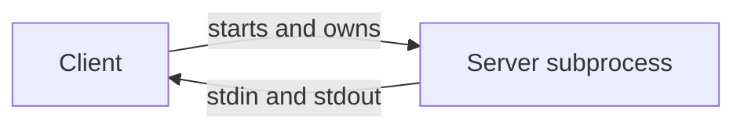
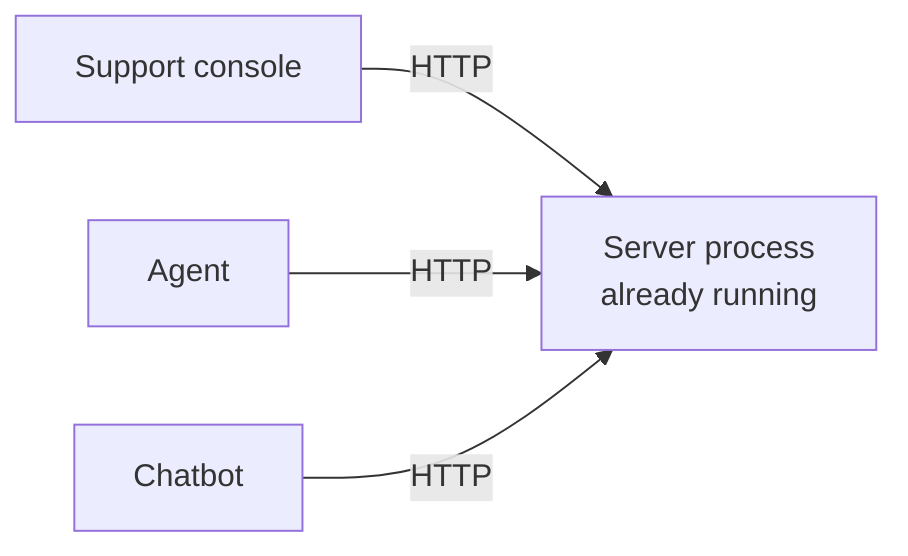
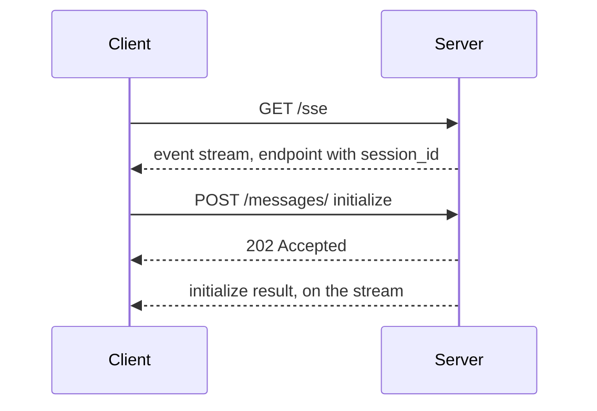
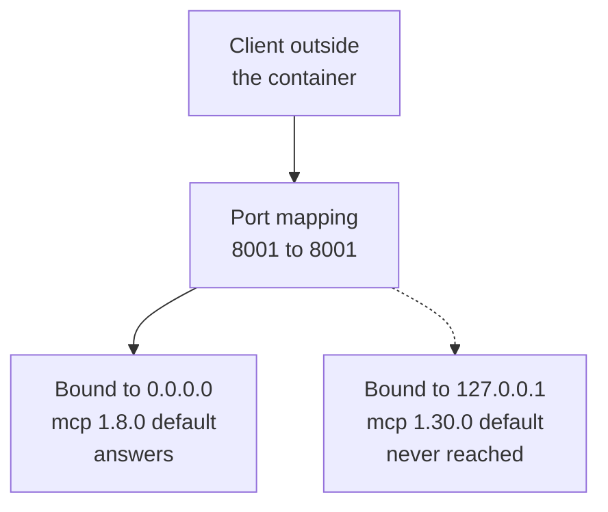

<!-- Generated by site/scripts/rag-theory-import.mjs from rag-agents-engineering. Edit the source there. -->
# lesson 6 of T12.1 Theory: Remote servers and deployment

<!-- subtitle: A remote server changes one transport line, and then needs what a subprocess never did: a reachable address, storage that lasts and a check on who calls it -->
<!-- format: approved -->

## Start with a server that must outlive the laptop

> **What you'll learn**
>
> - **Explain** what changes, and what does not, when a server moves from stdio to a remote transport.
> - **Compare** SSE with Streamable HTTP, stateful and stateless, by the requests and headers each exchange uses.
> - **Diagnose** a containerised server nobody can reach, and one that starts with no data.
> - **List** what a remote server needs before anyone outside can reach it.

Until now the Larkspur handbook server has run as a subprocess of each engineer's chatbot. The support console, two internal agents and a teammate's laptop now all want it. Each could start its own copy, with its own files and its own version, or the team can run one server and give everyone its URL.

The tools, resources and prompts stay as they are. The transport, the address, the storage and the security around them all change.

## Remote transport

A stdio server is a subprocess: the client starts it, owns it, and talks over its standard input and output.



*Figure 1: stdio. One client, one server process, gone when the client exits.*

A remote server is a process of its own, often on another machine, that must already be running when the client connects by URL.



*Figure 2: Remote. Many clients, one long-running server they reach by URL.*

With FastMCP only the last line of the server changes:

| Line in notebook 06a | Value |
|---|---|
| Constructor | `FastMCP("research", port=8001)` |
| Last line | `mcp.run(transport="sse")`, or `"streamable-http"`, or `"stdio"` |

*Table 1: The two lines that set the transport.*

The notebook deploys over SSE because, when the course was filmed, Streamable HTTP was still being built into the Python SDK; it adds notes for Streamable HTTP. SDK 1.30.0 ships both. Recorded against the Larkspur server running each way (initialize, list tools, one `tools/call`, close):

| | SSE | Streamable HTTP | Streamable HTTP, `stateless_http=True` |
|---|---|---|---|
| Endpoints | `GET /sse`, then `POST /messages/?session_id=…` | `/mcp` for everything | `/mcp` |
| Reply to a request | `202 Accepted`; the answer arrives on the `/sse` stream | `200` with the answer in the response (`text/event-stream`) | `200` with the answer |
| Session | id in the query string | `mcp-session-id` header, set on the `initialize` reply | none |
| Close | close the stream | `DELETE /mcp` | nothing to close |

*Table 2: Three remote transports compared.*

SSE splits every exchange across two connections: requests go up as POSTs, and answers come back down a stream the client opened first.



*Figure 3: SSE. Every POST is acknowledged with 202; every answer travels on the stream.*

Streamable HTTP sends each request to one endpoint and answers it in the response:

```animated
<figure class="anim sheet" aria-labelledby="anim-shttp-cap">
  <div class="anim__canvas" tabindex="0" aria-label="A Streamable HTTP session, scrolls sideways on a narrow screen">
    <svg viewBox="0 0 800 520" role="img" aria-labelledby="anim-shttp-title anim-shttp-desc">
      <title id="anim-shttp-title">One Streamable HTTP session</title>
      <desc id="anim-shttp-desc">Every message goes to one endpoint, /mcp. The initialize POST returns 200 and an mcp-session-id header; the initialized notification returns 202; a GET opens a stream for messages from the server; tools/list and tools/call each return 200; a DELETE ends the session.</desc>
      <defs>
        <marker id="ah-shttp" viewBox="0 0 8 8" refX="7" refY="4" markerWidth="8" markerHeight="8" markerUnits="userSpaceOnUse" orient="auto-start-reverse"><path class="ah" d="M0 0 L8 4 L0 8 z"/></marker>
      </defs>
      <path class="lane" d="M170 52 V512"/>
      <path class="lane" d="M630 52 V512"/>
      <g class="n-1 n-2 n-3 n-4 n-5 n-6"><rect class="box" x="90" y="12" width="160" height="40"/><text class="label" x="170" y="32">MCP client</text></g>
      <g class="n-1 n-2 n-3 n-4 n-5 n-6"><rect class="box" x="530" y="12" width="200" height="40"/><text class="label" x="630" y="32">Server at /mcp</text></g>
      <g class="in-1"><path class="edge e-1" d="M174 96 H626" marker-end="url(#ah-shttp)"/><text class="fig" x="400" y="85">POST initialize</text><path class="edge dashed e-1" d="M626 130 H174" marker-end="url(#ah-shttp)"/><text class="fig" x="400" y="119">200 + mcp-session-id</text></g>
      <g class="in-2"><path class="edge e-2" d="M174 168 H626" marker-end="url(#ah-shttp)"/><text class="fig" x="400" y="157">POST notifications/initialized</text><path class="edge dashed e-2" d="M626 202 H174" marker-end="url(#ah-shttp)"/><text class="fig" x="400" y="191">202 Accepted</text></g>
      <g class="in-3"><path class="edge e-3" d="M174 240 H626" marker-end="url(#ah-shttp)"/><text class="fig" x="400" y="229">GET /mcp</text><path class="edge dashed e-3" d="M626 274 H174" marker-end="url(#ah-shttp)"/><text class="fig" x="400" y="263">200 event-stream, held open</text></g>
      <g class="in-4"><path class="edge e-4" d="M174 312 H626" marker-end="url(#ah-shttp)"/><text class="fig" x="400" y="301">POST tools/list</text><path class="edge dashed e-4" d="M626 346 H174" marker-end="url(#ah-shttp)"/><text class="fig" x="400" y="335">200</text></g>
      <g class="in-5"><path class="edge e-5" d="M174 384 H626" marker-end="url(#ah-shttp)"/><text class="fig" x="400" y="373">POST tools/call</text><path class="edge dashed e-5" d="M626 418 H174" marker-end="url(#ah-shttp)"/><text class="fig" x="400" y="407">200</text></g>
      <g class="in-6"><path class="edge e-6" d="M174 456 H626" marker-end="url(#ah-shttp)"/><text class="fig" x="400" y="445">DELETE /mcp</text><path class="edge dashed e-6" d="M626 490 H174" marker-end="url(#ah-shttp)"/><text class="fig" x="400" y="479">200, session ended</text></g>
    </svg>
  </div>
  <div class="anim__controls" hidden>
    <button class="anim__btn" type="button" data-act="prev">Previous</button>
    <button class="anim__btn" type="button" data-act="play" aria-pressed="false">Play</button>
    <button class="anim__btn" type="button" data-act="next">Next</button>
  </div>
  <ol class="anim__steps" id="anim-shttp-cap">
    <li><button type="button">Initialize</button><span>The first POST carries <code>initialize</code>. The reply is 200 and sets an <code>mcp-session-id</code> header, 32 characters long.</span></li>
    <li><button type="button">Initialized</button><span>The client confirms with a notification. A notification gets no JSON-RPC reply, so the server returns 202 Accepted.</span></li>
    <li><button type="button">Stream</button><span>The client opens a GET on the same endpoint, a stream the server can use to send messages first.</span></li>
    <li><button type="button">List</button><span>Each request is its own POST, carrying the session id and <code>mcp-protocol-version: 2025-11-25</code>.</span></li>
    <li><button type="button">Call</button><span>The <code>tools/call</code> answer comes back in the POST’s own response.</span></li>
    <li><button type="button">Close</button><span>On exit the client sends DELETE, and the server ends the session.</span></li>
  </ol>
</figure>
```

*Figure 4: Streamable HTTP, stateful. One endpoint, a session header, and an explicit close.*

Compare the three exchanges request by request:

<div class="learning-widget evidence-switcher" data-comparison id="transport-switcher">
<p class="widget-intro">The same session (initialize, list tools, one call, close) on each transport. Status codes come from SDK 1.30.0 servers driven in-process; SSE's 202 is from the SDK's message handler.</p>
<div class="mode-controls" hidden role="group" aria-label="Remote transport">
<button type="button" data-mode="sse" aria-pressed="false" aria-controls="transport-sse">SSE</button>
<button type="button" data-mode="stateful" aria-pressed="false" aria-controls="transport-stateful">Streamable HTTP</button>
<button type="button" data-mode="stateless" aria-pressed="false" aria-controls="transport-stateless">Stateless</button>
</div>
<section id="transport-sse" class="mode-panel" data-announcement="SSE selected. Two connections, answers on the stream."><h4>SSE</h4><ul><li>The client opens <code>GET /sse</code> and keeps it open; the server names a <code>/messages/</code> URL carrying the session id.</li><li>Every request is a POST answered <code>202 Accepted</code>; its result arrives on the stream.</li><li>Closing the stream ends the session.</li></ul></section>
<section id="transport-stateful" class="mode-panel" data-announcement="Streamable HTTP selected. One endpoint and a 32-character session id."><h4>Streamable HTTP, stateful</h4><ul><li><code>POST /mcp</code> initialize: <code>200</code>, <code>text/event-stream</code>, and a 32-character <code>mcp-session-id</code>.</li><li><code>notifications/initialized</code>: <code>202</code>. <code>tools/list</code> and <code>tools/call</code>: <code>200</code> each, with both session and protocol headers.</li><li><code>DELETE /mcp</code>: <code>200</code>, and the session is gone.</li></ul></section>
<section id="transport-stateless" class="mode-panel" data-announcement="Stateless selected. No session id, nothing to close."><h4>Streamable HTTP, stateless_http=True</h4><ul><li>Initialize: <code>200</code> with no <code>mcp-session-id</code>.</li><li>The same <code>202</code> and <code>200</code> replies for the rest, with nothing to close.</li><li>Any replica can answer any request, and nothing is kept between calls.</li></ul></section>
<p class="switch-status" aria-live="polite"></p>
</div>

After `initialize`, every request in the stateful run carried two headers: `mcp-session-id` (32 characters) and `mcp-protocol-version: 2025-11-25`. The session id is what lets a stateful server remember a client between requests. It is also why a stateful server behind several replicas needs sticky routing, while a stateless one can answer from any replica and cannot keep anything between calls.

Paths and names to get right in SDK 1.30.0:

- **Defaults.** `FastMCP` listens on `127.0.0.1:8000`, with SSE at `/sse` and `/messages/` and Streamable HTTP at `/mcp`. The notebook's `port=8001` still works as a constructor argument.
- **The URL.** The notebook says to append `/mcp/`. The server answers `POST /mcp/` with `307` and a `Location` of `/mcp`. The 1.30.0 client follows a redirect only while it stays on the same origin, so either works, and `/mcp` saves the round trip.
- **The client function.** The notebook imports `streamablehttp_client`. In 1.30.0 it is marked deprecated with "Use `streamable_http_client` instead."; the new one takes the URL and an optional `httpx.AsyncClient` for headers and auth. `sse_client(url)` still takes the URL as the notebook passes it.

## Deploying a remote server

The lesson 9 project ships a `Dockerfile`:

| Line | Value |
|---|---|
| Base image | `python:3.11-slim` |
| Install | `pip install uv`, then `uv pip install --system .` from `pyproject.toml` and `uv.lock` |
| Port | `EXPOSE 8001` |
| Command | `uv run research_server.py` |

*Table 3: The lesson 9 container.*

Two things change once the server leaves your laptop: who can reach it, and where its data lives.

**The bind address.** The project's own `uv.lock` pins mcp 1.8.0, whose FastMCP default host is `0.0.0.0`, reachable through the container's mapped port. The course environment's 1.30.0 defaults to `127.0.0.1`: loaded under 1.30.0, the lesson 9 server reports host `127.0.0.1` and port 8001. Only the container itself can reach that address.



*Figure 5: The same container under two SDK versions. `EXPOSE` and a port mapping cannot reach a process listening only on loopback.*

Set `host="0.0.0.0"` in the constructor and the server behaves the same under both.

**Data the server keeps.** The research server keeps papers in a `papers/` folder beside it. The notebook's hosted server has that folder empty, and its resources list no topics. On a fresh copy under 1.30.0, `papers://folders` returns "No topics found." and `extract_info` fails with `[Errno 2] No such file or directory: 'papers'`, because it lists the folder without checking that it exists. A remote server needs storage that outlives the container, and tools that handle an empty start.

**Who may call it.** Before anyone outside can reach the server, it needs what a stdio server never did:

- **Authentication**, because anyone who can reach the URL can call the tools. The 1.30.0 `FastMCP` constructor takes `auth` settings and a `token_verifier`.
- **TLS**, because tool arguments and results cross the network.
- **Logs** of which client called what, because many clients now share one server.

The notebook's optional section deploys to Render, and its resources link Cloudflare's guide to remote MCP servers.

## Limits of this evidence

- **In-process, not over a network.** Streamable HTTP status codes and headers come from SDK 1.30.0 servers driven through Starlette's test client; the SSE 202 is read from the SDK's handler. No proxy, load balancer or TLS sat in between.
- **The GET stream was not replayed.** Figure 4's server-to-client stream comes from the earlier recording, not the in-process run.
- **Two SDK versions only.** The bind-address default was read from the 1.8.0 and 1.30.0 sources. Other releases may differ; set the host explicitly.

## References

1. Model Context Protocol, [Transports](https://modelcontextprotocol.io/specification/2025-11-25/basic/transports), specification 2025-11-25: stdio, Streamable HTTP, session ids and protocol-version headers.
2. Model Context Protocol, [Authorisation](https://modelcontextprotocol.io/specification/2025-11-25/basic/authorization), specification 2025-11-25.
3. Model Context Protocol, [Python SDK](https://github.com/modelcontextprotocol/python-sdk), FastMCP settings and the client transports.
4. Cloudflare, [Build a remote MCP server](https://developers.cloudflare.com/agents/model-context-protocol/guides/remote-mcp-server/).
5. Render, [Docker on Render](https://render.com/docs/docker).

## Run the notebooks

The code for this lesson is in these notebooks. Colab runs one in your browser: install the packages its first cell imports and set the API keys it reads. To run every notebook as written, clone the repository and use its uv environment.

| Notebook | GitHub | Colab |
|---|---|---|
| Creating and deploying remote servers | [Open on GitHub](https://github.com/Sourav692/rag-agents-engineering/blob/main/p11_agent_protocols/m38_mcp_foundations/mandatory/notebook/06a_creating_and_deploying_remote_servers.ipynb) | [Open in Colab](https://colab.research.google.com/github/Sourav692/rag-agents-engineering/blob/main/p11_agent_protocols/m38_mcp_foundations/mandatory/notebook/06a_creating_and_deploying_remote_servers.ipynb) |

## Key Takeaways

- Moving from `stdio` to a remote server changes only the transport line. A remote server must already be running when the client connects by URL.
- Streamable HTTP uses one `/mcp` endpoint. Stateful mode tracks clients with `mcp-session-id` and needs sticky routing across replicas; stateless mode answers from any replica but keeps nothing between calls.
- Set `host="0.0.0.0"` in a container, keep server files on storage that outlives it, and add authentication, TLS and call logs before exposing the URL.

## Check yourself

<details>
<summary>1. Why does a stateful Streamable HTTP server behind several replicas need sticky routing, while a stateless one does not?</summary>

A stateful server remembers a client through the `mcp-session-id` header set on the `initialize` reply, so every request in that session must reach the replica that holds it. With `stateless_http=True` there is no session: any replica can answer, but the server cannot keep anything between calls.

</details>

<details>
<summary>2. The lesson 9 Dockerfile runs fine with mcp 1.8.0, but with SDK 1.30.0 nothing outside the container reaches it. What changed, and what is the fix?</summary>

The FastMCP default host. In 1.8.0 it is `0.0.0.0`, reachable through the container's mapped port; in 1.30.0 it is `127.0.0.1`, which only the container itself can reach. Set `host="0.0.0.0"` in the constructor and the server behaves the same under both.

</details>

<details>
<summary>3. On a fresh deployment the folders resource says No topics found and extract_info fails with No such file or directory. What is wrong?</summary>

The research server keeps papers in a `papers/` folder beside it, and a fresh copy has none; `extract_info` lists the folder without checking that it exists. A remote server needs storage that outlives the container, and tools that handle an empty start.

</details>
