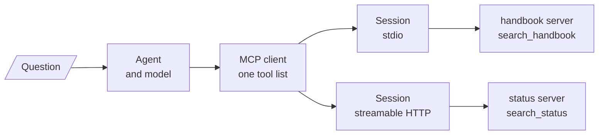

<!-- Generated by site/scripts/rag-theory-import.mjs from rag-agents-engineering. Edit the source there. -->
# M39 Theory: Building MCP Servers & Clients

[M38](../m38_mcp_foundations/00_overview.md) connects one client to one server. M39's projects grow that into a client that holds several servers at once, a client written by hand against the SDK, and servers that answer over HTTP. The projects are runnable code in `projects/`, not notebooks. They build on four ideas: one client in front of several servers, the session each connection lives in, the older HTTP transport with a stream and a separate POST endpoint, and the newer one with a single endpoint.

The running example is the module's lab brief applied to Larkspur Cloud, the fictional host whose handbook runs through [M11](../../p04_rag_foundations/m11_rag_lifecycle/00_overview.md) to [M13](../../p05_ingestion_and_indexing/m13_chunking/00_overview.md): a support assistant with two MCP servers. `handbook` wraps a retriever over the handbook (`search_handbook`), and `status` stands in for web search over Larkspur's status pages (`search_status`, canned results, no network). The golden questions are *How long does a refund take?*, which belongs to the handbook, and *Is there an outage right now?*, which belongs to the status pages. Every count on these pages was recorded by driving those two servers through the installed SDK: `mcp` 1.30.0 and `langchain-mcp-adapters` 0.3.2.

## In short

- A multi-server client keeps one session per server and merges their tools into one list for the model. Tool names must be unique across servers; `tool_name_prefix=True` turns `search` into `handbook_search`.
- A session is one `initialize` handshake followed by requests over the same transport until it closes. Over stdio a session is a server process.
- `MultiServerMCPClient.get_tools()` opens a new session for every tool call. Over stdio, 8 calls start 10 server processes and send 38 JSON-RPC messages; one held session per server needs 2 processes and 14 messages.
- SSE keeps a `GET /sse` stream open for every reply and answers each POST with `202 Accepted`. Streamable HTTP answers each POST on `/mcp` itself and ties requests together with an `mcp-session-id` header.
- `stateless_http=True` drops the session id, the server-to-client stream and the closing `DELETE`: 8 held calls cost 14 HTTP requests instead of 18, and the server keeps nothing between requests.

## Mental model

The client is the only piece that knows there are two servers. The model sees one list of tools, and each call goes back down the session of the server that listed the tool. Everything in M39 is about the middle column: how many sessions there are, how long each one lives, and what carries its messages.

## Interactive lab

[**Sessions on the wire**](/labs/rag/m39_building_mcp_servers_and_clients/session-wire-lab.html): open the file in a browser. Start with stdio and held sessions, and slide the tool calls to 8: 2 server processes, 14 messages. Switch the client to `get_tools()`: 10 processes and 38 messages, and every call lands on a process that has never seen the one before it. Then try Streamable HTTP with each client, and the stateless server, to see what each transport adds per call.

## How it connects

- **Before:** [M38](../m38_mcp_foundations/00_overview.md) builds the first server and client, the three things a server offers, and a remote server over SSE. [M23](../../p08_agent_foundations/m23_agent_loop_and_tools/00_overview.md) builds the tool-calling loop the clients here run, and [M31](../../p09_agentic_rag/m31_rag_as_agent_tool/00_overview.md) makes retrieval a tool, the job the `handbook` server does behind a protocol.
- **Next:** [M40](../m40_mcp_applications/00_overview.md) builds MCP applications and RAG over MCP on these clients and transports. [M41](../m41_a2a_protocol/00_overview.md) moves from tools to agents with the A2A protocol.

## Key Takeaways

- Give each server one session and hold it for the life of the agent. A session per call costs a handshake every time, and over stdio a process, and loses whatever the server kept in memory.
- Merge tools from several servers into one list only after checking names: prefix them by server, and give each a description that says which questions it answers.
- Pick the transport by where the server runs: stdio for a local subprocess, Streamable HTTP for anything shared, and stateless mode when replicas must answer any request.
- Treat an MCP server that runs commands as a remote shell. Narrow tools, authentication and a sandbox come before the first deployment.
