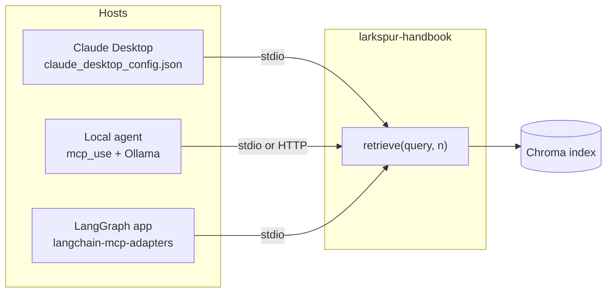

<!-- Generated by site/scripts/rag-theory-import.mjs from rag-agents-engineering. Edit the source there. -->
# M40 Theory: MCP applications and RAG over MCP

[M38](../m38_mcp_foundations/00_overview.md) and [M39](../m39_building_mcp_servers_and_clients/00_overview.md) built MCP servers and clients one piece at a time. M40 puts them to work: a local agent on Ollama, Claude Desktop with thirteen servers in one config file, a data-analysis session that ends in a slide deck, a job-search server that combines tools, resources and prompts, a Chroma retriever served over MCP, a LangGraph research assistant, and the same research server on an EC2 instance. The M40 projects build on four ideas: hooking a server into Claude Desktop, serving retrieval over MCP, driving MCP tools from a LangGraph graph, and deploying a server that other people reach over the network.

The module's lessons are runnable projects, not notebooks, and they ship without recorded output. The running example puts the Larkspur Cloud handbook from [M11](../../p04_rag_foundations/m11_rag_lifecycle/00_overview.md) to [M13](../../p05_ingestion_and_indexing/m13_chunking/00_overview.md) behind one stdio server, `larkspur-handbook`, with the same `retrieve(query, n)` tool as the 06 project. The golden questions are the [M11](../../p04_rag_foundations/m11_rag_lifecycle/00_overview.md) ones: *How long does a refund take?*, *Can I export my data after I cancel my plan?* and *What happens if my server goes down?* Every library behaviour quoted here was checked against the versions in the course's `mcp-apps` dependency group: mcp 1.30.0, fastmcp 3.4.11, langchain-mcp-adapters 0.3.2, mcp-use 1.7.1, langchain-chroma 1.1.0 and LangGraph 1.2.18.

## In short

- A server is written once and reached by any host: Claude Desktop starts it from a config entry, an `mcp_use` agent on Ollama starts it from the same kind of entry, and a LangGraph app loads its tools through `langchain-mcp-adapters`. The host, not the server, decides how long a session lives.
- The client decides how long a session lives, and nothing in the server's code shows the cost. In the lab, three questions with two retrieval calls each start the server once when the client holds a session, three times with a session per question (06's `app.py`) and seven times with `MultiServerMCPClient.get_tools()` (07's client): 17, 27 and 47 messages on the wire.
- Over stdio, the server's stdout is the protocol channel. With unbuffered output, each stray `print()` reaches the client as a line it cannot parse; mcp 1.30.0's client logs "Failed to parse JSONRPC message from server" and carries on, and other hosts may not be as forgiving.
- A tool result is a contract every client reads. 06's `retrieve` reports `similarity_score = 1 - distance` on Chroma's default squared L2 distance, so a chunk at right angles to the query scores −1.0 and an opposite one −3.0. A client that filters on that field filters on the wrong scale.
- The EC2 server binds `0.0.0.0` with no authentication. fastmcp's default is `127.0.0.1:8000/mcp`; changing the host publishes every tool, including one that passes a model-chosen topic name to `shutil.rmtree`.

## Mental model

The server holds the retriever and the index; everything to its left belongs to the host. Each host picks the model, writes the queries, decides when to start and stop the server process, and reads the tool result in its own way. Two hosts can send the same question to the same server and get different answers, and the difference is almost always on the host side: a different query, a different `n`, or a different reading of the result.

## Interactive lab

[**One server, three clients**](/labs/rag/m40_mcp_applications/session-lifetime-lab.html): open the file in a browser. Start on *Session per tool call* with three questions and two calls each: seven server starts and 35 of 47 messages spent on setup. Switch to *Hold one session* and the same conversation needs one start and 17 messages. Then pick *Session per question* with one question, and see that it matches the held session exactly until a second question arrives.

## How it connects

- **Before:** [M38](../m38_mcp_foundations/00_overview.md) covers the handshake, the three server primitives and remote transports; [M39](../m39_building_mcp_servers_and_clients/00_overview.md) covers multi-server clients, client sessions and streamable HTTP. The retriever served here is the [M11](../../p04_rag_foundations/m11_rag_lifecycle/00_overview.md) to [M15](../../p05_ingestion_and_indexing/m15_vector_stores/00_overview.md) pipeline ([M11](../../p04_rag_foundations/m11_rag_lifecycle/00_overview.md), [M15](../../p05_ingestion_and_indexing/m15_vector_stores/00_overview.md)), and the LangGraph loop is the one from [M31](../../p09_agentic_rag/m31_rag_as_agent_tool/00_overview.md).
- **Next:** [M41](../m41_a2a_protocol/00_overview.md) moves from agents calling tools to agents calling agents over A2A; its capstone puts an MCP retriever behind an A2A agent.

## Key Takeaways

- Write the server once and test it from more than one host; the host owns the model, the queries and the session, so most cross-client differences start there.
- Decide session lifetime on purpose. Hold one session per conversation unless you need isolation, and count server starts the way the lab does.
- Treat tool names, argument schemas and result fields as a public interface: a return value that breaks its own output schema, or a score on an undocumented scale, breaks every client at once.
- A deployed MCP server is an API with an LLM choosing the arguments. Bind it narrowly, authenticate it, and validate every argument that touches the filesystem.
