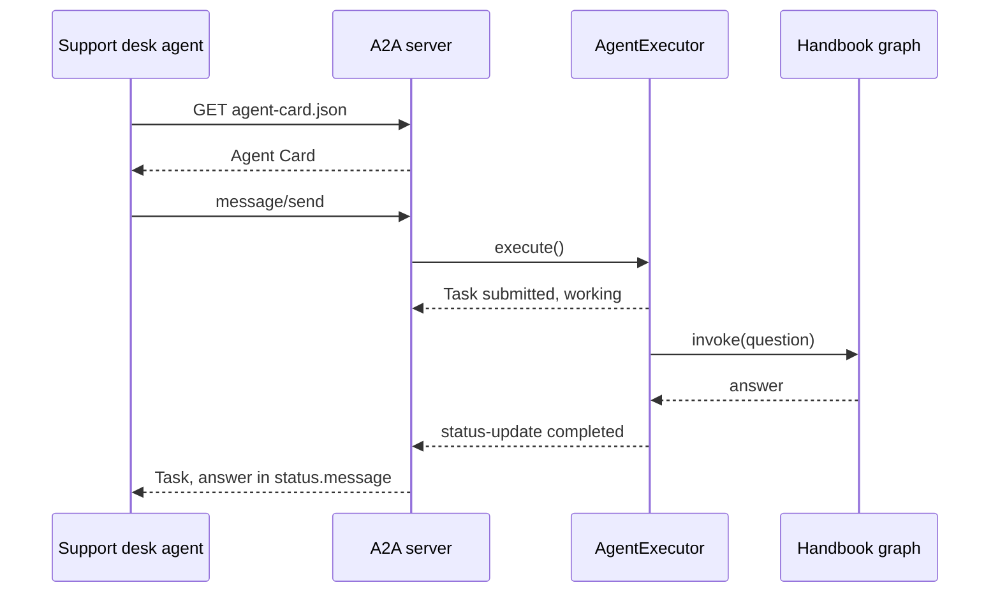

<!-- Generated by site/scripts/rag-theory-import.mjs from rag-agents-engineering. Edit the source there. -->
# M41 Theory: A2A: Agent-to-Agent Protocol

MCP gives one agent a standard way to call tools. A2A gives agents a standard way to call each other over HTTP, whatever framework each one is built with. The M41 notebooks build on four ideas: the Agent Card a server publishes so callers can find it, the Task and Message objects that carry the work, agents from different frameworks talking only through that contract, and a system that uses MCP for tools and A2A between agents.

The running example is Larkspur Cloud, the fictional cloud host whose handbook runs through [M11](../../p04_rag_foundations/m11_rag_lifecycle/00_overview.md) to [M13](../../p05_ingestion_and_indexing/m13_chunking/00_overview.md). Its handbook agent, the agentic RAG graph from [M28](../../p09_agentic_rag/m28_retrieval_grading_rewriting/00_overview.md) to [M31](../../p09_agentic_rag/m31_rag_as_agent_tool/00_overview.md), becomes a service: it publishes an Agent Card and answers over A2A, and the support desk agent, built in another framework, calls it. The lab asks every agent the [M11](../../p04_rag_foundations/m11_rag_lifecycle/00_overview.md) golden question *Can I export my data after I cancel my plan?* All protocol details on these pages come from the installed `a2a-sdk` 0.3.26 (the `protocols` uv group) or from the notebooks.

## In short

- An Agent Card is a JSON document at `/.well-known/agent-card.json`: name, URL, version, `capabilities` such as `streaming`, and `skills`. The client reads it before sending anything. In 0.3.26 the notebooks' path `/.well-known/agent.json` still answers, with a deprecation warning in the server log.
- Work travels as JSON-RPC 2.0 over HTTP: `message/send`, `message/stream`, `tasks/get`, `tasks/cancel`. The reply is either a Message (a one-shot answer) or a Task with a state such as `working` or `completed`.
- On the server, the only code you write is an `AgentExecutor`. The LangGraph graph, a plain LLM call or a Google ADK agent behind it is invisible to the caller.
- A Task keeps its answer in `status.message`. In the lab, a client that reads `result.parts` the way notebook 41.3's connector does forwards 1,492 characters of Python repr to the next agent instead of the 185-character answer.
- MCP and A2A sit at different layers: the capstone's host agent loads its tools over MCP (stdio) and delegates documents to the RAG agent over A2A (HTTP).

## Mental model

The caller sees two things: a card and a stream of task events. Everything to the right of the A2A server, the executor and the graph, can be rewritten in another framework without the caller changing a line, as long as the card and the task events stay the same.

## Interactive lab

[**What comes back over A2A**](/labs/rag/m41_a2a_protocol/a2a-exchange-lab.html): open the file in a browser. Pick *Handbook agent (41.2)* and `message/send`, then switch the reader from `result.parts` to `status.message` and watch the forwarded text drop from 1,492 characters to 185. Then pick *Echo agent (41.1)* and `tasks/get`: the reply had a task id, and the server still answers -32001 Task not found. Last, pick *Handbook agent, index missing* and compare `message/send`, which returns only an error, with `message/stream`, which shows the task fail.

## How it connects

- **Before:** [M24](../../p08_agent_foundations/m24_react_agents/00_overview.md) builds the ReAct agents that notebooks 41.2 and 41.3 put behind A2A. [M31](../../p09_agentic_rag/m31_rag_as_agent_tool/00_overview.md) turns retrieval into an agent's tool; here the whole agent becomes a service. [M35](../../p10_memory_and_multi_agent/m35_multi_agent_architectures/00_overview.md) teaches [supervisors](../../p10_memory_and_multi_agent/m35_multi_agent_architectures/04_supervisors_and_hierarchical_teams.md#lesson-supervisor) and [handoffs](../../p10_memory_and_multi_agent/m35_multi_agent_architectures/05_handoffs_and_swarms.md#lesson-handoffs) inside one process; A2A is how a supervisor reaches a worker that runs in another process, team or framework. [M40](../m40_mcp_applications/00_overview.md) serves retrieval as an MCP tool, the other way to share a RAG system.
- **Next:** [M42](../../p12_hierarchical_and_graph_rag/m42_hierarchical_memory_rag/00_overview.md) to [M44](../../p12_hierarchical_and_graph_rag/m44_graphrag/00_overview.md) return to retrieval itself: hierarchical indexes, memory-augmented retrieval and knowledge graphs. Any of them can sit behind the same A2A executor.

## Key Takeaways

- Publish an Agent Card and let clients discover it; hard-code a base URL, never a list of skills.
- Read replies by kind: a Message has `parts`, a Task has `status.message` and `artifacts`. Never forward `str()` of a protocol object.
- Keep the A2A code in one `AgentExecutor` and keep the agent behind it framework-specific. That boundary is what lets you swap LangGraph for anything else.
- Use MCP for tools and data, A2A for agents. A system needs both once one agent's answer depends on another team's agent.
