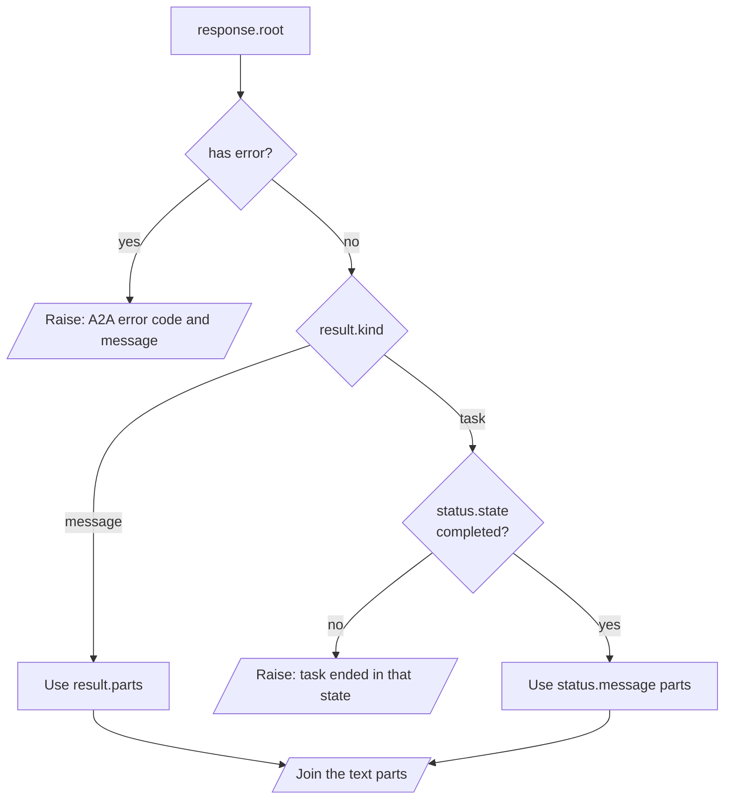

<!-- Generated by site/scripts/rag-theory-import.mjs from rag-agents-engineering. Edit the source there. -->
# lesson 3 of T12.4 Theory: Cross-framework agent interop

<!-- subtitle: Two agents that share no code can work in one pipeline when they share the card, the method and the reply objects; the hop between them breaks when the orchestrator misreads a Task -->
<!-- format: approved -->

## Start with two agents from two teams

> **What you'll learn**
>
> - **List** what two A2A agents must agree on, and what each may choose freely.
> - **Discover** agents from a registry of URLs and pick them by skill.
> - **Spot** the connector fault that forwards a Python repr instead of an answer.
> - **Read** a reply safely: errors first, then the reply kind, then the text.

A Larkspur support orchestrator needs two things for each ticket: the facts from the handbook, and a short reply a customer can read. The handbook agent belongs to the retrieval team and runs on LangGraph. The reply drafter belongs to the support writers, who want a single prompt and no framework at all. Neither team will import the other's code.

Notebook 03a builds that shape with a research agent and a writer agent. This lesson follows a topic through both hops and finds where the text going into hop 2 goes wrong.

## Cross-framework interop

### Two agents, one contract

The two-hop example serves two agents that share no code. The research agent is a LangGraph ReAct agent with one tool, `lookup_facts`, on port 10101. The writer agent is a single `get_llm(temperature=0.7).invoke(...)` call behind a copywriter prompt, with no graph and no tools, on port 10102. Each has its own `AgentExecutor` and its own Agent Card. An orchestrator reads a registry file listing the two base URLs, fetches both cards, sends a topic to the research agent (hop 1) and passes the research agent's output to the writer agent (hop 2).

```animated
<figure class="anim sheet" aria-labelledby="anim-twohop-cap">
  <div class="anim__canvas" tabindex="0" aria-label="Two hops over A2A, scrolls sideways on a narrow screen">
    <svg viewBox="0 0 800 330" role="img" aria-labelledby="anim-twohop-title anim-twohop-desc">
      <title id="anim-twohop-title">Two agents from different frameworks, two hops over A2A</title>
      <desc id="anim-twohop-desc">The orchestrator reads a registry of two base URLs and fetches both Agent Cards. Hop 1 sends the topic to the research agent, a LangGraph ReAct agent on port 10101, which replies with a Task. The orchestrator reads the answer from status.message. Hop 2 sends that text to the writer agent, one LLM call on port 10102, which replies with a Task holding the paragraph.</desc>
      <defs>
        <marker id="ah-twohop" viewBox="0 0 8 8" refX="7" refY="4" markerWidth="8" markerHeight="8" markerUnits="userSpaceOnUse" orient="auto-start-reverse"><path class="ah" d="M0 0 L8 4 L0 8 z"/></marker>
      </defs>

      <g class="n-1">
        <path class="box" d="M30 30 a75 10 0 0 0 150 0 v50 a75 10 0 0 1 -150 0 z"/>
        <ellipse class="box" cx="105" cy="30" rx="75" ry="10"/>
        <text class="small" x="105" y="56">agent_registry.json</text>
        <text class="fig" x="105" y="74">2 base URLs</text>
      </g>
      <path class="edge e-2" d="M105 90 V137" marker-end="url(#ah-twohop)"/>
      <g class="n-2"><rect class="box" x="30" y="140" width="150" height="56"/><text class="label" x="105" y="160">AgentDiscovery</text><text class="small" x="105" y="180">2 Agent Cards</text></g>
      <path class="edge e-2" d="M180 168 H297" marker-end="url(#ah-twohop)"/>

      <g class="n-3 n-4 n-5 n-6"><rect class="box" x="300" y="140" width="160" height="56"/><text class="label" x="380" y="168">Orchestrator</text></g>

      <g class="n-3"><rect class="box" x="590" y="30" width="190" height="56"/><text class="label" x="685" y="50">Research agent</text><text class="small" x="685" y="70">LangGraph + lookup_facts</text></g>
      <g class="in-3">
        <path class="edge e-3" d="M440 140 C470 70 540 58 587 58" marker-end="url(#ah-twohop)"/>
        <text class="small" x="500" y="56">hop 1: topic</text>
      </g>
      <g class="in-4">
        <path class="edge dashed e-4" d="M640 86 C620 130 500 150 463 156" marker-end="url(#ah-twohop)"/>
        <text class="small" x="600" y="132">Task</text>
      </g>

      <g class="in-4 n-4"><rect class="box" x="300" y="246" width="160" height="56"/><text class="small" x="380" y="266">read</text><text class="fig" x="380" y="286">status.message</text></g>
      <path class="edge in-4 e-4" d="M380 196 V243" marker-end="url(#ah-twohop)"/>

      <g class="n-5"><rect class="box" x="590" y="246" width="190" height="56"/><text class="label" x="685" y="266">Writer agent</text><text class="small" x="685" y="286">one LLM call</text></g>
      <g class="in-5">
        <path class="edge e-5" d="M460 274 H587" marker-end="url(#ah-twohop)"/>
        <text class="small" x="523" y="262">hop 2: notes</text>
      </g>
      <g class="in-6">
        <path class="edge dashed e-6" d="M640 246 C620 210 500 190 463 184" marker-end="url(#ah-twohop)"/>
        <text class="small" x="706" y="222">Task: paragraph</text>
      </g>

      <circle class="tok" cx="0" cy="0" r="7"/>
    </svg>
  </div>
  <div class="anim__controls" hidden>
    <button class="anim__btn" type="button" data-act="prev">Previous</button>
    <button class="anim__btn" type="button" data-act="play" aria-pressed="false">Play</button>
    <button class="anim__btn" type="button" data-act="next">Next</button>
  </div>
  <ol class="anim__steps" id="anim-twohop-cap">
    <li><button type="button" data-tok="105,30">Registry</button><span>The orchestrator starts from a file of two base URLs and nothing else.</span></li>
    <li><button type="button" data-tok="180,168">Discover</button><span>It fetches each agent-card.json and picks the two agents by card name.</span></li>
    <li><button type="button" data-tok="587,58">Hop 1</button><span>It sends the topic to the research agent, a LangGraph ReAct agent on port 10101.</span></li>
    <li><button type="button" data-tok="380,243">Read</button><span>The reply is a Task. The answer is its status message; the notebook’s connector forwards str(Task) instead.</span></li>
    <li><button type="button" data-tok="587,274">Hop 2</button><span>It sends the research notes to the writer agent: one LLM call, no graph, no tools, port 10102.</span></li>
    <li><button type="button" data-tok="463,184">Reply</button><span>The writer’s Task carries the paragraph. The orchestrator imported neither agent’s code.</span></li>
  </ol>
</figure>
```

*Figure 1: The two-hop example. Both agents reply with a Task.*

| Shared by both agents | Chosen by each team |
|---|---|
| The card's shape and the well-known card path | Framework: LangGraph for research, none for the writer |
| The `message/send` method | Prompt and persona |
| The Message and Task objects | Tools: `lookup_facts` for research, none for the writer |
| | Temperature: 0 for research, 0.7 for the writer |

*Table 1: The wire contract against everything else.*

The orchestrator imports none of the right-hand column. Replace the writer's single call with a CrewAI crew or a Google ADK agent, keep the card and the reply shape, and the orchestrator does not change.

On Larkspur Cloud the same layout is a support desk orchestrator, the handbook agent (the [T9.1](../../p08_agentic_rag/m28_retrieval_grading_rewriting/00_overview.md) to [T9.4](../../p08_agentic_rag/m31_rag_as_agent_tool/00_overview.md) agentic RAG graph, in LangGraph) as hop 1, and a reply drafter that turns the handbook answer into a customer email as hop 2. The drafter's team can pick any framework.

### Discovery from a registry

The registry holds URLs only. Capabilities come from each card at run time. A new agent joins by adding one URL, and a changed skill shows up without an orchestrator release. The notebook picks cards by `card.name`. Picking by skill (`id` or `tags`) survives a rename and lets two agents offer the same skill. The registry itself is a trust list: only agents on it get your traffic.

## Reading the reply

The orchestrator talks to both agents through an `AgentConnector` with one method, `send_task(message, session_id)`. How it reads the reply decides what hop 2 receives.

### The notebook's reader

The connector in notebook 03a does three things with a reply:

| Reply | What the connector does | What it returns |
|---|---|---|
| A Message | joins the text of every part in `result.parts` | the answer text |
| A Task | finds no `parts` attribute and falls back | `str(result)`, the Python repr of the whole Task |
| A JSON-RPC error | reading `result` raises `AttributeError`, caught by its `except` | the string `Error communicating with agent: 'JSONRPCErrorResponse' object has no attribute 'result'` |

*Table 2: The notebook's connector against each reply kind.*

Both executors in the example enqueue a Task before their answer. Every reply is therefore a Task, and a Task has no `parts`. The second row is the one that runs every time.

### Same Task, two readers

The [interactive lab](/labs/rag/m41_a2a_protocol/a2a-exchange-lab.html) shows the result with the handbook agent from 41.2. Here is the same completed Task read both ways:

<div class="learning-widget evidence-switcher" data-comparison id="reader-switcher">
<p class="widget-intro">Choose a reader to see what the orchestrator forwards to hop 2 for the same completed Task.</p>
<div class="mode-controls" hidden role="group" aria-label="Reply reader">
<button type="button" data-mode="repr" aria-pressed="false" aria-controls="reader-repr">Notebook connector</button>
<button type="button" data-mode="status" aria-pressed="false" aria-controls="reader-status">Kind-aware reader</button>
</div>
<section id="reader-repr" class="mode-panel" data-announcement="Notebook connector selected. The writer receives the Task repr."><h4>Notebook connector</h4><ul><li>A Task has no <code>parts</code>; the connector returns the Python repr.</li><li>The lab's recording is 1,492 characters of <code>context_id=</code>, <code>history=[Message(</code> and <code>TaskStatus(</code> around the 185-character answer; our replay with full-length ids gave 1,509.</li><li>The writer, told to synthesise research notes, receives Pydantic field names as its notes.</li></ul></section>
<section id="reader-status" class="mode-panel" data-announcement="Kind-aware reader selected. The writer receives the answer."><h4>Kind-aware reader</h4><ul><li>It sees <code>kind</code> task and state <code>completed</code>, and reads the text parts of <code>status.message</code>.</li><li>The writer receives the 185-character answer and nothing else.</li></ul></section>
<p class="switch-status" aria-live="polite"></p>
</div>

### A reader that branches on the kind

A reader that checks for an error first and then branches on the reply's kind fixes both faulty rows of Table 2:



*Figure 2: The kind-aware reader. Every failure raises; only answer text reaches the next hop.*

An agent that publishes its output as artifacts (`TaskUpdater.add_artifact`) puts it in `result.artifacts` instead; read those the same way.

### The session that never arrives

`send_task` takes a `session_id` and never sends it. Each hop gets a fresh `contextId`. The two hops of one ticket land in two unrelated conversations on the servers. To keep them together, set `context_id` on the outgoing `Message`; the server then files the new task under that context, as the follow-up in lesson 2 of T12.4 did.

## Limits of this evidence

- **No model ran.** The repr lengths come from the 41.2 handbook agent with a stub graph; real research output changes the length but not the fault.
- **The repr length moves with the ids.** 1,492 is the lab's recording; full uuids give 1,509. The point is the field names, not the count.
- **Error path replayed in process.** The `AttributeError` string comes from reading `result` on a JSON-RPC error reply in `a2a-sdk` 0.3.26.

## References

1. A2A Protocol, [Specification](https://a2a-protocol.org/latest/specification/).
2. A2A Project, [a2a-python SDK](https://github.com/a2aproject/a2a-python).
3. A2A Project, [A2A samples](https://github.com/a2aproject/a2a-samples).
4. Pydantic, [Models](https://docs.pydantic.dev/latest/concepts/models/).

## Run the notebooks

The code for this lesson is in these notebooks. Colab runs one in your browser: install the packages its first cell imports and set the API keys it reads. To run every notebook as written, clone the repository and use its uv environment.

| Notebook | GitHub | Colab |
|---|---|---|
| Cross framework agent interop | [Open on GitHub](https://github.com/Sourav692/rag-agents-engineering/blob/main/p11_agent_protocols/m41_a2a_protocol/mandatory/notebook/03a_cross_framework_agent_interop.ipynb) | [Open in Colab](https://colab.research.google.com/github/Sourav692/rag-agents-engineering/blob/main/p11_agent_protocols/m41_a2a_protocol/mandatory/notebook/03a_cross_framework_agent_interop.ipynb) |

## Key Takeaways

- Agents built in different frameworks interoperate when they share the card shape, `message/send`, the Message and Task objects and the card path. The orchestrator imports none of their code.
- Keep only URLs in the registry and read capabilities from each card at run time. Pick agents by skill, and treat the registry as a trust list.
- Read replies carefully: check for an error first, branch on the reply's kind, and set `context_id` to keep hops in one conversation. Never forward `str(result)` as content.

## Check yourself

<details>
<summary>1. What must the research and writer agents agree on for one orchestrator to call both, and what may differ?</summary>

Four things: the card's shape, the `message/send` method, the Message and Task objects, and the well-known card path. Framework, prompt, tools and temperature may all differ, and the orchestrator imports none of them. A CrewAI crew could replace the writer without an orchestrator change.

</details>

<details>
<summary>2. The writer agent receives about 1,500 characters of field names and TaskStatus text instead of research notes. What went wrong in the connector?</summary>

Both executors enqueue a Task, and a Task has no `parts`, so `AgentConnector` falls through to `str(result)`, the Python repr of the whole Task around a 185-character answer. Check for an error first, then branch on `result.kind` and read the text parts of `result.status.message` for a task.

</details>

<details>
<summary>3. Why pick agents from the registry by skill id or tags rather than by card name, as the notebook does?</summary>

Picking by skill survives a rename and lets two agents offer the same skill. The registry holds URLs only and capabilities come from each card at run time, so a new agent joins by adding one URL. The registry is also a trust list: only agents on it get your traffic.

</details>
