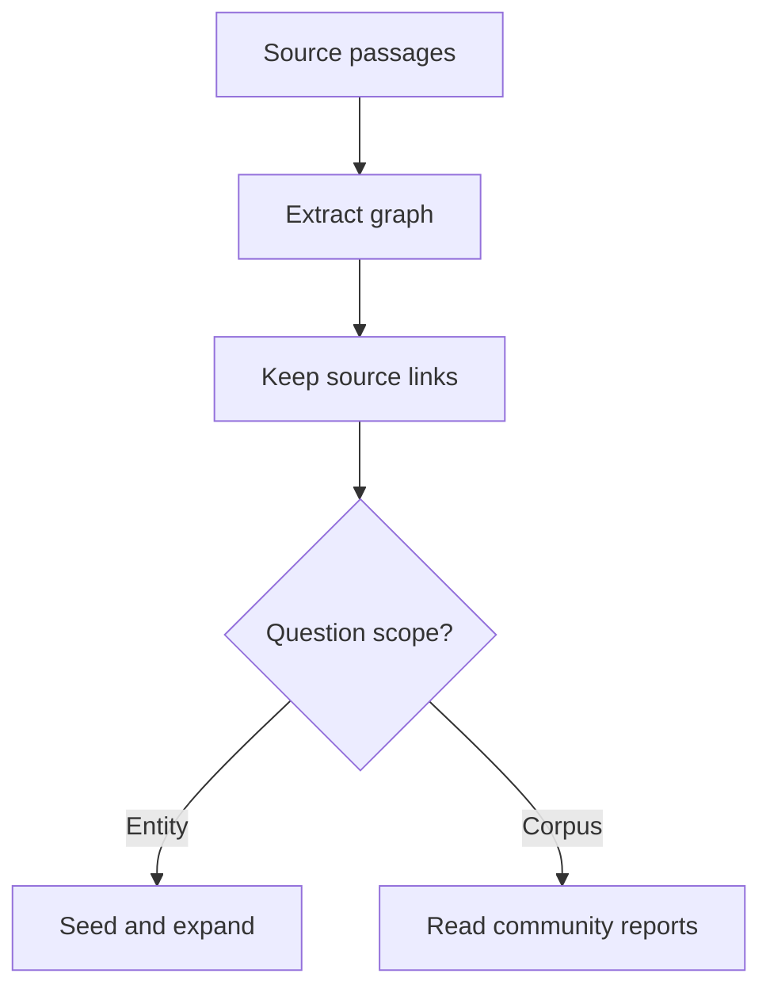

<!-- Generated by site/scripts/rag-theory-import.mjs from rag-agents-engineering. Edit the source there. -->
# M44 Theory: GraphRAG Techniques

Graph retrieval changes which evidence reaches the answer model. A question can start at one entity, follow a relationship to another passage, or ask for themes across communities. The M44 notebooks build on four ideas: community detection, global and local search, graph expansion, and the indexing work those choices require.

The running example is the fictional Larkspur Cloud handbook. “Which export mechanism remains available after cancellation?” needs a connection between policy and product pages. “What dependencies recur across cancellation, exports and outages?” asks for a corpus overview. These questions need different retrieval plans, even when they share an index.

## In short

- Decide what a node and an edge mean before calling a system GraphRAG. A similar pair of chunks, an extracted factual relation and a community membership support different inferences.
- Local search starts near entities; global search uses community reports to cover the corpus. Choose using the question's required evidence.
- Expansion increases the candidate set. In the lab's cancellation fixture, degree 0 returns 2 relations; degree 1 returns 4. Neither count measures answer accuracy.
- Carry source passages through extraction, traversal and generation. A citation marker alone does not establish that its claim follows from its source.
- Compare indexing, updates and query work on the same question set before replacing the flat retrieval baseline.

## Mental model

Both routes must return evidence that the answer can cite. The graph supplies candidate connections; the source passages establish what the handbook actually says. Community reports add a summary layer whose omissions need checking against those passages.

## Interactive lab

[**Expansion and the evidence set**](/labs/rag/m44_graphrag/expansion-lab.html): open the file in a browser. Start with Cancellation and compare degrees 0 and 1. Increase the degree until the source set stops growing. Switch to Outage to see that the same expansion budget reaches different passages from a different seed.

## How it connects

- **Before:** [M42](../m42_hierarchical_memory_rag/00_overview.md) retrieves at different abstraction levels. [M43](../m43_knowledge_graphs_neo4j/00_overview.md) models and queries factual relationships. This module uses graph structure to choose evidence.
- **Next:** [M45](../../p13_architecture_and_capstone/m45_architecture_synthesis/00_overview.md) compares complete agentic RAG architectures, including the cost of routing and repeated retrieval.

## Key Takeaways

- Name the graph representation and retrieval route in each evaluation result.
- Bound expansion before context construction and measure the candidate set it creates.
- Preserve passage provenance through both graph and community retrieval.
- Re-evaluate source coverage, update work and answer quality whenever extraction or routing changes.
