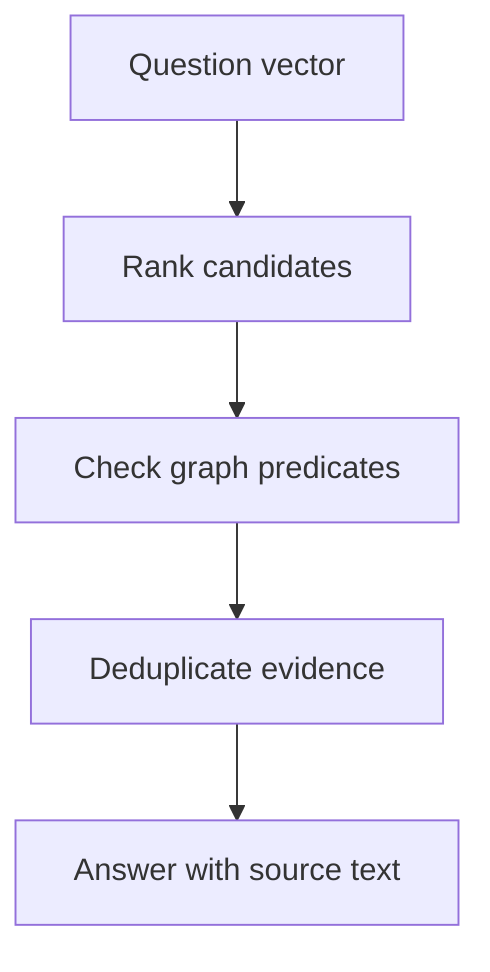

<!-- Generated by site/scripts/rag-theory-import.mjs from rag-agents-engineering. Edit the source there. -->
# lesson 4 of T13.2 Theory: Vector indexes on graph nodes

## Graph + vector hybrid

Vector search finds candidates whose text resembles the question. Graph matching checks explicit relationships. A Larkspur plan can rank highly for “export in the EU” while lacking the EU availability edge. Keep candidate selection and relationship validation visible as separate stages.

The vector notebook creates an index on `HealthcareProvider.comprehensiveEmbedding`, configured for 1536 dimensions and cosine similarity. It embeds `bio` using `genai.vector.encode`, stores the property with `db.create.setNodeVectorProperty`, and queries with `top_k=3`. Those dimensions belong to that notebook's configuration, not to every embedding model. Query and stored vectors must use the same model and dimensionality.

The notebook's `db.index.vector.queryNodes` is the historical procedure used in its cells. Current [Neo4j vector-index documentation](https://neo4j.com/docs/cypher-manual/current/indexes/search-indexes/vector-indexes/) prefers `SEARCH` on recent releases and marks the procedure deprecated from 2026.04. Check the deployed database version before copying syntax. Inspect `SHOW VECTOR INDEXES` and wait for `ONLINE` before searching.



A post-filter can return fewer than `k` results. Raising `k` gives the graph more candidates to check, with more work per request. It still cannot fix a missing relationship, an unresolved entity or a candidate outside the retrieved set. Treat authorisation as a separate constraint applied throughout retrieval, rather than an optional relevance filter.

## Candidate budget and exact constraints

The [interactive lab](/labs/rag/m43_knowledge_graphs_neo4j/graph-filter-lab.html) uses a deliberately small fictional catalogue. It computes exact cosine ranking from hand-placed two-dimensional teaching vectors, then follows `SUPPORTS` and `AVAILABLE_IN` edges. These are illustrative vectors and invented catalogue records for the exercise, not model embeddings or a benchmark of Neo4j's approximate index.

At `k=2`, no retrieved candidate has both required paths. At `k=3`, one qualifies; at `k=5`, both eligible records qualify. The candidate ledger shows excluded records as well as survivors, so an empty answer has an inspectable cause. The displayed recall divides surviving eligible records by every eligible record in this complete toy catalogue. Production recall needs independently labelled questions and answers.

```lab
src: /labs/rag/m43_knowledge_graphs_neo4j/graph-filter-lab.html
title: Candidates and graph constraints
```

Move the candidate budget before changing the schema. Once all eligible records are found, extra candidates add validation work without adding an eligible answer on this fixture. Compare that curve with the exact Cypher match over the full graph. A graph-first query can be preferable when the required constraints are precise and indexed; vector-first retrieval helps when the starting description is approximate.

## Run the notebooks

The code for this lesson is in these notebooks. Colab runs one in your browser: install the packages its first cell imports and set the API keys it reads. To run every notebook as written, clone the repository and use its uv environment.

| Notebook | GitHub | Colab |
|---|---|---|
| Vector indexing and embedding | [Open on GitHub](https://github.com/Sourav692/rag-agents-engineering/blob/main/p12_knowledge_graphs_and_graph_rag/m43_knowledge_graphs_neo4j/mandatory/notebook/04a_vector_indexing_and_embedding.ipynb) | [Open in Colab](https://colab.research.google.com/github/Sourav692/rag-agents-engineering/blob/main/p12_knowledge_graphs_and_graph_rag/m43_knowledge_graphs_neo4j/mandatory/notebook/04a_vector_indexing_and_embedding.ipynb) |

## Key Takeaways

- Vector search finds text that resembles the question; graph checks confirm explicit relationships. Keep the two stages separate so excluded candidates have a visible cause.
- Query and stored vectors must share a model and dimensionality. Check the database version for current search syntax and wait for the index to be `ONLINE`.
- Raising `k` gives the graph more candidates to check but cannot fix a missing edge or unresolved entity. Use graph-first queries when constraints are precise and indexed.

## Check yourself

<details>
<summary>1. Why keep vector candidate selection and graph relationship checks as separate stages?</summary>

Vector search finds text that resembles the question, while graph matching checks explicit relationships. A Larkspur plan can rank highly for "export in the EU" and still lack the EU availability edge. Keeping both stages visible shows which records were excluded and why.

</details>

<details>
<summary>2. In the graph filter lab, how many candidates survive the graph checks at k = 2, 3 and 5, and what does raising k past that buy?</summary>

None at `k=2`, one at `k=3`, and both eligible records at `k=5`. Once every eligible record is found, extra candidates add validation work without adding an answer on this fixture. Raising `k` cannot fix a missing relationship or an unresolved entity.

</details>

<details>
<summary>3. You copy the notebook's db.index.vector.queryNodes call to a new Neo4j deployment. What should you check first?</summary>

The database version: current Neo4j documentation prefers `SEARCH` on recent releases and marks the procedure deprecated from 2026.04. Check `SHOW VECTOR INDEXES` and wait for `ONLINE` before searching, and make sure query and stored vectors use the same model and dimensionality.

</details>
