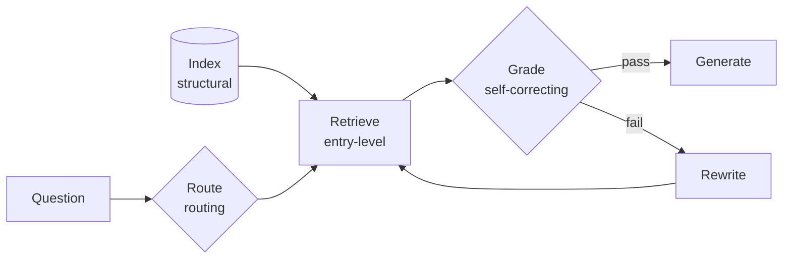

<!-- Generated by site/scripts/rag-theory-import.mjs from rag-agents-engineering. Edit the source there. -->
# lesson 1 of T15.1 Theory: The agentic RAG architecture map

<!-- subtitle: Every retrieval architecture in the course on one map, compared in one unit: model calls per question -->

## Too many designs to compare

> **What you'll learn**
>
> - **Place** each architecture from the course in one of five families by the kind of component it adds to plain RAG.
> - **Compare** architectures in one unit, model calls per question, using the counts earlier labs recorded.
> - **Explain** what that unit leaves out: index-time work, tokens per call and parts to test.
> - **Count** a stacked design component by component, so a review can remove one and know what it saves.

[T14.1](../../p13_fine_tuning/m45_fine_tuning_model_adaptation/00_overview.md) asked whether a requirement needs retrieval or a fine-tuned model. This module assumes retrieval and asks which retrieval architecture.

Picture Larkspur's design review. The support assistant answers from the handbook, and three engineers each bring a proposal for the outage question, *What happens if my server goes down?* One wants Self-RAG, one a supervisor over billing, operations and data agents, one GraphRAG. Each argues in the vocabulary of the module that taught it: reflection tokens, handoffs, communities. Nobody can say which proposal costs more, or which part of the pipeline each one changes.

We call this a **feature-list review**: designs compared by what they contain instead of by what they change and what they cost. The rest of this page gives the review two things it lacks, a map that sorts the designs by the component they add, and a common unit to price that component.

## The architecture map

The course keeps two inventories of what it teaches. The wider one, [`docs/agentic-architectures.yaml`](https://github.com/Sourav692/rag-agents-engineering/blob/main/docs/agentic-architectures.yaml), rendered as [Agentic Architecture Coverage](https://github.com/Sourav692/rag-agents-engineering/blob/main/docs/agentic-architecture-coverage.md), compares the course with an upstream catalogue of 35 agentic architectures in seven families. It finds all 35 covered: 33 by a dedicated notebook, 1 merged into another notebook and 1 taught as an adaptation. Five of the 35 are retrieval architectures, and all five are on the mandatory track:

| # | Architecture | Taught in |
|---|---|---|
| 23 | Agentic RAG | [T9.1](../../p08_agentic_rag/m28_retrieval_grading_rewriting/00_overview.md), [T9.4](../../p08_agentic_rag/m31_rag_as_agent_tool/00_overview.md) |
| 24 | Corrective RAG (CRAG) | [T9.2](../../p08_agentic_rag/m29_crag_and_self_rag/00_overview.md) |
| 25 | Self-RAG | [T9.2](../../p08_agentic_rag/m29_crag_and_self_rag/00_overview.md) |
| 26 | Adaptive RAG | [T9.3](../../p08_agentic_rag/m30_adaptive_rag_routing/00_overview.md) |
| 27 | GraphRAG | [T13.2](../../p12_knowledge_graphs_and_graph_rag/m43_knowledge_graphs_neo4j/00_overview.md), [T13.3](../../p12_knowledge_graphs_and_graph_rag/m44_graphrag/00_overview.md) |

*Table 1: The five retrieval architectures of the upstream catalogue, numbered as it numbers them, and the modules that teach them.*

The narrower inventory is this lesson's reading. It maps the retrieval side by graph shape rather than by folder, and names five architectures covered end to end: CRAG, Adaptive RAG, Self-RAG, domain-router RAG and retrieval as a tool. For each one it writes out the nodes and the conditional edges between them. CRAG, for example, retrieves, grades the documents, then either rewrites the query and retries or falls back to web search, and only then generates. Its table has a sixth row, the [T9.1](../../p08_agentic_rag/m28_retrieval_grading_rewriting/00_overview.md) agent with query rewriting and guardrails, although the text above it says five. It lists RAPTOR and the GraphRAG notebooks as anthology variants, and records one gap: CacheRAG exists in the source repository only as an empty placeholder.

Neither inventory says when to use what. For that, the architectures need a common unit. Every one of them is the [T5.1](../../p04_rag_foundations/m10_rag_lifecycle/00_overview.md) pipeline (retrieve, then generate) with components added, and each component is paid for in model calls per question. The course's labs have counted those calls on Larkspur questions:

*Figure 1: Model calls per question for each architecture, as the course's labs and notebook code counted them. The magenta point is plain RAG at 1 call, the baseline every range is measured against.*

The ranges come from different questions and settings. Read them as orders of magnitude. The same counts as a table, cheapest first:

| Model calls per question | Architectures |
|---|---|
| 1 | Plain RAG |
| 2 | Query rewrite, router, plan and execute, graph plus vector chain |
| 2 to 4 | Swarm (2 to 3), ReAct (2 to 4) |
| 3 to 7 | Supervisor (3 to 5), decomposition (5), hierarchy (5 to 7) |
| 4 to 10 | CRAG (4 to 7, plus a web search), grade, rewrite and retry (4 to 10) |
| 7 to 20 | Self-RAG |

*Table 2: The counts behind Figure 1. Collapsed-tree RAPTOR and GraphRAG have no counted query cost.*

The top of the scale has a source each. The retry loop reaches 10 calls in [T9.1](../../p08_agentic_rag/m28_retrieval_grading_rewriting/00_overview.md) with two rewrites allowed, and Self-RAG reaches 20 at `k = 5` on a question the handbook cannot answer ([T9.2](../../p08_agentic_rag/m29_crag_and_self_rag/00_overview.md)).

> **Pitfall: the index-time blind spot.** RAPTOR and GraphRAG are missing from the axis because their main cost is model calls made while building the index, one summary or extraction call after another. A per-question count makes them look free. Count that work separately, and count it again each time the handbook changes.

A count tells us what a design costs. The next section sorts the designs by what they buy with it.

## What each family adds

The module objectives sort the architectures into five families. Each family adds a different kind of component to plain RAG, at a different place in the pipeline:

*Figure 2: Plain RAG with each family's component in its place. A tool-based design hands the retrieve, grade and rewrite loop to a model that decides when to search.*

Each family has a module whose theory page measures what its component buys:

- **Entry-level** changes nothing in the control flow and improves what reaches the model. Plain RAG and its baseline ([T5.1](../../p04_rag_foundations/m10_rag_lifecycle/00_overview.md)), indexing that searches small and returns large ([T5.6](../../p04_rag_foundations/m15_advanced_indexing/00_overview.md)), hybrid search ([T6.1](../../p05_retrieval_quality_and_rag_apps/m16_retrievers_hybrid_search/00_overview.md)), query transformation ([T6.2](../../p05_retrieval_quality_and_rag_apps/m17_query_transformation/00_overview.md)) and reranking ([T6.3](../../p05_retrieval_quality_and_rag_apps/m18_reranking_post_retrieval/00_overview.md)). Late interaction (lesson 2 of T15.1) belongs here too. Most add no model call; query rewriting adds one, decomposition four.
- **Self-correcting** puts a judgement between retrieval and the answer: grade, rewrite and retry ([T9.1](../../p08_agentic_rag/m28_retrieval_grading_rewriting/00_overview.md)), CRAG and Self-RAG ([T9.2](../../p08_agentic_rag/m29_crag_and_self_rag/00_overview.md)), graders and user feedback ([T9.5](../../p08_agentic_rag/m32_reliability_feedback/00_overview.md)). Each check is a model call, and each failed check sends the question round again.
- **Routing** decides where a question goes before anything is retrieved: a classifier over knowledge bases and adaptive RAG ([T9.3](../../p08_agentic_rag/m30_adaptive_rag_routing/00_overview.md)), then supervisors, hierarchies and swarms of specialist agents ([T11.1](../../p10_multi_agent_systems/m35_multi_agent_architectures/00_overview.md)). A misroute hides the answer, because the filter restricts retrieval to a knowledge base that does not hold it.
- **Tool-based** hands retrieval to a model that decides when to call it: ReAct ([T7.2](../../p06_agent_foundations/m23_react_agents/00_overview.md)), plan and execute ([T8.1](../../p07_advanced_agents/m25_planning_reflection_reasoning/00_overview.md)) and retrieval as a tool ([T9.4](../../p08_agentic_rag/m31_rag_as_agent_tool/00_overview.md)). The same tool can be served over MCP and called across agents over A2A ([T12.1](../../p11_agent_protocols/m38_mcp_foundations/00_overview.md) to [T12.4](../../p11_agent_protocols/m41_a2a_protocol/00_overview.md)) without changing the loop.
- **Structural** changes the shape of the index: summary trees ([T13.1](../../p12_knowledge_graphs_and_graph_rag/m42_hierarchical_memory_rag/00_overview.md)), knowledge graphs ([T13.2](../../p12_knowledge_graphs_and_graph_rag/m43_knowledge_graphs_neo4j/00_overview.md)) and community-based GraphRAG ([T13.3](../../p12_knowledge_graphs_and_graph_rag/m44_graphrag/00_overview.md)). The work moves to index time, and the index has to be rebuilt or patched when the handbook changes.

Memory ([T10.1](../../p09_memory_layer/m33_short_term_memory_conversation_state/00_overview.md), [T10.2](../../p09_memory_layer/m34_long_term_agentic_memory/00_overview.md)) cuts across all five. A follow-up such as *How long do I have?* needs rewriting into a standalone question before any of these architectures can retrieve for it.

The families also stack. The [T9.1](../../p08_agentic_rag/m28_retrieval_grading_rewriting/00_overview.md) agent is a tool-based loop with a self-correcting grader, and adaptive RAG in [T9.3](../../p08_agentic_rag/m30_adaptive_rag_routing/00_overview.md) is a router in front of two graders. A stacked design priced as one total is a **lump-sum design**: a later review cannot remove one component without guessing what it cost. Count each component's calls separately instead, the loop's and the grader's, and the design document shows what each removal saves.

The map and the unit come together when we run one question through every family.

## In practice: the export question

The [T15.1 lab](/labs/rag/m46_architecture_synthesis/architecture-picker-lab.html) holds the counts earlier labs recorded for six Larkspur questions. For *Can I export my data after I cancel my plan?* it lists ten architectures, and all but one answer:

| Architecture | Family | Model calls | What the lab saw |
|---|---|---|---|
| Plain RAG, TF-IDF | entry-level | 1 | both evidence chunks in the top 2 ([T7.2](../../p06_agent_foundations/m23_react_agents/00_overview.md)) |
| Plain RAG, dense | entry-level | 1 | `cancel` outranks `export`: recall 0.50 at k = 2 ([T5.1](../../p04_rag_foundations/m10_rag_lifecycle/00_overview.md)) |
| Router | routing | 2 | one domain, the router's best case |
| Swarm | routing | 2 | triage hands off to data |
| ReAct | tool-based | 2 | one search, then the answer |
| Supervisor | routing | 3 | 2 of the 3 calls are routing |
| Grade, rewrite, retry | self-correcting | 4 | 2 of 2 chunks pass on the first retrieval |
| CRAG | self-correcting | 4 | both chunks pass, no web search |
| Hierarchy | routing | 5 | 4 of the 5 calls are routing |
| Self-RAG | self-correcting | 7 | one pass, every check says yes |

*Table 3: The export question through every family, as the T15.1 lab records it. The routing rows assume the handbook split into three knowledge bases.*

Read the table as the review should:

1. Plain TF-IDF RAG already answers, at 1 call.
2. Every family above it also answers, and each adds calls without changing the outcome: the grader passes both chunks, CRAG never searches the web, Self-RAG's checks all say yes.
3. The one architecture that falls short is an entry-level swap: dense retrieval ranks `cancel` above `export` and recalls half the evidence. A retrieval upgrade is not better on every question.

> **Key distinction:** a family earns its calls on the questions where the cheaper design fails. On a question plain RAG answers, every extra call is overhead. Lesson 3 of T15.1 turns this into a decision procedure, run on the questions where plain RAG does fail.

## Limits of the map

The map compares query-time model calls, and three costs sit outside it:

- **Index-time work.** The structural family's main cost, paid again on every handbook change.
- **Tokens per call.** A loop re-reads its message list on every call, and its tenth call costs more than its first.
- **Different questions.** Each range in Figure 1 comes from the question and settings its lab used. Two ranges are comparable in order of magnitude, not call for call.

## Run the notebooks

The code for this lesson is in these notebooks. Colab runs one in your browser: install the packages its first cell imports and set the API keys it reads. To run every notebook as written, clone the repository and use its uv environment.

| Notebook | GitHub | Colab |
|---|---|---|
| Agentic RAG architectures | [Open on GitHub](https://github.com/Sourav692/rag-agents-engineering/blob/main/p14_architecture_decisions/m46_architecture_synthesis/mandatory/notebook/01a_AGENTIC_RAG_ARCHITECTURES.md) | Run locally |

## Key Takeaways

- Every architecture is retrieve-then-generate with components added. Compare them in model calls per question: plain RAG is 1, routing and tool loops 2 to 7, self-correcting loops up to 20.
- Each family adds one kind of component: better context, a judgement step, routing, a model that calls retrieval, or a new index shape whose cost moves to index time.
- Families stack. Count each component's calls separately so a review can remove one and know what it saves.

## Check yourself

1. What common unit does the lesson use to compare the architectures, and what does that unit leave out?

Model calls per question, because every architecture is the [T5.1](../../p04_rag_foundations/m10_rag_lifecycle/00_overview.md) pipeline with components added: plain RAG is 1 call, routing and tool loops 2 to 7, and self-correcting loops climb to 10 and 20. It leaves out index-time model work, which is the main cost of collapsed-tree RAPTOR and GraphRAG, so those have no counted query cost on the axis.

2. The agentic RAG agent with query rewriting is a tool-based loop with a self-correcting grader. How should a design document count its cost?

Count each component's calls separately: the loop's calls and the grader's calls. A later review can then remove one component and know what it saves, instead of guessing from a lump sum.

3. A customer asks a follow-up, How long do I have?, and every architecture retrieves the wrong chunks. What is missing?

Memory ([T10.1](../../p09_memory_layer/m33_short_term_memory_conversation_state/00_overview.md), [T10.2](../../p09_memory_layer/m34_long_term_agentic_memory/00_overview.md)), which cuts across all five families. The follow-up has to be rewritten into a standalone question using the conversation before any architecture can retrieve for it.

