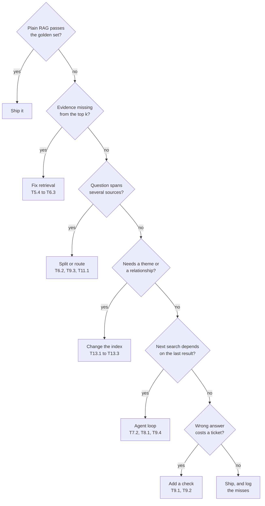

<!-- Generated by site/scripts/rag-theory-import.mjs from rag-agents-engineering. Edit the source there. -->
# lesson 3 of T15.1 Theory: Decision framework: picking the simplest architecture that works

<!-- subtitle: A chain of questions asked of the golden set, cheapest fix first, and a budget in model calls that each component has to earn -->

## Fourteen calls for a wrong answer

> **What you'll learn**
>
> - **Apply** a decision chain that asks which failure the golden set shows and points at the cheapest family that fixes it.
> - **Explain** why the check against costly mistakes comes last in the chain.
> - **Set** a complexity budget in model calls per question, and count what the calls leave out.
> - **Justify** each component of a design against a simpler alternative, with the failure it fixes and the calls it adds.

Lesson 1 of T15.1 priced every architecture in model calls, and lesson 2 of T15.1 showed how stage metrics locate a failure. This lesson puts the two together into a way of choosing.

Here is the failure it prevents. Larkspur's assistant answers *What happens if my server goes down?* wrongly with TF-IDF retrieval. A team reads that as a reasoning problem and adopts Self-RAG. In the [T9.2](../../p08_agentic_rag/m29_crag_and_self_rag/00_overview.md) lab Self-RAG spends 14 model calls on three passes over the same chunks and still misses, because TF-IDF never returns the outage evidence: the handbook says "outage", the question says "goes down". We call this a **loop over a miss**: a self-correcting loop paying again and again to work around a retrieval failure it cannot fix.

The rest of the page gives a procedure that names the failing stage before choosing a component, and a budget each component has to fit.

## Architecture selection

**Architecture selection is a chain of questions asked of the golden set, each naming a failure and pointing at the family that fixes it.** A "no" moves on to the next question, so a design only reaches the expensive families when the cheaper fixes are ruled out:



*Figure 1: The decision chain. Every "no" continues down to a more expensive family; every "yes" exits to the cheapest fix for that failure.*

Each branch has a counted example from an earlier lab:

- **Evidence missing: fix retrieval.** On the outage question TF-IDF retrieves neither evidence chunk ([T7.2](../../p06_agent_foundations/m23_react_agents/00_overview.md) lab). Dense retrieval ranks `incidents` and `sla` first and second ([T6.1](../../p05_retrieval_quality_and_rag_apps/m16_retrievers_hybrid_search/00_overview.md) lab) for the same single call. The loops that work around the miss pay for it: the [T9.1](../../p08_agentic_rag/m28_retrieval_grading_rewriting/00_overview.md) retry loop finds the evidence on its second rewrite, at 10 calls, and Self-RAG spends 14 calls on three passes over the same chunks ([T9.2](../../p08_agentic_rag/m29_crag_and_self_rag/00_overview.md)). [T9.2](../../p08_agentic_rag/m29_crag_and_self_rag/00_overview.md)'s own rule is that retrieval misses are fixed in retrieval.
- **Several sources: split or route.** *My server went down last night. Do I get service credits?* needs operations and billing. On three knowledge bases a router spends 2 calls and never asks billing, a swarm answers in 3 and a supervisor in 5 ([T11.1](../../p10_multi_agent_systems/m35_multi_agent_architectures/00_overview.md) lab). On one index, decomposition splits the question, at 5 calls and 3 retrievals for three sub-questions ([T6.2](../../p05_retrieval_quality_and_rag_apps/m17_query_transformation/00_overview.md)).
- **A theme or a relationship: change the index.** *How does service continuity work?* reaches 1 source passage from the leaves and 4 through summaries at the same two-node budget ([T13.1](../../p12_knowledge_graphs_and_graph_rag/m42_hierarchical_memory_rag/00_overview.md) lab). *Which plans support data export in the EU?* needs the EU edge checked: at `k = 5` both eligible plans survive the check, and without the graph nothing can tell them from the plans that only mention exports ([T13.2](../../p12_knowledge_graphs_and_graph_rag/m43_knowledge_graphs_neo4j/00_overview.md) lab).
- **Path depends on results: an agent loop.** A loop rewords failed searches: ReAct lifts mean evidence recall on the [T5.1](../../p04_rag_foundations/m10_rag_lifecycle/00_overview.md) golden set from 0.50 to 1.00 for 9 model calls instead of 3 ([T7.2](../../p06_agent_foundations/m23_react_agents/00_overview.md)). When the lookups are known in advance, a fixed plan makes 2 calls however many lookups it holds ([T8.1](../../p07_advanced_agents/m25_planning_reflection_reasoning/00_overview.md)).
- **Costly mistakes: add a check.** A relevance grader keeps unrelated chunks away from the model. On the export question the [T9.1](../../p08_agentic_rag/m28_retrieval_grading_rewriting/00_overview.md) loop costs 4 calls; on *Does Larkspur offer GPU servers?* it ends in a no-results reply after 9. A web fallback (CRAG) does not help here, because every Larkspur fact lives in a private handbook the web cannot see ([T9.2](../../p08_agentic_rag/m29_crag_and_self_rag/00_overview.md)).

Asking about a costly mistake last means the check runs on top of the best retrieval the design already has, so it grades good chunks instead of looping over bad ones. Asked first, it produces the loop over a miss from the opening section.

The chain says which family to reach for. It does not say how much that family may spend, which is the budget's job.

## Complexity budget

**A complexity budget is what one question may spend before the answer reaches the user.** Its main unit is model calls: they set the bill, and since the course's notebooks make them one after another, they set the latency too. Retrievals, tokens re-read in every loop iteration, index-time model work and the number of prompts to test count against the same budget. A component earns its place when it buys a measured gain on the golden set that nothing cheaper buys.

The [interactive lab](/labs/rag/m46_architecture_synthesis/architecture-picker-lab.html) holds the counts earlier labs recorded for the six Larkspur questions, 30 in all, each rung with its model calls, retrievals and what the lab saw. Set the data shape, the latency budget in model calls and what a wrong answer costs. A rung qualifies when all four hold:

1. Its data exists (a router needs separate knowledge bases, a graph needs a graph).
2. It answers the question, or refuses one the handbook cannot answer.
3. It has a check, when a wrong answer costs a support ticket.
4. Its calls fit the budget.

The pick is the first qualifying rung in order of calls.

```lab
src: /labs/rag/m46_architecture_synthesis/architecture-picker-lab.html
title: The simplest architecture that works
```

Five settings show the budget at work:

| Setting | Pick | Calls | Why |
|---|---|---|---|
| Outage, wrong answer cheap | Dense retrieval | 1 | the hybrid blend at `alpha = 0.5` is also 1 call, but keeps `sla` and loses `incidents` (recall 0.50), so the ladder passes it |
| Outage, wrong answer costs a ticket | [T9.1](../../p08_agentic_rag/m28_retrieval_grading_rewriting/00_overview.md) retry loop | 10 | the only counted rung with a check that answers; below a budget of 10 nothing fits |
| Service credits, three knowledge bases | Swarm | 3 | at a budget of 2 nothing fits, because the router's 2 calls answer only the outage half; on one index the pick is decomposition at 5 |
| Export, any data shape | Plain TF-IDF RAG | 1 | splitting the handbook does not make a router necessary; the question has one domain |
| GPU servers, wrong answer costs a ticket | [T9.1](../../p08_agentic_rag/m28_retrieval_grading_rewriting/00_overview.md) retry loop | 9 | ends in a safe no-results reply; Self-RAG spends 14 and still generates with no context behind it |

*Table 1: Five lab settings, the rung the lab picks and why.*

The second row hides a gap. A grader on top of dense retrieval may cost less than 10 calls, but no course lab has counted it; count it on your own golden set before you ship it. An uncounted rung is an **untested shortcut**, and the budget cannot hold what nobody measured.

The budget also has to hold what the lab's call counts leave out:

| Cost outside the call count | Example from the course | When it is paid |
|---|---|---|
| Index-time work | RAPTOR ([T13.1](../../p12_knowledge_graphs_and_graph_rag/m42_hierarchical_memory_rag/00_overview.md)) makes one summary call per cluster at every level of the tree, at most 10 clusters per level and never more than half the texts at that level; GraphRAG and the [T13.2](../../p12_knowledge_graphs_and_graph_rag/m43_knowledge_graphs_neo4j/00_overview.md) graph builders make an extraction call per chunk | at build time, and again when the handbook changes |
| Tokens per call | a loop re-reads its whole message list on every call; the [T7.2](../../p06_agent_foundations/m23_react_agents/00_overview.md) outage run reads about 451 tokens of context over four calls | every call |
| Parts to test | every grader is a prompt with its own failure mode: [T9.1](../../p08_agentic_rag/m28_retrieval_grading_rewriting/00_overview.md)'s topic check rejects silently, and [T9.2](../../p08_agentic_rag/m29_crag_and_self_rag/00_overview.md)'s groundedness check is skipped when no document passed | every change, through golden-set questions that exercise each one |

*Table 2: Three costs a call count misses.*

> **Pitfall: the silent check.** A grader that rejects without saying so, or is skipped on one path, looks safe in a design document and fails in production. Give each check at least one golden-set question that makes it fire.

With the chain and the budget in hand, the design document writes itself one component at a time.

## In practice: the design document

The module's lab brief asks for a two-page design for your capstone that justifies each component against a simpler alternative. For each component, write four things: the failure on the golden set that it fixes, the simpler alternative you tried first, the measured gain and the calls it adds per question. Two Larkspur rows, filled from the counts above:

| Component | Failure it fixes | Simpler alternative | Measured gain | Calls added |
|---|---|---|---|---|
| Dense retriever | outage evidence missing from the top k | TF-IDF retrieval | outage recall 0.00 to 1.00 ([T7.2](../../p06_agent_foundations/m23_react_agents/00_overview.md) and [T6.1](../../p05_retrieval_quality_and_rag_apps/m16_retrievers_hybrid_search/00_overview.md) labs) | 0 |
| Swarm over three knowledge bases | credits question needs two domains | router | billing half answered ([T11.1](../../p10_multi_agent_systems/m35_multi_agent_architectures/00_overview.md) lab) | 1 over the router |

*Table 3: Two rows of a design document for the Larkspur assistant.*

Writing a row exposes the cases where a component has no failure to point at. On the export question, every component above plain TF-IDF RAG adds calls and fixes nothing (lesson 1 of T15.1, Table 3), and its row would stay empty. A row with an empty first column is a component to remove.

## Limits of the framework

- **Fixture counts.** The lab's 30 counts come from small handbook fixtures, one question at a time. Your golden set may rank the rungs differently.
- **Calls stand in for latency** only while calls run one after another. Parallel specialists or batched graders break that link.
- **Uncounted rungs.** Combinations no course lab ran, such as a grader over dense retrieval, are absent from the ladder rather than ruled out.
- **One golden set.** The chain is only as good as the questions it asks; a failure type missing from the set never triggers its branch.

## Key Takeaways

- Pick an architecture by asking which failure the golden set shows, cheapest fix first: retrieval, then routing, index shape, an agent loop, and a check last.
- Fix retrieval misses in retrieval. Dense retrieval found the outage evidence in 1 call, while loops that worked around the miss spent 10 and 14.
- Set a complexity budget in model calls per question, and count index-time work, tokens re-read per loop and prompts to test against it. Keep a component only for a measured gain nothing cheaper buys.

## Check yourself

<details>
<summary>1. Why does the decision chain ask whether a wrong answer costs a ticket only after the retrieval, routing, index and loop questions?</summary>

So the check runs on top of the best retrieval the design already has, and grades good chunks instead of looping over bad ones. Each earlier question rules out a cheaper fix first, so a design reaches the expensive families only when it needs them.

</details>

<details>
<summary>2. The service-credits question runs over three knowledge bases with a budget of 2 model calls. What does the lab pick, and what changes at 3?</summary>

Nothing fits at 2: the router's 2 calls answer only the outage half and never ask billing. At a budget of 3 the swarm qualifies and is picked. On one index the pick would be decomposition at 5 calls.

</details>

<details>
<summary>3. TF-IDF misses the outage evidence, and a teammate proposes Self-RAG to recover it. What does the framework recommend instead?</summary>

Fix retrieval, because the evidence is missing from the top k. Dense retrieval ranks `incidents` and `sla` first and second in a single call, while the loops pay to work around the miss: the [T9.1](../../p08_agentic_rag/m28_retrieval_grading_rewriting/00_overview.md) retry loop takes 10 calls and Self-RAG 14. [T9.2](../../p08_agentic_rag/m29_crag_and_self_rag/00_overview.md)'s own rule is that retrieval misses are fixed in retrieval.

</details>
