## Case brief

### Let a support lead switch on actions they can trust {#brief}

A business wants support leads and other non-technical staff to build automations without writing code. A workflow listens to channels such as email, Slack, a chat widget, a web form or a ticket webhook, and it can reply, tag a ticket, escalate it or issue a refund. The person who switches it on cannot read the code that decides whether a refund should run.

That is the hard part. Wiring a model to a tool call is routine. Letting someone who has never seen a stack trace configure an automation that moves real money is not. A real action such as a refund must be authorised, executed once, and recoverable after a crash without paying twice. The platform therefore has to make the dangerous decisions itself, in deterministic code, and never hand them to the model's judgement in the moment.

A few terms carry the rest of the case. A **tenant** is one customer business on the shared platform; every record carries its `tenant_id`. A **canonical event** is the single internal shape every channel message is translated into. A **declarative workflow spec** is data that lists triggers, fixed steps and limits; the runtime walks it rather than executing user code. A **guardrail** is the deterministic check that allows, denies or pauses each step. **Idempotency** means that repeating the same action has the same effect as doing it once.

The core idea fits in one line: a workflow acts only after deterministic code allows it, and each real action runs once. The figure shows that path. A canonical event matches one live workflow; the guardrail either lets the step run once and checkpoint, or refuses it or asks for approval.

<figure class="source-diagram" id="figure-1-0"><a href="source-assets/0bb5046954c2c06e.svg" target="_blank" rel="noopener"></a><figcaption>The core path: one canonical event, one live workflow, a guardrail decision, then either one checkpointed execution or a refusal or approval request. Open for full size.</figcaption></figure>

The running example is Cascade Robotics, a tenant that wants Tier-1 support triage. Its support lead says: "If a customer messages us anywhere asking for a refund and it's under $50, just refund them. Don't bother me for small stuff." A billing complaint arrives asking for $500. The workflow is autonomous, but the tenant's spend cap is $50, so the guardrail refuses the step with `spend_cap_exceeded`. It does not clamp the refund down to $50. `issue_refund` is also not on Cascade's autonomous allow-list, so even after an authorised cap change the step would pause for a human. If the refund is ever approved and then retried, the action's idempotency key makes the retry a no-op.

People keep two responsibilities. An approver or admin promotes a workflow through its rollout stages, and the workflow's author can never approve their own work. A human approves a destructive step whenever the tenant has not allow-listed that tool for autonomous use.

### What you need to design {#brief-task}

Design a multi-tenant platform where non-technical users configure declarative workflows, never code, that can take real, destructive actions under a guardrail service. Each channel message becomes one canonical event carrying a tenant ID. Routing matches it to one live workflow, and an entity lock stops two workflows colliding on the same ticket. Workflows are versioned specs, and a model may fill only typed values. Every step checkpoints. Idempotency is keyed on the action and checked before authorisation. The guardrail denies in a fixed order. A workflow earns autonomy one stage at a time, from draft through testing, shadow and live.

Leave the visual builder and the natural-language-to-spec compiler out of scope: name the reviewable spec they must produce and move on. The source's runnable demo is deterministic and contains no LLM (large language model), on purpose, so its 21 tests prove the safety engine's rules. They prove nothing about a future model planner, and its in-process stores are not production storage.

This case suits engineers preparing for Forward Deployed, solutions or applied-AI interviews, especially a round that asks for an agent or workflow-automation platform. It assumes comfort with LLM agents and tool calling, idempotency, workflow state machines and basic multi-tenant cloud architecture. By the end you should be able to explain the system end to end from its dangerous constraint, and answer follow-ups on authoring specs, routing and locks, the execution loop, idempotency, guardrail order, promotion gates and production gaps.

<details class="source-chapter" id="brief-related"><summary>How the whiteboard anchor and Cascade Robotics fit together</summary><div class="detail-body"><p>The source combines two cases that share one engine. The whiteboard anchor asks you to explain the platform design and its negative cases in sixty minutes. The Cascade Robotics handbook module and code project build the same workflow engine and safety controls, and add the $500 refund against a $50 cap, conflicting workflows, a runnable demo and named implementation gaps.</p>
<div class="source-table-wrap"><table>
<thead>
<tr>
<th>Case</th>
<th>Shared foundation</th>
<th>What it adds here</th>
</tr>
</thead>
<tbody><tr>
<td>Agent platform whiteboard anchor (60-minute script)</td>
<td>Canonical events, declarative specs, deterministic guardrails and durable runs</td>
<td>The framing, the pipeline, determinism, durability, the guardrail, the two bugs and the close</td>
</tr>
<tr>
<td>Cascade Robotics (handbook module 05 and code project)</td>
<td>Same workflow engine and safety controls</td>
<td>The $500 refund on a $50 cap, conflicting workflows, the three-layer map, a runnable demo and its gaps</td>
</tr>
<tr>
<td>Self-drill add-on</td>
<td>The same design under a cost pivot</td>
<td>Stopping runaway automations before the invoice does</td>
</tr>
</tbody></table></div></div></details>

## Design walkthrough

### 1. Frame the round as trust, not tool selection {#discovery}

Say the framing sentence in the first two minutes. A design that starts with an LLM choosing tools spends forty minutes on the wrong thing, because function calling has been a standard model API feature since June 2023 ([OpenAI: function calling and other API updates](https://openai.com/index/function-calling-and-other-api-updates/)). The source puts the framing like this:

> "Anyone can wire an LLM to a tool call. The hard part is letting someone who has never seen a stack trace configure that safely — which means the system has to make the dangerous decisions itself, deterministically, and never delegate them to the model's judgement in the moment."

The prompt, as quoted in a company's system-design prep guide, is: "Design an AI agent platform for non-technical users to configure workflow automations across multiple channels." Four phrases carry it, and the table unpacks what each one commits the platform to.

<p class="figure-caption">What each phrase in the prompt commits the platform to.</p>
<div class="source-table-wrap"><table>
<thead>
<tr>
<th>Phrase in the prompt</th>
<th>What it really means</th>
</tr>
</thead>
<tbody><tr>
<td>"AI agent"</td>
<td>Something that looks at an event and <em>takes an action</em> (reply, refund, escalate, tag) instead of only answering a question</td>
</tr>
<tr>
<td>"platform"</td>
<td>Not one workflow: many tenants, each defining many workflows</td>
</tr>
<tr>
<td>"for non-technical users to configure"</td>
<td>The person building the automation is not a programmer and should never need to read a stack trace</td>
</tr>
<tr>
<td>"across multiple channels"</td>
<td>The same automation fires from email, Slack, a chat widget, a web form or a raw webhook</td>
</tr>
</tbody></table></div>

Five clarifying questions change the design, and they work best in this order. The second column turns each into the concrete thing you are really asking; the third says which part of the design the answer settles.

<p class="figure-caption">Five clarifying questions, what each really asks, and what it decides.</p>
<div class="source-table-wrap"><table>
<thead>
<tr>
<th>Question to ask</th>
<th>What it's really asking</th>
<th>What the answer decides</th>
</tr>
</thead>
<tbody><tr>
<td>How non-technical is the author: forms, templates or plain-English creation?</td>
<td>Do they pick a template, fill a form, or type "refund angry VIP emails"?</td>
<td>The authoring UI and the reviewable spec; whether natural-language authoring is a nice-to-have or the whole product</td>
</tr>
<tr>
<td>Which channels, and who owns each integration?</td>
<td>Is Slack ours, and if two copies of the same email arrive, who dedups?</td>
<td>Adapters, threading and dedup. Slack and webhook are easy; email threading and web-form dedup hide the real work</td>
</tr>
<tr>
<td>Are actions read-only, reversible or destructive?</td>
<td>Tag a ticket, or refund $500?</td>
<td>Approval, spend caps and audit. Write actions turn this into a guardrail problem instead of a UI problem</td>
</tr>
<tr>
<td>What is the blast radius of a bad workflow?</td>
<td>If someone publishes a loop, can it refund every customer tonight?</td>
<td>Default budgets, rollout gates and how aggressive the default guardrails are. A wrong Slack reply is embarrassing; a wrong refund is money</td>
</tr>
<tr>
<td>Is multi-tenancy required from day one?</td>
<td>Can Acme's workflow accidentally run on Globex's tickets?</td>
<td>A tenant ID on every event, spec, lock and policy; whether isolation is a retrofit or load-bearing from the start</td>
</tr>
</tbody></table></div>

Then scope out loud. The source's version: "I'll design for a multi-tenant platform where non-technical users configure declarative workflows — never code — that can take real, destructive actions under a guardrail service. I'm explicitly not designing the visual builder UI or a natural-language-to-spec compiler — those are their own projects — I'll name what they need to produce and move on."

### 2. Anchor every answer on one $500 refund {#anchor}

One concrete tenant keeps every later claim testable. Cascade Robotics wants Tier-1 support triage across two channels: a Zendesk webhook for new tickets, and an `#support-escalations` Slack channel for urgent messages. A high-priority ticket gets a drafted reply. A billing complaint also gets an automatic refund up to $50, which is a hard cap. A refund above it is refused outright, even with approval, because raising the cap is a separate, authorised policy change. A duplicate or retried step must never issue a second refund.

The support lead's sentence ("under $50, just refund them") names none of the machinery. The platform must silently guarantee six things the user never has to name, and each guarantee has a component that owns it.

<p class="figure-caption">Six guarantees hidden inside "just refund them", and the component that owns each.</p>
<div class="source-table-wrap"><table>
<thead>
<tr>
<th>Guarantee</th>
<th>Component</th>
</tr>
</thead>
<tbody><tr>
<td>Email, Slack DM and widget messages become one internal shape before any decision</td>
<td>Channel adapters</td>
</tr>
<tr>
<td>Only refund messages fire the workflow, and exactly one workflow wins</td>
<td>Routing</td>
</tr>
<tr>
<td>The workflow went <code>draft → test → shadow → live</code> and someone with authority approved it</td>
<td>Staged rollout</td>
</tr>
<tr>
<td>"Under $50" is a spend-cap check at execution time, not a sentence in a prompt</td>
<td>Guardrails</td>
</tr>
<tr>
<td>A retried refund call refunds once</td>
<td>Idempotency</td>
</tr>
<tr>
<td>A restart mid-run resumes rather than restarting</td>
<td>Durable, checkpointed execution</td>
</tr>
</tbody></table></div>

The demo question that drives the round is: "Why didn't Cascade Robotics' $500 refund fire automatically?" Three follow-ups test whether you can separate the reasons.

<p class="figure-caption">The $500 Cascade refund and the independent reasons it cannot proceed.</p>
<div class="source-table-wrap"><table>
<thead>
<tr>
<th>Question</th>
<th>What actually happened</th>
</tr>
</thead>
<tbody><tr>
<td>Wasn't the workflow autonomous?</td>
<td>Yes, but autonomy never bypasses the cap, which denies first under ordered deny. <code>issue_refund</code> was also not allow-listed for autonomous use on this tenant, so even after an authorised cap change it would pause for a human</td>
</tr>
<tr>
<td>Wasn't there budget?</td>
<td>The tenant's spend cap is $50. A $500 refund is refused outright (<code>spend_cap_exceeded</code>), never silently clamped down to the cap</td>
</tr>
<tr>
<td>What if it retries and refunds twice?</td>
<td>It cannot. The idempotency key on that action exists after the first apply, so a retry is a no-op</td>
</tr>
</tbody></table></div>

The source's line for this moment: "Notice the refund cap isn't a nice-to-have — it's the difference between 'the agent can act autonomously' and 'the agent can act autonomously up to the point where a mistake actually costs real money, and then it stops and asks.'" Clamping would be worse than refusing. A $50 refund on a $500 complaint is a decision nobody made, and the customer and the support lead both learn about it only afterwards.

### 3. State requirements as testable constraints {#requirements}

A requirement that cannot fail a test is a preference. The source project proves every safety claim with a deterministic test, including the negative cases, so state requirements the same way. Functional requirements say what the system does; non-functional requirements say how well it does it and under what constraints.

The functional list splits into must-haves and later work. The eight must-haves are:

1. Normalise every channel into one canonical event with a tenant ID.
2. Route each event to exactly one live workflow, or to none with a named reason.
3. Store workflows as versioned, declarative specs.
4. Validate typed tool arguments before execution.
5. Checkpoint execution so a crash resumes mid-run.
6. Make destructive side effects idempotent.
7. Run a per-step guardrail covering budget, spend cap, rollout stage and approval.
8. Promote through staged rollout (draft, testing, shadow, live, autonomous) under separation of duties.

Four behaviours make those must-haves concrete for Cascade: a $500 refund on a $50 cap is refused, never clamped; autonomous status cannot bypass the cap; `issue_refund` needs an allow-list entry or human approval; a retry cannot refund twice.

The should-haves come after the safety core is trusted: a template library with `clone()`, natural-language authoring compiled to a reviewable spec, a plain-language run history, automatic retries around `resume()`, and gradual migration between live versions.

<p class="figure-caption">Non-functional requirements and example targets.</p>
<div class="source-table-wrap"><table>
<thead>
<tr>
<th>Requirement</th>
<th>Example target or constraint</th>
</tr>
</thead>
<tbody><tr>
<td>Security</td>
<td>Tenant isolation; no unauthorised destructive action; author ≠ approver</td>
</tr>
<tr>
<td>Spend</td>
<td>Actual-dollar caps; maximum steps and cost</td>
</tr>
<tr>
<td>Reliability</td>
<td>Crash recovery; idempotency under redelivery; one active run per target entity</td>
</tr>
<tr>
<td>Audit</td>
<td>Every allow and deny recorded</td>
</tr>
</tbody></table></div>

Each constraint below is phrased so a test can fail it. The last row is the source demo itself: 21 deterministic tests with no LLM. They show the safety engine's behaviour, not a future LLM planner's.

<p class="figure-caption">Constraints stated so a deterministic test can fail them.</p>
<div class="source-table-wrap"><table>
<thead>
<tr>
<th>Constraint</th>
<th>Stated so it can be tested</th>
</tr>
</thead>
<tbody><tr>
<td>Safety</td>
<td>A destructive action never executes without an explicit human approval or an explicit per-tenant allow-list entry, even on a fully autonomous workflow</td>
</tr>
<tr>
<td>Money</td>
<td>A $500 refund against a $50 cap is refused outright, never silently clamped; the cap uses the real dollar amount</td>
</tr>
<tr>
<td>Idempotency</td>
<td>A retried or redelivered action never applies its side effect twice; external call count stays at 1</td>
</tr>
<tr>
<td>Durability</td>
<td>A crash mid-run never re-runs a step that already completed</td>
</tr>
<tr>
<td>Runaway</td>
<td>A 30-step workflow halts at a 5-step cap instead of looping</td>
</tr>
<tr>
<td>Concurrency</td>
<td>A second run on an in-flight ticket is refused with <code>entity_locked</code></td>
</tr>
<tr>
<td>Separation of duties</td>
<td>Nobody can promote their own workflow, and no stage can be skipped</td>
</tr>
<tr>
<td>Tenancy</td>
<td>Every event, workflow and policy carries <code>tenant_id</code>; guardrail caps are per tenant; routing matches only a tenant's own workflows</td>
</tr>
<tr>
<td>Auditability</td>
<td>Every guardrail decision, allowed or denied, is on the run's event log with a named rule and reason</td>
</tr>
<tr>
<td>Testability</td>
<td>21 tests, deterministic, no LLM, well under a second</td>
</tr>
</tbody></table></div>

Every must-have then needs an owner in the architecture. The traceability table is what lets an interviewer point at any box and ask which requirement it protects.

<p class="figure-caption">Requirement-to-component traceability.</p>
<div class="source-table-wrap"><table>
<thead>
<tr>
<th>Requirement</th>
<th>Primary component</th>
</tr>
</thead>
<tbody><tr>
<td>One shape for every channel</td>
<td>Channel adapters</td>
</tr>
<tr>
<td>Exactly one workflow per event</td>
<td>Routing: priority plus entity lock</td>
</tr>
<tr>
<td>Declarative, versioned workflows</td>
<td>Workflow store</td>
</tr>
<tr>
<td>Typed arguments</td>
<td>Tool registry with <code>validate_args()</code></td>
</tr>
<tr>
<td>Crash-safe execution</td>
<td>Orchestrator checkpoint, <code>next_step_index</code></td>
</tr>
<tr>
<td>No double side effect</td>
<td>Idempotency store keyed <code>{tenant_id}:{run_id}:{step_name}:{args_hash}</code></td>
</tr>
<tr>
<td>Budget, cap, stage, approval</td>
<td>Guardrail engine, <code>authorize_step()</code></td>
</tr>
<tr>
<td>Rollout discipline</td>
<td><code>promote()</code> with role checks</td>
</tr>
<tr>
<td>Replayable record</td>
<td>Run trace</td>
</tr>
</tbody></table></div>

If the interviewer simply asks "What are the requirements?", the source's short answer is: "Functionally, one event, one versioned workflow, typed args, checkpointed steps. Non-functionally, tenant isolation, real spend caps that refuse not clamp, recover after crash, execute once."

### 4. Draw the architecture end to end {#architecture}

Write the nouns before the boxes, because the nouns are the contract every box shares: Event, Channel, WorkflowSpec (versioned), Trigger, Step, Tool, Run, Guardrail and Principal. A Principal is whoever is acting: an author, an approver, an admin or the system itself.

Then narrate one event before drawing. A ticket webhook arrives, and a channel adapter normalises it into a canonical event. Routing finds the highest-priority live workflow that triggers on it and checks that no other run is already active on that ticket. The orchestrator executes the workflow's steps one at a time and checkpoints after each. A non-destructive step, such as drafting a reply, runs straight away after the budget checks. A destructive one, such as issuing a refund, goes through the full guardrail first: is the workflow live enough to act, is this tool allow-listed for autonomous use, is a human needed, does it fit the spend cap. If it passes, it executes with an idempotency key, so a retry can never double-refund. Every decision, allowed or denied, is logged.

The first figure is the anchor's whiteboard, drawn as a straight pipeline. Label the two independent decisions inside routing: priority match and the entity lock check. The pipeline ends in exactly three named exits: completed, paused for approval or halted.

<figure class="source-diagram" id="figure-31-0"><a href="source-assets/4492d7133a365c31.svg" target="_blank" rel="noopener"></a><figcaption>The anchor's board: raw payload through adapter, canonical event, priority match, entity lock check, durable orchestrator, argument validation, guardrail and idempotent execution to a checkpoint, with three exits. Open for full size.</figcaption></figure>

The full platform adds an authoring plane and the stores. The authoring plane changes what may run; the runtime plane decides whether a given step runs now. The second figure is the authoring plane on its own. A builder or a natural-language-to-spec compiler (both implementation gaps in the source) would produce a draft WorkflowSpec. An approver or admin promotes it one stage at a time into the versioned workflow store, and only then does it become eligible for live workflow selection.

<figure class="source-diagram" id="figure-31-1"><a href="source-assets/c2ab78b3ed85acb1.svg" target="_blank" rel="noopener"></a><figcaption>The authoring plane: a draft spec from a builder or compiler (not built in the source) reaches live selection only through role-checked, one-stage-at-a-time promotion. Open for full size.</figcaption></figure>

The third figure is the runtime plane with its supporting state. Follow the idempotency check: a replay of an already-applied step becomes a no-op, while a new step is authorised against tenant policy before its side effect applies. Two inputs feed that authorisation: tenant policy (spend cap, maximum steps and destructive-tool allow-list) and a role-checked human approver. After the side effect applies, the checkpoint lands in the lock, idempotency, run and trace stores at the bottom of the figure.

<figure class="source-diagram" id="figure-31-2"><a href="source-assets/81347677ba918616.svg" target="_blank" rel="noopener"></a><figcaption>The runtime plane: the idempotency check splits replays (no-op) from new steps (authorised against tenant policy), backed by lock, idempotency, run and trace stores and a role-checked approver. Open for full size.</figcaption></figure>

The registry holds four tools: `draft_reply`, `tag_ticket`, `issue_refund` and `close_ticket`. The refund and close-ticket operations are destructive. The live workflow store supplies runtime selection, while tenant policy and approval stay separate execution checks. The fourth figure is the detailed version with every named exit drawn: `no_trigger_match` when routing finds nothing, `entity_locked` when the lock is held, `HALTED` with a named reason when `validate_args` rejects the typed schema, and the replay question ("idempotency key already applied?") placed before `authorize_step` checks budget, cap, shadow, live and allow-list or approval.

<figure class="source-diagram" id="figure-31-3"><a href="source-assets/68a87b5d67f1b65e.svg" target="_blank" rel="noopener"></a><figcaption>The detailed runtime with every named exit: no_trigger_match, entity_locked, a HALTED validation failure, the replay check, then authorize_step's ordered checks. Open for full size.</figcaption></figure>

The component table gives each box its job and the failure that appears without it. Read the third column as the reason each component exists.

<p class="figure-caption">Platform components, their source functions and the failure each prevents.</p>
<div class="source-table-wrap"><table>
<thead>
<tr>
<th>Component</th>
<th>Job</th>
<th>What goes wrong without it</th>
</tr>
</thead>
<tbody><tr>
<td>Channel adapters (<code>from_webhook</code>, <code>from_slack</code>, <code>from_email</code>)</td>
<td>Translate each payload once into <code>Event</code></td>
<td>Every downstream component learns every channel, forever</td>
</tr>
<tr>
<td>Canonical <code>Event</code></td>
<td><code>channel</code>, <code>event_type</code>, <code>tenant_id</code>, <code>target_entity_id</code>, <code>payload</code>, <code>raw_ref</code></td>
<td>No tenant scope, no lock key, no audit pointer</td>
</tr>
<tr>
<td>Routing (<code>matching_workflows</code>, <code>route</code>)</td>
<td>Highest-priority live workflow, or a named non-selection</td>
<td>Two workflows both claim the event, or a silent no-op</td>
</tr>
<tr>
<td>Entity lock (<code>acquire_lock</code>, <code>release_lock</code>)</td>
<td>One active run per target entity</td>
<td>A priority misconfiguration becomes a concurrent-mutation bug</td>
</tr>
<tr>
<td>Workflow store (<code>WorkflowStore</code>)</td>
<td>Every version kept; a run pins to its version</td>
<td>Editing a workflow changes runs already in flight</td>
</tr>
<tr>
<td>Tool registry (<code>REGISTRY</code>, <code>validate_args</code>)</td>
<td>Typed schema, required fields, <code>destructive</code> flag, <code>scopes</code></td>
<td>A hallucinated or wrong-typed argument reaches a real system</td>
</tr>
<tr>
<td>Orchestrator (<code>run_workflow</code>, <code>resume</code>, <code>_continue</code>)</td>
<td>Walks the step list, checkpoints after each step</td>
<td>A crash re-runs completed steps</td>
</tr>
<tr>
<td>Idempotency store (<code>_apply_side_effect</code>)</td>
<td>First apply of a key wins; repeats are no-ops</td>
<td>A redelivered event refunds twice</td>
</tr>
<tr>
<td>Guardrail engine (<code>authorize_step</code>)</td>
<td>Five ordered deny rules, two allows</td>
<td>A destructive step runs without authority</td>
</tr>
<tr>
<td>Tenant policy (<code>GuardrailPolicy</code>)</td>
<td>Spend cap, max steps, autonomous allow-list</td>
<td>One tenant's risk appetite applies to another</td>
</tr>
<tr>
<td>Promotion (<code>promote</code>)</td>
<td>One stage at a time, approver or admin only</td>
<td>An author ships their own workflow straight to live</td>
</tr>
<tr>
<td>Run trace (<code>observability.py</code>)</td>
<td>Every decision with rule and reason</td>
<td>Nobody can say why a refund did or did not fire</td>
</tr>
</tbody></table></div>

#### The same path, step by step {#architecture-steps}

The last figure compresses both planes into one diagram, and the trace below follows it. In the demo the runtime is a fixed, versioned step list. A future LLM may propose a typed value or a draft workflow spec, but code controls routing, argument schema, policy, approval, execution and resumption.

1. Each channel adapter translates a payload once into an event carrying channel, event type, tenant, target entity, payload and raw reference.
2. Routing matches only that tenant's live workflows, chooses the highest priority, and returns a named reason if none matches. An entity lock prevents concurrent mutations of the same ticket.
3. The orchestrator pins the workflow version and resumes at `next_step_index`, using the same loop for fresh and restarted runs.
4. Before a step runs, the orchestrator resolves its values and validates the tool's typed schema. A model may supply proposed values but cannot change the spec or the tool signature.
5. After caller and tenant access checks, and before authorisation, the action-level idempotency key is checked. A replayed side effect is a no-op and is not charged again.
6. The guardrail checks the tighter of the workflow and tenant step and spend caps, the shadow or live stage, and the destructive-tool allow-list or human approval. Deny wins, and approval pauses safely.
7. Only an allowed step calls the scoped tool. The orchestrator records the outcome, checkpoints, logs every decision, and continues or finishes.

<figure class="source-diagram" id="figure-11-0"><a href="source-assets/7f12b160adc00bd5.svg" target="_blank" rel="noopener"></a><figcaption>Both planes in one view: the promoted workflow store feeds routing, and every step passes typed validation, the idempotency check and the deterministic guardrail before a scoped tool runs and the next step is checkpointed. Open for full size.</figcaption></figure>

### 5. Translate every channel once, at the edge {#events}

Normalise at the first layer and nowhere else. If channel-specific logic leaks past the adapter, every later component must know every channel forever.

The canonical `Event` has six fields, and five of them carry the design. `channel` and `event_type` are what triggers match on. `tenant_id` scopes everything downstream. `target_entity_id` is what the entity lock keys on. `raw_ref` means normalisation is not destruction: the original payload is always recoverable for audit. The sixth, `payload`, carries the content that step templates read.

Downstream of the three adapters (`from_webhook`, `from_slack`, `from_email`), nothing knows which channel an event came from except by reading `event.channel`. Adding a sixth channel is one new adapter and zero changes anywhere else.

Adapters do more than map fields. The Slack adapter classifies `urgent_message` against plain `message` from the raw urgency flag. That classification is how Cascade Robotics' `wf_slack_escalation` workflow triggers only on urgent messages.

### 6. Route twice: priority for configuration, a lock for safety {#routing}

Routing asks two independent questions, so it runs two independent checks. Priority answers a configuration question: which workflow is supposed to win. The entity lock answers a safety question: can two workflows ever mutate the same ticket at once.

Routing runs in three steps:

1. **Match.** Return every workflow whose tenant, status and trigger fit the event, where a Trigger is `(channel, event_type, priority)`. A `DRAFT` workflow never matches a real event, and that one rule makes authoring safe.
2. **Prioritise.** The highest priority wins.
3. **Lock.** `acquire_lock(target_entity_id, run_id)` refuses if another run is already active on the same entity.

`route()` returns the selected workflow or a named reason, `no_trigger_match` or `entity_locked`. It never returns a silent no-op.

Cascade Robotics' fixture builds the conflict on purpose. `wf_ticket_triage` at priority 10 and `wf_legacy_ticket_tagger` at priority 1 share the trigger `webhook / ticket.created`, and the triage workflow wins.

> "Priority answers which workflow SHOULD run. A lock answers whether two ever CAN run at once — two different questions, two different checks."

Each check covers the other's blind spot. Build only priority, and a configuration mistake becomes a concurrent-mutation bug. Build only the lock, and there is no way to say which workflow should win. The lock still holds when two workflows are accidentally given the same priority. A production lock needs database uniqueness, or a distributed lease checked with a fencing token, rather than the demo's in-process dict; the [gaps deep dive](#gaps) explains why.

### 7. Keep control flow in data, and let the model fill only typed values {#specification}

The prompt tests whether you split deterministic control flow from probabilistic reasoning. The model may decide that a refund is warranted. It never decides the shape of the call that moves money. The contrast below is the source's own example.

```text
Bad:   tool_call("issue a refund of about fifty dollars for this order")
Good:  issue_refund(order_id: str, amount_usd: float)   <- typed, validated BEFORE execution
```

A `WorkflowSpec` is a declarative document with `workflow_id`, `version`, `status`, `triggers`, `steps`, `max_steps` and `max_cost_usd`. Each Step names a tool and an `args_template`, such as `{"amount_usd": "{payload.refund_amount}"}`, which is resolved from the event at execution time. The orchestrator does not execute the spec as code; it walks it. Nobody, human or model, changes the step list at runtime.

That artefact is something a non-technical user can review. "Refund anyone under $50" becomes a form showing the trigger, the `amount < $50` condition and the `issue_refund` action, and the user confirms it before anything runs. A visual builder, or an eventual natural-language compiler, produces this reviewable draft spec; the runtime never executes free text as code.

Five determinism controls are all built and tested in the source project.

<p class="figure-caption">Five determinism controls, what each prevents and where it lives.</p>
<div class="source-table-wrap"><table>
<thead>
<tr>
<th>Control</th>
<th>What it prevents</th>
<th>Where</th>
</tr>
</thead>
<tbody><tr>
<td>Constrained tool schemas over free-text arguments</td>
<td>A hallucinated or wrong-typed argument reaching a real system</td>
<td><code>validate_args()</code>, before execution</td>
</tr>
<tr>
<td>Idempotency keys on side-effecting calls</td>
<td>A retried step applying its side effect twice</td>
<td>Orchestrator (see <a href="#idempotency">idempotency</a>)</td>
</tr>
<tr>
<td>Max-step and max-cost budgets, halt and escalate</td>
<td>A runaway run</td>
<td><code>authorize_step()</code>, tighter of workflow and tenant (see <a href="#guardrails">ordered deny</a>)</td>
</tr>
<tr>
<td>Confirmation gates on destructive actions, per tenant and tool</td>
<td>An irreversible action without authority</td>
<td>Guardrail approval plus per-tenant allow-list (see <a href="#guardrails">ordered deny</a>)</td>
</tr>
<tr>
<td>Deterministic control flow split from probabilistic reasoning</td>
<td>The model improvising what happens next</td>
<td>The fixed, declarative step list</td>
</tr>
</tbody></table></div>

The registry holds four tools, two destructive (`issue_refund`, `close_ticket`) and two not (`draft_reply`, `tag_ticket`). `destructive` is declared once at registration, so the guardrail asks "is this one of the tagged ones?" and never "does this call look risky?" A guardrail cannot reason about risk it is not told about explicitly. `scopes` lists what the tool may touch, which is the start of least privilege for connector credentials.

The non-technical half of the problem has five constraints, and the source says plainly which exist.

<p class="figure-caption">What the non-technical product surface implements and what remains absent.</p>
<div class="source-table-wrap"><table>
<thead>
<tr>
<th>Constraint</th>
<th>In plain language</th>
<th>Built?</th>
</tr>
</thead>
<tbody><tr>
<td>Templates, not a blank canvas</td>
<td>Clone "Auto-refund small orders" and change the numbers</td>
<td>Not built: <code>clone()</code> over pre-built specs is the low-effort fix</td>
</tr>
<tr>
<td>Plain English compiles to a reviewable spec</td>
<td>The sentence becomes a form you confirm</td>
<td>Partial: the spec is the form; the compiler is not built</td>
</tr>
<tr>
<td>A test mode where nothing happens</td>
<td>Shadow mode fakes every write</td>
<td>Built: <code>SHADOW</code> blocks every destructive step unconditionally, even for an admin</td>
</tr>
<tr>
<td>Run history in human words</td>
<td>"Refunded 12, escalated 2, denied 1 for exceeding the cap"</td>
<td>Not built: the trace is structured; a sentence per step is low effort</td>
</tr>
<tr>
<td>Staged rollout, like a driving test with levels</td>
<td>One stage at a time, and the author cannot grade their own test</td>
<td>Built: <code>promote()</code></td>
</tr>
</tbody></table></div>

Versioning follows from the same idea. `WorkflowStore` keeps every published version, and a Run pins to the version it started on, so editing a workflow never changes runs already in progress.

The runnable project has no LLM, on purpose, so its tests prove deterministic behaviour. A future LLM might propose values or produce a draft spec, but schema validation, policy and human promotion must stay deterministic. An open-ended planning loop, where a model picks the next tool, would be a separate change bounded by the same step, spend and authorisation controls. The source's line: "The model decides THAT something should happen. A typed, validated function signature decides HOW — that boundary is where determinism lives."

### 8. Deny in a fixed order, and let deny override {#guardrails}

Every step of every run goes through one decision. `authorize_step()` returns `Decision(allowed, rule, reason)`, and deny overrides allow. The rules run in a fixed order, so the same step always gets the same answer and the run trace can name exactly which rule stopped it.

<p class="figure-caption">Five ordered deny rules and the two ways a destructive step is allowed.</p>
<div class="source-table-wrap"><table>
<thead>
<tr>
<th>#</th>
<th>Rule</th>
<th>Denies when</th>
</tr>
</thead>
<tbody><tr>
<td>1</td>
<td><code>step_budget_exceeded</code></td>
<td>The run has used its step allowance, the tighter of the workflow's <code>max_steps</code> and the tenant's</td>
</tr>
<tr>
<td>2</td>
<td><code>spend_cap_exceeded</code></td>
<td>This step's real cost, the actual refund amount for a financial tool, would exceed the cap, again the tighter of workflow and tenant</td>
</tr>
<tr>
<td>3</td>
<td><code>shadow_mode</code></td>
<td>The workflow is in <code>SHADOW</code>; destructive steps never execute here, regardless of role or approval</td>
</tr>
<tr>
<td>4</td>
<td><code>not_live</code></td>
<td>The workflow has not been promoted to <code>LIVE</code></td>
</tr>
<tr>
<td>5</td>
<td><code>needs_human_approval</code></td>
<td>Destructive, not allow-listed for autonomous use on this tenant, and no approver present</td>
</tr>
<tr>
<td>Allow</td>
<td><code>autonomous_allowlisted</code> / <code>human_approved</code></td>
<td>The two ways a destructive step is actually allowed to run</td>
</tr>
</tbody></table></div>

Non-destructive steps pass after the two budget checks. Destructive steps must clear all five rules and then match one of the two allows, so the full set is seven rules: five deny, two allow. The whiteboard script draws the same logic as a seven-line ladder with "non-destructive? just run it" as its third rung. The five-rule table is the cleaner version to draw.

The step budget and the spend cap count different things; they are not two severities of one check. The step budget counts how many steps a run has taken, so it catches a loop however cheap each step is. A 30-step chain of cheap steps trips a 5-step cap. The spend cap counts the dollars one step is about to spend, so it catches one expensive action on step one. A single $500 refund trips a $50 cap. Both halt and escalate. Neither retries, and neither clamps the amount down to fit.

The spend cap must read the right number. The source found a bug where a $500 refund passed a $5 cap because the cost function charged a nominal per-call fee; the fix reads `amount_usd` from the validated financial arguments. The [idempotency deep dive](#idempotency) tells that story with the second bug, which this ordering also depends on.

> "Autonomous status raises the ceiling on which actions can skip approval. It never removes the ceiling itself."

The tenant policy is `GuardrailPolicy(spend_cap_usd, max_steps, allowed_destructive_tools_autonomous)`. A workflow's own limits can be tighter than its tenant's policy but never looser, and the autonomous allow-list belongs to the tenant alone. That is why Cascade's autonomous workflow still cannot refund $500: autonomy changes the approval question at rule 5, but rule 2 has already denied the step.

Build the negative control for anything claimed safe. The source's `scripts/demo_guardrail_failure.py` shows seven denials:

- `wrong_role`: the author cannot promote their own workflow.
- `cannot_skip_stage`: a draft cannot jump to autonomous.
- `type_mismatch` or missing arguments: rejected before execution.
- `not_live`: a draft workflow never fires a destructive step.
- `spend_cap_exceeded`: a 500 USD refund against a 50 USD cap is refused, not clamped.
- `step_budget_exceeded`: a 30-step workflow halts at the 5-step cap.
- `entity_locked`: a second run on an in-flight ticket is refused.

A demo that shows things being stopped proves more than one that shows things working. Each denial also gives the author a rule name and a plain reason in the run trace, which is what turns a refusal into something a support lead can understand.

### 9. Make autonomy something a workflow earns {#promotion}

A workflow moves `DRAFT → TESTING → SHADOW → LIVE → AUTONOMOUS`, one stage at a time. Only an approver or admin may promote it, never its author. Each stage removes exactly one kind of "we don't actually know yet", which the table spells out.

<p class="figure-caption">The one question each rollout stage answers, and what breaks if it is skipped.</p>
<div class="source-table-wrap"><table>
<thead>
<tr>
<th>Stage</th>
<th>The one question it answers</th>
<th>What breaks if skipped</th>
</tr>
</thead>
<tbody><tr>
<td><code>DRAFT</code></td>
<td>Is this even wired correctly?</td>
<td>The first idea is tested against real customer messages</td>
</tr>
<tr>
<td><code>TESTING</code></td>
<td>Does it behave correctly on realistic input, run against sample or historical data?</td>
<td>It is found wrong only once it is watching live traffic</td>
</tr>
<tr>
<td><code>SHADOW</code></td>
<td>Does it decide correctly on live traffic, with every write mocked?</td>
<td>Bad decisions surface only after a real refund</td>
</tr>
<tr>
<td><code>LIVE</code></td>
<td>Will a human still vouch for each individual action?</td>
<td>Straight from "looked fine in shadow" to acting alone</td>
</tr>
<tr>
<td><code>AUTONOMOUS</code></td>
<td>Has it earned the right to act without asking every time?</td>
<td>The destination, not a gate; the same guardrails still apply</td>
</tr>
</tbody></table></div>

Why four gates and not fewer or more? Fewer gates lose a distinct answer. Merge TESTING into SHADOW and cheap, repeatable replay disappears. Merge SHADOW into LIVE and debugging moves into production. More gates add stages someone must remember to promote through, and the guardrail policy already scales risk within a stage.

`promote(store, workflow_id, to_status, signer)` denies two things. `wrong_role` stops an author promoting their own work; only an approver or admin can promote at all. `cannot_skip_stage` stops a jump such as DRAFT to LIVE. The identity fixture includes `u_author_wrong_hat`, a negative control proving that an author cannot approve their own work however the request is framed.

The same mechanism answers the two follow-ups the round always gets. How does a user try a workflow before it is live? Shadow mode, where it sees live traffic with every write mocked. How is a bad one stopped mid-flight? The step and spend budgets halt it, and the entity lock stops a second run compounding the damage.

### 10. Ship one safe workflow first, and name the gaps {#rollout}

Start with one channel and one non-destructive workflow. Then prove the negative guardrail cases and staged promotion before enabling refunds. The source's forward-deployed close says it directly: "If I were shipping this, week one isn't the full agent runtime. It's: one channel, one non-destructive workflow, the guardrail engine, and the staged rollout — prove that a non-technical user's workflow genuinely can't take an unapproved destructive action, before anyone argues about which LLM plans the steps."

Then name the gaps before the interviewer does. The source contains no LLM at all, on purpose, so every property can be proven with fast, reproducible tests; never imply the demo proves an LLM planner is safe. Its in-process locks and idempotency dicts are not shared across workers, so production needs a distributed lock (database uniqueness, or a Redis lease checked with a fencing token) and a durable shared idempotency store. The source also lacks a visual builder, a natural-language-to-spec compiler, a real LLM planner, an automatic retry wrapper, secret vault integration, output PII (personally identifiable information) redaction and gradual version migration. A compiled natural-language spec should land in `DRAFT` for review, never straight in `LIVE`.

The [gaps deep dive](#gaps) gives each gap a status, an effort estimate and what to say about it.

## Technical deep dives

### One checkpointed loop for fresh runs and resume {#durability}

A recovery path that is different code from the normal path gets tested only during incidents. So there is no separate recovery path: one loop always starts wherever `next_step_index` says.

The checkpoint is one integer on the Run. After each completed step, the run saves the next index. `run_workflow()` and `resume()` both call the same `_continue()` loop, so the recovery path is exercised on every run, not just after a crash. Resume never reruns step 0.

The demo proves it with a real crash. `run_workflow(..., crash_after_step=0)` sets the state to `CRASHED` after the checkpoint is saved, and `resume()` continues from step 1. The external call count shows step 0 never ran again.

A run ends in exactly one of `COMPLETED`, `PAUSED_FOR_APPROVAL` or `HALTED_BUDGET`, with `CRASHED` as a transient state that `resume()` clears. There is no fourth "it just stopped and nobody knows" path.

The verified happy path, from `scripts/run_workflow_demo.py`, is `run_001` on `wf_ticket_triage` v1. Step 0, the draft reply, is applied at 0.02 USD operating cost. Step 1, the refund, is denied without approval and the run pauses. An approver resumes it, the refund applies, and the run completes. The figure follows that run on the left. A process restart, or an approval arriving an hour later, resumes at `next_step_index = 1`; the valid approval lets step 1 execute and record its idempotency key. On the right, a repeated step 1 finds the same key already present and becomes a no-op, so there is no duplicate refund.

<figure class="source-diagram" id="figure-35-0"><a href="source-assets/679f2b8520363da7.svg" target="_blank" rel="noopener"></a><figcaption>run_001 in one picture: the draft checkpoints, the refund pauses for approval, resume starts at next_step_index = 1, and a repeated step 1 finds its idempotency key and does nothing. Open for full size.</figcaption></figure>

> "There's no separate crash-recovery code path. resume() and a fresh run call the exact same loop — it always starts at next_step_index, whether that's 0 or the middle of a long-running workflow. One loop, one set of bugs to find, not two."

In the demo, an approval that never arrives leaves the run in `PAUSED_FOR_APPROVAL` indefinitely; it does not silently expire into either action. An expiry or escalation policy would be a production addition, not existing behaviour.

**Beyond the source.** A checkpoint saved after a step cannot by itself cover the moment between an external effect landing and the checkpoint being written. That gap is why the next deep dive's action-level key exists, and why a production deployment still needs downstream idempotency or reconciliation. Do not claim exactly-once external transactions from the demonstrated crash point alone.

### Key idempotency on the action, and cover every side effect {#idempotency}

A run legitimately retries after a transient failure, so a run-level "already started" flag cannot stop one step from firing twice. At-least-once delivery can also replay an action around a crash. The key therefore goes on the action:

```text
idempotency_key = f"{tenant_id}:{run_id}:{step_name}:{args_hash}"
```

The reference build keyed on `{run_id}:{step_name}` alone. Adding the tenant and an arguments hash stops a retry with different arguments, or another tenant's run, from matching. `_apply_side_effect()` returns True only the first time a key is seen. Reruns of the loop are fine; reruns of an already-applied side effect are not. The verified result: before retry, 1 apply; after retry, still 1 apply.

The key needs a durable store shared across workers, and the same key should be passed to a provider when the provider supports it. Stripe, for example, accepts an idempotency key on a request so a retried call returns the original result ([Stripe API reference: idempotent requests](https://docs.stripe.com/api/idempotent_requests)). Channel redelivery is normal, not exceptional: Slack's Events API retries failed deliveries ([Slack docs: Events API](https://docs.slack.dev/apis/events-api/)).

Two real bugs from building the project are the strongest material in the round. Tell them as stories.

**Bug 1: the spend cap checked the wrong number.** A $500 refund on a workflow with a $5 spend cap passed authorisation. The cost function charged a flat, nominal fee per tool call, which is fine for drafting a reply. The refund used the same fee, so the cap was checking against the nominal 0.02 USD every time. It conflated the operational cost of running a step with the dollars that step spends on the customer's behalf. The fix: a financial tool's cost is the real amount in its own arguments, `args["amount_usd"]`. Keep inference and tool operating cost separate from money moved for the customer.

**Bug 2: idempotency covered the side effect but not its cost.** After the first fix, an approved run whose refund step was retried started failing with `spend_cap_exceeded`. Nothing extra had happened in the real world. The idempotency guard correctly skipped the second refund, but the retry still went through `authorize_step()` and its cost was added to the run total again, producing a false cap denial. The fix moves the idempotency check before authorisation. After the caller and tenant access checks, a replay of an applied key is a free no-op that never touches the budget or the approval logic, and it may advance the checkpoint.

> "Idempotency has to cover every side effect of a step, not just its most obvious one."

Cost accounting is a side effect too, and so are audit semantics: the visible API call, the budget and the trace all have to agree that one action happened. The anchor links bug 1 to a false-security-alarm bug in the RAG (retrieval-augmented generation) project. Both are safety checks that look like they measure something while quietly measuring the wrong quantity.

When quoting, note that the bug story uses a $5 cap, while the Cascade Robotics tenant policy uses $50. Both figures are the source's; they are different scenarios.

**Beyond the source.** Two consequences follow from the key design that the source does not spell out. A retry with different arguments has a different `args_hash`, so it is a new action that needs fresh validation and authority rather than inheriting an old approval. And a redelivered channel event must map back to the same logical run; if every delivery created a fresh `run_id`, the key would never match. Durable event-to-run deduplication is the production piece that makes the source's "redelivery is a no-op" row hold across workers.

### Multi-worker safety and honest gaps {#gaps}

The scale answer is one sentence of mechanism and one of storage. The source's version:

> "Every lock and idempotency key in this demo lives in an in-process dict - correct in shape, wrong in storage. At real volume that becomes a distributed lock (a unique-constraint row in a database, or a Redis lease checked with a fencing token) and a durable idempotency store shared across workers. The mechanism doesn't change - acquire_lock/release_lock stay the same two functions - only where they're backed changes."

A fencing token matters because a lease can expire while its holder is paused. The protected resource checks a monotonically increasing token, so a worker holding a stale lease cannot keep writing after another worker has taken ownership ([Kleppmann: how to do distributed locking](https://martin.kleppmann.com/2016/02/08/how-to-do-distributed-locking.html); [Redis docs: distributed locks](https://redis.io/docs/latest/develop/clients/patterns/distributed-locks/)). A database unique-constraint row is the simpler alternative when one store already owns the entity.

The gap table gives each missing piece a status and the line to say about it.

<p class="figure-caption">Source implementation status and what to say about each gap.</p>
<div class="source-table-wrap"><table>
<thead>
<tr>
<th>Gap</th>
<th>Status</th>
<th>What to say</th>
</tr>
</thead>
<tbody><tr>
<td>Planner</td>
<td>Partial: fixed step list</td>
<td>Swapping in an LLM or rule engine that picks the next tool is a moderate change. The architecture stays: a reasoning loop with deterministic guardrails around it</td>
</tr>
<tr>
<td>Authoring surface</td>
<td>Partial / not built</td>
<td>The spec is what a builder would serialise to. NL-to-spec needs a real LLM call, and its output enters at <code>DRAFT</code> behind the same <code>promote()</code> gate</td>
</tr>
<tr>
<td>Automatic retries</td>
<td>Not built</td>
<td><code>resume()</code> is correct, but nothing calls it automatically. A retry wrapper with backoff is low effort because idempotent resumption is done</td>
</tr>
<tr>
<td>Connector secrets</td>
<td>Not built</td>
<td>A <code>Connector</code> model referencing a vault secret is moderate work; the vault itself is infrastructure</td>
</tr>
<tr>
<td>PII redaction</td>
<td>Not built</td>
<td>Low effort. The RAG project's <code>redact_pii()</code> is reusable on step outputs before a human sees them for approval</td>
</tr>
<tr>
<td>Custom tools</td>
<td>Partial</td>
<td>Schema validation and scoping exist. Sandboxed execution and review-before-publish reuse <code>promote()</code>'s role-gated pattern</td>
</tr>
<tr>
<td>Gradual version migration</td>
<td>Not built</td>
<td>A <code>traffic_split</code> on the spec, consulted by routing</td>
</tr>
</tbody></table></div>

Production also needs durable run, lock and idempotency stores shared across workers, scoped connector credentials, observability and a tenant-level spending breaker. Keep the run trace understandable to the author: each allow or deny should carry a rule name and a plain reason.

The failure table tells the interviewer what a workflow does when something goes wrong, rather than what breaks.

<p class="figure-caption">Failure behaviour, including indefinitely pending approval.</p>
<div class="source-table-wrap"><table>
<thead>
<tr>
<th>Fails</th>
<th>Behaviour</th>
</tr>
</thead>
<tbody><tr>
<td>A step's arguments don't validate</td>
<td>Rejected before execution; run halts with a named reason</td>
</tr>
<tr>
<td>A destructive step needs approval that never comes</td>
<td>Run stays <code>PAUSED_FOR_APPROVAL</code> indefinitely; it does not silently expire into either action</td>
</tr>
<tr>
<td>A workflow runs away (misconfigured self-trigger)</td>
<td>Halts at the step budget</td>
</tr>
<tr>
<td>The process crashes mid-run</td>
<td>Resumes from the last checkpoint; the completed step never re-runs</td>
</tr>
<tr>
<td>An event is redelivered (at-least-once channel semantics)</td>
<td>The idempotency key makes the redelivery a no-op</td>
</tr>
</tbody></table></div>

The source's punch list sizes the work to close each gap. Low effort: a template library with `clone()`, a retry wrapper around `resume()`, PII redaction on step outputs, a plain-language run summary. Moderate: a `Connector` model with a vault abstraction, a real planner, sandboxed custom-tool review, canary migration between versions. Large: a visual builder, and a real secrets manager with a distributed lock store. These are the source project's estimates, not delivery promises for another deployment.

### Cascade Robotics as a worked build {#cascade}

Cascade Robotics is a worked, runnable build of this design. Nothing in it contradicts the walkthrough, and it adds four things.

**First, a three-layer map that organises the whole answer.** Layer 1 is the canonical event and channel adapters. Layer 2 is idempotency and checkpointed recovery. Layer 3 is permissions, approvals, spend caps and staged draft, test, shadow and live rollout. A weak answer spends its time on Layer 1 and waves at an LLM doing reasoning. A strong answer spends most of it on Layers 2 and 3, because that is where real incidents happen: double refunds, a skipped human check, a re-run completed step.

<figure class="source-diagram" id="figure-40-0"><a href="source-assets/7a2f8fd728b00eb6.svg" target="_blank" rel="noopener"></a><figcaption>The three-layer map: channel intake on top, idempotency and recovery in the middle, permissions, approvals, spend caps and staged rollout at the bottom, where most of the interview time belongs. Open for full size.</figcaption></figure>

**Second, the example data.** The tenant is `cascade_robotics`, with three workflows. `wf_ticket_triage` runs at priority 10 on `webhook / ticket.created`. `wf_legacy_ticket_tagger` runs at priority 1 on the same trigger, to demonstrate the conflict. `wf_slack_escalation` runs at priority 10 on `slack / urgent_message`.

**Third, the cross-project shape.** The RAG platform, this agent platform and the delivery framework all return `Decision(allowed, rule, reason)` from a named policy where deny overrides. The three functions are `authorize_step()` here, `sign_off()` in the delivery framework and `decide()` in enterprise RAG. Access control, delivery gates and workflow guardrails are the same kind of problem wearing three different hats. That line works well as a bridge when the interviewer has seen the Enterprise Knowledge Assistant or Scoping to Deployed Agent design. The shape is shared; the domains and the evidence each one needs are not, and a delivery sign-off grants no refund capability.

**Fourth, the coverage discipline.** Every claim is marked built and runnable, or known but not demonstrated, with an effort label to close it. The punch list in the [gaps deep dive](#gaps) is that discipline applied.

The source suggests memorising its one-breath restatement: "We're building the safety and orchestration layer that sits between a non-technical user's plain-English intent and a real, destructive action — so that no matter which channel the trigger came from, the action only runs when it's actually supposed to, runs exactly once, and survives crashes and retries without ever surprising anyone."

With a laptop, the source project runs `python scripts/run_workflow_demo.py`, then `python scripts/demo_guardrail_failure.py`, then `pytest -q` for its 21 deterministic tests. Those commands belong to the separate Cascade Robotics project; this reading page does not include or run them. The durability demo is the most persuasive artefact: a run crashes mid-flight and resumes, and the completed step provably never re-runs.

### Stop runaway automations before the invoice does {#cost}

The interviewer's cost pivot is "users built automations and the bill exploded." Non-technical users will build loops, and they cannot be expected to bound them, so the platform does. The source's cost card summarises the answer.

<p class="figure-caption">The runaway-automation cost card.</p>
<div class="source-table-wrap"><table>
<thead>
<tr>
<th>Item</th>
<th>Answer</th>
</tr>
</thead>
<tbody><tr>
<td>Dominant driver</td>
<td>Retries and loops in user-authored automations, with no budget owner per tenant</td>
</tr>
<tr>
<td>Cheapest lever first</td>
<td>Per-automation step and token caps; per-tenant budgets with a circuit breaker; idempotency keys on every action; deterministic events instead of free-text triggers</td>
</tr>
<tr>
<td>Metric that proves it</td>
<td>Cost per automation run; steps per run; runaway kills per day; cost per tenant</td>
</tr>
<tr>
<td>Do not</td>
<td>Trust users to write bounded workflows</td>
</tr>
<tr>
<td>60-second line</td>
<td>Non-technical users will build loops. The platform bounds them: caps per run, a budget per tenant, idempotent actions, and a breaker that trips before the invoice does.</td>
</tr>
</tbody></table></div>

Most of the levers are already in the design, so say that aloud. The step budget is the per-run cap, and `max_steps` is the tighter of workflow and tenant. The spend cap already meters real dollars before the action, not after. The idempotency key already stops a redelivered event paying twice for the same work.

The per-tenant breaker and token metering are the additions. Meter model tokens per run into `total_cost_usd` alongside tool cost, and trip the tenant's breaker when the day's spend crosses its budget. Bug 2 belongs in this answer too: cost accounting is a side effect, so a replayed step must not be billed twice.

Every strong cost answer follows four verbs in order. **Measure** cost per run and per tenant first. **Route** deterministic events to deterministic handling, and use a model only where judgement adds value. **Bound** runs with step caps, spend caps and the breaker. **Cache** safely, and never across tenants.

### References {#references}

The source lists these fact-check sources, checked on 27 September 2026. Each supports a specific claim above: lock limits and fencing in the gaps deep dive, channel redelivery and provider idempotency keys in the idempotency deep dive, and the date function calling became a standard API feature in the framing step.

- [Redis docs: Distributed locks with Redis](https://redis.io/docs/latest/develop/clients/patterns/distributed-locks/): Redis lock patterns and their limits.
- [Kleppmann: How to do distributed locking](https://martin.kleppmann.com/2016/02/08/how-to-do-distributed-locking.html): a lease lock needs a fencing token to be safe.
- [Slack docs: Events API](https://docs.slack.dev/apis/events-api/): failed event deliveries are retried, so redelivery is normal.
- [Stripe API reference: Idempotent requests](https://docs.stripe.com/api/idempotent_requests): passing an idempotency key to a provider that supports it.
- [OpenAI: Function calling and other API updates](https://openai.com/index/function-calling-and-other-api-updates/): function calling shipped in the API in June 2023.

## Practice

### Attempt the design, then check yourself {#practice-start}

Try this on a blank page before opening any answer. Design the platform for Cascade Robotics: a Zendesk webhook and an urgent Slack channel, a triage workflow and a legacy tagger on the same trigger, and a billing complaint asking for $500 under a $50 cap. Say which workflow wins and why a second run cannot touch the same ticket. Name the rule that denies the refund and explain why it is refused rather than clamped. Then crash the run after step 0, resume it, and show that neither the draft nor the refund happens twice. This prompt is authored for this page; the eleven questions below are the source's own check-yourself set.

<details class="answer-reveal" id="answer-1"><summary>Why is "the hard part is trust" a stronger framing than "the hard part is tool selection"?</summary><div class="detail-body"><p>Tool calling has been a standard model API feature since 2023. The question being tested is how a non-programmer can trust an automation to do only what they meant, under model error, retries and crashes. That moves the design effort into deterministic authority, durability and money limits.</p></div></details>

<details class="answer-reveal" id="answer-2"><summary>Why did Cascade Robotics' $500 refund not fire on an autonomous workflow?</summary><div class="detail-body"><p>Under ordered deny, the spend cap fires first: $500 exceeded the $50 cap, so the step was refused with <code>spend_cap_exceeded</code>, not clamped, and the run halted. <code>issue_refund</code> was also not on the tenant's autonomous allow-list, so even after an authorised cap change it would pause for a human.</p></div></details>

<details class="answer-reveal" id="answer-3"><summary>Why does routing need both priority and an entity lock?</summary><div class="detail-body"><p>Priority is configuration: it chooses which workflow should win. The lock is safety: it stops two runs mutating one entity, and it holds even when priority is misconfigured or two workflows share a priority.</p></div></details>

<details class="answer-reveal" id="answer-4"><summary>What does the model decide, and what does it never decide?</summary><div class="detail-body"><p>It may decide that an action is warranted and which value fills an argument. It never decides the call's shape or the control flow; those are a typed schema and a fixed, reviewed step list.</p></div></details>

<details class="answer-reveal" id="answer-5"><summary>Why must resume() and run_workflow() share one loop?</summary><div class="detail-body"><p>A separate recovery path is second code whose bugs surface only in incidents. One loop starting at <code>next_step_index</code> is exercised on every run, so recovery is tested every time a workflow runs.</p></div></details>

<details class="answer-reveal" id="answer-6"><summary>Why is the idempotency key on the action rather than the run?</summary><div class="detail-body"><p>A run legitimately retries. Keying on <code>{tenant_id}:{run_id}:{step_name}:{args_hash}</code> deduplicates the specific side effect while still letting the loop rerun.</p></div></details>

<details class="answer-reveal" id="answer-7"><summary>Explain bug 2 in one sentence.</summary><div class="detail-body"><p>A replayed refund skipped the side effect but was still charged against the spend cap, so the idempotency check moved before authorisation, because cost accounting is a side effect too.</p></div></details>

<details class="answer-reveal" id="answer-8"><summary>Give an example that trips the step budget but not the spend cap, and one that does the reverse.</summary><div class="detail-body"><p>A 30-step chain of cheap steps halts at a 5-step cap. A single $500 refund trips a $50 cap on step one. Both halt; neither retries or clamps.</p></div></details>

<details class="answer-reveal" id="answer-9"><summary>What question does each rollout gate answer?</summary><div class="detail-body"><p>DRAFT: is it wired correctly? TESTING: is it correct on realistic data? SHADOW: does it make correct decisions on live traffic, with writes mocked? LIVE: will a human vouch for each action? Then AUTONOMOUS, the destination, where the same guardrails still apply.</p></div></details>

<details class="answer-reveal" id="answer-10"><summary>What is the scale gap, and why does it not change the design?</summary><div class="detail-body"><p>Locks and idempotency keys live in in-process dicts. They move to a distributed lock (a unique-constraint row, or a Redis lease checked with a fencing token) and a durable shared store behind the same functions, so the mechanism is unchanged and only its backing changes.</p></div></details>

<details class="answer-reveal" id="answer-11"><summary>How do non-technical users run up a bill, and what stops it?</summary><div class="detail-body"><p>They build loops and retries. Per-run step and token caps, per-tenant budgets with a breaker, and idempotent actions bound it, with replayed steps never billed twice.</p></div></details>

The round also brings two follow-ups and a cost pivot. Answer each aloud before opening it.

<details class="answer-reveal" id="answer-12"><summary>Follow-up: how does a user try a workflow before it is live?</summary><div class="detail-body"><p>Shadow mode. The workflow sees live traffic and makes its decisions, but every destructive write is mocked, unconditionally and even for an admin. TESTING before it replays sample or historical input, so the author has seen it behave twice before any real action.</p></div></details>

<details class="answer-reveal" id="answer-13"><summary>Follow-up: how is a bad workflow stopped mid-flight?</summary><div class="detail-body"><p>The step budget and the spend cap halt it with a named rule, so a loop stops at the step limit and an expensive action stops at the cap. The entity lock stops a second run on the same ticket compounding the damage. The run ends as <code>HALTED_BUDGET</code> with its reason on the trace.</p></div></details>

<details class="answer-reveal" id="answer-14"><summary>Pivot: "users built automations and the bill exploded." What do you say?</summary><div class="detail-body"><p>Non-technical users will build loops, so the platform bounds them. Most levers already exist: the step budget is the per-run cap, the spend cap meters real dollars before the action, and the idempotency key stops redelivered events paying twice. Add token metering into <code>total_cost_usd</code> and a per-tenant daily breaker. Then follow measure, route, bound, cache: measure cost per run and tenant, route deterministic events away from the model, bound with caps and the breaker, and never cache across tenants. Track cost per run, steps per run, runaway kills per day and cost per tenant.</p></div></details>

### Deliver it in sixty minutes {#interview}

Announce where the risk is, then spend the hour there. The channel adapters are comparatively boring. The source's opening for this: "The hardest part of this system is making the dangerous decisions deterministic instead of delegated to the model. I want to spend my time on the guardrail engine and the orchestrator."

<p class="figure-caption">A sixty-minute plan, with the walkthrough steps each phase draws on.</p>
<div class="source-table-wrap"><table>
<thead>
<tr>
<th>Minutes</th>
<th>Phase</th>
</tr>
</thead>
<tbody><tr>
<td>0–8</td>
<td>Clarify and scope: five questions, the framing sentence, Cascade Robotics (<a href="#discovery">framing</a>, <a href="#anchor">the $500 anchor</a>)</td>
</tr>
<tr>
<td>8–12</td>
<td>Entities and the happy path, narrated before drawing (<a href="#architecture">architecture</a>)</td>
</tr>
<tr>
<td>12–20</td>
<td>The architecture, with the two routing decisions labelled (<a href="#architecture">architecture</a>, <a href="#routing">routing</a>)</td>
</tr>
<tr>
<td>20–40</td>
<td>Deep dive: determinism, the guardrail, the two bugs, durability (<a href="#specification">spec</a>, <a href="#guardrails">ordered deny</a>, <a href="#idempotency">idempotency</a>, <a href="#durability">durability</a>)</td>
</tr>
<tr>
<td>40–55</td>
<td>Cross-cutting and failure: tenancy, security, observability, failure table, scale (<a href="#promotion">promotion</a>, <a href="#gaps">gaps</a>)</td>
</tr>
<tr>
<td>55–60</td>
<td>Close: three sentences, trade-offs, week one</td>
</tr>
</tbody></table></div>

The three-sentence close: "A multi-channel platform where every dangerous decision - which workflow runs, whether a destructive step executes, whether a retry can double-apply a side effect - is deterministic and enforced in code, never delegated to the model in the moment. Workflows are declarative and versioned, promoted through a staged rollout the same way a person earns more autonomy over time. Durability and idempotency mean a crash or a redelivered event is a non-event, not an incident."

Then state the trade-offs and the condition that would change each one.

<p class="figure-caption">Decisions, what was chosen and the conditions that justify revisiting them.</p>
<div class="source-table-wrap"><table>
<thead>
<tr>
<th>Decision</th>
<th>Chose</th>
<th>Would revisit if</th>
</tr>
</thead>
<tbody><tr>
<td>A fixed step-list planner over an LLM reasoning loop</td>
<td>Deterministic, testable, free</td>
<td>The task space is open-ended enough that a fixed plan cannot cover it; then a model picks the next tool inside the same guardrail</td>
</tr>
<tr>
<td>Priority plus entity lock over one ranking mechanism</td>
<td>Two independent checks</td>
<td>Conflicts became rare enough that the lock is not worth it (unlikely, since the lock makes a misconfigured priority merely wrong instead of dangerous)</td>
</tr>
<tr>
<td>In-process locks and idempotency store</td>
<td>Simple, fast for a demo</td>
<td>Any real deployment on day one</td>
</tr>
</tbody></table></div>

Never skip the forward-deployed close about week one: one channel, one non-destructive workflow, the guardrail engine and staged rollout, proven before anyone argues about which LLM plans the steps ([rollout](#rollout) has the full quotation).

The source lists the lines that carry the round:

- "The model decides THAT something should happen. A typed, validated function signature decides HOW — that boundary is where determinism lives."
- "Autonomous status raises the ceiling on what can skip approval. It never removes the ceiling."
- "One execution loop, not two — resume and a fresh run share the exact same code path."
- "An idempotency key is on the action, not the run — because a run can legitimately retry, but one specific side effect must never apply twice."
- "Priority answers which workflow SHOULD run. A lock answers whether two ever CAN run at once."
- "A halted run with a named reason beats a workflow that loops until someone notices."

Questions to ask them at the end: How much of their agent configuration is already declarative versus code? Does the guardrail decision live in the platform or in each connector? What is the story for a workflow that acts across two channels in one run? How does a workflow earn autonomous status?

<details class="source-chapter" id="two-minute-answer"><summary>The source's two-minute spoken answer</summary><div class="detail-body"><p>Spoken-answer example from the source: "I would separate what a non-technical user intends from what may safely execute. Each channel becomes one canonical, tenant-scoped event. Routing chooses the highest-priority live workflow, while an entity lock prevents concurrent actions. A versioned declarative spec drives one checkpointed execution loop. Arguments are typed and validated; action-level idempotency is checked before charging or authorisation; then deterministic guardrails enforce step limits, the real dollar spend cap, rollout stage and human approval or a tenant allow-list. Only an allowed tool call runs, and every decision is logged. I would prove the $500 refund is refused under a $50 cap, a replay cannot refund twice, and a crash resumes from its checkpoint. The source demo does this without an LLM; a future planner would remain inside these same boundaries."</p></div></details>

Level calibration shows what each level adds. Anyone can wire a model to a tool; the level shows in how much of the dangerous decision is code, and how far its owner looks past one tenant.

<p class="figure-caption">Level calibration: what each level sounds like and what it is still missing.</p>
<div class="source-table-wrap"><table>
<thead>
<tr>
<th>Level</th>
<th>Sounds like</th>
<th>Missing</th>
</tr>
</thead>
<tbody><tr>
<td>Senior</td>
<td>Canonical events per channel, priority plus an entity lock, a versioned spec walked by one checkpointed loop, typed arguments and an idempotency key on the action. Refuses the $500 refund under a $50 cap rather than clamping it.</td>
<td>Who may promote a workflow, how a non-technical author reviews what will run, and what stops a tenant's runaway bill.</td>
</tr>
<tr>
<td>Staff</td>
<td>Adds separation of duties and the author's view: promotion one stage at a time by someone other than the author, shadow mode to try a workflow, plain-language run history, and per-tenant budgets with a breaker. Tells both real bugs, including idempotency that must cover cost accounting.</td>
<td>How the same decision shape serves other products, and what changes when a real planner or a natural-language compiler joins.</td>
</tr>
<tr>
<td>Principal</td>
<td>Names <code>Decision(allowed, rule, reason)</code> with deny overriding as the one policy shape across access control, delivery gates and workflow guardrails. Sequences the path: one channel and one non-destructive workflow first, any future planner or compiler landing in <code>DRAFT</code> behind the same <code>promote()</code> gate, and in-process stores moving to a distributed lock and a shared idempotency store.</td>
<td>Which destructive tools each tenant will allow-list and how much autonomy it will grant, which depends on that customer's risk appetite.</td>
</tr>
</tbody></table></div>

## Quick review

### Ask first, then draw the path {#review}

Ask first: How non-technical is authoring? Which channels? Read-only or destructive actions? Blast radius? Multi-tenant from day one?

Whiteboard path: channel adapter → canonical tenant Event → live-trigger priority → entity lock → pinned-spec orchestrator → typed args → action idempotency → guardrail or approval → scoped tool → checkpoint and trace. The demonstrated engine has no LLM. A future model proposes values or a draft spec; code and humans authorise actions.

### Five rules and the failure story {#review-rules}

1. Priority chooses which workflow should run; a lock stops two that can collide.
2. Resume and fresh execution share one loop at `next_step_index`.
3. Key idempotency on `{tenant_id}:{run_id}:{step_name}:{args_hash}` and check it after caller and tenant access, before authorisation or billing.
4. The guardrail denies in order: step cap, real-dollar spend cap, shadow, not-live, missing destructive-action authority.
5. Promote `DRAFT → TESTING → SHADOW → LIVE → AUTONOMOUS`, one step at a time, never self-approved.

Failure story: a $500 refund against a $50 tenant cap is refused, never clamped. The wrong-cost bug checked a nominal API fee against a $5 cap; the replay bug charged the cap again despite no second refund. Correct the amount and place idempotency before authorisation. The source demo has 21 deterministic tests; its in-process stores still need durable shared replacements for production.

60-second close: "Non-technical intent becomes a reviewable spec. Deterministic routing, guardrails, idempotency and checkpointing decide whether a real action can run once and recover safely; the model never grants itself authority."

### Key takeaways {#review-takeaways}

- The hard part is trust, not tool selection, and the framing sentence goes on the board in the first two minutes.
- One $500 refund against a $50 cap, on an autonomous workflow without an allow-list entry, anchors every later claim.
- Requirements are stated as testable guarantees, and each has a named owner in the architecture.
- One diagram shows adapters, two-check routing, a checkpointed orchestrator and a guardrail on every step, with three named exits.
- Every channel is translated once at the edge into a six-field canonical event.
- Priority answers which workflow should run, and the entity lock answers whether two can run at once.
- The workflow is declarative data the orchestrator walks, and the model fills only typed, validated values.
- The checkpoint is `next_step_index`, and resume and a fresh run share one loop.
- The idempotency key is on the action, and the replay check runs before authorisation because cost is a side effect too.
- Five ordered deny rules decide every step, and autonomy raises the ceiling without removing it.
- Four rollout gates each answer one question, and only someone other than the author may promote.
- The no-LLM choice and the in-process stores are named gaps with sized fixes, not hidden ones.
- Cascade Robotics adds the three-layer map, the fixture and the shared decision shape.
- The hour goes to determinism, the guardrail and durability, and the close is a week-one plan.
- The cost pivot is answered with caps per run, budgets per tenant, idempotent actions and a breaker.
