## Case brief

### Run useful AI inside a network with no way out {#brief}

A customer runs an enclave: a restricted network with no route to the internet. They want AI inside it, and they want their own people to keep it running after the build team leaves. Analysts need answers from documents that can never leave the enclave. They want a packet of documents classified, specific fields extracted, or sensitive passages redacted. Every model, index and software package has to arrive through an approved transfer, because nothing inside can download anything.

The hard constraint is the boundary. Nothing crosses the enclave's network, artifact, identity or audit boundaries at runtime. The system cannot fetch a model, pull a package or reach a telemetry endpoint when it needs one. An ordinary cloud application behind a firewall fails this test the first time its installer fetches a package, its model calls an external endpoint or its crash reporter phones home. The source states the goal as one outcome line, and every later decision in this case is tested against it: **maintainable AI that runs locally and never crosses the enclave's network, artifact, identity or audit boundaries.**

The core idea fits in one sentence: build outside, prove the bundle offline, then deploy inside. Nothing at runtime reaches out.

<figure class="source-diagram" id="figure-1-0"><a href="source-assets/af6aab2e346c386c.svg" target="_blank" rel="noopener"></a><figcaption>The core idea: a signed bundle crosses one controlled path, and the offline checks (intact, complete, compatible) decide whether it reaches the registry or stops with its evidence kept. Open for full size.</figcaption></figure>

The figure shows the two outcomes that matter. A bundle that passes the offline checks enters the offline registry and becomes deployable. A bundle that fails stops where it is, and its evidence is kept for investigation. There is no third path where the system reaches outside to fix the problem.

### Follow one document and one release {#brief-example}

Two flows run through this system, and the design treats them very differently.

**The document request.** An analyst inside the enclave submits a packet of documents. The local identity provider confirms who the analyst is. The document pipeline runs OCR (optical character recognition, which turns scanned pages into text), parses and chunks the text, retrieves context, calls the local model server, scores the output and applies redaction. The analyst receives a typed result tagged with the model version that produced it, and the local telemetry stack records an audit event. Every step happens inside the enclave, synchronously, with no external dependency.

**The release.** A new model or patch is built on the connected side from pinned dependencies (exact, locked versions). It is scanned, attested (given a signed record of how it was built), signed and exported as a bundle with a manifest: a list of every artifact and its hash. The bundle waits in a quarantined staging zone, is verified offline against the enclave's own trust roots (the locally held keys that decide which signers are trusted), imported to the local registry, tried on a canary node (one node that takes the new release first) and then promoted or rolled back. This flow is slow, asynchronous and run by operators. Users never wait on it.

The release flow is where this case is won or lost. Suppose the signed bundle arrives but one transitive dependency (a package needed by another package, not named directly) never made it into the offline mirror. With no network, a retry cannot conjure a file nobody copied in. The correct behaviour is to fail closed: refuse to promote, keep the evidence and leave the running release untouched.

### What you need to design {#brief-task}

You are the FDE (Forward Deployed Engineer: an engineer who works with the customer, finds the real problem and ships a working system in their environment). Bring generative AI into this air-gapped environment and make the boundary the centre of the design.

Five groups of people care about the outcome. The security officer needs proof that the boundary holds and every change can be audited. Operations needs a system it can repair on site at 2 a.m. without calling the vendor. Analysts need trustworthy results faster than manual work. The program sponsor needs a gain they can measure from inside the enclave. The external build team needs a clean handoff.

The case fixes four facts: 1,000 users, a peak of 20 queries per second, a corpus of 50 million pages, and a GPU pool that cannot grow. Every other figure in the source (memory per replica, tokens per request, throughput, rollout weeks, thresholds) is an illustrative assumption by the source author, not a measurement. This prototype guarantees no model, hardware performance, accreditation or commercial platform.

The source is aimed at engineers preparing for forward deployed, solutions or applied-AI interviews set in regulated, defence or on-premises settings. It assumes comfort with retrieval-augmented generation, serving a model on your own GPUs, and basic release engineering (artifact registries, signing and rollback). Work through the walkthrough in order. The deep dives hold the records, the verifier code and the trade-offs. Practice turns the source worksheet, drills and model answers into exercises with worked answers behind reveals.

## Design walkthrough

### 1. Discover the boundary and who operates it {#discovery}

Start from the tension. The enclave has no route out, yet the customer wants AI inside it, maintained by their own people. Restate the outcome line before drawing anything and hold every later choice to it. The boundary is the design. It is not a constraint you bolt onto an ordinary AI system afterwards: requirements, architecture, data model, security and delivery all start from it. The source advises learning the outcome line word for word and ending each later summary with it, because interviewers notice when every section points back to one goal.

The stakeholders pull in different directions. Each wants one thing and dreads another, so fill in both columns before drawing a box.

<p class="figure-caption">Stakeholder map: what each group wants and what worries them.</p>
<div class="source-table-wrap"><table>
<thead>
<tr>
<th>Stakeholder</th>
<th>What they want</th>
<th>What worries them</th>
</tr>
</thead>
<tbody><tr>
<td>Security/compliance officer</td>
<td>Proof that the boundary holds and that every update can be audited</td>
<td>A stopgap that quietly becomes permanent</td>
</tr>
<tr>
<td>Operations/IT admin</td>
<td>A system the local team can support without calling the vendor</td>
<td>An outage at 2 a.m. that no one on-site can fix</td>
</tr>
<tr>
<td>End users (analysts)</td>
<td>Quick, correct answers about their own documents</td>
<td>A tool that is slower than doing the work by hand, or harder to trust</td>
</tr>
<tr>
<td>Program sponsor</td>
<td>Measurable value, delivered when promised</td>
<td>Accreditation review stalling the program</td>
</tr>
<tr>
<td>External vendor/build team</td>
<td>A clear, clean handoff</td>
<td>Taking the blame for problems that appear once releases cross the boundary</td>
</tr>
</tbody></table></div>

Sort discovery questions into six buckets instead of firing them at random:

- **Workflow:** the real job the user needs done.
- **Risk:** the cost of an answer that is wrong, slow or compromised.
- **Boundary:** precisely what sits inside the enclave and what stays outside.
- **Update process:** the lawful, safe route by which new capability gets in.
- **Identity and audit:** who may act, and how you prove it afterwards.
- **Operations:** who keeps the system up from one day to the next.

<figure class="source-diagram" id="figure-9-0"><a href="source-assets/24f8642736e15d5e.svg" target="_blank" rel="noopener"></a><figcaption>Discovery flows from six question buckets into four answers (scope, risks, owners, success) and ends at the outcome statement. Open for full size.</figcaption></figure>

Discovery should end with clear answers to four questions. **Scope:** which capabilities ship in the first release, and which are deliberately left out? **Risks:** which assumption is most dangerous, and who is responsible for reducing it? **Owners:** which team answers for build, for transfer and for operate? **Success:** how will the customer check, on their own terms, that the system works?

The success measure deserves care. Pick a business metric the customer can check from inside the enclave without opening the boundary. Analyst turnaround time per case works because the customer sees it locally. A vendor-reported figure is weaker: believing it means trusting an outside system, which is exactly what the enclave exists to avoid.

Before drawing, confirm which boundary carries the most risk. What does the air gap protect? Is isolation total, or are there governed transfer points for media, packages and logs? Is this one secure enclave, several disconnected sites, or a staged network split into separate trust zones? Should analysts share one central service, or do especially sensitive teams need isolated workstations? The answers change packaging, rollout and how many copies of the system you operate.

### 2. Turn restrictions into deployable requirements {#requirements}

Six questions shape this architecture more than all the others. Each answer changes a specific part of the design.

1. **How is the data classified, and which handling rules follow?** This decides whether you may store document text, keep prompts, cache intermediate results, or write audit records that contain sensitive content.
2. **What compute hardware sits inside the enclave?** The hardware picks one of three shapes: a single smaller model, a bigger model with batching, or a workflow that leans on retrieval and pairs it with a light model.
3. **How good must answers be, and how long can a person wait?** Quality and latency targets set the product's role: a tool that assists a person, a batch analyst, or a copilot that feels close to interactive.
4. **What path does an artifact follow to be imported, approved, scanned, signed and rolled in?** The speed of that path sets how fast the customer can patch a vulnerability or refresh the model.
5. **Which identity system runs locally, and which storage and directory services can the application depend on?** This decides whether you can plug into local SSO (single sign-on: one company login for every app, and the source of the user's identity for permission checks), file shares, object storage or directory-backed authorisation.
6. **What limits apply to logging, retention, backup and disaster recovery inside the network?** These settle two things: whether you can see failures without exposing classified data, and whether the organisation can survive a lost node or a lost site and stay within policy.

The source turns these questions into a compact decision tree. It shows how you reason when facts are missing: settle the hardest unknowns first, which tells the interviewer you are protecting delivery.

<figure class="source-diagram" id="figure-10-0"><a href="source-assets/843b904026b88270.svg" target="_blank" rel="noopener"></a><figcaption>The interview question tree: five yes/no questions, each branch naming the design consequence. Open for full size.</figcaption></figure>

Read the last branch carefully. If the customer has no local identity or storage platform, the first release may have to build a minimal internal service. The tree flags that as a high-risk scope expansion, not a routine task. Likewise, if artifacts cannot be imported automatically, the answer is a manual ceremony with clear provenance records, not an informal copy.

Once about half the questions have answers, stop chasing a complete picture. State your assumptions and turn them into requirements in three lists: functional, nonfunctional and constraints.

**Functional requirements** (what the system has to do). The core workflow is that an analyst uploads a document inside the enclave and receives a classification, an extraction or a redaction, with nothing at runtime touching the internet. To support it:

- Package the model and services for offline use, so the whole runtime deploys with no internet connection.
- Sign and version every artifact, so each model, container and dependency traces back to an approved release.
- Run a local registry and a dependency mirror, so installs and redeploys never reach beyond the enclave.
- Integrate with local identity, so access follows the customer's approved accounts and groups.
- Provide observability, backups and restore procedures that work offline, so operations need no outside telemetry.
- Run an update and rollback ceremony that leaves an audit trail, so each promotion can be reviewed and undone.

**Nonfunctional requirements** (how well it has to behave): nothing depends on the internet at runtime; installs from approved artifacts are reproducible; every code file, model file and packaged dependency has provenance you can check; and the system stays supportable when patches and model refreshes arrive only rarely.

**Constraints versus preferences.** A constraint is a wall the design must stay inside: all compute stays on-premises, logs are kept only locally, updates arrive only through a manual approval path. A preference is softer, such as favouring one storage engine over another. Keep the two apart out loud. Otherwise the team may optimise for convenience and break a boundary by accident, for example by sending logs to a convenient monitoring service.

The six functional items are the MVP's must-haves (MVP: minimum viable product, the smallest version real users actually use). The list is short on purpose: it is the least the system needs to be operationally credible on a controlled network. Could-haves include richer analytics dashboards, a choice of models, automatic canary releases and replication across sites. In an air-gapped setting they pull attention from the core problem.

Name what the MVP will not support. Naming exclusions guards against scope creep and makes you more trustworthy:

- Calls to a live model on the internet.
- Unmanaged package installs, or fetching dependencies on the fly.
- Agents that update themselves and skip the approved import process.
- Any promise of unlimited model size or of running arbitrary plugins.
- Any assumption that logs can go to a cloud observability stack.
- Backup as a vague promise. Every backup runs through a storage and restore path the customer has already approved.

Map every requirement to a component. A requirement with no component behind it is a wish.

<p class="figure-caption">Requirement-to-component traceability.</p>
<div class="source-table-wrap"><table>
<thead>
<tr>
<th>Requirement</th>
<th>Component or mechanism</th>
</tr>
</thead>
<tbody><tr>
<td>Offline model and service packaging</td>
<td>A build pipeline that emits one deployable bundle holding the model, the service and the runtime assets</td>
</tr>
<tr>
<td>Signed versioned artifacts</td>
<td>Signing step, artifact registry, release manifest and a record of each promotion</td>
</tr>
<tr>
<td>Local registry and dependency mirror</td>
<td>A container registry on-premises, plus package mirrors for each language's dependencies</td>
</tr>
<tr>
<td>Local identity integration</td>
<td>A bridge to the directory or SSO, with role mapping and authorisation checks</td>
</tr>
<tr>
<td>Offline observability and backups</td>
<td>Logs and a metrics store kept locally, backup jobs, and checks that restores work</td>
</tr>
<tr>
<td>Auditable update and rollback ceremony</td>
<td>A workflow for approving changes, a ledger of releases and a rollback runbook</td>
</tr>
<tr>
<td>No runtime internet dependency</td>
<td>Network policy that denies egress, plus an allowlist of dependencies</td>
</tr>
<tr>
<td>Reproducible installs</td>
<td>Every version pinned, every manifest locked, and build inputs that never vary</td>
</tr>
<tr>
<td>Verifiable supply chain</td>
<td>Provenance records, signatures, scan results and evidence of approval</td>
</tr>
<tr>
<td>Supportable under long update intervals</td>
<td>Cautious dependency choices, compatibility checks and written restore paths</td>
</tr>
</tbody></table></div>

If you can defend only one assumption, defend the network boundary: the system works completely with no internet access at runtime. That assumption shapes packaging, dependency management, model deployment, observability and rollback. The asymmetry makes it the right one to protect. If the customer relaxes it later, the design only gets simpler. If you assume the reverse and are wrong, the whole architecture falls apart. When an interviewer says "assume whatever you need", pin this one down first.

The source frames this step as a strong FDE signal because it shows three habits at once: care for the customer, engineering judgement and delivery. In practice that means finding the constraints that matter, prioritising while facts are missing, keeping the solution shippable, and guarding the riskiest constraint rather than tuning the design to the easiest feature. In the interview: ask the six questions, turn the answers into the six must-haves, name the four nonfunctional requirements out loud and finish with what the MVP leaves out.

### 3. Size against a GPU pool that cannot grow {#sizing}

Candidates often slip here. They picture an on-premises document service, guess at a few dozen active users and settle on one model replica behind a queue. That holds up on an average day. Then the customer names a deadline (their busiest day, or a date by which the backlog must be gone) and the plan falls over. An enclave gives you little or no room to scale out later, so the capacity plan must be right before anything ships.

Start from the case's four facts: 1,000 users, 20 QPS (queries per second) at peak, 50 million pages and a fixed GPU pool. Those figures choose between three architectures: batch processing, online interactive extraction, or a split where indexing runs asynchronously under a smaller interactive layer. They also decide what failure looks like: a slow response, or a missed mission deadline.

Keep four load figures apart, because each answers a different question:

- **Average load** describes ordinary daily behaviour.
- **Peak load** protects you when bursts pile up in the queue.
- **Growth** tells you whether the design lasts through a year of adoption.
- **Headroom** stops you running at the edge of collapse when a large document lands.

**Storage is never just the model.** Reserve space for model weights and runtime packages as one primary release plus two rollback versions; vector or search indexes covering 50 million pages with metadata and sharding overhead; logs, audit trails and operational metrics for as long as local policy requires; and short-lived staging space for signed updates, validation artifacts and canary packages. Real sizes depend on the model, chunking, embedding dimension, retention policy and compression, so avoid false precision. Keep the rollback copies even though they cost space. Inside an enclave, reverting can be slow or held up by approvals, so a bad release may stay live for a long time if no prepared fallback sits on disk.

**Memory and throughput per replica.** Work out two figures for each replica. Memory must fit the model weights, the KV cache (key-value cache: the attention keys and values stored for every token already processed, prompt and generated output alike, so each new token does not recompute them; it grows with context length and with the number of sequences in flight), framework overhead and batch buffers. Throughput is usually tokens per second for one replica at a chosen model, quantisation and batch size. You need both: a GPU count without throughput misses the bottleneck, and a memory figure without throughput misses the placement constraint.

The source's interview-scale memory estimate is the author's own illustration, not a measurement from real hardware:

- Weights after quantisation: 12 GB.
- Runtime and framework overhead: 2 GB.
- KV cache plus transient activations at the target context length: 6 GB.
- Batch buffers with slack for fragmentation: 2 GB.

That sums to about 22 GB per replica. A 24 GB card leaves too thin a margin for a noisy batch or a longer-than-planned context. You would probably step up to a 32 GB GPU, or choose a smaller model, cap context harder or quantise further. Use the estimate to decide whether today's class of hardware can carry the workload at all. It is not a promise.

**The replica formula.** One equation drives sizing:

Replicas = ⌈ (QPS × Tokens_request) / (TokensPerSecond_replica × UtilizationTarget) ⌉

QPS is the arrival rate. Tokens_request is the mean token work in one request. TokensPerSecond_replica is what one replica sustains. UtilizationTarget is the share of peak capacity you will spend before latency degrades too far. The numerator turns request rate into token demand. The denominator turns one replica into the capacity it really offers once headroom is set aside.

**Worked example.** The case supplies 1,000 users driving a 20 QPS peak. The source author assumes everything else: a typical request costs 2,000 tokens of model work (retrieval-augmented prompt plus generated output), a replica sustains 120 tokens per second at the chosen batch shape, and the target utilisation is 70%.

Replicas = ⌈ (20 × 2,000) / (120 × 0.70) ⌉ = ⌈ 40,000 / 84 ⌉ = 477

The result is meant to feel wrong. A fixed pool will never hold 477 replicas, so the assumptions are probably wrong for an air-gapped deployment. Do not defend 477 and do not ask for more hardware. Question the request profile instead. Not all 20 QPS may be LLM (large language model) inference; much of it could be retrieval or metadata lookups. Chunking, caching or form-based extraction might shrink the model work behind each request. The workflow may really be batch-first, in which case a queue with a nightly SLA (service level agreement: the promise to the customer, usually looser than the internal target) fits better. The arithmetic forces the design towards something real, which is why you estimate at all. The source notes that interviewers often choose numbers that produce an absurd replica count on purpose, to see whether you cling to the result or question the request mix.

<figure class="source-diagram" id="figure-11-0"><a href="source-assets/6e874087e2803773.svg" target="_blank" rel="noopener"></a><figcaption>When the formula exceeds the fixed pool, the response is one of six workload levers, never a hardware request. Open for full size.</figcaption></figure>

The six levers in the figure are the full list: reduce token work per request, use a smaller or more aggressively quantised model, batch harder, relax the SLO (service level objective: the internal target, such as "95% of answers in under 3 seconds"), move work into offline preprocessing, or agree to a smaller interactive feature set.

**Sensitivity, not one heroic number.** A range shows which design lever matters most.

<p class="figure-caption">Baseline versus tenfold growth on the same toy assumptions.</p>
<div class="source-table-wrap"><table>
<thead>
<tr>
<th>Scenario</th>
<th>QPS</th>
<th>Avg tokens/request</th>
<th>Effective token demand</th>
<th>Replica implication</th>
<th>Design pressure</th>
</tr>
</thead>
<tbody><tr>
<td>Baseline illustrative case</td>
<td>20</td>
<td>2,000</td>
<td>40,000 tokens/sec of demand, counted before headroom</td>
<td>The toy formula gives 477 replicas, a sign that this request mix cannot fit the fixed GPU pool</td>
<td>Steers you to batch or offline processing, less work in each request, or a far smaller model fraction</td>
</tr>
<tr>
<td>10x growth case</td>
<td>200</td>
<td>2,000</td>
<td>400,000 tokens/sec of demand, counted before headroom</td>
<td>About 4,760 replicas on the same toy assumptions</td>
<td>Shows the same architecture would break badly; you would need to partition the workload, precompute, or serve it another way</td>
</tr>
</tbody></table></div>

Exactly, 400,000 / 84 = 4,761.9, which rounds up to 4,762 replicas. Read the direction more than the figure. In an enclave you cannot fix ten times the load by buying more of the same, because the GPU pool, the storage and the operational process cannot stretch on demand.

Growth does not hit every component first. More users strain identity, audit and queueing before raw inference. More pages grow the index, so rebuild time or storage bandwidth may become the limit. Longer documents move the bottleneck to token count and context length. Stricter SLOs need more headroom, and the fixed pool runs short.

State the uncertainty plainly, as the source does: the numbers are illustrative; build the first deployment around the 20 QPS peak plus a growth factor and some rollback margin; if the real mix leans towards batch, the interactive pool shrinks; if the average request is longer, either add replicas or narrow what each request may ask. Per-request token demand is the lever most likely to steer component choice. Light requests may need only one general-purpose inference tier with retrieval. Heavy requests push the design into three layers: cheap preprocessing up front, a retrieval and rules layer in the middle, and a small set of expensive inference workers. Inside an enclave each added replica consumes scarce offline capacity, and each added dependency makes updates and audits heavier. A real benchmark should also separate prefill (reading the input) from decode (generating output), rather than treating every token as identical work. Prefill processes all prompt tokens of a request in parallel and is usually limited by compute; decode emits one token per step for each sequence and is usually limited by memory bandwidth. A GPU therefore reads prompt tokens far faster than it writes output tokens. If most of the assumed 2,000 tokens are retrieved context rather than generated text, one blended tokens-per-second figure overstates the replica count, so measure the two phases on the chosen model and put the measured split into the formula.

**SLIs tied to the workflow.** An SLI (service level indicator) is the actual measurement behind an SLO. Pick ones whose movement the customer would notice:

- **Availability:** share of working hours in which the system accepts jobs and returns results.
- **Latency:** how soon a submitted document yields its first useful result, and separately how long a whole batch takes.
- **Freshness:** time from approved content arriving until it can be searched or used by the model.
- **Quality:** extraction accuracy, retrieval relevance, or the rate at which analysts accept output.
- **Security:** whether the network, identity, signing and audit boundaries hold.
- **Cost:** GPU-hours, storage footprint, support load and what a rollback costs.

Fit the objectives to the workflow. If analysts review results interactively, the interactive latency budget matters most. If ingestion runs nightly, freshness and completion time outrank per-request latency. Break the end-to-end latency target into controllable parts: upload, preprocessing, retrieval, inference, validation and rendering. When inference consumes most of the budget, you likely need a smaller model, a shorter context or retrieval done ahead of time.

### 4. Separate connected builds from offline execution {#architecture}

The clearest way to defend this design is to walk one request through it twice: once when everything works, and once when something critical is missing. Inside the restricted network, an analyst submits a packet to be classified, extracted or redacted. The answer must be useful and auditable, and producing it must not rely on the internet at all.

One hidden constraint shapes everything. Software, models and metadata reach the offline side through a single controlled update path and no other way. So the design splits into two worlds: a connected side where things are built and an offline side where they run.

Present the nine components in the order they depend on one another, not the order they would sit on a slide:

1. **Connected build environment:** gathers source code, pinned dependencies and model artifacts before export.
2. **Artifact signing service:** signs whatever bundle crosses the boundary and issues attestations anyone can check.
3. **Transfer staging zone:** holds each bundle in quarantine for inspection until the offline side admits it.
4. **Offline registry and package mirror:** the one trusted local store for every approved model package, container image and library.
5. **Local orchestrator:** runs canary rollouts, applies deployment policy and decides where services run.
6. **Model server:** hosts the local model or inference runtime that the document pipeline calls.
7. **Document pipeline:** ingests documents, runs OCR and parsing, chunks, retrieves context, scores, redacts and builds the final result.
8. **Local identity provider:** confirms who each user and service is without leaving the boundary.
9. **Local telemetry stack:** collects audit events, logs, metrics and traces, and exports none of it.

<figure class="source-diagram" id="figure-12-0"><a href="source-assets/18a4b5f6b55b78fc.svg" target="_blank" rel="noopener"></a><figcaption>Top-down architecture: the connected build world and the air-gapped execution world, joined only by the signed export and offline verification. Open for full size.</figcaption></figure>

The main trust boundary separates the build environment, the only connected part, from everything else. Boundaries inside the enclave matter too: orchestrator versus workloads, identity versus services, document pipeline versus telemetry store. Cutting the network link does not remove untrusted code. It moves the threat model from internet exposure to admission control, least privilege and a strong audit trail.

Each box earns its place by meeting a requirement. The build environment gives inputs that can be rebuilt identically. The signing service gives evidence of exactly what crossed. The transfer zone keeps unvetted material from landing directly on the offline side. The registry and mirror keep deployments deterministic. The orchestrator keeps the runtime managed. The model server and document pipeline do the work. The identity and telemetry stacks make every access authenticated and every operation auditable.

**System of record, cache or queue.** For every component, say which bucket its data belongs to and what breaks when that data goes stale. The source calls this the distinction that separates a strong answer from an architecture that only looks good.

- **System of record:** approved packages and images live in the offline registry; user and service identities live in the identity provider; the audit log records each deployment and when it happened.
- **Cache:** model weights held locally in memory, retrieval indexes, frequently used document fragments and any response cache. All of it is derived and replaceable.
- **Queue:** document ingestion jobs; scan, attest and export tasks; background enrichment and post-processing.
- **External dependency:** end-user traffic has none. The only thing from outside is the controlled build pipeline that produces the bundle.

A common error is letting a cache behave as the source of truth. Air gaps make this worse, because nothing online refreshes the cache, so stale entries can linger unnoticed for a long time. If the registry marks an image as approved, the runtime must not quietly fall back to an older cached copy. If a service credential is revoked in the identity provider, the local control plane must revoke it everywhere, consistently.

**The happy path as state changes.** Tell it as a sequence of explicit transitions:

1. **Build from pinned dependencies.** Code, system packages and model package versions are pinned to known revisions on the connected side.
2. **Scan, attest, sign and export.** The bundle is checked for policy violations, given a provenance attestation, signed and packaged for export.
3. **Inspect in the transfer zone.** The zone confirms integrity, policy conformance and chain of custody before anything moves inward.
4. **Verify signatures offline.** This proves an authorised signer produced the bundle and nothing altered it on the way.
5. **Import to the local registry.** The runtime can now pull approved model files, images and libraries from the local mirror.
6. **Deploy a canary.** The orchestrator runs a small share of model-serving and pipeline capacity against harmless test data.
7. **Run acceptance tests.** They check authentication, document ingestion, latency, output quality, logging and rollback readiness.
8. **Promote or roll back.** A passing canary gets more traffic. A failing one is reverted, and its bundle goes into quarantine for review.

Steps 1 to 4 are administrative work that runs asynchronously. Deployment, request handling and the inference users see are synchronous. State the split plainly: document requests need a synchronous answer from the offline runtime, while updates and the supply chain run in the background, so a user never waits on them.

<figure class="source-diagram" id="figure-12-1"><a href="source-assets/1fc12c2ce7ad31d5.svg" target="_blank" rel="noopener">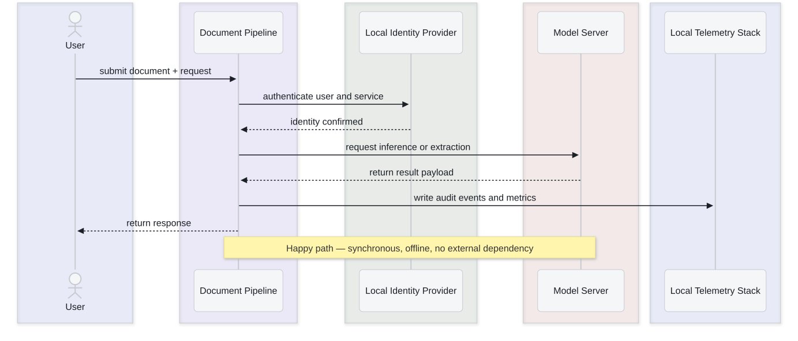</a>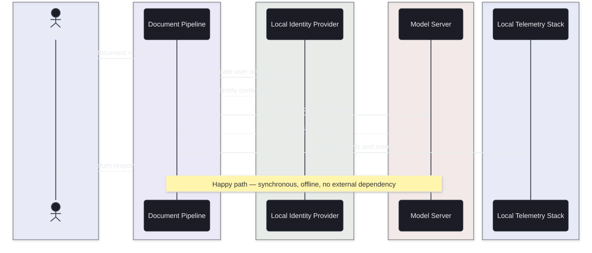<figcaption>The synchronous request path: document pipeline, local identity, model server and local telemetry, with no external call. Open for full size.</figcaption></figure>

The sequence diagram shows the data-plane side of the happy path: the document request from the brief. Authentication, inference and the audit write all happen against local services. Now walk the second pass, where something is missing.

**The fail-closed drill.** A bundle arrives, but the offline mirror lacks one transitive package. The offline system must fail closed and must never improvise by reaching across the boundary. Any unresolved dependency blocks promotion. The bundle stays quarantined in staging or the mirror until someone repairs the dependency and it is approved again.

<figure class="source-diagram" id="figure-12-2"><a href="source-assets/635a518e7115935a.svg" target="_blank" rel="noopener"></a><figcaption>The failure overlay: dependency resolution against the package mirror fails, the rollout is recorded and the canary is held or rolled back. Open for full size.</figcaption></figure>

Narrate the overlay out loud: the bundle arrives; the mirror lacks one transitive package; promotion stalls in the orchestrator, which leaves the canary isolated; the telemetry stack logs the failed rollout; the registry holds the bundle in quarantine; an operator repairs the package on the connected build side and retries the controlled transfer.

**Backpressure and flow control.** Without backpressure, a burst of document uploads can melt an offline service that has no spare capacity to scale into. Apply it at four layers:

- **Ingestion:** cap concurrent uploads, check file size and type as early as possible, and queue oversized jobs rather than letting them grab parser resources immediately.
- **Pipeline:** shard each document's work on a fixed key (case ID, tenant or document ID) so related state lands in one place and retries behave deterministically.
- **Model server:** limit concurrency, put a ceiling on batch size, and reject or defer work once GPU or CPU saturation passes a safe threshold.
- **Orchestrator:** use rollout limits so the canary sees only a small share of traffic until acceptance passes.

The partitioning key matters most when a document's context, redaction choices and audit trail must agree. With document ID as the key, a retry or partial failure is much easier to reason about than when requests land on random workers, and state from one document cannot corrupt another.

<p class="figure-caption">Component responsibility and state ownership.</p>
<div class="source-table-wrap"><table>
<thead>
<tr>
<th>Component</th>
<th>Primary responsibility</th>
<th>State ownership</th>
<th>Notes</th>
</tr>
</thead>
<tbody><tr>
<td>Connected build environment</td>
<td>Pin, package and compile artifacts ready for offline use</td>
<td>Source tree and build metadata</td>
<td>Sits outside the runtime trust boundary</td>
</tr>
<tr>
<td>Artifact signing service</td>
<td>Attest and sign artifacts</td>
<td>Signing keys and provenance records</td>
<td>Keep tight control over who can use the keys</td>
</tr>
<tr>
<td>Transfer staging zone</td>
<td>Examine each bundle before it is admitted</td>
<td>Quarantine manifests</td>
<td>Never serves runtime traffic</td>
</tr>
<tr>
<td>Offline registry / package mirror</td>
<td>Hand out approved packages and images</td>
<td>Catalogue of approved artifacts</td>
<td>The authoritative record of what may be deployed</td>
</tr>
<tr>
<td>Local orchestrator</td>
<td>Deploy services, scale them and roll them back</td>
<td>Desired state and rollout state</td>
<td>Applies policy on site</td>
</tr>
<tr>
<td>Model server</td>
<td>Run inference</td>
<td>Model runtime state, cached weights</td>
<td>Keep its API small and stable</td>
</tr>
<tr>
<td>Document pipeline</td>
<td>Ingest, analyse and redact documents, then assemble outputs</td>
<td>Document processing state</td>
<td>Usually the main request path</td>
</tr>
<tr>
<td>Local identity provider</td>
<td>Confirm who users and services are</td>
<td>Identities, groups, tokens</td>
<td>The authoritative record for access</td>
</tr>
<tr>
<td>Local telemetry stack</td>
<td>Store audit events, logs, metrics and traces</td>
<td>Observability data</td>
<td>Retain for as long as policy requires</td>
</tr>
</tbody></table></div>

**MVP versus later.** Keep the MVP small and opinionated: one each of offline registry, orchestrator, identity provider, telemetry stack, model server and document pipeline, plus a clear canary process. Signing, verification and the transfer zone ship in the first release, because offline updates cannot be defended without them. Smarter scheduling, routing across several models, better retrieval, background reindexing and richer policy engines come later. Make the offline path dependable and auditable first, then tune throughput and operator convenience.

**Control plane versus data plane.** The control plane is signing, verification, deployment, identity and policy. The data plane is inference and live document requests. Be explicit about which workflows are synchronous, which are asynchronous, and which system owns each durable state transition. The split lets you explain one architecture to two audiences. The customer hears: "The system stays inside our boundary, and we can still take controlled updates." Engineering hears: "State has a known home, failures have a known edge, and promotion holds no surprises."

Spoken-answer example from the source, a 90-second summary of this step: "I'd keep the connected build side apart from the offline runtime, with signing and staging as the only bridge. Inside the enclave sit a local registry, an orchestrator, a model server, a document pipeline, an identity provider and a telemetry stack. Requests are synchronous. Updates are asynchronous and tightly controlled. Deployable artifacts have one system of record: the offline registry. Local telemetry and the identity provider hold the audit trail. My biggest trade-off is security versus how hard updates become. The first production gate is simple: no bundle enters the enclave until it has proved, offline, that it is intact, complete and compatible. After that, a canary proves signature provenance, complete dependencies, working authentication and a rollback path before wider promotion."

### 5. Admit only complete, verified, compatible releases {#admission}

Release verification carries more risk than any other component. If the system cannot check a bundle offline, the rest is theatre. That gives the first production gate, which the source asks you to repeat word for word in every section: **no bundle enters the enclave until it has proved, offline, that it is intact, complete and compatible.** Intact means every artifact hash matches the signed manifest. Complete means every declared dependency is present. Compatible means the bundle fits the target node class and the stored index.

The admission sequence is the happy path from step 4 with explicit gates. Verification runs before import, and the canary and acceptance tests run before promotion. Acceptance covers identity, document handling, output quality, latency, local logging and tested recovery. A failure at any gate leaves the active release untouched.

Consider the missing transitive package again, because it tests whether you understand what offline means. "Just retry" is the wrong reflex. A retry cannot create a dependency that was never transferred, and fetching it from the internet "just this once" breaks the boundary the whole system exists to protect. Keep the bundle quarantined, preserve its dependency graph, manifest version, bundle hash and signer, and leave the active release running. Repair the connected build, prove dependency closure (every transitive dependency is present) and repeat the controlled transfer. That is why `dependencies` sits in the manifest rather than in someone's head: a manifest that names a dependency the offline store lacks fails validation before installation, not at runtime.

Duplicate requests show whether the admission path truly handles idempotency (repeating a call has the same effect as making it once). Say an operator submits a validated bundle twice because the first response timed out. With a matching idempotency key and bundle hash, the second call returns the same validation outcome and does not move state forward again. If a promote request is resent after a transient fault, the server either returns the state already reached or rejects the repeat with a clear, stable error saying this version is no longer waiting for promotion. The record and API details are in the [release records deep dive](#records).

### 6. Treat the release path as a high-trust control plane {#reliability}

Open the way a security and operations reviewer would: with the incident that hurts most, not with the model. A good answer to the missing-package incident halts promotion, keeps the manifest and evidence intact and shrinks the damage to the smallest slice of the system it can.

**Threat-model the offline control plane.** Inference is only one thing you defend. The local AI capability depends on a chain of signing keys, model artifacts, index files, package repositories, privileged admin actions and update workflows. Any link can be attacked. Three controls cover the chain:

1. **Pin and attest every dependency.** Nothing crosses without it. The release manifest lists each exact version and hash, the installer checks signatures against offline trust roots, and anything outside the known-good set is refused at deployment.
2. **Avoid telemetry egress assumptions.** Connected products switch on cloud diagnostics, remote metrics and crash reporting without a second thought. Inside the enclave that habit is wrong. Every observability path is local-first and approved on purpose: metrics flow to an internal collector, and support bundles leave only through a controlled operator workflow. A library that silently calls home is a leak. The source singles this out as where candidates slip: interviewers wait to hear "we'll send logs to our SaaS dashboard", said out of habit.
3. **Treat privileged administration as a high-risk interface.** Admin commands live apart from the everyday user flow and need local role-based approval. Key rotation, index rebuilds, trust-root updates and rollback promotion each run as a deliberate, explicit operation that leaves an audit record.

**Sort every failure into a policy.** A strong answer puts each failure in one of five buckets: fail open, fail closed, degrade, queue, or hand to a human. The source's examples show how the buckets differ:

- Authentication and signature checks **fail closed**.
- When a downstream classifier is down, document ingestion can **queue**, but only inside a bounded local buffer.
- Search on a stale index can **degrade**, as long as users see a freshness warning.
- If memory runs short, model serving can **degrade** to a smaller approved model, provided that fallback was verified in advance.
- Promoting a bundle or updating a trust root needs a **human** to approve it.

None of the source's examples fails open. This sorting separates a system that is down from one that is dangerous.

<p class="figure-caption">Five-condition decision table: policy, what users see and how to recover.</p>
<div class="source-table-wrap"><table>
<thead>
<tr>
<th>Condition</th>
<th>Policy</th>
<th>User-visible behaviour</th>
<th>Recovery path</th>
</tr>
</thead>
<tbody><tr>
<td>Missing transitive package</td>
<td>Fail closed</td>
<td>Promotion is blocked; the current release keeps running</td>
<td>Put the mirrored artifact back, then repeat verification</td>
</tr>
<tr>
<td>Artifact corrupted during transfer</td>
<td>Fail closed</td>
<td>Bundle is refused before installation</td>
<td>Copy it again from the release origin; check hash and signature</td>
</tr>
<tr>
<td>Model exceeds GPU memory</td>
<td>Degrade or queue</td>
<td>A smaller approved model answers, or the request waits for capacity</td>
<td>Rework routing, or revise the packaging policy</td>
</tr>
<tr>
<td>Local certificate expires</td>
<td>Admin actions fail closed; read-only flows degrade where policy permits</td>
<td>Admin operations stop; some reads may carry on</td>
<td>Rotate the cert from the offline trust anchor</td>
</tr>
<tr>
<td>Update breaks stored-index compatibility</td>
<td>Queue or rollback</td>
<td>Promotion pauses; the old index stays live</td>
<td>Rebuild the index offline, or roll back model and index together</td>
</tr>
</tbody></table></div>

**Blast radius.** Spell out the blast radius per workflow, per tenant, per dependency and per region. On an air-gapped government network, a "region" is usually a physical enclave or site, not a cloud geography. Where tenants or workspaces can be isolated, one bad index rebuild must not knock out document search across the whole enclave. A failed model rollout must leave the audit service valid. If policy lets reads continue, a certificate fault in the admin plane must not stop read-only document lookup. Give every dependency its own containment boundary.

**The critical incident drill.** The source makes this drill mandatory. The bundle carries a valid signature, yet the installer cannot pull one transitive dependency from the local mirror. However tempting, do not let the install go ahead "just this once".

<figure class="source-diagram" id="figure-14-0"><a href="source-assets/cf0fe73c28796a23.svg" target="_blank" rel="noopener"></a><figcaption>The missing-package drill in four stages: detection, five containment steps, recovery and prevention. Open for full size.</figcaption></figure>

Containment comes first and has five steps: halt promotion before it writes any partial state; capture the failing dependency graph with the exact bundle hash and manifest version; save signer metadata, logs and the artifact as evidence; check that the release in service has not been touched; and tell the operator the mirrored set is incomplete, which is not a runtime defect. Recovery uses the source of truth to rebuild the offline mirror, proves the dependency closure is whole and verifies hashes and signatures again. Prevention moves the check earlier: run a dependency-closure preflight before the bundle ever reaches the enclave. A release process that cannot prove completeness must never hand the bundle to the installer.

**Other failure paths.**

- **Artifact corruption during transfer.** Check cryptographic hashes and signatures at every hop, not only where the bundle was built. A bundle that verifies at its origin but fails at the enclave boundary is hostile or damaged until shown otherwise. Set the bad artifact aside for investigation; do not overwrite it.
- **Model exceeds GPU memory.** This is a capacity and packaging problem that should never surprise you at runtime. Send the request to a smaller approved model, hold it until a compatible worker frees up, or reject it with a clear operational error. Never let the node crash in the hope that the scheduler sorts it out. Spot memory pressure before admission where you can, and keep an explicit compatibility map tying model size, quantisation format and hardware profile together.
- **Local certificate expiring.** At first this is an availability and administration problem. It becomes a security problem the moment the system skips checks to stay up. Issue short-lived operational certificates, watch expiry, renew locally from an offline trust anchor and keep an escalation path for overdue rotation. Privileged actions halt; read-only workflows may continue in degraded form if policy allows. An enclave also needs a trusted local time source, because certificate validity, signature timestamps and revocation lists are all judged against the clock: a node whose clock drifts can reject a valid release or accept an expired certificate. Revocation lists reach the enclave through the same controlled transfer path as any other artifact, so plan their cadence alongside releases.
- **Update breaks stored-index compatibility.** Give the index format a version that moves with the model and the reader code; the three ship as one unit, and only when the new reader can read the old index or rebuild it deterministically. If it cannot, pause promotion and keep the old path serving. A human steps in if nobody is sure what the compatibility matrix says, or if a rebuild would take longer than the recovery objective allows.

**Evidence and runbooks.** Runbooks must exist before go-live for node replacement, index rebuild, rollback, certificate renewal, trust-root rotation and verification failure. Each names who may run it, which evidence it keeps, which systems it pauses and how success is judged. The audit trail captures the operator's identity and approval record, the signed manifest with its hash list, the trust-root fingerprint, installation logs and any rollback decision. When a customer later asks why a release was blocked, that evidence alone should reconstruct the answer. Without it every incident becomes forensic guesswork. With it, operations can show a release was rejected for a real integrity reason rather than a flaky installer.

The source closes this step on why it matters for the job: a strong FDE shows the design survives stale state, partial failure, dependency outages, hostile input, retries that change nothing and political pressure to "just make it work". Spoken-answer example from the source: "The offline release pipeline is a high-trust control plane, and I guard it that way. Every dependency is pinned and attested. Signatures are checked against offline trust roots. Telemetry never assumes it can leave the network. Privileged admin is kept apart from normal use. The riskiest failure is a bundle that is incomplete or corrupted. So the system fails closed, keeps the evidence and leaves the running release alone. Runtime problems each get a clear policy: some queue, some degrade to an approved fallback, some need a human. My first production gate: no bundle enters the enclave until it has proved, offline, that it is intact, complete and compatible."

### 7. Turn the prototype into an operating path {#delivery}

A working demo is only the start. The real milestone is the customer seriously asking when they can rely on it in production. Inside an air gap, delivery is part of the design: if the team must improvise to move, verify, install, watch or roll back the software, they have an encouraging demo they cannot deploy. The FDE's job is an operating path that is safe enough for the enclave, dull enough for operators and valuable enough for users. "After we tune the model some more" is the wrong answer to the production question.

The source rolls out in four phases. Each has an owner, an exit gate and a reason.

<figure class="source-diagram" id="figure-15-0"><a href="source-assets/caa6054342ce68ec.svg" target="_blank" rel="noopener"></a><figcaption>Four rollout phases with their exit criteria; a failed canary or acceptance test returns to the tested rollback bundle. Open for full size.</figcaption></figure>

1. **Stand up staging on identical hardware.** Owner: infrastructure or platform engineering, with a security review by the enclave team. Exit: trust roots, OS image, GPU/CPU profile, storage layout and node class all match production, so install and runtime results are representative. Why: staging built for convenience hides the problems that bite later, such as package incompatibility, driver mismatch, disk layout surprises and painful upgrades.
2. **Rehearse the signed transfer.** Owner: release engineering runs it; security and operations watch together. Exit: the team carries a release bundle along the controlled path, checks signatures offline and installs with no call beyond the boundary. Why: real systems often fail at the transfer step. "Someone will hand-carry it" falls short unless the handoff is written down, repeatable and auditable.
3. **Run a canary on one node.** Owner: operations, with the product owner and an incident responder on call. Exit: one production node takes the release, handles real traffic and stays within the agreed health thresholds for a set observation window. Why: there is no cloud-scale rollback shortcut on a closed network, so the first live node must show that configuration, dependencies, model and bundle behave together.
4. **Keep a tested rollback bundle and runbooks.** Owner: operations carries out a rollback, release engineering keeps the artifacts and the technical lead approves. Exit: the last known-good bundle is stored, tested and ready, with its escalation path, operator checklist, rollback steps and signatures. Why: rollback is a prepared artifact. When a release goes wrong, the team needs a trusted route back, not a scramble to rebuild confidence under pressure.

The source's model answer turns the phases into a week plan: weeks 0 to 1 agree scope and write down the non-goals (no live internet calls, no on-the-fly dependencies, no self-updating agents, no cloud observability); weeks 1 to 2 build production-identical staging; weeks 2 to 3 practise the full transfer and import drill; weeks 3 to 4 write the handoff so anyone can repeat and audit it; week 5 runs the one-node canary; weeks 6 to 8 build and test the rollback bundle as a proper artifact. After the pilot, add nodes only while install success, signature checks and capacity saturation stay healthy, and keep watching release age. The schedule lists the formal rollback exercise after the canary, but the phase list makes a tested rollback a prerequisite for wider promotion. Read the week plan as planning order, not as permission to expand before rollback is proven.

Each phase gets an owner, a gate and a stopping point before damage spreads. That is what separates a staged rollout from deployment by hope.

### 8. Measure, own and stop a release {#operations}

Track technical health with six metrics. Each has a calculation, a data source, an owner and an alert rule.

<p class="figure-caption">Technical health metrics from the source delivery plan.</p>
<div class="source-table-wrap"><table>
<thead>
<tr>
<th>Metric</th>
<th>Calculation</th>
<th>Data from</th>
<th>Owner</th>
<th>Alert threshold</th>
</tr>
</thead>
<tbody><tr>
<td>Offline install success rate</td>
<td>Successful offline installs divided by attempts, over the same release window</td>
<td>Installer logs, release logs, node boot records</td>
<td>Release engineering</td>
<td>A rate under baseline, or failures on more than one staging or production node in one release cycle, halts expansion; check bundle integrity, dependency drift and environment mismatch</td>
</tr>
<tr>
<td>Signature verification failures</td>
<td>Count of failed signature checks on bundles, artifacts or manifests, in transfer or at install</td>
<td>Transfer logs and install-time verification logs</td>
<td>Security or release engineering, as the local operating model assigns</td>
<td>Any unexpected failure is a go/no-go blocker until the root cause is clear</td>
</tr>
<tr>
<td>Model throughput and latency</td>
<td>Documents or pages per unit time, with request latency at the chosen percentile on user-facing paths</td>
<td>Local performance counters and service telemetry</td>
<td>Platform or ML (machine learning) operations</td>
<td>Latency outside the band users accept, or throughput under the demand forecast: inspect queue limits, saturation, quantisation or batching</td>
</tr>
<tr>
<td>Capacity saturation</td>
<td>Share of safe operating headroom in use across token budget, queue depth, disk I/O, memory, GPU or CPU</td>
<td>Service queues and host metrics</td>
<td>Infrastructure or SRE (site reliability engineering)</td>
<td>Sustained running near the ceiling: scale up, shed load or throttle before it turns unstable</td>
</tr>
<tr>
<td>Mean time to repair</td>
<td>Average time from declaring an incident to restoring service</td>
<td>Incident timelines</td>
<td>Incident management with the primary on-call team</td>
<td>Repair times climbing release over release suggest missing documentation, automation or spare capacity</td>
</tr>
<tr>
<td>Release age</td>
<td>Time since the running approved bundle was signed off and deployed</td>
<td>Deployment records and the release registry</td>
<td>Release manager</td>
<td>Too old has drifted from security fixes and operational lessons; changing too fast gets too little soak time</td>
</tr>
</tbody></table></div>

Keep user and business metrics separate, because a healthy system can still go unused. Adoption shows in repeat use, active users, documents submitted and the share of workflows done with no manual workaround. Business outcome shows in time saved per case, a lighter manual review load, more analyst throughput and fewer missed deadlines or rework cycles. The business sponsor or operations manager usually owns the outcome, backed by product and the FDE. Then tie the layers together. Faster throughput means little if analysts distrust the output, and if users adopt the tool but still correct results by hand, the workflow gain is smaller than the demo implied.

**A dashboard that tells one story.** Avoid a wall of green lights. Lay the dashboard out in three causal rows, so it shows how user value depends on each layer:

- **Top row, user outcome:** documents handled per shift, mean turnaround per case, proportion of cases finished without manual fallback.
- **Middle row, service behaviour:** offline install success per release, signature verification failures per transfer event, model latency and throughput per node, queue depth and saturation.
- **Bottom row, operational control:** age of the running release, whether a rollback bundle is available, mean time to repair alongside open incidents, and the most recent successful signed transfer.

This layout answers the question that counts in a closed network: is the user's problem getting better because the system is healthy, or is the system only staying alive while the workflow stays painful? "How would you dashboard this?" is a common follow-up, and the three rows show you reason in causal layers rather than collecting metrics.

**Owners.** The product or business owner sets the case-review workflow and defines success. Release engineering packages artifacts, signs bundles and keeps release records. Security signs off trust-root handling, audit evidence and the transfer process. Operations or SRE monitors health, runs the canary and carries out rollback. ML or platform engineering answers for model performance, runtime efficiency and compatibility. The help desk or support lead sorts user problems, training gaps and documentation defects.

**Go/no-go gates,** in order: offline verification of the bundle passes; the bundle is complete and fits the target node class (these first two apply the first production gate); staging on near-production hardware shows the expected behaviour; canary latency, throughput and saturation stay within thresholds; and someone has tested the rollback bundle, because archiving it is not enough.

**Rollback triggers:** repeated signature failures, an unexplained install failure, a latency regression on the canary, a climbing error rate, or any sign that the release puts enclave integrity at risk. In an air-gapped setting, "we'll debug it live" is not a plan; saying it means the team never had a working way back.

**Standardise what repeats.** Sort what should be the same for every customer from what stays local:

- **Configuration:** approval thresholds, retention rules, document types, queue limits, which approved offline model to use and the workflow routing rules.
- **Adapters:** importers for the customer's document sources, connectors that export to case systems and translation layers for local formats.
- **Shared services:** the release registry, audit logging, bundle validation, signature verification and model-serving primitives, all strong candidates for reuse across enclaves.
- **Core product:** the document analysis engine, the health-check framework, the offline package manager and the rollback discipline. Improving these improves every deployment.

The point is product thinking. An FDE should not hand-build one-off integrations forever, but turn repeated local pain into reusable capability while respecting each customer's boundary.

<p class="figure-caption">Risk register with owners, mitigations and triggers.</p>
<div class="source-table-wrap"><table>
<thead>
<tr>
<th>Risk</th>
<th>Owner</th>
<th>Mitigation</th>
<th>Trigger</th>
</tr>
</thead>
<tbody><tr>
<td>The offline bundle lacks a transitive package</td>
<td>Release engineering</td>
<td>Dependency lockfiles, a preflight bundle validation check, an install rehearsed in staging</td>
<td>An install fails, or an import cannot be resolved at boot</td>
</tr>
<tr>
<td>Signatures do not match during transfer</td>
<td>Security engineering</td>
<td>Offline trust-root validation, signed manifest checks, transfer steps under dual control</td>
<td>Any unexpected verification failure</td>
</tr>
<tr>
<td>Model latency on one node exceeds what users tolerate</td>
<td>Platform or ML operations</td>
<td>A smaller model variant, adjusted batching, or moving the work to other hardware</td>
<td>The canary shows a latency regression or queues keep growing</td>
</tr>
<tr>
<td>Operators need tribal knowledge to support the workflow</td>
<td>Support lead and technical lead</td>
<td>Incident drills, runbooks, training and explanations attached to alerts</td>
<td>The same questions keep coming, escalations stall, or cases are handled inconsistently</td>
</tr>
</tbody></table></div>

The delivery story the interviewer wants: four steps from prototype to staged rollout; release age, repair time, saturation, latency, throughput, signature failures and install success tracked; business outcome, adoption, model quality and technical health kept as separate layers; owners and gates named so a bad release halts before it becomes an incident. The source's measurable impact statement: the system counts as a success only when analysts use it, documents are handled faster and more consistently, and the operating team keeps it running as maintainable AI that runs locally and never crosses the enclave's network, artifact, identity or audit boundaries.

## Technical deep dives

### Release records and API contracts {#records}

Three records make the system governable. Each has a key, a lifecycle, a retention rule and an owner.

**ReleaseManifest(version, artifact_hashes, signatures, dependencies)** is the promise a bundle makes, and therefore the contract you deploy against. Its primary key is `version`, because operators need one stable name to cite, rebuild against and promote. It is written in the connected build environment, signed, carried into the offline side, validated, staged and finally promoted or rejected. Keep the manifest, its signature material and enough dependency detail to show later why the release passed or failed. Audit needs and local policy set the retention period; no universal standard applies.

**ModelDeployment(model_id, version, hardware, status)** is the runtime truth about which model is live, and where. The preferred primary key is a dedicated `deployment_id`, with a unique constraint over (model_id, version, hardware) when one model family can sit in several release states across targets. Without a dedicated identifier, that composite is the natural key. Pick one on purpose. Its lifecycle states are staged, validated, active, draining and retired. Keep enough history to answer "which model served this document when we analysed it?"

**OfflineAuditEvent(actor, action, artifact_hash, time)** records which actor took which action on which artifact, and when. Its primary key is usually an event ID, with the four-field tuple as the business key. It is append-only: nobody rewrites an audit row. Follow the customer's audit policy for retention. Purge too eagerly and trust goes; keep too much and you may break local retention rules. Without a vendor console, this log is the only way to reconstruct an incident.

Ownership is split deliberately. The build team holds signed release material until the handoff into offline validation. The offline runtime holds deployment state. Security and operations hold the audit trail. The split stops a government network from becoming one large mutable blob.

**Four API contracts.**

- **POST /v1/documents/analyze** is the data-plane call analysts hit. It takes an authenticated document payload plus optional metadata such as an idempotency key or analysis profile, and returns a typed analysis result with a request identifier and a pointer to the model version. Authentication stays inside the boundary, through the offline identity provider or a token minted on the network itself; "just use OAuth" is not an answer. If the same idempotency key arrives twice with an identical body, the caller gets the same result or a stable "already processed" reply. If the key arrives with a different body, reject it as a conflict rather than return the earlier result, because the key no longer names one operation. Errors separate bad input, unauthorised access, no free model capacity and a policy rejection.
- **GET /v1/models/status** is the operators' read path. It reports each model's deployment state, the live version and whether each hardware target is ready. Repeated calls change nothing, but callers still authenticate because status data can reveal operational details. Errors distinguish "unknown model", "not deployed" and "temporarily unavailable".
- **POST /v1/admin/releases/validate** is the control-plane gate. It takes a bundle pointer or the uploaded bundle, checks the manifest signature, compares artifact hashes and confirms every declared dependency is on hand. It returns a structured pass/fail result or validation report. It is idempotent per release identifier: two runs on one bundle yield one logical validation record unless the content changed.
- **POST /v1/admin/releases/{id}/promote** moves a release from validated to active. Three guards protect it: authorisation, policy checks and optimistic concurrency. It refuses when the release cannot be promoted from its current state, when the target deployment changed since the client last read it, or when the live release is not the one the client expected.

Optimistic concurrency works like this: each release object holds a revision token that the promote call sends back. If another operator has already moved the deployment, the server refuses the write, so two people cannot push incompatible releases live at once. Retry safe reads and validation calls automatically and nothing else by default. Retry a promotion only when it was built to be idempotent and a write token guards it.

Request and response shapes carry versions, so a later change to the manifest or validation output cannot break older tooling overnight. Versioning extends beyond public APIs to the bundle format, the manifest schema and the audit event schema. When nobody can update the offline environment at will, every breaking change is a planned migration, never a light refactor.

The source's 90-second implementation summary: "I'd ship each release as a signed manifest that lists every artifact hash and declares every dependency. Deployment state lives apart from audit state. Versioned endpoints cover analysis, status, validation and promotion. Every write path is idempotent and uses optimistic concurrency. Release verification is the riskiest part, so I'd build and test it first: typed checks on the manifest, a signature check, a hash check per artifact, and clearly structured failure modes."

### Read the verifier sketch piece by piece {#verifier}

The source's first code sketch implements the verification gate. The flowchart shows its order of checks before the code.

<figure class="source-diagram" id="figure-13-0"><a href="source-assets/e33bc9fb37e0f124.svg" target="_blank" rel="noopener"></a><figcaption>Verify-bundle flow: shape checks, then signature, then per-artifact hashes, each failure raising its own exception, before a VerifiedManifest is handed to the promote step. Open for full size.</figcaption></figure>

```python
from __future__ import annotations

import hashlib
import hmac
import json
from dataclasses import dataclass
from typing import Any, Mapping


class IntegrityError(Exception):
    pass


class ManifestError(Exception):
    pass


class SignatureError(Exception):
    pass


class ValidationError(Exception):
    pass


@dataclass(frozen=True)
class VerifiedManifest:
    version: str
    artifacts: tuple[dict[str, str], ...]
    dependencies: tuple[str, ...]


def canonical_json(obj: Any) -> bytes:
    return json.dumps(obj, sort_keys=True, separators=(",", ":")).encode("utf-8")


def sha256_hex(data: bytes) -> str:
    return hashlib.sha256(data).hexdigest()


def verify_signature(trusted_public_key: bytes, payload: bytes, signature: bytes) -> None:
    # Interview sketch: replace with a real signature primitive such as Ed25519 verification.
    expected = hmac.new(trusted_public_key, payload, hashlib.sha256).digest()
    if not hmac.compare_digest(expected, signature):
        raise SignatureError("manifest signature verification failed")


def _require_str(mapping: Mapping[str, Any], key: str) -> str:
    value = mapping.get(key)
    if not isinstance(value, str) or not value.strip():
        raise ManifestError(f"missing or invalid string field: {key}")
    return value


def _require_list(mapping: Mapping[str, Any], key: str) -> list[Any]:
    value = mapping.get(key)
    if not isinstance(value, list):
        raise ManifestError(f"missing or invalid list field: {key}")
    return value


def verify_bundle(bundle, trusted_public_key: bytes) -> VerifiedManifest:
    manifest_raw = bundle.read_bytes("manifest.json")
    signature = bundle.read_bytes("manifest.sig")

    try:
        manifest = json.loads(manifest_raw)
    except json.JSONDecodeError as exc:
        raise ManifestError("manifest.json is not valid JSON") from exc

    if not isinstance(manifest, dict):
        raise ManifestError("manifest root must be an object")

    version = _require_str(manifest, "version")
    artifacts = _require_list(manifest, "artifacts")
    dependencies = _require_list(manifest, "dependencies")

    verify_signature(trusted_public_key, canonical_json(manifest), signature)

    normalized_artifacts: list[dict[str, str]] = []
    for idx, item in enumerate(artifacts):
        if not isinstance(item, dict):
            raise ManifestError(f"artifacts[{idx}] must be an object")
        path = _require_str(item, "path")
        expected_hash = _require_str(item, "sha256")
        if len(expected_hash) != 64 or any(c not in "0123456789abcdef" for c in expected_hash.lower()):
            raise ManifestError(f"artifacts[{idx}].sha256 is not a valid hex digest")
        actual_hash = sha256_hex(bundle.read_bytes(path))
        if not hmac.compare_digest(actual_hash, expected_hash):
            raise IntegrityError(path)
        normalized_artifacts.append({"path": path, "sha256": expected_hash})

    normalized_deps: list[str] = []
    for idx, dep in enumerate(dependencies):
        if not isinstance(dep, str) or not dep.strip():
            raise ManifestError(f"dependencies[{idx}] must be a non-empty string")
        normalized_deps.append(dep)

    return VerifiedManifest(
        version=version,
        artifacts=tuple(normalized_artifacts),
        dependencies=tuple(normalized_deps),
    )
```

Walk through it in order:

- **`canonical_json`** turns the manifest into deterministic bytes (sorted keys, no extra whitespace) before the signature check, so one logical manifest always produces the same bytes and the same signature.
- **`sha256_hex`** produces a stable digest to compare each artifact against.
- **`verify_signature`** is labelled a sketch on purpose. It uses HMAC (hash-based message authentication code), a symmetric scheme where the same secret both creates and checks the tag, even though the parameter is named `trusted_public_key`. Production needs a genuine asymmetric primitive such as Ed25519, where the enclave holds only a public key that cannot create signatures, plus an approved key lifecycle.
- **Three exception classes** tell the caller what broke: `SignatureError` (who produced it), `ManifestError` (the manifest's shape) or `IntegrityError` (the content). Each calls for a different operator response. A fourth class, `ValidationError`, is declared but never raised in this sketch.
- **`VerifiedManifest`** is a frozen dataclass so nothing quietly alters a successful validation result. The source presents this as immutability. Note the limit: the tuple holds dictionaries, which are still mutable, so deep immutability needs further normalisation.
- **`_require_str` and `_require_list`** check types at the boundary, so malformed input fails early, before any state moves.
- **`verify_bundle`** reads the manifest and signature, parses the JSON defensively, checks the required fields, verifies the signature over the canonical form and then compares each artifact hash using `hmac.compare_digest`, a constant-time comparison that avoids leaking information through timing. It returns a normalised, typed result that a later promote step can rely on.

**What the snippet leaves out on purpose.** Concurrency, retries and observability belong in the production layer around the core path, and the [records deep dive](#records) covers the first two. For observability, surround the path with logs, counters and structured audit events: each validation should record who validated which bundle, which hash it checked and, on failure, why.

The sketch also has limits the source does not spell out, and they matter for "complete" in the production gate. It validates dependency names but does not check that those files exist or resolve transitive closure, so closure must be proved separately. It reads artifact paths from the manifest without rejecting absolute paths, `..` traversal or unsafe archive members. It also parses the manifest before authenticating it, then checks the signature over a re-serialised copy rather than the exact bytes that were signed. Verify the signature over the raw `manifest.json` bytes first and parse only after it passes. Re-serialisation works only if signer and verifier emit identical JSON (number formatting, escaping, key order), which is the problem RFC 8785 canonicalisation addresses, and Python's `json.loads` silently keeps the last of any duplicate keys, so two parsers can disagree about what one manifest says. Finally, the digest check accepts upper-case hex but compares case-sensitively against the lower-case `hexdigest()`, so a valid upper-case digest would raise `IntegrityError`; normalise case before comparing. A production verifier should also bound sizes, parse without executing, apply signer policy and target compatibility checks, write durable local audit records and handle trusted timestamps and revocation as the enclave requires.

**Contract and failure-injection tests.** The tests show how the gate behaves on a pass and on a failure; full coverage is not the goal.

```python
class BundleStub:
    def __init__(self, files):
        self.files = files

    def read_bytes(self, path):
        return self.files[path]


def test_verify_bundle_accepts_known_good_bundle():
    manifest = {
        "version": "2024.10.1",
        "artifacts": [{"path": "model.bin", "sha256": ""}],
        "dependencies": ["tokenizer.json"],
    }
    files = {
        "model.bin": b"weights-bytes",
        "tokenizer.json": b"vocab-bytes",
    }
    manifest["artifacts"][0]["sha256"] = sha256_hex(files["model.bin"])
    manifest_bytes = canonical_json(manifest)
    key = b"trusted-key"
    sig = hmac.new(key, manifest_bytes, hashlib.sha256).digest()
    bundle = BundleStub({
        "manifest.json": manifest_bytes,
        "manifest.sig": sig,
        **files,
    })

    verified = verify_bundle(bundle, key)

    assert verified.version == "2024.10.1"
    assert verified.artifacts[0]["path"] == "model.bin"
    assert verified.dependencies == ("tokenizer.json",)


def test_verify_bundle_rejects_corrupted_artifact_hash():
    manifest = {
        "version": "2024.10.1",
        "artifacts": [{"path": "model.bin", "sha256": "0" * 64}],
        "dependencies": ["tokenizer.json"],
    }
    manifest_bytes = canonical_json(manifest)
    key = b"trusted-key"
    sig = hmac.new(key, manifest_bytes, hashlib.sha256).digest()
    bundle = BundleStub({
        "manifest.json": manifest_bytes,
        "manifest.sig": sig,
        "model.bin": b"tampered-weights",
        "tokenizer.json": b"vocab-bytes",
    })

    try:
        verify_bundle(bundle, key)
        raise AssertionError("expected IntegrityError")
    except IntegrityError as exc:
        assert str(exc) == "model.bin"
```

Test 1 is a contract test: a valid manifest, a valid signature and matching hashes return a normalised `VerifiedManifest` with the expected version and dependency list. Test 2 is a failure-injection test: a wrong hash and altered bytes must raise `IntegrityError` naming the exact path. The source adds that a real repository would include a third test that damages `manifest.sig` and expects `SignatureError`, because a bad signature and a bad artifact need different operational responses. Beyond that, add negative tests for malformed fields, missing files, unsafe paths, signer mismatch and incomplete closure. For a whiteboard sketch, one contract test and one failure-injection test are enough.

### Prove one security invariant with a tamper test {#tamper-test}

Interview code should prove a security invariant rather than walk a toy happy path. The source's second sketch, from its security section, proves one: a tampered bundle is refused before it is deployed. It is a separate, self-contained example with its own `IntegrityError` and `verify_bundle`. Do not concatenate it with the first sketch.

It differs from the first sketch in useful ways. The manifest carries a `signer` name, which must match the pinned local key before anything else happens. Artifacts are a path-to-hash map on disk, hashed in 1 MB chunks so large model files do not load into memory. A missing artifact is detected explicitly. Every refusal appends an audit event with the reason, and acceptance is audited too.

```python
from __future__ import annotations

from dataclasses import dataclass
from pathlib import Path
import hashlib
import hmac
import json
import tempfile
from typing import Mapping


class IntegrityError(RuntimeError):
    pass


@dataclass(frozen=True)
class TrustedKey:
    name: str
    secret_key: bytes


@dataclass(frozen=True)
class Bundle:
    root: Path

    def replace(self, relative_path: str, content: bytes) -> None:
        target = self.root / relative_path
        if not target.is_file():
            raise FileNotFoundError(relative_path)
        target.write_bytes(content)


@dataclass(frozen=True)
class AuditEvent:
    action: str
    detail: str


def _sha256_file(path: Path) -> str:
    digest = hashlib.sha256()
    with path.open("rb") as f:
        for chunk in iter(lambda: f.read(1024 * 1024), b""):
            digest.update(chunk)
    return digest.hexdigest()


def _load_manifest(bundle: Bundle) -> Mapping[str, object]:
    manifest_path = bundle.root / "manifest.json"
    if not manifest_path.is_file():
        raise IntegrityError("missing manifest")
    try:
        manifest = json.loads(manifest_path.read_text(encoding="utf-8"))
    except json.JSONDecodeError as exc:
        raise IntegrityError("invalid manifest") from exc
    if not isinstance(manifest, dict):
        raise IntegrityError("invalid manifest")
    return manifest


def _audit(log: list[AuditEvent], action: str, detail: str) -> None:
    log.append(AuditEvent(action=action, detail=detail))


def verify_bundle(bundle: Bundle, trusted_key: TrustedKey, audit_log: list[AuditEvent] | None = None) -> None:
    audit_log = audit_log if audit_log is not None else []
    manifest = _load_manifest(bundle)

    if manifest.get("signer") != trusted_key.name:
        _audit(audit_log, "verify_bundle", "untrusted signer")
        raise IntegrityError("untrusted signer")

    signature = manifest.get("signature")
    if not isinstance(signature, str) or not signature:
        _audit(audit_log, "verify_bundle", "missing signature")
        raise IntegrityError("missing signature")

    expected = manifest.get("artifacts")
    if not isinstance(expected, dict):
        _audit(audit_log, "verify_bundle", "invalid artifact list")
        raise IntegrityError("invalid artifact list")

    # Verify every listed artifact is present and unaltered before any promotion occurs.
    for relative_path, expected_hash in expected.items():
        if not isinstance(relative_path, str) or not isinstance(expected_hash, str):
            _audit(audit_log, "verify_bundle", "invalid artifact entry")
            raise IntegrityError("invalid artifact entry")
        artifact_path = bundle.root / relative_path
        if not artifact_path.is_file():
            _audit(audit_log, "verify_bundle", f"missing artifact: {relative_path}")
            raise IntegrityError(f"missing artifact: {relative_path}")
        actual_hash = _sha256_file(artifact_path)
        if not hmac.compare_digest(actual_hash, expected_hash):
            _audit(audit_log, "verify_bundle", f"hash mismatch: {relative_path}")
            raise IntegrityError(f"hash mismatch: {relative_path}")

    # Offline trust-root check: the manifest is authenticated with a pinned local key.
    material = json.dumps(
        {"signer": manifest["signer"], "artifacts": manifest["artifacts"]},
        sort_keys=True,
        separators=(",", ":"),
    ).encode("utf-8")
    expected_sig = hmac.new(trusted_key.secret_key, material, hashlib.sha256).hexdigest()
    if not hmac.compare_digest(signature, expected_sig):
        _audit(audit_log, "verify_bundle", "signature verification failed")
        raise IntegrityError("signature verification failed")

    _audit(audit_log, "verify_bundle", "bundle accepted")


def _write_bundle(root: Path, signer: str, secret_key: bytes, model_bytes: bytes) -> Bundle:
    root.mkdir(parents=True, exist_ok=True)
    (root / "model.bin").write_bytes(model_bytes)
    artifact_hash = hashlib.sha256(model_bytes).hexdigest()
    manifest_body = {"signer": signer, "artifacts": {"model.bin": artifact_hash}}
    material = json.dumps(manifest_body, sort_keys=True, separators=(",", ":")).encode("utf-8")
    signature = hmac.new(secret_key, material, hashlib.sha256).hexdigest()
    manifest = {**manifest_body, "signature": signature}
    (root / "manifest.json").write_text(json.dumps(manifest), encoding="utf-8")
    return Bundle(root=root)


def test_tampered_model_is_rejected():
    with tempfile.TemporaryDirectory() as tmpdir:
        bundle_root = Path(tmpdir) / "bundle"
        trusted_key = TrustedKey(name="offline-root-1", secret_key=b"local-trust-root-secret")
        bundle = _write_bundle(
            bundle_root,
            signer=trusted_key.name,
            secret_key=trusted_key.secret_key,
            model_bytes=b"approved-model-bytes",
        )

        bundle.replace("model.bin", b"tampered")
        audit_log: list[AuditEvent] = []

        try:
            verify_bundle(bundle, trusted_key, audit_log=audit_log)
        except IntegrityError:
            assert any(event.action == "verify_bundle" for event in audit_log)
            assert (bundle_root / "model.bin").read_bytes() == b"tampered"
            return
        raise AssertionError("tampered bundle should be rejected")
```

Trace the test. It writes a bundle signed by `offline-root-1`, then overwrites `model.bin` with different bytes. Verification passes the signer and signature-presence checks, reaches the hash loop and raises `IntegrityError("hash mismatch: model.bin")` after appending an audit event. The test asserts that an audit event exists and that the tampered file is still on disk: the evidence was preserved, not overwritten.

The source sizes this sketch for an interview on purpose. For production, keep the control flow and replace the teaching scaffold with a hardened verifier: check the manifest schema explicitly, write structured audit events to local storage and add negative tests for signer mismatch, a malformed manifest, a missing file and a broken dependency closure. Further limits worth naming: the HMAC secret is symmetric scaffolding like the first sketch; the in-memory audit list is not durable; the hash loop checks only the listed artifacts, so transitive dependency closure still needs its own preflight; and bundle-relative paths need containment checks. Two ordering points matter as well. The sketch hashes files named by a manifest it has not yet authenticated, so an attacker-controlled manifest can direct file reads; check the signature first. And the signed material covers only the signer and the artifact map, with no version or expiry, so an older, validly signed bundle replays cleanly. The Update Framework calls this a rollback attack: sign the version and refuse any bundle older than the installed release unless a recorded rollback decision allows it. The test shows the system will not install a bundle whose integrity it cannot establish. It does not certify key protection, safe extraction, atomic installation or regulatory compliance.

### Four deployment trade-offs {#tradeoffs}

The four trade-offs follow one pattern. Lay out both options, name the deciding factor in terms of the customer's real constraints, then commit to a default and say when you would leave it. Use the same pattern live for trade-offs not listed here.

**Model size versus hardware fit.** This is usually the first tension interviewers probe. A bigger model may improve extraction and summaries, but it may not fit local GPU memory, it answers more slowly, patching it is harder and the customer may have to buy or borrow hardware. A smaller model fits easily and is simpler to support, but may struggle with noisy documents, specialised vocabulary or long-context reasoning. "Always biggest" and "always smallest" are both wrong. For triage or structured extraction, a reliable, well-tuned small model can beat a brittle large one that is costly to maintain. Subtle legal or technical interpretation can justify bigger inference hardware, but only if enclave operators can sustain and safely patch it. Interview line from the source: "I'd pick the smallest model that clears the quality bar on the customer's own documents. Each step up in size competes for enclave hardware, adds latency and adds accreditation work."

**Containers versus virtual appliances.** Containers give portability, repeatable deployment and cleaner separation of concerns. They fit an enclave with an existing platform team where components are refreshed one at a time. A virtual appliance seals the whole stack in a fixed boundary with fewer moving parts, which some security teams find easier to review. The tension is operational complexity against governance simplicity. Pick containers when efficient scaling, controlled patching and reusable components rank highest. Pick an appliance when the customer prefers one tight, inspectable unit and slow, deliberate change. Let the organisation's existing standards decide: a hardened virtualisation standard favours the appliance, an existing secure container platform favours containers.

**Update frequency versus accreditation cost.** Frequent updates cut vulnerability exposure, lift model quality and speed feedback. But each one must be packaged, signed, transferred, verified, staged, tested and approved, and may trigger re-accreditation. "Ship weekly because we're agile" is wrong. Size the release train to the governance load the customer can carry: keep urgent security patches on a separate track from features (emergency patches still carry provenance and validation, with a pre-agreed faster approval path), prebuild trusted update bundles, promote from dev to staging to the enclave, and make each high-friction change smaller and more predictable so fewer are needed. Source phrasing: "I'd favour fewer releases that we trust more. In an air-gapped setting, change costs you in engineering and in governance."

**Central cluster versus workstations.** A central cluster is easier to manage and observe, and every analyst reaches the same models. It suits many analysts on one service where a managed platform is allowed. Workstations help on a heavily segmented network, at low volume, or when the capability must survive limited central infrastructure, at the price of harder patch distribution, more support and weaker consistency. A central service raises reuse and control but becomes one operational asset to protect and monitor closely. Decide on user count, concurrency, isolation needs and how much central administration the customer can sustain. If the enclave can host it, start central, because governance and updates are easier there, and fall back to workstations for isolated teams or cut-off sub-enclaves.

### Cost, build-versus-buy and governance gaps {#governance}

The source scored its own design against a 20-item rubric in four phases and published the result. Seventeen items were covered. Item 7 (unit economics and cost drivers) was absent: the Cost SLI and rollout discussion stay qualitative, and no figures were invented. Item 10 (build versus buy, vendors and model choice) was partial: the design weighs model size but assumes every component is built in-house. Item 17 (regulation and governance depth) was absent: accreditation, approval gates and audit trails run through the design, but no regulatory framework is named, deliberately. Item 18 (responsible AI) was counted as covered through correctness, governance and integrity (audit evidence, signed provenance, fail-closed policy) rather than bias or fairness. No second review was run. The source author then sketched how to close each gap live in an interview, using only the existing architecture.

**Unit economics without invented numbers.** Derive the shape from the replica formula: cost per document = (GPU-hours on the model server + amortised storage and index + telemetry and audit storage) / documents handled in that window. Support and update effort belong in the overhead too. A fixed GPU pool actually simplifies this: replicas cannot grow on demand, so the cost question reduces to how much of the pool this workload uses, and the 477-replica example already answers that it would use far more than exists. Present it as cost per analyst-hour saved against GPU-hours burned, and lean on the baseline-versus-10x table for the scaling argument rather than a dollar figure you cannot defend. Without the customer's GPU procurement cost and fully loaded analyst cost, sketch only the shape (amortised fixed hardware plus operations and audit overhead, all over throughput) and invite the interviewer to supply one real figure as an anchor. Never make up a cost-per-document number.

**Build or buy, per component.** Section 4's nine components make this a per-component call rather than one decision. Commodity infrastructure (the offline registry and package mirror, the identity-provider integration, the telemetry stack) is a candidate to buy or adopt from an accredited vendor if one is on the approved products list; a bespoke air-gapped package mirror could take months to re-solve a problem the customer's accreditation programme may already have cleared a vendor for. Mission-specific parts are candidates to build: the document pipeline's redaction and extraction logic, the release manifest schema and the `verify_bundle` integrity gate. No vendor can own domain-specific redaction correctness or a manifest schema shaped around this customer's audit policy. Even so, a vendor platform could supply some verified mechanisms if the customer accepts its evidence and support model. The source's rule of thumb: buy solved, security-commoditised problems whose vendors already hold the right government credentials (identity brokers, package mirrors, base OS images); build only the boundary logic and the mission pipeline.

**Governance frameworks as conditional context.** For US government on-premises procurement, the source names two signals: a product on NIAP's Product Compliant List under Common Criteria, and a published DISA STIG (Security Technical Implementation Guide) for it. It calls FedRAMP the wrong yardstick here, because FedRAMP authorises cloud services, not on-premises products. If the enclave belongs to the US government, the source would name NIST SP 800-53 Rev 5 and three control families that map onto controls the design already has: CM-3 (configuration change control) and CM-14 (signed components) map to the signed release manifest; AU-2 and AU-12 (event logging and audit record generation; Rev 5 retitled AU-2 from "Audit Events") map to the offline audit log; SC-7 (boundary protection) maps to the fail-closed dependency policy. If the workload handles export-controlled technical data, ITAR/EAR rules could limit which analysts may see some documents at all, and the compliance officer would add that as a new constraint in the stakeholder map. Source phrasing for the interview: "I don't know yet which framework governs this enclave. But what I've already described (append-only audit, signed provenance, fail-closed promotion) maps cleanly onto the CM and AU families in NIST 800-53. So once we learn the exact framework, the architecture stays put. Only the format of the evidence changes."

These are discussion maps, not compliance claims. The customer's compliance authority decides which framework applies, which controls are in scope and what evidence counts. No architecture sketch establishes legal compliance or an authorisation to operate.

### Source references {#references}

Primary references: [NIST SP 800-53 Rev 5](https://csrc.nist.gov/pubs/sp/800/53/r5/upd1/final), [RFC 8785 JSON canonicalisation](https://www.rfc-editor.org/rfc/rfc8785), [RFC 8259 on duplicate object names](https://www.rfc-editor.org/rfc/rfc8259#section-4), [The Update Framework specification](https://theupdateframework.github.io/specification/latest/), [DistServe on prefill and decode](https://arxiv.org/abs/2401.09670) and the [SLSA specification](https://slsa.dev/spec/). The source author checked these references on 27 September 2026. They support the standards and supply-chain claims above; verify current requirements with the customer's authorised reviewers.

- [NIST SP 800-53 Rev 5 control catalog (OSCAL JSON, usnistgov/oscal-content)](https://github.com/usnistgov/oscal-content/tree/main/nist.gov/SP800-53/rev5): control titles for CM-3, CM-14, AU-2, AU-12 and SC-7.
- [FedRAMP](https://www.fedramp.gov/): authorises cloud services, not on-premises products.
- [NIAP Product Compliant List](https://www.niap-ccevs.org/product/pcl): Common Criteria listing for commercial IT products used in national security systems.
- [DISA Security Technical Implementation Guides](https://www.cyber.mil/stigs/): DoD configuration guides for operating systems and other products.
- [SLSA provenance specification v1.0](https://slsa.dev/spec/v1.0/provenance): build provenance attestations. The SLSA site now marks later versions current (v1.2 in November 2026), so check the version the customer's policy names.
- [Python hmac.compare_digest](https://docs.python.org/3/library/hmac.html#hmac.compare_digest): constant-time comparison to reduce timing attacks.

## Practice

### Fill the worksheet on a blank page {#practice-start}

The source worksheet sets the prompt: you are the FDE asked to bring generative AI into a network with no route to the internet; make that boundary the centre of the design. Work through its sections before opening any answer. Each reveal below holds the source model answer for that section.

<details class="answer-reveal" id="answer-discovery"><summary>Clarify the customer problem: which questions do you ask first, and why does each matter?</summary><div class="detail-body"><p>The worksheet asks about data classification and handling rules, whether the hardware pool is fixed and what is in it, the artifact import path from scanning and approval to signing and roll-in, the identity, storage and directory services already inside the boundary, and the limits on logging, retention and recovery.</p><p>The model answer adds why each matters. Classification decides whether you may store text, keep prompts or cache outputs. The GPUs and servers decide between a bigger model, a smaller one or a retrieval-heavy workflow. Whether this is an assist tool, a batch job or a near-interactive copilot sets the quality bar and latency target. The import path's speed sets how quickly you can patch a vulnerability. Local identity, directory and storage services decide what you integrate with rather than build. Logging, retention, backup and disaster-recovery limits decide what you can observe and survive. Two more questions finish discovery: what result can the customer measure on their own side without trusting a vendor figure, and when the build team has gone home and it is 2 a.m., who runs this and what do they need to fix it without help?</p></div></details>

The worksheet's users-and-workflows table has one row each for the analyst, operations or IT admin, security or compliance officer, and programme sponsor, with columns for workflow, current pain, AI-assist opportunity and whether human approval is needed. Its data and integration map asks, for every data source, its format, owner, freshness, permission model and risk. Fill both from the stakeholder map in step 1 and the system-of-record split in step 4. The analyst submits documents and reviews results; operations runs releases and recovery; security approves trust-root, transfer and audit changes; the sponsor owns the outcome metric. Promotion and trust-root changes are the steps that need human approval.

<details class="answer-reveal" id="answer-requirements"><summary>Requirements: list the functional requirements and fill the latency, availability, cost, security and audit targets.</summary><div class="detail-body"><p>Functional: an analyst uploads a document inside the enclave and gets a classification, extraction or redaction with no runtime internet; ship model and service as one offline bundle; version and sign every artifact; host a local registry and dependency mirror; integrate with local identity; make updates and rollbacks a formal, audited ceremony that anyone can review and anyone with authority can reverse.</p><p>Nonfunctional, from the model answer. Latency: one budget across upload, preprocessing, retrieval, inference, validation and rendering; if inference eats most of it, cut model size or context. Availability: you cannot scale out on demand, so get capacity right before launch and plan for the 20 QPS peak, not the average. Security: pin and attest every dependency, check signatures against offline trust roots, keep privileged administration apart from user work. Compliance: an append-only audit log of actor, action, artifact hash and time, retained as local policy demands. Reliability: refuse an incomplete or damaged bundle and leave the current release in service. Cost: apply the replica formula and, if the result exceeds the fixed pool, reshape the workload rather than ask for hardware.</p></div></details>

<details class="answer-reveal" id="answer-architecture"><summary>Proposed architecture: fill in build and signing, transfer inspection, offline registry, orchestration, document pipeline and local telemetry.</summary><div class="detail-body"><p>Picture two worlds with one controlled path between them; the trust boundary separates the connected build side from everything else. Build and signing: the build environment packs source, pinned dependencies and model artifacts into a reproducible bundle, and the signing service attaches signatures and verifiable attestations to anything that will cross. Transfer inspection: the bundle waits in quarantine in the staging zone while integrity, chain of custody and policy conformance are confirmed. Offline registry: once signatures are checked against offline trust roots, approved content goes into the local registry and package mirror, the offline source of truth. Orchestration: the local orchestrator runs services, applies deployment policy and sends a small share of traffic to a canary. Document pipeline: ingestion, OCR and parsing, chunking, retrieval, scoring, redaction and result assembly, calling the local model server. Local telemetry: audit, logs, metrics and traces stay inside, alongside the local identity provider. No data leaves, and no cache is ever trusted over the registry.</p></div></details>

The worksheet's evaluation plan asks for a good threshold, a bad threshold, a test dataset and an owner per metric.

<p class="figure-caption">Source worksheet evaluation plan.</p>
<div class="source-table-wrap"><table>
<thead>
<tr>
<th>Metric</th>
<th>Good threshold</th>
<th>Bad threshold</th>
<th>Test dataset</th>
<th>Owner</th>
</tr>
</thead>
<tbody><tr>
<td>Signature check results</td>
<td>No failed artifact admitted</td>
<td>One failed artifact admitted</td>
<td>Logs from each transfer hop</td>
<td>Security</td>
</tr>
<tr>
<td>Offline install success</td>
<td>Clean on every staging run</td>
<td>Install needs outside access</td>
<td>Installs on matched staging nodes</td>
<td>Platform engineering</td>
</tr>
<tr>
<td>GPU and queue saturation</td>
<td>Stays under admission limit</td>
<td>Held above the limit</td>
<td>Local GPU and queue metrics</td>
<td>Operations</td>
</tr>
<tr>
<td>Time per analyst case</td>
<td>Lower than baseline</td>
<td>No change or slower</td>
<td>Case timings taken inside</td>
<td>Sponsor</td>
</tr>
</tbody></table></div>

<details class="answer-reveal" id="answer-evaluation"><summary>Evaluation plan: which metrics prove the system works, and what does each prove?</summary><div class="detail-body"><p>The model answer's thresholds are the author's choices for this case, not industry standards, so defend them rather than recite them.</p><div class="source-table-wrap"><table><thead><tr><th>Metric</th><th>What it proves</th><th>Strong threshold</th><th>Dataset / method</th></tr></thead><tbody><tr><td>Offline install success rate</td><td>Bundles install cleanly without any outside access</td><td>Clean every time on representative staging</td><td>Repeated installs on nodes that match production</td></tr><tr><td>Signature verification failures</td><td>Nothing unverified got into the enclave</td><td>None admitted; each failure goes to quarantine</td><td>Verification logs from every transfer hop</td></tr><tr><td>Model throughput and latency</td><td>The fixed GPU pool serves the workflow</td><td>Inside the interactive or batch SLO</td><td>Peak load test at 20 QPS</td></tr><tr><td>Capacity saturation</td><td>There is still headroom for a big document or a burst</td><td>Under the admission threshold</td><td>Telemetry from GPUs and queues</td></tr><tr><td>Release age and MTTR</td><td>Patching and repair still work inside the enclave</td><td>Meets the agreed windows for patching and recovery</td><td>Release ledger plus incident records</td></tr><tr><td>Analyst time saved per case</td><td>The workflow got better in ways the customer can check</td><td>A local, measurable drop against the baseline</td><td>Case turnaround measured on site</td></tr></tbody></table></div></div></details>

<details class="answer-reveal" id="answer-failure-modes"><summary>Failure modes: for each of the six worksheet failures, what is the policy and the recovery?</summary><div class="detail-body"><p><strong>Install halts on a missing transitive dependency:</strong> fail closed. Promotion is blocked before partial state, the current release keeps running, evidence is kept, the mirror is rebuilt from the source of truth and closure is re-verified. Never fetch it from outside.</p><p><strong>A bundle arrives damaged after a transfer hop:</strong> fail closed. Hashes and signatures are checked at every hop, so the bundle is refused before install, kept for investigation rather than overwritten and copied again from the release origin.</p><p><strong>The model does not fit local GPU memory:</strong> degrade or queue. A smaller pre-approved model answers, the request waits for a compatible worker, or it is rejected with a clear capacity error. Never let the node crash; keep a model, quantisation and hardware compatibility map.</p><p><strong>An internal certificate reaches expiry:</strong> admin actions fail closed and read-only flows degrade where policy allows. Renew locally from the offline trust anchor, and never skip checks to stay up.</p><p><strong>A new release cannot read the existing index:</strong> queue or roll back. Promotion pauses and the old model and index pair keeps serving until the index is rebuilt offline or a parallel index is validated.</p><p><strong>A library tries to send telemetry out:</strong> treat it as a boundary breach. Egress is denied by network policy, the library is configured or replaced so observability stays local-first, and support bundles leave only through the approved operator workflow. The model answer's red-team list adds two more risks: privileged administration handled as routine work, and a temporary stopgap that quietly becomes permanent, which the security officer fears most and an accreditation review will find.</p></div></details>

<details class="answer-reveal" id="answer-rollout"><summary>Rollout plan: put the worksheet's six steps in order with exit criteria.</summary><div class="detail-body"><p>The worksheet lists: build a staging copy that matches production; run the full transfer and import drill; write the handoff down so anyone can repeat it; put one canary node on live traffic; build and test the rollback bundle; add nodes only while every gate passes.</p><p>The model answer schedules them. Weeks 0 to 1: agree scope and write down the non-goals (no live internet calls, no on-the-fly dependencies, no self-updating agents, no cloud observability). Weeks 1 to 2: staging identical to production in GPU profile, node class, OS image, trust roots and storage layout. Weeks 2 to 3: the full transfer and import drill, with signatures verified offline and an install that makes no outside call. Weeks 3 to 4: a written, auditable handoff; "someone will carry it over by hand" is not a process. Week 5: one canary node on real traffic within agreed health thresholds for a set window. Weeks 6 to 8: the rollback bundle built and tested as a real artifact with the last known-good release, signatures, checklist and escalation path. After the pilot: add nodes only while install success, signature checks and saturation stay healthy, and watch release age. Keep the rollback bundle tested before you widen beyond the canary.</p></div></details>

### Defend the design under follow-up questions {#practice-drills}

These are the source's four hard follow-up questions, its mandatory incident drill and the capacity challenge from its sizing section. Answer each aloud before opening it.

<details class="answer-reveal" id="answer-1"><summary>How do patches enter an air-gapped network?</summary><div class="detail-body"><p>Through controlled import, never casual file copying. Builds happen outside the enclave, and each patch is signed, scanned and packaged as an immutable release artifact. It crosses by a customer-approved transfer mechanism into a quarantine or staging repository inside the air gap. Before promotion, the enclave checks the signature and dependency manifest and runs regression tests, then canaries and promotes.</p><p>If pushed, split emergency security updates from planned releases. Emergencies still need provenance and validation but use a faster approval path with pre-agreed criteria. Every crossing carries a named owner, a checksum or signature and a promotion record.</p></div></details>

<details class="answer-reveal" id="answer-2"><summary>With no cloud telemetry, how do you find faults?</summary><div class="detail-body"><p>On site, by design, with enough instrumentation that nobody has to guess. The enclave keeps its own audit events, local metrics, health checks, trace correlation IDs and structured logs. Replayable fixtures built from representative documents reproduce failures offline.</p><p>When an analyst flags a fault, record the index revision, document hash, model version, request context and the logs of the services involved, so you can reproduce it with no data leaving the network. If policy bars full payloads, keep the smallest safe subset or a redacted reproduction bundle, which leaves only through an approved operator process. The principle: disciplined internal observability plus rich release metadata replace external observability.</p></div></details>

<details class="answer-reveal" id="answer-3"><summary>The model weights changed but the index didn't. Now what?</summary><div class="detail-body"><p>This probes whether you see coupled artifacts. Version the model and the retrieval index together as a compatible pair. The index schema, embedding pipeline, prompts, tokeniser and model package form one compatibility surface. New weights that change embeddings, tokenisation or ranking may force an index rebuild or revalidation.</p><p>A pure runtime improvement behind the same interface may keep the existing index, once compatibility is demonstrated. A representation change needs a rebuild, or a parallel index staged so outputs can be compared before traffic moves. Until compatibility is proved, keep the old pair serving. The answer shows the unwritten contract between retrieval and generation and a safe upgrade path, rather than "updating the model".</p></div></details>

<details class="answer-reveal" id="answer-4"><summary>How do you prove build provenance?</summary><div class="detail-body"><p>As chain of custody: where the artifact came from, which code built it, which dependencies went in and who approved its entry to the enclave. The evidence is artifact hashes, reproducible build steps, pinned dependency manifests, tagged releases or signed commits, and a verification record at every handoff. For more detail, the build system emits attestations (the SLSA provenance format is one) and policy checks verify them before install.</p><p>Never claim absolute proof. You get strong evidence and a control you can defend, which ends the guesswork when an auditor or operator asks, "What exactly is running here?"</p></div></details>

<details class="answer-reveal" id="answer-5"><summary>Mandatory drill: the signed bundle lacks a transitive package. What happens?</summary><div class="detail-body"><p>Do not let the install go ahead "just this once", and do not reach outside for the package. Containment: halt promotion before any partial state is written; capture the failing dependency graph with the exact bundle hash and manifest version; preserve signer metadata, logs and the artifact as evidence; confirm the running release is untouched; tell the operator the mirrored set is incomplete, which is not a runtime defect.</p><p>Recovery: rebuild the offline mirror from the source of truth on the connected side, prove the dependency closure is whole and re-run hash and signature verification before a controlled re-transfer. Prevention: add a dependency-closure preflight before the bundle ever reaches the enclave, so a release that cannot prove completeness never reaches the installer.</p></div></details>

<details class="answer-reveal" id="answer-6"><summary>Capacity challenge: the formula gives 477 replicas against a fixed pool. What changes?</summary><div class="detail-body"><p>Do not defend 477 and do not ask for hardware. The result means the assumed request mix is wrong for a fixed pool. Question it: not all 20 QPS may be model inference, because much may be retrieval or metadata lookups; chunking, caching, rules or form-based extraction can shrink token work per request; and the workflow may be batch-first with a nightly SLA, needing a much smaller interactive pool.</p><p>Then apply the six levers: reduce token work per request, use a smaller or more quantised evaluated model, batch harder, relax the SLO, move work into offline preprocessing, or accept a smaller interactive feature set. Benchmark prefill and decode separately on the actual model. At 10x load the same toy arithmetic gives about 4,760 replicas, which shows the architecture must partition, precompute or serve differently, not scale the same design.</p></div></details>

<details class="answer-reveal" id="answer-dashboard"><summary>How would you dashboard this?</summary><div class="detail-body"><p>Three causal rows, not a wall of green lights. Top: user outcome (documents per shift, mean turnaround per case, share of cases with no manual fallback). Middle: service behaviour (install success per release, signature failures per transfer, latency and throughput per node, queue depth and saturation). Bottom: operational control (release age, rollback bundle available, mean time to repair with open incidents, last successful signed transfer). The layout tells you whether the user's problem improves because the system is healthy, or whether the system is merely alive while the workflow stays painful.</p></div></details>

### Rehearse the interview and score the answer {#interview}

Open with the customer outcome in their words: "We want local AI we can maintain inside an air-gapped government network. Updates have to be controlled, nothing can lean on the internet, and we need an audit trail that stands up to scrutiny." It shows you heard the operating constraint and keeps you out of a stock chatbot design. Then announce the plan: "First I'll cover how software gets into the enclave and how we show it's safe. After that, we can walk the request path and how the team runs it." Spend minutes by risk, not diagram size: software ingress, provenance, identity and rollback deserve the most time, and cosmetic model debates and over-tuned UI the least.

<figure class="source-diagram" id="figure-16-0"><a href="source-assets/f90a2dc303bd7c65.svg" target="_blank" rel="noopener"></a><figcaption>The source's 50-minute pacing plan in seven blocks. Open for full size.</figcaption></figure>

What each block contains:

- **0 to 5 minutes, discovery and constraints.** Restate the outcome in one sentence. Pin down the air-gap boundary, how updates happen and what auditors expect. Ask who the users are, which document types matter and whether success means search, extraction, classification, summarisation or all of them. Check whether it runs centrally, on workstations or both. Flag your riskiest assumption and promise to return to it.
- **5 to 10 minutes, scale and success.** Estimate daily documents, typical size, peak concurrent analysts and freshness needs. Without given latency targets, state them in words: interactive queries feel quick, batch jobs may run slower. Name adoption, install success, signature verification, release age and recovery time as measures, and treat every capacity figure as illustrative until the customer confirms the workload.
- **10 to 18 minutes, architecture.** Sketch the trust zones: the build environment outside, a transfer gate, and inside the admin plane, audit store, document pipeline, inference service, model registry and package repository. Keep data and control planes apart. Documents move inward; results and logs reach only approved destinations; nothing relies on cloud telemetry or breaches the identity, artifact or audit boundary.
- **18 to 28 minutes, trade-offs.** Model size versus hardware fit, containers versus appliances, update cadence versus accreditation cost, central cluster versus workstations. Justify each by customer value and running cost, never taste.
- **28 to 35 minutes, security, provenance and failure.** Signed artifacts, pinned dependencies and reproducible builds; a patch passing a controlled import gate and pre-promotion checks; offline debugging with replay, health endpoints, structured traces and local logs; and the new-weights, old-index drill.
- **35 to 42 minutes, rollout and operations.** Staging, canary, rollback and user training; owners across platform, security, support and the analyst community; release age and approval gates lowering risk without freezing progress; reuse in similar enclaves.
- **42 to 50 minutes, recap and defence.** Give the 90-second version, name the biggest trade-off, state the first production gate and tie every answer back to boundaries, provenance or rollback.

**Common weak answers and their repairs.** To sound senior, the source suggests replacing the generic answer with: "That works in plenty of environments. In an air-gapped enclave, though, the hard part isn't technical feasibility. It's managing change safely."

<p class="figure-caption">Weak answers and the repair that strengthens each.</p>
<div class="source-table-wrap"><table>
<thead>
<tr>
<th>Weak answer</th>
<th>Repair</th>
</tr>
</thead>
<tbody><tr>
<td>"Let's run our usual cloud stack on-prem."</td>
<td>Name the cloud dependencies that would breach the air-gap boundary and the enclave-local services that replace them.</td>
</tr>
<tr>
<td>"Pick the largest model we can get."</td>
<td>Tie the model choice to what the hardware holds, the latency users accept and the cost of upkeep.</td>
</tr>
<tr>
<td>"Security can handle the rest."</td>
<td>Show that you own the artifact flow, identity, logs and rollback.</td>
</tr>
<tr>
<td>"We'll patch monthly."</td>
<td>Explain release trains, the emergency-fix path and the approval cost every update brings.</td>
</tr>
<tr>
<td>"Logs can wait; we'll look when something breaks."</td>
<td>Say what you must capture from day one so offline debugging is possible.</td>
</tr>
<tr>
<td>"Model and index are independent."</td>
<td>Admit that embedding behaviour, retrieval quality and index freshness have to stay compatible.</td>
</tr>
</tbody></table></div>

<details class="answer-reveal" id="answer-weak-average"><summary>Why are the source's weak and average answers not enough?</summary><div class="detail-body"><p><strong>Weak:</strong> "Run the model at the customer's own site, fenced off by a firewall, and process documents there." The worksheet's version is "Put the model on a local server and lock down the firewall." It treats the air gap as a network setting, when it is the constraint that shapes everything. It never explains how artifacts get in legally, how dependencies are attested or how an update is rolled back.</p><p><strong>Average:</strong> "Containerise the model and service, sign the image, move it across the boundary and run it with local identity and a package mirror; logs stay on-premises." Better packaging, but it never says what fails closed, how a bad release is reverted while approvals are slow, or how capacity fits a fixed GPU pool.</p><p><strong>Strong (worksheet version):</strong> "The release path into the enclave is the most trusted part of the system. Every dependency is pinned and attested, and signatures are checked against trust roots held offline. Telemetry never leaves. An incomplete bundle is refused, and rollback is a bundle we have already tested."</p></div></details>

<details class="answer-reveal" id="answer-implementation"><summary>Implementation exercise: map one enclave update from commit to rollback. Which steps change the audit log, the index or the model artifact, and where do you halt if new weights drop retrieval quality?</summary><div class="detail-body"><p>This is an authored worked answer to the source's exercise, built from the happy path and the index-compatibility rule. Commit and build on the connected side create the model artifact and manifest but touch nothing in the enclave. Sign produces the attestation. Stage and transfer write chain-of-custody records. Import writes an audit event and adds the artifact to the registry. Validate writes a validation record and audit event per bundle hash. Promote changes deployment state, writes an audit event and makes the new model artifact live; if the representation changed, the paired index is rebuilt or a parallel index is staged at this point. Rollback writes an audit event and restores the previous model and index pair together.</p><p>Halt at canary acceptance, before promotion widens traffic. If the canary's retrieval quality drops with the new weights, the old model and index stay live, the new pair is not promoted and the bundle returns to quarantine for review.</p></div></details>

The source's other practice assignments: a **solo exercise**, writing your own 90-second answer and then keeping only sentences that name a production risk, defend a trade-off or clarify a boundary; and a **pair mock**, where a sceptical security reviewer asks only follow-ups on patches, provenance and logging, and the candidate may say "secure", "robust" or "scalable" only if they define the mechanism behind the word immediately. When lost under pressure, come back to what the customer needs, where trust ends, how releases travel and how you undo one.

**Self-scoring rubric.** The source's seven questions: Discovery: did you surface the true outcome, where the boundaries sit and the most dangerous unknowns? Estimation: did you give a sensible scale and flag illustrative numbers? Architecture: were the update flow, trust boundaries and data and control planes kept separate? Depth: did you dig into the riskiest areas rather than give every box equal time? Security: did you cover provenance, identity, transfer controls, logging and rollback, while admitting no control makes risk vanish? Delivery: did you show the path from prototype through staged rollout to production support? Communication: were you crisp and structured, and did you welcome redirection? Winning answers show judgement rather than box count.

<p class="figure-caption">Source interviewer scorecard (1, 3 and 5 on each area).</p>
<div class="source-table-wrap"><table>
<thead>
<tr>
<th>Area</th>
<th>1 - Weak</th>
<th>3 - Average</th>
<th>5 - Strong</th>
</tr>
</thead>
<tbody><tr>
<td>Problem framing</td>
<td>Sees the air gap as a firewall rule</td>
<td>Mentions offline deployment and local identity</td>
<td>Makes the boundary the design and states an outcome the customer can check locally</td>
</tr>
<tr>
<td>Requirements</td>
<td>"Host it on-premises"</td>
<td>Covers offline packaging and signing</td>
<td>Gives a must-have list and explicit exclusions, and keeps constraints apart from preferences</td>
</tr>
<tr>
<td>Architecture</td>
<td>A single container on one server</td>
<td>Registry, orchestrator and model server</td>
<td>All nine components in dependency order, split across build and offline sides, with trust boundaries marked</td>
</tr>
<tr>
<td>Data/integration</td>
<td>Refers to versions</td>
<td>Names the manifest and the deployment record</td>
<td>ReleaseManifest, ModelDeployment, an append-only audit log, clear ownership, optimistic concurrency</td>
</tr>
<tr>
<td>Evaluation</td>
<td>"It runs offline"</td>
<td>Checks install and latency</td>
<td>Tracks signature failures, install success, release age, saturation and analyst time saved</td>
</tr>
<tr>
<td>Safety/security</td>
<td>"It's air-gapped, so it's safe"</td>
<td>Adds signing and local logs</td>
<td>Pinned, attested dependencies, no assumed egress, and privileged admin handled as a high-risk interface</td>
</tr>
<tr>
<td>Rollout</td>
<td>Install it and walk away</td>
<td>Staging first, then deploy</td>
<td>Staging that matches production, a rehearsed transfer drill, a one-node canary and a tested rollback bundle</td>
</tr>
<tr>
<td>Communication</td>
<td>Talks from the vendor's side</td>
<td>Clear but generic</td>
<td>Opens with the failure, names the fail-closed rule and ends on the admission gate</td>
</tr>
</tbody></table></div>

The worksheet carries a shorter candidate scorecard for self-marking, with a score column per area.

<p class="figure-caption">Source worksheet candidate scorecard.</p>
<div class="source-table-wrap"><table>
<thead>
<tr>
<th>Area</th>
<th>1</th>
<th>3</th>
<th>5</th>
</tr>
</thead>
<tbody><tr>
<td>Problem framing</td>
<td>Treats the gap as a firewall rule</td>
<td>Sees offline deployment</td>
<td>Designs around the boundary</td>
</tr>
<tr>
<td>Architecture</td>
<td>A single container</td>
<td>Adds registry and mirror</td>
<td>Separate build and offline sides, canary node</td>
</tr>
<tr>
<td>Evaluation</td>
<td>"Runs without internet"</td>
<td>Checks installs</td>
<td>Signature checks, saturation, analyst time</td>
</tr>
<tr>
<td>Production thinking</td>
<td>Installs, then walks away</td>
<td>Adds some monitoring</td>
<td>Refuses bad bundles, rollback already tested</td>
</tr>
<tr>
<td>Communication</td>
<td>Talks about the vendor</td>
<td>Mostly clear</td>
<td>Opens with the failure and the gate</td>
</tr>
</tbody></table></div>

**Level calibration.** On this design, the levels separate on how far the answer treats the boundary as the system itself, not on how many boxes sit inside the enclave.

<p class="figure-caption">What each level sounds like and what it still misses.</p>
<div class="source-table-wrap"><table>
<thead>
<tr>
<th>Level</th>
<th>Sounds like</th>
<th>Missing</th>
</tr>
</thead>
<tbody><tr>
<td>Senior</td>
<td>"I'd split the connected build world from the offline runtime: pinned dependencies, a signed bundle, a transfer staging zone, then the offline registry and mirror. A missing transitive package fails closed, blocks promotion and leaves the current release running."</td>
<td>Honest sizing against the fixed GPU pool, where the 477-replica result means challenging the request mix rather than asking for hardware, and a named owner for build, transfer and operate.</td>
</tr>
<tr>
<td>Staff</td>
<td>"Release engineering signs, security owns trust roots and audit evidence, and operations runs the one-node canary with a tested rollback bundle. Model and index ship as a compatible pair, telemetry stays local-first, and expansion waits on install success, signature failures and saturation."</td>
<td>A release train matched to the customer's accreditation capacity, and which pieces become shared services across enclaves instead of being rebuilt for each site.</td>
</tr>
<tr>
<td>Principal</td>
<td>"I'd run fewer, higher-confidence releases with urgent security fixes decoupled from features. Buy accredited commodity pieces such as the package mirror and identity, build only the verify-bundle gate and the mission pipeline, and standardise both across enclaves."</td>
<td>The real request mix, GPU cost and analyst cost, which decide unit economics and whether the 20 QPS peak is interactive work. Also which governance framework applies; that changes the evidence format, not the architecture.</td>
</tr>
</tbody></table></div>

<details class="answer-reveal" id="answer-final-summary"><summary>Give the final 90-second summary, then the two-minute spoken answer.</summary><div class="detail-body"><p><strong>90-second summary (source spoken example):</strong> "I'd run document analysis inside the air gap as an enclave service under central management. Signed releases come in through a controlled import path. The model and index ship together as versioned bundles. Local observability lets us support it offline. On model size, I'd go as small as approved hardware allows while still passing the customer's quality bar on their documents. Accuracy matters, but so do hardware fit, update cost and accreditation friction. If the customer already runs a secure platform, I'd use containers. If governance simplicity comes first, I'd switch to a virtual appliance. My biggest risk is the tension between how often we update and how much review each update needs. A staged release train, signed artifacts and bundles we can roll back keep that in check. The first production gate: no bundle enters the enclave until it has proved, offline, that it is intact, complete and compatible. After that, an in-enclave canary has to show verified provenance, steady latency and a support runbook we've already tested."</p><p><strong>Two-minute spoken answer (source model answer):</strong> "I'd begin somewhere other than the model. In an air-gapped site, the boundary is the system design, not an extra limit bolted onto a normal AI system, so I argue every decision against it. I'd restate the goal as AI capability that runs and stays maintainable locally, without breaking the network, artifact, identity or audit boundaries. The architecture is two worlds with one controlled path between them. On the connected side, a build environment collects model artifacts and pinned dependencies, and anything due to cross gets attested by a signing service. The bundle then sits in a transfer staging zone, quarantined and inspected. Inside the enclave, we check signatures against offline trust roots. Approved content goes into a local registry and package mirror, which is the source of truth. An orchestrator deploys a canary and the acceptance tests run; only then do we promote or roll back. Identity and telemetry stay inside, and nothing calls home. My named drill is a transitive package missing from the bundle: the system fails closed, blocks promotion, the current release keeps running and the bundle goes to quarantine instead of anyone reaching outside to patch it. On capacity, a fixed GPU pool means the sizing formula soon gives an awkward replica count, so the right move is to question the request profile and shift work out of the live path, not request hardware that can never get in. My first production gate: a bundle proves offline that it is intact, complete and compatible, or it stays out."</p><p><strong>Strong-answer core (source model answer):</strong> the boundary is the system design; the offline release pipeline becomes a high-trust control plane; pin and attest every dependency, check signatures against offline trust roots, keep telemetry local-first and split privileged administration from normal use; fail closed on an incomplete or corrupted bundle while keeping evidence and the current release; size honestly for the fixed pool and reshape the workload.</p></div></details>

## Quick review

### Recall the boundary, the gate and the recovery path {#review}

**Outcome line:** maintainable AI that runs locally and never crosses the enclave's network, artifact, identity or audit boundaries. The boundary is the design. Defend the no-internet-at-runtime assumption first: relaxing it later simplifies the design, but assuming the reverse breaks it. Measure success with analyst turnaround per case, which the customer can check from inside.

**Sizing:** 1,000 users, 20 QPS peak, 50 million pages, a fixed GPU pool. About 22 GB per replica in the illustrative memory estimate, so a 24 GB card is too tight. 20 QPS × 2,000 tokens over 120 tokens/s × 70% gives 477 replicas: challenge the request mix (retrieval, rules, batch, smaller model, offline preprocessing, narrower interactive scope), never ask for hardware.

**Architecture:** a connected build world and an offline runtime, with signing and the transfer staging zone as the only bridge. Nine components in dependency order. The offline registry is the one system of record for deployable artifacts, and no runtime falls back to an older cached copy. Requests are synchronous; updates are asynchronous.

**First production gate:** no bundle enters the enclave until it has proved, offline, that it is intact, complete and compatible. Each release ships as a signed manifest listing every artifact hash and declaring every dependency, so a missing package fails before installation, not at runtime.

**Failure policies:** a missing transitive package or corrupted artifact fails closed, keeps evidence, leaves the running release untouched and adds a closure preflight. Signature and authentication checks fail closed. A stale index degrades with a freshness warning. Ingestion queues in a bounded buffer. GPU memory pressure falls back to a pre-approved smaller model or queues. Certificate expiry stops admin actions while permitted reads degrade. Trust-root updates and promotion need a human. Every observability path is local-first, because a library that calls home is a leak.

**Records and code:** ReleaseManifest (what may deploy), ModelDeployment (what is live, staged to retired) and append-only OfflineAuditEvent (who did what). Promotion uses optimistic concurrency; analysis and validation are idempotent. Both verifier sketches use HMAC scaffolding and need a real asymmetric signature, path containment, proven dependency closure and durable audit before production.

**Model and index:** version them as a compatible pair. New weights that change embeddings or tokenisation force a rebuild or a parallel index; keep the old pair serving until compatibility is proved.

**Trade-offs:** the smallest model that clears the quality bar on the customer's documents; containers or an appliance by the customer's existing standard; fewer, more trusted releases with security patches on a separate track; start central, fall back to workstations for isolated teams.

**Delivery:** four phases (identical staging, rehearsed signed transfer, one-node canary, tested rollback bundle with runbooks), each with an owner and exit gate. Six health metrics with owners and alert rules, a three-row dashboard, a four-item risk register and explicit rollback triggers. Success means analysts use it, documents move faster and the local team can keep it running.
