## Case brief

### Ten customers, one workflow product {#brief-scenario}

A vendor sells one workflow product: a customer employee submits a request, it moves through approvals and it updates other systems when it finishes. Ten customers now want it, and each wants its own form fields, approval chain, branding and integrations. Everyone in the room agrees on the headline, "one platform for similar workflows", and on very little underneath it. The risk is that the team satisfies each customer with its own copy of the code, a **fork**, and ends up with ten codebases that nobody can upgrade together.

A few terms carry the whole case. A **tenant** is one customer's isolated slice of the shared platform. A **configuration** is data a tenant supplies, such as field definitions or approval rules, that changes how the shared product behaves for that tenant without changing its code. The **control plane** is where configurations are written, checked, versioned and promoted; the **data plane** runs live workflows for real users. An **FDE (Forward Deployed Engineer)** sits with the customer, works out the real problem and ships a working system in the customer's environment.

The hard constraint is that customisation must be **safe, versioned and supportable**. No change may skip authorisation or switch on behaviour nobody reviewed. Every tenant can see which workflow definition is live. Support can trace a fault and roll a bad configuration back. Much of the configuration is written by customer administrators, not engineers, so the platform cannot assume its authors are careful or expert.

The core idea fits in one sentence: each configuration becomes a version that never changes, a per-tenant flag decides which version runs, and a rollback flips the flag back. The figure follows an administrator's edit through that path. A draft is saved, then validated and authorised; if it fails, it is rejected and nothing is written. If it passes, it becomes a published version, and a tenant flag exposes it to one tenant and then a cohort before it serves live workflows.

<figure class="source-diagram" id="figure-core-idea"><a href="source-assets/b1e7cf74d571a20d.svg" target="_blank" rel="noopener"></a><figcaption>The core idea: a validated configuration becomes an immutable published version, and a tenant flag controls who runs it. Source figure. Open for full size.</figcaption></figure>

Two choices make that path work. The control plane is split from the data plane, so risky change management stays away from the workflows customers are running. And published versions are immutable: a tenant flag switches a version on for one tenant and then a cohort, while an append-only **deployment ledger** records which version is live. Because the ledger only grows, a rollback is a new event pointing at an earlier version, not an edit that erases history.

### Follow one change from edit to live {#brief-example}

Take the source's own worked tenant, `acme`. Its administrator wants a compliance approval after the manager approval on a purchase workflow, and wants completed requests to sync to the CRM (customer relationship management system, the sales and customer system of record such as Salesforce). The administrator edits Acme's configuration against the versioned template `tpl-9`. The details of the compliance step and the CRM sync are illustrative; the tenant, template and version numbers come from the source's deployment walkthrough.

1. **Save.** The draft is stored quickly and durably. Nothing is live yet.
2. **Validate.** The validator checks the draft's structure, its approval rules and its adapter mappings. If the new rule sends compliance back to the manager under a condition that never turns false, the approval graph contains a cycle and publication fails closed.
3. **Test.** The tenant test harness replays Acme's contract tests: a form submission, approval routing, odd inputs and a stubbed CRM call.
4. **Publish.** The registry stores configuration version 17 as an immutable artifact with its schema version, author and release metadata.
5. **Expose.** An operator creates a deployment for Acme with an idempotency key. A tenant flag exposes version 17 to Acme only. Other tenants keep running their own versions.
6. **Observe, then promote or roll back.** Support watches step latency, adapter errors and loop detection. If the release misbehaves, a rollback appends a new ledger event pointing Acme at its previous version.

The Acme administrator decides what the fields and approvals mean for their business. The platform decides whether the configuration is well formed, permitted and safe to run. A vendor operator, under the assumption we will state in discovery, signs off each change before production. That split of responsibility is the case in miniature.

### What you need to design {#brief-task}

Design the configurable platform at interview depth, starting from its outcome: one stable product core, with customisation that is safe, versioned and supportable. Then be ready for follow-ups on peak deployment load, validation at publish time, idempotent deployment calls, sandboxed extensions, approval loops and tenant isolation. The dominant constraint is that ten customers' differences must never become ten forks.

The case suits engineers preparing for Forward Deployed, solutions or applied-AI engineering interviews, especially a round on multi-tenant SaaS, low-code or workflow products, or any customer request for "configuration" that could turn into a fork. It assumes comfort with multi-tenant SaaS, API design and idempotency, and basic release practice such as feature flags and rollback.

Work through the eight walkthrough steps in order; each one answers a question an interviewer will ask. Open the technical deep dives for the records, API contracts, publish-path code and the source's notes on gaps. In Practice, attempt the worksheet before opening the worked answers, then reread the steps where your answer fell short. The level calibration in Practice is worth reviewing the night before an interview. Reading progress and practice notes stay in this browser. The source's separate interactive worksheet is not connected to this page; its prompts and model answers are reproduced in Practice.

## Design walkthrough

### 1. Reframe the request before drawing anything {#walk-discovery}

#### Turn "configuration" into a measurable outcome {#walk-reframe}

The room agrees on "one platform for similar workflows" and disagrees about fields, approval paths, audit depth and release process. If we start drawing services now, we design for whichever stakeholder spoke last. First turn the vague ask into an outcome: one configurable workflow platform on which ten customers can each change their fields, approvals, branding and integrations, while the shared core stays stable, versioned and supportable.

That sentence separates the feature someone asked for, configuration, from the result the business needs: each customer gets its own workflow, and the product does not splinter into ten forks that cannot talk to each other. Say that split aloud. An implementer skips it; an FDE leads with it.

Each word in the outcome needs a test:

- **Safe:** no change can skip authorisation or switch on runtime behaviour that nobody reviewed.
- **Versioned:** every customer can see which workflow definition is live and what changed in it.
- **Supportable:** support and release staff can trace a fault, undo a bad configuration and explain behaviour tenant by tenant.

Pick a success measure that tracks the outcome. The number of configurable fields is a vanity measure: it can grow while the product forks. Track instead how often a new customer variation ships with no fork, no hotfix and no support escalation.

It also helps to state the job the customer is hiring the platform to do: make custom forks unnecessary while each tenant keeps its own process. That framing pushes the design towards a stable core with a few controlled extension points, rather than a codebase that changes shape for each account.

The interview version is worth memorising: "keep one stable product core, and allow customisation that is safe, versioned and supportable." Interviewers listen for those three words because each one drives a later decision. Safe leads to validation and sandboxing, versioned to the immutable registry and ledger, and supportable to rollback and observability.

#### Map what the same request means to each group {#walk-stakeholders}

One request means something different to each group, and dropping any group tilts the design.

- **Customer administrators** ask who may change a workflow, how much they may customise, and how fast a change reaches users.
- **FDE teams** want a real customer use case in production without leaving one-off code behind.
- **Core platform engineers** want a lasting model for workflow definitions, validation, permissions and how the runtime executes them.
- **Support and release teams** want observability, rollback, a clear incident process and a quick answer to "what changed?"

The figure shows the cost of missing a group. Without support and release teams, we ship flexibility nobody can operate. Without core platform engineers, the customer-specific layer never generalises into a product.

<figure class="source-diagram" id="figure-stakeholders"><a href="source-assets/18c82ee6e0a9fede.svg" target="_blank" rel="noopener"></a><figcaption>Four groups read the same request differently; two of them, if missed, tilt the design. Source figure. Open for full size.</figcaption></figure>

Below those groups sit the concrete roles we will design for:

- **End user:** a customer employee who starts a workflow, approves it, or receives its result.
- **Operator:** on the support or release team; watches health, reverts a bad configuration and handles incidents.
- **Security owner:** answers for permissions, audit and least privilege between tenants.
- **Executive sponsor:** the business leader paying for one platform rollout instead of a run of forks and long customisation projects.

#### Ask the few questions that remove the most doubt {#walk-question-tree}

Interview time is short, so skip twenty generic questions and ask the few whose answers change the design. They fall into four branches.

- **Workflow shape.** Which parts are the same for every customer, and which really differ? Is the variation only in fields, routing, branding and integrations, or does it also touch business logic and lifecycle states?
- **Ownership and control.** Who may write configuration changes, and who signs them off? Do customer admins change configuration themselves, or does an FDE or platform team handle every change?
- **Risk and recovery.** What happens when someone misconfigures a workflow? Can the customer live with a broken approval path, or must a fallback always exist?
- **Success.** What counts as done for the first customer: one live workflow, several teams onboarded, or every variation migrated? How will the customer judge it: less manual handling, faster turnaround, fewer errors or simpler audits?

<figure class="source-diagram" id="figure-discovery"><a href="source-assets/873fdc1d0c2df049.svg" target="_blank" rel="noopener"></a><figcaption>The discovery pass: four question branches that produce the design's inputs. Source figure. Open for full size.</figcaption></figure>

The answers become the design's inputs: scope, assumptions, risks, owners and success measures. If the interviewer holds back, state an assumption aloud and keep going: "I'll assume only customer admins can configure, and the vendor approves each change before production." That sets a clear boundary we can revise later.

#### Leave discovery with an assumption ledger {#walk-ledger}

A useful discovery pass leaves four things written down. **Scope** says what is configurable and what stays fixed. **Assumptions** record what we accept for now because the prompt left it open. **Risks** name where a bad configuration, a permission slip or a failed integration could hurt a customer. **Success criteria** state the measurable change that shows the platform works.

#### Hear the difference between a weak and a strong opening {#walk-openings}

A weak restatement leads with features: "Let's build a flexible workflow system: forms, approvals, themes and some API hooks." A strong one leads with the outcome: "We need a single shared workflow platform. Each customer can tailor its fields, approvals, branding and integrations without a separate codebase, and the core stays stable enough to version, support and roll out safely." Only the second names the tension between flexibility and fragmentation.

A short spoken opening, from the source, shows how this sounds:

> "Let me frame it first. One workflow product, ten customers, each wanting its own fields, approval chains, branding and integrations. I want a stable shared core with safe, versioned, supportable customisation, so we never run ten forks. First I'd find out who owns configuration, which variations are really needed, which failures we can't accept, and how we'll measure the first rollout. Then the design rests on validation, rollback and a few controlled extension points, not per-customer code."

It works because it names the problem and the people, and it holds the architecture back until someone owns the workflow, someone owns the risk and a success metric exists.

### 2. Turn "we need flexibility" into requirements {#walk-requirements}

#### Separate requirements from preferences {#walk-req-vs-pref}

"We need flexibility" is a preference until we know who needs it, under what governance and with what promise about upgrades. Every customer wants a slightly different mix of fields, approvals, branding, integrations and sometimes rules. The first design fork is spotting which of those differences repeat across customers.

Skip that step, along with deciding who authors configuration and where custom code ends, and the design fails in one of two directions. Either the platform is too thin to cover real variation, or it grows into a bespoke rules engine that nobody can support safely.

#### Ask six questions that each change a component {#walk-six-questions}

Six questions keep the conversation away from a feature wish list. Each one is worth asking because its answer moves a specific part of the design.

1. **Which differences keep coming back between customers?** This separates a shared product pattern from one-offs. Approval chains that differ again and again are a platform capability; a single seasonal override goes down an exception path. The answer also tells us the core abstraction: steps, policy rules, form schemas or integration orchestration.
2. **Who will write the configuration?** This is an architecture question, not a staffing one. Internal engineers can handle expressive power. Customer admins and support staff need guardrails: validation, previews, narrow building blocks and safe defaults. The answer reshapes the admin experience, the validation model and the authorisation model.
3. **Which integrations and extensions can't be dropped?** Typical items are webhook callbacks, outbound notifications, CRM sync, document generation, ticket creation and authentication hooks. The list fixes the adapter interface, settles synchronous versus asynchronous calls, and decides whether a failed call blocks a workflow transition or degrades gracefully.
4. **What upgrade promise do customers expect?** If configurations must outlive core releases, we need versioning, migration tooling, backward-compatible schema changes and rollback paths. Without them the "product core" becomes an endless services project.
5. **Where does the security boundary for custom code sit?** The options are the trusted core itself, a sandbox, or approved integration points only. The choice sets tenant isolation and how much supply-chain scrutiny extensions need. Default to a declarative core, with arbitrary code kept beyond the main trust boundary.
6. **How fast must a configuration change go live?** Changes needed within hours call for self-service tooling with validation built in. A week allows more manual review. The target decides where we invest: admin experience, reusable templates, automated testing or partner onboarding.

<figure class="source-diagram" id="figure-six-questions"><a href="source-assets/0ac2d23f44108d7a.svg" target="_blank" rel="noopener"></a><figcaption>The six-question tree and the design pressure each answer creates. Source figure. Open for full size.</figcaption></figure>

Expect follow-ups on question 5, the custom-code boundary. Have the default ready, a declarative core with any arbitrary code kept outside the trust boundary, and connect it to the sandbox in [step 4](#walk-architecture) and the security controls in [step 5](#walk-failures).

#### Write the functional requirements {#walk-functional}

The must-have functional requirements follow from the outcome:

- A stable workflow engine that runs one core lifecycle for all customers.
- Declarative configuration (schemas, rules and UI metadata) for labels, fields, visibility and validation, so no customer needs a code fork. Declarative means the configuration states what should happen and the engine decides how; it cannot contain executable code.
- An adapter interface, so external systems plug in while the engine stays untouched.
- Versioned configuration with validation, so every change can be reviewed, tested and reverted.
- A small set of controlled extension points for the rare cases declarative configuration cannot cover.
- Migration and rollback tooling, so a version change never strands a customer on an incompatible configuration.

They fit together around the engine. One engine means one release train, one way to operate and one thing to support. Most variation lives in declarative configuration rather than code. Integrations pass through the adapter interface instead of each becoming a special case. Versioning and validation make customisation supportable, and extension points stay narrow and explicit, never a blank cheque.

#### Make the non-functional requirements measurable {#walk-nonfunctional}

Four non-functional requirements shape the system:

- **One core release train:** a single product ships, never ten customer branches.
- **Configuration isolation:** no customer's settings, data or test changes can leak into how another customer's workflows run.
- **Backward-compatible upgrades:** an existing configuration keeps working until a planned migration runs.
- **Observable customer-specific behaviour:** when a workflow goes wrong, operators can see the configuration version involved and which rule or adapter fired.

Each one prevents a specific failure. Without observability there is no support. Without backward compatibility, configuration becomes a liability at every upgrade. With weak isolation, customisation turns into a steady stream of multi-tenant incidents.

#### Fence the MVP {#walk-scope}

The MVP (minimum viable product, the smallest version real users actually rely on) leaves out five things:

- Code written by customers and run inside the workflow engine.
- Endless per-customer UI branches to meet branding requests.
- A general-purpose rules language that tries to model any business process.
- Bespoke integration behaviour that goes around the adapter contract.
- Automatic, unreviewed migration of every legacy configuration shape.

These cuts protect the core. The MVP has to prove that one platform can serve ten customers with safe variation, not that it can model every workflow on day one.

#### Give every requirement a home {#walk-traceability}

Tracing each requirement to a component checks that nothing in the requirements list is orphaned. The table pairs them.

<p class="figure-caption">Requirement-to-component traceability.</p>
<div class="source-table-wrap">

| Requirement | Likely component |
| --- | --- |
| Stable workflow engine | Workflow runtime / orchestrator |
| Declarative schemas, rules, UI metadata | Config model, schema registry, admin UI |
| Adapter interface for integrations | Integration gateway / connector layer |
| Versioned configuration and validation | Config service, validator, release pipeline |
| Controlled extension points | Sandbox or plugin boundary |
| Migration and rollback tooling | Deployment and ops tooling |
| One core release train | Shared platform build and release process |
| Configuration isolation | Tenant-aware data and authorisation layer |
| Backward-compatible upgrades | Schema evolution and compatibility checks |
| Observable customer-specific behaviour | Audit logs, metrics, tracing, config-version tags |

</div>

#### Keep moving when answers are partial {#walk-partial}

If only some questions get answers, don't stall. Assume sensibly and guard the riskiest constraint. Suppose the customers look alike but nobody says who authors configuration. Assume a mix: the customer's admins own the safe declarative fields, and our operations team signs off any extension or schema change. That assumption guards the most fragile line in the design, between safe customisation and unsafe code. The interviewer is testing discovery under ambiguity, prioritisation with gaps and the habit of protecting delivery by narrowing scope.

The strong sequence runs in order: find the recurring differences, settle who owns configuration, state the integration and upgrade promise, draw a firm line for custom code, then commit to a stable engine backed by declarative configuration, versioning and strict validation. That order turns discovery into a buildable plan. Ask only questions that change the design, then proceed on stated assumptions.

### 3. Size the peak, not the customer count {#walk-sizing}

#### Estimate the load shape {#walk-load-shape}

A tidy first sketch has one shared workflow engine, configuration store, validator and deployment pipeline. It holds up at average load and falls over when a deadline arrives. Customer count is the wrong thing to estimate. Ask instead how many edits, validation runs, activations and approval events land together, and what happens to them as a release window closes.

The source's working assumption, chosen for this case rather than taken from a benchmark, is 100 tenants and 50 workflow templates producing 1,000 configuration versions per day. That traffic mixes small edits, bulk template updates and bursts around release windows.

- Spread evenly over 24 hours, 1,000 versions is about **42 versions per hour**.
- If half the day's changes, 500 versions, arrive inside a 2-hour business window, the peak is about **250 versions per hour**, roughly six times the average. Retries, failed validations and resubmissions come on top of that.
- At the 10-second upper validation cost, 250 versions an hour need 250 × 10 = 2,500 worker-seconds an hour, under one busy worker. Raw throughput is not the baseline problem; one slow tenant blocking the queue is. At 10,000 versions a day with a 5x peak (about 417 an hour average, 2,083 at peak) the same cost needs about 20,833 worker-seconds an hour, or six workers. At 100,000 a day it is about 58, which is where per-tenant quotas and sharding start to matter.

Size well above the average, often by several times, with a growth factor and a headroom target. Then a release-day spike does not turn configuration into an outage.

#### Work through a four-step capacity envelope {#walk-envelope}

Work the estimate in the order that moves the architecture.

1. **Version intake and validation throughput.** Validation means schema, policy and dependency checks plus a dry run. The source guesses 2–10 seconds of CPU-bound work, or a few network calls, per validation. At that cost, quick feedback to the person editing must split from slower checks that run asynchronously. The near-term SLO (service level objective, an internal target the team commits to) is that the edit was saved and came back with a clear result quickly. The deeper promise is that validation finished and promoted or rejected the version before the deployment window shut.
2. **Deployment throughput.** Perhaps only some of the 1,000 daily versions are promoted, but each promotion fans out across tenants, regions or integrations. One template update can reach dozens of workflow instances or queue downstream sync jobs. Fan-out, more than the number of human edits, sets deployment capacity.
3. **Limits for expressive power.** Hard caps on rules, custom fields and plugins pin down runtime cost early: a moderate number of fields per form, a bounded count of rule clauses per transition, and short plugin runs with memory and network limits. The caps stop one customer's customisation from consuming the shared budget every other tenant relies on.
4. **State growth and retention.** Event history outgrows configuration history, yet configuration history still matters. Record volume is half the question; the other half is what audit, rollback and support require us to keep, and for how long. Keep the version graph small, store deltas where they pay off, and treat rollback metadata as a first-class record.

#### Tie SLOs to customer pain {#walk-slos}

Six SLO dimensions describe what customers and operators actually feel:

- **Availability:** when users need to, can they open the workflow editor, validate a change and activate a version?
- **Latency:** how long does the editor wait on a save, a validation preview or an approval routing result?
- **Freshness:** once a configuration is approved, how soon does the runtime path start using it?
- **Quality:** what share of deployments fail validation, get rolled back, or need someone to step in by hand?
- **Security:** are audit trails, plugin and approval permissions, and tenant boundaries enforced at the right control points?
- **Cost:** what does each validated version, activated template or thousand workflow executions cost, and how does adding rules or plugins change that?

Split the latency budget by step rather than quoting one figure. A save should feel instant; a validation preview may lag a little; a full deployment may take longer, provided we can trust and watch it. Making every step synchronous because it seems simpler couples the fast path to the slowest check.

#### Use leverage to decide what belongs in the core {#walk-leverage}

A simple ratio tells us where a capability should live: shared product code, configuration, or an adapter around one customer's integration.

<p class="figure-caption">The source's leverage ratio.</p>

> **Leverage** = customers served by the shared capability ÷ engineering effort

A high ratio earns first-class core support; an approval model that 80 tenants use is the source's example. A low ratio, such as one customer's brittle edge-case approval chain, belongs in configuration, an adapter or a tightly scoped extension. We should not bend the whole platform around it.

Count support cost in the effort as well. A feature can look reusable yet bring costly onboarding, hard debugging or painful upgrades, so its real ratio falls below that of a simpler, narrower design.

#### Let the estimate change the components {#walk-estimate-changes}

The naive plan validates inside the same API call that saves the configuration. Put the peak on the board and it breaks: the worst-case request time tracks the slowest rule set or plugin call, and one slow tenant holds capacity everyone else needs. The control plane becomes brittle.

With peak validation throughput and deployment fan-out written down, the design changes:

- **Save** becomes fast and durable.
- **Validation** becomes queued, bounded and observable.
- **Deployment** becomes idempotent and retryable, kept apart from authoring traffic.

Tenant count matters less than it first appears. Component choice and partitioning depend mostly on how often validation and deployment run, and what each run costs.

#### Check sensitivity across growth scenarios {#walk-sensitivity}

The source picked these volumes and peak factors for this case. They are not industry benchmarks, so justify them in an interview rather than cite them.

<p class="figure-caption">Sensitivity of the design to growth in daily configuration versions.</p>
<div class="source-table-wrap">

| Scenario | Daily config versions | Peak factor | Operational implication |
| --- | --- | --- | --- |
| Baseline | 1,000 | ~6x (the 2-hour window above) | One shared validator can cope if most of the work runs asynchronously |
| Moderate growth | 10,000 | 3x–5x | Separate queues, pools of workers, tighter caps on plugin run time |
| Aggressive growth | 100,000 (100x baseline) | 5x+ | Explicit quotas per tenant, sharded queues, firmer tenant isolation |

</div>

Growth of 10x can demand a new partitioning strategy, not just more spend. Custom fields and rules behave the same way. Deeply branched forms full of computed fields may call for cached execution plans, partial evaluation or checks done at compile time. Plugins that run often may need a sandbox or an adapter boundary instead of running inside the engine's process.

An interviewer may ask why 10x growth calls for new partitioning rather than more servers. The reason is the **noisy neighbour**: one tenant whose load degrades service for others. Past a certain point, a shared validator or queue can no longer contain one misbehaving tenant's blast radius, however many servers sit behind it. That reasoning earns more credit than a precise spreadsheet.

#### Treat headroom as a product feature {#walk-headroom}

Average load shows whether the system makes economic sense. Peak load shows whether customers can rely on it on their worst day. Headroom, the gap between the two, stops a release window, a rush of approvals or a large tenant onboarding from becoming the day the platform breaks its promise.

Widen the unit-economics question too. Running cost is one part; the support load the design creates is the other. A cheap design that needs constant hands-on work can lose to a slightly dearer one that is simpler to roll back, explain and support.

Carry one rule forward: every estimate should act as a design lever. Does the number move a queue, a quota, a latency budget, a support process or a component boundary? If not, it is probably trivia. If it does, record it and be ready to defend it.

### 4. Split the control plane from the data plane {#walk-architecture}

#### Why two planes {#walk-planes}

The way to present this system is to follow one tenant request end to end, then replay it with a dependency in poor health. Start with the danger: a customer's own approval logic becomes hazardous the moment it can change how the shared runtime behaves.

So the design has two halves. The **control plane** is where configuration is written, checked, versioned and promoted: editing configurations, checking schemas, running tenant contract tests and promoting releases. The **data plane** runs live workflow instances: workflow execution, runtime UI rendering, connector calls and audit events. Keeping them apart moves risky change management off the hot path that users are waiting on. If an interviewer asks where the trust boundary sits, point at this split first.

#### Read the architecture top to bottom {#walk-diagram}

The figure reads from top to bottom. A tenant's change request enters the control plane through the config editor. It passes the schema and rule validator and the tenant test harness, reaches the configuration registry (the system of record for approved versions), and then the feature flag service, which gates exposure by tenant or cohort. The migration service sits beside them. The data plane follows: the workflow runtime, the UI renderer, the integration adapter SDK and sandboxed approved extensions. External systems sit last: customer APIs, the identity provider and notification services. The numbered arrows show the order: the change request, publishing an immutable version, recording the release target and rollout state, gated exposure, and finally external calls and event delivery.

<figure class="source-diagram" id="figure-architecture"><a href="source-assets/3cd408da90303e3a.svg" target="_blank" rel="noopener"></a><figcaption>The control plane, data plane and external systems, with the numbered path a change takes. Source figure. Open for full size.</figcaption></figure>

The design has two trust boundaries. The first lies between content a tenant writes and execution the platform owns: configuration written by a tenant never runs as code with full platform trust, and even approved extensions stay untrusted enough to need isolation and quotas. The second lies between platform execution and outside dependencies. We do not control external systems, so every adapter call gets a timeout, retries, idempotency where it applies, and a backoff policy that does not make a failure worse.

#### Know each component's job and state {#walk-components}

The table lists the components in dependency order, with the state each one owns and where it sits.

<p class="figure-caption">Core components in dependency order.</p>
<div class="source-table-wrap">

| Component | Responsibility | State ownership | Typical boundary |
| --- | --- | --- | --- |
| Workflow runtime | Runs workflow instances, moves between steps, fires timers and retries | Execution history, runtime state | Data plane; step decisions are synchronous, long-running work is asynchronous |
| Configuration registry | Keeps every config and schema version with its release metadata | Immutable config versions | Control plane; the system of record once a config is published |
| Schema and rule validator | Verifies syntax, semantic rules, permissions and compatibility | Only its check results | Control plane; cheap schema checks inline on save, full checks queued, and publish blocks until they pass |
| UI renderer | Turns approved config into each tenant's forms, labels and layouts | Cache only | Mostly data plane; renders synchronously from cached descriptors |
| Integration adapter SDK | A common contract for webhook, ticketing, ERP and CRM adapters | Adapter definitions, credentials references | Data plane edge facing external systems |
| Feature flag service | Controls rollout per tenant, cohort or percentage | Flag state | Spans both planes |
| Sandbox for approved extensions | Executes tightly scoped customer logic or plugins under hard limits | Ephemeral execution only | Isolated; synchronous when small, async otherwise |
| Migration service | Upgrades older configs to new schema versions, or moves instances forward | Migration jobs, compatibility mappings | Control plane; mostly asynchronous |
| Tenant test harness | Re-runs each tenant's contract tests ahead of release | Test fixtures, expected outcomes | Control plane; a synchronous approval gate or an async batch |

</div>

ERP means enterprise resource planning, the system that runs finance, orders and inventory, such as SAP. Three components exist for reasons worth saying aloud. The validator keeps junk out of the registry. The flag service exists because publishing a version and showing it to every tenant are two different actions. The sandbox exists because approved extensions are valuable, yet letting arbitrary code run at runtime is how customisation ends in incident response.

#### Trace the happy path from author to promotion {#walk-happy-path}

The live release path has seven steps.

1. **Author against a versioned schema.** A customer admin, an implementation engineer or a product manager edits the workflow definition, approval graph, field layout and adapter mappings.
2. **Validate syntax and semantic constraints.** Checks cover structure, permitted field types, whether the approval graph makes sense, reference integrity, permissions, and fit with the features switched on.
3. **Run tenant contract tests.** The harness replays typical scenarios: form submission, approval routing, odd edge inputs and integration stubs.
4. **Publish an immutable version.** The registry keeps that precise artifact plus its version tag, schema version, release metadata and author, so it records exactly what was approved.
5. **Roll out behind a tenant flag.** One tenant sees it first, then a cohort, then wider traffic once it proves stable.
6. **Observe behaviour.** Watch step latency, failed validations, adapter errors, approval-loop detection and how often users finish the workflow.
7. **Promote or roll back.** A release that clears the acceptance gate becomes the active version. A release that fails has its flag switched back, or its tenant stays pinned to the earlier immutable version.

<figure class="source-diagram" id="figure-happy-path"><a href="source-assets/0d91ecd4aec14991.svg" target="_blank" rel="noopener"></a><figcaption>Author to promotion: the acceptance gate decides between promotion and a flag rollback. Source figure. Open for full size.</figcaption></figure>

Publishing a version and switching it on everywhere are separate steps. Keeping them apart is what stops one bad configuration from causing a wide outage.

Some steps should block and some should not. Validation and contract tests are blocking gates, because they must hold back promotion. They can still run on a queue: what blocks is promotion, which waits for their result, not the author's save request. Bulk replay, migration and some integration recovery suit asynchronous work, so the user's request does not stay open. The runtime usually does both: quick step decisions inline, and external side effects pushed to asynchronous work when a dependency is slow or flaky.

#### Place systems of record, caches, queues and backpressure {#walk-state-placement}

Each kind of state has one home:

- **System of record:** published versions belong to the configuration registry; execution history normally belongs to the workflow audit store.
- **Caches:** recent flag decisions, adapter metadata, rendered form layouts and compiled schema descriptors. If the flag service is unreachable, the runtime keeps serving each tenant's last cached decision, the version it last ran. It must not fall back to a default that exposes an unreviewed version or switches a tenant off.
- **Queues:** test harness batches, migration tasks, event delivery, retries and adapter jobs.
- **Backpressure and flow control:** as adapter queues grow, the runtime drops or defers non-critical work instead of letting retries stampede external systems.

The partitioning key is normally the tenant ID, sometimes paired with the workflow definition ID or environment. Partitioning by tenant stops a noisy tenant from spoiling latency for the rest, makes replay easier and gives quotas an obvious place to be enforced. A surge of approvals from one tenant stays inside its partition.

#### Keep the MVP small and leave the rest for later {#walk-mvp}

For the MVP, stay ruthlessly simple: the runtime, a versioned registry, the validator, feature flags, the tenant test harness, a small adapter SDK, and only as much sandbox as approved extensions strictly need. Prefer immutable configuration versions and an obvious rollback over a fancier live-editing system.

Leave for later: configuration templates shared across tenants, more automated migration, a wider plugin marketplace and deeper visibility into tenant behaviour. Add them once the core release path is stable and easy to support. The source's 90-second spoken summary of this architecture is a worked answer in [Practice](#practice-summaries).

### 5. Fail closed at publish and contain the rest at runtime {#walk-failures}

#### Start from the red-team question {#walk-red-team}

The security and operations review decides whether this platform ships or stays a good demo. Assume the hardest realistic request: customers get deep workflow control, the core stays stable anyway, secrets are kept per tenant, and one customer's broken configuration never becomes everyone's outage.

A sharp reviewer asks: "A config goes live and its approvals loop forever. Then what?" The test is whether the platform limits the damage, keeps the evidence and keeps serving every other tenant.

The answer has two layers. Before activation, the configuration pipeline rejects any cycle it can see. Some loops only appear after publication, through hidden state or a race between events. When that happens, the engine stops that workflow version and marks the bad revision inactive, while customers keep using the version that last worked. For audit and replay, the system logs who published, when and for which tenant, plus a snapshot of the rule graph. Loops will happen; the design goal is to make each one dull, bounded and traced to a named change.

#### Pair four security controls with the failures they stop {#walk-controls}

- **Disallow arbitrary code by default.** Customers shape workflows through declarations: fields, validation rules, routing, approvals and adapter bindings. Custom code is a last resort. If it is ever allowed, it runs in a tightly limited sandbox or behind a separate, approval-gated extension path. This control stops a customer from *running code* inside the platform.
- **Scope adapters and secrets per tenant.** Compartmentalise every integration so no tenant sees a neighbour's credentials, tokens or request bodies. Apply least privilege in two places: the runtime that carries out actions and the control plane that publishes configuration. A support engineer allowed to read a tenant's configuration does not, by that fact, get to call that tenant's external systems. This control stops *leaked secrets*.
- **Validate rules for denial-of-service risk.** Rich validation can itself exhaust resources. Deeply nested conditions, unbounded regular expressions, huge lookup tables and recursive approval paths can each burn CPU or memory without limit. So the publish path checks shape, depth and size against fixed caps, and runs cycle detection, before any configuration goes live. This control stops *resource abuse*.
- **Audit configuration publishers and versions.** Each change leaves a lasting record: the publisher, the diff, the review or approval gate it passed and the version it replaced. Operations can then find the revision that broke things, and security can confirm the change was authorised. This control stops the platform *losing track of who changed what*.

In an interview, name each control together with the failure it prevents. A list of controls without their failures sounds like a checklist; the pairing shows we designed them for a reason.

#### Decide each failure's default before it happens {#walk-failure-policy}

A failure policy says what the platform does by default when something specific goes wrong. Lead with this table in an interview: it shows failure handling was designed up front, not improvised. SLA here means service level agreement, the promise made to the customer, usually with penalties and looser than the internal SLO.

<p class="figure-caption">Failure-policy decision table.</p>
<div class="source-table-wrap">

| Event | Default behaviour | Why |
| --- | --- | --- |
| Checks at publish cannot show the workflow is safe to switch on | Fail closed | Blocking a doubtful publish costs less than running an unsafe revision for a tenant |
| An external adapter hits its timeout mid-run | Bounded retries, then a queue or the dead-letter path | A brief outage should not fail the customer's work on the spot |
| The approval graph contains a cycle, or starts looping while running | Fail closed for that workflow version | The loop will do the same harm every time; letting it run only adds more |
| An integration further down is offline, yet the task is not urgent | Degrade or queue | Hold the work rather than lose it, as long as the SLA tolerates the wait |
| The customer's action cannot be undone, for example a side effect in another system | When in doubt, hand it to a human | When the system has no safe way to undo, it must not guess |
| Someone asks for custom code that looks suspicious | Deny by default | Execution rights need a clear trust boundary before the platform hands them out |

</div>

The rows differ for a reason. A timeout is transient, so retrying is worth it. A cycle is deterministic, so retrying only repeats the harm. An irreversible side effect has no safe automatic recovery, so a person decides.

#### Contain the blast radius at four levels {#walk-blast-radius}

The **blast radius** is how far one failure spreads. The design contains it at four levels:

- **Tenant:** a broken configuration from one customer leaves every other customer's workflow state, secrets and run queue untouched.
- **Region:** in a multi-region setup, a faulty deploy or a failing dependency stays inside the smallest region slice possible.
- **Workflow:** only the workflow definition or version at fault is frozen. The rest of the tenant keeps running, unless its control plane itself is compromised.
- **Dependency:** when one adapter fails, it is fenced off and the other adapters carry on.

The defences are layered. Validation is the first layer, the runtime sandbox the second and rate limits the third. Observability comes last and shows that the other three still hold.

#### Run the infinite approval loop drill {#walk-loop-drill}

The setup: a tenant publishes a workflow in which step A sends work to manager approval. Manager approval hands off to compliance approval. Compliance approval sends it back to the manager whenever a condition holds, and that condition never turns false. Nothing crashes; the request circulates forever, generating notifications and holding work.

A good answer covers four stages:

1. **Detection.** At publish time, static analysis finds the cycle where it can. For a loop that only appears at runtime, the engine notices the same state transitions repeating and trips a max-hop or max-revisit guard, a counter that stops an instance after too many steps or too many returns to one state.
2. **Containment.** Freeze that workflow version. Stop only the execution group it affects, and block any new run from starting on that revision.
3. **Recovery.** Fall back to the last known-good version. If the workflow has already caused side effects, queue the affected requests for an operator to review rather than replaying them automatically.
4. **Prevention.** Tighten graph validation and add test cases for cyclic approvals. Adopt a publish-time policy that refuses any configuration whose approval graph has no **topological order**, an ordering in which every step comes after the steps that feed it. Only a graph without cycles has one. Real approval flows do have one legitimate loop, sending a request back to the requester for changes. Model that as a declared rework edge with a revisit cap (for example, at most three returns), leave it out of the ordering check, and enforce the cap in the runtime guard. Every other cycle is still refused.

<figure class="source-diagram" id="figure-loop-drill"><a href="source-assets/65ba2deb998ebfc6.svg" target="_blank" rel="noopener"></a><figcaption>The loop drill: detection, containment, recovery and prevention, failing closed for the affected version. Source figure. Open for full size.</figcaption></figure>

Keep the evidence: the exact configuration revision, the trace of transitions and the history of operator actions. A forensic review needs this record; an error message alone is not enough.

The next figure overlays the same failure on the architecture from [step 4](#walk-diagram). It shows which component shrinks the blast radius at each stage. The validator catches structural errors but may miss a semantic cycle unless loop detection is enabled. The tenant test harness should catch the loop with a tenant-specific contract test. If both gates are insufficient, the registry publishes an immutable bad version, but the feature flag service limits exposure to one tenant or a small cohort. In the runtime, the loop guard detects repeated step transitions and the audit log raises alerts. Support then switches the tenant flag back to the previous immutable version, and the migration service preserves or remaps instance state so recovery is safe. If one layer misses the defect, a later one still prevents a tenant-wide incident.

<figure class="source-diagram" id="figure-loop-overlay"><a href="source-assets/403986a41cd312d0.svg" target="_blank" rel="noopener">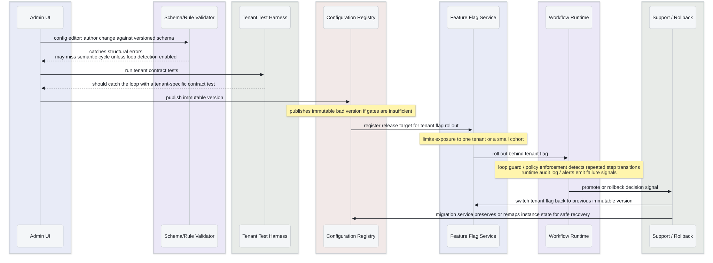</a>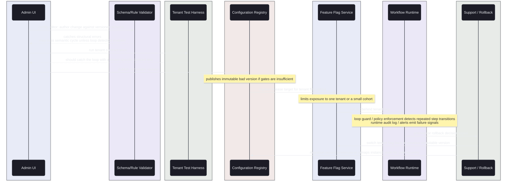<figcaption>Failure-path overlay for the infinite approval loop: each component that shrinks the blast radius. Source figure. Open for full size.</figcaption></figure>

#### Say the reliability story out loud {#walk-reliability-story}

Show judgement out loud. Arbitrary code is off unless explicitly allowed. Each tenant's secrets and adapters live in their own compartment. Risky rules are checked before they go live. Every publish leaves an audit trail. Each external dependency and each irreversible action has a named failure policy. Then connect all of it to supportability: with evidence in hand, the platform can degrade, queue or block, and it never has to guess.

Give every external dependency and every irreversible action an explicit policy for failure and recovery. State that policy at the four levels above, tenant, region, workflow and dependency, and back it with a publish-time invariant so unsafe configuration never reaches production. Hiring teams look for someone who owns safe rollout, support and incident response beyond the happy path, and who guards the product core while customers still feel their workflows bend to fit them. The remaining named failure cases and the six operational primitives are in the [failure handling deep dive](#dive-failure-handling).

### 6. Roll out as a series of proofs {#walk-rollout}

#### Replace one go-live with staged proofs {#walk-proofs}

Once the prototype works, the customer stops asking whether the platform can do the job. They start asking whether they can trust it in production, with their own data, their own approval chains and their own support staff. At that point the FDE stops building demos and turns the architecture into staged delivery, with a measurable gate at every stage.

Plan a sequence of proofs instead of one big go-live:

- **Start with a workflow several customers already share.** Pick its least contested form: one approval path, one integration, one field set and one brand surface. Go deep and show that a real customer need fits the platform with no fork.
- **Bring on one willing customer** who copes with loose ends and gives feedback quickly. Name an owner on our side, keep a single production gate and know the rollback path before the first publish. Release as a **canary** first, to a thin slice of traffic or one low-risk group of tenants. Keep the first launch small enough that support can trace each event, each rejected configuration and each request sent to a downstream system.
- **Widen the configuration surface only on repeated evidence** that the current surface meets real demand, cuts duplicated work and adds no incident risk. Without that rule, the platform turns into a growing pile of tenant-specific debt.

#### Gate each of the four phases {#walk-phases}

Each phase has an owner, exit criteria and a go/no-go gate.

1. **Extract one recurring workflow.** Owner: a product engineer, with the FDE in support. Exit: shared primitives can express the workflow, so no one-off fork is needed. Gate: the team judges the pattern settled enough to build into the platform.
2. **Onboard a willing customer.** Owner: the FDE together with the customer admin. Exit: the customer configures the workflow, finishes a pilot run and raises issues through the support channel. Gate: the customer signs up to the support model and the rollback procedure.
3. **Measure delivery time and defects.** Owner: the platform lead for telemetry and the support lead for classifying incidents. Exit: baseline figures exist for how fast tenants launch, how many defects appear and how often validation fails, captured before any scope is added. Gate: the data shows configuration is cutting custom work, not hiding rework somewhere else.
4. **Expand configuration only after repeated evidence.** Owner: product and platform, deciding together. Exit: a second and a third customer reuse the same mechanism, and the effort is predictable. Gate: a new configuration type is approved only if it reduces forks or support load without adding upgrade risk.

<figure class="source-diagram" id="figure-rollout"><a href="source-assets/adf85b45d11e4606.svg" target="_blank" rel="noopener"></a><figcaption>Four rollout phases, each with an owner and a go/no-go gate, ending in a reusable product pattern. Source figure. Open for full size.</figcaption></figure>

Interviewers tend to push on the gates between phases, so know all four: the pattern is stable; the customer accepts the support and rollback model; the evidence shows configuration cuts custom work; customers two and three reuse it with no fresh build. These gates stop a rollout from becoming "we shipped because the demo went well."

#### Name the owners before launch {#walk-owners}

- **Product owner:** picks the first repeated workflow to turn into a platform path.
- **Platform owner:** looks after the shared core, the configuration schema and the publish service.
- **FDE:** turns the customer's workflow into supported configuration, checks the assumptions and runs the rollout.
- **Support lead:** handles customer communication, triage and escalation during the pilot.
- **SRE / operations lead:** owns monitoring, rollback execution and release health. SRE (site reliability engineering) is the practice and team that keeps production running through on-call, SLOs and incident response.
- **Customer admin / champion:** tests the workflow in their own environment and signs off that it is ready.

#### Define go/no-go and rollback triggers {#walk-triggers}

A configuration may publish only when four things hold: validation passes, the adapters it depends on are healthy, the team has rehearsed the rollback plan, and the customer champion agrees that their business process and the configured workflow still line up.

Roll back on any one of these: validation keeps failing, integrations throw errors nobody predicted, incidents climb among the earliest group of tenants, or a new configuration pattern starts to make approvals unstable.

For a stateful workflow, write the migration plan and the rollback plan separately. Moving the state of running instances is a different job from reverting a configuration version; a rollback that ignores in-flight instances can strand them.

Ship a launch package of four documents: a short guide for admins, a runbook for support, a rollback checklist and a change log. The change log lists which parts customers may configure, which stay fixed and which go to engineering for review.

### 7. Measure whether configuration is replacing forks {#walk-metrics}

#### Track six metrics with owners and alerts {#walk-scorecard}

The scorecard measures the outcome from [step 1](#walk-reframe): variation without forks. Each metric has a data source, an owner and an alert condition.

<p class="figure-caption">The six-metric scorecard.</p>
<div class="source-table-wrap">

| Metric | Definition | Data from | Owner | Alert when |
| --- | --- | --- | --- | --- |
| Time to launch customer | Time from an approved request to a tenant's first successful production workflow | Release tracking and ticket timestamps | Delivery lead | Lead time creeps up across several customers, a sign of brittle config, slow approvals or manual steps |
| Percentage handled by configuration | Share of customer-specific changes delivered as config rather than code | Tags on releases and change requests | Product or platform lead | The share stops rising, which usually means the team is quietly going back to forks |
| Config validation failure rate | Failed publishes divided by all publish attempts | Config service logs | Platform engineering | The rate climbs, pointing to a confusing UX, a weak schema or unsafe requests |
| Fork count | Customer-specific code branches, conditionals or exceptions that cannot be removed | Architecture reviews and repository analysis | Engineering manager | The count grows, since every fork erodes the stable core |
| Upgrade time | Effort to move one customer or tenant onto a new platform version | Release records and migration tickets | Release manager | An upgrade needs one-off scripts or a long freeze window |
| Tenant incident rate | Rolling count of each tenant's incidents, kept separate from platform-wide outages | Incident management system | Support and SRE together | Incidents bunch around one config type or one adapter |

</div>

#### Keep four layers of metrics apart {#walk-layers}

- **Technical health:** publish success rate, validation failures, rollback frequency, latency and incident rate.
- **Model and configuration quality:** do the workflow primitives fit how customers really work? The usual clue is how often customers ask for exceptions.
- **Adoption:** how many customers use the configured workflow, how often each returns, and what share of each customer's process it now handles.
- **Business outcome:** faster launches, less custom engineering, fewer support escalations and quicker growth into new tenants.

Keep the layers separate in an interview. A platform can pass every technical check and still fail commercially because nobody adopts it. It can also be widely adopted and still fail operationally because support cannot keep it stable.

#### Write the dashboard in the user's language {#walk-dashboard}

Lead with the customer's story, then drill into the machinery. The source's headline uses illustrative numbers: "Onboarding for this customer took under two days. It needed zero manual config edits and one validation retry, and there was no incident after launch." Under that headline sit the internal signals, broken out by tenant: rollout status, publish latency, adapter errors, blocked approval loops and failed schema validations.

This answers "what do we watch after launch?" CPU, logs and queue depth are not enough on their own. The dashboard should connect what the customer sees as success to the failure modes inside the system.

### 8. Decide where each exception lives {#walk-placement}

#### Test every exception against four homes {#walk-four-homes}

Sooner or later a customer asks for "just one exception". Each request has four possible homes:

- **Configuration:** fields, routing choices, branding, approver lists and threshold values that differ per customer.
- **Adapter:** integrations that vary by customer behind one common interface, such as CRM, ticketing, email, identity and document systems.
- **Shared service:** capabilities every tenant reuses under one uniform policy, such as validation, audit logging, workflow execution and publish orchestration.
- **Core product:** the building blocks the business model rests on. They stay put, and no new tenant gets to reopen them.

The figure turns this into three questions asked in order. Does the request change the stable business model? If so, it is a core product question, promoted only if proven reusable. If not, is it a customer-specific integration behind a common interface? Then it is an adapter. If not, is it reused across tenants and does it need uniform policy? Then it is a shared service. Anything left is configuration. Asking these questions every time keeps the platform from sliding into per-customer branches nobody can maintain.

<figure class="source-diagram" id="figure-exception"><a href="source-assets/d2bfc78ba58a4f8a.svg" target="_blank" rel="noopener"></a><figcaption>Where a "just one exception" request belongs: core, adapter, shared service or configuration. Source figure. Open for full size.</figcaption></figure>

#### Defend four trade-offs {#walk-tradeoffs}

Each of these pairs has a fair case on both sides. Explain each side before choosing.

- **Configuration versus code.** When tenants vary only in fields, labels, approvals, routing or their choice of connector, use configuration: such differences stay visible, carry version numbers and remain easy to support. Reach for code once the variation changes what the workflow means, adds a new invariant, or would twist the configuration language into a programming language nobody can read. The weak line is "make everything configurable". A better one: "Put the common variations in declarative config. When a rule becomes bespoke business behaviour, promote it to reviewed, isolated code."
- **Generic engine versus domain product.** One generic engine can host many tenants, but if it tries to model every business process it becomes too abstract to use. A domain product does less but is simpler to use and cheaper to support. Combine them: a stable core built from workflow primitives the company knows it can support repeatedly, with a constrained domain model on top. Aim at the workflow family the business intends to own, not at endless extensibility.
- **Plugin flexibility versus security.** Plugins let teams wire in unusual customer systems without touching the core, so customers go live faster. The price is a larger attack surface. Contain it: run extensions in a sandbox, give them minimal permissions, fix their interfaces, and manage every plugin as a reviewed, versioned and observable artifact. Once a plugin can read lots of data or run any code it likes, it is no longer simple; treat it as a trusted service boundary.
- **Backward compatibility versus simplification.** Compatibility shields existing tenants and keeps running workflows intact. Simplification keeps the platform easy to understand and maintain. A good answer values both and proposes a clear deprecation policy: versioned schemas, migration windows, compatibility tests and a short list of supported generations. Promising to "support everything forever" is the weak answer; it turns support work into archaeology.

#### Keep a risk register as part of running the platform {#walk-risk-register}

The register names each major risk with an owner, a mitigation and the signal that triggers action. Treat it as part of operating the platform, not an appendix.

<p class="figure-caption">The risk register.</p>
<div class="source-table-wrap">

| Risk | Owner | Mitigation | Trigger |
| --- | --- | --- | --- |
| Infinite approval loop | Platform engineer | Detect cycles and validate at publish time | The same approval state is entered again and again |
| Adapter mismatch | Integration engineer | Contract tests plus explicit adapter versions | Calls fail after a publish, or the schema drifts |
| Customer confusion during rollout | FDE | Training, playbooks and guided setup | Support volume is high, or validation errors keep repeating |
| Unsupported fork pressure | Product manager | Clear grounds for refusing bespoke code, plus a review board for exceptions | A request cannot be expressed in configuration |

</div>

#### Know when the platform is finished {#walk-finished}

Forward-deployed teams want people who carry work past the prototype until customers adopt it, then distil what customers said into a pattern the product can reuse. The source's definition of finished has three parts: customers rely on the platform, the workflow keeps improving, and operations can run it with no heroics. This is the conversation an FDE holds whenever one customer's problem becomes a product feature that is safe to ship.

## Technical deep dives

### Four records and who owns them {#dive-records}

Interviewers trust concrete state more than abstractions. Tie the riskiest parts of the design to records, contracts and a little code. Say what is durable and what can change, what carries a version, what gets deployed, and what the system does when an identical request arrives a second time. Four records carry the design.

#### WorkflowTemplate: the shared blueprint {#dive-template}

`WorkflowTemplate(id, engine_version, schema)` is owned by product and platform. `id` is the primary key. `engine_version` names the evaluator and renderer that can read this template. `schema` sets the permitted shape of fields, approvals and integrations.

Its lifecycle is `draft → published`. Once published, the artifact never changes; new behaviour needs a new template version. Published templates are retained for as long as the product or contract window lasts, because older tenant configurations must still resolve against the precise template they were validated with. Drafts can be garbage-collected once they have sat idle for a safe period.

#### TenantConfig: one customer's overlay {#dive-tenant-config}

`TenantConfig(tenant_id, template_id, version, values)` is the overlay one customer applies on top of a template. In practice its key is `(tenant_id, version)`. `values` carries only the tenant parameters that the template schema permits.

Its lifecycle is `draft → validated → deployed` or `rolled_back`. When validation fails, the record goes back to `draft/needs_fix` and keeps its version number. Every published and rolled-back version is retained, so audit and rollback both work; drafts follow platform policy and are dropped once abandoned or superseded. What the values mean for the business is the tenant's decision. Validating and storing them is the platform's job.

#### AdapterDefinition: the contract with one downstream system {#dive-adapter-definition}

`AdapterDefinition(name, contract_version, permissions)` is the contract for talking to one downstream system, such as CRM, ticketing, storage or messaging. `name` plus `contract_version` form the key. `permissions` lists the scopes and capabilities the adapter needs, so the platform can reject a configuration that requests an adapter it has no safe way to call.

The platform or integrations team runs it. Contracts ship as versions and retire only when no active tenant configuration still relies on them. Retired definitions stay available for past deployments and debugging, flagged inactive so a new configuration cannot select them.

#### ConfigDeployment: the deployment ledger {#dive-ledger}

`ConfigDeployment(tenant_id, version, state)` is the deployment ledger. It alone decides which of `draft`, `validated`, `deployed`, `rolled_back` or `failed` applies, and ops and support read it to see which version is live at this moment. The feature flag service also holds state about what is live, so the two must not drift apart. Either derive flag state from ledger events, or write the ledger event first and have the flag change replay from it until it succeeds; otherwise a rollback can be recorded while the old flag still serves the bad version.

Each state change is appended; nothing is rewritten in place. A rollback adds a fresh deployment event that points at an earlier good version. The whole history is retained for the full support and audit window, because incident reviews, customer support and change tracking all depend on it.

<p class="figure-caption">The four records, their owners and their lifecycles.</p>
<div class="source-table-wrap">

| Record | Key | Owner | Lifecycle | Retention |
| --- | --- | --- | --- | --- |
| WorkflowTemplate | `id` | Product and platform | draft → published; immutable once published | Published: product or contract window. Idle drafts: garbage-collected |
| TenantConfig | `(tenant_id, version)` | The customer (values); the platform validates and stores | draft → validated → deployed or rolled_back; failed validation returns to draft/needs_fix | All published and rolled-back versions |
| AdapterDefinition | `name` + `contract_version` | Integrations team | Versioned; retired when no active config uses it | Retired versions kept, flagged inactive |
| ConfigDeployment | `(tenant_id, version)` events | Ops | Append-only state transitions | Full support and audit window |

</div>

Separate owners stop the records from tangling. Product owns the template, the customer owns the tenant configuration, integrations owns the adapter contract and ops owns the deployment record. Blur those lines and per-customer forks return.

If an interviewer asks what tells you which version is live, the answer is `ConfigDeployment`, not `TenantConfig`. A tenant can have many configuration versions, validated and waiting; only the ledger records which one is deployed. Because its transitions are append-only, support can see what is running now and how it got there, and a rollback becomes a new event rather than an edit in place.

### API contracts and idempotent deployment {#dive-apis}

#### Four API contracts {#dive-contracts}

At interview scale, show one bounded declarative contract plus a write path that stops unsafe input before the registry ever sees it. That proves three things: the platform accepts limited configuration, checks it and publishes it as an immutable version. Four endpoints cover the lifecycle.

`POST /v1/configurations/validate` takes a draft tenant configuration and returns validation errors plus a normalised preview. It never publishes anything.

- **Auth:** a bearer token or session scoped to the caller's tenant; authorisation permits validation only for tenants the caller may administer.
- **Body:** `template_id`, `version`, `values`, and an optional `idempotency_key` so validation traces can be replayed. The call has no write effects, so retrying it is safe anyway.
- **Responses:** 200 OK for a good preview; 400 Bad Request when the structure is wrong; 403 Forbidden for a tenant mismatch or missing rights; 422 Unprocessable Content when schema or policy rules fail.

`POST /v1/tenants/{id}/deployments` starts a deployment for a tenant, usually from a configuration version that already passed validation. It returns the deployment ID and its state.

- **Auth:** the caller must belong to tenant `{id}` or hold a delegated ops role. The server refuses any attempt to deploy into another tenant.
- **Idempotency:** because this call creates something, it requires an idempotency key, a client-chosen identifier that lets the server recognise a retry. The same key with an identical body returns the same result. The same key with a different body gets 422 Unprocessable Content, as the IETF Idempotency-Key draft recommends. A retry that arrives while the first request is still in progress gets 409 Conflict.
- **Errors:** 401 Unauthorized when credentials are absent or expired; 403 Forbidden when tenant permission is missing; 404 Not Found when the named configuration version does not exist; 409 Conflict for a stale optimistic-concurrency token or a key that is still in flight; 422 Unprocessable Content when syntax passes but policy fails, or when a key is reused with a different payload.

`POST /v1/adapters/{name}/test` runs an adapter mapping against a harmless test payload or a sandbox endpoint.

- **Auth:** limited to integration maintainers or tenant admins.
- **Body:** the adapter name, a test payload, the mapping and an optional sandbox selector. An idempotency key is accepted too, so a retry does not produce a second test run or a second audit entry.
- **Errors:** 404 Not Found for an unknown adapter; 403 Forbidden when permission is lacking; 422 Unprocessable Content when the mapping cannot be applied; 502 Bad Gateway, or something like it, when the sandbox dependency fails.

`POST /v1/deployments/{id}/rollback` records a new rollback state for that tenant and leaves the old deployment untouched.

- **Auth:** the caller needs tenant scope and either raised ops rights or an explicit sign-off route.
- **Body:** identifies the target deployment or the earlier good version, and carries an idempotency key, because rollback writes state and may be retried after a failure. On success the caller gets the new deployment record; the previous record is never overwritten.
- **Errors:** 404 Not Found when no deployment has that ID; 409 Conflict when the live state has changed so much that rolling back is unsafe; 422 Unprocessable Content when the target version no longer fits the current template or adapter contract.

<p class="figure-caption">The four endpoints at a glance.</p>
<div class="source-table-wrap">

| Endpoint | Writes state? | Idempotency key | Distinctive errors |
| --- | --- | --- | --- |
| `POST /v1/configurations/validate` | No; never publishes | Optional, for replaying traces | 400 structure, 403 tenant, 422 schema or policy |
| `POST /v1/tenants/{id}/deployments` | Yes; creates a deployment | Required | 401, 403, 404 version, 409 stale token or in flight, 422 policy or changed payload |
| `POST /v1/adapters/{name}/test` | Audit entry only | Accepted | 404 adapter, 403, 422 mapping, 502 sandbox |
| `POST /v1/deployments/{id}/rollback` | Yes; appends a rollback state | Required | 404, 409 unsafe live state, 422 target no longer fits |

</div>

Rules shared by all four: authentication and authorisation are tenant-aware, and writes across tenants are refused. Create-style calls demand an idempotency key. A repeat with the same key and body returns the same answer. A reused key with a new body is rejected; it never becomes a quiet update.

#### Walk through an idempotent deployment {#dive-idempotency}

Follow one deployment through a timeout. An ops client calls `POST /v1/tenants/acme/deployments` with the body `{configVersion: 17, templateId: "tpl-9"}` and the key `deploy-2024-11-18-001`.

1. The server creates deployment `dep-555` and replies 201 Created with `deployment_id=dep-555` and `state=deployed`. The write log stores the idempotency key alongside the result and a fingerprint of the request body, scoped to the tenant and caller so one tenant's key can never replay another tenant's deployment. Keys are kept for a published retention window, after which the same key starts a new request.
2. The client times out before reading the reply and retries with the same key and body. No `dep-556` may appear. The reply is identical and still refers to `dep-555`.
3. The client then retries with the same key but sends `configVersion: 18`. The payload no longer matches what the key was first used for, so the server answers 422 Unprocessable Content.

<figure class="source-diagram" id="figure-idempotency"><a href="source-assets/4fd6b7e1a6dc8fda.svg" target="_blank" rel="noopener">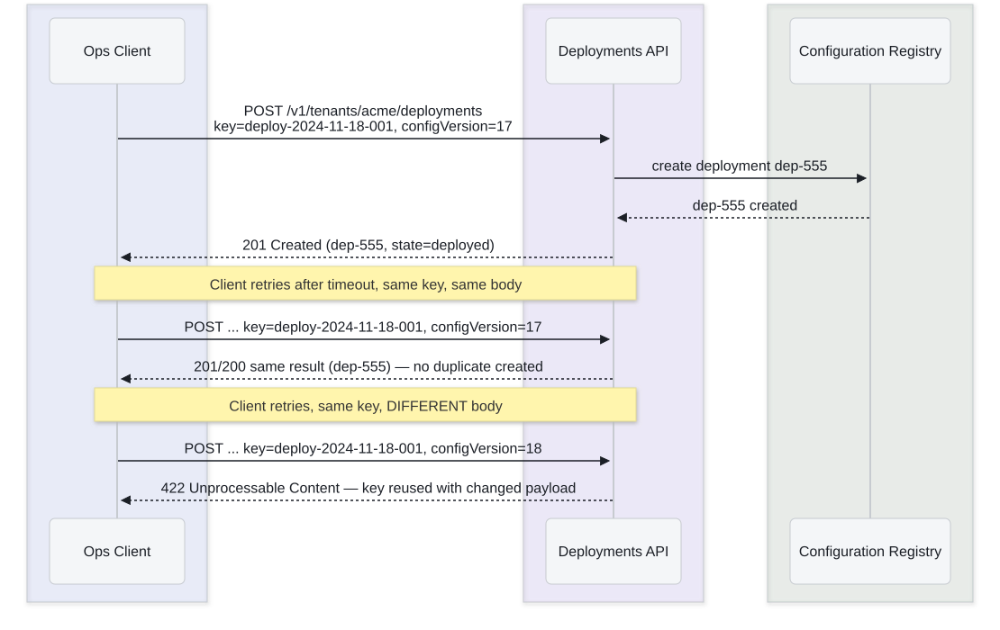</a>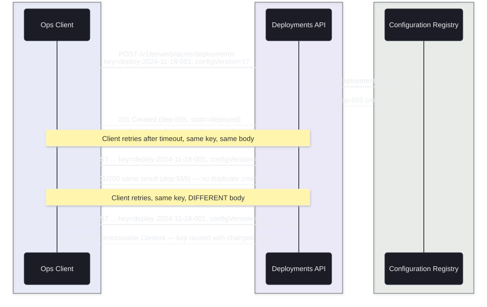<figcaption>Idempotent deployment creation: same key and body returns dep-555; same key with a changed body returns 422. Source figure. Open for full size.</figcaption></figure>

The second step protects against duplicate side effects; the third protects against a client accidentally reusing a key for a different intent. Without the third check, a retry with changed data could silently deploy the wrong version under an old key.

#### What a production service adds {#dive-production-additions}

The whiteboard version omits four things on purpose. A production service needs them all.

- **Optimistic concurrency.** Each write states the template or configuration version it expects to replace, so two operators cannot race and silently overwrite each other. If the expected version travels in the body, a mismatch returns 409 Conflict. If it travels in an `If-Match` header, HTTP semantics call for 412 Precondition Failed.
- **Idempotency.** Retrying after a timeout must never yield a second deployment or a second version.
- **Bounded, safe retries.** Retry only failure types that are safe to repeat. Never replay a rejected validation or authorisation; that rejection is not transient.
- **Observability.** Each validation, deployment, adapter test and rollback carries the request ID, the tenant ID, the idempotency key and the configuration version. Support can then rebuild exactly what happened without combing through application logs.

### The publish path in code {#dive-publish-code}

#### The smallest safe publication path {#dive-publish-sketch}

Configuration publication carries the most risk. Bad structure, broken mappings or faulty versioning at this step can take production down. The source's TypeScript sketch is small but contains every control point a live system needs. It belongs to the source case as an illustration; this page does not run it.

```ts
type JsonValue = string | number | boolean | null | JsonValue[] | { [key: string]: JsonValue };
type JsonLogic = { op: string; args?: JsonValue[] };
type WorkflowConfig = {
  version: 1;
  fields: Array<{ key: string; type: "text" | "number" | "date"; required: boolean }>;
  approvals: Array<{ when: JsonLogic; role: string; slaHours: number }>;
  integrations: Array<{ adapter: string; mapping: Record<string, string> }>;
};
type ValidationError = { path: string; code: string; message: string };
type PublishResult =
  | { ok: true; configId: string; version: number }
  | { ok: false; errors: ValidationError[] };
class ConfigValidationError extends Error {
  constructor(public errors: ValidationError[]) {
    super("Configuration validation failed");
  }
}
function isPlainObject(value: unknown): value is Record<string, unknown> {
  return typeof value === "object" && value !== null && !Array.isArray(value);
}
function validateWorkflowConfig(input: unknown): WorkflowConfig {
  const errors: ValidationError[] = [];
  if (!isPlainObject(input)) {
    throw new ConfigValidationError([{ path: "$", code: "invalid_type", message: "Expected an object" }]);
  }
  if (input.version !== 1) {
    errors.push({ path: "version", code: "unsupported_version", message: "Only version 1 is supported" });
  }
  if (!Array.isArray(input.fields) || input.fields.length === 0) {
    errors.push({ path: "fields", code: "required", message: "At least one field is required" });
  }
  if (!Array.isArray(input.approvals)) {
    errors.push({ path: "approvals", code: "invalid_type", message: "Approvals must be an array" });
  }
  if (!Array.isArray(input.integrations)) {
    errors.push({ path: "integrations", code: "invalid_type", message: "Integrations must be an array" });
  }
  if (errors.length > 0) {
    throw new ConfigValidationError(errors);
  }
  return input as WorkflowConfig;
}
function validatePolicy(config: WorkflowConfig): void {
  const seenRoles = new Set<string>();
  for (const approval of config.approvals) {
    if (!approval.role || typeof approval.slaHours !== "number" || !(approval.slaHours > 0)) {
      throw new ConfigValidationError([
        { path: "approvals", code: "invalid_approval", message: "Each approval must have a role and positive SLA" },
      ]);
    }
    if (seenRoles.has(approval.role)) {
      throw new ConfigValidationError([
        { path: "approvals", code: "duplicate_role", message: `Duplicate approval role: ${approval.role}` },
      ]);
    }
    seenRoles.add(approval.role);
  }
}
function validateAdapterMappings(config: WorkflowConfig, allowedAdapters: Set<string>): void {
  for (const integration of config.integrations) {
    if (!allowedAdapters.has(integration.adapter)) {
      throw new ConfigValidationError([
        { path: "integrations", code: "unknown_adapter", message: `Unknown adapter: ${integration.adapter}` },
      ]);
    }
    for (const [from, to] of Object.entries(integration.mapping)) {
      if (!from || !to) {
        throw new ConfigValidationError([
          { path: `integrations.${integration.adapter}.mapping`, code: "invalid_mapping", message: "Mappings must not contain empty keys" },
        ]);
      }
    }
  }
}
class Registry {
  private store = new Map<string, { version: number; config: WorkflowConfig; snapshot: string }[]>();
  putImmutable(configId: string, config: WorkflowConfig): { version: number } {
    const versions = this.store.get(configId) ?? [];
    const nextVersion = versions.length + 1;
    const snapshot = JSON.stringify(config);
    versions.push({ version: nextVersion, config, snapshot });
    this.store.set(configId, versions);
    return { version: nextVersion };
  }
  versions(configId: string): readonly { version: number; snapshot: string }[] {
    return this.store.get(configId) ?? [];
  }
}
function publish(configId: string, raw: unknown, allowedAdapters: Set<string>, registry: Registry): PublishResult {
  try {
    const config = validateWorkflowConfig(raw);
    validatePolicy(config);
    validateAdapterMappings(config, allowedAdapters);
    const result = registry.putImmutable(configId, config);
    return { ok: true, configId, version: result.version };
  } catch (error) {
    if (error instanceof ConfigValidationError) {
      return { ok: false, errors: error.errors };
    }
    return {
      ok: false,
      errors: [{ path: "$", code: "internal_error", message: "Unexpected failure during publish" }],
    };
  }
}
```

Each part teaches one control:

- `WorkflowConfig` limits the shape to a declarative contract with a version.
- `JsonValue` and `JsonLogic` express approval conditions as data, leaving no route for arbitrary code.
- `ValidationError` gives the API a fixed vocabulary of error codes.
- `validateWorkflowConfig` validates types at the boundary, so malformed payloads stop before any business logic runs.
- `validatePolicy` keeps authorisation and workflow rules apart from structural checks; here it rejects an approval without a role or a positive numeric SLA, and a duplicate approval role. The SLA test is written as `!(slaHours > 0)` with a type check because `undefined <= 0` is false in JavaScript, so a missing SLA would otherwise pass.
- `validateAdapterMappings` compares the integration surface with an allowlist instead of trusting whoever wrote the configuration, and rejects empty mapping keys.
- `Registry.putImmutable` appends each write as a new version and never edits or replaces an earlier one; `Registry.versions` reads them back without exposing the store for writing.
- `publish` runs the checks in the one order that holds up: parse → validate → authorise-by-policy → persist. Any expected failure returns structured errors; anything unexpected returns a generic `internal_error` rather than a partial write.

<figure class="source-diagram" id="figure-publish-order"><a href="source-assets/921e87e0926a0de3.svg" target="_blank" rel="noopener"></a><figcaption>Parse → validate → authorise-by-policy → persist, with a failure exit at every stage. Source figure. Open for full size.</figcaption></figure>

Memorise that sequence and reuse it elsewhere, and expect "why that order?" Cheap structural checks come first and fail fast, so the costlier policy and adapter checks only run on sound input. Nothing is written until every earlier step passes, so the path **fails closed**: an error leaves the registry exactly as it was.

The registry keeps every version. Each publish appends an entry to the configuration's version list, and `snapshot` holds the configuration exactly as it was published, so any earlier version can be read back or redeployed. The in-memory list stands in for durable storage; a production registry stores each artifact under `(configId, version)`, usually with a content digest beside it.

#### Pin the contract and inject a failure {#dive-tests}

A strong answer brings two tests. One pins the contract; the other injects a failure.

```ts
import { describe, it, expect } from "vitest";
describe("publish", () => {
  it("rejects duplicate approval roles and returns a structured validation error", () => {
    const registry = new Registry();
    const result = publish(
      "cfg-1",
      {
        version: 1,
        fields: [{ key: "requester", type: "text", required: true }],
        approvals: [
          { when: { op: "always" }, role: "manager", slaHours: 24 },
          { when: { op: "always" }, role: "manager", slaHours: 24 },
        ],
        integrations: [],
      },
      new Set(["crm"]),
      registry,
    );
    expect(result.ok).toBe(false);
    if (!result.ok) {
      expect(result.errors[0].code).toBe("duplicate_role");
    }
  });
  it("survives an adapter allowlist miss without publishing state", () => {
    const registry = new Registry();
    const result = publish(
      "cfg-2",
      {
        version: 1,
        fields: [{ key: "requester", type: "text", required: true }],
        approvals: [{ when: { op: "always" }, role: "manager", slaHours: 24 }],
        integrations: [{ adapter: "unknown", mapping: { a: "b" } }],
      },
      new Set(["crm"]),
      registry,
    );
    expect(result.ok).toBe(false);
    expect(registry.versions("cfg-2")).toHaveLength(0);
  });
});
```

The contract test shows the API rejecting a configuration that is structurally sound but breaks policy: two approvals for the same `manager` role produce `duplicate_role`. The failure-injection test feeds in an adapter outside the allowlist and confirms that publishing fails closed: the result is a failure, and `registry.versions("cfg-2")` is still empty, so nothing was written.

A real service would add more: tests for duplicate idempotency keys, tests for deployment rollback, and a concurrency test proving that stale versions are refused. Teams hire FDEs who can go from a customer's workflow pain to a state model, then to API semantics, then to validation code fit for production.

#### An interview-sized production sketch with caps {#dive-production-sketch}

The second sketch is deliberately narrow. It shows one publish-path invariant: a configuration that names an unknown adapter is refused before it can go live. The source chose its caps as stand-ins, not platform standards: 50 fields, 10 approvals, 20 integrations and a 168-hour SLA (one week). A real companion repository would also need tested dependencies, fuller schema validation, structured logging and a link to a real persistence layer.

```ts
export type WorkflowConfig = {
  tenantId: string;
  version: number;
  fields: Array<{ key: string; type: string; required?: boolean }>;
  approvals: Array<{ when: Record<string, unknown>; role: string; slaHours?: number }>;
  integrations: Array<{ adapter: string; mapping: Record<string, string> }>;
};
export type AdapterRegistry = {
  has(adapterName: string): boolean;
};
export type PublishResult =
  | { ok: true; activatedVersion: number }
  | { ok: false; error: string };
const ALLOWED_FIELD_TYPES = new Set(["text", "number", "date", "boolean", "email"]);
const MAX_FIELDS = 50;
const MAX_APPROVALS = 10;
const MAX_INTEGRATIONS = 20;
function isPlainObject(value: unknown): value is Record<string, unknown> {
  return typeof value === "object" && value !== null && !Array.isArray(value);
}
function validateConfig(config: WorkflowConfig, registry: AdapterRegistry): string | null {
  if (!config.tenantId || typeof config.tenantId !== "string") return "invalid tenantId";
  if (!Number.isInteger(config.version) || config.version < 1) return "invalid version";
  if (!Array.isArray(config.fields) || config.fields.length > MAX_FIELDS) return "invalid fields";
  if (!Array.isArray(config.approvals) || config.approvals.length > MAX_APPROVALS) return "invalid approvals";
  if (!Array.isArray(config.integrations) || config.integrations.length > MAX_INTEGRATIONS) return "invalid integrations";
  const seenFields = new Set<string>();
  for (const field of config.fields) {
    if (!field || typeof field.key !== "string" || !field.key.trim()) return "invalid field key";
    if (seenFields.has(field.key)) return "duplicate field key";
    seenFields.add(field.key);
    if (!ALLOWED_FIELD_TYPES.has(field.type)) return `unsupported field type: ${field.type}`;
  }
  for (const approval of config.approvals) {
    if (!approval || typeof approval.role !== "string" || !approval.role.trim()) return "invalid approval role";
    if (!isPlainObject(approval.when)) return "invalid approval condition";
    if (approval.slaHours !== undefined && (!Number.isInteger(approval.slaHours) || approval.slaHours < 1 || approval.slaHours > 168)) {
      return "invalid approval slaHours";
    }
  }
  for (const integration of config.integrations) {
    if (!integration || typeof integration.adapter !== "string" || !integration.adapter.trim()) return "invalid adapter name";
    if (!registry.has(integration.adapter)) return `unknown adapter: ${integration.adapter}`;
    if (!isPlainObject(integration.mapping)) return "invalid adapter mapping";
  }
  return null;
}
export function publish(config: WorkflowConfig, registry: AdapterRegistry): PublishResult {
  const error = validateConfig(config, registry);
  if (error) {
    return { ok: false, error };
  }
  return { ok: true, activatedVersion: config.version };
}
export function configWithAdapter(adapterName: string): WorkflowConfig {
  return {
    tenantId: "tenant-acme",
    version: 1,
    fields: [{ key: "requester", type: "text", required: true }],
    approvals: [{ when: { op: "always" }, role: "manager", slaHours: 24 }],
    integrations: [{ adapter: adapterName, mapping: { a: "b" } }],
  };
}
// Example failure test.
describe("publish", () => {
  it("rejects an unknown adapter", () => {
    const registry: AdapterRegistry = { has: (adapterName: string) => adapterName === "crm" };
    expect(() => {
      const result = publish(configWithAdapter("arbitrary-shell"), registry);
      if (result.ok) throw new Error("expected publish to fail");
      throw new Error(result.error);
    }).toThrow(/unknown adapter/);
  });
  it("accepts a known adapter", () => {
    const registry: AdapterRegistry = { has: (adapterName: string) => adapterName === "crm" };
    const result = publish(configWithAdapter("crm"), registry);
    expect(result.ok).toBe(true);
  });
});
```

Compared with the first sketch, this one adds the expressive-power caps from [step 3](#walk-envelope): field, approval and integration counts, an allowlist of five field types, duplicate field keys and an SLA bounded to 1–168 hours. It returns a single error string rather than structured errors, and it only validates; it does not persist. The test makes the invariant plain without claiming the code is finished: a configuration naming `arbitrary-shell`, an adapter the platform has never heard of, cannot be activated, and publish fails closed long before runtime.

### Failure cases, primitives and runbooks {#dive-failure-handling}

#### Four more named failure cases {#dive-failure-cases}

The [loop drill](#walk-loop-drill) is the headline failure. Four others need a named mitigation.

- **Adapter contract changes.** A downstream service renames a field the platform relies on, or changes the shape of its response. Every tenant on that adapter breaks at the same moment. Mitigate by versioning adapters, pinning the schema each one expects, adding compatibility checks, and quarantining any mismatch rather than letting it pass as a quiet partial success.
- **A tenant upgrade breaks an old field mapping.** After a tenant upgrades from version 1 to version 2, integrations built earlier may still rely on the mapping it replaced. Mitigate with versioned field maps and a validated migration. Keep the old mapping running until every execution that uses it has drained.
- **An untested feature-flag combination.** Two toggles can each be safe alone and still create a bad path together. Mitigate with a matrix of combinations known to be safe for high-risk flags, and ban unsupported combinations in production. At launch, any combination nobody has reviewed fails closed.
- **Custom code escapes the sandbox.** Once customer-defined logic runs anywhere, a sandbox breakout is a high-severity event. Mitigate by leaving arbitrary code switched off by default. Where a sandbox exists, give it least privilege, resource caps, limits on outbound network traffic and its own approval gates. A breakout should shut the extension path and start incident response.

#### Six operational primitives {#dive-primitives}

At each failure, the system picks the least dangerous next state. Six primitives make that possible:

- **Timeouts:** each adapter gets its own explicit timeout, so one hung dependency cannot stall the whole workflow.
- **Retries:** retry only operations that are transient and idempotent; cap the attempts and back off between them.
- **Idempotency:** any write the outside world can see carries an idempotency key, or another way to deduplicate, so a retry never repeats a side effect.
- **Circuit breakers:** when a dependency is plainly unhealthy, open the breaker. It sheds traffic at once instead of letting doomed requests pile up.
- **Dead-letter handling:** once automation has used up its safe retries, repeat failures go to a dead-letter queue or a failure inbox where a person can inspect them.
- **Human escalation:** a person steps in when the action cannot be undone, when the configuration is unclear, or when the evidence points to a policy breach rather than a passing outage.

#### Write evidence and runbooks before launch {#dive-runbooks}

Audit evidence and runbooks must exist before launch. They cover who may publish configuration, how versions get approved, how to switch off a bad workflow, how to rotate adapters, how to revoke secrets, and how to replay one tenant's incident without exposing another tenant's data. A team that cannot write these answers down in calm conditions will not find them in the middle of an outage.

### Cost, build or buy, regulation and AI authoring {#dive-gaps}

#### How the source graded itself {#dive-coverage-review}

The source reviewed its guide once against a 20-point checklist for design case studies. Sixteen items were met; four fell short as deliberate choices of scope: unit cost by driver, build or buy, regulation and governance, and responsible AI. The source counted eight stakeholder groups by including the four roles beneath the four groups. The table records each verdict with the place in this casebook that now covers it.

<p class="figure-caption">The source's 20-point coverage review, mapped to this casebook.</p>
<div class="source-table-wrap">

| Phase | Item | Source verdict | Where it is covered here |
| --- | --- | --- | --- |
| Problem framing and discovery | 1. Feature request turned into a business outcome | Met | [Step 1](#walk-reframe) |
| | 2. Who the stakeholders are | Met; eight groups and roles | [Step 1](#walk-stakeholders) |
| | 3. Questions whose answers reshape the design | Met; six-question tree | [Step 2](#walk-six-questions) |
| | 4. Splitting and ranking requirements | Met | [Step 2](#walk-functional) |
| | 5. What is out of scope | Met; five MVP non-goals | [Step 2](#walk-scope) |
| Estimation and architecture | 6. Rough sizing and capacity arithmetic | Met; worked estimate, envelope, sensitivity table | [Step 3](#walk-sizing) |
| | 7. Cost per unit, split by driver | Partly met; no table separates cost drivers | [Cost model below](#dive-cost-model) |
| | 8. Whole architecture and data flow | Met | [Step 4](#walk-architecture) |
| | 9. Records and API contracts | Met; four records, four contracts | [Records](#dive-records), [APIs](#dive-apis) |
| | 10. Build or buy, vendor or model | Not met | [Build or buy below](#dive-build-buy) |
| Trade-offs, security and reliability | 11. Named trade-offs with fair verdicts | Met; four pairs | [Step 8](#walk-tradeoffs) |
| | 12. Threats and controls | Met; four controls | [Step 5](#walk-controls) |
| | 13. Failure drills | Met; loop drill, four more cases, six-row policy table | [Step 5](#walk-loop-drill), [failure cases](#dive-failure-cases) |
| | 14. How the system is tested | Met; contract, failure-injection and invariant tests | [Publish path](#dive-tests) |
| Delivery, governance and communication | 15. Layered metrics and observability | Met; six metrics in four layers | [Step 7](#walk-metrics) |
| | 16. Staged rollout, risk register, rollback gates | Met | [Step 6](#walk-phases), [risk register](#walk-risk-register) |
| | 17. Regulation and governance depth | Not met; no data residency or industry audit regimes | [Regulation below](#dive-regulation) |
| | 18. Responsible AI and non-obvious risks | Not met; no AI component | [AI authoring below](#dive-ai-authoring) |
| | 19. How people adopt the change | Met | [Step 6](#walk-proofs) |
| | 20. Talk plan and self-scoring rubric | Met | [Practice](#practice-interview) |

</div>

The source's author added a perspective on each gap. Use these if an interviewer presses on one.

#### A four-line cost model {#dive-cost-model}

Base the cost model on the [four-step capacity envelope](#walk-envelope). Four lines are enough. Line one prices each validated version: the CPU and network spent on schema, policy, dependency and dry-run checks. Line two prices each deployment; fan-out to tenant instances and downstream sync jobs drives it, while raw edit volume barely matters. Line three is the price of each second a plugin runs in the sandbox. Line four is storage for the version graph and the append-only `ConfigDeployment` ledger.

Say one driver out loud: tenants, not the platform design, set validation cost. Forms with deep branching or rules with many clauses make validation dearer even when nothing on the platform side changes. So the limits on expressive power (maximum fields, maximum rule clauses, bounded plugin windows) control cost as much as they control safety.

Report cost per tenant, line by line. One noisy tenant then shows up clearly instead of disappearing into a platform total, and "should this customisation sit in config or in an adapter?" becomes a debate about real figures.

#### Build the engine, buy the commodity {#dive-build-buy}

The obvious build-or-buy question is the workflow and rules engine. We could build the declarative engine described in this case, or buy a BPM (business process management) or workflow-orchestration product, such as a commercial rules engine or workflow-as-a-service, and keep the same control-plane and data-plane split around it.

A rule of thumb: buy what is already solved and commoditised, where the vendor owns its security record and competes on it. Identity and SSO (single sign-on, one company login for every app) federation is the standard example, and it fits here if customer admins must log in through an enterprise IdP (identity provider). Build the workflow engine, though. What sets this platform apart is its constrained, tenant-safe configuration model, with validation, versioning and sandboxing. No vendor can take responsibility for that, and it is what the interviewer wants to see designed.

The adapter SDK falls between the two. Where a connector framework already exists for a common system such as CRM or ticketing, reuse or buy it. Keep the adapter contract and its permission model in-house, because the security controls in [step 5](#walk-controls) depend on that trust boundary.

#### Regulation, residency and audit {#dive-regulation}

The design already isolates tenants: it separates the control plane from the data plane, partitions data by tenant ID and scopes each adapter to one tenant. Data residency extends that. When customers live under different jurisdictions, the configuration registry and the workflow audit store may need region-fixed storage. `TenantConfig` and `ConfigDeployment` would each gain a region field, and the deployment ledger could then show where every tenant's data was held and where its workflows ran.

Tie this to the audit control that logs who published each configuration version. That durable log already answers most of what a SOC 2 auditor asks under change-management criterion CC8.1, or what a review of SOX (the Sarbanes-Oxley Act, the US law on financial-reporting controls) IT general controls asks: who signed off, what was tested and what shipped. It does less for HIPAA (the Health Insurance Portability and Accountability Act, the US law protecting health data) if the workflow handles health data, because HIPAA's audit-control rule targets activity on any system storing that data, beyond configuration changes alone. The remaining gap is modest: an explicit retention period per regulation, added to the retention rules on the [four records](#dive-records).

Raise this in an interview before anyone asks. Pick one regulation that matches the customer's industry; SOX-style segregation of duties for approval workflows in financial services is a good example. Then show how the existing approval roles and audit trail satisfy it, with no new infrastructure.

#### Responsible AI, and AI-assisted authoring {#dive-ai-authoring}

Nothing in this design is AI. Its "intelligence" is deterministic validation, policy checks and rule evaluation. Bolting on a responsible-AI story would sound hollow, so tell the interviewer that directly instead of reaching for generic AI-safety wording.

That may change. A later release might add an AI helper for authoring, for example one that drafts an approval graph from a plain-language description. The fail-closed stance applies unchanged: whatever the AI proposes is untrusted input. It passes through the same schema, policy and cycle-detection gates as configuration a person wrote, and it never gets a route around them.

Under pressure, state the trade-off. AI-assisted authoring adds risk at the boundary this design already treats as hostile, the path from config editor to validator. It raises the volume of untrusted input that reaches the validator; the trust model stays the same.

### References {#dive-references}

The source checked these references on 27 September 2026. Each supports a specific claim in the case.

- [The Idempotency-Key HTTP Header Field (IETF draft -07)](https://www.ietf.org/archive/id/draft-ietf-httpapi-idempotency-key-header-07.html): 422 for a reused key with a different body, 409 for a retry while the first request is still running, and replay returning the original result. Used in the [deployment contract](#dive-contracts).
- [RFC 9110: HTTP Semantics](https://www.rfc-editor.org/rfc/rfc9110.html): the meanings of 409 Conflict, 412 Precondition Failed for a failed `If-Match`, and the 422 Unprocessable Content name. Used in [optimistic concurrency](#dive-production-additions).
- [AICPA 2017 Trust Services Criteria (revised points of focus, 2022)](https://www.aicpa-cima.com/resources/download/2017-trust-services-criteria-with-revised-points-of-focus-2022): SOC 2 change-management criterion CC8.1. Used in [regulation](#dive-regulation).
- [PCAOB AS 2201: An Audit of Internal Control Over Financial Reporting](https://pcaobus.org/oversight/standards/auditing-standards/details/AS2201): SOX audits test IT controls, including program changes and segregation of duties.
- [45 CFR 164.312(b), HIPAA audit controls](https://www.law.cornell.edu/cfr/text/45/164.312): HIPAA's audit rule covers activity on systems holding health data.

## Practice

### Attempt the design on a blank page {#practice-prompt}

The source worksheet's prompt: as the FDE, shape a Configurable Platform for Customer-Specific Workflows. Ten customers share one platform, yet each wants its own fields, approval steps, branding and integrations. Avoid ending up with ten separate forks.

Work through the worksheet's eleven parts before opening any answer. Write your notes in the fields below; they stay in this browser.

1. **Clarify the customer problem.** Which differences keep coming back, and which happen only once? Who writes the configuration: our engineers, the customer's admins, or both? Does each configuration have to keep working, unchanged, across core releases? Where is custom code allowed: in the core, in a sandbox, or only inside adapters? How long should it take to configure a new customer?
2. **Users and workflows.** For each user, fill in the workflow, the current pain, any AI-assist opportunity and whether human approval is needed.

<p class="figure-caption">Worksheet grid: users and workflows (blank in the source).</p>
<div class="source-table-wrap">

| User | Workflow | Current pain | AI assist opportunity | Human approval needed? |
| --- | --- | --- | --- | --- |
| Customer administrator | | | | |
| FDE / delivery team | | | | |
| Core platform engineer | | | | |
| Support and release team | | | | |

</div>

3. **Requirements.** List at least three functional requirements. For non-functional requirements, state a latency target, an availability target, a cost budget, security and privacy constraints, and an audit or compliance requirement.
4. **Data and integration map.** For each data source, give its format, owner, freshness, permission model and risk.
5. **Proposed architecture.** Start from a diagram and shape it to this case, covering the workflow runtime, configuration registry, schema validation, adapter SDK, sandbox and flags, and migration and rollback.
6. **Evaluation plan.** The source worksheet pre-fills four metrics; add thresholds you can defend.

<p class="figure-caption">Worksheet evaluation plan, as pre-filled in the source.</p>
<div class="source-table-wrap">

| Metric | Good threshold | Bad threshold | Test dataset | Owner |
| --- | --- | --- | --- | --- |
| Fork count | 0 | One fork that cannot be removed | Analysis of the repo | Engineering lead |
| Handled by configuration | High and climbing | Dropping | Tags on change requests | Platform eng |
| Time to launch customer | Getting shorter | Getting longer | Records of each release | Delivery lead |
| Tenant incident rate | Stays inside one tenant | Reaches other tenants | The incident system | Support and SRE |

</div>

7. **Failure modes.** Explain detection, containment and recovery for each: an approval graph contains a cycle and never ends; an adapter's contract shifts on the downstream side; an upgrade breaks a field mapping older configs rely on; nobody tested a particular mix of feature flags; custom code gets out of its sandbox; one validation rule eats all the available resources.
8. **Rollout plan.** The source's outline: spot the pattern that keeps repeating; build it into shared primitives; have the first customer's admin set it up; run a pilot through the real support desk; record a baseline for launch speed and defect count; widen only while the fork count stays at zero. Add owners and gates.
9. **Weak versus strong answer.** Weak: "I'd make a flexible system with forms, approvals and hooks you can configure." Strong: "I'd run every customer on a single engine that ships on a single release train. Each customer's variation would live in a declarative config that is versioned, immutable and validated before it can be published. I'd deny arbitrary code unless it is explicitly allowed, and scope adapters and secrets to a single tenant. I'd count success as variations shipped with no fork." Explain what the strong version commits to that the weak one avoids.
10. **Score yourself** on the source's candidate scorecard.

<p class="figure-caption">The worksheet's candidate scorecard.</p>
<div class="source-table-wrap">

| Area | 1 | 3 | 5 | Score |
| --- | --- | --- | --- | --- |
| Problem framing | "Keep it flexible" | Names a shared core | Sets variation without forks as the goal | |
| Architecture | An engine with settings | Registry plus validator | Sandbox, flags and migrations | |
| Evaluation | "The customers are happy" | Tracks incidents | Fork count and share handled by config | |
| Production thinking | Brings on all ten at once | Pilots with one | Rollback, baselines and gates | |
| Communication | Lists features | Mostly clear | Opens with the risk of fragmenting | |

</div>

### Compare with the model answer {#practice-answers}

Try the worksheet before reading these answers. They show what a strong FDE candidate asks, designs, measures, secures and explains while taking a demo to production. The answers come from the source's model answer unless marked as authored for this page.

<details class="answer-reveal" id="answer-discovery"><summary>Which discovery questions would a strong candidate ask?</summary><div class="detail-body">

- Across the ten customers, which differences keep coming back and which happen only once? The first kind earns a platform capability; the second goes down an exception path.
- Is the variation limited to fields, approvals, branding and integrations, or does it reach into business logic and the states a workflow can pass through?
- Who writes the configuration: our engineers, the customer's admins, or both, with the vendor signing off before anything reaches production?
- Which integrations must exist on day one? If an adapter fails, does the transition stop, or does the workflow carry on in a reduced mode?
- What do customers expect from an upgrade? Must their configs keep working, unchanged, through every core release?
- Where does custom code stop? Is it allowed in the trusted core, confined to a sandbox, or limited to integration points we have approved?
- How fast must a new customer be configured? A target of hours means self-service tooling; a target of a week leaves room for manual review.
- What should happen when someone misconfigures a workflow? Do we need a fallback approval path that always works?

</div></details>

<details class="answer-reveal" id="answer-users"><summary>How would you fill the users and workflows grid? (authored for this page)</summary><div class="detail-body">

This answer is assembled from the walkthrough's stakeholder map; the source leaves the grid blank. The "AI assist" column has no entry in the base design because it contains no AI component; an AI authoring helper is a possible later addition whose output would be untrusted input to the validator.

| User | Workflow | Current pain | AI assist opportunity | Human approval needed? |
| --- | --- | --- | --- | --- |
| Customer administrator | Edits fields, approvals, branding and adapter mappings; validates and requests promotion | Waits on engineering for every change; unclear what is live | None in the base design; later, drafting an approval graph that still passes every gate | Yes, under the stated assumption the vendor approves each change before production |
| FDE / delivery team | Turns a customer workflow into supported configuration and runs the rollout | One-off code left behind after each deployment | None | Signs off extensions and schema changes |
| Core platform engineer | Owns workflow definitions, validation, permissions and the runtime | Forks that make upgrades impossible | None | Reviews new configuration types and promotion to core |
| Support and release team | Watches health, answers "what changed?", rolls back bad configurations | No version or ledger to trace a tenant's fault | None | Executes rollbacks; escalates irreversible actions |

</div></details>

<details class="answer-reveal" id="answer-functional"><summary>What are the strong functional requirements?</summary><div class="detail-body">

- **Core workflow:** ten customers each change fields, approvals, branding and integrations, all on one shared platform and one codebase with no forks.
- Keep a single, stable workflow engine. Every customer runs the same core lifecycle and ships on the same release train.
- Describe variation as data: schemas, rules and UI metadata. Most customisation should then need no code change.
- Offer an adapter interface. External systems plug into it, and the engine itself never needs rewriting.
- Give every configuration a version and validate it, so a change can be reviewed, tested and rolled back.
- Provide migration and rollback tools, so no version change leaves a customer stuck on a configuration the platform no longer supports.

</div></details>

<details class="answer-reveal" id="answer-nonfunctional"><summary>What are the strong non-functional requirements?</summary><div class="detail-body">

- **Latency:** split the budget by action. A save should feel instant, a validation preview may take a moment, and a full deployment can run slower as long as it is reliable.
- **Availability:** the model answer assumes about 1,000 configuration versions a day with peaks of about 6x (half the day's versions in a 2-hour window), so validation and deployment need separate paths, not one synchronous chain.
- **Security:** arbitrary code stays off unless explicitly allowed. Adapters and secrets belong to one tenant each. The validation rules themselves are checked, because a rule can be a denial-of-service risk.
- **Compliance:** keep a lasting record of who published each change, what it altered, which approval gate it passed and which version went live.
- **Reliability:** isolate configuration by tenant. A setting or test change from one tenant must never change how another tenant's workflows run.
- **Cost:** track spend per validated version and per activated template, including the support load a very flexible primitive brings with it.

</div></details>

<details class="answer-reveal" id="answer-architecture-explained"><summary>Explain the architecture as the model answer does.</summary><div class="detail-body">

- Configuration truth lives in the control plane, and workflows execute in the data plane. That separation stops the product splitting into ten forks.
- For every tenant, the workflow runtime handles instances, step transitions, timers and retries the same way.
- Published configuration versions are immutable. The configuration registry stores them with their release metadata and acts as the system of record.
- The schema and rule validator checks syntax, semantic constraints, permissions and compatibility. Cheap schema checks run inline on save; the full checks run on a queue, and publish waits for them to pass.
- The UI renderer builds each tenant's forms, labels and layouts from the approved configuration and stores nothing apart from a cache.
- CRM, ERP, ticketing and webhook connectors sit behind one standard interface, the integration adapter SDK. Each tenant's credentials are held by reference.
- Rollout runs through a feature flag service, by tenant, cohort or percentage. The few extensions we approve run in a sandbox with strict limits.
- The migration service moves older configurations onto new schema versions. Before a release ships, the tenant test harness replays each tenant's contract tests as a gate.

</div></details>

<details class="answer-reveal" id="answer-data-model"><summary>What data model and integration assumptions should you state?</summary><div class="detail-body">

- `WorkflowTemplate(id, engine_version, schema)`; `TenantConfig(tenant_id, template_id, version, values)`; `AdapterDefinition(name, contract_version, permissions)`; `ConfigDeployment(tenant_id, version, state)`.
- `ConfigDeployment` is the deployment ledger and the source of truth for the `draft`, `validated`, `deployed`, `rolled_back` and `failed` states.
- A rollback adds a new deployment state. It never edits the earlier record, so the full history can always be rebuilt.
- Each write states the version it expects to replace, so two operators racing on the same configuration cannot overwrite each other without noticing.
- Every validation, deployment, adapter test and rollback is tagged with the tenant, the configuration version, a request ID and an idempotency key.

</div></details>

<details class="answer-reveal" id="answer-integration-map"><summary>How would you fill the data and integration map? (authored for this page)</summary><div class="detail-body">

The source leaves this grid blank. This answer is assembled from the records, components and failure cases in the walkthrough and deep dives; freshness values are qualitative because the source sets no numbers.

| Data source | Format | Owner | Freshness | Permission model | Risk |
| --- | --- | --- | --- | --- | --- |
| Configuration registry | Immutable versioned config documents | Platform (product owns templates; customer owns values) | Read at activation; published versions never change | Tenant-scoped authoring; vendor approval before production | A bad version published if gates miss it |
| ConfigDeployment ledger | Append-only state events | Ops | Updated on every deploy or rollback | Ops and delegated tenant roles | Losing it loses "what is live" |
| Adapter definitions | Versioned contracts with permission scopes | Integrations team | Changes per contract version | Allowlist; per-tenant credentials held by reference | Contract drift breaks every tenant on the adapter |
| Customer APIs (CRM, ERP, ticketing, webhooks) | External APIs | The customer | Live calls at runtime | Per-tenant secrets, least privilege | Timeouts, renamed fields, irreversible side effects |
| Identity provider | Federated identity | The customer's IT | Live | SSO; tenant-aware authorisation | Wrong tenant scope on a write |
| Workflow audit store | Execution events | Platform | Continuous | Tenant-partitioned | Replaying one tenant's incident exposes another's data |

</div></details>

<details class="answer-reveal" id="answer-red-team"><summary>Which red-team risks should the answer name?</summary><div class="detail-body">

Five: approval loops that never end, drift in adapter contracts, upgrades that break old field mappings, flag combinations nobody tested and escape from the sandbox.

- An approval graph with a cycle keeps looping at runtime. The harm is deterministic, so a retry will not fix it.
- A downstream service renames a field or changes its response shape. That adapter contract drift breaks every tenant on the adapter at the same moment.
- A tenant upgrade breaks old field mappings, and integrations still pointing at the previous version are left stranded.
- Two feature flags are each safe alone, but nobody tested them together, and the combination opens a bad path.
- Customer-defined logic escapes the sandbox. That is why arbitrary code is denied by default rather than only reviewed.

</div></details>

<details class="answer-reveal" id="answer-rollout-weeks"><summary>Give the week-by-week rollout plan.</summary><div class="detail-body">

- **Weeks 0–1:** find out which differences recur, who owns the configuration and where the line for custom code falls.
- **Weeks 1–2:** show that one recurring pattern fits into shared primitives, with no one-off fork needed.
- **Weeks 2–3:** keep the gate closed until the team agrees the pattern is stable enough to become a platform capability.
- **Weeks 3–4:** have the first customer admin configure their own workflow, then run a pilot through the real support channel.
- **Week 5:** before going wider, check that the customer accepts both the support model and the rollback procedure.
- **Weeks 6–8:** record a baseline for launch speed, defects and validation failures; scope grows only after that.
- **After the pilot:** grow only if configuration is clearly cutting custom work, not hiding rework somewhere else.

</div></details>

<details class="answer-reveal" id="answer-evaluation"><summary>What evaluation plan proves the platform works?</summary><div class="detail-body">

The source picked these thresholds for this case. They are not industry standards, so be ready to justify them rather than recite them.

| Metric | What it proves | Strong threshold | Dataset / method |
| --- | --- | --- | --- |
| Fork count | We still ship one product, not ten | No customer-specific branch that cannot be removed | Repo analysis plus architecture review |
| Percentage handled by configuration | Customer differences end up in config, not in code | High, and climbing with each onboarding | Tags that classify each change request |
| Time to launch a customer | Onboarding works as a platform feature, not a bespoke project | Shorter for each new tenant | Timestamps from release tracking |
| Config validation failure rate | People writing config can use the tools, and the guardrails catch mistakes | Steady; a spike points to a confusing primitive | Logs from the config service |
| Upgrade time per tenant | Backward compatibility holds | Moving a tenant forward needs no bespoke work | Migration and release records |
| Tenant incident rate | A bad config stays contained | Contained to one tenant and counted apart from platform outages | The incident management system |

</div></details>

<details class="answer-reveal" id="answer-levels"><summary>What separates a weak, an average and a strong answer?</summary><div class="detail-body">

**Weak:** "I'd build a flexible workflow system where forms, approvals, themes and API hooks are all configurable." It falls short because flexibility with no governance turns into fragmentation. It never says who may write configuration, what an upgrade must preserve, or where custom code has to stop.

**Average:** "I'd keep one shared engine, push customer differences into versioned configuration, validate it before publish and put integrations behind an adapter layer." That is better, but it never decides which differences should become platform primitives, sets no limit on what a validation rule may cost to run, and has no plan for a tenant left behind on an old schema.

**Strong:** "I'd split the feature they asked for, configuration, from the result they need: customer-specific workflows that don't break the product into ten incompatible forks. We should be able to test it on three counts: safe, versioned and supportable. The number I'd track is the share of new customer variations that launch without a fork, a hotfix or an escalation to support. In the design, that becomes one stable engine on one release train. Declarative schemas carry most of the variation, and an adapter interface handles integrations. Configs are immutable, versioned and validated before publish. A narrow sandbox appears only where declarative config can't reach, and arbitrary code is denied by default. First I'd show that shared primitives can express one pattern that keeps recurring. Then a real customer admin configures and pilots it, and only after that do we expand."

</div></details>

<details class="answer-reveal" id="answer-scorecard"><summary>How does the interviewer's scorecard grade each area?</summary><div class="detail-body">

| Area | 1 – Weak | 3 – Average | 5 – Strong |
| --- | --- | --- | --- |
| Problem framing | "Make it flexible" | Mentions a shared core and config | Separates the feature from the outcome; variation with no forks is the measured result |
| Requirements | Lists the configurable fields | Adds versioning and validation | Recurring versus one-off, who writes config, upgrade promise, where custom code stops |
| Architecture | One engine with some settings | Registry, validator, adapters | Control plane and data plane apart, sandbox, flags, migration service, tenant test harness |
| Data/integration | Mentions a config table | Names templates and configs | Deployment ledger, rollback as a new state, writes with an expected version, tagged telemetry |
| Evaluation | "Customers are happy" | Counts incidents | Counts forks, measures the share done in config, launch time and per-tenant upgrade time |
| Safety/security | "Admins are trusted" | Separates tenants | Code denied by default, secrets per tenant, rules checked for DoS, audit of who published |
| Rollout | Onboard all ten at once | Pilots one customer | One recurring pattern first, a real admin pilot, baselines before wider scope |
| Communication | Lists features | Clear, but generic | Opens with the fragmentation risk, states the non-goals, ends on the go/no-go gate |

DoS means denial of service: a rule or request that exhausts shared resources.

</div></details>

<details class="answer-reveal" id="answer-spoken"><summary>Give the final two-minute spoken answer.</summary><div class="detail-body">

"I wouldn't open with a list of features. People agree on the headline request and disagree on everything beneath it. So my first job is to pull apart what they asked for, configuration, from what the business needs: ten customers served without the product splitting into ten incompatible forks. I'd make that outcome testable with three words. Safe: no change skips authorisation or creates runtime behaviour nobody reviewed. Versioned: each customer knows which definition is live and what changed in it. Supportable: someone can diagnose a problem and roll a bad configuration back. My own scorecard counts the new customer variations that go live and never needed a fork, a hotfix or a call to support. A count of configurable fields would be a vanity number. The first real design choice is which differences recur. A difference in the approval chain that keeps coming back should become a platform capability. A single seasonal override belongs on an exception path. For the architecture, every tenant shares a single stable engine and a single release train. Declarative schemas carry most of the variation, and an adapter interface handles integrations. Configs are immutable and versioned, and we validate them before publish. A narrow sandbox exists only where declarative config can't go. Arbitrary code is off by default. Adapters and secrets belong to one tenant each, and we check validation rules too, in case one exhausts resources. The failure I'd name is an infinite approval loop. That version fails closed instead of carrying on. My first step is to show one recurring pattern working, and then a real customer admin pilots it."

</div></details>

### Rehearse the interview {#practice-interview}

#### Open at minute zero {#practice-opening}

Lead with the result the customer wants, not the technology. The source's opening:

> "Ten customers run broadly similar workflows. What differs is their fields, their approval chains, their branding and the systems they connect to. We want one platform for all ten, with no forks. First I'd settle three questions. Which parts belong in the product core? Which parts can each tenant change safely through configuration? And which extensions must run in strict isolation? I'd lean towards a small, stable core, with tenant differences held in configuration that is versioned and tested. I'd depart from that only for a need that is genuinely one of a kind, or too dangerous to make generic."

Those sentences carry the outcome, show architectural judgement and invite pushback. If the interviewer shifts the ground, for example with a regulated sign-off step or a proprietary connector, rework the plan instead of defending the first guess.

#### Pace fifty minutes by risk {#practice-pacing}

Spend minutes by risk, not by the size of the boxes. A strong candidate lingers on the part whose failure would cost the business most. The source's plan:

- **Outcome and discovery, minutes 0–9.** Minute 0: anchor on the outcome. Minute 1: the main thing the customer gets. Minute 2: which piece of the workflow changes fastest. Minute 3: surface the hidden constraint. Minute 4: what must never shift. Minute 5: the fixed requirements, namely identity, workflow semantics, auditability, rollback and support boundaries. Minutes 6–8: assumptions, first on tenant numbers and change rate, next on who drafts and signs off configuration, last on failure tolerance and incident handling. Minute 9: offer the interviewer a chance to redirect.
- **Success and scale, minutes 10–14.** Minute 10: success for the customer and for the team running the platform. Minute 11: what that implies for SLOs and support. Minute 12: what "safe customisation" means here. Minute 13: a rough load shape: tenants, workflows, connectors, admin edits. Minute 14: call every figure illustrative.
- **Architecture, minutes 15–24.** Minute 15: the overall design. Then one component a minute: authoring tools and their guardrails (16), validation and the gates before publish (17), immutable versions and how they roll out (18), the engine that runs workflows (19), connectors and where integrations stop (20), audit logs and observability (21), per-tenant identity and authorisation (22), reads and writes of workflow state (23). Minute 24: contrast the control path with the data path.
- **Configuration lifecycle, minutes 25–29.** Who may change a tenant's settings (25), who checks the change (26), how it moves between environments (27), how to undo it (28), and how support pins a version and reproduces a reported problem (29).
- **Happy path, failure path and loop drill, minutes 30–38.** Trace a good change from edit to publish (30), from publish to a running workflow (31), and from that run to its audit entry (32). Then break it: a configuration that fails validation (33), permissions that have drifted (34), a connector that stops responding (35), a bad publish that needs reverting (36). Minute 37 is the drill where approvals circle forever; minute 38 shows how cycle detection and publish-time checks stop that loop before production.
- **Trade-offs and follow-ups, minutes 39–46.** Config against code (39), a generic engine against a domain product (40), plugin freedom against security (41), compatibility against simplicity (42). Then follow-ups: what belongs in the core (43), how configuration versions work (44), when a single-customer fork is justified (45) and how to isolate extensions (46).
- **Close, minutes 47–49.** Recap delivery, rollout gates, observability and support runbooks (47). Give the 90-second summary for executives (48). State the first gate for production rollout, then invite questions (49).

<figure class="source-diagram" id="figure-pacing"><a href="source-assets/bab340162f1cb76f.svg" target="_blank" rel="noopener"></a><figcaption>The 50-minute pacing plan, weighted towards the configuration lifecycle and failure drills. Source figure. Open for full size.</figcaption></figure>

#### Check yourself before the interview {#practice-checklist}

Before any mock or real interview, check that you can do these five things with no notes:

- Say the customer outcome in a single sentence.
- Name the hidden constraint and the assumption that carries the most risk.
- Explain what goes in the core product and what goes in configuration.
- Hold your ground on one trade-off under pressure.
- Finish with a short summary and the first rollout gate.

#### Follow the practice plan {#practice-plan}

- **Solo exercise:** take a blank page and talk through the 50-minute plan out loud, then compress it to 2 minutes and to 90 seconds.
- **Pair mock:** have a partner cut in with a hard question, such as "What becomes core product?" or "When is a one-off fork acceptable?", and practise replying calmly, without sounding defensive.
- **Implementation exercise:** design a validator for versioned configuration that rejects cycles in approval routing and insists on safe publish-time checks before any workflow goes live.

The source's interview section adds no new equation and keeps its numbers in prose; the capacity arithmetic lives in [step 3](#walk-sizing), so the rehearsal stays on trade-offs.

<details class="answer-reveal" id="answer-cycle-validator"><summary>Sketch the cycle-rejecting validator from the implementation exercise. (authored for this page)</summary><div class="detail-body">

The source sets this exercise without a worked answer; this outline is authored from its loop drill and publish-path rules. Treat the approval graph as a directed graph: one node per approval step, one edge per routing rule. Run a topological sort such as Kahn's algorithm: repeatedly remove steps that no remaining step routes into. If steps remain when no such step exists, they contain at least one cycle (plus any steps reachable only through it), so publication fails closed. A depth-first search over the remaining steps finds the actual loop to report as a structured error, for example `approval_cycle` with the path `manager → compliance → manager`.

Place the check in the validate stage of parse → validate → authorise-by-policy → persist, after structural parsing and before any write. Bound it with the expressive-power caps (at most 10 approvals in the source's sketch) so the check itself cannot become a denial-of-service risk. Static analysis cannot see every runtime loop, because a conditional edge may only fire under hidden state, so keep the runtime max-hop or max-revisit guard as the second layer. Test it with the cyclic manager-compliance case, an acyclic chain that must pass, and a self-loop.

</div></details>

### Answer the expected follow-ups {#practice-followups}

Each question below comes from the source: its expected follow-ups, its interview pointers and its list of weak answers. Answer aloud before opening.

<details class="answer-reveal" id="answer-core"><summary>What becomes core product?</summary><div class="detail-body"><p>Put in the core: the stable execution model, primitives for identity and authorisation, the state transitions every workflow goes through, audit logging, validation and the admin tools. Put in versioned configuration: per-customer labels and field definitions, the routing of approvals and connector parameters. If something would change how workflows execute, demand custom storage behaviour or make rollback unsafe, keep it out of the core. Promote it only after several customers have shown they can reuse it.</p></div></details>

<details class="answer-reveal" id="answer-versioning"><summary>How do you version configurations?</summary><div class="detail-body"><p>A published version is frozen, and diffs between versions are easy for a person to read. Saving runs the schema check; publishing runs the compatibility check. Each configuration lives as a declarative document recording its tenant scope, version number, author and rollout status. Production workflows only ever run against a pinned version, never a loose draft. Versions serve audit, support and reproducing customer incidents, not only rollback.</p></div></details>

<details class="answer-reveal" id="answer-fork"><summary>When is a one-off fork acceptable?</summary><div class="detail-body"><p>All three conditions must hold: nobody else could reuse the requirement, the business value outweighs the support cost, and the divergence can be fenced off so it never seeps into the core. Keep it rare. One more valid case: refusing the fork would force the core into a shape that is less reliable or less secure for every other tenant.</p></div></details>

<details class="answer-reveal" id="answer-sandbox"><summary>How do you sandbox extensions?</summary><div class="detail-body"><p>Constrain what an extension can execute, which networks and data it can reach, and what side effects it can cause. Apply least privilege, explicit interfaces, resource limits and timeouts, and ship it as a deployment artifact a reviewer can inspect. When it handles customer data, document and audit exactly what it may read or write. Runtime isolation is one layer; sandboxing also covers interface design, review of dependencies and governed deployments.</p></div></details>

<details class="answer-reveal" id="answer-loop"><summary>A config goes live and its approvals loop forever. Then what?</summary><div class="detail-body"><p>Detection: a static cycle check at publish, or a runtime max-hop or max-revisit guard when the loop only appears through hidden state or a race. Containment: freeze that workflow version, halt only the affected execution group and block new starts on that revision. Recovery: fall back to the last known-good version and queue requests that already caused side effects for operator review. Prevention: stronger graph validation, cyclic-approval test cases and rejecting graphs with no topological order. Keep the revision, the transition trace and operator actions as evidence. Every other tenant keeps running.</p></div></details>

<details class="answer-reveal" id="answer-live-version"><summary>Which record tells you which version is live, and why not the config record?</summary><div class="detail-body"><p><code>ConfigDeployment</code>, the deployment ledger. <code>TenantConfig</code> holds many versions, some only validated; the ledger alone records which one is deployed. Its transitions are append-only, so support sees what is running now and how it got there, and a rollback is a new event pointing at an earlier good version rather than an edit in place.</p></div></details>

<details class="answer-reveal" id="answer-order"><summary>Why does publish run parse, validate, authorise-by-policy, then persist?</summary><div class="detail-body"><p>Cheap structural checks come first and fail fast, so the costlier policy and adapter checks only run on sound input. Nothing is written until every earlier step passes, so the path fails closed and an error leaves the registry unchanged.</p></div></details>

<details class="answer-reveal" id="answer-partitioning"><summary>Why does 10x growth call for new partitioning instead of more servers?</summary><div class="detail-body"><p>Noisy-neighbour risk. Past a certain point a shared validator or queue cannot contain one misbehaving tenant's blast radius, however much capacity sits behind it. In the source's sensitivity table, 10,000 versions a day needs separate queues, worker pools and tighter plugin caps; 100,000 needs explicit per-tenant quotas, sharded queues and firmer tenant isolation. The reasoning matters more than a precise spreadsheet.</p></div></details>

<details class="answer-reveal" id="answer-gates"><summary>Name the four gates between rollout phases.</summary><div class="detail-body"><p>The pattern is stable enough to build into the platform. The customer accepts the support and rollback model. The evidence shows configuration cuts custom work rather than hiding rework. Customers two and three reuse the mechanism with no fresh build. These gates stop a rollout from becoming "we shipped because the demo went well."</p></div></details>

<details class="answer-reveal" id="answer-boundary"><summary>Where does the custom-code boundary sit by default?</summary><div class="detail-body"><p>A declarative core, with any arbitrary code kept outside the main trust boundary. Arbitrary code is denied unless explicitly allowed; an approved extension runs in the sandbox with least privilege, resource caps, outbound network limits and its own approval gate. Connect the answer to the sandbox component in the architecture and the four security controls.</p></div></details>

The source lists five weak answers with their repairs. Try to give the repair before opening each one.

<details class="answer-reveal" id="answer-repair-configurable"><summary>Repair: "Let's just make it all configurable."</summary><div class="detail-body"><p>Draw a line between declarative customisation and business logic. Common variation goes in versioned config; a rule that becomes bespoke business behaviour is promoted to reviewed, isolated code.</p></div></details>

<details class="answer-reveal" id="answer-repair-plugins"><summary>Repair: "A flexible plugin system will cover it."</summary><div class="detail-body"><p>Name the trust boundaries, the permissions and the review gates: sandboxed execution, minimal permissions, fixed interfaces, and plugins managed as reviewed, versioned and observable artifacts.</p></div></details>

<details class="answer-reveal" id="answer-repair-fork-later"><summary>Repair: "If we need a fork, we can add one later."</summary><div class="detail-body"><p>Count what forks add to support, testing and every upgrade, and track fork count as a metric whose growth triggers an alert.</p></div></details>

<details class="answer-reveal" id="answer-repair-compat"><summary>Repair: "Backward compatibility is always a good thing."</summary><div class="detail-body"><p>Explain how old versions retire and how big the compatibility budget is: versioned schemas, migration windows, compatibility tests and a short list of supported generations.</p></div></details>

<details class="answer-reveal" id="answer-repair-details"><summary>Repair: "We'll sort out the details once it's launched."</summary><div class="detail-body"><p>Make rollout depend on validation, observability and rollback: the go/no-go gate, the rollback triggers and a rehearsed rollback plan before the first publish.</p></div></details>

### Give the short summaries {#practice-summaries}

The source gives two 90-second summaries, one from its architecture section and one from its interview section. Write your own first, then compare.

<details class="answer-reveal" id="answer-summary-architecture"><summary>Give the 90-second interview summary of the architecture.</summary><div class="detail-body"><p>"I'd split the system into two planes. The control plane is where people write configs, where schemas and rules get checked, where tenant contract tests run, and where versions are frozen and rolled out with feature flags. The data plane runs workflows, renders the UI and calls adapters. Published versions live in the configuration registry, which is the system of record, and the runtime only reads approved releases. I'd partition mainly by tenant ID, with queues and backpressure shielding external dependencies. The hardest trade-off is how far customer logic may go inside approved extensions, versus keeping it all as declarative config. For the MVP I'd keep extensions narrow, insist on versioned configs, and send every release through a tenant test harness and a staged flag rollout. My first production gate is one tenant, with a rollback I can run straight away."</p></div></details>

<details class="answer-reveal" id="answer-summary-close"><summary>Give the 90-second closing summary.</summary><div class="detail-body"><p>"We keep the workflow core small and stable. Tenant differences go into versioned configuration: fields, approvals, branding and connector settings. Customers edit their config through guarded admin tools. Every config is validated and stored as an immutable version. It publishes only if it passes the schema, policy and cycle checks. At runtime, the engine loads whichever version is live, moves each workflow from state to state and writes audit events. So support can replay what any tenant saw. Extensions plug in only through a controlled boundary. Each gets explicit contracts and minimal privilege. The main trade-off is configuration against code. I'll reuse whatever I can. But I won't push custom business semantics into config if that weakens security or makes the system hard to maintain. My first production gate is one tenant cohort. Rollback, audit and the adapter contract tests must be proven in staging before we go wider."</p></div></details>

### Score yourself and calibrate your level {#practice-calibration}

The source's scoring rubric grades seven criteria from 1 to 5.

<p class="figure-caption">Scoring rubric.</p>
<div class="source-table-wrap">

| Criterion | 1 — Weak | 3 — Adequate | 5 — Excellent |
| --- | --- | --- | --- |
| Discovery | Starts designing before asking what varies or what constrains it | Asks a handful of basic questions about the customers and workflows | Finds the hidden constraint fast, separates core from config, and states assumptions plainly |
| Estimation | Frames no scale, or waves a hand at it | Gives a rough scale but never ties it to a design choice | Lets illustrative numbers justify the architecture, SLOs, rollout and operational risk |
| Architecture | Draws boxes with no data, control or trust boundaries | Covers the main components but skips one or two flows | Walks control flow and data flow end to end, including how configuration is checked, given a version and run |
| Depth | Stays too shallow, or digs into internals that do not matter | Balances high-level points and detail fairly well | Goes deep where failure costs most and stays brief elsewhere |
| Security | Bolts security on at the end | Mentions basic auth and sandboxing | Builds least privilege, audit, rollback and extension boundaries into the design from day one |
| Delivery | Leaves out rollout and support | Gestures at a phased launch | Describes a staged rollout, observability, gating on config and how to recover |
| Communication | Hard to follow, with no closing summary | Mostly clear, but the structure is loose | Leads with the outcome, flags assumptions, makes trade-offs explicit and ends on a tight executive summary |

</div>

Levels separate on how far the answer goes past "make it configurable". Review this table the night before an interview.

<p class="figure-caption">Level calibration.</p>
<div class="source-table-wrap">

| Level | Sounds like | Missing |
| --- | --- | --- |
| Senior | "One workflow runtime, declarative configs in a versioned registry, a validator on publish and an adapter SDK for integrations. Save stays fast while validation and deployment run queued and idempotent, and an approval loop fails closed for that version." | Who authors and approves configs, how a new version reaches one tenant before the rest, and who owns rollback. |
| Staff | "Split the control plane from the data plane: publish immutable versions, expose them behind a tenant flag and gate on the tenant test harness. Ownership is explicit: product owns templates, customers own values, integrations own adapters, ops own the ConfigDeployment ledger, and rollout starts with one willing customer admin." | Which variations earn a place in core, how old schema generations retire, and whether to build the engine at all. |
| Principal | "Pick the workflow family the company wants to own and promote a capability to core only when its leverage is proven. Build the constrained configuration model, buy commodity pieces like identity federation, and run a deprecation policy with a small number of supported generations. Fork count and upgrade time per tenant are what the organisation steers by." | Which differences recur, and what upgrade promise customers expect, need the first customers' real change requests to settle. |

</div>

## Quick review

### Recall the decisions {#review-decisions}

- **Outcome:** one stable product core with customisation that is safe, versioned and supportable, so ten customers never become ten forks. Measure variations shipped with no fork, hotfix or escalation, not configurable fields.
- **Authorship is architecture:** customer admins need validation, previews, narrow building blocks and safe defaults.
- **Two planes:** the control plane writes, checks, versions and promotes; the data plane runs live workflows. Risky change stays off the hot path.
- **Publish is not exposure:** an immutable version goes live through a tenant flag, one tenant then a cohort; rollback flips the flag back.
- **The ledger says what is live:** the append-only `ConfigDeployment`, not `TenantConfig`, so rollback is a new event.
- **Publish order:** parse → validate → authorise-by-policy → persist; cheap checks fail fast and nothing is written until all pass.
- **Idempotency:** same key and body returns the same deployment; a changed body gets 422; a retry still in flight gets 409.
- **Code is off by default:** approved extensions run sandboxed with least privilege, resource caps and outbound limits.
- **Loops fail closed:** cycle detection at publish or a max-hop guard at runtime; the tenant falls back to the last known-good version.
- **Exceptions have four homes:** configuration, adapter, shared service or core, tested in that decision order.

### Recall the numbers and gates {#review-numbers}

- 1,000 versions a day is about 42 an hour on average; half of them in a 2-hour window is about 250 an hour, roughly 6x, before retries.
- Validation costs an assumed 2–10 seconds, so save is fast and durable, validation is queued and bounded, and deployment is idempotent and retryable.
- Deployment capacity is set by fan-out across tenants, regions and integrations, not by human edits.
- Partition by tenant ID. At 10,000 versions a day: separate queues, worker pools, tighter plugin caps. At 100,000: per-tenant quotas, sharded queues, firmer isolation.
- Sketch caps: 50 fields, 10 approvals, 20 integrations, SLA of 1–168 hours, all illustrative.
- Rollout gates: pattern stable; customer accepts support and rollback; config cuts custom work; customers two and three reuse it. Widen only while fork count stays at zero.
- Publish only when validation passes, adapters are healthy, rollback is rehearsed and the champion agrees. Roll back on repeated validation failures, unexpected integration errors, rising early-tenant incidents or unstable approvals.

### Close in one answer {#review-close}

Keep one small, stable workflow core and put tenant differences into declarative configuration that is validated, published as immutable versions and exposed one tenant at a time behind a flag, with an append-only ledger that makes every rollback a new event; deny arbitrary code by default, fail closed on loops, and widen the configuration surface only when a second and third customer reuse it without a fork.
