## Case brief
### What this research agent does {#brief-scenario}

A consumer product wants a research assistant. A user types a question, the assistant searches the public web and the user's own documents, and it returns a short brief in which every factual claim carries a citation. The case assumes about 100,000 daily users and 40,000 research runs a day.

The hard part is honesty under failure. A source can time out, a search can come back empty, and the evidence can simply be thin. When that happens the brief must say so. A failed search has to look incomplete, never confidently fake. The second hard part is privacy: the user's private documents must never leak through the web-search side of the system or through the rendered answer.

A few terms carry the whole case. An **agent** is an <abbr title="large language model: the model that reads and writes text, such as GPT, Claude or Llama. Powerful, but it will confidently make things up if you let it.">LLM</abbr> (large language model) that can call tools in a loop. A **sub-agent** is a narrower agent that a parent hands one task to, with its own context window and its own tools. A **run** is one question answered end to end. The **evidence ledger** is the run's list of typed findings, each with its source, which the final answer may cite and nothing else. A **gap** is a named part of the question the run could not cover.

The design is a bounded, read-only multi-agent workflow. Bounded means hard caps on hops (one delegation from the supervisor to a worker and back), elapsed time and spend. Read-only means it cannot send email, buy anything or change any system. The whole run follows one line, which the diagram below draws.

<figure class="source-diagram" id="fig-core-idea"><a href="source-assets/31ce1215724ce15b.svg" target="_blank" rel="noopener"></a><figcaption>The core idea: plan the research, search the web and the user's documents apart, append to the evidence ledger, and check coverage. "No" sends the run back to planning; "yes" produces a cited answer with its gaps shown. Open for full size.</figcaption></figure>

Every run plans, searches in isolation, then either cites the evidence or shows the hole, and stops within its caps. The loop back from "Enough coverage?" is not free: later sections cap it by hops, spend and a no-progress check.

### Follow one question through a run {#brief-example}

The source traces a single question: "Who is Acme's CEO, with sources?" Follow it through the system once before any component gets a name of its own.

1. **Entry.** The user authenticates. The run's budget and the user's rate limit are fixed before any model call. A first progress signal reaches the screen within seconds.
2. **Plan.** A planner model splits the work into a public-web part (news pages, Acme's own site, Wikipedia) and a private part (the user's Drive, where a board memo might name the CEO).
3. **Search apart.** Web sub-agents search public pages. They never inherit the user's Drive token. A separate document sub-agent searches only what this user may read.
4. **Typed results.** Suppose the Wikipedia fetch times out. That is recorded as "couldn't check", never as "not found". The two mean different things to the reader.
5. **Ledger.** Each branch returns typed findings with a URL or document ID and the supporting passage. They are appended to the user's evidence ledger.
6. **Coverage.** A grader asks whether the ledger covers the question. If it is thin and budget remains, the run takes one more hop.
7. **Write and check.** A synthesiser writes only from the ledger, and every fact needs a citation. A verifier checks each claim against its cited passage. A sanitizer strips images, bad links and raw HTML from the answer before it renders.
8. **Answer.** The user sees "Acme's CEO is Jane Doe [two citations]" plus a note that Wikipedia could not be checked. The gap stays visible.

Nothing in that trace touches an external action. The research slice ends at a cited brief.

### What you need to design {#brief-task}

In one sentence: build a read-only research agent over the public web and a user's private documents, for about 100,000 daily users and 40,000 research runs a day, with p95 latency under 90 seconds, a first signal under 3 seconds, 3 to 12 steps a run, cited claims and a cost ceiling of $0.20 a run. p95 means 95% of runs finish faster than that figure. A failed branch returns an answer marked incomplete instead of fabricated certainty.

The dangerous constraint shapes everything else: a failed or thin branch must produce a visible gap, and private documents must stay isolated from the web branch. By the end you should be able to explain the system end to end at interview depth starting from that constraint, and answer follow-ups on agent state and reducers, permission isolation, termination caps, latency and cost budgets, evaluation and rollout.

The case is written for engineers preparing for forward-deployed, solutions or applied-AI engineering interviews, especially a round that asks for a multi-agent research system or an agent that works over untrusted web content. It assumes you are comfortable with LLM agents and tool calling, retrieval with citations, and prompt injection from untrusted content (instructions hidden in a page or document the model reads).

The source draws on three related designs, and this page keeps all three. The anchor is the consumer-scale Deep Research Agent above. A deployed multi-agent research platform on AWS shows the same product as nine running layers. A mock interview design, "a research system with a supervisor and workers", supplies the state reducer, the termination defences and the supervisor-and-workers build. The Design walkthrough gives the interview answer in order; the Technical deep dives hold the mechanisms behind follow-up questions; Practice holds the source's self-checks, follow-up bank, cost pivot and timing plan; the Quick review is the card for the night before.

## Design walkthrough
### 1. Restate the problem and name the oracle first {#walk-oracle}

The first eight minutes of a 45-minute round buy every later answer. Spend twenty minutes on requirements and the design is unfinished. Spend two and it is generic. Rehearse against a clock until the pacing is automatic.

Make three opening moves every time. First, restate the problem in one sentence. Second, ask for the eight numbers that size any agent design: throughput, latency, horizon (how many steps a run takes), accuracy, cost, autonomy (what the agent may change in the world), data class (who may see what) and recovery (what happens when a part fails). Third, name the oracle and cut scope. An **oracle** is the test that decides whether a run succeeded. Ask "how will we know a run succeeded?", then say "I'll treat X as out of scope unless you want it in."

The prompt here is a read-only, citation-grounded research agent for about 100,000 daily users. It searches the public web and the user's own documents, then writes an answer in which every claim is cited.

Close requirements by restating the whole system as one sentence and asking "is that the system?". It costs twenty seconds. The source author expects an interviewer to mark it as a strong signal, because it is what a technical lead does at the start of a real project. The source's version:

> "A read-only research agent for about a hundred thousand daily users, forty thousand runs a day, under ninety seconds at p95 and twenty cents a run, where success means every claim is cited to a source a reviewer would accept. Is that the system?"

### 2. Ask the questions that change the design {#walk-discovery}

Each discovery question should change something you build. The table pairs each question with the plain version of what it is really asking and the design decision its answer settles.

<p class="figure-caption">Questions to ask the interviewer, what each is really asking, and what you then decide.</p>
<div class="source-table-wrap"><table>
<thead>
<tr>
<th>Question to ask</th>
<th>What it's really asking</th>
<th>What you then decide</th>
</tr>
</thead>
<tbody><tr>
<td>What is an acceptable citation, and must every factual claim have one?</td>
<td>If we say "Acme's CEO is Jane," must we show the URL and span, or is a vibe okay?</td>
<td>Evidence schema and verifier.</td>
</tr>
<tr>
<td>Which sources are public and which are user-scoped?</td>
<td>Can the web agent see my Drive, or only public pages?</td>
<td>Tool identities and isolation.</td>
</tr>
<tr>
<td>What happens when a source is unavailable or search finds nothing?</td>
<td>If Wikipedia timed out, do we say "not found" or "we couldn't check"?</td>
<td><code>EMPTY</code> vs <code>UNAVAILABLE</code>, and when a partial answer is allowed.</td>
</tr>
<tr>
<td>What makes a research run complete?</td>
<td>After eight hops we still lack a number: keep going, or stop and show the gap?</td>
<td>Coverage rubric, hop cap, and no-progress stop.</td>
</tr>
<tr>
<td>May answers contain external links, images or rendered HTML?</td>
<td>Can the answer include a tracking pixel or a <code>javascript:</code> link from a random page?</td>
<td>Egress sanitization.</td>
</tr>
<tr>
<td>Is $0.20 a hard cap or target, and at what traffic peak?</td>
<td>At noon, if a run would cost $0.50, do we stop mid-research?</td>
<td>Model routing and search budgets.</td>
</tr>
</tbody></table></div>

The third row introduces two result types used throughout the case. `EMPTY` means a search ran successfully and found nothing. `UNAVAILABLE` means the tool failed, so nobody knows what it would have found. The fourth row's eight hops is the supervisor's hop cap ([step 9](#walk-bounds)); the plan's 3 to 12 steps are a separate counter.

On the card version of this list, the five questions to ask first are: what counts as a valid citation, which documents are private, what the partial-answer rule is, whether $0.20 a run is hard, and what failed tools mean.

### 3. State requirements as testable constraints {#walk-requirements}

Frame requirements the usual way. Functional requirements are what the system does. Non-functional requirements are how well it does it and under what constraints. The test for both is the same: a requirement that cannot fail a test is a preference. "Well-researched" is a preference. "Every claim cited to a source a reviewer would accept" is an oracle, and only an oracle shapes the architecture.

#### What the system must do

The functional path, in the order a run executes it:

1. Authenticate the user and apply rate limits.
2. Plan a bounded research task.
3. Search the web and the user's documents with separate privileges.
4. Merge typed evidence.
5. Check coverage, and replan if that would help and budget remains.
6. Synthesise an answer with citations.
7. Verify claims and sanitize the rendered output.
8. Stream status and return explicit gaps.

The source then ranks them. Five are must-haves: decompose a question into a dependency-aware plan (one that knows which sub-questions need another's answer first); search the public web and the user's documents in parallel; collect findings into one deduplicated evidence ledger; synthesise an answer with citations; and verify each claim against the evidence before streaming it with a coverage note. Four are should-haves, added after the core path is trusted: probe a cache before planning, replan when coverage is thin, grade agreement between sources, and answer "not enough evidence" rather than guess.

Read-only is a deliberate requirement, not an omission. With no writes there is no approval subsystem to build. Say so out loud, because the interviewer is listening for whether you asked the autonomy question. Read-only removes write approval; it does not remove access control or disclosure control, which the rest of the design is about.

#### How well, and under what constraints

The source states the non-functional targets in two overlapping tables. The first is the short list with example targets.

<p class="figure-caption">Non-functional requirements with example targets.</p>
<div class="source-table-wrap"><table>
<thead>
<tr>
<th>Requirement</th>
<th>Example target / constraint</th>
</tr>
</thead>
<tbody><tr>
<td>Latency</td>
<td>p95 run &lt;90 s; first progress &lt;3 s.</td>
</tr>
<tr>
<td>Cost</td>
<td>$0.20/run ceiling.</td>
</tr>
<tr>
<td>Security</td>
<td>Strict cross-user isolation; untrusted web content sanitized.</td>
</tr>
<tr>
<td>Bounds</td>
<td>Cap tool calls and retries.</td>
</tr>
<tr>
<td>Audit</td>
<td>Citations are auditable.</td>
</tr>
<tr>
<td>Autonomy</td>
<td>Read-only; no external actions.</td>
</tr>
<tr>
<td>Scale (illustrative)</td>
<td>40,000 runs/day ≈ 28/min; 3× peak ≈ 84/min, rounded up to 100; ~70 s mean time in system ⇒ ~120 in flight (~170 slots at 70% util.). Naive seven-step plans can send ~30k input tokens plus output on the premium model.</td>
</tr>
</tbody></table></div>

The second table restates the eight numbers from step 1 so each can be tested. The recovery row comes from the supervisor-and-workers mock design.

<p class="figure-caption">The eight constraints, each stated so it can be tested.</p>
<div class="source-table-wrap"><table>
<thead>
<tr>
<th>Constraint</th>
<th>Stated so it can be tested</th>
</tr>
</thead>
<tbody><tr>
<td>Throughput</td>
<td>~40K research runs/day, peak 3x mean</td>
</tr>
<tr>
<td>Latency</td>
<td>p95 under 90s; first signal under 3s</td>
</tr>
<tr>
<td>Horizon</td>
<td>3-12 steps per run</td>
</tr>
<tr>
<td>Accuracy (the oracle)</td>
<td>Every claim cited to a source a reviewer would accept</td>
</tr>
<tr>
<td>Cost</td>
<td>$0.20/run ceiling</td>
</tr>
<tr>
<td>Autonomy</td>
<td>Read-only: no writes, so no approval subsystem</td>
</tr>
<tr>
<td>Data class</td>
<td>Public web plus user documents; per-user isolation required</td>
</tr>
<tr>
<td>Recovery</td>
<td>A failed branch returns partial results with an explicit gap note, never a silent drop <em>(from the supervisor-and-workers mock design)</em></td>
</tr>
</tbody></table></div>

#### Give every requirement an owner

Every must-have needs a component that is responsible for it. If a requirement has no owner, nothing in the design will make it true.

<p class="figure-caption">Which component owns each requirement.</p>
<div class="source-table-wrap"><table>
<thead>
<tr>
<th>Requirement</th>
<th>Primary component(s)</th>
</tr>
</thead>
<tbody><tr>
<td>Decompose the question</td>
<td>Planner on the reasoning tier</td>
</tr>
<tr>
<td>Search web and documents</td>
<td>Web sub-agents (no user-document scope); document sub-agent (user-scoped)</td>
</tr>
<tr>
<td>One deduplicated evidence base</td>
<td>Schema boundary, then the user-scoped evidence ledger</td>
</tr>
<tr>
<td>First signal under 3s</td>
<td>Cache probe, streamed plan and progress</td>
</tr>
<tr>
<td>Every claim cited</td>
<td>Synthesiser with citations, then the claim verifier</td>
</tr>
<tr>
<td>$0.20/run</td>
<td>Sub-agent isolation, prefix caching, tier routing, budget dict</td>
</tr>
<tr>
<td>Per-user isolation</td>
<td>User-scoped ledger and document sub-agent; web agents hold zero document scope</td>
</tr>
</tbody></table></div>

The "reasoning tier" is the stronger, more expensive model class; "tier routing" sends each call to the cheapest tier that can do it. The first signal under three seconds should be useful status, the streamed plan or verified partial evidence. It must never be a fabricated early answer.

If the interviewer simply asks "what are the requirements?", the source's short answer is: "Functionally, plan bounded research, search public and private sources separately, cite every claim, and show gaps. Non-functionally, under 90 seconds, about 20 cents, no cross-user leak, and no invented certainty."

### 4. Carry state that cannot lose a branch {#walk-state}

State is the contract between the planner, the sub-agents and the synthesiser. Every node reads it and writes to it, so its shape decides which failures are even possible.

The dangerous failure is the **fan-out data-loss defect**. Suppose three web branches run in parallel and each writes its result to one key, `summary`, under a **last-write-wins** rule: the last write replaces the others. Two of the three results vanish, and nothing reports an error. LangGraph, a common agent-graph library, refuses this case: when parallel nodes write one key that has no **reducer** (a function that says how to combine concurrent writes), it raises an `InvalidUpdateError`. A hand-rolled merge has no such guard and loses the data silently.

The fix is to store a list of typed evidence with an append (concatenating) reducer, so parallel writes accumulate. Deduplicate by provenance, and synthesise once, at the end, from the whole list. The supervisor-and-workers mock names the rule in one line: any key that more than one node writes needs a reducer that accumulates. It also warns against the scalar version of the bug, where several agents write one summary key and the final answer reflects only the last one to run.

The anchor's state carries seven groups of fields. The table gives each one's job.

<p class="figure-caption">Run state: each field and why it is there.</p>
<div class="source-table-wrap"><table>
<thead>
<tr>
<th>Field</th>
<th>Why it is there</th>
</tr>
</thead>
<tbody><tr>
<td>Run and user identity</td>
<td>Scopes the document sub-agent and the ledger; keys the trace</td>
</tr>
<tr>
<td>Goal</td>
<td>Non-evictable; the planner and verifier both read it</td>
</tr>
<tr>
<td>Dependency-aware plan</td>
<td>Lets independent sub-questions run in parallel and dependent ones wait</td>
</tr>
<tr>
<td>Evidence list, concatenating merge</td>
<td>Parallel writes accumulate instead of overwriting</td>
</tr>
<tr>
<td>Tool errors</td>
<td>A failed branch becomes a recorded gap, not a vanished one</td>
</tr>
<tr>
<td>Draft and verification score</td>
<td>The verifier's output decides stream, replan or refuse</td>
</tr>
<tr>
<td>Step, replan and hop counters</td>
<td>The termination defences read them</td>
</tr>
<tr>
<td>Budget dict, summed across branches</td>
<td>The $0.20 ceiling is enforced per run, not per branch</td>
</tr>
</tbody></table></div>

"Non-evictable" means the goal is never trimmed out of context to make room, because the verifier checks the answer against it. The last row matters as much as the evidence list. If each of four branches tracks its own spend against $0.20, the run can spend $0.80. Budget consumption is summed across branches.

Trace the Acme run through this state. The plan holds two independent sub-questions. Both branches append findings; the Wikipedia branch appends a tool error instead. The synthesiser sees two findings and one error, so the answer cites two sources and names one gap. With a last-write-wins `summary`, the same run might have produced only the error. The deep dive on [agent state and evidence records](#dive-state) gives the fields each evidence record needs.

### 5. Draw the architecture end to end {#walk-architecture}

The organising rule is privilege separation first, then cost. Web sub-agents read untrusted content and hold no user-document scope. Only typed findings cross back to the parent, and everything after the schema boundary is user-scoped.

The planner and synthesiser use a reasoning-tier LLM; narrower web and document agents can use smaller models. Deterministic rules (plain code, not a model) bound the supervisor by hops, budget and lack of progress. Web agents never inherit private-document access.

<figure class="source-diagram" id="fig-main-architecture"><a href="source-assets/76952e5d72d2fbe5.svg" target="_blank" rel="noopener"></a><figcaption>The main path: auth and rate limit, a bounded LLM plan, public-only web subagents beside a user-scoped document subagent, the typed findings boundary, the append-and-dedupe ledger, a grader that loops back to the planner while coverage is thin and budget remains, then synthesis, claim verification and the egress sanitizer before the streamed answer with gaps. Open for full size.</figcaption></figure>

Read the main path one step at a time, as the source lists it:

1. Authenticate the user, apply run budgets and rate limits, and emit a first progress signal quickly.
2. A reasoning LLM makes a small dependency-aware plan; deterministic controls cap hops, elapsed time, calls and spend.
3. Independent web sub-agents search public sources in parallel, while a separate document sub-agent retrieves only documents that this user may read.
4. Each branch returns typed findings and citations, not instructions.
5. A reducer appends and deduplicates evidence in a user-scoped ledger.
6. A coverage grader compares findings with the plan. It may request a capped replan; repeated delegation without new evidence stops.
7. A synthesiser writes claims grounded in the ledger; a verifier checks claim-citation support and marks unavailable or uncovered areas.
8. An egress sanitizer removes image and markup fetches and disallowed links before streaming a cited answer or a clearly labelled partial result.

The source then draws the same system three more ways. The first is the plain vertical flow.

<figure class="source-diagram" id="fig-flow-linear"><a href="source-assets/9c12b8c1efda04c2.svg" target="_blank" rel="noopener"></a><figcaption>The flow redrawn top to bottom: cache probe, reasoning-tier plan, independent questions, untrusted web sub-agents, the typed findings boundary, the user-scoped document sub-agent and ledger, grading, synthesis, verification and a streamed answer with a coverage note. Open for full size.</figcaption></figure>

The second version adds the branches the linear flow hides: a valid cache hit returns at once, web and private-document questions are routed to different workers, and a thin grade loops back within the cap.

<figure class="source-diagram" id="fig-flow-branches"><a href="source-assets/daa7b0aa8a16366f.svg" target="_blank" rel="noopener"></a><figcaption>The branching flow: a cache hit returns early; a miss is planned with a budget; web questions go to small-model web sub-agents with no private-document scope, private questions to the user-scoped document sub-agent; thin coverage replans within the cap; enough coverage is synthesised, verified and passed through the render-time egress firewall. Open for full size.</figcaption></figure>

The third version shows planes and trust zones. A **control plane** holds the settings that change only by release; the **data plane** carries each run and is split by who may see what. The **untrusted zone** holds anything that reads web pages. The **user-scoped zone** holds anything that touches this user's private data.

<figure class="source-diagram" id="fig-planes-zones"><a href="source-assets/557fea85d15a2ea6.svg" target="_blank" rel="noopener"></a><figcaption>Planes and trust zones: the control plane (versioned prompts, tier routing with caps and budget, egress allowlist) sits over a data plane split into an untrusted zone of web sub-agents with no user-document scope and a user-scoped zone that starts at the schema boundary. Open for full size.</figcaption></figure>

Three notes go with the planes view:

- **Control plane.** Version the role prompts, tier routing, hop and step caps, budget ceilings, cache thresholds, grader rubric, evaluation gates and the rendering egress allowlist. Each change ships as a release you can evaluate and roll back.
- **Egress.** Strip images and links outside the allowlist before rendering.
- **Trace.** Link sub-agent traces to the run, and record tokens and spend by branch along with the resulting grades.

Now read the components in dependency order. The last column matters most in an interview. "Closed" means the component fails safe by refusing; "degrades" means it keeps going with less.

<p class="figure-caption">The twelve components, their responsibility and how each fails.</p>
<div class="source-table-wrap"><table>
<thead>
<tr>
<th>#</th>
<th>Component</th>
<th>Responsibility</th>
<th>Fails how</th>
</tr>
</thead>
<tbody><tr>
<td>01</td>
<td>Entry and rate limit</td>
<td>Identity, per-principal rate and cost governor</td>
<td>Closed: no identity, no run</td>
</tr>
<tr>
<td>02</td>
<td>Cache probe</td>
<td>Returns a finished answer for a near-identical question</td>
<td>Degrades to a miss; never serves across users for private-document answers</td>
</tr>
<tr>
<td>03</td>
<td>Planner (reasoning tier)</td>
<td>Decides whether to decompose; writes a dependency-aware plan and budget</td>
<td>Degrades to a single-query plan</td>
</tr>
<tr>
<td>04</td>
<td>Web sub-agents</td>
<td>Fetch and read untrusted pages in their own windows; return findings</td>
<td>Degrades: a failed branch becomes a gap note</td>
</tr>
<tr>
<td>05</td>
<td>Document sub-agent</td>
<td>Retrieves from the user's own documents under the user's <abbr title="access control list: the list of who is allowed to see or change a thing.">ACL</abbr></td>
<td>Closed on permission; degrades on availability</td>
</tr>
<tr>
<td>06</td>
<td>Schema boundary</td>
<td>Admits typed findings only, never raw page text</td>
<td>Closed: malformed findings are dropped and logged</td>
</tr>
<tr>
<td>07</td>
<td>Evidence ledger</td>
<td>Accumulates and deduplicates sources, user-scoped</td>
<td>Closed on scope mismatch</td>
</tr>
<tr>
<td>08</td>
<td>Grader</td>
<td>Scores coverage and cross-source agreement</td>
<td>Degrades: thin coverage triggers a capped replan</td>
</tr>
<tr>
<td>09</td>
<td>Synthesiser (reasoning tier)</td>
<td>Writes the answer with a citation per claim</td>
<td>Degrades to a shorter answer over the evidence it has</td>
</tr>
<tr>
<td>10</td>
<td>Claim verifier</td>
<td>Checks every claim against the ledger</td>
<td>Closed: an unsupported claim is cut or flagged</td>
</tr>
<tr>
<td>11</td>
<td>Egress firewall on render</td>
<td>Strips Markdown images, non-allowlisted links and fetch-inducing markup</td>
<td>Closed: nothing renders unfiltered</td>
</tr>
<tr>
<td>12</td>
<td>Trace and cost meter</td>
<td>One trace per run, sub-agent traces linked; tokens and dollars by branch</td>
<td>Degrades: the answer still ships, the gap is logged</td>
</tr>
</tbody></table></div>

The pattern in that column is deliberate. Everything that guards identity, scope or what renders fails closed. Everything that only affects completeness degrades to a smaller answer with a named gap.

### 6. Isolate sub-agents so the parent stays small {#walk-isolation}

Sub-agent isolation is a candidate cost lever in this design. Rank it against routing, caching and search caps using measured whole-run spend. A parent that accumulates raw pages resends every token on every later step, because each model call is billed for its whole input. A parent that receives one short conclusion per sub-agent grows by hundreds of tokens per step, not thousands.

**Context rot** compounds the cost problem. Model accuracy degrades as the context window fills, and unevenly: information stuck in the middle of a long context is retrieved less reliably than information at either end (the "lost in the middle" result). A run with three well-chosen observations often beats the same run stuffed with twelve.

So isolate when a subtask's intermediate steps are not needed downstream. That is the common case for research, verification and extraction. Share context only when steps must reason across each other's intermediates, which is rarer than it feels.

Two limits keep the claim honest. First, on a ten-step run isolation can shrink the parent's input tokens a lot, but sub-agents bill their own tokens, so measure the total. Anthropic's own write-up of its multi-agent research system reports that multi-agent runs use many more total tokens; isolation alone does not cut the bill. Second, isolation costs you auditability across the boundary. If the parent only sees "Jane Doe is CEO", you cannot explain a wrong conclusion later. Store each sub-agent's full trace and link it from the parent's span.

Credential isolation prevents a web worker from directly retrieving private documents. It does not prove that the whole run cannot leak: the parent later combines private evidence with untrusted findings, and its outputs can still be manipulated. Keep private content out of delegated web queries and enforce the rendering and tool-egress controls from step 8 after synthesis as well.

### 7. Say the arithmetic aloud {#walk-arithmetic}

Saying the numbers out loud is the senior signal. Derive them in front of the interviewer instead of quoting them, because the derivation is what gets scored.

<p class="figure-caption">Capacity arithmetic and the naive cost, step by step.</p>
<div class="source-table-wrap"><table>
<thead>
<tr>
<th>Step</th>
<th>Arithmetic</th>
<th>Result</th>
</tr>
</thead>
<tbody><tr>
<td>Mean rate</td>
<td>40K runs ÷ 1,440 minutes</td>
<td>~28 runs/min <em>(own derivation)</em></td>
</tr>
<tr>
<td>Peak rate</td>
<td>~28 × 3 ≈ 84, rounded up for headroom</td>
<td>≈ 100 runs/min at peak</td>
</tr>
<tr>
<td>In flight (Little's Law)</td>
<td>100 runs/min × ~70 s mean time in system ÷ 60</td>
<td>~120 in-flight</td>
</tr>
<tr>
<td>Concurrency to provision</td>
<td>120 ÷ 0.70 utilisation target</td>
<td>around 170</td>
</tr>
<tr>
<td>Naive cost</td>
<td>7 steps, ≈ 30K input tokens plus output, all on the premium model</td>
<td>Blows the $0.20 budget</td>
</tr>
</tbody></table></div>

**Little's Law** says work in flight equals arrival rate times mean time in system. It turns a throughput number into a capacity number. Name it. Here, 100 runs a minute times 70 seconds is 100 × 70 ÷ 60 ≈ 117, which the source rounds to about 120 runs in flight at once. Divide by a 70% utilisation target, so slots are not all busy at peak, and you provision about 170.

Two cautions keep the numbers honest. The 70 seconds is an assumed mean time in system, and Little's Law needs a mean. The p95 of 90 seconds is not a mean and cannot be substituted. Validate the whole estimate against observed arrival bursts and the real service-time distribution before provisioning.

The naive cost line is a seven-step run that sends about 30,000 input tokens plus output, all on the premium model. The source says this blows the $0.20 budget; it cites the provider's pricing page rather than working the dollars, so treat the per-token figure as something to compute with current prices. Three levers can help meet $0.20, subject to measured token counts, model prices and quality checks:

- **Sub-agent isolation.** The parent sees hundreds of tokens, not raw pages, so the planner's calls stay cheap. Each sub-agent still pays for the pages it reads.
- **Prefix caching.** The provider caches the stable start of a prompt (instructions and tool definitions) so repeated calls pay less for it.
- **Tier routing.** Extraction and summarisation go to a small model; the reasoning tier is kept for the plan and verification only.

At ten times the traffic, the source expects provider quota (the rate limit the model vendor grants your account) to bind before compute. Name the quota first, then the arithmetic, then which lever to pull and what it costs.

### 8. Volunteer the trifecta analysis before anyone asks {#walk-trifecta}

The **lethal trifecta** is three capabilities that are dangerous together: reading private data, processing untrusted content, and communicating externally. An agent holding all three can be told by a web page to send a user's documents somewhere.

This agent reads private data and processes untrusted web content. It has no external communication tool, so the third leg looks absent. It is not, because the rendered answer is itself a channel. A Markdown image whose URL encodes private text is **exfiltration** (data leaving without permission) the moment the client fetches it. For example, a poisoned page persuades the synthesiser to include ``; the user's browser requests that URL to draw the image, and the memo text reaches the attacker's server logs.

The rendering path therefore needs an egress firewall. It strips Markdown images, non-allowlisted links and fetch-inducing markup. Meanwhile web sub-agents hold zero user-document scope, preventing direct private retrieval through their tools. Typed findings remain untrusted content when the parent reads them. Validate the schema, preserve provenance and enforce access and egress controls in the parent too. Call it **privilege separation**, in those words.

Prompt defences, such as telling the model to ignore instructions in pages, are rate-reducers, not boundaries. Keep them, and never present them as the control. The boundary is the gateway, the scope separation, and egress control on both the tool path and the rendering path. The [permission and trust topology](#dive-trust) deep dive adds cache keys and the tests.

### 9. Bound the loop in both directions {#walk-bounds}

A research run can fail by stopping too early or by never stopping. Stopping early abandons solvable work. Never stopping burns budget on unsolvable work.

The supervisor-and-workers mock combines three defences, all read by one routing function: an explicit done flag from the supervisor, a hard hop cap, and a no-progress check that compares this delegation with the last one. The source gives eight hops as its example cap.

```python
MAX_HOPS = 8

def route(state) -> Literal["agent", "give_up", "end"]:
    if state["task_complete"]:
        return "end"
    if state["hops"] >= MAX_HOPS:
        return "give_up"                       # partial results, with a reason
    # Same agent, same request as last hop -> the loop is not converging
    signature = f"{state['next_agent']}::{state['messages'][-1].content[:200]}"
    if signature == state.get("last_delegation"):
        return "give_up"
    return "agent"
```

Read it top to bottom. If the supervisor has marked the task complete, the run ends. If the hop counter has reached eight, the run gives up with partial results and a reason. Otherwise it builds a signature from the next agent's name and the first 200 characters of the latest message. If that signature equals the last delegation's, the same request is going to the same agent again, so the loop is not converging and the run gives up.

Do not skip the no-progress signature. A hop cap alone still lets a supervisor and worker burn the whole budget rejecting and retrying the identical request; it only bounds how much they burn. The signature can catch an identical consecutive delegation on hop two. Because it compares only 200 characters, it can also stop distinct requests with the same prefix and miss equivalent requests phrased differently. In production, hash a canonical full request with tool identity, relevant state version and evidence progress, and retain the hard caps. This is the canonical multi-agent failure: the supervisor rejects, the worker retries the same way, and the supervisor rejects again. The remaining defence is feedback specific enough for the worker to change its approach.

Every ceiling returns partial results with a reason rather than raising an error. Add the per-run budget as a fourth ceiling: the anchor's budget dict, summed across branches, stops the run at $0.20. One implementation detail matters with parallel branches: if spend is only summed after branches finish, the overrun is observed too late, so reserve budget before a branch starts and reconcile the actual cost afterwards. That reservation step is this rewrite's addition, not the source's.

The sketch is a routing decision only. It does not implement the evidence ledger, the budget accounting or the permission checks; those are separate contracts around it. Note also that the plan may request 3 to 12 steps while the supervisor caps delegation at eight hops. They are different counters: planned steps, hops and replans each have their own limit.

The deployed platform uses the same shape. Its Critic loops back to Search while under `agent_max_iterations`, and a YES or an exhausted budget ends the graph.

### 10. Degrade every branch to a gap, never to silence {#walk-gaps}

A research answer is only as honest as its gaps. Ten parallel workers where one fails should produce nine findings and a gap note, not nothing. The wrong answer is losing nine successes to one failure because no one decided what a partial failure means.

Start with the distinction from step 2. `EMPTY` means a successful search found nothing. `UNAVAILABLE` means a tool failed. The synthesiser must not treat either as proof that a claim is false. "We searched and found no record of a second CEO" is a finding; "the search service was down" is a gap.

Rehearse "what breaks first?" most of all, because "hallucinations" is the wrong answer. The right shape names a symptom, a mechanism, a metric and a fix in one breath. The source's example:

> "The web search tool returns empty result sets during a partial outage. The agent treats empty as valid, and we ship an ungrounded response with no citations. The signal is citation-free answer rate. The fix is a typed result distinguishing empty from unavailable."

The failure ladder applies that shape to each component. Read the right column as the guard each failure meets.

<p class="figure-caption">The failure ladder: what fails and how the system behaves.</p>
<div class="source-table-wrap"><table>
<thead>
<tr>
<th>Fails</th>
<th>Behaviour</th>
</tr>
</thead>
<tbody><tr>
<td>Search tool returns empty during an outage</td>
<td>Typed <code>UNAVAILABLE</code> vs <code>EMPTY</code>; unavailable becomes a gap note, never evidence of absence</td>
</tr>
<tr>
<td>One web sub-agent errors or times out</td>
<td>Error marker in state; synthesis proceeds with a coverage note naming the gap</td>
</tr>
<tr>
<td>Coverage grade stays thin</td>
<td>One capped replan; then answer with explicit low coverage, or say "not enough evidence"</td>
</tr>
<tr>
<td>Verifier finds an unsupported claim</td>
<td>Cut or flag the claim; never stream it as cited</td>
</tr>
<tr>
<td>Reasoning tier unavailable</td>
<td>Queue with visible status; never downgrade the verifier silently</td>
</tr>
<tr>
<td>Budget ceiling reached</td>
<td>Stop, synthesise from the ledger so far, state what was not searched</td>
</tr>
<tr>
<td>Fetched page contains injected instructions</td>
<td>Contained by scope; the finding is typed data, and rendering is filtered</td>
</tr>
<tr>
<td>Hop cap or no-progress check trips</td>
<td>Partial result with the reason attached</td>
</tr>
</tbody></table></div>

Two rows are easy to miss. When the reasoning tier is down, quietly switching the verifier to a small model would make every answer look verified while checking less; the run queues with a visible status instead. And an injected instruction never becomes an action: it arrives inside a typed finding as data, and anything it tries to render is filtered.

The summary rule for the whole ladder: on a cap or an outage, provide a partial answer with the missing section named.

### 11. Measure it and name the metric that would prove it wrong {#walk-evaluation}

A design that cannot be falsified cannot be improved. Name the one metric whose value would say the architecture was the wrong bet. Here that metric is the **grade distribution**: the spread of coverage grades across runs. If most runs grade poorly after validating the grader, inspect whether the required evidence exists, whether retrieval finds it, and whether synthesis uses it. Missing corpus evidence is one falsifying result: adding agents cannot recover facts absent from the available sources. Grade distribution alone cannot distinguish that from retrieval or planning defects.

Evaluate at two levels. **Outcome** evaluation asks whether the final answer was right. **Trajectory** evaluation asks whether the run took a sensible path: did the planner decompose sensibly, did agents stay in role, how many hops did it take. Trajectory matters more in a multi-agent system. A run that reaches the right answer through six wasted hops is one prompt change away from not reaching it. Track both, because a good-looking answer can have unsafe routing and a safe trajectory can still miss the user's question.

The source's main guide lists what to score as a metric and the failure it catches.

<p class="figure-caption">What to score and what each metric catches.</p>
<div class="source-table-wrap"><table>
<thead>
<tr>
<th>Metric</th>
<th>What it catches</th>
</tr>
</thead>
<tbody><tr>
<td>Citation support</td>
<td>Claims that are not backed by the ledger</td>
</tr>
<tr>
<td>Unsupported-claim rate</td>
<td>Invented facts</td>
</tr>
<tr>
<td>Coverage</td>
<td>Plan items left unanswered</td>
</tr>
<tr>
<td>Cross-user leak rate</td>
<td>Private docs in another user's run</td>
</tr>
<tr>
<td>p95 latency / first signal</td>
<td>Slow runs; silent first seconds</td>
</tr>
<tr>
<td>Cost/run</td>
<td>Budget blow-ups</td>
</tr>
<tr>
<td>Hop count and tool routing</td>
<td>Loops, wrong worker, wasted searches</td>
</tr>
</tbody></table></div>

The full design frames the same measures as questions an owner would ask.

<p class="figure-caption">Questions a worried owner asks, and the metric that answers each.</p>
<div class="source-table-wrap"><table>
<thead>
<tr>
<th>Question a worried owner asks</th>
<th>Metric</th>
</tr>
</thead>
<tbody><tr>
<td>Is every claim actually supported?</td>
<td>Claim-support rate from the verifier, audited by human sample</td>
</tr>
<tr>
<td>Are we shipping answers with no sources?</td>
<td>Citation-free answer rate</td>
</tr>
<tr>
<td>Is coverage good enough to trust?</td>
<td>Grade distribution after correction (the falsifying metric)</td>
</tr>
<tr>
<td>Are runs taking sensible paths?</td>
<td>Hops per run; replan rate; routing accuracy on a labelled set</td>
</tr>
<tr>
<td>Are we inside budget?</td>
<td>Cost per run, split by branch and tier; share of runs hitting the ceiling</td>
</tr>
<tr>
<td>Does it feel fast?</td>
<td>Time to first signal (under 3s); p95 total (under 90s)</td>
</tr>
<tr>
<td>Is the private corpus safe?</td>
<td>Cross-user retrieval tests at zero; egress-firewall trigger rate</td>
</tr>
</tbody></table></div>

Score the outcome and the trajectory, not only the final paragraph. Then test the cases that break research agents specifically: poisoned web pages, missing documents, conflicting sources, an empty search (`EMPTY`) and unavailable tools (`UNAVAILABLE`). Audit the evidence ledger and the link sanitizer directly, not only the final answer. A clean answer can sit on a ledger that holds a cross-user finding.

Debug a bad run from the trace keyed by run ID. Record per hop which agent ran, why it was chosen, what it saw and what it returned. The routing reasoning is the highest-value thing to log, because many bad multi-agent outputs come from how work was split and routed, not from one weak agent. Find the first hop where the trajectory diverged.

#### Roll out on the measures, not on the grader alone

The source's rollout content is the evaluation above plus one rule from the deep dive: the coverage grader's score alone does not decide a release. A release needs the zero cross-user leak suite to pass, claim support checked against human labels, and cost within the per-run budget. The deep dive on [quality checks](#dive-quality) explains why a grader fix can lower scores without making answers worse. The scope stays read-only throughout; nothing in this design earns write access by doing well on research.

### 12. Choose multiple agents only where they pay {#walk-multi-agent}

Close the walkthrough by justifying the agent count, because an interviewer will ask. A supervisor-worker split pays off when you need at least one of three things: real parallelism, distinct tool permissions per role, or context isolation that one agent cannot hold. This design has all three. It fans out independent searches, web agents hold different permissions from the document agent, and isolation keeps the parent's window small. If the decomposition is predictable, a deterministic workflow is simpler and avoids the supervisor's cost and its loops.

The cost and latency choices from the earlier steps fit together here: isolate sub-agent contexts; use smaller models for narrow extraction and a stronger model for planning and synthesis; cap rounds; deduplicate searches; cache public facts and user-scoped private work separately; and measure cost by branch, hop and synthesis tokens. Parallelism helps only when tasks are independent and provider limits permit it.

The source's own close, for the last minute of the round: "I use multiple agents only where parallel research and permission isolation help. A bounded planner delegates, a typed ledger merges findings, and a verifier plus egress filter turns them into a cited answer with explicit uncertainty."

## Technical deep dives
### Permission and trust topology {#dive-trust}

The public-web sub-agents and the private-document sub-agent run with different tool credentials. A public branch must not receive user document scope, even if a web page tells it to request that scope. The prompt cannot enforce this, because the model reading the page is the thing being attacked. The credential simply is not there to use.

Retrieved text is evidence, never a system instruction. The private branch is scoped to one authenticated user and that user's current access rights. Tenant and user identity belong in retrieval keys and cache keys, not only in the prompt. If the cache key for "summarise my board memos" is only the question text, the second user to ask gets the first user's answer. Never share private-answer caches across users.

Keep private facts out of what the web side sees, too. A web worker given the task "find public news about the acquisition in this confidential memo" has been handed private content inside its task. The planner should send web workers public sub-questions only. This point is an implementation consequence of the source's isolation rule rather than a sentence it states.

The final answer can itself leak data if it renders attacker-controlled Markdown images or external links with secret query parameters. Three controls work together at the boundary: normalise findings into typed records, verify citations, and sanitize output at the egress boundary. Validate citation targets against the ledger's actual source locators rather than accept any URL the model composed.

Test injection in both web pages and uploaded documents. A zero cross-user leak target outranks any average quality score: a release that improves claim support by five points and leaks one private document has failed.

### Agent state and evidence records {#dive-state}

A run records the user and run ID, the goal, the dependency plan, typed evidence, tool errors, the draft, the coverage score, hop and replan counters, and the budget. Parallel branches append to an evidence list with provenance and deduplication; a scalar summary with last-write-wins semantics loses a branch. Budget counters aggregate across branches.

Each evidence record should identify five things:

- the source URL or document ID;
- the access scope it was retrieved under (public, or this user's documents);
- the retrieved timestamp;
- the quoted span or locator that supports the claim;
- the claim it is relevant to.

Take the Acme example. A good record says: source `https://acme.example/leadership`, scope public, retrieved 09:14, span "Jane Doe, Chief Executive Officer", relevant to "who is the CEO". The verifier can then check the claim against the span, and the egress firewall can check the link against the ledger. Bind the scope field to what the tool layer actually used, not to what the worker reports, so a worker cannot label a private finding as public.

The planner may request 3 to 12 steps, but the supervisor enforces a hard cap and a no-progress rule. If a branch repeats the same delegation without new evidence, stop. `EMPTY` means a successful search found nothing; `UNAVAILABLE` means a tool failed. The synthesiser must not treat either as proof that a claim is false.

### Latency and cost budget {#dive-cost}

The capacity numbers from [step 7](#walk-arithmetic) in brief: 40,000 runs a day is about 28 a minute; a threefold peak is about 84, rounded up to 100 a minute. With roughly 70 seconds of active time that suggests about 120 concurrent runs, and around 170 slots at 70% utilisation. Validate against observed arrival bursts and the service-time distribution; p95 time is not a formal mean for Little's Law.

The first signal under 3 seconds should be a useful status or partial evidence, not a fake answer. Streaming the plan ("searching public sources for Acme's leadership; checking your Drive for board documents") meets the target honestly.

Context isolation cuts cost sharply. A web branch sees its task and the relevant snippets, not the entire conversation or other branches' histories. Use small models for narrow search summaries and a stronger reasoning model where planning and synthesis need it.

Two kinds of caching apply, and they are different. Prefix caching helps with repeated stable instructions inside model calls. Answer caches store finished work, and here public topic caches differ from user-scoped private caches: a public "who is Acme's CEO" answer can serve everyone, while an answer built from one user's Drive can serve only that user. Reuse must also respect freshness, because a CEO answer cached last year may be wrong today.

Track tokens into synthesis, cost per branch, searches per report and replans, then tune budgets without cutting coverage the answer needs. The [cost-per-report pivot](#practice-cost-pivot) in Practice turns these measures into an answer.

### Quality checks and the grader {#dive-quality}

The coverage grader asks two questions: does the evidence address each research sub-question, and do the sources agree? Its score alone does not decide a release, because a grader is itself a model that can be wrong in a consistent direction.

Evaluate citation correctness and claim support against human-labelled examples. Include the hard cases: conflicting sources, stale pages, tool failures and adversarial instructions. A labelled set without them measures only the easy runs.

A grader can mislead. Suppose it scored any answer with three citations as well covered, whatever the citations said. Correct it, then inspect its score distribution again. A drop in scores after the fix can reflect better measurement rather than worse answers. Read the new distribution before calling it a regression.

Trajectory metrics include hops, duplicate searches, misrouted private queries and budget exhaustion. Outcome metrics include task completion, grounded-claim rate, citation-free claims, explicit gaps, latency and cost. Track both, because a good-looking answer can have unsafe routing and a safe trajectory can still miss the user's question.

### The supervisor-and-workers build {#dive-supervisor}

The mock prompt is "design a research system with a supervisor and workers". It is the anchor's implementation view. The supervisor plans N queries, workers execute them independently in parallel, and a synthesiser merges. State carries findings with `operator.add` (Python's list concatenation used as the reducer), so parallel writes accumulate. Bound it with a hop cap and a per-run model-call budget.

Then volunteer the trade-off. The supervisor's planning call is pure overhead if the query decomposition was predictable. If every run is "search news, search filings, search the user's documents", hardcode that plan and save a reasoning-tier call per run.

#### Parallel or sequential

Parallel is right here because the queries are independent. Parallel costs N calls at once, merge logic and partial-failure handling. It buys the latency of the slowest branch rather than the sum: three searches of 10, 15 and 20 seconds finish in about 20 seconds in parallel and 45 seconds in sequence. Sequential is right only when a later step needs an earlier one's result, such as finding the CEO's name before searching for the CEO's prior companies.

#### Why multi-agent at all

Justify multi-agent by naming what it buys. The three valid reasons are real parallelism, distinct tool permissions per role, and context one agent cannot hold. This design has all three. If you cannot name any of the three, use one agent with more tools.

#### Four costs to name

The mock design lists four costs that belong in the answer:

1. A supervisor adds one model call per hop.
2. Passing full history to every agent makes hop N pay for hops 1 to N-1, so pass a summary instead.
3. Declare a `Literal` type over the real agent names, then validate the proposed route at runtime against that allowlist before dispatch. The annotation alone does not reject a malformed model response.
4. Parallel agents over one corpus duplicate retrieval, so share one retrieval step upstream.

When attributing cost, the same mock adds two moves: collapse agents whose only job is passing messages along, and route only hard steps to the expensive model.

### The deployed research platform as evidence {#dive-platform}

The source author built the same product and deployed it on AWS; the source calls it "my own build". Given a topic, it researches, writes a full report, safety-checks it, caches it and remembers it. Read it once as evidence that each whiteboard box is a real component. It has nine layers, and one request passes through them top to bottom.

<p class="figure-caption">The deployed platform's nine layers, as built.</p>
<div class="source-table-wrap"><table>
<thead>
<tr>
<th>Layer</th>
<th>What it does</th>
<th>Detail worth quoting</th>
</tr>
</thead>
<tbody><tr>
<td>1 · Entry and security</td>
<td>API-key check, rate limit, input guardrail, then a job on a queue</td>
<td>Wrong key → 401; a Redis counter per client IP, 10 requests per 60 s; Bedrock Guardrails screen raw input <em>before any LLM sees the text</em>; Redis Stream queue decouples accepted from processed</td>
</tr>
<tr>
<td>2 · Smart lookup</td>
<td>Three progressively looser checks before any agent runs</td>
<td>Semantic cache ≥ 0.85; exact long-term-memory match ≥ 0.88; related LTM 0.50–0.88 passed to the Writer as context</td>
</tr>
<tr>
<td>3 · Agent pipeline</td>
<td>Search → Summarise → Writer → Critic</td>
<td>Search finds 5 key facts using the last four turns of history; a Critic NO under <code>agent_max_iterations</code> loops back to Search</td>
</tr>
<tr>
<td>4 · LLM gateway</td>
<td>Every call goes through one sidecar, TensorZero (archived and unmaintained since June 2026)</td>
<td>Agents name a <em>function</em>, not a model; primary OpenAI GPT-4o, fallback Groq <code>llama-3.1-8b-instant</code> (as built; Groq retired that model for free and developer tiers in Aug 2026)</td>
</tr>
<tr>
<td>5 · Output, save, evaluate</td>
<td>Output guardrail, persist, score</td>
<td>Bedrock again on generated content; LLM-as-judge on relevance, completeness, hallucination and quality, in parallel and non-blocking</td>
</tr>
<tr>
<td>6 · Storage</td>
<td>Redis for fast and short-lived, Postgres for durable</td>
<td><abbr title="Amazon Relational Database Service: AWS's managed PostgreSQL, MySQL and similar databases.">RDS</abbr> PostgreSQL 15 + pgvector; every report as a 384-dimension embedding</td>
</tr>
<tr>
<td>7 · Observability</td>
<td>One trace per request</td>
<td>LangSmith spans with eval scores attached; in-process <code>all-MiniLM-L6-v2</code> embeddings avoid a gateway call but still consume compute and add local latency</td>
</tr>
<tr>
<td>8 · Red team</td>
<td>PyRIT attacks the real <code>/query</code> endpoint</td>
<td>Jailbreaks, <abbr title="cross-prompt injection attack: instructions hidden in content the model reads, such as a document, web page or tool result, that try to hijack it.">XPIA</abbr>, Crescendo, Skeleton Key; every Monday at 02:00 UTC via EventBridge</td>
</tr>
<tr>
<td>9 · Infra and <abbr title="continuous integration and continuous delivery: the automated pipeline that tests and ships every change.">CI/CD</abbr></td>
<td>Terraform, GitHub Actions, <abbr title="Amazon Elastic Container Service: AWS's managed way to run containers without operating Kubernetes.">ECS</abbr> Fargate</td>
<td>Auto-rollback on failed health checks; Secrets Manager; CloudWatch logs kept seven days</td>
</tr>
</tbody></table></div>

The table is a record of what was built, with its dependency notes as of the source's fact-check. TensorZero's repository was archived on 12 June 2026, and Groq retired `llama-3.1-8b-instant` for free and developer tiers in August 2026, while GPT-4o was still offered. Check supported replacements before rebuilding it.

#### Four pieces carry the difference from the whiteboard

The delta from the anchor is the infrastructure, and four pieces carry it.

- **The gateway.** Agents call a named function, and the gateway maps it to a model. An outage, rate limit or price change becomes a config change, not a code change in five places.
- **Guardrails on both sides.** A model can produce harmful output from a benign prompt, so output is screened as well as input. The input check runs on raw user input, not on an agent's interpretation of it.
- **pgvector makes the cache durable.** Redis holds short-lived entries. A report evicted from Redis is still found in Postgres at a similarity of 0.88 or more, and a related one in the 0.50 to 0.88 band seeds the Writer as context.
- **PyRIT attacks the real path.** The red-team tool goes through the same auth, rate-limit and guardrail path as a real user. A passing run is therefore genuine evidence that those defences held against those attacks, not a test of a mock. It is not proof of immunity to attacks it did not try.

#### What its agent layer is, and what it lacks

Layer 3 is a pipeline with a loop and a gate, closer to a single agent taking multiple steps than to a supervisor with workers. Its agents share one context and one tool set. The Critic's independent judgement and the bounded retry earn the split.

Name what it lacks, because that is the coverage-map habit. It has no per-user access control: one API key, no tenant model, so every user sees every cached report. The source's fact-check points at the reference build's `app/auth.py` and `app/cache.py` for this. That is fine for a research tool and wrong for an enterprise one, and it is exactly the anchor's per-user isolation requirement. It also has no deterministic release gate, since the judge scores are observability, not a gate.

Do not copy those defaults into the anchor. It is a consumer product, but it holds each user's private documents, so it needs both missing properties.

### Three variants and when each fits {#dive-variants}

The source compares three ways to build the same product. Each is a real option with its own condition.

**The AWS platform variant** gives concrete infrastructure: API-key and Redis limits, Bedrock input and output guardrails, cache and vector memory, a search, summarise, write and critic loop, gateway tracing, Postgres with pgvector, and deployment automation. Trace a request through it and every user's question passes through the same shared report cache. Choose it as the infrastructure reference, then add the two things it lacks, per-user ACL and a deterministic release gate, both of which the anchor requires.

**The supervisor-worker variant** uses parallel sub-questions and an append reducer. Trace the Acme question through it and the supervisor plans "public leadership page" and "user's board documents" as two workers with different permissions, merged by concatenation. Choose it when permissions or independent work justify agent boundaries.

**A deterministic workflow** fixes the decomposition in code. Trace the Acme question through it and the same two searches run every time, with no supervisor call deciding them. Choose it when decomposition is predictable: it avoids the supervisor's cost and its loops.

### References and source notes {#dive-sources}

Typed findings do not make injected content trustworthy, and whole-run cost savings need measurement. The routing code is an illustrative sketch, with its signature limitations explained above. Historical deployment details are reported by the original team, not reproduced here. [OWASP LLM01](https://genai.owasp.org/llmrisk/llm01-prompt-injection/) supports layered controls. [Python typing](https://docs.python.org/3/library/typing.html) distinguishes annotations from runtime enforcement.

The source was fact-checked on 27 September 2026. Each reference is listed with the claim it supports in this case.

- [LangGraph docs: INVALID_CONCURRENT_GRAPH_UPDATE](https://docs.langchain.com/oss/python/langgraph/errors/INVALID_CONCURRENT_GRAPH_UPDATE): parallel writes to a key with no reducer raise an error; silent loss needs a hand-rolled merge.
- [Liu et al. 2023, Lost in the Middle](https://arxiv.org/abs/2307.03172): information in the middle of a long context is used less reliably.
- [Chroma Research 2025, Context Rot](https://www.trychroma.com/research/context-rot): accuracy degrades as input length grows.
- [Anthropic Engineering: How we built our multi-agent research system](https://www.anthropic.com/engineering/multi-agent-research-system): multi-agent runs use many more total tokens; isolation does not cut the bill by itself.
- [Little 1961, A Proof for the Queuing Formula L = λW](https://pubsonline.informs.org/doi/10.1287/opre.9.3.383): Little's Law uses mean time in system.
- [Claude docs: Models overview](https://platform.claude.com/docs/en/about-claude/models/overview): current model tiers.
- [Claude docs: Pricing](https://platform.claude.com/docs/en/about-claude/pricing): per-token prices behind the $0.20 run budget.
- [Claude docs: Rate limits](https://platform.claude.com/docs/en/api/rate-limits): provider quotas that can bind at 10x.
- [Simon Willison: The lethal trifecta for AI agents (16 June 2025)](https://simonwillison.net/2025/Jun/16/the-lethal-trifecta/): private data plus untrusted content plus an outbound channel.
- [MSRC: How Microsoft defends against indirect prompt injection attacks (Jul 2025)](https://www.microsoft.com/en-us/msrc/blog/2025/07/how-microsoft-defends-against-indirect-prompt-injection-attacks): Markdown image exfiltration; prompt defences reduce rates but are not boundaries.
- [OWASP GenAI LLM01:2025 Prompt Injection](https://genai.owasp.org/llmrisk/llm01-prompt-injection/): prompt injection has no complete prompt-level fix.
- [Cemri et al., Why Do Multi-Agent LLM Systems Fail? (arXiv 2503.13657)](https://arxiv.org/abs/2503.13657): failures spread across design, coordination and verification, not routing alone.
- [AWS Bedrock User Guide: Use the ApplyGuardrail API](https://docs.aws.amazon.com/bedrock/latest/userguide/guardrails-use-independent-api.html): guardrails can screen input before any model call.
- [tensorzero/tensorzero on GitHub](https://github.com/tensorzero/tensorzero): repository archived on 12 June 2026.
- [GroqDocs: Model deprecations](https://console.groq.com/docs/deprecations): `llama-3.1-8b-instant` retired for free and developer tiers in Aug 2026.
- [OpenAI API docs: Deprecations](https://developers.openai.com/api/docs/deprecations): GPT-4o still offered.
- [OpenAI API docs: GPT-4o model page](https://developers.openai.com/api/docs/models/gpt-4o): GPT-4o still listed.
- [microsoft/PyRIT](https://github.com/microsoft/PyRIT): Crescendo, Skeleton Key and XPIA (cross-prompt injection attack) attacks.
- Reference build, [app/auth.py](https://github.com/Sourav692/ai-engineering-demystified-14-projects/blob/db71e98600bf98c145b6172968da489e05220352/projects/03_enterprise_realtime_capstones/03_enterprise_multi_agent_research_platform/CODE/app/auth.py) and [app/cache.py](https://github.com/Sourav692/ai-engineering-demystified-14-projects/blob/db71e98600bf98c145b6172968da489e05220352/projects/03_enterprise_realtime_capstones/03_enterprise_multi_agent_research_platform/CODE/app/cache.py): one API key, no tenant model, shared report cache.

## Practice
### Attempt the design on a blank page {#practice-prompt}

Before opening any answer, design the read-only research agent from the brief on a blank page. Restate it in one sentence and ask "is that the system?". Ask the questions that settle citations, private scope, failed tools, completion and the $0.20 cap. Then draw the trust zones, trace the Acme question through state and the ledger, derive the capacity numbers aloud, explain the trifecta and the rendering channel, bound the loop, walk the failure ladder and name the falsifying metric. Use the worksheet prompts below to record your attempt, then compare against the reveals.

### Check yourself {#practice-checks}

These are the source's eleven self-check questions, with its answers. Answer each aloud first.

<details class="answer-reveal" id="research-check-1"><summary>What are the eight numbers, and which one makes an approval subsystem unnecessary here?</summary><div class="detail-body"><p>Throughput, latency, horizon, accuracy, cost, autonomy, data class and recovery. Autonomy: the agent is read-only, so there are no writes to approve. Access control and egress control are still required.</p></div></details>

<details class="answer-reveal" id="research-check-2"><summary>Why must the evidence list use a concatenating merge?</summary><div class="detail-body"><p>Parallel branches writing one key under last-write-wins lose all results but one. LangGraph raises <code>InvalidUpdateError</code> when the key has no reducer; a hand-rolled merge loses them silently.</p></div></details>

<details class="answer-reveal" id="research-check-3"><summary>Derive the concurrency number.</summary><div class="detail-body"><p>40,000 runs a day is about 28 a minute; peaked threefold that is about 84, rounded up to about 100 runs a minute. At about 70 seconds mean time in system, Little's Law gives about 120 in flight. At a 70% utilisation target, provision around 170.</p></div></details>

<details class="answer-reveal" id="research-check-4"><summary>What is the single largest cost lever, and what does it give up?</summary><div class="detail-body"><p>The source nominates sub-agent isolation. Confirm its ranking with measured whole-run cost. It gives up auditability across the boundary unless access-controlled sub-agent traces are linked from the parent's span. Sub-agents still pay for their own tokens.</p></div></details>

<details class="answer-reveal" id="research-check-5"><summary>The agent has no email or webhook tool. Why is the trifecta still live?</summary><div class="detail-body"><p>The rendered answer is a channel. A Markdown image URL can carry private text out when the client fetches it. Filter rendering with an egress firewall that strips images, non-allowlisted links and fetch-inducing markup.</p></div></details>

<details class="answer-reveal" id="research-check-6"><summary>A hop cap is in place. Why add a no-progress check?</summary><div class="detail-body"><p>A cap only bounds the burn. The signature check catches an identical rejected retry on hop two instead of hop eight. Specific feedback is what lets a worker's retry change approach.</p></div></details>

<details class="answer-reveal" id="research-check-7"><summary>What is the strong answer to "what breaks first?"</summary><div class="detail-body"><p>Search returns empty during an outage, empty is treated as valid, and an uncited answer ships. Watch the citation-free answer rate. Type empty apart from unavailable, and turn unavailable into a gap note.</p></div></details>

<details class="answer-reveal" id="research-check-8"><summary>Which metric would prove the design wrong?</summary><div class="detail-body"><p>The grade distribution. After validating the grader, poor scores trigger corpus, retrieval and synthesis checks. If the necessary evidence is absent from the corpus, adding agents will not repair it.</p></div></details>

<details class="answer-reveal" id="research-check-9"><summary>Name two properties the deployed Research Platform lacks.</summary><div class="detail-body"><p>Per-user access control (one API key, no tenant model, a shared report cache), and a deterministic release gate (its judge scores are observability only).</p></div></details>

<details class="answer-reveal" id="research-check-10"><summary>When is the supervisor's planning call pure overhead?</summary><div class="detail-body"><p>When the query decomposition is predictable. Hardcode it instead.</p></div></details>

<details class="answer-reveal" id="research-check-11"><summary>What is the sixty-second cost answer?</summary><div class="detail-body"><p>Cost is search fan-out times synthesis context: bound the rounds, dedupe, compress, and never research the same topic twice.</p></div></details>

### Answer the follow-up bank {#practice-followups}

The source's follow-up bank gives the shape of a strong answer to eight common probes. Each reveal states that shape and then applies it to this case.

<details class="answer-reveal" id="followup-scale"><summary>How does this scale 10x?</summary><div class="detail-body"><p><strong>Shape:</strong> name the binding constraint first, then the arithmetic, then which lever you'd pull and its cost.</p><p><strong>Here:</strong> the source expects provider quota to bind first. Peak becomes about 1,000 runs a minute and about 1,200 in flight. Pull tier routing and prefix caching to cut premium-tier calls, at the cost of a more complex router and a quality check on what moved to the small model.</p></div></details>

<details class="answer-reveal" id="followup-breaks"><summary>What breaks first?</summary><div class="detail-body"><p><strong>Shape:</strong> a specific component with a specific symptom and the metric that reveals it; never "hallucinations".</p><p><strong>Here:</strong> the search tool returns empty during a partial outage, the agent treats empty as valid and ships an uncited answer, and the citation-free answer rate shows it. The fix is a typed <code>EMPTY</code> versus <code>UNAVAILABLE</code> result.</p></div></details>

<details class="answer-reveal" id="followup-works"><summary>How do you know it works?</summary><div class="detail-body"><p><strong>Shape:</strong> the oracle, sampled online measurement, the offline gate, and the offline suite's power limitation.</p><p><strong>Here:</strong> the oracle is every claim cited to a source a reviewer would accept. Sample live runs for human claim-support audits, gate releases offline on the zero cross-user leak suite and labelled claim support, and admit that a small offline suite cannot detect small quality changes.</p></div></details>

<details class="answer-reveal" id="followup-model-worse"><summary>What if the model gets worse?</summary><div class="detail-body"><p><strong>Shape:</strong> version pinning, evaluation before adoption, canary with guardrails, automatic rollback, a second provider behind an adapter.</p><p><strong>Here:</strong> pin model versions in the control plane, run the evaluation suite before adopting a new one, canary it on a slice of traffic with the leak and claim-support guardrails, and roll back automatically. The deployed platform's gateway shows the adapter: agents name a function, not a model.</p></div></details>

<details class="answer-reveal" id="followup-cost"><summary>How much does it cost?</summary><div class="detail-body"><p><strong>Shape:</strong> the per-run arithmetic derived aloud, the blended figure, the levers with expected effect.</p><p><strong>Here:</strong> a naive seven-step run of about 30,000 input tokens on the premium tier blows $0.20. Isolation, prefix caching and tier routing are candidates for bringing the blended figure under it; state each lever's expected effect and measure cost by branch to confirm.</p></div></details>

<details class="answer-reveal" id="followup-boundary"><summary>Where's the security boundary?</summary><div class="detail-body"><p><strong>Shape:</strong> the gateway, the trifecta analysis, egress control on both the tool path and the rendering path.</p><p><strong>Here:</strong> web agents hold zero document scope, preventing direct private retrieval. The parent must still treat their findings as untrusted when it combines them with private evidence. Filter the rendered answer as an outbound channel.</p></div></details>

<details class="answer-reveal" id="followup-two-week"><summary>What would you cut for a 2-week version?</summary><div class="detail-body"><p><strong>Shape:</strong> a specific reduced scope that still has an oracle and a failure ladder, plus what you would NOT cut and why.</p><p><strong>Here (illustrative):</strong> one web worker and one document worker with a fixed plan, no cache and no replan. Do not cut the citation verifier, the typed <code>EMPTY</code>/<code>UNAVAILABLE</code> result, the zero document scope on the web worker or the egress firewall, because those are the oracle and the privacy boundary.</p></div></details>

<details class="answer-reveal" id="followup-bad-actor"><summary>How do you handle a bad actor?</summary><div class="detail-body"><p><strong>Shape:</strong> rate limits, a cost governor per principal, anomalous tool-sequence detection, and the point that prompt defences are rate-reducers, not boundaries.</p><p><strong>Here:</strong> component 01 already holds the per-principal rate and cost governor. Add alerts on unusual tool sequences, and rely on scope separation and egress filtering rather than prompt instructions.</p></div></details>

The 10x numbers, the 2-week cut and the per-case applications above are worked examples added in this rewrite; the "Shape" lines are the source's.

### Answer the cost-per-report pivot {#practice-cost-pivot}

After a good design, the interviewer's pivot is "each report costs too much." Try a ten-minute answer before opening the source's.

<details class="answer-reveal" id="cost-pivot-answer"><summary>Each report costs too much. What do you do in ten minutes?</summary><div class="detail-body"><p>Cost here is search fan-out times synthesis context. The source answers with its self-drill card.</p>
<p class="figure-caption">The cost-per-report self-drill card.</p>
<div class="source-table-wrap"><table>
<thead>
<tr>
<th>Card field</th>
<th>Answer</th>
</tr>
</thead>
<tbody><tr>
<td>Dominant driver</td>
<td>Agent steps as search rounds, and long-context synthesis over every source found</td>
</tr>
<tr>
<td>Cheapest lever first</td>
<td>Cap search rounds; dedupe sources before reading; compress evidence before synthesis; cache finished reports by topic (the deployed research platform already does this)</td>
</tr>
<tr>
<td>Metric that proves it</td>
<td>Searches per report; cost per report; cache hit rate; tokens into synthesis</td>
</tr>
<tr>
<td>Do not</td>
<td>Let the agent search until it is satisfied</td>
</tr>
<tr>
<td>60-second line</td>
<td>Cost here is search fan-out times synthesis context. Bound the rounds, dedupe, compress, and never research the same topic twice.</td>
</tr>
</tbody></table></div>
<p>Each lever maps to a part of the design already drawn. The round cap is the hop cap and budget dict from step 9. Deduplication is the evidence ledger from step 5. Compression before synthesis is sub-agent isolation from step 6. The topic cache is the deployed platform's smart lookup, with its 0.85 and 0.88 thresholds.</p>
<p>The multi-agent mock adds the accounting step that must come first. Split cost per run by agent and by hop, so it is clear whether routing calls, agent calls or retries dominate. Collapse agents whose only job is passing messages along. Route only hard steps to the expensive model. Ship every cut with an evaluation number showing quality held.</p>
<p>Every strong cost answer follows four verbs in order. <strong>Measure</strong>, by tracing tokens and dollars by branch first. <strong>Route</strong>, with the small model for extraction and the reasoning tier for plan and verification. <strong>Bound</strong>, with caps on rounds, hops and the per-run budget. <strong>Cache safely</strong>, never serving a private-document answer across users.</p>
<p>One qualification on the sixty-second line: "never research the same topic twice" applies to a fresh, eligible cached report. A private answer is reusable only by its owner, and a stale public answer should be refreshed.</p></div></details>

### Re-derive the design when a constraint changes {#practice-constraints}

These two drills are added in this rewrite; the source has no changed-constraint exercises. Each answer reuses mechanisms the source teaches.

<details class="answer-reveal" id="constraint-hard-cap"><summary>The interviewer confirms $0.20 is a hard cap, and at noon a run is heading for $0.50. What changes?</summary><div class="detail-body"><p>The budget dict becomes a stop condition, not a report. Reserve spend before each branch starts so parallel branches cannot overrun together. When the ceiling is reached, stop, synthesise from the ledger so far and state what was not searched, exactly as the failure ladder's budget row says. Tier routing and the round cap move earlier, so fewer runs reach the ceiling at all.</p></div></details>

<details class="answer-reveal" id="constraint-email"><summary>Product wants the agent to email the finished brief to a colleague. What changes?</summary><div class="detail-body"><p>The agent now holds all three legs of the lethal trifecta through a real tool, and it is no longer read-only. The autonomy answer changes, so an approval step for the send returns. The recipient and content need egress control on the tool path as well as the rendering path, and the send must use only the verified, sanitized answer, never text a web page supplied.</p></div></details>

### Deliver it in forty-five minutes {#practice-delivery}

The binding constraint in the round is time. Miss the first eight minutes and every later answer is guesswork. Miss the last five and the levelling signal is gone. The source's plan maps each phase to its full-design sections, given here as walkthrough steps.

<p class="figure-caption">The forty-five-minute plan.</p>
<div class="source-table-wrap"><table>
<thead>
<tr>
<th>Minutes</th>
<th>Phase</th>
<th>Where it is taught</th>
</tr>
</thead>
<tbody><tr>
<td>0-8</td>
<td>Requirements: 8 numbers, the oracle, scope cut</td>
<td>Steps 1 to 3</td>
</tr>
<tr>
<td>8-12</td>
<td>State schema + action space</td>
<td>Step 4</td>
</tr>
<tr>
<td>12-20</td>
<td>Control pattern, draw architecture</td>
<td>Steps 5 and 6</td>
</tr>
<tr>
<td>20-28</td>
<td>Failure ladder, safety, human gates</td>
<td>Steps 8 to 10</td>
</tr>
<tr>
<td>28-35</td>
<td>Scale, cost arithmetic, capacity</td>
<td>Step 7 and the cost pivot</td>
</tr>
<tr>
<td>35-41</td>
<td>Measurement and rollout</td>
<td>Step 11</td>
</tr>
<tr>
<td>41-45</td>
<td>Questions for the interviewer</td>
<td>None</td>
</tr>
</tbody></table></div>

Cover the whole design at consistent depth first, then offer depth explicitly: "I can go deeper on the evaluation layer or the cost model. Which is more useful to you?" Candidates who go deep unprompted usually pick the component they know best. They then run out of time before the failure and measurement sections, where the levelling signal lives.

Recover a round that goes sideways out loud:

- **Behind on time:** say so and reprioritise aloud.
- **The interviewer keeps redirecting:** stop defending the path, follow, and ask what they want to assess.
- **A wrong number:** correct it immediately. Self-correction is a strong signal; an uncorrected error that was noticed is a weak one.
- **An unfamiliar domain:** say so and ask two questions that make it reasonable.

What fails a round is running out of time without saying so.

### Say it in two minutes {#practice-spoken}

The source gives two spoken versions and a set of lines worth saying verbatim. Both answers are written in the first person as interview speech.

<details class="answer-reveal" id="spoken-main"><summary>Give the short two-minute answer from the main guide.</summary><div class="detail-body"><p>"I would clarify citation quality, private-document permissions and the partial-answer contract first. The planner builds a bounded research plan, then public-web workers and a separate user-scoped document worker gather typed findings in parallel. They append evidence to a user-scoped ledger, and a coverage check can trigger a limited replan. A stronger LLM synthesises the answer, a claim verifier checks that citations support the claims, and an egress sanitizer stops rendered output leaking private content through images or links. I enforce hop, time and spend caps, return explicit gaps on failure, and measure both answer quality and the path the agents took."</p></div></details>

<details class="answer-reveal" id="spoken-full"><summary>Give the full two-minute spoken answer with the numbers.</summary><div class="detail-body"><p>"This is a read-only research agent, forty thousand runs a day, peaking at three times the mean, under ninety seconds at p95 with a first signal in three, and twenty cents a run. Success is every claim cited to a source a reviewer would accept.</p>
<p>A planner on the reasoning tier decides whether to decompose and writes a dependency-aware plan. Web sub-agents fetch and read in their own windows and hold no access to the user's documents. A separate user-scoped sub-agent reads those. Only typed findings cross the schema boundary into a deduplicated evidence ledger with a concatenating merge, so no parallel branch is lost. A grader checks coverage and agreement, the synthesiser writes with citations, and a verifier checks every claim before the answer streams with a coverage note.</p>
<p>At peak that is about a hundred runs a minute and around a hundred and twenty in flight, so I would provision around a hundred and seventy. A naive seven-step run blows the budget, and I would test sub-agent isolation, prefix caching and tier routing against measured cost before claiming it fits.</p>
<p>On safety, the agent reads private data and untrusted pages. The rendered answer is its outbound channel, so rendering goes through an egress firewall. The metric that would prove me wrong is the grade distribution."</p></div></details>

<details class="answer-reveal" id="spoken-lines"><summary>Which lines carry the round?</summary><div class="detail-body"><ul>
<li>"Read-only, so no approval subsystem. I'm saying that on purpose."</li>
<li>"Sub-agent isolation is the single largest cost lever. The parent sees hundreds of tokens, not raw pages."</li>
<li>"Evidence merges by concatenation. Last-write-wins silently loses branches."</li>
<li>"A hundred a minute, a hundred and twenty in flight, a hundred and seventy provisioned."</li>
<li>"The rendered answer is a channel. Egress control goes on the rendering path too."</li>
<li>"Web agents hold zero document scope. I also keep private facts out of delegated queries and enforce egress controls after synthesis."</li>
<li>"Empty is not unavailable. Type the difference."</li>
<li>"Poor grades after grader correction make me check corpus coverage, retrieval and synthesis separately."</li>
</ul></div></details>

### Calibrate your answer to the level {#practice-levels}

The levelling rubric describes what to say, not who the candidate is. Read each row as the content that moves an answer up a level.

<p class="figure-caption">Level calibration: what each level sounds like and what it is missing.</p>
<div class="source-table-wrap"><table>
<thead>
<tr>
<th>Level</th>
<th>Sounds like</th>
<th>Missing</th>
</tr>
</thead>
<tbody><tr>
<td>Mid</td>
<td>Correct components, names a framework, describes a working happy path</td>
<td>Numbers, failure design, trade-offs stated as choices</td>
</tr>
<tr>
<td>Senior</td>
<td>Requirements as numbers, names the control pattern <em>and the rejected alternative</em>, walks a degradation ladder, does cost arithmetic</td>
<td>Organisational consequences, migration path, second-order effects</td>
</tr>
<tr>
<td>Staff</td>
<td>All of the above, plus: what to build first and why, what to deliberately <em>not</em> build, how the design changes at 10x, the measurement that would falsify it</td>
<td>Little; at this level differences are about scope of influence</td>
</tr>
<tr>
<td>Principal</td>
<td>All of the above, framed as a multi-year bet for the organisation: one gateway with a second provider behind an adapter, so a provider outage or price change is a config change; per-user isolation and a deterministic release gate as shared platform rules, the two things the deployed platform lacks. If the grade distribution stays poor, they move investment to the corpus, not the architecture.</td>
<td>The real arrival bursts, service-time distribution and the citation standard a reviewer would accept, which only the customer's own data can settle</td>
</tr>
</tbody></table></div>

The 45-minute script, the follow-up bank and this rubric decide the level more than the diagram does.

## Quick review
### Ask first and the whiteboard path {#review-decisions}

Ask first: what counts as a valid citation? Which documents are private? What is the partial-answer rule? Is $0.20 a run hard? What do failed tools mean?

The whiteboard path:

Auth → bounded LLM plan → parallel public-web + user-scoped document agents → typed evidence ledger → coverage check / capped replan → LLM synthesis → claim verification → egress sanitizer → cited answer + gaps

Keep web and private-document credentials separate. Append branch evidence; never last-write-wins a shared summary. Read-only means no approval subsystem, and you say so on purpose.

### Numbers and limits {#review-numbers}

- 40,000 runs a day ≈ 28 a minute; a 3× peak ≈ 84 a minute, rounded up to 100.
- About 120 concurrent at a 70-second mean run time (Little's Law needs the mean, not p95); about 170 slots at 70% utilisation.
- p95 under 90 seconds, first signal under 3 seconds, a $0.20 ceiling a run, 3 to 12 planned steps.
- A naive seven-step run of about 30,000 input tokens on the premium tier blows the budget; isolation, prefix caching and tier routing must be measured before claiming it fits.
- Hard caps on hops (eight in the example), tools, time and budget, plus a no-progress signature.
- Deployed platform: 10 requests per 60 seconds per IP; cache ≥ 0.85, durable memory ≥ 0.88, related context 0.50 to 0.88.

### Fail safely and evaluate {#review-failures}

`EMPTY` ≠ `UNAVAILABLE`. If evidence is thin or a branch fails, state the gap: nine findings and a gap note, never nothing. On a cap or outage, return a partial answer with the reason. Strip image and markup fetches and unapproved links from the final answer. Private caches are user-scoped. Never downgrade the verifier silently.

Evaluate claim-citation support, coverage, cross-user leaks, p95, first signal, cost, hops, routing and no-progress loops. Test poisoned pages, missing documents, conflicting sources and missing tools. Audit the ledger and the sanitizer, not only the answer. The grade distribution after correction is the falsifying metric.

### Takeaways and the closing line {#review-closing}

- The first eight minutes set the eight numbers, the oracle and the scope cut, and end with "is that the system?".
- Requirements are testable: about 40,000 runs a day, p95 under 90 seconds, first signal under 3 seconds, $0.20 a run, read-only, per-user isolation.
- State carries a concatenating evidence list and a budget summed across branches, so no parallel result is lost.
- The architecture separates an untrusted web zone from a user-scoped zone, joined only by typed findings.
- Sub-agent isolation limits parent-context growth and direct tool access. Measure total cost, and protect the parent and rendering path too.
- The arithmetic is 100 runs a minute at peak, about 120 in flight by Little's Law, around 170 provisioned.
- The rendered answer is an exfiltration channel, so an egress firewall on rendering is mandatory.
- Termination uses a done flag, a hop cap, a no-progress check and a per-run budget, each returning partial results.
- Every failed branch degrades to a gap note, and empty is typed apart from unavailable.
- The grade distribution is the falsifying metric, and trajectory evaluation matters more than outcome alone.
- The deployed platform proves the boxes are real, and lacks per-user access control and a release gate.
- The supervisor-worker build fans out N independent queries, with the caveat that predictable decomposition should be hardcoded.
- The 45-minute script, the follow-up bank and the rubric decide the level more than the diagram does.
- The cost pivot is answered by capping rounds, deduplicating, compressing and caching by topic.

The sixty-second close: "I use multiple agents only where parallel research and permission isolation help. A bounded planner delegates, a typed ledger merges findings, and a verifier plus egress filter turns them into a cited answer with explicit uncertainty."
