## Case brief
### From a document packet to a reviewable draft {#brief-scenario}

A document review copilot helps a person compare documents with a set of requirements. It finds the relevant facts, links them to the source passages, identifies missing or conflicting evidence, and prepares a draft for review. The output should make it easier to check a decision, with a clear account of what the documents do and do not support.

This case follows a healthcare coordinator preparing a prior-authorisation request: a request for an insurer to approve a procedure. The insurer, also called the payer, publishes a policy describing the required evidence. The coordinator assembles the request packet, which contains the draft request and supporting patient records. A named clinician checks the clinical content and approves, edits or rejects the draft. External submission is a separately authorised action.

The same approach supports other review tasks. A compliance analyst compares a communication with applicable obligations. A lawyer compares contract clauses with an approved playbook. Claims processing can reuse evidence extraction and triage. Each workflow has different rules, data permissions and decision owners; the healthcare example does not validate those other uses.

### One request, from records to outstanding questions {#brief-example}

Consider an illustrative case where the payer’s policy requires evidence of a previous therapy. The coordinator selects the patient’s case and asks for an internal draft. The copilot needs the records the coordinator may access and the policy version applicable to the procedure and date of service.

The copilot extracts the relevant facts and retains their page or passage references. It compares those facts with the policy’s requirements. If the records contain no evidence of the previous therapy, it marks that requirement as a gap. It must not turn missing evidence into a claim that treatment occurred.

The coordinator receives a draft with supporting citations, a missing-evidence list and unresolved conflicts. The clinician can follow each citation, request additional records, edit the draft or reject it. The diagram includes a check that must happen before this review: confirm that the software could read the required pages and tables at all.

<figure class="source-diagram" id="figure-1-0"><figcaption>Extract evidence, compare against rules, draft supported text and obtain human approval, source figure 1. Open the figure for full size.</figcaption></figure>

### The design task and first release {#brief-task}

Design the path from permitted documents and the applicable rule to a supported draft and a recorded human decision. Explain document extraction, rule-version selection, evidence fields, comparisons, citation checks and escalation. The system must keep uncertainty visible throughout that path.

Suppose page 7 holds a required policy table, but the parser, the software that extracts text and tables, cannot read it. Stop the affected review, reprocess the document and validate the corrected extraction before relying on it. More search results cannot restore evidence that never reached the index.

The first release produces internal drafts. Qualified human owners retain clinical, legal, compliance and claims decisions. Changing case records, sending communications and submitting externally require a separately approved action flow. Access controls and data minimisation apply to protected health information (PHI) and other sensitive records. Reviewer edits do not become training data by default.

This case is for engineers designing review workflows or preparing for forward-deployed, solutions or applied-AI interviews. Familiarity with APIs, parsing, retrieval and model calls helps. Use the walkthrough to develop the design, the deep dives to examine its mechanisms, and Practice to test it. Evaluate extraction accuracy, claim support, citation correctness and escalation separately: a good result on one does not establish the others.

## Design walkthrough
### 1. Find the decision and its owner {#walk-discovery}

Identify the exact review and the person who owns its outcome. A coordinator assembling records needs a draft and missing-evidence list. A clinician needs to verify clinical claims before signing. An operations manager needs preparation time, rework and failure rates. The privacy or compliance officer needs evidence of access and audit controls, plus authority to stop a release that violates them.

Ask for the five highest-volume cases and the five with the greatest consequences if wrong. These may call for different treatment: routine extraction for one group and careful exception review for the other. Agree which operations read, draft or change data. Then identify the governing rules, effective dates, critical fields and tables, patient or matter permissions, allowed provider handling and escalation route.

Discovery questions that determine the workflow.

<table>
<thead>
<tr>
<th>Question to ask</th>
<th>What the answer decides</th>
</tr>
</thead>
<tbody><tr>
<td>Which exact review workflow is slow, risky or inconsistent today, and what decision does the user make at the end of it?</td>
<td>The scope of the first slice and the definition of done</td>
</tr>
<tr>
<td>Who is the primary user, who reviews the output, and who owns the risk if the assistant is wrong?</td>
<td>The approval routing and the audit trail’s audience</td>
</tr>
<tr>
<td>Which tasks are read-only, which are draft-only, and which need explicit human approval before write-back?</td>
<td>The tool allowlist and the risk tiers</td>
</tr>
<tr>
<td>Which systems hold the trusted source of truth, and how do their permissions, freshness and ownership differ?</td>
<td>The connector list, the ACL mapping, the freshness <abbr title='service level objective: The target you commit to internally: "95% of answers in under 3 seconds".'>SLO</abbr> per source</td>
</tr>
<tr>
<td>What are the top 5 recurring cases by volume and the top 5 highest-risk cases by impact?</td>
<td>Where the cheap path and the expensive path each go</td>
</tr>
<tr>
<td>What answer must the assistant refuse or escalate instead of generating?</td>
<td>The output policy engine’s refuse and escalate modes</td>
</tr>
<tr>
<td>What audit evidence must be stored so security, legal or management can reconstruct why the system answered?</td>
<td>The audit record’s fields</td>
</tr>
<tr>
<td>Are payer rules structured policies, PDFs, web portals or internal documents?</td>
<td>The ingestion pipeline and the table-extraction gate</td>
</tr>
<tr>
<td>Are we allowed to generate text that goes directly to the payer, or only internal drafts?</td>
<td>Whether external submission exists at all in version one</td>
</tr>
<tr>
<td>How should the system behave when clinical notes conflict with payer rules?</td>
<td>The conflict policy: surface, prefer the approved current source, escalate</td>
</tr>
<tr>
<td>Which PHI fields are necessary, and what is excluded from prompts and logs?</td>
<td>Data minimisation and the log redaction rules</td>
</tr>
</tbody></table>

Users, noticed failures and approval roles.

<table>
<thead>
<tr>
<th>User</th>
<th>Workflow</th>
<th>Failure they notice first</th>
<th>What the copilot gives them</th>
<th>Approval role</th>
</tr>
</thead>
<tbody><tr>
<td>Coordinator, analyst or contract reviewer</td>
<td>Selects the case, gathers the packet, checks required evidence, identifies what is missing</td>
<td>A packet that comes back incomplete or wrong</td>
<td>Draft with citations, a missing-evidence list, a denial-risk or deviation explanation</td>
<td>Prepares; does not approve</td>
</tr>
<tr>
<td>Clinician, compliance manager or counsel</td>
<td>Reviews the draft, confirms necessity or risk, overrides wrong suggestions, approves</td>
<td>Language that reads as a decision they did not make</td>
<td>An editable draft where every claim links to its source, with confidence and escalation reason</td>
<td>Approves, rejects, edits, or asks for more documentation</td>
</tr>
<tr>
<td>Revenue-cycle, surveillance or legal-ops manager</td>
<td>Tracks denial patterns, false-positive burden, turnaround</td>
<td>A tool that adds review time without improving first-pass rate</td>
<td>Dashboards separating operational from safety metrics</td>
<td>Approves rollout stages</td>
</tr>
<tr>
<td>Compliance or privacy officer</td>
<td>Reviews audit logs, access controls, PHI handling</td>
<td>A record accessed without a reason, or PHI in a log</td>
<td>Immutable audit of evidence IDs, policy versions, edits and approvals; least-privilege access</td>
<td>Any violation blocks release</td>
</tr>
</tbody></table>

For a prior-authorisation case, “rule out” in a note is not a confirmed diagnosis. A governing rule and clinical notes can disagree or leave evidence missing. The system should expose the conflict with source versions and route it to the professional who owns the decision. It should not manufacture a resolution from general model knowledge.

### 2. Specify what must be observable {#walk-requirements}

Make every required outcome independently checkable. The system must select the governing rule for the case, extract facts or clauses into named fields with defined types, attach their supporting passages, and compare them with the requirements. A draft may use only supported claims. Missing, stale or conflicting evidence must remain visible and route to the named reviewer. The audit must preserve the evidence and rule versions, generated draft, edits and final state.

Give the reviewer explicit edit, approve, reject and override actions, with a reason where the workflow requires one. Show confidence alongside the field or gap it describes; do not treat it as an approval. Govern how corrections enter evaluation and whether any later training is allowed. Operators need source freshness, policy configuration, blocked actions and an audit export.

Testable constraints and illustrative latency expectations.

<table>
<thead>
<tr>
<th>Constraint</th>
<th>Stated so it can be tested</th>
</tr>
</thead>
<tbody><tr>
<td>Latency</td>
<td>Interactive questions 3 to 8 s; packet generation under 10 to 20 s per the vendor case; bulk surveillance runs overnight as batch with an interactive p95 under 10 s for analyst drill-down. Longer workflows go asynchronous with progress state</td>
</tr>
<tr>
<td>Availability</td>
<td>Business-critical hours with graceful degradation when the LLM, the vector store or a source system is down: partial packet with gaps labelled, or refusal, never a silent guess</td>
</tr>
<tr>
<td>Cost</td>
<td>Token budgets, caching for stable policy documents, retrieval pruning, small models for classification and extraction, the strong model routed only to flagged risk. Reported as cost per document and cost per true issue found</td>
</tr>
<tr>
<td>Security and privacy</td>
<td><abbr title="single sign-on: One company login for every app. It is also where you get the user’s identity to enforce permissions.">SSO</abbr>; <abbr title="role-based access control: Permissions given by role: managers can do this, agents can do that.">RBAC</abbr> and <abbr title="attribute-based access control: Permissions decided by attributes, region, department, data sensitivity, not just role. Finer-grained than RBAC.">ABAC</abbr>; source-level ACLs and patient-level access restrictions; encryption in transit and at rest; secrets management; no training on customer data unless the contract allows; PHI minimised in prompts and redacted from logs</td>
</tr>
<tr>
<td>Audit and compliance</td>
<td>Immutable log of queries, retrieved evidence IDs, policy versions, model and prompt version, policy decisions, reviewer edits, approvals and final output, with full evidence traceability for every generated statement</td>
</tr>
<tr>
<td>Reliability</td>
<td>Fail closed on permission uncertainty, stale rules, missing citations and any high-risk write action. Degrade on retrieval quality. Low hallucination tolerance for clinical, payer or policy claims</td>
</tr>
</tbody></table>

Requirements and the components that implement them.

<table>
<thead>
<tr>
<th>Requirement</th>
<th>Primary component(s)</th>
</tr>
</thead>
<tbody><tr>
<td>Governing rule by version</td>
<td>Policy ingestion pipeline, rule versioning store, rule retriever</td>
</tr>
<tr>
<td>Evidence and clause extraction</td>
<td>Parser with table extraction, extraction service with schema, evidence mapper</td>
</tr>
<tr>
<td>Draft with span-level citations</td>
<td>Drafting service, citation builder, citation verifier</td>
</tr>
<tr>
<td>Missing evidence and gap detection</td>
<td>Completeness and risk checker</td>
</tr>
<tr>
<td>Route material cases to a human</td>
<td>Risk tiering, review queue, approval workflow</td>
</tr>
<tr>
<td>Complete audit trail</td>
<td>Audit and compliance layer, trace store</td>
</tr>
<tr>
<td>No cross-user or cross-patient disclosure</td>
<td>Identity mapping, permission-aware retrieval, output policy engine</td>
</tr>
<tr>
<td>Fail closed on missing citation</td>
<td>Citation verifier, output policy engine</td>
</tr>
</tbody></table>

The source uses interactive answers in three to eight seconds, packet generation around ten to twenty seconds, overnight batch screening and a p95 drill-down target below ten seconds. The packet range is a source-reported expectation, not a demonstrated benchmark for this prototype. Longer jobs need status and an asynchronous result. Missing permissions, governing rules, material citations or required approval must stop the corresponding transition even when the service is busy.

### 3. Draw one processing spine {#walk-architecture}

Separate preparing evidence from reviewing one case. In the background, ingest approved documents and versioned rules, parse their pages and tables, and measure extraction coverage. At request time, authenticate the user and bind the tenant and patient or matter. A tenant is the organisation boundary used to isolate records. Classify the operation as reading, drafting or acting before accessing the case.

Retrieve the permitted evidence and applicable rule version. Use a smaller model to extract typed fields, meaning values with a defined structure, with links to their supporting spans. Deterministic comparison code applies the stated requirements to those fields and flags gaps or conflicts. Route unknown or high-risk cases to the appropriate reviewer. A stronger model drafts difficult cases from the selected evidence. Verify each material citation before presenting an editable draft for human review.

<figure class="source-diagram" id="figure-10-0"><figcaption>The main document-review pipeline, source figure 1. Open the figure for full size.</figcaption></figure>

The control plane versions extraction schemas, rules, thresholds, approval routes, identity mappings, connector credentials, parsers, prompts, models, budgets and evaluation gates. The serving path records those versions. Otherwise, a changed threshold or parser could silently alter a review while the audit still refers to the old behaviour.

<figure class="source-diagram" id="figure-34-0"><figcaption>The complete architecture and its ingestion and review-path zooms, source figure 1. Open the figure for full size.</figcaption></figure>

<figure class="source-diagram" id="figure-34-1"><figcaption>The complete architecture and its ingestion and review-path zooms, source figure 2. Open the figure for full size.</figcaption></figure>

<figure class="source-diagram" id="figure-34-2"><figcaption>The complete architecture and its ingestion and review-path zooms, source figure 3. Open the figure for full size.</figcaption></figure>

Components, responsibilities and failure behaviour.

<table>
<thead>
<tr>
<th>Component</th>
<th>Responsibility</th>
<th>Fails how</th>
</tr>
</thead>
<tbody><tr>
<td>Gateway and identity</td>
<td>Authenticate via <abbr title="single sign-on: One company login for every app. It is also where you get the user’s identity to enforce permissions.">SSO</abbr>, load role and tenant, scope to the patient or matter, classify the request as read, draft or action</td>
<td>Closed: no scope, no case</td>
</tr>
<tr>
<td>Rule ingestion and version store</td>
<td>Ingest payer policies, regulations, playbooks; version by effective and expiry date</td>
<td>Degrades: an unversioned rule is excluded, not guessed</td>
</tr>
<tr>
<td>Parser, table extractor, layout <abbr title="quality assurance: Checking the thing works before real users see it.">QA</abbr></td>
<td>Convert PDFs to text and tables; emit coverage and confidence; gate high-risk documents</td>
<td>Closed: low table coverage on a high-risk document fails ingestion</td>
</tr>
<tr>
<td>Extraction service</td>
<td>Map document content into the schema for its type with a cheap model</td>
<td>Degrades: low-confidence fields flagged as missing, never filled</td>
</tr>
<tr>
<td>Rule retriever</td>
<td>Fetch the governing rule at the right version, under the user’s permissions</td>
<td>Closed: no permitted rule, no draft</td>
</tr>
<tr>
<td>Comparison and gap detector</td>
<td>Evidence against criteria; missing, stale, conflicting flagged</td>
<td>Degrades: gaps listed, draft marked incomplete</td>
</tr>
<tr>
<td>Risk classifier and router</td>
<td>Assign a tier; decide reviewer-accept versus named-approver</td>
<td>Closed: unknown tier routes up, never down</td>
</tr>
<tr>
<td>Drafting service</td>
<td>Strong model only on flagged tiers; never writes decision language</td>
<td>Refuses when evidence is missing or conflicting</td>
</tr>
<tr>
<td>Citation builder and verifier</td>
<td>Cite the exact supporting span; reject any citation that is not the span used or not permitted</td>
<td>Closed on span mismatch</td>
</tr>
<tr>
<td>Approval workflow</td>
<td>Named approver edits, approves, rejects; nothing external leaves without it</td>
<td>Closed: no approver, no submission</td>
</tr>
<tr>
<td>Audit, trace, eval, dashboards</td>
<td>Rule IDs and versions, evidence IDs, draft, edits, approval; golden and red-team evals; operational and safety metrics apart</td>
<td>Degrades: preparation continues, gap logged; approval waits for a durable audit record</td>
</tr>
</tbody></table>

There are three separate boundaries to defend. Extraction turns source documents into uncertain typed evidence. Verification tests whether a draft and citation are supported. Human approval authorises the material decision. Buying a stronger model does not collapse those boundaries into one reliable step.

### 4. Make the schema carry evidence {#walk-schema}

A field must explain both its value and where that value came from. Store the source document, page or offsets, version, and confidence or missing-state reason alongside the extracted value. The comparison can then join a case fact to the applicable rule and show the reviewer the evidence for its conclusion. A value without provenance cannot support that explanation.

For prior authorisation, preserve payer, plan, procedure, diagnosis codes, date of service, prior therapies, labs and imaging. A low-confidence diagnosis remains uncertain. For compliance, carry document type, jurisdiction, product, business unit, obligation and evidence span. For a contract, carry clause type, normalised text, counterparty, jurisdiction and confidentiality, then compare to the approved playbook.

A typed representation gives deterministic code something concrete to validate. A model returning a long summary of the file does not prove that the required field was found or that the source supports it.

### 5. Keep sensitive data inside its scope {#walk-security}

Use single sign-on (SSO) to establish identity, then apply role and attribute policies to the requested tenant and patient, customer or matter. Carry that scope through retrieval, index access, model input, provider routing, logs and the review interface. Checking a patient ID at the gateway is insufficient if a later search can return another patient’s record.

Use least-privilege credentials, encryption and secret management. Minimise prompts, redact logs, agree retention/deletion and residency, and review provider contracts and training restrictions. Store source IDs and rule versions when raw content is unnecessary. An approved break-glass workflow requires a reason and audit trail. Retrieved instructions in a PDF or email cannot widen these permissions or trigger submission.

### 6. Evaluate each stage against a human reference {#walk-evaluation}

Test the output of each stage against a reviewed reference. Did extraction recover the required field? Does each draft claim follow from the evidence? Does its citation point to the actual supporting span? Did the case reach the right reviewer? Historical decisions reviewed by subject-matter experts can help establish these labels. Model-generated scores alone cannot supply the reference. Audit high-risk extraction fields on a sample every release.

Illustrative evaluation bars, failure thresholds and owners.

<table>
<thead>
<tr>
<th>Metric</th>
<th>Good threshold</th>
<th>Bad threshold</th>
<th>Test dataset</th>
<th>Owner</th>
</tr>
</thead>
<tbody><tr>
<td>Extraction accuracy on a sampled audit</td>
<td>Agreed bar per field; high-risk fields audited every release</td>
<td>Any drop on a high-risk field</td>
<td>Sampled documents with SME-labelled fields</td>
<td><abbr title="subject-matter expert: The person at the customer who actually knows the domain, the one who can tell you if an answer is right.">SME</abbr> / eval</td>
</tr>
<tr>
<td>Answer groundedness</td>
<td>&gt;= 90% supported claims</td>
<td>&lt; 80%</td>
<td>Golden Q&amp;A + SME review</td>
<td><abbr title="Forward Deployed Engineer: An engineer who sits with the customer, figures out the real problem, and ships a working system in their environment.">FDE</abbr> / SME</td>
</tr>
<tr>
<td>Citation accuracy at span level</td>
<td>&gt;= 95% correct citations</td>
<td>&lt; 85%</td>
<td>Source-span audit with clause-level labels</td>
<td>SME</td>
</tr>
<tr>
<td>Permission and <abbr title="protected health information: Health data tied to a person. Heavily regulated, especially in the US.">PHI</abbr> violations</td>
<td>0</td>
<td>&gt; 0</td>
<td><abbr title="access control list: The list of who is allowed to see or change a thing.">ACL</abbr> and PHI red-team suite</td>
<td>Security</td>
</tr>
<tr>
<td>Escalation quality</td>
<td>&gt;= 95% correct escalation on high-risk cases</td>
<td>Missed high-risk case</td>
<td>Risk-labelled scenarios</td>
<td>Product / compliance</td>
</tr>
<tr>
<td>Task completion</td>
<td>&gt;= 80% workflows completed with less manual effort</td>
<td>&lt; 65%</td>
<td>Workflow replay tests</td>
<td>Product</td>
</tr>
<tr>
<td>Unsupported claim rate</td>
<td>Blocked or flagged, trending to zero</td>
<td>Any unsupported claim in an approved packet</td>
<td>Evidence-faithfulness review</td>
<td>SME</td>
</tr>
<tr>
<td>Reviewer override rate and edits</td>
<td>Falling over the pilot; spikes investigated</td>
<td>Rising</td>
<td>Production telemetry</td>
<td>Product</td>
</tr>
<tr>
<td>p95 latency and cost per document</td>
<td>Within budget; cost per true issue found tracked</td>
<td>Breach</td>
<td>Load test + telemetry</td>
<td>Platform</td>
</tr>
</tbody></table>

The source’s example targets include groundedness at least 90% with below 80% treated as bad; citation correctness at least 95% with below 85% bad; high-risk escalation at least 95%; and task completion at least 80% with below 65% bad. PHI or permission violations must be zero in the defined suite. These are design examples, not clinical validation standards or a claim of regulatory compliance. The subject-matter expert (SME), Product, Security and Platform owners must agree the actual gates.

Track unsupported approved claims, false-positive burden, reviewer overrides, extraction accuracy, p95 and cost. An edit-rate spike can indicate drift. A low edit rate alone does not prove quality if reviewers have stopped checking. For prior authorisation, measure preparation time, first-pass approval, coordinator rework, clinician review time and denial categories by payer. For compliance, track high-risk recall, escalation precision, audit completeness, injection resilience and drift.

### 7. Roll out through shadow work {#walk-rollout}

In weeks 0-1, agree the workflow, risk boundary, success measures, source owners, approvals and exclusions. In weeks 1-2, ingest a limited approved corpus and validate it offline, with no external submission or write-back. In weeks 2-3, compare historical cases with expert decisions and run adversarial tests. During weeks 3-4, generate drafts in shadow mode: measure them while preventing users from acting on them. Calibrate risk thresholds before the reviewer pilot.

Rollout stages and gates.

<table>
<thead>
<tr>
<th>Stage</th>
<th>Gate</th>
</tr>
</thead>
<tbody><tr>
<td>Week 0-1</td>
<td>Define the workflow, the risk boundary, success metrics, source owners, approval rules and non-goals</td>
</tr>
<tr>
<td>Week 1-2</td>
<td>Ingest a limited approved corpus; offline prototype with no write-back and no external communication</td>
</tr>
<tr>
<td>Week 2-3</td>
<td>Golden dataset from historical cases and SME-approved answers; red-team and permission tests</td>
</tr>
<tr>
<td>Week 3-4</td>
<td>Shadow mode: drafts generated, compared with human decisions, never shown to end users; thresholds calibrated by risk category</td>
</tr>
<tr>
<td>Week 5</td>
<td>Read-only pilot with citations, confidence, feedback capture and an escalation path; coordinators use drafts, every request needs the approver</td>
</tr>
<tr>
<td>Week 6-8</td>
<td>Draft-only workflow actions behind human approval; one high-volume low-risk category first, such as imaging authorisation or one business unit</td>
</tr>
<tr>
<td>After</td>
<td>Outcome measurement: approval rate, denial reasons, preparation time, override rate. Expand payers, categories or document types only while eval metrics, incident rate, latency and cost hold; keep the rollback plan</td>
</tr>
</tbody></table>

Around week 5, offer a read-only reviewer pilot with citations, uncertainty, feedback and escalation. In weeks 6-8, start one high-volume, low-risk category, payer or business unit with approved draft actions. Expand only after observed outcomes justify it. Autonomous adjudication would require additional governance beyond this design.

A parser, chunker, model, prompt, rule or threshold change is a versioned release. Keep the previous configuration and compatible evidence/index state for rollback. Publishing a new parser without coverage regression tests can make a previously correct answer impossible.

## Technical deep dives
### One spine, distinct schemas and source contracts {#dive-schemas}

For prior authorisation, extract facts from encounter notes, codes, labs, imaging and therapy records. Select the payer/plan/procedure rule for the service date, then map each required fact to its evidence. Patient, Encounter, PayerPolicy, AuthRequest, EvidenceLink and AuditLog records preserve those relationships. The reviewer receives a cited packet, missing-evidence flags and any denial-risk explanation that the evidence supports. The clinician retains the clinical decision.

Compliance ingests adviser email, chat, marketing drafts, client and regulatory documents. Rules depend on jurisdiction, product and business unit. Document, Rule, Finding, ReviewerDecision and AuditLog records link obligations to exact evidence, severity and remediation. An analyst reviews routine findings; a supervisor or counsel reviews higher-risk cases. A banned-phrase detector can miss subtle promissory language and does not establish supervision quality.

Contract review starts with uploaded contracts and extracted clauses, not clinical fields. Contract, Clause, PlaybookRule, RiskFinding and ReviewAction records preserve the clause type and jurisdiction. Compare to preferred terms and approved fallback language. A model must not invent legal language or accept a material fallback without counsel. Matter confidentiality, privilege and counterparty scope affect retrieval and display.

How three workflows map onto the shared processing spine.

<table>
<thead>
<tr>
<th></th>
<th>Prior authorisation</th>
<th>Financial compliance</th>
<th>Legal contract</th>
</tr>
</thead>
<tbody><tr>
<td>Document in</td>
<td>Patient encounter, clinical notes, labs, imaging, prior therapies</td>
<td>Advisor email, chat, marketing draft, client or regulatory document</td>
<td>Uploaded contract</td>
</tr>
<tr>
<td>Governing rule</td>
<td>Payer policy, versioned by payer, plan, procedure, diagnosis, date of service</td>
<td>Regulatory rule library and internal policy, by jurisdiction and product</td>
<td>Negotiation playbook and clause library, by clause type</td>
</tr>
<tr>
<td>Extraction</td>
<td>Medical-necessity evidence mapped to payer requirements</td>
<td>Policy gaps, promissory language, disclosure gaps</td>
<td>Clauses by type, normalised text</td>
</tr>
<tr>
<td>Comparison</td>
<td>Evidence versus criteria; missing documents; conflicting notes</td>
<td>Text versus obligation; severity</td>
<td>Clause versus preferred position; deviation</td>
</tr>
<tr>
<td>Output</td>
<td>Draft packet with citations, denial-risk explanation</td>
<td>Findings with rule citations, risk class, remediation notes</td>
<td>Flagged deviations, risk rationale, proposed fallback language</td>
</tr>
<tr>
<td>Human</td>
<td>Clinician approves before submission</td>
<td>Analyst then supervisor or legal on high risk</td>
<td>Counsel on material changes</td>
</tr>
<tr>
<td>Records</td>
<td>Patient, Encounter, PayerPolicy, AuthRequest, EvidenceLink, AuditLog</td>
<td>Document, Rule, Finding, ReviewerDecision, AuditLog</td>
<td>Contract, Clause, PlaybookRule, RiskFinding, ReviewAction</td>
</tr>
<tr>
<td>Sources</td>
<td><abbr title="electronic health record: A patient’s medical record system.">EHR</abbr> via FHIR, payer portals, document store, claims system, IdP, audit logs</td>
<td>DMS, policy repository, regulatory rule library, GRC platform, case management, IdP</td>
<td><abbr title="contract lifecycle management: The system that stores contracts and tracks them from draft to renewal.">CLM</abbr>, contract repository, clause library, playbook, DMS, e-signature, IdP</td>
</tr>
<tr>
<td>Persona-specific red-team</td>
<td><abbr title="protected health information: Health data tied to a person. Heavily regulated, especially in the US.">PHI</abbr> leakage, invented necessity, stale payer rule, wrong patient, "just submit it anyway"</td>
<td>Missed violation, outdated regulation, hallucinated rule, over-automation of legal judgement</td>
<td>Unauthorised legal advice, privilege leakage, wrong jurisdiction, hallucinated clause, risky fallback accepted without a lawyer</td>
</tr>
</tbody></table>

Source formats, owners, freshness, permissions and failure risks.

<table>
<thead>
<tr>
<th>Data source</th>
<th>Format</th>
<th>Owner</th>
<th>Freshness</th>
<th>Permission model</th>
<th>Risk</th>
</tr>
</thead>
<tbody><tr>
<td>EHR via FHIR</td>
<td>Structured codes, notes, labs, imaging reports</td>
<td>Clinical informatics</td>
<td>Minutes if the EHR supports FHIR Subscriptions; otherwise polled</td>
<td>Patient-level and role-based; break-the-glass audited</td>
<td>Wrong patient; PHI over-exposure; "rule out" read as confirmed</td>
</tr>
<tr>
<td>Payer policy portals and PDFs</td>
<td>Semi-structured PDFs, portal pages</td>
<td>Payer relations</td>
<td>Days to weeks; versioned by effective date</td>
<td>Public or contract-restricted</td>
<td>Outdated rule version; tables dropped by the parser; injection in an uploaded PDF</td>
</tr>
<tr>
<td>Regulatory rule library and GRC</td>
<td>Structured obligations, policy documents</td>
<td>Compliance</td>
<td>Weeks; versioned</td>
<td>Business-unit and jurisdiction</td>
<td>Superseded obligation; wrong jurisdiction</td>
</tr>
<tr>
<td>Advisor communications</td>
<td>Email, chat, drafts</td>
<td>Surveillance</td>
<td>Real time; immutable ingestion</td>
<td>Supervisory and legal hold</td>
<td>Injection inside reviewed messages; PII and financial data</td>
</tr>
<tr>
<td>CLM and contract repository</td>
<td>Contracts, clause library, playbook</td>
<td>Legal ops</td>
<td>Days</td>
<td>Matter-level and confidentiality level; privilege</td>
<td>Privilege leakage; wrong jurisdiction; stale playbook</td>
</tr>
<tr>
<td>Case, claims and e-signature systems</td>
<td>Structured records</td>
<td>Operations</td>
<td>Minutes</td>
<td>Queue and role membership</td>
<td>Write-back without approval</td>
</tr>
</tbody></table>

An electronic health record (EHR) integration may use FHIR, the health-data exchange standard. Minute-level updates depend on actual subscription support; otherwise polling governs lag. Payer PDFs and portals can change over days or weeks while carrying future effective dates. Regulatory libraries and internal policies need jurisdiction and version tracking. Adviser communications may arrive continuously and require retention controls. Contract lifecycle management (CLM), document management (DMS), governance/risk/compliance (GRC), claims and e-sign systems each retain their own ownership and permission contracts.

Claims processing can reuse classification, optical character recognition (OCR), extraction, summarisation and missing-information triage. Fraud or anomaly signals need explainability, thresholds, human decision evaluation and rollout by claim type. Treat autonomous adjudication as a separate scope with additional approval and evidence requirements. An example from one workflow does not validate the others.

### Parser coverage and rule-version selection {#dive-parser}

Measure what the parser recovered before publishing the document for retrieval. OCR converts scanned page images into text, but text extraction can still miss rotated tables, reading order or page anchors. Check page-level coverage, layout confidence, detected and extracted table counts, and the specific regions needed for the review. A non-empty file or successful HTTP response does not establish that those regions survived.

Extract tables separately from prose. Preserve each row or row group with its header and schema metadata; a zero-overlap row record can work when the header travels with it. Do not split the condition from its threshold or the approver from the applicable amount. Keep page anchors and the original document so an operator and reviewer can inspect the evidence.

Define an agreed coverage gate for policy documents with tables. Below that gate, fail ingestion and reprocess using OCR/table fallback. A warning is insufficient when the omitted content governs the decision. Block affected questions until the corrected index passes checks. Re-evaluate every parser/chunker change against rotated pages, merged cells, layout changes and known critical tables.

Rule selection is a join over case attributes and time. Choose the policy effective at the date of service or applicable transaction, including expiry and jurisdiction. “Latest” can select a future rule for an older case. Store and show the selected version and any mismatch. If clinical notes conflict with policy requirements, preserve both evidence sets and escalate the gap. Do not use a model to invent the missing clinical fact.

### Drafting, citation verification and approval states {#dive-citations}

Use the extraction schema to limit what later stages may assume. A smaller model fills routine fields from permitted evidence. Comparison code checks the extracted fields against the rule. Unknown and conflicting values stay explicit rather than becoming plausible facts. Send selected evidence to a stronger model when a flagged or difficult case needs drafting, and record why that route was chosen. Model size cannot compensate for an omitted source table.

A citation builder must attach the exact supporting span, page or clause to each material claim. The verifier checks semantic support, source version and whether the reviewer may open the evidence. It must not attach the nearest chunk or shortest plausible clause merely because the answer sounds right. A contract fallback from an approved playbook still needs counsel where the approval policy requires it.

Move a case through explicit states: ingested, extraction validated, gaps/risk assessed, draft verified, pending review, approved/edited/rejected. Only the permitted human transition authorises the material action. A request saying “just submit” does not skip it. If approval workflow or required citation verification is unavailable, keep the case pending.

Final decisions require an immutable audit. When audit storage is unavailable, internal preparation may continue with a visible audit-pending state, but final approval or any external transition waits until its audit record is durable.

### Sensitive data, injection and degraded service {#dive-failures}

Classify the records before choosing where each stage may run. Patient information, personal data, financial records and privileged contracts need scoped access throughout the pipeline. Agree encryption, tenancy, retention/deletion, audit, residency, human oversight, explainability, model/prompt versions, incident response, vendor risk and governance with their owners. Production requirements depend on the workflow and its professional and legal review; this case does not determine compliance.

A document can instruct the model to ignore the reviewer, expose another patient, or invoke a tool. Keep document text as data. The gateway binds identity and scope. Output policy and tool approval checks run outside the model. A disclaimer has no effect on a credential or submission endpoint.

Failure responses by stage.

<table>
<thead>
<tr>
<th>Fails</th>
<th>Behaviour</th>
</tr>
</thead>
<tbody><tr>
<td>Parser drops tables or pages on a high-risk document</td>
<td>Ingestion fails; document reprocessed with <abbr title="optical character recognition: Turning scanned pages or images into text. Often where document pipelines quietly lose accuracy.">OCR</abbr> and table fallback; affected questions blocked until the corrected index is live</td>
</tr>
<tr>
<td>Rule version missing or stale for the date of service</td>
<td>Draft refused; policy-version mismatch counted; reviewer told which version was expected</td>
</tr>
<tr>
<td>Evidence missing, conflicting, or a note says "rule out"</td>
<td>Gap flagged, no language invented, case escalated to the clinician or analyst</td>
</tr>
<tr>
<td>Citation span does not match the claim</td>
<td>Response rejected; low citation-accuracy answers routed to human review</td>
</tr>
<tr>
<td>Wrong patient or matter in scope</td>
<td>Closed: patient-level restriction in retrieval, never in the prompt</td>
</tr>
<tr>
<td>Retrieved document carries embedded instructions</td>
<td>Treated as untrusted data (this lowers but does not stop injection), so it can never trigger an action or widen access; suspicious chunks flagged; red-team test in the gate</td>
</tr>
<tr>
<td><abbr title="large language model: The model that reads text and writes text, GPT, Claude, Llama. Powerful, but it will confidently make things up if you let it.">LLM</abbr>, vector store or a source system down</td>
<td>Partial packet with gaps labelled, or refusal; overnight batch queued; never a silent guess</td>
</tr>
<tr>
<td>User asks to "just submit it anyway"</td>
<td>Refused; autonomous submission is disabled by design</td>
</tr>
<tr>
<td>Approval workflow unavailable</td>
<td>Fail closed. Nothing leaves.</td>
</tr>
</tbody></table>

A missing or stale rule should return the expected version and a clear refusal or escalation. Missing step therapy becomes a gap. A wrong patient fails closed. A mismatched span rejects the draft. A provider, index or source outage may produce a labelled partial packet or a queued batch, but never a complete-looking decision with hidden gaps. Material approval remains blocked when required evidence or approval is missing.

Retain audit references to input documents, rule versions, parser/schema/model/prompt versions, extracted fields, comparisons, evidence links, generated drafts, reviewer edits and final state. Restrict trace access and avoid unnecessary raw PHI. This permits investigation without turning every prompt into a permanent copy of the patient record.

### Incident: correct answer, wrong clause {#dive-incident-citation}

In the source’s legal-review incident of 8 July 2026, the answer described the correct 30-day termination-for-convenience right but linked the wrong clause. Clause 8.2 supported the claim; the response cited Clause 12.4, a data-processing clause. Groundedness was 0.91 while citation accuracy was 0.38. Those scores diagnose two different components: generating a supported statement and attaching the evidence the reviewer will open.

The trace `trc_cite_2088`, request `req_legal_33102`, document `doc_contoso_msa_2026`, tenant `acme` and pipeline `cite_v5` provide the source’s example replay keys. The wrong clause scored 0.74 and the true clause 0.68, with the correct span ranked seventh. Reranking used `semantic_similarity` and `heading_match` but lacked clause-type features. The verifier recorded `span_match=false` and still allowed the draft because groundedness exceeded 0.85.

Contain by rolling back to `cite_v4` and routing low-citation-confidence drafts to human review. Repair the exact-span gate and clause-type features, then replay the termination example and other clause families. Measure answer correctness, citation correctness and quote/span match separately. Highlight the actual source clause in the UI. A correct general answer with a misleading legal link still fails the product’s evidence promise.

### Incident: the policy table never reached the index {#dive-incident-parser}

In the source’s second 8 July 2026 incident, a compliance answer missed the requirement for Head of Compliance plus Legal approval on a trade exception above €5 million. The PDF had 48 pages and 17 detected tables. Extraction recovered only nine tables, or 52.9%. Layout confidence was 0.61 and `ocr_fallback=false`, yet ingestion reported success. The defect had already entered the index before the user asked the question.

Trace `trc_parse_8827` and request `req_fin_55019` showed missing text on pages 31, 32 and 33. The missing `restricted_list_threshold_matrix` was expected on page 32. Retrieval returned pages 12, 13, 14 and 21. Its context had `table_required=true`, `chunk_has_table=false`, and completeness 0.46. The 184-chunk index used `heading_aware_v2` and `text_embed_v5`.

A parser upgrade from `pdf_extract_v2.9` to `pdf_extract_v3.2` had regressed on rotated landscape tables. The document was misclassified as a plain policy, making coverage a warning rather than a hard gate. Reprocess with OCR/table fallback, manually inspect the missing pages, rebuild and validate the affected index, and block those questions meanwhile. Add policy-with-tables classification, critical-page coverage gates, rotation regression fixtures and stored page warnings. Raising top-k cannot retrieve absent content.

### Cost, bulk screening and delivery pressure {#dive-cost}

Begin cost analysis with the amount of document text processed and the model used for it. In the source design, long input contexts and routing every page through the strongest model dominate cost. Deduplicate repeated templates by content hash, select relevant sections, use smaller models for routine typed extraction, and compare requirements in deterministic code. Reserve stronger drafting for flagged cases. Audit the cheaper path’s extraction and support quality as well.

Cost drivers, routing and measurement.

<table>
<thead>
<tr>
<th></th>
<th></th>
</tr>
</thead>
<tbody><tr>
<td>Dominant driver</td>
<td>Input tokens on long documents, and every page going through the strongest model</td>
</tr>
<tr>
<td>Cheapest lever first</td>
<td>Extract only the relevant sections first; dedupe templated documents by hash; cheap model for extraction, strong model only on flagged risk; batch the non-urgent queue off-peak</td>
</tr>
<tr>
<td>Metric that proves it</td>
<td>Cost per document; tokens per document; escalation rate; extraction accuracy on a sampled audit</td>
</tr>
<tr>
<td>Do not</td>
<td>Send the whole document to the premium model every time</td>
</tr>
</tbody></table>

For bulk surveillance, inexpensive rules or classifiers screen all items and route borderline or high-risk cases to the model and reviewer. Sample low-risk cases to detect missed issues. Monitor the flagged fraction: if it grows, expensive work can approach the full workload. Prioritise high-risk queues, precompute rule matches and embeddings, and use off-peak batch processing where the workflow permits it.

If a drill-down takes eighteen seconds against a below-ten-second target, profile stages first. Parallelise independent lookups, cache permission/version-sensitive work, reduce irrelevant context and tune candidate counts. Streaming can improve perceived progress. Keep material citation verification synchronous before serving an actionable draft. Only non-material explanatory work may move later under the agreed risk policy.

Measure cost per document and cost per true issue found, along with tokens, extraction accuracy, escalation and reviewer effort. A global switch to a cheaper model can reduce the bill while increasing missed high-risk findings. Business value, failure cost and return-on-investment assumptions need observed workflow data before expansion.

### References and source context {#dive-references}

The tables and diagrams retain source case data. Numerical targets are illustrative unless explicitly identified otherwise. This adaptation reorganises the source’s repeated interview, deep-dive, cheat-sheet and full-pack explanations. The incident numbers above are source-reported examples, not incidents observed in this prototype. The source lists a 27 September 2026 reference check. Its retention, supervision and vendor examples need current workflow-specific review before a production claim.

- [HL7 FHIR R5 Subscriptions framework](https://hl7.org/fhir/R5/subscriptions.html)
- [FINRA Books and Records (SEA 17a-4, FINRA 4511)](https://www.finra.org/rules-guidance/key-topics/books-records)
- [FINRA Rule 3110: Supervision](https://www.finra.org/rules-guidance/rulebooks/finra-rules/3110)
- [Unstructured partitioning (infer_table_structure)](https://docs.unstructured.io/open-source/core-functionality/partitioning)
- [OWASP GenAI LLM01:2025 Prompt Injection](https://genai.owasp.org/llmrisk/llm01-prompt-injection/)
- [MSRC: How Microsoft defends against indirect prompt injection attacks (Jul 2025)](https://www.microsoft.com/en-us/msrc/blog/2025/07/how-microsoft-defends-against-indirect-prompt-injection-attacks)

## Practice
### Design before opening the answers {#practice-prompt}

Draw the prior-authorisation workflow without looking at the guide. Identify the coordinator and clinician, select a rule by case attributes and date, define one evidence field, and show how extraction and citation checks gate the draft. Then handle a missing therapy record, an unread table on page 7 and a coordinator asking to submit before review. State which outcome each case should reach and who owns the next action.

Use the notes to record assumptions and tradeoffs. The prototype stores these locally. It does not connect to records, make clinical decisions or submit a packet. Try the nine source checks before revealing the worked answers.

### Nine checks with worked answers {#practice-checks}

Why is a wrong citation severe when the answer is correct?

The reviewer relies on the linked evidence to verify and approve the claim. A link to an unrelated clause misrepresents that support and can hide a missing or inapplicable rule. Reject or repair the draft before material review.

How can groundedness be 0.91 while citation accuracy is 0.38?

The answer can follow evidence found somewhere in the context while the citation builder attaches a different span. In the source incident, Clause 8.2 supported termination but Clause 12.4 was linked. Use separate answer and exact-span gates.

Why cannot a higher top-k repair the parser incident?

The critical table was never extracted or indexed. Retrieving more existing chunks cannot create the absent row. Reprocess the document, validate page/table coverage, rebuild the index and replay the affected question.

Should 52.9% table coverage pass for a high-risk policy?

It must fail the agreed policy-with-tables coverage gate when required content is absent. The source had nine of seventeen tables and missing critical pages. Block affected answers and inspect corrected extraction rather than publish a warning-only index.

Why use the stronger model only for flagged cases?

Routine extraction and deterministic comparisons can structure most work at lower cost. Reserve expensive drafting for uncertain, complex or high-risk cases, while auditing extraction and sampling low-risk cases for misses. Monitor the flagged fraction and risk recall.

What happens when step therapy is required but undocumented?

Record a missing-evidence gap with the governing requirement and record versions. Ask for the missing evidence or escalate to the clinician. Do not infer that therapy occurred or generate a history to meet the rule.

How do you choose the governing rule version?

Join payer, plan, procedure, jurisdiction and other relevant case attributes to the rule effective at the applicable service or transaction date. Preserve the selected version and conflicts. The latest publication can be wrong for an earlier case.

Why is a disclaimer insufficient?

A disclaimer does not restrict data access, verify a span or block an external action. Enforce identity scope, extraction/citation gates and approval transitions in services outside the model. Test that a request to submit cannot bypass the reviewer.

Give a 60-second cost plan.

Measure long input tokens, model routing and reviewer burden. Deduplicate templates, extract relevant sections, use small models and rules for routine work, and draft flagged cases with the stronger model. Batch when permitted, cache with permission/rule versions, and track cost per true issue alongside high-risk recall. Keep evidence and approval gates intact.

### Rehearse pressure, incidents and the closing answer {#practice-pivots}

Spend 0-8 minutes clarifying workflow and decision ownership, 8-15 on the shared spine and source map, 15-35 on schema/parser/citations/sensitive data, 35-45 on failures/scale/evaluation, 45-55 on rollout/red-team/cost, and 55-60 on the close and week-one plan. Allocate more time to whichever boundary the interviewer challenges.

Pressure objections and bounded responses.

<table>
<thead>
<tr>
<th>Objection</th>
<th>Answer</th>
</tr>
</thead>
<tbody><tr>
<td>They want a prototype fast, no discovery</td>
<td>A 3 to 5 day discovery-and-prototype sprint: one workflow, only approved sources, a small eval set, a demo on real examples. Speed without pretending a broad assistant is production-ready</td>
</tr>
<tr>
<td>The first version should cover everything</td>
<td>Split scope into read-only, draft, and action layers; ship read-only or draft-only first; action needs approval until evaluation and telemetry earn it</td>
</tr>
<tr>
<td>Just add a disclaimer</td>
<td>A disclaimer does not stop permission leakage, stale data, wrong citations, unsafe tool calls or over-trust. Constrain what the model sees and does before generation, do not apologise after</td>
</tr>
<tr>
<td>18 seconds per answer</td>
<td>Set the budget: batch overnight for bulk, p95 under 10 s for drill-down; decompose by stage; parallelise, cache embeddings, cut top-k before rerank, stream, small model for low risk. Do not remove citation verification; make it asynchronous for low-risk explanatory answers only</td>
</tr>
<tr>
<td>Too expensive at scale</td>
<td>Cost per true issue found, not per request. Tiered screening: rules and small classifiers for bulk, the LLM only for borderline cases. Never downgrade the model globally; route by risk</td>
</tr>
</tbody></table>

Follow-up questions and the production evidence they require.

<table>
<thead>
<tr>
<th>Follow-up</th>
<th>Answer</th>
</tr>
</thead>
<tbody><tr>
<td>How would you prove the system is safe enough for production? (OpenAI-style claims practice prompt)</td>
<td>Evaluation against human decisions on historical cases; the four-dimension gate in section 10 with a red-team suite that blocks on any violation; shadow mode before any user sees a draft; rollout by claim type starting with extraction and triage</td>
</tr>
<tr>
<td>The business wants to skip the governance review for the <abbr title="minimum viable product: The smallest version that proves the idea works for real users. Not a demo, something people actually use.">MVP</abbr>. What do you do? (OpenAI-style regulated-industry practice prompt)</td>
<td>Narrow the scope, use synthetic or masked data, start read-only or assistive, define explicit approval gates, and get security and legal review before production exposure. Speed comes from a smaller slice, not a skipped gate</td>
</tr>
<tr>
<td>What if the retrieved document contains malicious instructions?</td>
<td>Treat it as untrusted data: the system prompt keeps task apart from content, which lowers the risk but does not stop it, so retrieved text can never trigger an action or widen access; suspicious chunks are flagged; the red-team suite plants instructions in documents, emails and logs</td>
</tr>
<tr>
<td>What if the answer is correct but cites the wrong source?</td>
<td>Section 14: span-level verification fails closed, citation accuracy is its own eval, the citation is the span used</td>
</tr>
<tr>
<td>What if one customer sees another customer’s data?</td>
<td>Tenant predicate on every retrieval and cache key, the Secure Multi-Tenant AI Platform case’s design; patient-level and matter-level scope in retrieval, never in the prompt</td>
</tr>
<tr>
<td>What should be human-approved versus automated?</td>
<td>Extraction, triage, summarisation and gap detection automated; any draft that leaves the system, any decision language and any external submission approved by the named human</td>
</tr>
<tr>
<td>How should the system behave when clinical notes conflict with payer rules?</td>
<td>Surface the conflict, prefer the approved current source, flag the case and escalate; never resolve it in the draft</td>
</tr>
<tr>
<td>What if the payer rule changed after the request was started?</td>
<td>Rule versioning by effective date; the request is judged against the version in force at the date of service, and a mismatch is counted and shown</td>
</tr>
</tbody></table>

A fast prototype can be a three-to-five-day discovery-and-prototype sprint with one approved workflow, a small evaluation set and real approved examples. If asked to cover every review type, separate read, draft and action tiers and prove one first. If governance is incomplete, narrow to synthetic or masked read-only data and get the required source/approval owners involved before production. State the demo’s limits and rollback plan.

Run ten source adversarial cases: missing diagnosis code; outdated payer rule; conflicting clinical notes; wrong-patient data; required step therapy without evidence; an injected PDF; “rule out” misread as confirmation; undocumented medical necessity; a user saying “just submit”; and a coordinator requesting a restricted record. Give each an expected gate or escalation outcome, not only a model-generated answer score.

What should the ten adversarial cases prove?

Missing codes, absent therapy and undocumented necessity become explicit evidence gaps. Outdated rules fail version selection. Conflicting notes and uncertain diagnoses remain unresolved evidence for the clinician. Wrong-patient and restricted-record requests fail scope checks. Uploaded instructions cannot change permissions or invoke tools. Submission requires the named approval transition. Test each boundary with an independently labelled expected result, then include representative valid cases to ensure the system remains useful.

Give a concise example interview answer.

I would build an internal drafting workflow around the reviewer’s decision. It would choose a versioned rule for the case, validate document and table coverage, extract typed facts with evidence spans, compare requirements deterministically, and route gaps or risk to a named professional. A stronger model would draft the difficult cases from permitted evidence, with an exact citation verifier before review. I would release through historical-case evaluation, shadow work and one category, tracking extraction, citation, escalation, privacy and reviewer outcomes separately.

This is an example design answer. It is not a claim that you built or clinically validated the system.

Senior, Staff and Principal scope.

<table>
<thead>
<tr>
<th>Level</th>
<th>Sounds like</th>
<th>Missing</th>
</tr>
</thead>
<tbody><tr>
<td>Senior</td>
<td>Keeps the copilot a drafter: a small model extracts typed fields on every page, deterministic compare flags gaps, and the strong LLM drafts only flagged cases. Pulls the payer rule in force on the date of service, fails closed on any span mismatch, and routes material cases to a named clinician.</td>
<td>The gates that prove it: a coverage gate that fails a table-heavy PDF instead of warning, and a citation gate kept apart from groundedness, since 0.91 groundedness hid 0.38 citation accuracy.</td>
</tr>
<tr>
<td>Staff</td>
<td>Adds the parser coverage gate on high-risk policies and separate datasets for extraction, citation span accuracy, escalation and <abbr title="protected health information: Health data tied to a person. Heavily regulated, especially in the US.">PHI</abbr> leaks, with Security owning the zero-violation red-team suite. Rolls out shadow, then read-only pilot, then one low-risk category, with regression tests on parser releases and a rollback for citation-generator releases.</td>
<td>What happens as personas and sources multiply: who owns rule versions across payers, regulations and playbooks, and whether cost per true issue holds if the flagged fraction grows.</td>
</tr>
<tr>
<td>Principal</td>
<td>Makes the spine a platform: one control plane of rule versions, extraction schemas, risk tiers and eval gates that prior authorisation, compliance and contracts plug into by swapping schema, rule and approver. Treats every parser, chunker or citation change as a release gated on offline eval, and keeps adjudication out until evaluation and governance earn it.</td>
<td>The false-positive budget, per-field extraction bars and which PHI may reach the model provider depend on each customer’s reviewers and contracts, so they wait for discovery.</td>
</tr>
</tbody></table>

Senior work defends the bounded pipeline, effective rule and supporting span. Staff work owns parser regressions, separate evaluation dimensions, Security gates and staged rollback. Principal work standardises schemas, rule/approval contracts, versioned releases and cost routing across workflows. Per-field accuracy, false-positive burden and provider handling remain discovery questions with the responsible owners.

## Quick review
### Recall the processing and approval path {#review-decisions}

Scope the user and case, then retrieve permitted evidence and the effective rule version. Validate document coverage, extract fields with supporting spans, compare requirements and keep gaps visible. Draft only from that evidence, verify material citations and obtain the required professional approval. Record source and configuration versions, reviewer edits and the final state.

Six rules govern the path: the copilot drafts; rules match case attributes and effective dates; unread critical content blocks ingestion; missing facts stay missing; citations must point to supporting spans; material actions wait for approval. Sensitive data remains scoped at every boundary.

### Recall the incident tests {#review-tests}

A groundedness score of 0.91 can coexist with citation accuracy of 0.38. Gate them separately. A parser extracting nine of seventeen tables has 52.9% table coverage. Higher top-k cannot recover its omitted table. A wrong-patient record fails access checks even if the answer would otherwise be correct.

Use smaller models for routine extraction and stronger drafting for flagged cases. Monitor the flagged fraction, cost per document, cost per true issue and high-risk recall. Start offline, then shadow, then one reviewer category. A disclaimer cannot authorise a submission or repair missing evidence.

### Close with the owned decision {#review-close}

Build a versioned evidence-to-draft pipeline whose parser, citations and approval transitions can be tested independently, and keep the final professional decision with the named reviewer.
