## Case brief
### An internal answer with the right access {#brief-scenario}

An enterprise knowledge assistant answers employees’ questions using the company’s policies, runbooks, product documents and tickets. It searches the approved sources, writes an answer from the evidence it finds and links to the supporting passages. The employee should be able to open every source used in the answer.

Priya, a Tier 1 support agent, asks what service-level agreement (SLA), the service commitment to the customer, applies to Enterprise Plus. The assistant checks her identity and groups, searches only the material she may read, and answers from the applicable published policy and runbook. A restricted VP handbook must stay out of both the answer and the model’s input. If permitted sources disagree or do not support an answer, the assistant explains the uncertainty or sends the question for review.

This approach is called retrieval-augmented generation (RAG): retrieve evidence first, then ask a language model to answer from it. Here, access can change between requests. If Priya leaves a group, old search results and cached answers must stop giving her access to that group’s material. The diagram shows how the permission decision constrains the evidence available for an answer.

<figure class="source-diagram" id="figure-1-0"><a href="source-assets/c2d8db12d827514e.svg" target="_blank" rel="noopener"></a><figcaption>The assistant retrieves permitted evidence before generating a cited answer, source figure 1. Open the figure for full size.</figcaption></figure>

### The design task and first release {#brief-task}

Design a read-only assistant across Drive, SharePoint, Slack, wikis and tickets. Read-only means it answers questions without changing records. Trace how documents and permissions enter the system, how a request selects permitted evidence, and how the response is checked. Include updates, deletions, lost access, failure diagnosis, evaluation and rollout. The support operator needs enough evidence to investigate a wrong answer; the Security owner needs a defined release gate for disclosure failures.

The first release excludes policy creation, ticket write-back, personal files, unapproved websites, cross-organisation sharing and unrestricted persistent conversation memory. A later draft ticket note for Zendesk, Salesforce or Jira requires a separate action flow with an allowed operation, preview, human approval and a key that prevents duplicate execution. Permission to read a document does not grant permission to perform those actions.

This case is for engineers preparing for forward-deployed, solutions or applied-AI interviews. Familiarity with APIs, queues, search indexes and model prompts helps. Work through the design, open the deep dives for the mechanisms, and use Practice to test whether you can defend the permission checks, retrieval choices and rollout without the guide. Reading progress and practice notes are separate and stay in this browser; the source’s external worksheet is not connected here.

<details class="source-chapter" id="brief-related"><summary>How related cases change the design</summary><div class="detail-body"><p>Enterprise Support adds customer-specific ticket visibility, workflow integrations and escalation. Legal RAG puts more weight on citation precision, authoritative versions, auditability and cost. Sub-100ms Search prioritises permission-aware precomputation and may remove live generation from the request path. Enterprise/LLM Search expands source coverage, freshness, relevance and search experience at scale. Meridian Assist adapts the same foundation to its own users and systems. Security and incident cases concentrate on blast radius, detection, containment, revocation, recovery and evidence of disclosure.</p><p>The source combines these variations with an access-control whiteboard script and two interview follow-ups. Their mechanisms and exercises appear in the walkthrough, deep dives and Practice.</p></div></details>

## Design walkthrough
### 1. Discover the permission contract {#walk-discovery}

Start by deciding which source the assistant should trust for each kind of question. An old Drive slide and the approved wiki policy may describe different SLAs. A higher search score cannot establish which policy governs. Ask the source owner how to resolve that conflict, whether an answer may combine sources, and whether a citation must identify a supporting passage or only a document. Agree what the employee receives when evidence is missing: an explanation, a source link or an escalation.

Next, establish how access changes reach the assistant. An access-control list (ACL) records who may read a resource. A document can inherit access from a folder, override part of that inheritance, or rely on a group whose membership changes independently. Agree separate limits for how long a revoked permission, deleted document or stale content may remain visible. A service-level objective (SLO) makes those limits testable. Identity updates that arrive asynchronously prevent a credible promise of instant revocation everywhere.

<p class="figure-caption">Discovery questions and the design choices they control.</p>
<div class="source-table-wrap"><table>
<thead>
<tr>
<th>Question to ask</th>
<th>What the answer decides</th>
</tr>
</thead>
<tbody><tr>
<td>Which source is authoritative for each content type, and what happens when Drive, SharePoint, Slack, the wiki and tickets disagree?</td>
<td>Conflict policy: prefer approved current sources, surface the conflict, never silently pick one</td>
</tr>
<tr>
<td>Must permissions be inherited live, or is periodic sync acceptable?</td>
<td>Where ACL checks live. Live means query-time enforcement; periodic means a bounded, stated stale window</td>
</tr>
<tr>
<td>Synthesise across sources, or answer only from retrieved passages? Citations to the passage or the document?</td>
<td>Context-budget design and the citation builder’s granularity</td>
</tr>
<tr>
<td>How fresh must policies, tickets and project updates be, and how fast must a deletion or revoked permission leave retrieval?</td>
<td>Freshness <abbr title='service level objective: The target you commit to internally: "95% of answers in under 3 seconds".'>SLO</abbr> per content class; event-plus-backfill ingestion; reconciliation cadence</td>
</tr>
<tr>
<td>Who is the primary user, who diagnoses a wrong answer, who owns the risk if it over-shares?</td>
<td>The trace store’s audience and the escalation path</td>
</tr>
<tr>
<td>p95 latency target, residency, retention, cost limits?</td>
<td>Stage-by-stage latency budget; region pinning; what the trace may store</td>
</tr>
<tr>
<td>Who may view audit logs and answer traces, and what must they contain to reconstruct an answer?</td>
<td>Trace schema: source event IDs, index and ACL version stamps, request ID, exact citation set</td>
</tr>
<tr>
<td>Fallback when retrieval fails or sources conflict: refuse, label staleness, or escalate?</td>
<td>The output policy engine’s three modes</td>
</tr>
</tbody></table></div>

An employee notices a wrong answer. An operator needs the source event, versions and replay path. Security needs adversarial tests and authority to block an unsafe source. A sponsor needs task completion and cost evidence. Name each owner before choosing a database.

<p class="figure-caption">Users, operational needs and approval responsibilities.</p>
<div class="source-table-wrap"><table>
<thead>
<tr>
<th>User</th>
<th>Workflow</th>
<th>Failure they notice first</th>
<th>What the assistant gives them</th>
<th>Approval needed</th>
</tr>
</thead>
<tbody><tr>
<td>End user (employee)</td>
<td>Asks a work question in chat, expects a cited answer and a next step</td>
<td>Wrong or missing answer</td>
<td>Grounded answer with passage citations, abstention on weak evidence, a "missing source" button</td>
<td>None for read-only Q&amp;A any write-back is out of <abbr title="minimum viable product: The smallest version that proves the idea works for real users. Not a demo, something people actually use.">MVP</abbr> scope</td>
</tr>
<tr>
<td>Operator / support</td>
<td>Triages "the assistant was wrong" reports, tunes connectors and retrieval</td>
<td>No trace of why the system failed</td>
<td>Replayable structured traces, a freshness dashboard per source, the reconciliation drill</td>
<td>Decides when to widen sources after gates pass</td>
</tr>
<tr>
<td>Security owner</td>
<td>Approves sources, reviews leakage results, reads audit logs</td>
<td>An answer exposes content the user should not see</td>
<td>Leakage suite as a release gate, the ACL normaliser, immutable audit of retrieval set and citations</td>
<td>Any exposure blocks release; signs off each new source</td>
</tr>
<tr>
<td>Executive sponsor</td>
<td>Tracks adoption and cost-to-value</td>
<td>A tool that looks impressive but does not reduce work</td>
<td>Grounded-answer rate, task completion, cost per answer, source-by-source expansion</td>
<td>Approves rollout stages and budget</td>
</tr>
</tbody></table></div>

### 2. Turn requirements into tests {#walk-requirements}

Turn the discovery answers into acceptance tests. When a document changes, update the affected chunks, the passages indexed for search, without rebuilding the whole corpus. Each chunk needs a stable document ID, content version, source reference and permission metadata. For every request, test that each passage passed to another component is permitted for the verified user. If the remaining evidence cannot support an answer, the system must abstain or escalate.

Separate first-release requirements from later improvements. Hybrid retrieval combines semantic and keyword search; reranking reorders candidates for the question. Both need evidence that they improve the pilot. Uncertainty messages and governed feedback also help, but collecting a correction does not authorise training on it. Operators need connector health, freshness, policy versions, blocked actions and audit export. Add optical character recognition (OCR) for scanned pages, more sources, richer analytics or organisation-specific ranking after the pilot identifies the need.

<p class="figure-caption">Functional scope and acceptance criteria.</p>
<div class="source-table-wrap"><table>
<thead>
<tr>
<th>Priority</th>
<th>Functional requirement</th>
<th>Accepted when</th>
</tr>
</thead>
<tbody><tr>
<td>Must</td>
<td>Incremental ingest of Drive, SharePoint, Slack, wikis, tickets</td>
<td>A source change never requires a full reindex</td>
</tr>
<tr>
<td>Must</td>
<td>Preserve versions and ACL metadata</td>
<td>Retrieval can answer "what was visible to this user at this time?"</td>
</tr>
<tr>
<td>Must</td>
<td>Resolve effective permissions at query time; filter before the model</td>
<td>Unauthorised chunks never enter the context window</td>
</tr>
<tr>
<td>Must</td>
<td>Grounded answers with passage-level citations</td>
<td>Every citation is in the permitted retrieval set</td>
</tr>
<tr>
<td>Must</td>
<td>Abstain on weak evidence</td>
<td>A correct refusal beats a confident hallucination</td>
</tr>
<tr>
<td>Should</td>
<td>Hybrid retrieval and reranking</td>
<td>Policy IDs, error codes and ticket numbers match lexically</td>
</tr>
<tr>
<td>Should</td>
<td>Show confidence, missing evidence and escalation reason</td>
<td>Uncertain or high-risk answers are labelled, not guessed</td>
</tr>
<tr>
<td>Should</td>
<td>Safe feedback for evaluation</td>
<td>No raw-prompt dump; no training on customer data without governance</td>
</tr>
<tr>
<td>Should</td>
<td>Admin controls: sources, freshness, policy, blocked actions, audit export</td>
<td>An operator can change those without a code release</td>
</tr>
<tr>
<td>Could</td>
<td>Richer analytics, more sources, tenant ranking, <abbr title="optical character recognition: Turning scanned pages or images into text. Often where document pipelines quietly lose accuracy.">OCR</abbr>, human-review workflows</td>
<td>Out of MVP; must not distort the first architecture</td>
</tr>
</tbody></table></div>
<p class="figure-caption">Non-functional constraints expressed as testable behaviour.</p>
<div class="source-table-wrap"><table>
<thead>
<tr>
<th>Constraint</th>
<th>Testable form</th>
</tr>
</thead>
<tbody><tr>
<td>Latency</td>
<td>p95, never "fast enough". In this design, target p95 of 3-8 s; under 3 s if it must feel like chat; longer work goes async. Slice identity → ACL → retrieval → rerank → generate; each stage times out and degrades, never fails open</td>
</tr>
<tr>
<td>Availability</td>
<td>Connector, index or model down: partial coverage, labelled staleness, or refuse; never a silent guess</td>
</tr>
<tr>
<td>Cost</td>
<td>Embedding, index and tokens estimated separately. Cost per answer. Cache stable docs; prune retrieval; small models for classification; expensive reasoning only where risk justifies it</td>
</tr>
<tr>
<td>Security</td>
<td><abbr title="single sign-on: One company login for every app. It is also where you get the user’s identity to enforce permissions.">SSO</abbr> via the IdP; ABAC over source ACLs; filter before the model; revocations fan out to indexes and caches; secrets never in prompts; no training on customer data unless the contract allows it</td>
</tr>
<tr>
<td>Audit</td>
<td>Immutable: source event IDs, index/ACL versions, request ID, retrieved docs, policy decision, model/prompt version, exact citation set shown</td>
</tr>
<tr>
<td>Reliability</td>
<td>Fail closed on permissions, stale permission data and the citation check. Label stale content, including a suspected missed deletion, and suppress it once the deletion is confirmed. Degrade on retrieval quality. Queue background reindex</td>
</tr>
</tbody></table></div>
<p class="figure-caption">Each requirement needs an implementing component.</p>
<div class="source-table-wrap"><table>
<thead>
<tr>
<th>Requirement</th>
<th>Component</th>
</tr>
</thead>
<tbody><tr>
<td>Incremental ingest</td>
<td>Connectors, change-event processor, ingestion queue with backfill</td>
</tr>
<tr>
<td>Version and ACL preservation</td>
<td>Metadata store, ACL normaliser, permission-aware index, audit log</td>
</tr>
<tr>
<td>Hybrid retrieval and reranking</td>
<td>Keyword index, vector index, fusion, reranker</td>
</tr>
<tr>
<td>Grounded answers with citations</td>
<td>LLM gateway, evidence selector, citation builder and verifier</td>
</tr>
<tr>
<td>No cross-user disclosure</td>
<td>Identity mapping, authorisation filter, policy enforcement point, output policy</td>
</tr>
<tr>
<td>p95 latency</td>
<td>Query service, caches, rerank budget, model timeout</td>
</tr>
<tr>
<td>Deletion freshness SLO</td>
<td>Connector sync, tombstones, reconciliation job, reindex</td>
</tr>
<tr>
<td>Graceful degradation</td>
<td>Circuit breakers, fallbacks, partial-answer policy</td>
</tr>
</tbody></table></div>

### 3. Size the work before tuning it {#walk-sizing}

Use four explicit interview assumptions: 100,000 employees, 50 million chunks, 20 average queries per second (QPS) and 100 peak QPS. Each sizes a different part of the design. Employees determine the number of identities and permission combinations. Chunks determine index storage and refresh work. Peak QPS determines how much simultaneous serving work the system must sustain. None of these figures is a measured result from this prototype.

At 100 QPS, a three-second generation stage holds roughly 300 requests in flight. This follows from arrival rate multiplied by time in the stage. Budget identity lookup, permission filtering, retrieval, reranking, generation and citation verification separately. The 95th-percentile latency, or p95, should stay within the agreed target: under three seconds for a chat-like experience, or under eight seconds for the source’s relaxed variant. Work that cannot meet the interactive budget needs an explicit asynchronous path and queue limit.

<p class="figure-caption">Sizing assumptions and their consequences.</p>
<div class="source-table-wrap"><table>
<thead>
<tr>
<th>Quantity</th>
<th>Figure</th>
<th>What it forces</th>
</tr>
</thead>
<tbody><tr>
<td>Employees</td>
<td>100k</td>
<td>Identity and ACL cardinality, not 100k concurrent. Post-filter does not scale when almost every query has a different permission set</td>
</tr>
<tr>
<td>Corpus</td>
<td>50M chunks</td>
<td>The first embed job is doable. Refresh is the hard part: a permission change or deletion must update indexes and caches without a 50M rebuild</td>
</tr>
<tr>
<td>Average load</td>
<td>20 <abbr title="queries per second: How much traffic hits the system each second.">QPS</abbr></td>
<td>Untuned sync retrieve → rerank → generate looks fine</td>
</tr>
<tr>
<td>Peak load</td>
<td>100 QPS</td>
<td>5× the work on the same path. Rerank and generate dominate. They queue, p95 blows the 3 s budget, or you drop</td>
</tr>
</tbody></table></div>

### 4. Separate ingestion from the request path {#walk-architecture}

Build ingestion as a background process. Connectors fetch authoritative content and its permissions. The pipeline converts source-specific access rules into a common representation, splits text into chunks, creates numerical embeddings for changed chunks and updates the indexes. A durable queue holds change events until they are processed. Backfills recover older data, while reconciliation compares the source with its indexed copy to find missed changes. The source remains authoritative for both content and access.

Now trace Priya’s request. The gateway verifies her session and tenant, the organisation boundary used to isolate data. It loads her identity attributes, interprets the question and applies the permission filter inside hybrid search. After combining the ranked lists, it checks each candidate against the authoritative policy. Only permitted candidates reach reranking and generation. Citation and output checks run before the answer is returned. A query planner may split a complex question into searches; it cannot change Priya’s identity, grant access or approve a write.

<figure class="source-diagram" id="figure-13-0"><a href="source-assets/f4d27ec911817284.svg" target="_blank" rel="noopener"></a><figcaption>The main ingestion and request paths, source figure 1. Open the figure for full size.</figcaption></figure>

The control plane versions connector schedules and credentials, identity mappings, policies, model and prompt versions, retrieval settings, budgets and evaluation gates. The data plane executes those versions. Keep a trace of the selected configuration so a later replay does not silently use today’s policy.

<figure class="source-diagram" id="figure-76-0"><a href="source-assets/b55e8bbe500d148f.svg" target="_blank" rel="noopener"></a><figcaption>Ingestion, request-path zooms and the complete control-plane architecture, source figure 1. Open the figure for full size.</figcaption></figure>

<figure class="source-diagram" id="figure-76-1"><a href="source-assets/00ac5d117c7b300f.svg" target="_blank" rel="noopener"></a><figcaption>Ingestion, request-path zooms and the complete control-plane architecture, source figure 2. Open the figure for full size.</figcaption></figure>

<figure class="source-diagram" id="figure-76-2"><a href="source-assets/c172ecaac70ba9ae.svg" target="_blank" rel="noopener"></a><figcaption>Ingestion, request-path zooms and the complete control-plane architecture, source figure 3. Open the figure for full size.</figcaption></figure>
<p class="figure-caption">Components, responsibilities and failure behaviour.</p>
<div class="source-table-wrap"><table>
<thead>
<tr>
<th>Component</th>
<th>Responsibility</th>
<th>Fails how</th>
</tr>
</thead>
<tbody><tr>
<td>Identity and gateway</td>
<td>Authenticate via the IdP, load role, tenant and region, classify the request as read-only or action-taking</td>
<td>Closed: no identity, no answer</td>
</tr>
<tr>
<td>Connectors and queue</td>
<td>Pull change events, run backfill, reconcile missed events</td>
<td>Degrades: stale source is labelled, not hidden</td>
</tr>
<tr>
<td>ACL normaliser</td>
<td>Translate each source’s permission model into one attribute model</td>
<td>Closed: no usable ACL, nothing indexed</td>
</tr>
<tr>
<td>Indexes and metadata store</td>
<td>Keyword and vector per tenant; versions, tombstones, event IDs</td>
<td>Degrades: vector down, keyword serves a labelled answer</td>
</tr>
<tr>
<td>Authorise and pre-filter</td>
<td>Resolve groups, compile attributes into the search filter</td>
<td>Closed</td>
</tr>
<tr>
<td>Retriever and fusion</td>
<td>Hybrid search inside the filter, <abbr title="reciprocal rank fusion: A simple way to merge two ranked result lists, each result scores by how high it sits in each list.">RRF</abbr></td>
<td>Degrades: fusion order without rerank</td>
</tr>
<tr>
<td>Policy post-check</td>
<td>Re-run the full ABAC policy on fresh attributes; redact as an obligation</td>
<td>Closed: policy engine down, refuse</td>
</tr>
<tr>
<td>Reranker and grader</td>
<td>20 to 6, then decide if the evidence is enough</td>
<td>Degrades or refuses</td>
</tr>
<tr>
<td><abbr title="large language model: The model that reads text and writes text, GPT, Claude, Llama. Powerful, but it will confidently make things up if you let it.">LLM</abbr> gateway and verifier</td>
<td>One place for prompts, model choice, guardrails; reject any citation outside the permitted set</td>
<td>Closed on citation failure</td>
</tr>
<tr>
<td>Trace store, eval, dashboards</td>
<td>Replayable runs, golden set, leak suite, freshness and cost signals</td>
<td>Degrades: answer still served, gap logged</td>
</tr>
</tbody></table></div>

### 5. Enforce before ranking and writing {#walk-enforcement}

Use two permission checks because the search index is a copy of policy state. First, partition search by tenant and apply an indexed permission predicate, a condition that decides which records search may consider. This prevents forbidden passages from occupying the candidate list. Second, check the surviving candidates against the policy authority to catch stale ACLs, revocations, embargoes and obligations that the index cannot represent. Complete both checks before reranking or generation.

Suppose unrestricted top-six retrieval finds four forbidden passages and two permitted ones. Dropping the four afterward leaves a weak two-passage answer even when better permitted material exists farther down the corpus. It can also expose restricted result counts. Filtering inside search avoids that competition. The second check still matters because the indexed permission copy may lag behind the policy authority.

If the policy service is unavailable or permissions are missing, stop the protected query. Availability targets do not authorise disclosure. Log cases where the second layer denies something accepted by the first: they can reveal stale identity caches, broken predicates or propagation lag.

### 6. Retrieve evidence that supports the claim {#walk-evidence}

Match retrieval to the ways employees ask questions. Dense retrieval uses embeddings to find similar meaning, while BM25 scores lexical matches such as rare terms and exact identifiers. The source contrasts the identifier “MRD-4290” with the paraphrase “Telemetry disappears before it is saved”. Combine their ranked results, recheck permissions, rerank the permitted candidates and select passages that cover the question without exhausting the model’s token budget.

The source’s 20 candidates reranked to six is an example, not a universal setting. Six repetitive chunks from the wrong policy version are worse than a small set that covers each claim. Surface contradictions and apply declared source authority. Compression must retain supporting text and citations.

Citations need to support the actual claim at the promised granularity. An authorised document link alone does not prove a sentence. Verify that the cited passage was available to this user, belongs to the right version, and supports what the response says. Weak or conflicting evidence produces a qualified answer, abstention or escalation according to the content policy. Never hint that a forbidden document contains the missing answer.

### 7. Release against failures and owned metrics {#walk-evaluation}

Write the expected behaviour before asking a model to answer. The evaluation set should include paraphrases, exact IDs, multi-hop questions, stale and deleted documents, missing evidence, conflicting sources and prompt injection, where document text attempts to redirect the system. Label the supporting passages and expected permission decision independently of the generated response. Replay the same question for different personas, including an identity with no groups and one with broad clearance.

Permission leakage has a zero-tolerance release gate in this design. The source’s other example bars include groundedness at least 90%, citation correctness at least 95%, high-risk escalation at least 95%, and task completion at least 80%. These are case assumptions to negotiate, not external standards. Test recall by query type and track drops from the agreed baseline even if an aggregate score remains high.

<p class="figure-caption">Evaluation bars, failure thresholds, datasets and owners.</p>
<div class="source-table-wrap"><table>
<thead>
<tr>
<th>Metric</th>
<th>Good threshold</th>
<th>Bad threshold</th>
<th>Test dataset</th>
<th>Owner</th>
</tr>
</thead>
<tbody><tr>
<td>Permission leakage</td>
<td>0</td>
<td>&gt; 0, any case triggers rollback review</td>
<td><abbr title="access control list: The list of who is allowed to see or change a thing.">ACL</abbr> red-team suite across roles, tenants, regions, stale groups, mid-session changes</td>
<td>Security</td>
</tr>
<tr>
<td>Grounded answer rate</td>
<td>≥ 90% supported claims, no sustained drop over 5 pts</td>
<td>&gt; 5 pts below baseline</td>
<td>Silent-mode labelled set plus sampled traffic, <abbr title="subject-matter expert: The person at the customer who actually knows the domain, the one who can tell you if an answer is right.">SME</abbr> review</td>
<td><abbr title="machine learning: Models that learn patterns from data instead of following hand-written rules.">ML</abbr> / eval</td>
</tr>
<tr>
<td>Citation precision and recall</td>
<td>≥ 95% correct citations, ≥ agreed bar</td>
<td>&gt; 5 pts decline</td>
<td>Source-span audit of a sampled set</td>
<td>Evaluation</td>
</tr>
<tr>
<td>Freshness lag</td>
<td>Within the <abbr title='service level objective: The target you commit to internally: "95% of answers in under 3 seconds".'>SLO</abbr> per content class</td>
<td>Exceeds SLO</td>
<td>Connector telemetry vs index timestamps</td>
<td>Ingestion</td>
</tr>
<tr>
<td>Retrieval recall</td>
<td>Measured per query type, used to tune α</td>
<td>Regression on any query type</td>
<td>Representative query set segmented by type</td>
<td>ML / eval</td>
</tr>
<tr>
<td>Escalation quality</td>
<td>≥ 95% correct escalation on high-risk cases</td>
<td>Missed high-risk case</td>
<td>Risk-labelled scenarios</td>
<td>Product / support</td>
</tr>
<tr>
<td>Task completion</td>
<td>≥ 80% of target workflows completed with less manual effort</td>
<td>Below baseline</td>
<td>Workflow replay tests</td>
<td>Product</td>
</tr>
<tr>
<td>p95 latency and cost per answer</td>
<td>p95 within target at 100 <abbr title="queries per second: How much traffic hits the system each second.">QPS</abbr> peak; cost per workflow below budget</td>
<td>Breach at peak</td>
<td>Load test plus production telemetry</td>
<td>Platform</td>
</tr>
</tbody></table></div>

Groundedness asks whether claims follow evidence. Citation correctness asks whether the link supports them. Permission tests ask whether the user may see that evidence. These need separate labels and gates. A true answer from a forbidden source still fails.

### 8. Expand one corpus after the evidence holds {#walk-rollout}

Start with one low-risk corpus and three personas. In week 0-1, identify the workflow, risk boundaries, owners and exclusions. In weeks 1-2, ingest that corpus and check it offline. Add golden questions with reviewed expected answers and adversarial cases in weeks 2-3. In weeks 3-4, run real queries in shadow mode while the existing workflow still supplies the user’s answer. Offer a read-only pilot around week 5. Expand sources in weeks 6-8 only after freshness, security, quality and cost gates hold.

<p class="figure-caption">Staged rollout and gates.</p>
<div class="source-table-wrap"><table>
<thead>
<tr>
<th>Week</th>
<th>Gate</th>
</tr>
</thead>
<tbody><tr>
<td>0-1</td>
<td>Name the workflow, the dangerous constraint, success metrics, source owners, approval rules and explicit non-goals</td>
</tr>
<tr>
<td>1-2</td>
<td>One low-risk corpus, no write-back: validate ingestion, ACL normalisation, retrieval and citation formatting offline</td>
</tr>
<tr>
<td>2-3</td>
<td>Golden dataset from historical questions and SME-approved answers; the access-leakage suite across roles, indirect phrasing, stale ACLs and deleted documents. Any exposure blocks release</td>
</tr>
<tr>
<td>3-4</td>
<td>Silent evaluation on real employee questions while users still get the legacy workflow; compare against human answers without showing output</td>
</tr>
<tr>
<td>5</td>
<td>Read-only pilot for one segment with citations, confidence, abstention, feedback capture and an escalation path</td>
</tr>
<tr>
<td>6-8</td>
<td>Expand source by source, each with its own freshness dashboard, reconciliation rules, owner and rollback trigger. Draft-only actions, if any, behind human approval</td>
</tr>
<tr>
<td>After</td>
<td>Widen only while leakage stays at zero and groundedness, freshness, latency and cost hold; rehearse the reconciliation drill; keep the rollback plan</td>
</tr>
</tbody></table></div>
<p class="figure-caption">Decisions and evidence that would justify revisiting them.</p>
<div class="source-table-wrap"><table>
<thead>
<tr>
<th>Decision</th>
<th>Chose</th>
<th>Would revisit if</th>
</tr>
</thead>
<tbody><tr>
<td>Pre-filter over post-filter</td>
<td>pre-filter + tenant partitioning</td>
<td>ACLs so dynamic the index cannot keep up, then a per-request authorisation service</td>
</tr>
<tr>
<td>LLM reranker</td>
<td>LLM (explainable, no model hosting)</td>
<td>latency or cost at scale, then a cross-encoder behind the same interface</td>
</tr>
<tr>
<td>Hybrid + multi-query as default</td>
<td>yes</td>
<td>measurement showing the extra latency does not pay for itself on this corpus</td>
</tr>
<tr>
<td>Real-time sync vs scheduled indexing</td>
<td>mixed: event-driven for high-churn sources, scheduled for stable ones, reconciliation for missed events</td>
<td>the customer’s freshness tolerance turns out to be same-day, then scheduled everywhere</td>
</tr>
</tbody></table></div>

Roll back a model, embedding, chunker, index or prompt release when its agreed gate fails. An operator needs both the previous configuration and a compatible index. A customer may accept a scheduled connector for stable material while requiring event-driven updates for high-churn tickets. The discovery contract determines that tradeoff.

## Technical deep dives
### Source contracts, records and reconciliation {#dive-ingestion}

A connector must preserve the source’s effective permissions, including exceptions. A Drive file may inherit folder access and add a limited-access restriction. A SharePoint item may break site or library inheritance. Slack private channels depend on membership; exclude direct messages unless they are explicitly approved. A wiki page can override space permissions. Tickets may depend on queue, project, organisation and customer. Flattening these into one broad “employee” group would change who can read the content.

<p class="figure-caption">Source formats, ownership, freshness, permissions and risks.</p>
<div class="source-table-wrap"><table>
<thead>
<tr>
<th>Data source</th>
<th>Format</th>
<th>Owner</th>
<th>Freshness</th>
<th>Permission model</th>
<th>Risk</th>
</tr>
</thead>
<tbody><tr>
<td>Google Drive</td>
<td>Docs, Sheets, Slides, PDFs</td>
<td>Individual and team owners</td>
<td>Minutes to hours; change notifications plus backfill</td>
<td>Per-file and folder sharing, inherited unless a folder has limited access; external sharing possible</td>
<td>Personal files leaking in; over-shared folders; missed deletions</td>
</tr>
<tr>
<td>SharePoint</td>
<td>Office docs, PDFs, lists</td>
<td>Site owners</td>
<td>Hours; scheduled plus change events</td>
<td>Site and library groups, item-level breaks of inheritance</td>
<td>Broken-inheritance items indexed with the site’s <abbr title="access control list: The list of who is allowed to see or change a thing.">ACL</abbr>; stale library permissions</td>
</tr>
<tr>
<td>Slack</td>
<td>Threads, messages, attachments</td>
<td>Channel admins</td>
<td>Real time; high churn</td>
<td>Public channels, private channels, DMs</td>
<td>Private-channel content; pasted secrets; injection in messages; DMs excluded by policy</td>
</tr>
<tr>
<td>Wikis (Confluence)</td>
<td>Pages, tables, attachments</td>
<td>Space owners</td>
<td>Days; scheduled with event refresh</td>
<td>Space and page restrictions</td>
<td>Superseded pages outranking current policy; injection in page bodies; tables lost by the parser</td>
</tr>
<tr>
<td>Tickets (Jira, Zendesk, ServiceNow)</td>
<td>Structured fields plus free text</td>
<td>Team queues</td>
<td>Minutes; event-driven</td>
<td>Project, organisation and queue membership; customer-specific visibility</td>
<td>Cross-customer leakage via ticket text; error codes that need lexical match; <abbr title="personally identifiable information: Anything that identifies a person, name, email, phone, account number. It needs masking, access control and care in logs.">PII</abbr> in transcripts</td>
</tr>
</tbody></table></div>

Use a normalised record carrying tenant, source and document IDs, owner, source version, update time, principals or groups, classifications, validity window, deletion state, ACL/index versions and checkpoint. Exclude records with missing permissions. Keep the original source reference to explain how an effective permission was derived.

A Document record holds version, owner, ACL policy ID, sensitivity, effective date and deleted time. A Chunk points to its document, section path, citation URL, offsets, embedding reference and ACL hash. A Ticket retains customer, product, severity, symptoms, resolution and linked documents. Feedback connects an answer to a governed correction. QueryTrace connects actor references, retrieval sets, policy decisions, model/prompt versions, citations, latency and outcome. These relationships allow deletion suppression and audit retention to follow different policies.

<figure class="source-diagram" id="figure-77-0"><a href="source-assets/5ee68f42f75b881c.svg" target="_blank" rel="noopener"></a><figcaption>Normalise source permissions before publishing chunks, source figure 1. Open the figure for full size.</figcaption></figure>

Use an idempotency key such as source/document/version for retries. Compare content hashes to avoid re-embedding unchanged text. Update ACL metadata independently when only access changes. A tombstone suppresses a deleted document from active retrieval without pretending the historical audit never happened. Reconcile source versions, deletes, checkpoints and ACL versions periodically because an event subscription can miss a notification.

Freshness and authorisation are separate tests. A currently authorised chunk can still describe a deleted policy. Conversely, new text may carry stale permissions. Invalidate affected caches, revalidate the source and suppress known-deleted material. A warning about age is acceptable only when the content-class policy permits serving that material and permissions remain trustworthy. Never use a freshness warning to excuse a confirmed revocation or known-invalid policy.

### The two checks and attribute policies {#dive-authorisation}

Consider three ways to keep search results within the user’s access. Post-filtering searches the unrestricted corpus and removes forbidden results afterward. It is easy to add, but forbidden candidates can crowd out useful permitted passages and expose metadata. Partitioned indexes place different tenants or groups in separate search spaces. They contain disclosure failures, but overlapping groups make copies and updates harder to manage. In-search predicates restrict eligible records while searching a shared index, preserving the candidate budget for permitted evidence. Combining tenant partitions with indexed predicates and an authoritative recheck addresses both isolation and stale-policy risk.

<p class="figure-caption">Three search designs and their consequences.</p>
<div class="source-table-wrap"><table>
<thead>
<tr>
<th>Search design</th>
<th>Behaviour</th>
<th>Consequence</th>
</tr>
</thead>
<tbody><tr>
<td>Post-filter</td>
<td>Retrieve everything, then drop inaccessible results</td>
<td>The top 6 can shrink to 2 help documents; restricted results crowd out useful evidence. Result counts can also leak information.</td>
</tr>
<tr>
<td>Partitioned indexes</td>
<td>Separate tenant or group indexes</td>
<td>Strong isolation, but expensive and awkward for overlapping groups.</td>
</tr>
<tr>
<td>Pre-filter</td>
<td>Search within tenant, clearance, region, and group-overlap limits</td>
<td>Unauthorised chunks are never scored, ranked, or returned.</td>
</tr>
</tbody></table></div>
<figure class="source-diagram" id="figure-78-0"><a href="source-assets/7d61705a24ddf82d.svg" target="_blank" rel="noopener"></a><figcaption>Permission normalisation, attribute decisions, two-layer enforcement and the unsafe prompt-only alternative, source figure 1. Open the figure for full size.</figcaption></figure>

<figure class="source-diagram" id="figure-78-1"><a href="source-assets/dc4264ac36253127.svg" target="_blank" rel="noopener"></a><figcaption>Permission normalisation, attribute decisions, two-layer enforcement and the unsafe prompt-only alternative, source figure 2. Open the figure for full size.</figcaption></figure>

<figure class="source-diagram" id="figure-78-2"><a href="source-assets/fc02fb29a9119ea4.svg" target="_blank" rel="noopener"></a><figcaption>Permission normalisation, attribute decisions, two-layer enforcement and the unsafe prompt-only alternative, source figure 3. Open the figure for full size.</figcaption></figure>

<figure class="source-diagram" id="figure-78-3"><a href="source-assets/c88915a567f04133.svg" target="_blank" rel="noopener"></a><figcaption>Permission normalisation, attribute decisions, two-layer enforcement and the unsafe prompt-only alternative, source figure 4. Open the figure for full size.</figcaption></figure>

Role-based access control (RBAC) associates a role with permissions. Attribute-based access control (ABAC) evaluates user, document and environment properties. Consider an EU engineer reading a restricted vulnerability advisory after its embargo. Being an engineer is insufficient if the document requires EU residency, vulnerability-team membership and an elapsed embargo. Evaluate tenant isolation, clearance, residency, validity, need-to-know compartments and contractor restrictions, then default to deny.

<p class="figure-caption">Seven deterministic policy rules.</p>
<div class="source-table-wrap"><table>
<thead>
<tr>
<th>#</th>
<th>Rule</th>
<th>Denies when</th>
</tr>
</thead>
<tbody><tr>
<td>1</td>
<td>tenant isolation</td>
<td>different tenant; nothing crosses, ever</td>
</tr>
<tr>
<td>2</td>
<td>clearance</td>
<td>document outranks the principal</td>
</tr>
<tr>
<td>3</td>
<td>data residency</td>
<td>region-locked doc, principal elsewhere</td>
</tr>
<tr>
<td>4</td>
<td>embargo</td>
<td>before publication / after expiry</td>
</tr>
<tr>
<td>5</td>
<td>need-to-know</td>
<td>principal not in the compartment</td>
</tr>
<tr>
<td>6</td>
<td>external</td>
<td>contractors can’t read commercial sources</td>
</tr>
<tr>
<td>7</td>
<td>default deny</td>
<td>nothing granted it</td>
</tr>
</tbody></table></div>

An indexed filter can represent stable groups and coarse attributes. The policy layer handles time-sensitive or richer obligations, including redaction. Bind identity to the verified session, not a tenant field supplied by the browser. Key permission caches by identity/policy versions, shorten their lifetime, invalidate on change events, and measure the remaining propagation window. A provisioning delay upstream remains a real limit.

The source discusses a historical Chroma metadata workaround using Boolean group fields such as `grp__engineering` with an `$or` predicate, and contrasts later array filtering. Treat that as a version-specific implementation example. Confirm supported operators against the installed database before encoding a connector contract. The design requirement is an executable, tested permission predicate; syntax does not establish its correctness.

For retrieval systems backed by copied indexes, permissions and governance must be propagated into the copy. A source storage ACL does not automatically protect a separately served search result. A “do not reveal secrets” prompt cannot perform this enforcement.

### Hybrid retrieval, fusion and evidence selection {#dive-retrieval}

Retrieval and reranking spend computation differently. A bi-encoder turns queries and documents into embeddings independently, allowing the stored document vectors to be searched efficiently. A cross-encoder reads the query and one candidate together to score their relationship; that work repeats for each candidate. A language-model reranker can provide a relevance explanation without a separately hosted reranking model, but can add token cost and latency. Compare these alternatives on candidates that have already passed authorisation.

<p class="figure-caption">Exact identifiers and paraphrases favour different retrievers.</p>
<div class="source-table-wrap"><table>
<thead>
<tr>
<th>Query</th>
<th>Dense result</th>
<th>BM25 result</th>
</tr>
</thead>
<tbody><tr>
<td>“What is MRD-4290?”</td>
<td>MRD-5031 document: wrong</td>
<td>Rate-limit document: right</td>
</tr>
<tr>
<td>“Telemetry disappears before it is saved”</td>
<td>Durability passage: right</td>
<td>Getting Started: wrong</td>
</tr>
</tbody></table></div>

The dense result for MRD-4290 can incorrectly favour MRD-5031 while BM25 finds the correct rate-limit document. A paraphrase about telemetry disappearing can favour the durability passage in dense search while lexical matching favours Getting Started. Neither example proves one retriever always wins.

Reciprocal rank fusion (RRF) adds `1 / (k + rank)` for each list containing a document. With dense `[A, B, D]` and BM25 `[C, B, E]`, B receives two second-place contributions. At the source’s illustrative `k = 60`, B scores `2/62`, exceeding A’s `1/61`. Rank fusion avoids treating a cosine score of 0.82 as comparable to a BM25 score of 14.3.

A weighted score is another option: `alpha * vector_score + (1 - alpha) * keyword_score`. Normalise scores first and tune alpha against representative query classes. A universal alpha chosen by intuition can hide poor exact-ID recall.

<p class="figure-caption">Retrieval extensions and their added cost.</p>
<div class="source-table-wrap"><table>
<thead>
<tr>
<th>Technique</th>
<th>Fixes</th>
<th>Cost</th>
</tr>
</thead>
<tbody><tr>
<td>Multi-Query (+RRF = RAG-Fusion)</td>
<td>user’s wording ≠ corpus wording</td>
<td>N× retrieval, 1 LLM call</td>
</tr>
<tr>
<td>HyDE</td>
<td>questions and answers are written differently</td>
<td>1 LLM call + latency</td>
</tr>
<tr>
<td>Decomposition</td>
<td>multi-hop questions no single chunk answers</td>
<td>1 LLM call, only when needed</td>
</tr>
<tr>
<td>Reranking</td>
<td>recall-optimised retrieval is imprecise</td>
<td>often the biggest win</td>
</tr>
</tbody></table></div>

Multi-query retrieval creates several phrasings and fuses their results. It adds retrieval calls plus a model call to produce queries. HyDE embeds a hypothetical answer to bridge question/answer wording; that invented text is a search aid, never evidence. Decomposition splits a genuinely multi-hop question into dependent retrieval steps. Enable each technique only when its measured quality gain justifies latency, cost and new failure cases.

After authorisation and reranking, select evidence for relevance, coverage, authority, freshness, diversity and token budget. Maintain the relationship from each compressed excerpt back to original offsets. If approved sources conflict, show that conflict or escalate rather than synthesising an unsupported compromise. Verify each final citation against the selected evidence and current access decision.

### Injection, tools and safe degradation {#dive-failures}

Assume a retrieved wiki page, Slack message or tool response can contain hostile instructions. The text may ask the model to reveal its prompt, search another tenant or invoke a write operation. Treat it as evidence to analyse, with no authority to change the request’s identity, permissions or allowed actions. A tool gateway outside the model validates the operation against an allowlist and schema. Material writes also require preview, human approval and an idempotency key to prevent duplicate execution.

<p class="figure-caption">Failure responses that preserve the access boundary.</p>
<div class="source-table-wrap"><table>
<thead>
<tr>
<th>Fails</th>
<th>Behaviour</th>
</tr>
</thead>
<tbody><tr>
<td>Model provider down</td>
<td>fail over to secondary/smaller model; queue + backoff</td>
</tr>
<tr>
<td>Vector store down</td>
<td>fall back to keyword search and say the answer is degraded</td>
</tr>
<tr>
<td>Connector stale</td>
<td>answer with a staleness label; refuse only when permission data is stale</td>
</tr>
<tr>
<td>Reranker unavailable</td>
<td>fall back to fusion order; trace records it</td>
</tr>
<tr>
<td>Low retrieval confidence</td>
<td>refuse and escalate to a human</td>
</tr>
<tr>
<td>Stale ACL cache serves a revoked user</td>
<td>short-lived permission cache with a versioned identity snapshot, revocation on IdP change events, a bounded and stated stale window; layer 2 catches it</td>
</tr>
<tr>
<td>Fabricated citation</td>
<td>citation verifier against the retrieval set and live authorisation; the response is rejected or rewritten</td>
</tr>
<tr>
<td>Prompt injection in a ticket or wiki</td>
<td>retrieved content is evidence, never instructions; it cannot alter the system prompt or enable tools, and unauthorised text never entered the context anyway</td>
</tr>
<tr>
<td>Policy engine unavailable</td>
<td>fail closed. Refuse. Never fail open on authorisation</td>
</tr>
</tbody></table></div>

If a vector store fails, permission-aware keyword search can offer a labelled degraded answer. If reranking fails, use the already authorised fused order. If the model provider fails, use a tested secondary model or queue with backoff. A policy-engine outage fails closed. A fabricated citation is rejected or repaired before serving. Context overflow calls for evidence selection, not silent truncation of the supporting passage.

A cached answer is another derived copy. Its key needs tenant, permission signature, query and index version, plus policy/model/prompt versions where those alter validity. Invalidate on ACL, document, deletion and policy events. Recheck access when required. Shared query text never makes two users equivalent.

At ten times traffic, a per-request BM25 implementation that scans too much material may need a search service with document-level security or suitable group partitions. Preserve enforcement while changing the search mechanism. An embedding-model migration needs a versioned index, offline retrieval tests, staged traffic and rollback rather than an in-place unmeasured replacement.

### Evaluation, audit and the reference project’s limits {#dive-evaluation}

Use a permission matrix as the reference for the leakage suite. Cover Tier 1, Tier 3, account manager, administrator, contractor and cross-tenant users, including identities with no groups and with broad clearance. Change regions and memberships during a session. Try direct and document-borne injection, requests for metadata/prompts/tool schemas, fabricated citations and stale, deleted or superseded documents. Assert the boundary before reranking too: a reranker may itself send text to a model provider.

The reference project used 22 documents, nine personas and six retrieval strategies. It is a useful demonstration of visibility and policy tests, but such a small corpus cannot establish production retrieval quality or scale. A plausible dense baseline and a passing finite suite do not prove universal zero leakage. An account manager may see contract terms without root-cause details. An engineer may see root-cause and credit eligibility without the contract. A contractor may see neither.

One evaluation bug labelled an allowed contract a leak. Separate `forbidden_docs`, whose presence violates policy, from `distractor_docs`, whose presence hurts relevance. Test policy rules in isolation: one broad deny can mask a broken embargo or region rule. Keep deterministic security assertions separate from nondeterministic model answer scoring.

The source reference project exposes these commands. They describe that project, not executable features of this local reader:

```sh
python scripts/demo_access_control.py --matrix
python scripts/evaluate.py --kinds security
```

The first source example prints the visibility matrix without model cost in roughly two seconds. The second runs the security gate. Reproduce those behaviours in the real implementation with explicit expected permissions.

Trace request and tenant IDs, privacy-preserving identity references, source event/content versions, ACL/index/policy versions, candidates, selected evidence, citations, model/prompt versions, tool calls, stage latency, tokens, cost and final outcome. Govern access to traces and retain only the content needed for diagnosis. A raw prompt dump is not a privacy policy. Operators should be able to distinguish retrieval failure, policy rejection, absent source data, generation error and citation mismatch.

### Latency, cost and changed constraints {#dive-cost}

Measure each cost driver before choosing a cheaper design. Separate ingestion embeddings, search, reranking, input/output tokens and storage, then attribute the total to a tenant and completed workflow. Reduce repeated work and unnecessary context, tune candidate counts, and rerank selectively where the measured gain warrants it. Route simple lookups and difficult synthesis separately. Both routes must pass their evidence and permission tests; the cheaper route does not get weaker access controls.

For the legal-documents pivot, first identify lawyers, sales, procurement or executives, approved sources, acceptable risk, permission representation and human escalation. The source permits a response under eight seconds in this variant. Mandatory citations and escalation make a slower supported answer preferable to a fast unsupported legal conclusion. Start with a few approved documents, cheaper lookup and stronger synthesis only where justified.

A 100 ms complete-answer requirement changes the architecture. The source contrasts ordinary RAG around 1.5 seconds with cached embeddings, fast authorised retrieval, verified answer caches or precomputed head questions. Keep ordinary live generation off that hot path unless measurements demonstrate the budget. Time to first token is not time to a complete verified answer. The source’s roughly 0.4-second provider example is a historical comparison, not a current service guarantee. A verified semantic cache still needs permission and source-version validity checks.

### References and source context {#dive-references}

The tables and diagrams retain source case data. Numerical targets are illustrative unless explicitly identified otherwise. This teaching adaptation consolidates repeated explanations from the source’s interview, deep-dive, cheat-sheet and full-pack versions. The source reports a 27 September 2026 fact-check and a 4 November 2026 update. Its dated implementation examples and illustrative thresholds retain that context. Consult current product documentation before selecting APIs or promising a performance target.

- [OWASP Top 10 for LLM Apps 2025 - LLM08 Vector and Embedding Weaknesses](https://genai.owasp.org/llmrisk/llm082025-vector-and-embedding-weaknesses/)
- [Pinecone: The Missing WHERE Clause in Vector Search](https://www.pinecone.io/learn/vector-search-filtering/)
- [Qdrant: Pre-Filtering vs Post-Filtering](https://qdrant.tech/blog/pre-filtering-vs-post-filtering/)
- [Chroma Docs - Metadata Filtering](https://docs.trychroma.com/docs/querying-collections/metadata-filtering)
- [Cormack, Clarke & Buettcher 2009, Reciprocal Rank Fusion (SIGIR)](https://cormack.uwaterloo.ca/cormacksigir09-rrf.pdf)
- [Anthropic, Introducing Contextual Retrieval](https://www.anthropic.com/news/contextual-retrieval)
- [OpenSearch document-level security](https://docs.opensearch.org/latest/security/access-control/document-level-security/)
- [Microsoft 365 Copilot federated connectors overview](https://learn.microsoft.com/en-us/microsoft-365/copilot/connectors/federated-connectors-overview)
- [Microsoft Entra: How application provisioning works](https://learn.microsoft.com/en-us/entra/identity/app-provisioning/how-provisioning-works)
- [Artificial Analysis LLM leaderboard (TTFT)](https://artificialanalysis.ai/leaderboards/models)
- [Google Drive Help: Learn about folders with limited access](https://support.google.com/drive/answer/14254362?hl=en-GB)

## Practice
### Design from a blank page {#practice-prompt}

Design Priya’s assistant from a blank page. Use 100,000 employees, 50 million chunks and 100 peak QPS as assumptions. Establish the access and freshness contract, draw the background ingestion and live request paths, and trace a cited answer. Then replay four cases: a revoked user, a deleted policy, an exact-ID query and a question with insufficient evidence. Name the release tests, owners and evidence needed to add a second corpus.

Write your attempt before opening the worked answers. The notes and rubric below are local learning aids. They do not query enterprise documents or grade your design automatically.

### Nine checks with worked answers {#practice-checks}

<details class="answer-reveal" id="enterprise-answer-1"><summary>Why does post-filtering hurt recall?</summary><div class="detail-body"><p>Forbidden candidates consume the top-k budget. Removing four of six candidates leaves only two permitted passages even if better permitted evidence exists outside that unrestricted top six. Filter during search, then recheck policy for freshness and richer rules.</p></div></details>

<details class="answer-reveal" id="enterprise-answer-2"><summary>Why keep a full post-check after pre-filtering?</summary><div class="detail-body"><p>The filter uses indexed metadata that may be stale or too coarse for embargoes, need-to-know or redaction obligations. The authoritative check catches these before reranking and model exposure. Its denials also reveal propagation or predicate errors.</p></div></details>

<details class="answer-reveal" id="enterprise-answer-3"><summary>A missed deletion passes ACL checks. What failed?</summary><div class="detail-body"><p>Freshness and deletion reconciliation failed. Access permission does not prove that a policy remains valid. Tombstone the document, invalidate answers, reconcile source checkpoints and replay deleted-policy cases.</p></div></details>

<details class="answer-reveal" id="enterprise-answer-4"><summary>Why rerank only after authorisation?</summary><div class="detail-body"><p>A reranker may receive full passage text and may itself be a remote model. Sending forbidden candidates already discloses them, even if a later answer filter removes their names.</p></div></details>

<details class="answer-reveal" id="enterprise-answer-5"><summary>What is the release gate for leakage?</summary><div class="detail-body"><p>The source design requires zero leaks on the defined adversarial suite. Any detected leak blocks release or triggers rollback review with Security. A passing finite suite is evidence about tested cases, not proof of universal safety.</p></div></details>

<details class="answer-reveal" id="enterprise-answer-6"><summary>What do the four scale numbers tell you?</summary><div class="detail-body"><p>100,000 employees sizes identity/ACL cardinality; 50 million chunks sizes indexing and refresh; 20 average QPS describes normal load; 100 peak QPS drives capacity. Three seconds per generation implies roughly 300 concurrent generations at peak.</p></div></details>

<details class="answer-reveal" id="enterprise-answer-7"><summary>What changes at ten times traffic if BM25 is slow?</summary><div class="detail-body"><p>Profile the lexical stage and replace a costly per-request implementation with a scalable permission-aware search service or suitable partitions. Keep tenant isolation, indexed permission predicates and authoritative checks while changing the serving engine.</p></div></details>

<details class="answer-reveal" id="enterprise-answer-8"><summary>How would you tune hybrid alpha?</summary><div class="detail-body"><p>Use normalised vector and lexical scores and a labelled query mix containing exact IDs and paraphrases. Sweep weights offline, inspect recall and ranking per class, then stage the selected configuration. Compare against RRF, which avoids raw-score comparability.</p></div></details>

<details class="answer-reveal" id="enterprise-answer-9"><summary>Give the 60-second legal-cost pivot.</summary><div class="detail-body"><p>Clarify users, authoritative documents, acceptable risk and escalation. Use the permitted under-eight-second target, mandatory citations, a few approved sources, cheaper lookup and stronger synthesis selectively. Reduce context and repeated work, then measure cost per completed workflow without weakening permissions or support checks.</p></div></details>

### Interview pivots and incident drills {#practice-pivots}

Use a 60-minute interview to spend 0-8 minutes clarifying scope, 8-15 on entities and architecture, 15-35 on authorisation and retrieval, 35-45 on tenancy/security/evaluation/traceability, 45-55 on failures and sizing, and 55-60 on the close and week-one work. The source’s shorter opening variant spends two minutes framing and three on discovery before drawing. Adjust allocation to the interviewer, while still covering permission enforcement and rollout.

<p class="figure-caption">Follow-up questions and the mechanism an answer should defend.</p>
<div class="source-table-wrap"><table>
<thead>
<tr>
<th>Follow-up</th>
<th>Answer</th>
</tr>
</thead>
<tbody><tr>
<td>How do you prove users never see a passage they cannot open?</td>
<td>Authorise before a passage can enter context or the response. Query-time effective permissions. A disallowed citation rejects or rewrites the response. Suite: known-denied docs, group changes, adversarial queries; retrieval, reranker, assembler, and citation renderer share one policy</td>
</tr>
<tr>
<td>Access today, gone tomorrow?</td>
<td>Pre-filter is a snapshot. Post-check re-resolves live, so revocation hits the next query after the IdP sync. Short permission cache, versioned identity, IdP change events. If signals lag, state the max stale window</td>
</tr>
<tr>
<td>Confident but wrong?</td>
<td>Citation check against the retrieval set, groundedness on a silent labelled set, abstain on weak evidence, trace which stage failed. Confidence follows evidence, not tone</td>
</tr>
<tr>
<td>Re-index after a chunking change?</td>
<td>Versioned migration: old and new side by side, new index version, offline eval, small traffic slice, leak tests again, rollback kept</td>
</tr>
<tr>
<td>LLM-powered enterprise search (OpenAI-style practice prompt)</td>
<td>This design. Open with section 1. Spend the time on permission layers and the leak gate</td>
</tr>
<tr>
<td>Unified search across SharePoint, Slack, Drive, Confluence, Salesforce, databases</td>
<td>Federated search inherits permissions but struggles to rank across sources and is only as fast as the slowest source. An index ranks across sources and must carry the ACL translation. Then this design</td>
</tr>
</tbody></table></div>
<p class="figure-caption">Weak interview claims and concrete replacements.</p>
<div class="source-table-wrap"><table>
<thead>
<tr>
<th>Weak line</th>
<th>Replace with</th>
</tr>
</thead>
<tbody><tr>
<td>"Vector search because it’s modern"</td>
<td>Hybrid: exact terms plus paraphrase</td>
</tr>
<tr>
<td>"Permissions are handled by the database"</td>
<td>Storage ACL ≠ retrieval-time authorisation</td>
</tr>
<tr>
<td>"Store the whole prompt for debugging"</td>
<td>Structured traces, redacted</td>
</tr>
<tr>
<td>"Real-time sync everywhere"</td>
<td>Mixed, by freshness need</td>
</tr>
<tr>
<td>"More context will solve it"</td>
<td>Precision, cost, a tight candidate set</td>
</tr>
<tr>
<td>"If the model is confident it’s right"</td>
<td>Confidence tied to evidence and citations</td>
</tr>
</tbody></table></div>

<details class="answer-reveal" id="enterprise-incident-answer"><summary>Incident drill: a recently revoked user receives a deleted policy. What do you do?</summary><div class="detail-body"><p>Contain disclosure by suppressing the affected document and invalidating permission-sensitive caches. Reconstruct identity, policy, ACL/index versions and source events from the trace. Determine whether deletion was missed, the identity cache lagged, a filter omitted a predicate, or a cached response bypassed verification. Reconcile the source, repair the index and replay the revoked persona and stale-policy tests before restoring traffic. Track freshness and revocation lag separately. A current ACL decision cannot make a deleted policy current.</p></div></details>

The source links seven adjacent incident cases: 86 stale-index policy answers, 93 injected Confluence content, 94 embedding drift, 106 retrieval quality as the corpus grows, 111 vector-search latency, 112 reranking that improves quality while doubling latency, and 117 oversized context. For each, state the detection metric, containment, root-cause evidence and prevention test. An embedding regression needs versioned retrieval replay; a slow reranker needs stage timing and a measured routing tradeoff; an oversized context needs evidence selection rather than a larger limit alone.

<details class="answer-reveal" id="enterprise-story-answer"><summary>Give an honest project story and calibrate its scope.</summary><div class="detail-body"><p>An example interview story can describe the source’s 22-document, nine-persona, six-strategy reference: normalise permissions, filter inside search, recheck policy, compare hybrid retrieval, and replay expected visibility. Explain the false leak label and masked-rule lesson. State that the dataset demonstrates mechanisms rather than production scale. Use first-person claims only for work you performed. A production follow-up would establish owned connector contracts, measured revocation windows, larger evaluation sets and a staged rollout.</p></div></details>

<p class="figure-caption">Senior, Staff and Principal scope.</p>
<div class="source-table-wrap"><table>
<thead>
<tr>
<th>Level</th>
<th>Sounds like</th>
<th>Missing</th>
</tr>
</thead>
<tbody><tr>
<td>Senior</td>
<td>Partitions by tenant and pre-filters inside hybrid search, re-checks policy live before generation, reranks 20 to 6 after enforcement and abstains on weak evidence. Authorisation fails closed; everything else degrades.</td>
<td>The ingest half and the proof: how each source’s ACLs get translated, how a missed deletion is caught, and what shows zero leaks before release.</td>
</tr>
<tr>
<td>Staff</td>
<td>Adds the ACL normaliser that refuses anything without a usable ACL, tombstones and reconciliation for missed deletes, and a leak suite Security owns as the release gate. Rolls out one corpus at a time, with an owner and a rollback trigger per source.</td>
<td>What happens as sources, tenants and pivots multiply: index and embedding migrations, cost per answer at 100 <abbr title="queries per second: How much traffic hits the system each second.">QPS</abbr> peak, and whether governance survives a copied index.</td>
</tr>
<tr>
<td>Principal</td>
<td>Makes permission translation a platform contract every connector meets, and versions the index so a chunking or embedding change is a staged cutover with rollback. Keeps the legal cost pivot and the 100 ms pivot on the same trust path, and checks that source governance does not silently drop at the index boundary.</td>
<td>The freshness <abbr title='service level objective: The target you commit to internally: "95% of answers in under 3 seconds".'>SLO</abbr> per content class and the stated stale window for revocation depend on the customer’s IdP sync and risk appetite, so they wait for discovery.</td>
</tr>
</tbody></table></div>

A Senior answer traces a safe query. A Staff answer also owns ingestion, reconciliation, evaluation and rollback. A Principal answer defines a shared connector and governance platform, safe index migrations, tenant growth and cost ownership. Do not claim the broader level by adding component names without operational contracts.

## Quick review
### Recall the trust path {#review-decisions}

The request uses a versioned copy of authoritative content and permissions. Keep that copy current with change events and reconciliation. Verify identity, restrict search to the tenant and permitted records, combine retrieval ranks, recheck policy, rerank, select evidence, generate and verify citations. Stop disclosure whenever the permission decision is uncertain.

Five rules carry the design: missing permissions exclude a document; authorisation happens before model exposure; freshness and access are different checks; citations must support claims; insufficient evidence leads to qualification, abstention or escalation. Prompt instructions cannot substitute for those controls.

### Recall the tests and numbers {#review-tests}

The example scale is 100,000 employees, 50 million chunks, 20 average QPS and 100 peak QPS. At three seconds of generation, peak traffic implies about 300 in-flight generations. Set per-stage p95 and per-workflow cost budgets. A 100 ms full-answer target generally needs precomputation or a verified cache, with current permissions checked.

Release gates separate zero permission leaks, grounded claims, correct citations, freshness, retrieval recall, high-risk escalation and task completion. Start with one corpus and three personas. A failed provider can trigger a tested fallback; a failed policy decision must stop disclosure. Cache keys and invalidation must carry permission and version context.

### Close in one sentence {#review-close}

Build a permission-aware evidence pipeline whose answers can be traced to authorised, current passages, then expand only when leakage, quality, freshness and operational gates hold.
