## Case brief

### Decide whether one change may ship {#gate-brief}

A company runs about 30 AI applications: support assistants, internal copilots, narrow workflow tools. Teams change their prompts and models every week. Each change raises the same question, and somebody has to answer it: may this change go to production, should it be stopped, or does it need a person to look first? This case designs the shared platform that makes that decision. We will call the three outcomes **pass**, **block** and **hold**.

A dashboard of scores does not answer the question. It reports numbers that nobody is obliged to act on. A release gate makes a decision, and that decision has an owner, a threshold and a record. The tension the whole design has to manage is that a gate strict enough to stop a bad release can become slow or expensive enough that teams route around it.

A few terms carry the rest of the page:

- A **candidate** is the proposed change, frozen as a bundle of versioned artifacts: prompt, model, retrieval configuration, tool manifest and policy settings.
- The **baseline** is the version currently in production, pinned so that it cannot move while we compare against it.
- A **suite** is a versioned set of test cases. The **golden set** is the curated core of that suite, with expected behaviour and labels a team trusts.
- A **rubric** is the written scoring guide for a dimension that needs judgement, such as "is every claim supported?"
- An **LLM grader** (also called LLM-as-judge) is a large language model, the kind of model that reads and writes text, used to score outputs against a rubric. It is powerful and fallible: it can confidently reward the wrong answer.
- A **slice** is a subset of cases that share a property, such as every case about regulated claims. A **critical slice** is one whose failure the business cannot accept, however good the average looks.

The hard part is trusting the decision. In the source's incident, a sales copilot passed 96.7% of 120 release cases, which looked healthy. Only six of those cases tested regulated claims, and that slice passed at 83.3%. In production the share of drafts with unsupported claims rose from 1.2% to 8.7%. The aggregate score hid the failure the business feared most. We return to that incident in full in the [incident deep dive](#dive-incident).

### Follow one change through the gate {#brief-example}

Take a refund bot whose team wants to change its prompt. The source traces that change end to end:

1. Someone files a release request with frozen artifacts: the new prompt, the model, the retrieval and policy settings. Nothing in the bundle may change during the evaluation.
2. A versioned suite and rubric run against the candidate in a sandbox, an isolated execution environment. The test never touches live customers.
3. Deterministic checks (fixed rules such as "does the output match the schema?") and a calibrated LLM grader score four dimensions: quality, safety, latency and cost.
4. Policy compares those scores with the pinned production version. Suppose groundedness, the share of answers supported by retrieved evidence, drops by 2%. Whether that automatically blocks or waits for a person is a threshold the owners set before the run, not a judgement made after seeing the result.
5. A hold goes to the risk owner, the person accountable for that application's release risk. A random engineer cannot override it.
6. If production later finds a failure the suite missed, that case becomes a golden-set case before the next release.

The loop is pin the candidate, evaluate it against the baseline, decide pass, block or hold, then learn from production. Nothing ships on a feeling that the new version seems better. The figure below compresses the same decision into its two questions: is the evidence complete, and is every slice within its limits?

<figure class="source-diagram" id="figure-core-gate"><a href="source-assets/bcc5e2784fa7b225.svg" target="_blank" rel="noopener"></a><figcaption>The core gate: score the pinned candidate, block on incomplete evidence, then pass when slices are within limits, block when they are not, and hold for the risk owner when the answer is unsure. Open for full size.</figcaption></figure>

The order of the two checks matters. Missing evidence is checked first, so a run that never finished cannot reach the slice comparison and accidentally pass. Only complete evidence gets judged. The slice question then has three answers, not two: within limits passes, outside limits blocks, and unsure (too few cases or disputed scores) holds for the risk owner.

### What you need to design {#brief-task}

Design one shared gate for about 30 applications that compares each candidate with a pinned production baseline and returns pass, block or hold with evidence for quality, safety, latency and cost. The grader scores; policy code and authorised people decide. A strong aggregate score must never release a change that fails a critical slice or the safety floor. Missing evidence blocks, evidence too thin to support a conclusion holds, and only an authorised owner can override.

Automatic prompt or model tuning is out of scope. So is broad sharing of datasets between tenants, where a tenant is one application team's isolated workspace. The same gate also answers two neighbouring interview prompts: "the model got worse after an upgrade" and "we have no evaluation strategy". The source treats the sales-copilot incident and a cost pivot ("the eval bill tripled") as variations on the same design, and so does this casebook.

This case suits engineers preparing for forward deployed, solutions or applied-AI engineering interviews, particularly a round on evaluation platforms or release processes for prompt and model changes. It assumes you are comfortable with golden sets, rubrics and LLM-as-judge, basic statistics such as confidence bounds, and CI release pipelines (continuous integration, the automated pipeline that tests every change). After working through it you should be able to explain the gate end to end and answer follow-ups on load sizing, grader calibration, slice coverage, failure policy, rollout and evaluation cost.

The walkthrough gives the complete interview answer in reasoning order. The deep dives carry the data model, the decision code, the statistics, the full incident, the two neighbouring prompts, the threat model and the cost answer. Practice holds the source's self-checks and follow-ups behind reveals. Every traffic figure, threshold, calendar and dollar amount below is a source planning assumption or an illustrative example, not a measured result of this prototype.

## Design walkthrough

### 1. Restate the ask as a release decision {#restate}

The customer opens with one sentence: "We need one platform that lets 30 AI applications decide whether prompt, model, retrieval, or tool changes are safe to release." Your first job is to restate it without smuggling in a design. "What are the scores?" is a dashboard question. "Can this change ship?" is a release question, and it has an owner, a threshold and a record. The goal is to make quality, safety, latency and cost regressions visible before and after deployment. The platform is the means.

The table compares a weak and a strong restatement of the same ask.

<p class="figure-caption">Two ways to restate the ask, from the source.</p>

<div class="source-table-wrap"><table>
<thead>
<tr>
<th>Restatement</th>
<th>Why it is weak or strong</th>
</tr>
</thead>
<tbody><tr>
<td>Weak: "Build an evaluation dashboard with test runs, scorecards, and approvals."</td>
<td>Feature-first. It never pins a baseline, never says what blocks a release, never names who may override</td>
</tr>
<tr>
<td>Strong: "Build a release-gating system that helps teams compare a candidate AI change against the current baseline, detect quality, safety, latency, and cost regressions, and record the evidence behind a release decision."</td>
<td>Keeps the outcome in view. A dashboard becomes one possible interface to a controlled decision process</td>
</tr>
</tbody></table></div>

The strong version keeps the outcome in view and leaves room for a dashboard as one interface to the decision. In one sentence: build a shared platform for 30 AI applications that makes a controlled pass, block or hold decision against a pinned production baseline, with evidence for quality, safety, latency and cost.

Four stakeholders hire this platform, and each asks a different question. If you blur them together you get a system that is technically impressive and unusable in operation.

<p class="figure-caption">The four stakeholders and the question each one brings.</p>

<div class="source-table-wrap"><table>
<thead>
<tr>
<th>Stakeholder</th>
<th>The question they hire the platform to answer</th>
</tr>
</thead>
<tbody><tr>
<td>AI application engineer</td>
<td>"Did my change worsen behaviour?"</td>
</tr>
<tr>
<td>Domain evaluator</td>
<td>"What should I score and why?"</td>
</tr>
<tr>
<td>Safety lead</td>
<td>"Is this release safe enough for the risk profile?"</td>
</tr>
<tr>
<td>Release manager</td>
<td>"Can I approve this with evidence?"</td>
</tr>
</tbody></table></div>

Those questions turn into a decision contract, the set of rules that defines what each outcome means. The shared platform supplies artifact lineage (a record of exactly which versions produced a result), execution and evidence. Each application owns its rubric and thresholds.

- **Pass** needs a named policy, a pinned baseline and a complete, validated run.
- **Block** means a known limit failed, or required evidence is unavailable.
- **Hold** means the evidence is too thin or too disputed to decide either way.
- **Override** is allowed only for an authorised owner, and every override records who made it and why.

> "I'd frame this as a controlled decision process rather than a dashboard: compare a candidate against a pinned baseline, detect quality, safety, latency and cost regressions, and record the evidence behind the decision."

### 2. Ask the questions that change the design {#discovery}

Discovery questions earn their time only when an answer changes the design. The first table, from the interview guide, pairs each question with what it is really asking and the decision it settles. The examples in the middle column make the abstract question concrete.

<p class="figure-caption">Questions to ask the interviewer, with the decision each answer drives.</p>

<div class="source-table-wrap"><table>
<thead>
<tr>
<th>Question to ask</th>
<th>What it's really asking</th>
<th>What you then decide</th>
</tr>
</thead>
<tbody><tr>
<td>Which applications are critical, and what counts as a release?</td>
<td>Is changing a prompt on the refund bot a “release” that must pass the suite?</td>
<td>Suite tiers and per-app policies.</td>
</tr>
<tr>
<td>Who owns labels, rubrics, review and override authority?</td>
<td>Can an engineer override a safety fail, or only the risk owner?</td>
<td>Trusted evidence and who may decide.</td>
</tr>
<tr>
<td>What is the release window and acceptable evaluation spend?</td>
<td>Do we have 20 minutes and $200 per candidate, or overnight and unlimited?</td>
<td>Workers and suite schedule.</td>
</tr>
<tr>
<td>Which traces contain <abbr title="personally identifiable information: Anything that identifies a person — name, email, phone, account number. It needs masking, access control and care in logs.">PII</abbr>, secrets or proprietary prompts?</td>
<td>Can eval logs contain a customer <abbr title="social security number: The United States personal identity number: a classic example of sensitive personal data.">SSN</abbr> from a test ticket?</td>
<td>Redaction, retention, and tenant access.</td>
</tr>
<tr>
<td>Which regressions must block automatically versus hold for review?</td>
<td>If groundedness drops 2%, is that an automatic block or a meeting?</td>
<td>Thresholds and confidence bands.</td>
</tr>
<tr>
<td>How are post-release failures fed back into tests?</td>
<td>When prod invents a policy, does that case join the golden set before the next ship?</td>
<td>How the suite stays current.</td>
</tr>
</tbody></table></div>

PII stands for personally identifiable information: anything that identifies a person, such as a name, email address or account number. An SSN, a United States social security number, is the classic example. If a test ticket can carry one, evaluation logs need redaction, retention limits and tenant-scoped access.

The full design orders the same territory as a six-question tree. Ask these in order, because each answer narrows the next.

<p class="figure-caption">The six-question discovery tree and what each answer decides.</p>

<div class="source-table-wrap"><table>
<thead>
<tr>
<th>#</th>
<th>Question</th>
<th>What the answer decides</th>
</tr>
</thead>
<tbody><tr>
<td>1</td>
<td>Which application types are in scope, and which are safety- or revenue-critical?</td>
<td>Whether a failed check blocks or warns; whether human review is mandatory</td>
</tr>
<tr>
<td>2</td>
<td>Are we gating only pre-release changes, or also monitoring live releases?</td>
<td>Offline suites only, or shadow traffic, canaries and sampled production too</td>
</tr>
<tr>
<td>3</td>
<td>What labels exist today, who reviews hard cases, and how often do they disagree?</td>
<td>Deterministic scoring, model graders, or human routing; disagreement kept as a signal</td>
</tr>
<tr>
<td>4</td>
<td>How frequently do teams release, and what confidence level is required to ship?</td>
<td>Fast smoke gates versus slow, rich review</td>
</tr>
<tr>
<td>5</td>
<td>What parts of a trace are sensitive, and what must be redacted or isolated?</td>
<td>Redaction, tenant isolation, retention, who may inspect failures</td>
</tr>
<tr>
<td>6</td>
<td>What regression threshold blocks a release versus only opening a review?</td>
<td>Whether the gate is credible at all</td>
</tr>
</tbody></table></div>

The answer key adds two more: what counts as a release, and who may override a failed gate and how that override is recorded. Both have structural consequences. An audited override forces immutable records and role-based access controls. Shared evaluation data forces tenancy boundaries between applications.

When the interviewer stays vague, protect the riskiest assumption. Assume the gate should block uncertain, high-impact changes and escalate them to a human. For a high-impact application a false pass, shipping a harmful change, is more dangerous than a false block, which only delays a good one.

### 3. State requirements as testable constraints {#requirements}

A requirement that cannot fail a test is a preference. "A fast gate" is a preference. "p95 run duration under 20 minutes in the release window" is a constraint, where p95 is the duration that 95% of runs finish within. Only constraints shape the architecture.

Functional requirements say what the system does. The gate must pin candidate artifacts (prompt, model, retrieval, tool and policy), select versioned suites and rubrics, run deterministic and model-based checks, and compare against the pinned production baseline. It gates critical slices and the four outcome dimensions separately, routes uncertain or disputed cases to humans, records decisions, owners and overrides, and samples production failures into a reviewed test pipeline.

The full design sorts these with MoSCoW prioritisation (must, should, could, won't) so the first release is the smallest trustworthy path. There are six must-haves:

1. A release owner submits a candidate, and the platform compares it to a pinned baseline and returns pass, block or hold with evidence.
2. Datasets, prompts, models, tools and graders are versioned, because versioning is the only way to reproduce a decision later.
3. Both deterministic and probabilistic evaluations run. Some checks must be stable; others depend on rubric judgement.
4. Every candidate is compared with a pinned production baseline, never reported only as an absolute score.
5. Release policies are enforced per application, which turns analysis into action.
6. Human review is supported, and reviewer disagreement is recorded as a first-class signal rather than discarded as noise.

The should-haves follow once the gate is trusted: privacy-safe production failures sampled back into future suites so the test set evolves with the product, online sampling of live or shadow traffic after rollout, and latency and cost gates beside quality and safety.

The first version deliberately excludes six things: automated fine-tuning or prompt optimisation, a full legal or compliance sign-off workflow, open-ended notebook experimentation (which weakens reproducibility), every metric for every application on day one, cross-tenant sharing of datasets or graders, and custom visualisation of every trace field. Do not assume one universal rubric either.

The interview guide states the non-functional targets compactly, including the scale estimate that the next step derives.

<p class="figure-caption">Compact non-functional targets from the interview guide.</p>

<div class="source-table-wrap"><table>
<thead>
<tr>
<th>Requirement</th>
<th>Example target / constraint</th>
</tr>
</thead>
<tbody><tr>
<td><strong>Latency</strong></td>
<td>p95 release evaluation within ~20 minutes.</td>
</tr>
<tr>
<td><strong>Reproducibility</strong></td>
<td>Same artifacts, same suite, same decision.</td>
</tr>
<tr>
<td><strong>Security</strong></td>
<td>Tenant isolation; sandboxed runners.</td>
</tr>
<tr>
<td><strong>Trust</strong></td>
<td>Calibrated graders; fail closed when evidence is missing.</td>
</tr>
<tr>
<td><strong>Cost</strong></td>
<td>Bounded eval spend.</td>
</tr>
<tr>
<td><strong>Scale (illustrative)</strong></td>
<td>30 apps × 20 candidates/day × 5,000 cases = <strong>3M executions/day</strong>; 2–5 calls each ⇒ <strong>6–15M calls/day</strong>. Six-hour window ≈ 278–694 calls/s (~112–278 workers at 2.5 calls/s). Tier suites; shared elastic pool with tenant quotas.</td>
</tr>
</tbody></table></div>

The full design states each constraint so that a test could fail it.

<p class="figure-caption">Constraints stated so they can be tested.</p>

<div class="source-table-wrap"><table>
<thead>
<tr>
<th>Constraint</th>
<th>Stated so it can be tested</th>
</tr>
</thead>
<tbody><tr>
<td>Latency</td>
<td>The gate finishes inside the release window. A p95 run duration past about 20 minutes (the target I'd set) turns a gate into a blocker</td>
</tr>
<tr>
<td>Availability</td>
<td>Peak matters more than average. Thirty teams releasing in the same business hour can overwhelm a daily-average design</td>
</tr>
<tr>
<td>Reproducibility</td>
<td>Same dataset, prompt version, model version, tool config and grader version recreate the same evaluation context</td>
</tr>
<tr>
<td>Lineage</td>
<td>Every result traces back to its inputs and version history</td>
</tr>
<tr>
<td>Statistical honesty</td>
<td>No overstating tiny differences, no cherry-picked runs, no treating noisy scores as precise</td>
</tr>
<tr>
<td>Security</td>
<td>The sandboxed runner is hostile-adjacent: timeouts, egress limits, secrets scoping, per-run concurrency caps</td>
</tr>
<tr>
<td>Isolation</td>
<td>One application's traces, labels and evaluations never leak into another tenant's workspace</td>
</tr>
<tr>
<td>Reliability</td>
<td>Fail closed on release decisions when evidence is missing. Never approve on an incomplete or unvalidated run</td>
</tr>
<tr>
<td>Cost</td>
<td>At roughly 3,000,000 test-case executions a day, tier the suites. If every release costs a fortune, teams route around the gate</td>
</tr>
</tbody></table></div>

Every requirement then needs an owner in the architecture. A requirement with no owning component is a sign the design is incomplete.

<p class="figure-caption">Each requirement and the component responsible for it.</p>

<div class="source-table-wrap"><table>
<thead>
<tr>
<th>Requirement</th>
<th>Component responsibility</th>
</tr>
</thead>
<tbody><tr>
<td>Version datasets, prompts, models, tools, graders</td>
<td>Registry and immutable version store</td>
</tr>
<tr>
<td>Run deterministic and probabilistic evaluations</td>
<td>Evaluation runner and scoring service</td>
</tr>
<tr>
<td>Compare candidates with production baselines</td>
<td>Baseline comparator and diff engine</td>
</tr>
<tr>
<td>Support human review and disagreement</td>
<td>Review queue, adjudication workflow, audit log</td>
</tr>
<tr>
<td>Enforce release policies</td>
<td>Policy engine and release gate</td>
</tr>
<tr>
<td>Sample privacy-safe production failures into future tests</td>
<td>Trace ingestion, redaction, curation pipeline</td>
</tr>
<tr>
<td>Reproducible runs</td>
<td>Run manifests, locked versions, execution logs</td>
</tr>
<tr>
<td>Grader and dataset lineage</td>
<td>Provenance graph and metadata store</td>
</tr>
<tr>
<td>Statistically honest comparisons</td>
<td>Reporting layer with uncertainty-aware summaries</td>
</tr>
<tr>
<td>Tenant and data isolation</td>
<td>Authz boundaries, workspace partitioning, encryption controls</td>
</tr>
</tbody></table></div>

If the interviewer asks "what are the requirements?", the source's short answer is: "Functionally, pin the candidate, run the suite versus the live baseline, then pass, block or hold. Non-functionally, about 20 minutes, reproducible, fail closed, and humans own overrides."

### 4. Size the gate against the release window {#sizing}

The whiteboard version of this system is a queue, a pool of workers, a results database and a dashboard. It works at average load and fails when the release train tightens. Sizing is what turns the sketch into a design.

The source's arithmetic, step by step:

- The workload is 30 applications × 20 candidate releases a day = 600 candidate evaluations a day. "30 apps" is not the unit.
- With 5,000 test cases each, that is 3,000,000 test-case executions a day.
- Each case needs model or grader calls: 2–3 at minimum, 3–5 more realistically. Across the range of 2 to 5, the platform makes roughly 6,000,000–15,000,000 model or evaluator calls a day.

Spread over a day, that load is modest. Packed into a release window, it is not.

<p class="figure-caption">Calls per second and workers needed for two windows.</p>

<div class="source-table-wrap"><table>
<thead>
<tr>
<th>Window</th>
<th>Calls/sec needed</th>
<th>Approx. workers at 2.5 calls/sec each</th>
<th>Practical implication</th>
</tr>
</thead>
<tbody><tr>
<td>24-hour batch</td>
<td>69–174</td>
<td>28–70</td>
<td>Shared elastic pool is sufficient if backlog is allowed</td>
</tr>
<tr>
<td>6-hour release gate</td>
<td>278–694</td>
<td>112–278</td>
<td>Requires aggressive parallelism, admission control, and prioritisation</td>
</tr>
</tbody></table></div>

The worker figures assume one call every 400 ms, about 2.5 calls a second per worker at full utilisation. Divide the call rate by 2.5: 278 calls/s needs about 112 workers and 694 needs about 278. These are rough pre-headroom ranges. Real deployments add capacity for retries, tail latency and bursts.

Average load answers "can we survive the day?" Peak load answers "can we survive the release window?" A modest daily average still overwhelms the system if many applications submit in the same business hour. The pool is therefore shared and elastic, with per-tenant quotas and admission control, so that one application cannot starve the rest. Suites are tiered so that not every change runs the full set.

<p class="figure-caption">Current load and ten-times growth, with the pressure each puts on the design.</p>

<div class="source-table-wrap"><table>
<thead>
<tr>
<th>Scenario</th>
<th>Candidate evaluations/day</th>
<th>Test-case executions/day</th>
<th>Design pressure</th>
</tr>
</thead>
<tbody><tr>
<td>Current</td>
<td>600</td>
<td>3,000,000</td>
<td>Queue depth, worker pool, storage writes</td>
</tr>
<tr>
<td>10x growth</td>
<td>6,000</td>
<td>30,000,000</td>
<td>Throughput, cost, sharding, retention</td>
</tr>
</tbody></table></div>

At current scale, evaluator concurrency is the limit. At ten times the volume, the source expects storage, retention and human-review routing to dominate instead.

Caching helps only for inputs that cannot change the answer. Test definitions, baseline outputs, corpus snapshots, rubric and prompt templates, and precomputed embeddings are safe to cache when they are versioned. A stochastic judgement is not: if the grader's verdict varies from run to run, caching one verdict hides exactly the variance the gate exists to measure.

> "I cache immutable inputs and expensive shared fixtures, not the stochastic judgement itself."

### 5. Draw the architecture end to end {#architecture}

Start from the principle the interview guide puts first: the LLM grader produces a calibrated score, while deterministic checks, policy code and human authority control the release. Candidate applications and evaluation inputs run in a sandbox, and the decision side reads only validated, completed results.

<figure class="source-diagram" id="figure-gate-architecture"><a href="source-assets/d97543ed4cfa764f.svg" target="_blank" rel="noopener"></a><figcaption>The gate's main flow: pinned artifacts and suites feed sandboxed runs, scores land in a validated store, and the policy engine releases, stops or sends the candidate to human review. Open for full size.</figcaption></figure>

Read the diagram as six steps:

1. A release request pins the full candidate artifact bundle and the current production baseline, including model, prompt, retrieval, tool and policy versions.
2. The scheduler chooses versioned suites and app-specific rubrics, applies tenant quotas, and sends cases to sandboxed runners with timeouts and limited network egress and secrets.
3. Runners execute the whole application workflow, not just a model call. Deterministic checks score schemas, policy rules and measurable outcomes. A versioned LLM grader scores the rubric dimensions that need judgement.
4. Validated results are written immutably with run, case, grader and rubric hashes. An incomplete run cannot masquerade as complete evidence.
5. The policy engine computes candidate-minus-baseline deltas for quality, safety, p95 latency and cost, checks each critical slice independently, and issues pass, block or hold.
6. Humans review disputed or statistically thin cases and record overrides with reasons. Production signals are redacted and labelled before they join future suites.

The full design organises the same components with one rule: the **control plane** decides what to evaluate, and the **data plane** executes it. Because selection, enforcement and escalation live in the control plane, a slow or failing runner cannot make policy nondeterministic. The decision stays the same however noisy execution becomes.

<figure class="source-diagram" id="figure-planes-lanes"><a href="source-assets/27e17a5b5a917e11.svg" target="_blank" rel="noopener"></a><figcaption>The planes and lanes as one picture: inputs are pinned and versioned, execution is sandboxed, and the fail-closed policy reads the validated warehouse. Open for full size.</figcaption></figure>

<figure class="source-diagram" id="figure-online-sampling"><a href="source-assets/ce22bb4f9a94ee3b.svg" target="_blank" rel="noopener"></a><figcaption>The learning loop below the main lanes: redacted live or shadow samples become new failure cases in the dataset store. Open for full size.</figcaption></figure>

Two annotations travel with this picture. Artifacts include prompts, models, retrieval, tools, seeds and hashes. Runner timeouts, egress, secrets and concurrency are all bounded; human overrides are inputs to policy, and validated runs remain auditable.

The source then redraws the same flow with the decision branches visible, splitting the components between the two planes.

<figure class="source-diagram" id="figure-control-data-planes"><a href="source-assets/38bb6ed81abef6ed.svg" target="_blank" rel="noopener"></a><figcaption>Control plane and data plane: the runner and grader execute in the data plane; the policy engine computes Δ = candidate − baseline and branches to pass (Δ within threshold), block (Δ breaches threshold) or hold for review (uncertain or insufficient evidence), while the online sampling pipeline returns redacted production regressions to the dataset store. Open for full size.</figcaption></figure>

The component table reads in the order a release travels. Its last column matters most in an interview: it says how each component fails, and most of them fail closed, meaning they stop the release rather than let it through.

<p class="figure-caption">Components, the state each owns, and how each fails.</p>

<div class="source-table-wrap"><table>
<thead>
<tr>
<th>Component</th>
<th>Primary responsibility</th>
<th>State ownership</th>
<th>Fails how</th>
</tr>
</thead>
<tbody><tr>
<td>Artifact Registry</td>
<td>Store immutable candidate definitions and baseline references</td>
<td>System of record for candidate config</td>
<td>Closed: an unresolvable artifact means no run</td>
</tr>
<tr>
<td>Dataset Store</td>
<td>Store suites, labels, rubrics, and scenario metadata</td>
<td>System of record for eval inputs</td>
<td>Closed: a missing suite means no run</td>
</tr>
<tr>
<td>Evaluation Scheduler</td>
<td>Select suites, fan out work, enforce queueing and concurrency</td>
<td>Job state / run orchestration state</td>
<td>Degrades: sheds noncritical work, lowers concurrency</td>
</tr>
<tr>
<td>Sandboxed Runner</td>
<td>Execute prompts, tool calls, and model calls under isolation</td>
<td>Ephemeral run state</td>
<td>Retries idempotently with the same run ID</td>
</tr>
<tr>
<td>Grader Service</td>
<td>Score task success, safety, latency, and cost</td>
<td>Derived scoring state</td>
<td>Closed for release decisions on timeout; retry for analysis runs</td>
</tr>
<tr>
<td>Human Review UI</td>
<td>Resolve ambiguous or disputed cases</td>
<td>Review decisions and annotations</td>
<td>Holds the release; nothing auto-approves</td>
</tr>
<tr>
<td>Results Warehouse</td>
<td>Persist run-level and aggregate outcomes</td>
<td>System of record for validated results</td>
<td>Closed: evidence store down means block and escalate</td>
</tr>
<tr>
<td>Release Policy Engine</td>
<td>Decide pass, block, or hold for review</td>
<td>Policy decision state</td>
<td>Closed: reads only completed, validated records</td>
</tr>
<tr>
<td>Online Sampling Pipeline</td>
<td>Sample live or shadow traffic post-release</td>
<td>Monitoring / sampling state</td>
<td>Degrades: dashboards lag, the gate keeps running</td>
</tr>
</tbody></table></div>

Point at three boundaries while the diagram is up:

- The registry and dataset store are strongly consistent, so a run always points at fixed inputs.
- The warehouse may be eventually consistent for analytics, but the final gate reads only completed, validated records.
- The runner is the trust boundary. Prompts, retrieved documents and uploaded cases are treated as adversarial until proven otherwise. The [trust boundary deep dive](#dive-trust-boundary) explains why.

Now trace the refund-bot prompt change through the happy path, which the source gives in ten steps:

1. A release engineer submits an immutable candidate to the registry.
2. The registry pins the exact prompt, model, retrieval, tool, seed and baseline identifiers.
3. The scheduler selects the application's suite, partitions work by tenant and enforces concurrency limits.
4. The runner executes cases in isolation with controlled seeds.
5. The grader scores correctness, safety, latency and cost.
6. The warehouse stores run-level and aggregate results.
7. The policy engine compares candidate metrics and confidence intervals with the pinned baseline.
8. Ambiguous cases route to human review.
9. The decision is issued as pass, block or hold.
10. Reasons are attached to the release record.

Each stage answers a different customer question. The registry answers "what exactly changed?" The suite answers "what did we test?" The runner answers "under what conditions?" The grader answers "how did it perform?" The policy engine answers "can we ship?"

The MVP (minimum viable product, the smallest version real teams would use) is the smallest trustworthy path from registration to decision: registry, dataset store, asynchronous scheduler, sandboxed runner, grader, warehouse, and a policy engine that can pass or block. Richer human workflow, adaptive suite selection, online sampling, multi-region execution and score calibration come later.

### 6. Pin every input and compare against a baseline {#baseline}

A score means nothing without the thing it is compared against. The platform does not produce one "good" number. It says whether a candidate is better than, worse than, or indistinguishable from a pinned baseline. The comparison is:

**Δ = Metric<sub>candidate</sub> − Metric<sub>baseline</sub>**

The metric can be quality, safety violation rate, task success, refusal accuracy, latency or cost, depending on the gate. A delta is useful only when the baseline is fixed, versioned and comparable. A two-tenths-of-a-point gain on a noisy rubric may not justify a release, so the gate weighs variance, confidence bands and operational risk as well as the sign of the delta.

Say the derivation on the whiteboard in one breath:

1. For each test case, compare the candidate output with a pinned baseline output or rubric score.
2. Compute Δ for the metric that matters to that application.
3. Aggregate by application, by release and across the fleet.
4. If the distribution of Δ crosses the allowed regression threshold, the gate fails or routes to human review.

For the refund bot, suppose groundedness was 0.91 on the baseline and 0.89 on the candidate (illustrative values). The delta is −0.02. Whether that blocks depends on the threshold the owners set in advance and on how certain the measurement is, which is why the next step judges quality on a lower bound rather than on −0.02 alone.

Pinning makes the comparison reproducible: the same dataset, prompt version, model version, tool configuration and grader version recreate the same evaluation context. Four immutable records carry that guarantee, and their write rules are what let you reconstruct a decision a year later. The [records deep dive](#dive-records) covers their fields, lifecycles, ownership and the API that writes them.

### 7. Decide on four dimensions and fail closed {#gate-logic}

One opaque score hides the trade the customer cares about. A candidate can raise quality while lowering safety, doubling latency or exceeding the budget. The gate therefore checks each dimension separately and allows a release only when all of them pass:

- **Quality** uses task-specific outcomes and a confidence-aware lower bound on the candidate's delta. Judging the lower bound of a bootstrapped delta, rather than its point estimate, is what "statistically honest" means in code. The [lower-bound deep dive](#dive-lower-bound) shows how that bound is computed.
- **Safety** has an independent floor. Better average quality cannot compensate for a safety regression.
- **Latency** (p95) and **cost** per case each have an agreed envelope.
- **Each critical slice** must pass on its own, whatever the aggregate says.

The decision function that implements this, and the test for its central invariant, are in the [decision-code deep dive](#dive-decision-code). The invariant is easy to state: a more persuasive release cannot ship if it falls below the safety floor. The source's test gives a candidate a better quality score than the baseline (0.95 against 0.90) and a safety rate of 0.97 against a floor of 0.995. The gate must not allow it.

Missing evidence and thin evidence are different outcomes, and the difference is one of the most-tested ideas in this round:

- **Missing evidence blocks.** A grader timeout or an unavailable evidence store means the gate cannot know the answer, so it refuses.
- **Thin evidence holds.** A sample too small to support a conclusion produces "insufficient evidence", routed to a person, rather than an approval.

Neither ever becomes a pass by default.

Many application outputs are nondeterministic: the same input can produce different text on each run. For those, compare repeated trials and outcome equivalence (did the answer satisfy the task, respect policy and avoid harm?) rather than exact text match. The next step explains how slices and repeated trials work together.

### 8. Gate on slices, not on the aggregate {#slices}

A high average can hide a failing slice. A change may improve mean quality while hurting the rare, high-risk cases the business fears. So the gate reads per-slice results, and a critical slice must pass on its own. A slice also needs a minimum number of cases: a critical slice too small to support a conclusion holds instead of passing.

The golden set should be small enough to maintain carefully and broad enough to reflect real release risk. It holds:

- representative happy paths;
- known hard cases;
- policy-sensitive cases;
- examples that previously caused incidents or near misses;
- the quiet failures of the old system: malformed tool inputs, ambiguous queries, retrieval misses, and verbose answers that looked strong but were wrong.

A golden set of obvious examples creates false confidence, because every candidate passes it.

Nondeterministic outputs are compared as distributions, not single strings. Run repeated trials where needed, seed what can be seeded, and compare aggregated rubric scores or pass rates. For many dimensions the unit of comparison is outcome equivalence rather than text match. Stratify the results by scenario type so that a regression in a small slice stays visible instead of averaging away.

Online feedback is a discovery channel, not a scorecard. Thumbs-down, abandonment, escalation, corrections and repeated retries are leads for new cases. They enter the golden set only after redaction and trustworthy labelling. In the tutorial's words: "Online feedback is a discovery channel for new failure modes; offline evaluation is where I make those failure modes measurable and releasable."

The suite itself goes stale. Signs include a benchmark that no longer distinguishes candidates, or incidents clustering where the suite never looks. When that happens, mark the suite non-authoritative for gating, refresh it with new workflows, and re-baseline thresholds. A candidate can also overfit the benchmark: large offline gains with flat real-world behaviour. The defences are hidden holdout cases, adversarial variants, and never exposing the gate suite to the candidate's prompt, retrieval index or logs.

The sales-copilot incident is this step failing in production. Its suite passed 96.7% of 120 cases, but only six cases covered regulated claims, and those passed at 83.3%. With a critical-slice threshold and a minimum slice size, the same suite would have held or blocked the release. The [incident deep dive](#dive-incident) walks through it signal by signal.

### 9. Calibrate the grader before letting it gate {#grader}

A model grader is part of the release logic, so it needs evaluation like any other component. An uncalibrated grader can make a risky release look safe while still producing a clean audit trail.

The named failure is a grader that rewards verbosity over correctness. Long, confident, wrong answers receive high marks. The runner completes normally, so nothing looks broken. Published work on LLM judges reports this verbosity bias (Zheng et al. 2023, in the [references](#references)). The source handles it as a four-move drill.

<p class="figure-caption">Detecting and repairing a grader that rewards verbosity.</p>

<div class="source-table-wrap"><table>
<thead>
<tr>
<th>Move</th>
<th>Action</th>
</tr>
</thead>
<tbody><tr>
<td>Detect</td>
<td>Score distributions shift toward long responses with low factual alignment; compare against a baseline grader or a smaller rule-based check</td>
</tr>
<tr>
<td>Contain</td>
<td>Pause the grader version for that tenant or application and require human approval for release decisions</td>
</tr>
<tr>
<td>Recover</td>
<td>Re-run the affected cases with a pinned prior grader version and a manually sampled audit set</td>
</tr>
<tr>
<td>Prevent</td>
<td>Version the grader, store rubric hashes, and require a calibration suite that includes concise-correct and verbose-wrong examples</td>
</tr>
</tbody></table></div>

Validate a grader against human judgements on a representative sample, not on the easy cases. Measure agreement on the cases that drive release decisions, then read the disagreements. Some reveal gaps in the rubric; others expose genuine ambiguity in the task. Re-score a held-out set with humans periodically, because a grader drifts after rubric changes or model upgrades even when the platform itself is stable.

Trust is earned in levels. At first the grader is advisory: it can block only low-risk deploys, or it requires human approval on uncertain cases. As agreement stabilises, high-confidence checks move to automatic gating. The design assumes the grader is imperfect and builds a path to trust instead of assuming trust on day one.

Four trade-offs follow the same pattern: one tool gives breadth, another makes the decision.

<p class="figure-caption">One tool for breadth, another for the release decision.</p>

<div class="source-table-wrap"><table>
<thead>
<tr>
<th>Trade-off</th>
<th>Use this for breadth</th>
<th>Use this for the decision</th>
</tr>
</thead>
<tbody><tr>
<td>Generic metrics vs task-specific rubrics</td>
<td>Generic metrics for platform-level trend visibility</td>
<td>Task-specific rubrics for release decisions</td>
</tr>
<tr>
<td>Model graders vs human review</td>
<td>Model graders on every change</td>
<td>Humans for calibration, dispute resolution and periodic audits</td>
</tr>
<tr>
<td>Large suites vs iteration speed</td>
<td>Fast smoke suite on every candidate</td>
<td>Broader regression suite pre-release; deep audits for high-risk changes</td>
</tr>
<tr>
<td>Fixed thresholds vs statistical tests</td>
<td>Statistical comparison for noisy quality metrics</td>
<td>Fixed thresholds for critical safety invariants</td>
</tr>
</tbody></table></div>

All four pairs share one shape. When a follow-up catches you without a specific answer, reuse that shape: what gives you broad visibility cheaply, and what do you trust for the decision that matters?

### 10. Fail closed on evidence, degrade on dashboards {#failure-policy}

Every external dependency and every irreversible action needs an explicit failure policy. Without one, the default becomes "guess", and a guessing gate approves things. The rule of thumb is that anything feeding the decision fails closed, while anything that only displays results may degrade.

<p class="figure-caption">Failure conditions and the gate's response.</p>

<div class="source-table-wrap"><table>
<thead>
<tr>
<th>Condition</th>
<th>Recommended behaviour</th>
<th>Why</th>
</tr>
</thead>
<tbody><tr>
<td>Grader service times out</td>
<td>Fail closed for release decisions; queue a retry for analysis runs</td>
<td>Do not approve on missing evidence</td>
</tr>
<tr>
<td>Metrics backend is delayed</td>
<td>Degrade dashboards, not gate decisions, if the decision record is already durable</td>
<td>Preserve the control plane</td>
</tr>
<tr>
<td>Evaluation case write conflicts</td>
<td>Retry idempotently with the same run identifier</td>
<td>Prevent duplicate or partial runs</td>
</tr>
<tr>
<td>Dependency outage persists</td>
<td>Open a dead-letter path and require human review</td>
<td>Avoid silent backlog buildup</td>
</tr>
<tr>
<td>Evidence store is unavailable</td>
<td>Block release and escalate</td>
<td>Audit evidence is part of the gate</td>
</tr>
</tbody></table></div>

Time out grader and retrieval calls. Retry only operations that are safe to repeat, such as an idempotent write keyed on the same run identifier. Put repeated failures behind a circuit breaker, which stops calling a dependency that keeps failing, so the platform stops hammering a broken service. Move persistent failures to a dead-letter path, a queue of failed work that needs human attention, and escalate any unresolved release decision to a person rather than guessing.

The asymmetry is deliberate. A delayed metrics backend only slows the dashboard, because the decision record is already durable. An unavailable evidence store blocks the release, because audit evidence is part of the gate. The runner's isolation, redaction and audit rules are covered in the [trust boundary deep dive](#dive-trust-boundary).

### 11. Roll out one application and earn trust {#rollout}

A gate nobody trusts gets bypassed, so adoption is part of the design. The rollout proves trust on one application before generalising.

<p class="figure-caption">Four rollout phases, their owners and exit criteria.</p>

<div class="source-table-wrap"><table>
<thead>
<tr>
<th>Phase</th>
<th>Owner</th>
<th>Exit criterion</th>
</tr>
</thead>
<tbody><tr>
<td>1. Prove it on one critical application</td>
<td>The application team plus one platform engineer</td>
<td>The app submits runs, compares against a baseline, and gets a recommendation humans understand. Every metric is a learning signal, not yet a hard gate</td>
</tr>
<tr>
<td>2. Calibrate automated graders against humans</td>
<td>Evaluation lead or applied scientist</td>
<td>Stable, explainable agreement on the cases that drive release decisions; the disagreement set is understood</td>
</tr>
<tr>
<td>3. Add latency and cost gates</td>
<td>Platform engineering with product and finance input</td>
<td>The candidate stays within agreed performance and cost envelopes, or the exception is approved with a rationale</td>
</tr>
<tr>
<td>4. Expand with a shared schema and app-specific rubrics</td>
<td>Platform team; app teams own their rubric configuration</td>
<td>Coverage, escape rate and flaky-case rate hold as teams join</td>
</tr>
</tbody></table></div>

The answer key turns those phases into a calendar:

- Weeks 0–1: name the scope, the evidence, override authority and thresholds.
- Weeks 1–2: prove the gate on one application.
- Weeks 2–3: calibrate graders, including concise-correct and verbose-wrong examples.
- Weeks 3–4: run the gate in advisory mode.
- Week 5: add latency and cost gates.
- Weeks 6–8: expand with a shared schema.

After the pilot, widen only while the metrics hold, and retire any suite that stops discriminating between candidates.

The shared schema becomes the core product: run metadata; model, prompt, dataset and rubric versions; outcome labels; trace references; and the release decision. Rubrics stay configuration, because a support bot and a coding assistant do not need identical criteria. Adapters handle each application's formats, while the shared service owns orchestration, scoring and audit.

The gate measures itself too. The thresholds below are the source's illustrative alert levels, not universal standards.

<p class="figure-caption">Metrics that show whether the gate itself is working.</p>

<div class="source-table-wrap"><table>
<thead>
<tr>
<th>Metric</th>
<th>Calculation</th>
<th>Owner</th>
<th>Illustrative alert threshold</th>
</tr>
</thead>
<tbody><tr>
<td>Evaluation coverage</td>
<td>executed cases / planned cases for a release</td>
<td>platform ops</td>
<td>below 95% for critical apps, or below the agreed minimum sample</td>
</tr>
<tr>
<td>Release regression escape rate</td>
<td>harmful changes that passed the gate / total harmful changes discovered</td>
<td>release manager with incident review board</td>
<td>rolling 30-day rate above 5%; same class escapes twice in a month; any severe escape in a critical app</td>
</tr>
<tr>
<td>Human-grader agreement</td>
<td>match rate between automated grader and sampled human labels</td>
<td>evaluation lead</td>
<td>below 85% for a stable rubric, or below the app-specific floor</td>
</tr>
<tr>
<td>Run duration</td>
<td>final scoring event minus candidate submission</td>
<td>platform engineering</td>
<td>p95 above 20 minutes, or median up more than 20% week over week</td>
</tr>
<tr>
<td>Cost per run</td>
<td>compute + storage + tool calls + human review per run</td>
<td>platform owner with finance visibility</td>
<td>above $25 for the critical app, or a trend that breaks the release budget</td>
</tr>
<tr>
<td>Flaky case rate</td>
<td>cases whose result changes across repeated runs without input change / repeated cases</td>
<td><abbr title="quality assurance: Checking the thing works before real users see it.">QA</abbr> or evaluation infra</td>
<td>above 2% overall, or above 5% in a release-affecting dimension</td>
</tr>
<tr>
<td>Production failure capture rate</td>
<td>regressions caught before or right after deploy / total known regressions</td>
<td>incident review board</td>
<td>below 80% over a quarter, or down more than 10 points</td>
</tr>
</tbody></table></div>

QA here means quality assurance, the team or infrastructure that checks behaviour before users see it. A flaky case is one whose result changes across repeated runs with no input change.

A concrete launch review reads like this. Coverage is 97%. One severe regression escaped in the last 20 releases. Human-grader agreement is 89%, acceptable only if the disagreement set is explainable. The p95 run time is 14 minutes against the 20-minute window. Cost is $18 per release evaluation. The flaky rate is 1.5%, concentrated in one ambiguous rubric dimension. Four of five known regression classes were caught before release and one by the canary (a small first slice of production traffic), with a postmortem required on the missed class.

Read against the metric table, every number clears its alert threshold, but two need explanation before launch: the 89% agreement and the class the canary caught.

Rollback triggers are as explicit as go/no-go gates: a bad canary signal, a spike in flaky cases, a post-release incident in an unchecked failure class, and a failed dependency that prevents trustworthy scoring. A severe escape also becomes a new incident case in the suite.

### 12. Deliver it in fifty minutes {#delivery}

Spend time in proportion to risk, not diagram size. The evaluation-design block is the depth budget, and interviewers probe it hardest.

<p class="figure-caption">A fifty-minute plan, linked to the walkthrough steps that supply each block.</p>

<div class="source-table-wrap"><table>
<thead>
<tr><th>Minutes</th><th>Phase</th></tr>
</thead>
<tbody>
<tr><td>0–5</td><td>Discovery and assumptions: users, what counts as a release, failure modes, approval owner (<a href="#restate">step 1</a>, <a href="#discovery">step 2</a>)</td></tr>
<tr><td>5–10</td><td>Scope and success criteria; platform-wide versus app-level metrics (<a href="#restate">step 1</a>, <a href="#requirements">step 3</a>)</td></tr>
<tr><td>10–18</td><td>Architecture: control and data planes, the ten-step path (<a href="#sizing">step 4</a>, <a href="#architecture">step 5</a>)</td></tr>
<tr><td>18–28</td><td>Evaluation design, the depth budget: rubrics, graders, suite size, nondeterminism (<a href="#baseline">steps 6</a> to <a href="#grader">9</a>)</td></tr>
<tr><td>28–35</td><td>Security, reliability and failure modes (<a href="#failure-policy">step 10</a>)</td></tr>
<tr><td>35–42</td><td>Rollout and adoption (<a href="#rollout">step 11</a>)</td></tr>
<tr><td>42–47</td><td>Follow-ups: grader validation, golden set, nondeterminism, online-to-offline (<a href="#practice-followups">Practice</a>)</td></tr>
<tr><td>47–50</td><td>Executive summary: the outcome, the riskiest trade-off, the first production gate</td></tr>
</tbody>
</table></div>

Open with the business result and the hidden constraint: the applications are not homogeneous. Some are high-volume support assistants, some low-volume workflows, some narrow safety cases. So do not force one universal metric. Build a shared evaluation spine with app-specific rubrics and gates on top.

The interview guide's two-minute answer is the compact version. It is a spoken example, so it uses the first person.

> "I would build a release decision system, with an evaluation dashboard as one view of it. I pin the candidate and production baseline, run versioned cases in an isolated worker pool, score deterministic checks and calibrated LLM rubrics, and store immutable evidence. A policy engine compares quality, safety, latency and cost separately, with critical slices passing independently. Missing results block, thin samples hold, and humans handle disputes and overrides. I would start advisory on one critical app, validate the grader against humans, then harden the gate and expand. Post-release incidents become labelled regression cases, and the gate's own cost and escape rate are measured."

<details class="source-chapter" id="delivery-long-answer"><summary>The answer key's longer two-minute answer</summary><div class="detail-body">
<p>"The ask is one platform so 30 applications can decide whether a change is safe to release, but the platform is not the goal: making quality, safety, latency, and cost regressions visible before and after deployment is. So I would restate it as a release-gating system that compares a candidate against the current baseline and records the evidence behind the decision, then separate the four stakeholders. An engineer asking 'did my change worsen behaviour,' an evaluator asking 'what should I score,' a safety lead asking 'is this safe enough,' and a release manager asking 'can I approve this with evidence' are different jobs.</p>
<p>Architecturally, the control plane decides what to evaluate and the data plane executes it inside a sandbox I treat as hostile-adjacent. An artifact registry pins the candidate so it cannot drift mid-run, a dataset store owns suites and rubrics, a scheduler fans out work with per-tenant quotas, a grader scores across all four dimensions, and a policy engine reads only completed validated runs to compute the delta against thresholds. Missing evidence fails closed, and a sample too small to support a decision holds rather than approves.</p>
<p>The named failure is a grader that rewards verbosity over correctness, so graders are versioned, rubric hashes stored, and a calibration suite includes concise-correct and verbose-wrong cases. I would prove it on one critical application, calibrate against human labels, add latency and cost gates, then expand. The gate is only useful if teams trust it enough not to route around it."</p>
</div></details>

Eight lines carry the round. Each compresses a step above:

- "A dashboard reports scores. A gate makes a decision, with an owner, a threshold and a record."
- "Thirty apps, twenty releases, five thousand cases: three million executions a day."
- "Δ against a pinned baseline, never an absolute score."
- "Missing evidence blocks. Thin evidence holds. Nothing passes by default."
- "Quality cannot buy its way past the safety floor."
- "The grader is part of the release logic, so it is versioned and calibrated like code."
- "An aggregate pass rate can hide a failing slice. Critical slices pass on their own."
- "Model quality is not the same as application quality."

## Technical deep dives

### Records, lineage and the write contract {#dive-records}

Four immutable records carry the whole design. Their lifecycles are what let an auditor reconstruct a decision a year later: which versions ran, against which baseline, under which policy, with which scores.

<p class="figure-caption">The four records, their purpose and lifecycle.</p>

<div class="source-table-wrap"><table>
<thead>
<tr>
<th>Record</th>
<th>Purpose</th>
<th>Lifecycle</th>
</tr>
</thead>
<tbody><tr>
<td><code>EvalArtifact(id, type, version, hash)</code></td>
<td>Names a model, prompt bundle, retrieval config, tool manifest, or policy snapshot</td>
<td>Never mutated in place; a new version gets a new ID</td>
</tr>
<tr>
<td><code>EvalCase(id, input_ref, expected, rubric, sensitivity)</code></td>
<td>One case: input reference, expected behaviour, scoring rubric, sensitivity class</td>
<td>Updated by creating a new version; retired when obsolete</td>
</tr>
<tr>
<td><code>EvalRun(id, candidate, baseline, status)</code></td>
<td>One comparison of a candidate against a baseline under a policy snapshot</td>
<td>Status moves monotonically through submitted, queued, running, completed, failed, blocked</td>
</tr>
<tr>
<td><code>EvalResult(run_id, case_id, scores, trace_ref)</code></td>
<td>One case-level outcome with multidimensional scores and a trace pointer</td>
<td>Written once; changed only by an explicit superseding correction</td>
</tr>
</tbody></table></div>

Artifact hashes cover model, prompt, retrieval, tools and policy, so two runs that claim the same candidate can prove it. Case and rubric versions prevent silent benchmark drift: if someone edits a case, it becomes a new version rather than quietly changing what last month's score meant. Each result carries the grader version, a raw trace reference, the score, deterministic outcomes and tenant scope.

Ownership is split on purpose. The evaluation program owns EvalCase, the control plane owns EvalRun, and the execution path writes EvalResult for reviewers and auditors to read. That split keeps the gate from silently rewriting evidence after the fact. The decision record and the redacted score summary also outlive the raw trace, so a shorter trace-retention policy never destroys auditability. A superseding record is always safer than mutating an old result.

The API surface stays at four endpoints:

- `POST /v1/eval-runs` creates a run.
- `GET /v1/eval-runs/{id}` reads its status and results.
- `POST /v1/reviews` records a human review.
- `POST /v1/release-decisions` records the decision or an override.

Three ideas do most of the reliability work at that boundary. Trace a retried submission through each:

- **Idempotency key.** Every retryable write carries a key. If the client times out and resends the same request, the platform returns the original `run_123` instead of creating `run_124`, so one candidate never gets two competing runs.
- **Explicit contract versions.** A run created under policy v7 is never read under v8 semantics. Changing the policy creates new runs; it does not reinterpret old ones.
- **ETag on reviews and decisions.** An ETag is a version tag returned with a record; a writer must send it back in an `If-Match` header. If two actors try to finalise the same run, the first succeeds and the second gets `412 Precondition Failed` and must re-read. RFC 9110 specifies 412, not 409, for a failed `If-Match` (see [references](#references)).

API writes are idempotent, and conditional updates protect reviews and decisions. An override is always a new superseding record, never an invisible overwrite.

### The decision function in code {#dive-decision-code}

The smallest code path that proves the design is the decision function. It validates typed input at the boundary, injects the statistical comparison as a seam (a replaceable component, so the bootstrap can be tested or swapped), and returns every individual check with the verdict, not just a boolean.

```python
def release_decision(candidate: Mapping[str, Any], baseline: Mapping[str, Any], policy: Mapping[str, Any], comparator: Comparator) -> Decision:
    candidate_metrics = _parse_candidate(candidate)
    _ = _parse_candidate(baseline)
    policy_obj = _parse_policy(policy)
    delta = comparator.compare(candidate, baseline, bootstrap_samples=2000)
    checks = {
        "quality": delta.quality_lower_bound >= -policy_obj.max_quality_drop,
        "safety": candidate_metrics.safety_rate >= policy_obj.min_safety_rate,
        "latency": candidate_metrics.p95_latency_ms <= policy_obj.max_p95_ms,
        "cost": candidate_metrics.cost_per_case <= policy_obj.max_cost,
    }
    return Decision(allow=all(checks.values()), checks=checks, delta=delta)
```

Read it line by line. Both candidate and baseline pass through the parser, so a malformed metric such as `"safety_rate": "high"` raises `ValidationError` before any policy logic runs. The baseline's parsed value is discarded (`_`), because only its validity matters here; the comparator reads both raw inputs. Quality is the only relative check: it compares the lower bound of the delta against the allowed drop. Safety, latency and cost are absolute envelopes on the candidate. `allow` is true only when all four checks pass, and the returned `checks` map tells a reviewer which one failed.

The tutorial's test policy, `policy-7`, uses `max_quality_drop` 0.01, `min_safety_rate` 0.95, `max_p95_ms` 250 and `max_cost` 0.20. One invariant gets its own test:

```python
baseline = Score(quality=0.90, safety_rate=0.999)

def test_quality_win_cannot_hide_safety_regression():
    candidate = scores(quality=0.95, safety_rate=0.97)
    assert not release_decision(candidate, baseline, policy(min_safety_rate=0.995)).allow
```

The candidate is five points better on quality. Its safety rate of 0.97 is below the 0.995 floor this test sets, so `checks["safety"]` is false and the release is refused. A more persuasive release cannot ship below the safety floor, and the round tests exactly that judgement.

This function covers the four dimensions. A production gate adds the evidence and slice checks around it: a missing result returns block before this function runs, and each critical slice is evaluated with its own thresholds and minimum size.

### Statistical honesty: judging quality on a lower bound {#dive-lower-bound}

The source asks for "a bootstrapped lower confidence bound for the delta" without spelling out the procedure. This section explains the standard technique; the numbers in it are illustrative.

A rubric score on 5,000 cases has noise: rerun the suite or draw slightly different cases and the mean moves. The bootstrap estimates that noise from the data itself. Take the per-case deltas, then 2,000 times (the `bootstrap_samples=2000` in the code) draw a new sample of the same size with replacement and compute its mean delta. The spread of those 2,000 means shows how far the true delta could plausibly sit from the observed one. A low percentile of that spread, for example the 5th, is the lower bound.

Suppose the observed quality delta is +0.004, a small gain. If the 5th percentile of the bootstrap means is −0.015, the gain is indistinguishable from noise, and with `max_quality_drop` 0.01 the lower bound of −0.015 fails the quality check. The same +0.004 measured on a stable rubric might have a lower bound of −0.002, which passes. The point estimate is identical; the decision differs because the certainty differs. That is what "no overstating tiny differences" in the requirements means in practice.

Small slices make the bound wide. Six regulated-claim cases cannot produce a tight bound on anything, which is one reason the gate needs a minimum slice size and holds when a critical slice is too small to decide.

### Incident: aggregate success, slice failure {#dive-incident}

The sales-copilot incident proves that an aggregate pass rate can hide a critical slice. It is the [slice step](#slices) failing in production.

A sales copilot drafts account-specific outreach emails from CRM notes (customer relationship management, the sales system of record such as Salesforce), product documentation and approved messaging. Its model route was upgraded to improve fluency and personalisation. After the upgrade the emails sounded polished but included unsupported claims. Reps saw drafts claiming "SOC 2 Type II renewal completed in June 2026" and "average 34% support cost reduction." The SOC 2 claim was not yet approved for external use. The ROI (return on investment) claim came only from an internal pilot.

The workflow ran CRM account context → approved claims retriever → prompt template → LLM gateway → policy evaluator → offline eval suite → online quality monitor. The release gate checked grammar, tone and general groundedness on 120 examples. Only 6 were about regulated claims.

Six signals tell the story:

<p class="figure-caption">The six signals from the sales-copilot incident.</p>

<div class="source-table-wrap"><table>
<thead>
<tr>
<th>Signal</th>
<th>Value</th>
<th>What it means</th>
</tr>
</thead>
<tbody><tr>
<td>Online unsupported-claim rate</td>
<td>8.7% against a 1.2% baseline, sample size 430</td>
<td>Production regressed badly</td>
</tr>
<tr>
<td>External claim policy failures</td>
<td>37, severity high</td>
<td>The failures are the dangerous kind</td>
</tr>
<tr>
<td>Release gate, <code>eval_v14</code></td>
<td>120 cases, 96.7% pass, <code>release_gate=pass</code></td>
<td>The aggregate looked healthy</td>
</tr>
<tr>
<td>Regulated-claim slice</td>
<td>6 cases, 83.3% pass</td>
<td>The critical slice was tiny and already failing</td>
</tr>
<tr>
<td>Missing cases</td>
<td><code>security_cert_pending</code>, <code>roi_internal_only</code>, <code>customer_logo_permission</code></td>
<td>The suite never tested the real risk</td>
</tr>
<tr>
<td>Claim verifier</td>
<td><code>policy_action=should_block actual_action=warn_only</code></td>
<td>The runtime backstop was switched off</td>
</tr>
</tbody></table></div>

The arithmetic shows how small the warning was. 96.7% of 120 is 116 passing cases. 83.3% of 6 is five passing cases: a single failure in the slice that mattered. Averaged over 120, that one failure barely moved the aggregate.

Two changes landed together on 2026-07-08 at 09:00. The router moved drafting from `llm_standard_v2` to `llm_premium_v3` after an offline eval showed better fluency. The policy evaluator also moved from block mode to warn-only during the experiment, to reduce false positives.

The root cause is an evaluation and launch-gate failure, not a model outage, and "the model is creative" does not explain it. The suite over-measured writing quality and under-measured unsupported business claims. The upgrade increased persuasive extrapolation, and warn-only mode let the risky drafts through.

Debug it by comparing offline pass rates with online failure modes. Inspect failing drafts, retrieve the claims each draft used, verify those claims' approval metadata, and segment failures by model route and policy mode. Then name the gate flaw aloud: a high aggregate pass rate can hide failure on a small but critical slice.

<p class="figure-caption">Immediate containment and long-term prevention.</p>

<div class="source-table-wrap"><table>
<thead>
<tr>
<th>Horizon</th>
<th>Fix</th>
</tr>
</thead>
<tbody><tr>
<td>Immediate</td>
<td>Roll back to <code>llm_standard_v2</code>; restore policy-evaluator block mode for external claims; add review banners to drafts generated during the experiment</td>
</tr>
<tr>
<td>Long term</td>
<td>A claim-level eval suite with labelled approval status; slice-based release gates; zero critical failures required for regulated claims; unsupported-claim rate monitored online; negative examples where the model must refuse internal-only claims</td>
</tr>
</tbody></table></div>

The stakes are concrete. Unsupported sales claims create legal exposure, customer trust damage and compliance issues. A careless or malicious rep could prompt the assistant to exaggerate ROI or security status and send the draft externally.

Map the incident back onto the anchor design. Its gate would have caught this in three places:

1. A per-application threshold on the regulated-claim slice fails at 83.3%.
2. The coverage metric flags a critical slice with 6 cases as below the minimum sample, so the gate holds.
3. A policy change from block to warn-only is itself a versioned artifact, so it goes through the gate instead of around it.

The interview answer turns on that diagnosis. A weak answer: "The model is too creative. I would make the prompt stricter and ask sales reps to review the output." A strong answer, spoken in the first person:

> "The failure is an eval and launch-gate problem. The suite passed at 96.7%, but it had only six regulated-claim cases and the online unsupported-claim rate jumped to 8.7%. I would roll back the model route, restore blocking for external claims, add claim-level evals for security, ROI, and customer-logo claims, and require critical slices to pass independently before release."

### Two neighbouring prompts, one gate {#dive-neighbours}

Two common practice prompts, which the source labels OpenAI-style, are the anchor seen from a different moment. The upgrade-regression prompt is the gate applied after the fact. The evaluation-strategy prompt is the gate built from nothing.

#### The model got worse after an upgrade {#dive-upgrade-regression}

A customer says quality declined after switching to a newer model. Treat it as the release decision that never happened, and run it retroactively. The diagnostic plan has nine steps:

1. Collect before-and-after production examples.
2. Replay a fixed evaluation set.
3. Segment by task, language, customer and input size.
4. Compare structured-output compliance.
5. Check prompt compatibility and retrieval changes.
6. Compare latency and token usage.
7. Run human evaluation, calibrating any LLM-as-judge first.
8. Roll back or pin the model version.
9. A/B test future upgrades.

Each step maps onto the anchor. Pinning the version is the artifact registry. Replaying a fixed set against the old model is Δ against a pinned baseline. Segmenting is slice-based gating. Calibrating the judge is [grader calibration](#grader). A/B testing future upgrades is the online sampling pipeline. The answer ends with the permanent fix: model upgrades become candidates that pass through the gate.

The follow-up is "the offline benchmark improved, but the customer still says quality declined." The source gives seven explanations, and each points at a gate weakness:

<p class="figure-caption">Why a better benchmark can coexist with worse quality.</p>

<div class="source-table-wrap"><table>
<thead>
<tr>
<th>Explanation</th>
<th>The gate weakness it points at</th>
</tr>
</thead>
<tbody><tr>
<td>The benchmark does not represent production traffic</td>
<td>Stale or unrepresentative golden set</td>
</tr>
<tr>
<td>A specific customer segment regressed</td>
<td>Aggregate gate, no slices</td>
</tr>
<tr>
<td>Retrieval quality changed</td>
<td>Retrieval config not pinned as an artifact</td>
</tr>
<tr>
<td>The user experience became slower</td>
<td>No latency gate</td>
</tr>
<tr>
<td>Structured output became less reliable</td>
<td>No deterministic schema check</td>
</tr>
<tr>
<td>The model improved average quality but worsened important edge cases</td>
<td>Mean-based decision on a tail-risk product</td>
</tr>
<tr>
<td>Users are judging task completion rather than answer quality</td>
<td>Model quality measured instead of application quality</td>
</tr>
</tbody></table></div>

#### Build an evaluation strategy from nothing {#dive-eval-strategy}

A customer wants to deploy an assistant but has no reliable way to measure quality. The source lists fourteen items to cover. Seven build the measurement: a representative production dataset, golden examples, task-specific rubrics, ground-truth labels, automated graders, human evaluation, and LLM-as-judge calibration. Seven keep it honest over time: safety and refusal tests, regression tests, online metrics, user feedback, slice-based analysis, statistical confidence, and continuous evaluation in CI/CD (continuous integration and continuous delivery, the pipeline that tests and ships every change).

The source's key distinction fits in one sentence: "Model quality is not the same as application quality." Evaluate the complete workflow: retrieval, tools, business rules, user interaction, operational performance and business outcomes. That sentence is the anchor's four-dimension gate in miniature.

The follow-up is "what if there is no labelled data?" Sample production traffic. Use expert labelling. Apply weak supervision, meaning heuristic rules that produce noisy labels at scale. Use synthetic examples carefully. Measure grader agreement, and send the difficult cases to human review. The anchor's rollout says the same thing in order: one application, humans label a sample, calibrate the grader, and keep the gate advisory until agreement holds.

### Trust boundary and threat model {#dive-trust-boundary}

The runner executes content that someone else controls, so it is the trust boundary. A candidate prompt can carry a prompt injection, an instruction hidden in text meant to steer a model. A retrieved document can be poisoned. An uploaded case can hide instructions aimed at the grader, such as text telling it to score the answer highly.

The response has four parts. Isolate runners with limited secrets, timeouts and egress. Sanitise inputs before evaluation and keep them out of the grader's instruction context. Pin every input and log the artifact hash and tenant scope. Store a copy of suspicious traces for investigation. Then contain any failure at the smallest scope: one tenant, one application, one region, one dependency chain.

Four controls deserve their own threat model:

- **Tenant separation.** Separate evaluator data by application and tenant, including reviewer access, so one team's traces and labels never reach another's workspace.
- **Redaction at ingestion.** Online samples carry PII, secrets and proprietary prompts. Redact or synthesise sensitive cases before they are stored.
- **Grader versioning.** Version model-based graders like code. Otherwise the platform can change verdicts without any change to the application under test.
- **Leakage prevention.** Keep the gate suite out of candidate prompts, retrieval indexes, hidden notes and cached artifacts. Leakage manufactures false confidence, because the candidate has effectively seen the answers.

Two failures get the full detect, contain, prevent treatment:

<p class="figure-caption">Two threat-model failures and their controls.</p>

<div class="source-table-wrap"><table>
<thead>
<tr>
<th>Failure</th>
<th>Detect</th>
<th>Contain</th>
<th>Prevent</th>
</tr>
</thead>
<tbody><tr>
<td>Online sample contains PII</td>
<td>Boundary scanners or human review flag sensitive text before persistence</td>
<td>Quarantine, redact or synthesise, block propagation</td>
<td>Ingress filtering, tenant-scoped retention, least-privilege raw-trace access</td>
</tr>
<tr>
<td>Small sample produces false confidence</td>
<td>The result set is too narrow to support a decision, even if scores look good</td>
<td>Keep the gate in "insufficient evidence", not "approved"</td>
<td>Minimum sample sizes per workflow; no tiny run unlocks production</td>
</tr>
</tbody></table></div>

Before launch, the team must be able to show who changed the policy and which grader version was used. It must also show which tenant and application were evaluated, which cases were redacted or synthesised, which external dependencies were called, and what happened on each retry. Log policy edits, grader versions, redactions, retries and overrides so those answers exist.

Two later dimensions come from the tutorial's own gap notes. For regulation, the registry, lineage and audit trail are most of a compliance story; add an explicit control mapping, such as SOC 2-style controls, and reconcile deletion rights (GDPR Article 17, the right to erasure) with trace retention. For fairness, stratify the golden set by user segment and add a per-segment Δ as a fifth dimension of the same fail-closed decision.

### Cut the evaluation bill without blinding the gate {#dive-cost}

The pivot after a good design is "costs are fine, but the eval bill tripled." Start from the fact that LLM-as-judge is inference too. The source counts evaluation as the eighth cost driver, the one that runs off the request path where no interactive user ever sees it. At 6–15 million calls a day, the evaluation bill can rival a production inference bill.

The source's answer is four moves:

1. Use a stratified sample instead of the full set for ordinary changes.
2. Use a cheaper judge, with a periodic strong-judge audit.
3. Run deltas only on changed prompts or models.
4. Cache judge calls on unchanged pairs.

Tiering ties these together. Cheap smoke samples run on ordinary changes. The full release-relevant suite runs at gate time. Deep audits run on high-risk changes. Easy cases go to a cheap judge, and failures and disagreements escalate to a strong judge or a human.

The self-drill card turns the same idea into a complete answer shape.

<p class="figure-caption">The source's self-drill card for the eval-bill pivot.</p>

<div class="source-table-wrap"><table>
<thead>
<tr><th>Card field</th><th>Answer</th></tr>
</thead>
<tbody>
<tr><td>Dominant driver</td><td>Batch and evaluation pipeline spend: LLM-as-judge over the full suite on every change</td></tr>
<tr><td>Cheapest lever first</td><td>Sample the suite for smoke tests; cheap judge first, strong judge only on failures and disagreements; cache judged pairs by prompt version; full suite only at the release gate</td></tr>
<tr><td>Metric that proves it</td><td>Eval cost per release; judge agreement rate; time to gate; regressions caught per dollar</td></tr>
<tr><td>Do not</td><td>Run the full strong-judge suite on every commit</td></tr>
<tr><td>60-second line</td><td>A gate nobody can afford gets bypassed. Tier the judges, sample on every change, run the full suite only where a release decision is made.</td></tr>
</tbody>
</table></div>

The source names the risk alongside the fix: weak evaluation coverage misses quality regressions, as the sales-copilot incident shows. So cut cost by sampling the easy majority, never by thinning the critical slices. The regulated-claim slice runs in full on every release; the smoke tier samples the rest.

Two levers connect the cost answer back to the design. First, the tutorial's gap note calls human review almost certainly the most expensive unit cost, and human review load often dominates marginal cost. Better grader agreement shrinks the human-review tail, so calibration can lower spend without weakening the gate. Second, the judge cache is safe only on unchanged pairs. It is keyed on prompt version, model version and case, and it never replaces a judgement the gate is meant to re-measure.

To prove the savings, measure cost per release, decision time, grader agreement, escape rate, flaky-case rate and override rate. A cheaper gate that lets more regressions escape is not cheaper.

Every strong cost answer runs through four verbs in order:

1. **Measure** eval spend per release and per tier first.
2. **Route** cases to a cheap judge and escalate only disagreements.
3. **Bound** the full suite to the release gate.
4. **Cache** safely, keyed on every version that could change the verdict.

### References {#references}

The source's fact-check sources were checked on 27 September 2026. They support specific claims above: the 412 status for a failed conditional write, verbosity bias in LLM judges, the compliance and deletion notes, and the human-review cost note.

- [RFC 9110 HTTP Semantics](https://www.rfc-editor.org/rfc/rfc9110.html#name-if-match): sections 13.1.1 (If-Match) and 15.5.13 (412). A failed If-Match returns 412 Precondition Failed, not 409.
- [Zheng et al. 2023, Judging LLM-as-a-Judge with MT-Bench and Chatbot Arena](https://arxiv.org/abs/2306.05685): LLM judges show verbosity bias.
- [AICPA & CIMA: SOC 2](https://www.aicpa-cima.com/topic/audit-assurance/audit-and-assurance-greater-than-soc-2): SOC 2 control mapping.
- [GDPR Article 17: Right to erasure](https://gdpr-info.eu/art-17-gdpr/): deletion rights that trace retention must respect.
- V2 chapter 9 tutorial, "My Perspective on the Gaps": the gap note calling human review the most expensive unit cost. This is an internal course source with no public link.

## Practice

### Attempt the design from a blank page {#practice-start}

Close the walkthrough and design the gate yourself. Restate the ask as a release decision, size it against a six-hour window, draw the control and data planes, state the four checks and the difference between block and hold, and explain how the sales-copilot incident would have been caught. Use the worksheet below to write your answer. The source offers a separate [Evaluation and Release Gating worksheet](https://forwarddeployedprep.com/practice/llm-evaluation-and-release-gating-platform) for this exercise. It was not captured or imported, so the local worksheet below stands in for it.

The ten questions below are the source's Check Yourself drills. Answer each aloud before opening it.

<details class="answer-reveal" id="check-dashboard"><summary>1. Why is a dashboard the weak answer?</summary><div class="detail-body"><p>It reports scores nobody must act on. It never pins a baseline, defines what blocks a release, or says who may override.</p></div></details>

<details class="answer-reveal" id="check-sizing"><summary>2. Redo the sizing aloud.</summary><div class="detail-body"><p>30 × 20 = 600 evaluations a day; × 5,000 = 3,000,000 executions; × 2–5 calls = 6–15 million calls; 69–174 calls/sec over 24 hours or 278–694 in a 6-hour window; 28–70 or 112–278 workers at 2.5 calls/sec.</p></div></details>

<details class="answer-reveal" id="check-planes"><summary>3. Why separate the control plane from the data plane?</summary><div class="detail-body"><p>So selection, enforcement and escalation stay deterministic when runners are slow, failing or fed adversarial input.</p></div></details>

<details class="answer-reveal" id="check-missing-thin"><summary>4. What is the difference between missing and insufficient evidence?</summary><div class="detail-body"><p>Missing evidence, such as a grader timeout or a down evidence store, blocks. Insufficient evidence, a sample too small to decide, holds rather than approves.</p></div></details>

<details class="answer-reveal" id="check-lower-bound"><summary>5. Why is quality judged on the lower bound of the delta?</summary><div class="detail-body"><p>A small gain on a noisy rubric may be noise. The lower bound of a bootstrapped delta keeps the gate statistically honest.</p></div></details>

<details class="answer-reveal" id="check-verbosity"><summary>6. How is the verbosity-rewarding grader detected and prevented?</summary><div class="detail-body"><p>Detect a score shift toward long, low-alignment answers against a baseline grader. Prevent it by versioning the grader, storing rubric hashes and calibrating on concise-correct and verbose-wrong cases.</p></div></details>

<details class="answer-reveal" id="check-incident"><summary>7. In the sales-copilot incident, what three facts show the gate failed rather than the model?</summary><div class="detail-body"><p>A 96.7% pass on 120 cases with only 6 regulated-claim cases, an 83.3% pass on that slice, and warn-only policy mode. Production ran 8.7% unsupported claims against a 1.2% baseline.</p></div></details>

<details class="answer-reveal" id="check-benchmark"><summary>8. The offline benchmark improved but the customer says quality fell. Name three explanations.</summary><div class="detail-body"><p>An unrepresentative benchmark, a regressed customer segment, and worse edge cases hidden by a better average. Also possible: retrieval changed, the user experience slowed, or structured output got less reliable.</p></div></details>

<details class="answer-reveal" id="check-no-labels"><summary>9. What if there is no labelled data?</summary><div class="detail-body"><p>Sample production traffic, use expert labelling and weak supervision, use synthetic examples carefully, measure grader agreement, and send hard cases to humans.</p></div></details>

<details class="answer-reveal" id="check-eval-bill"><summary>10. What is the sixty-second answer to "the eval bill tripled"?</summary><div class="detail-body"><p>A gate nobody can afford gets bypassed. Tier the judges, sample on every change, run the full suite only where a release decision is made, and cache judge calls on unchanged pairs.</p></div></details>

### Rehearse the follow-ups {#practice-followups}

The source says the follow-ups arrive in a predictable order. Each answer below is the source's; try your own first.

<details class="answer-reveal" id="followup-grader-reliable"><summary>How do you know the grader is reliable enough to gate releases?</summary><div class="detail-body"><p>Advisory first. Calibrate against human labels on the decision-relevant cases, and promote high-confidence checks to hard gates only as agreement holds.</p></div></details>

<details class="answer-reveal" id="followup-golden-set"><summary>What belongs in the golden set?</summary><div class="detail-body"><p>Happy paths, known hard cases, policy-sensitive cases, past incidents and near misses, and quiet failures such as verbose-but-wrong answers.</p></div></details>

<details class="answer-reveal" id="followup-nondeterminism"><summary>How do you compare nondeterministic outputs?</summary><div class="detail-body"><p>As distributions over repeated seeded trials, using outcome equivalence rather than text match, stratified by scenario.</p></div></details>

<details class="answer-reveal" id="followup-online-offline"><summary>How does online feedback enter offline evaluation?</summary><div class="detail-body"><p>As a discovery channel: redact, label, then add to the golden or shadow set.</p></div></details>

<details class="answer-reveal" id="followup-full-suite"><summary>Why not run the full suite on every commit?</summary><div class="detail-body"><p>Tiered evaluation: a smoke suite on every change, a broader regression suite before release, and deep audits for high-risk changes.</p></div></details>

<details class="answer-reveal" id="followup-universal-rubric"><summary>Why not one universal rubric?</summary><div class="detail-body"><p>Generic metrics for trends, task-specific rubrics for the decision. A support bot and a coding assistant do not need identical criteria.</p></div></details>

<details class="answer-reveal" id="followup-blocking-good"><summary>How do you know the gate isn't blocking good releases?</summary><div class="detail-body"><p>Track the override rate and the reason for every override. Treat a rising rate of justified overrides as a threshold or rubric defect.</p></div></details>

<details class="answer-reveal" id="followup-regulation"><summary>What about regulation?</summary><div class="detail-body"><p>The registry, lineage and audit trail are most of a compliance story. Add an explicit control mapping, such as SOC 2-style controls, and reconcile deletion rights with trace retention. This is the tutorial's own gap note.</p></div></details>

<details class="answer-reveal" id="followup-fairness"><summary>What about fairness?</summary><div class="detail-body"><p>Stratify the golden set by user segment and add a per-segment Δ as a fifth dimension of the same fail-closed decision. This is also the tutorial's own gap note.</p></div></details>

<details class="answer-reveal" id="followup-weak-traps"><summary>Repair five weak-answer traps on the spot.</summary><div class="detail-body"><ul>
<li>"We'll track accuracy and latency" is too generic. Name task-specific rubrics and release decisions.</li>
<li>"The model grader decides everything" is too automated. Add human calibration and audits.</li>
<li>"Full suite on every commit" is too big too soon. Tier it.</li>
<li>"Pass or fail" is too binary. Add thresholds, confidence bands and escalation paths.</li>
<li>"We only care about pre-release quality" is too narrow. Add online feedback and post-release drift detection.</li>
</ul></div></details>

### Change the constraints {#practice-changed}

These three drills are authored for this casebook, not taken from the source. They reuse the source's numbers and rules under a changed condition.

<details class="answer-reveal" id="drill-grader-timeouts"><summary>The grader times out on 40 of 5,000 cases. The other 4,960 look excellent. Do you ship?</summary><div class="detail-body"><p>No. For a release decision a grader timeout is missing evidence, so the gate blocks; the analysis run can queue a retry. The 40 cases are not a random sample you can drop: they may be exactly the long or adversarial inputs the grader struggles with, and one of them could belong to a critical slice. An incomplete run cannot masquerade as complete evidence. Retry the missing cases idempotently under the same run ID, and if the dependency keeps failing, move the run to the dead-letter path for human review.</p></div></details>

<details class="answer-reveal" id="drill-warn-only"><summary>A team wants to switch the claim verifier to warn-only to cut false positives during an experiment. What do you require?</summary><div class="detail-body"><p>Treat the policy mode as a versioned artifact that passes through the same gate as a prompt or model change. That is the sales-copilot lesson: the switch to warn-only landed beside a model route change and removed the runtime backstop. The candidate bundle must include the new mode, the regulated-claim slice must have enough cases and zero critical failures, and the risk owner, not the experimenting engineer, decides any override with a recorded reason.</p></div></details>

<details class="answer-reveal" id="drill-two-hour-window"><summary>The release window shrinks from six hours to two. What changes?</summary><div class="detail-body"><p>Using the source's assumptions, 6–15 million calls in 7,200 seconds is about 833–2,083 calls/s, roughly 333–833 workers at 2.5 calls/s before headroom: three times the six-hour figures. Rather than tripling the pool, tighten tiering so ordinary changes run smoke samples and only release candidates run the full suite, apply admission control and per-tenant quotas so a burst cannot starve critical apps, and keep every critical-slice case in the release suite. If the window still cannot be met, the honest answer is to hold rather than pass on a partial run.</p></div></details>

### Calibrate your answer by level {#practice-level}

Every level can draw the pass, block or hold gate. The level shows in who trusts it, who may override it and whether teams can afford it. Use the table to judge which column your blank-page answer matches.

<p class="figure-caption">What each level sounds like and what it usually misses.</p>

<div class="source-table-wrap"><table>
<thead>
<tr>
<th>Level</th>
<th>Sounds like</th>
<th>Missing</th>
</tr>
</thead>
<tbody><tr>
<td>Senior</td>
<td>Pins the candidate and the production baseline, judges Δ on quality, safety, p95 latency and cost separately, and fails closed: missing evidence blocks, thin evidence holds. Sizes 3,000,000 executions a day against a six-hour release window.</td>
<td>Who owns rubrics and overrides, and why the <abbr title="large language model: The model that reads text and writes text — GPT, Claude, Llama. Powerful, but it will confidently make things up if you let it.">LLM</abbr> grader needs calibration against humans before it may gate.</td>
</tr>
<tr>
<td>Staff</td>
<td>Adds the trust path: app teams own rubrics, an authorised owner records every override, the grader stays advisory until human agreement holds, and critical slices pass on their own, as the sales-copilot incident shows. Tracks escape rate, override reasons and eval cost per release.</td>
<td>How the gate becomes the standard for all 30 apps without teams routing around it, and what changes at 10x.</td>
</tr>
<tr>
<td>Principal</td>
<td>Treats the gate as the organisation's release contract: a shared schema with app-specific rubrics, policy mode as a versioned artifact nobody can bypass, and tiered suites that keep the gate affordable. Plans for 10x, where storage, retention and human-review routing dominate, with compliance mapping and per-segment fairness as later dimensions.</td>
<td>Each team's real release cadence, label quality and acceptable eval spend, which need their own data before thresholds are set.</td>
</tr>
</tbody></table></div>

## Quick review

### Ask, draw and size {#review-path}

**Ask first.** Which apps and slices are critical? What is the release window? Who owns labels and rubrics? Which traces are sensitive? What blocks versus holds? Who may override?

**Whiteboard path.** Release request → pinned artifact + baseline → versioned suites → sandbox runners → deterministic checks + calibrated LLM grader → validated results → policy delta → pass / block / hold → online feedback. LLM graders score; deterministic policy and authorised humans decide.

**Numbers.** 30 apps × 20 candidates/day × 5,000 cases = 3M executions/day. At 2–5 calls each: 6–15M calls/day, or about 278–694 calls/s in a six-hour window (112–278 workers at 2.5 calls/s, before headroom). Tier suites and quota the shared worker pool. At 10x, storage, retention and human-review routing dominate.

### Gate rules, incident and cost {#review-rules}

**Gate rules.** Pin model, prompt, retrieval, tool, policy, dataset and rubric versions. Compare candidate with the current production baseline on quality, safety, p95 latency and cost. The safety floor and every critical slice pass independently of the aggregate. Missing evidence blocks; thin or disputed evidence holds. Calibrate the versioned LLM grader against humans before making it a hard gate.

**Failure policy.** Grader timeout or evidence-store outage blocks. A delayed dashboard degrades if the decision record is durable. Retry idempotent writes; dead-letter persistent failures to human review. Roll back on a bad canary, an unchecked severe incident or untrustworthy scoring.

**Incident to cite.** Sales copilot: 96.7% pass on 120 cases; only six regulated-claim cases, passing at 83.3%; unsupported claims 8.7% online versus 1.2% baseline; claim policy switched to warn-only. Roll back the route, restore blocking, add claim-level critical-slice coverage, and version the policy mode.

**Cost close.** Sample easy cases for smoke, use a cheap judge then strong-judge or human escalation, run full critical suites at release, and cache only unchanged pairs. Do not thin the highest-risk slice.

**Sixty-second close.** "I build a decision record around pinned evidence. The runner executes the application in a sandbox, calibrated graders and deterministic checks score it, and policy compares four independent dimensions with critical-slice gates. The platform holds or blocks when evidence is untrustworthy, then learns from production escapes."

### Key takeaways {#review-takeaways}

- The ask is a controlled release decision for four stakeholders with four different questions, not a dashboard of scores.
- Requirements are stated so a test can fail them, every one is owned by a component, and six things are fenced out of the first version.
- Thirty apps, twenty releases and five thousand cases make three million executions a day, and the peak release window, not the daily average, sizes the pool.
- The control plane decides and the data plane executes, so a noisy runner can never make the policy nondeterministic.
- Every input is pinned and every result is a delta against a pinned baseline, with records that are immutable, monotonic and write-once.
- The decision checks quality, safety, latency and cost separately, judges quality on a lower bound, and never lets quality hide a safety drop.
- A grader is release logic: versioned, calibrated against humans, advisory until agreement holds.
- Critical slices pass on their own, because an aggregate pass rate can hide the failure the business fears.
- The sales-copilot incident passed at 96.7% with six regulated-claim cases while production ran 8.7% unsupported claims.
- A post-upgrade regression is the gate run retroactively, and an evaluation strategy is the gate built from nothing.
- Missing evidence blocks, thin evidence holds, and dashboards degrade while the gate keeps its record.
- Trust is earned on one application first, then graders, then latency and cost gates, then a shared schema.
- The fifty minutes go mostly to evaluation design, closed by the two-minute answer.
- The eval bill falls by tiering judges and sampling the easy majority, never by thinning the critical slices.
