## Case brief

### A shipment that should have moved and did not {#brief}

A logistics operator ships goods across the US, the EU and APAC through many carriers. Some shipments stall: a customs hold stops a parcel at a border, a carrier misses a scan so nobody knows where the parcel is, or a storm delays a whole route. Each stall is an exception, meaning a shipment that should have moved and did not. Someone in operations then has to decide what to tell the customer or the carrier. About 150 ops agents do that work today.

The operator wants an assistant that watches the shipment feeds, spots exceptions and proposes a resolution: the next expected scan, a message for the customer, a carrier call such as a rebooking. A narrow set of low-risk cases may resolve automatically. Everything else becomes a draft that an ops agent approves, edits or rejects.

Users are few and the stakes are high. Two rules dominate the design. Customs and regulatory holds always go to a human, whatever the model thinks. No automated carrier action may run twice or run without an audit row, because a duplicated rebooking or refund is real money and a real mess. A third rule comes from the customer: EU shipment data must stay in the EU.

The case teaches one pattern in its plainest form. The agent proposes and the gate decides, and customs never reaches the automatic path.

<figure class="source-diagram" id="figure-core-idea"><figcaption>The core idea from the source: feeds, detection, an agent draft, then a gate that chooses between "run once and audit" and the ops agent queue. Open for full size.</figcaption></figure>

Read the diagram left to right. Carrier feeds produce events. Detection decides which events are exceptions. The agent drafts a resolution for each exception. The gate, a separate deterministic component, answers one question: may this draft run automatically? A yes runs the action exactly once and records it. A no sends the draft to a human.

A few terms recur throughout. A webhook is a carrier pushing an event to us the moment it happens. A batch drop is a carrier leaving a CSV or EDI file (electronic data interchange, the long-standing structured format for trade documents) on a schedule. An idempotency key is an identifier attached to an action so that repeating the request returns the first result instead of doing the work twice. A circuit breaker stops calling a dependency that keeps failing and sends the work elsewhere, here to a human.

### Follow a missed scan in Frankfurt {#brief-example}

The source traces one exception end to end: a missed scan in Frankfurt. The parcel was due to be scanned at a hub and the scan never arrived.

1. The carrier's webhook, or the next line of its batch file, becomes one normalised event.
2. Detection recognises a missed scan and pulls the shipment's value, its route and any freeze rules that apply.
3. The policy gate looks at the case. A weather delay with a known playbook might auto-message the customer. A customs hold always queues a human.
4. The ops agent sees a draft (the next expected scan, the customer text, a proposed carrier call) instead of discovering that the system silently wrote to a carrier.
5. If the gate allows auto-resolution, the action runs once through an execution gateway and writes an audit row.
6. Later variants add SAP and weather signals. The gate does not get looser when they arrive.

The whole path is feed, detect, policy, draft or narrow auto-action, audit. One tempting design stays out: "just ping the carrier for every blip." That would put a model and a carrier call behind every routine event, which is both expensive and dangerous.

To make the trace concrete, add some illustrative numbers that are not from the source. Suppose the Frankfurt parcel is worth $320, the route is one the carrier has rebooked many times, and the agent proposes "rebook on the next linehaul and tell the customer the new date" with a confidence above the agreed threshold. The gate checks customs first: detection typed this case as a missed scan, so it is provisionally non-customs. Before auto-action, confirm current carrier/customs status from authoritative fields; a detector label alone can be wrong. Unknown, conflicting or stale status goes to a human. Then it checks value and confidence: $320 is under $500 and confidence meets the threshold. The rebooking runs once with an idempotency key, and the audit log records the verdict, the draft and the result. Change one fact, so that detection types the case as a customs hold, and the same confident draft goes to an ops agent. Nothing the agent says can change that.

### What you need to design {#brief-task}

Design the exception-handling assistant for one mid-size logistics customer. Your answer has to explain the system end to end at interview depth, starting from its dangerous constraint, and then hold up under follow-up questions on event ingestion and sizing, the policy gate, idempotent execution, regional data residency, evaluation and rollout.

The case is written for engineers preparing for Forward Deployed, solutions or applied-AI engineering interviews, especially a round that asks for an event-driven agent that takes real actions under a policy gate. It assumes comfort with event streaming and batch ingestion, <abbr title="large language model: the model that reads text and writes text, such as GPT, Claude or Llama. Powerful, but it will confidently make things up if you let it.">LLM</abbr> agents with tool calls, and idempotent writes to external systems.

A related prompt reuses the same system: shipment rerouting over SAP data, real-time weather APIs and 500 regional warehouse managers. SAP becomes both a source and a target, weather adds a predictive signal, and the approval surface widens. The gate does not get looser. The walkthrough builds the anchor design first; the rerouting variant has its own deep dive.

## Design walkthrough

### 1. Ask the four questions that decide the design {#discovery}

The source frames this case as an <abbr title="Forward Deployed Engineer: an engineer who sits with the customer, figures out the real problem, and ships a working system in their environment.">FDE</abbr> round, run in interview order. Clarifying questions come first. You record each answer and say out loud what it changes. In this format the questions shape the design, and the interviewer scores whether you adapt to them.

The prompt reads like this. The FDE is embedded with a mid-size logistics customer. The customer wants an AI exception-handling assistant that watches their shipment pipeline and detects disruptions: customs holds, missed carrier scans and weather delays. It either auto-resolves them or drafts a resolution for a human ops agent to approve. It works across multiple carriers and a mix of real-time and batch feeds.

Five questions are worth asking. The table pairs each with the design consequence it controls.

Questions to ask the interviewer and the design decision each one controls.

| Ask | Design consequence |
| --- | --- |
| How fresh is each carrier feed and at what peak rate? | Webhook and batch ingestion need different adapters and latency promises. |
| Who acts on a draft, and how many cases arrive per shift? | Sizes the human queue and its <abbr title="service level agreement: the promise to the customer, usually with penalties. Looser than the SLO, so you have room.">SLA</abbr>. |
| Which cases may auto-resolve, and which are always human? | Defines the policy gate before any carrier write. |
| What are the shipment-value and confidence rules? | Sets the narrow auto path and the calibration work. |
| Which regions may store or access shipment data? | Determines regional data planes and application access. |

The source's mock session asked four of these and recorded the answers below. Read the third column as the reason the question mattered.

The four answers from the mock session and the box each one moved.

| Asked | Answer | Implication |
| --- | --- | --- |
| Data volume and freshness per carrier? | Mixed. About 60% of carriers push real-time webhooks (scan events, status changes), about 200 events/s combined at peak. About 40%, mostly smaller regional carriers, provide batch file drops (CSV/EDI) every 2–6 hours, a few thousand records each. | Ingestion needs both a streaming path and a scheduled batch path feeding the same pipeline, not a single uniform interface. |
| Who are the users, and what scale? | Internal only: the customer's ops team. About 150 agents across three shifts, about 40 concurrent at peak during shift handoff, each handling 30–50 cases a day. | Low-<abbr title="daily active users: how many people use the product on a given day.">DAU</abbr>, high stakes per interaction. Scale pressure comes from event throughput, not concurrent users, which is a very different sizing profile from a consumer assistant. |
| What is the auto-resolve vs human-approval boundary? | Value- and confidence-based. Under $500 shipment value with high confidence auto-resolves. Customs and regulatory holds always go to a human, regardless of confidence. Over $500, or below the confidence threshold, always goes to a human. | The core risk-boundary decision. It puts a policy layer in front of every auto-resolution, with customs as a distinct always-gated path, separate from the low-confidence case. |
| Regional or multi-tenant topology? | One customer, one assistant experience, operating across US, EU and APAC with different carriers per region. The customer requires that EU data stays in the EU. That is their requirement; GDPR itself allows transfers with safeguards. | Rules out a single global deployment or data store. Regional data isolation sits behind one coherent experience. |

Each answer moved a box. Mixed feeds split ingestion into two paths. Low DAU moved sizing from users to event throughput. The auto-versus-human rule created the policy gate with its own customs path. EU residency created regional data planes. That visible adaptation is what the round scores.

The source's own example of an auto-resolvable case is rebooking a missed scan on a known route. Keep it in mind: it becomes the first cohort the rollout enables.

It also helps to place this case beside its sibling before drawing anything. Both share one foundation and differ in scale and in who approves.

The anchor case and the related rerouting case share the event, gate, action and audit pattern.

| Case | Shared foundation | What changes |
| --- | --- | --- |
| Logistics exception assistant (anchor) | Two feed types, one detection path, resolution draft, independent policy gate | 150 ops agents; value/confidence boundary; EU residency. |
| Shipment rerouting over SAP and weather | Same event normalisation, gate, action and audit pattern | SAP becomes source and target, weather adds a predictive signal, 500 regional managers expand the approval surface. |

The mock session ended on the architecture prompt that step 4 answers: "Walk me through your high-level architecture. What are the major components, and how does an event — say, a missed carrier scan — flow through the system from ingestion to either auto-resolution or a human agent's queue?" Practise picking up from there.

### 2. State requirements as testable constraints {#requirements}

In an interview, separate two kinds of requirement. Functional requirements say what the system does. Non-functional requirements say how well it does it and which constraints it must satisfy.

Functionally, the system must ingest webhooks and CSV/EDI drops, normalise and deduplicate them, and detect disruptions. For each exception it proposes a resolution with its signals and a confidence. It enforces the customs-first, value and confidence policy. It auto-executes only eligible actions, and does so idempotently. It lets agents approve, edit or reject everything else. It audits every verdict and every action. A new carrier is an adapter, not a rewrite of the core.

The source pushes one step further. A requirement that cannot fail a test is a preference. "Reliable" is a preference. "Zero customs holds auto-resolved, ever" is a constraint, and it is the one that shapes the architecture. So each requirement gets an acceptance condition.

Functional requirements with the test that accepts each one.

| Priority | Functional requirement | Accepted when |
| --- | --- | --- |
| Must | Ingest shipment events from carriers, real-time and batch | Both paths write the same normalised schema; a batch diff emits only changed shipments |
| Must | Detect disruptions: customs holds, missed scans, weather delays | Recall per exception type measured on a labelled replay set (step 10) |
| Must | Classify each exception by type, value and confidence | Every exception reaching the gate carries all three fields; a missing field routes to a human |
| Must | Auto-resolve low-risk, low-value, high-confidence cases | Only under $500, only when confidence meets the threshold, never customs |
| Must | Draft a proposed resolution for everything else and route it to a human ops agent | The draft shows the action, the signals and the confidence |
| Must | Let an ops agent approve, edit or reject a drafted resolution | Each choice is logged with the agent's identity and the original draft |
| Must | Maintain a full audit trail of every decision, automated or human | Any resolution can be reconstructed from the audit log alone |
| Should | Extend to new carriers without redeploying the core pipeline | A new carrier is an adapter plus config, no pipeline release |

The quality requirements get the same treatment. The first table states them as the short interview version gives them; the second turns each into a check that can fail.

Non-functional requirements with an example target or constraint.

| Requirement | Example target / constraint |
| --- | --- |
| Safety | Zero customs holds auto-resolved; missing type, value or confidence goes to a human. |
| Residency | EU data stays in the EU (the customer's rule; <abbr title="General Data Protection Regulation: the EU's data-privacy law covering consent, the right to be forgotten, and where data may live.">GDPR</abbr> itself allows transfers with safeguards). |
| Reliability | No silently lost exception or double action. |
| Freshness | Separate metrics for real-time and batch feeds. |
| Latency / cost | Low time-to-draft; cost per resolved exception. |
| Security | Least-privilege carrier credentials. |
| Load (illustrative) | About 60% of carriers on webhooks, about 200 events/s combined peak; 40% send files every 2–6 h. About 150 agents, about 40 concurrent, 30–50 cases a day each. Upper bound about 17.3M events/day against about 4,500–7,500 human cases/day. Detect cheaply on all events; call the model only on exceptions. |

Quality requirements restated in testable form.

| Quality | Source requirement | Testable form |
| --- | --- | --- |
| Residency | EU data never leaves the EU | A cross-region query from a US session is refused; replication config has no EU→non-EU path |
| Reliability | A missed exception is a real shipment sitting stuck | Detection recall per type tracked daily; zero dropped events on the queue |
| Latency | Low latency from disruption detection to draft resolution | Time-to-draft p95 tracked separately for real-time and batch carriers |
| Auditability | Every auto-resolution and every human decision traceable | 100% of gate verdicts and agent actions in the immutable log |
| Cost | Cost-efficient at a modest, bounded user scale (150 agents, not millions of consumers) | Cost per resolved exception, with the model called only on detected exceptions |
| Extensibility | New carriers without a redeploy of the core | Adapter contract test passes before a carrier goes live |

The customs rule dominates the rest. The gate holds it as an invariant for every input, including a model that is wrong and confident. Nobody tunes it the way they tune a threshold. If the interviewer asks "What are the requirements?", the source's short answer is: "Functionally, ingest feeds, detect, draft, then a policy gate — customs always human. Non-functionally, no double actions, EU stays in EU, and we don't call the model on every webhook."

### 3. Size by event throughput, not by users {#sizing}

Event throughput and correctness constrain this system, not user count. Forty concurrent agents suggest modest interface concurrency, but do not establish one server's capacity or availability requirements. Two hundred events a second, bursting during a regional storm, is the real sizing problem. Say this aloud in the interview, because it decides where the model sits.

The sizing arithmetic and what each figure decides.

| Quantity | Figure | Consequence |
| --- | --- | --- |
| Real-time events at peak | ~200 events/s | The stream and detection must absorb bursts; a queue sits in front |
| Upper bound per day at the peak rate | 200 × 86,400 ≈ 17.3M events | Far too many to send to an LLM; detection must be cheap |
| Human-handled cases per day | 150 agents × 30–50 ≈ 4,500–7,500 | Human capacity is thousands of cases/day; total exception and draft volume still needs measurement |
| Concurrent approvers at peak | ~40, during shift handoff | The approval queue, not the model, is the human bottleneck |
| Batch drops | every 2–6 hours, a few thousand records each | Batch exceptions surface hours late by design |

The gap between the first two rows and the third is the design. The 17.3M figure is an upper bound: it assumes the peak rate holds for a full 24 hours, which it will not. Even so, the gap is three orders of magnitude. Most events are routine scans that only need to update shipment state.

So detection is a rules-and-classifier layer on the stream, and the resolution model runs only on the small fraction of events that are exceptions. Compare the two placements. Put the model on the event stream and cost and latency scale with every scan. Put it behind detection and they scale with disruptions. The deep dive on [event rate, exception rate and feed freshness](#dive-throughput) works through the rest of the arithmetic.

### 4. Draw the architecture end to end {#architecture}

Two ingestion paths, one exception pipeline, and a policy gate before anything acts. The diagram should say that before you explain any box. The source's first diagram shows exactly that shape.

<figure class="source-diagram" id="figure-end-to-end"><figcaption>The source's end-to-end diagram, kept verbatim: two ingestion paths join one normalised stream, and the policy gate splits automatic resolution from the human queue before anything reaches a carrier. Open for full size.</figcaption></figure>

The agent, the model behind it, drafts an action and a confidence. A separate deterministic policy gate decides whether that action may run. Shared, versioned logic is deployed into US, EU and APAC regional data planes, and EU records and audit data never replicate out of the EU. The next diagram adds the trust boundaries and the gate's internal order.

<figure class="source-diagram" id="figure-trust-boundaries"><figcaption>The same system with its trust boundaries: three gate outcomes, two of which reach a regional operator, and one scoped, idempotent execution path. Open for full size.</figcaption></figure>

The same system has two planes. The control plane is the logic: prompts, tools, routing, policy and UI, shared and versioned identically everywhere. The data plane is the shipment data and its audit trail, with one copy per region.

<figure class="source-diagram" id="figure-planes"><figcaption>One shared, versioned control plane deployed over three regional data planes. Open for full size.</figcaption></figure>

Three rules go with that picture:

- Version the same prompts, tools, routing, customs rule, $500 threshold, confidence threshold, UI, carrier adapters, evaluation gates and releases in each region.
- Nothing executes before policy. Circuit breakers protect carrier calls.
- Keep event stores, audit verdicts, actions, confidence and decision summaries inside their region. EU data never leaves the EU.

The source also draws the full flow in Mermaid, with the gate's ordering visible and the control plane outlined.

<figure class="source-diagram" id="figure-gate-ordering"><figcaption>The Mermaid version of the flow: the customs check sits before the value-and-confidence check, an open carrier circuit returns work to the human queue, and every branch writes to the regional audit log. Open for full size.</figcaption></figure>

Read the components in the order an event meets them. The fourth column matters most in follow-ups: it says whether each part fails closed (stops and refuses), degrades (keeps working with less) or alerts.

The twelve components, their responsibilities and how each fails.

| # | Component | Responsibility | Fails how |
| --- | --- | --- | --- |
| 01 | Webhook ingest | Validates, deduplicates and pushes real-time carrier events onto the stream immediately | Closed on a bad payload; events buffer at the carrier's retry |
| 02 | Batch file ingest | Picks up EDI/CSV drops on schedule, parses, diffs against last known state per shipment | Degrades: a late drop is flagged, not silently skipped |
| 03 | Event normalisation and stream | One schema for both paths, queue-backed | Degrades to backlog; alert on depth |
| 04 | Disruption detection | Classifies events into customs hold, missed scan, weather delay | Degrades: an unclassifiable event routes to a human |
| 05 | Resolution Agent | Drafts an action with a confidence score and reasons; never executes | Degrades: no draft, case goes to the queue bare |
| 06 | Policy Gate | Customs first, then value and confidence; the auto-versus-human verdict | Closed: any missing field or error means human |
| 07 | Auto-resolve executor | Executes the resolution with an idempotency key behind a circuit breaker | Degrades to the human queue when the carrier API is flaky |
| 08 | Human approval queue | Ops agents approve, edit or reject drafted resolutions | Alerts on depth during shift handoff |
| 09 | Carrier / ops systems | The systems of record that move the shipment | Outside the design; guarded by least-privilege scopes |
| 10 | Audit log | Every gate verdict and every action, with confidence and reasoning | Closed: an action that cannot be logged does not run |
| 11 | Shared control plane | Logic, routing, policy definitions, UI, versioned identically per region | A bad release rolls back everywhere at once |
| 12 | Regional data plane | Event store, any vector store, audit log; never replicates across regions | Closed at the region boundary |

The source's main guide adds a more detailed architecture diagram that names the regional durable queue, the routine branch that only updates shipment state, and the paths back from the human queue.

<figure class="source-diagram" id="figure-regional-flow"><figcaption>The regional architecture: "yes or unknown" on customs and "no or missing" on value and confidence both reach the regional human approval queue, and every branch writes to regional immutable audit. Open for full size.</figcaption></figure>

Walk a missed scan through it in seven steps:

1. Webhook events are validated and deduplicated. Scheduled files are parsed and diffed so only shipment-state differences are emitted. Both paths become one regional event schema, with batch detection lag kept visible.
2. Normalised events go onto a queue that absorbs storms. Rules or a small classifier find customs, missed-scan and weather exceptions. Routine scans only update state.
3. Exceptions go to the resolution agent, which returns an action draft, a confidence and its supporting signals. The agent cannot call carrier write APIs directly.
4. The independent gate checks customs and regulatory status first, using detection's type rather than the agent's label. Any customs or unknown case goes to a human.
5. For a non-customs case, only a shipment worth under $500 with confidence that meets the agreed threshold may auto-resolve. All others enter the regional approval queue.
6. An approved or eligible action runs with scoped carrier credentials, an idempotency key and a circuit breaker. A flaky or non-idempotent carrier falls back to human handling.
7. Every verdict, draft, approval, edit, rejection and execution is logged in the regional audit store. EU data and access stay within the EU.

Point at three things while the diagram is up. The gate is its own box, not a check inside the agent. Both ingestion paths converge after ingestion, not before. The region boundary cuts through storage, not through logic. Steps 5, 6 and 7 explain each of those choices.

### 5. Converge streaming and batch after ingestion {#ingestion}

About 40% of carriers only send files. Forcing them onto a fake real-time interface buys nothing. It means polling a file drop every few seconds, and the data does not get fresher; only the infrastructure gets more complex. A poll cannot make a carrier report sooner than it reports.

So the two paths converge after ingestion instead:

- Webhook ingest validates and deduplicates each event, then pushes it onto the stream immediately. Detection must be low-latency on this path.
- Batch ingest picks up the carrier's drop on its schedule, every 2–6 hours. It parses the drop and diffs it against the last known state of each shipment, so only changes enter the stream.
- Both paths write the same normalised event schema. Detection uses one schema but still needs provenance, event time, ingest time, carrier sequence/version and feed freshness. Reject duplicate IDs and prevent an older batch row from overwriting a newer webhook state. Resolve conflicting statuses through carrier-specific authority rules rather than arrival order.

Picture a batch file with three thousand rows where 2,950 shipments are unchanged since the last drop (illustrative numbers). Without the diff, detection would see 3,000 events and might re-flag yesterday's exceptions. With it, detection sees 50 changed shipments through the shared schema. That diff alone cannot find the other failure: a shipment that remains unchanged past its expected next scan. Persist its expected-scan deadline and schedule a keyed timer or periodic due-state sweep. At the deadline, check late-event allowance and feed health. A stale batch feed means “cannot establish movement”, not proof that the parcel is physically stuck. An unchanged row or no webhook must not remove the deadline check.

A missed scan on a batch carrier is therefore detected late by design. Surface that latency to agents instead of hiding it, because it changes how urgently they should act. Tag every batch-sourced exception with its detection lag, and show it on the draft. The system has two feed clocks, so keep separate time-to-detect p50 and p95 for webhook and batch feeds (p95 is the time within which 95% of exceptions are detected). An average would blend a seconds-scale clock with an hours-scale one and describe neither.

The same idea appears as channel adapters in the Agent Platform for Non-Technical Users case. Here the channels are carrier feeds, and a new carrier is a new adapter rather than a change to detection.

### 6. Put customs first in the policy gate {#policy-gate}

The gate is its own component, not a side-check inside the Resolution Agent. The customer said customs must never be bypassed, so the gate must be testable and auditable on its own.

<figure class="source-diagram" id="figure-policy-gate"><figcaption>The source's gate: the customs check comes first and ends the decision on "yes"; only a non-customs proposal reaches the value-and-confidence check. Open for full size.</figcaption></figure>

The diagram labels the proposal with an exception type. In this design that type comes from the detection service, not from the agent's output, and a missing or unknown type goes to the Human Approval Queue exactly like a customs hold.

The customs check runs first and short-circuits everything else. A confidence score cannot outvote a rule it is never compared with. This mirrors the customer's framing: customs is a hard compliance boundary and never competes with a confidence score. Only after that check does the value-and-confidence rule apply.

State the ordering out loud. Suppose a candidate checks confidence first and treats customs as one more reason for low confidence. Now trace a customs hold where the model is, for whatever reason, 0.99 confident in a rebooking (an illustrative value). In that system the case passes the confidence check, and only a later rule might catch it. In principle a high-confidence model could auto-resolve a customs hold, the one outcome the customer ruled out. With customs first, the same case never reaches a confidence comparison. This is the same structure as deny-rules-first in the Tool-Using Agent with Safety Controls tool gateway, with the same short-circuit logic.

Three details make the gate trustworthy. Detection is independent of the drafting model, but it is not infallible. Require current carrier/regulatory evidence for a non-customs verdict and test misclassified customs cases, not only correctly labelled cases with forced high confidence. The $500 rule also needs an explicit currency and valuation basis. Treat exactly $500, an unknown currency or a missing approved conversion as human-review cases; a bare numeric comparison cannot authorise a multi-region shipment.

The remaining details preserve the policy boundary:

- **Take the exception type from detection, not from the agent.** An agent that mislabels a customs hold as a weather delay must not be able to talk its way past the gate.
- **Fail closed on any missing field.** No value, no type or no confidence routes to a human. So does a missing policy version.
- **Keep the policy definitions in the control plane under version control.** A threshold change is then a release with an audit entry, not a config edit, and the policy version travels with every decision.

### 7. Share the logic, isolate the data by region {#residency}

The customer requires EU data to stay in the EU, so a single global deployment is out. That is the customer's rule. It is stricter than GDPR, which allows transfers out of the EU with safeguards. Say so in the interview, because the distinction tells the interviewer you know where the constraint comes from and who could relax it.

The pattern has two halves. A shared control plane holds agent logic, model routing, policy definitions and the UI, deployed identically in each region. A regional data plane holds the event store, any vector store and the audit log, and never replicates across regions.

<figure class="source-diagram" id="figure-regional-data"><figcaption>Shared logic over isolated regional data: the EU store and its audit never leave the EU. Open for full size.</figcaption></figure>

An ops agent in any region sees the same UI and the same policy. Execution, storage, model calls, telemetry and support access are partitioned by region. Name the pattern, shared logic with isolated data, instead of only drawing three boxes. It is the tenancy ladder from the Secure Multi-Tenant AI Platform case, applied at the region level instead of the customer level.

Mirror residency at the application layer too. By default an EU agent's session cannot query US shipment data, and a US session cannot query EU data. Storage isolation alone leaves the application free to join across regions: a service with credentials in two regions could still read both and combine them.

The cost of the pattern is reporting. Cross-region analytics needs an aggregation layer that respects residency. The source's example ships aggregated metrics only, with no raw EU data leaving. The [residency deep dive](#dive-residency) covers the enforcement points in more detail.

### 8. Make every action safe to retry and every carrier safe to lose {#reliability}

Reliability means two different failures here. A missed exception is a shipment sitting stuck. A duplicated action is a double booking or a double refund. The design guards against both.

Keep detection and resolution stateless behind a queue, with state held in the event store and the audit log. Put a queue in front of detection. A regional weather event that disrupts many shipments at once then smooths into backlog instead of overwhelming detection, and detection can scale out because no instance holds state of its own.

The duplicate risk comes from timeouts. A client that times out cannot tell a failed rebooking from a slow one, so it retries. Give every auto-resolve action an idempotency key, and the retry returns the first result instead of booking twice. Legacy carrier APIs that cannot honour a key carry a real cost: those carriers may be forced into human-only handling regardless of confidence. The [execution deep dive](#dive-gate-execution) traces a timed-out rebooking step by step.

Wrap carrier API calls in circuit breakers. A flaky carrier should degrade to "route to human", not pile up retries that delay every other exception behind it. Limit retries as well, so a breaker that has not yet opened cannot turn into a retry storm.

Two failures need their own measurements:

- **Lateness.** Track time-to-detect separately for real-time and batch carriers. An average hides that a meaningful share of exceptions are detected hours late by design, not by failure.
- **Human capacity.** Put <abbr title="service level agreements: promises to the customer, usually with penalties. Looser than the SLO, so you have room.">SLAs</abbr> on the approval queue. With 40 concurrent agents, a queue that grows faster than agents clear it during shift handoff is a capacity problem the AI cannot solve. Alert on queue depth, not only event latency.

The main guide adds the remaining failure rules. Customs is an invariant, not a threshold, so a high-confidence model cannot override it. A missing field fails to the human queue. An unavailable audit store blocks action. Queue depth and approval age are separate operational <abbr title="service level objectives: the targets you commit to internally, such as 95% of answers in under 3 seconds.">SLOs</abbr>, each with its own alert.

### 9. Audit every decision and explain every draft {#audit}

This customer's compliance posture depends on traceability. Every auto-resolved action and every human decision must be reconstructable after the fact.

Treat the audit log as a first-class store, not a side effect of other components. It records every gate verdict, whether customs to human or value-and-confidence to auto or human. It records every ops agent action: approve, edit or reject. Each entry is immutable and carries the model's confidence and reasoning trace. Because dispatch requires durable intent, missing pre-action evidence blocks execution. Completion evidence still needs reconciliation after crashes or lost responses, so monitor unresolved operations as well as missing audit rows.

Hold least-privilege carrier credentials. The execution path holds only the scopes needed to rebook or reschedule, never broad account-level credentials. Enforce regional access control at the application layer, as step 7 describes.

Require explainability at the point of approval. The draft an ops agent sees must say why the model proposed it: which signals, which confidence. An agent approving a black box under time pressure is how a wrong suggestion becomes a wrong human decision too. Human review is a control only when the human can see what they are reviewing. For the Frankfurt parcel, the draft would show the missing hub scan, the last known location, the route history behind the rebooking and, for a batch carrier, how late the exception was detected.

### 10. Evaluate it before anyone asks {#evaluation}

The rerouting prompt ends "how do you build it, and how do you evaluate it?" The source's question bank names hand-waved evaluation as the second failure mode of the round, and says most candidates fumble "how do you know your AI system is actually working well?" Tie every design choice back to how it would be evaluated, and raise the plan unprompted.

Each layer of the design gets one question and one instrument.

What could go wrong at each layer and the first evaluator for it.

| What could go wrong | First evaluator |
| --- | --- |
| Did detection catch the disruption at all? | Recall per exception type on a labelled replay of historical shipments |
| Did it flag routine scans as disruptions? | Precision per type; false-alarm rate per agent shift |
| Would the gate ever auto-resolve a customs hold? | Invariant test: adversarial customs cases with forced high confidence; required result zero |
| Is the confidence score honest? | Calibration curve on the replay set; error rate of auto-resolved cases at or above the threshold |
| Are drafts good enough to approve? | Approve-unedited, approve-edited and reject rates per exception type |
| Did the resolution unstick the shipment? | Outcome join: delivered within the revised <abbr title="estimated time of arrival: when a shipment is expected.">ETA</abbr>, from SAP, days later |
| Does a retry ever double-book? | Fault-injection test: kill the executor mid-call, replay, count bookings |
| Can an EU record reach a US session? | Residency test from every region's session, on every release |
| Is batch lateness hidden? | Time-to-detect p50/p95 split by feed type |

Two terms in that table need a plain definition. Recall is the share of real exceptions detection caught. Precision is the share of flagged events that were real exceptions. Calibration asks whether a stated confidence matches observed accuracy: if the agent says 0.9 on a hundred cases, roughly ninety should be right. Calibration matters most at and above the auto threshold, because those are the cases that run without a human.

Run the evaluation in three stages:

1. **Offline.** Replay months of historical shipment and weather data through detection and the agent, with no carrier writes. Compare against what the ops team actually did. This builds the golden set and calibrates the threshold before anything touches a carrier.
2. **Shadow.** The agent drafts for live exceptions, but humans act on everything. Compare its draft with the human decision per exception type. Auto-resolve stays off until the agreement rate on sub-$500 cases clears a target agreed with the ops lead.
3. **Staged auto-resolve.** Enable it for one region and one well-integrated carrier first, on missed scans on known routes, the source's own example. Watch outcome and reversal rates. Then widen.

Rerouting has one evaluation trap. The route not taken is never observed, so "the reroute helped" cannot be read off a single shipment. Measure it against a matched holdout of comparable exceptions handled the old way, comparing delay hours and cost per exception.

Gate every release on the same suite. Detection recall must not drop, customs auto-resolutions must stay at zero on adversarial cases, the residency test must pass, and the audit must be complete. Fluency of the drafts is not on the list. A quality gain in draft wording does not compensate for a customs gate failure.

### 11. Weigh the trade-offs out loud {#tradeoffs}

Every decision in the design costs something. Name each cost rather than presenting the design as free.

Each major decision with its advantage and its cost.

| Decision | Advantage | Trade-off |
| --- | --- | --- |
| Unified stream (webhook + batch) | One detection code path; simpler to add carriers | Batch exceptions detected late by design, so surface the lag |
| Policy Gate as a separate component | Independently testable; customs rule cannot be bypassed by a confidence-score bug | Extra hop in the critical path |
| Regional data planes, shared control plane | Compliant by construction; consistent UX and policy | Cross-region reporting needs an aggregation layer that respects residency |
| Queue-backed ingestion | Absorbs bursts | Latency under normal load; backlog needs monitoring |
| Idempotent auto-resolve | Safe to retry | Every carrier integration must support idempotency keys; legacy ones may not, forcing some carriers to human-only |

The source sums up the table in one line: the design centres on one non-negotiable, the Policy Gate. Everything else feeds it correctly and acts on its verdict safely.

## Technical deep dives

### Event rate, exception rate and feed freshness {#dive-throughput}

The sizing step established that about 200 webhook events a second at peak does not mean 200 agent decisions a second. This topic follows the numbers through each component.

Start with the stream. A peak sustained for 24 hours would be 200 × 86,400, about 17.3M events. Treat that as an upper bound for capacity planning, not a daily forecast. Now the human side: about 150 agents each handle 30–50 cases a day, which gives 4,500–7,500 cases in the simple sizing estimate. Because cheap detection runs before the model, inference spend tracks detected exceptions and calls per exception. Human case capacity is not an upper bound on automated cases, so measure the exception fraction and auto-resolve share before sizing inference.

The 40 concurrent agents at shift handoff size something different. They size the review interface and the queue SLA, not stream ingestion. Mixing the two leads to the classic mistake of scaling the model tier for a load that only the queue and the humans feel.

Batch-only carriers report every 2–6 hours, and no polling trick removes that upstream delay. Each ingestion path therefore does a different job before the shared schema:

- **Webhook ingest** validates the payload and deduplicates carrier retries, since a carrier that did not see our acknowledgement will resend the same event.
- **File ingest** parses CSV or EDI and diffs the latest shipment state, emitting only changes.
- **Both** write the same regional event schema.

Stamp three times on each event: when the carrier says it happened (source time), when we received it (ingest time) and when detection classified it (detection time). The differences expose freshness. Ingest minus source shows the carrier's own delay, which is hours for a batch drop. Detection minus ingest shows our queue delay.

A regional queue absorbs weather bursts. Monitor oldest-event age and detection recall, not only queue depth. A deep queue that is draining quickly is fine; a shallow queue whose oldest event is two hours old is not, and only oldest-event age shows the difference. Recall shows whether detection is still finding exceptions while it is under load.

### Gate inputs, identity and idempotent execution {#dive-gate-execution}

The gate is only as trustworthy as its inputs and the executor behind it. Each input has one owner. Detection supplies the exception type. The agent supplies a proposed action, a confidence and its reasons. The agent holds no carrier-write credentials, so even a badly behaved agent has no path to a carrier that bypasses the gate.

The gate checks customs and regulatory status first. Then only a non-customs shipment below $500 with calibrated high confidence can enter auto-execution. A missing type, value, confidence or policy version means human review. Store the policy version with the decision, so an auditor can see which rule set produced a verdict, and test forced-high-confidence customs examples on every release.

Execution is where duplicates happen. Each carrier action needs an idempotency key tied to the specific shipment and the resolution version. Trace a timed-out rebook to see why:

1. The executor sends "rebook shipment S on the next linehaul" with key `S:resolution-v1` (an illustrative format).
2. The carrier books it, but the response is lost and the executor times out.
3. A timed-out rebook could have succeeded, so a blind retry risks a second booking.
4. With the key, the retry carries `S:resolution-v1` again. A carrier that honours keys recognises it and returns the first booking.
5. If an ops agent later edits the resolution, first reconcile `S:resolution-v1` and determine whether it already booked. Only a distinct, still-needed and approved operation gets `S:resolution-v2`. An edit is not permission to dispatch a second booking while the first is uncertain. The key tracks the decision, not just the shipment, so a deliberate change is not mistaken for a duplicate.

Carrier APIs without idempotent semantics may stay human-only, because step 4 has no safe equivalent for them. Limit retries and use a circuit breaker to send work to review when a carrier is unhealthy.

Audit automated and human decisions alike: the original draft, the agent's edit or rejection and the action result. If the audit store is down, take no action. Persist intent, policy verdict, approved payload hash and operation ID before dispatch. Persist the authoritative receipt after confirmation. A crash between the carrier effect and receipt write leaves an uncertain action that must be reconciled; the pre-action log cannot prove completion by itself. An outbox can couple local state and queued work, but it does not make the carrier call and the local log one atomic transaction.

### Residency at the storage and application layers {#dive-residency}

One versioned control plane distributes prompts, model routes, policy definitions and UI logic. The US, EU and APAC data planes hold their own event stores, model inputs and audit logs. Model inputs are listed on purpose: a prompt that contains EU shipment details is EU data, so the model call for an EU exception runs in the EU.

EU data never leaves the EU because the customer requires it. GDPR alone would allow transfers with safeguards. If the customer later relaxed the rule, the GDPR-compliant transfer route would be a design option, which is why the source keeps the two apart.

Residency needs two enforcement points. Storage isolation keeps EU records in EU stores. Application sessions must enforce region access as well, because isolated storage alone does not block a cross-region query issued by a service that can reach both regions. The release test in step 10 checks this from every region's session.

Cross-region reporting uses approved aggregate metrics, not raw shipment records. Aggregation alone does not remove the residency obligation: small groups, shipment identifiers and low-count slices may still expose shipment data. Review the permitted metric schema and suppress disallowed detail before export. A global dashboard can show EU exception counts or median time-to-draft, but not EU shipment rows.

### The rerouting variant: SAP, weather and 500 managers {#dive-rerouting}

The rerouting prompt is the same system with three different nouns. It says: "A logistics firm wants an AI agent to handle automated shipment rerouting. They have SAP data, real-time weather APIs, and 500 warehouse managers on different regional systems." The source's question bank says the prompt tests three things: multi-system data unification, stakeholder surface area, and whether evaluation is first-class. Step 10 covers evaluation. This topic covers the first two.

Map the anchor onto the prompt before drawing anything new.

Where each rerouting-prompt noun lands in the anchor design and what changes.

| Rerouting-prompt noun | Where it lands in the anchor | What changes |
| --- | --- | --- |
| SAP data | The system of record behind "carrier / ops systems" and the event store | SAP becomes an ingestion source and an execution target; changes arrive by change feed or batch extract, so the batch-diff path applies |
| Real-time weather APIs | A detection signal for "weather delay", on the streaming path | Weather is predictive, so detection can flag a shipment before a scan is missed; forecasts need a freshness stamp |
| 500 warehouse managers | The human approval surface, larger than the anchor's 150 agents | Still low-DAU; the approvers sit in different tools, so the draft must reach them where they work |
| Different regional systems | The regional data planes of step 7 | One adapter per regional system, behind one normalised schema |
| Automated rerouting | The auto-resolve action | A reroute is a side effect: idempotency key, least-privilege scope, gate before execution |

So SAP is authoritative shipment state and a possible write target. Weather is a predictive signal stamped with freshness. The 500 warehouse managers are distributed approvers. Regional system differences belong in adapters, not in the core.

The source then narrates a six-step framework over the mapping, because the round scores the narration:

1. **Clarify the mission.** Is the goal on-time delivery, cost, or fewer manual touches? Who is the primary user: the warehouse manager or a central ops desk?
2. **Name stakeholders and success metrics.** Warehouse managers approve reroutes. Central logistics owns the SAP integration. Regional IT owns each regional system. Customs and compliance own the always-human rule. Each group calls success by a different number, and the metrics must be agreed before the build.
3. **Map the inputs.** What data exists, in what shape, who owns it, how fresh is it? SAP is authoritative but batchy. Weather is fresh but probabilistic. Regional systems differ in schema and in whether they accept writes at all.
4. **Decompose into workstreams and sequence them by risk.** Data ingestion and quality come first, because a reroute based on a wrong shipment state is the worst failure. The agent and gate come second. The manager-facing surface comes third.
5. **Ship a walking skeleton.** Build the thinnest path from one SAP extract and one weather feed to one region's managers, even with a mocked agent, before broad integration work. It proves the integration story before the model matters.
6. **Adapt live.** Expect "you lost access to the weather feed." Re-derive without defending the old plan. Weather-driven detection falls back to scan-driven detection, and the draft states that weather data was unavailable.

The same question bank has a data-unification probe: how do you unify customer data split across SAP, Salesforce and Postgres for an agent? Give the anchor's answer. Normalise into one event schema per region at ingestion, and never let the agent query three systems of record live. Live queries would put three freshness clocks, three permission models and three failure modes inside every agent step.

### Operating metrics after launch {#dive-operating}

Step 10 defines the release suite. This topic covers what the team watches once auto-resolve is live, and how those numbers feed back into policy.

The replay set measures detection recall and false alarms per exception type. After calibration, the human signals come from the audit log: approve-unedited, approve-edited and reject rates per type. An approve-unedited rate tells you the draft was usable; a high edit rate on one type tells you the agent misunderstands it. Outcome comes later: join each resolution to delivery against the revised ETA days afterwards, using SAP as the record of what actually happened.

Two fault tests run on every release. Kill the executor mid-call and replay, then count bookings: the answer must be one. Attempt every region-to-region access and confirm each is denied. Rerouted shipments are compared with matched holdouts, because one shipment cannot show the alternative route's outcome.

In production, monitor five numbers: cost per resolved exception, model calls per exception, time-to-draft by feed, queue age and reversal rate. A reversal is a resolved case that a human later had to undo, which is the most direct sign that auto-resolve has widened too far.

The audit log also drives the human-in-the-loop (<abbr title="human in the loop: a person approves or corrects the AI before anything risky happens.">HITL</abbr>) boundary over time. Edit and reject rates per type decide where the confidence threshold sits and which exception types stay human-only. Changing the threshold is a control-plane release with an audit entry, as step 6 requires, so every widening has a recorded reason.

### Cost and latency scale with exceptions {#dive-cost}

Keep model calls behind detection, and cost scales with exceptions, not routine scan volume. Within an exception, four further controls keep spend bounded:

- Template the common missed-scan rebook, so the most frequent case needs little or no free-form generation.
- Cap agent steps, carrier calls and retries per exception.
- Send difficult drafts that a human will read to a stronger model, and only when it helps. Routine drafts use a small model.
- Cache shipment and route lookups within a case, keyed on the event version so a stale lookup never drives an action.

Latency during a storm is a separate problem. The batch path is slow by design, and no model choice changes that. On the real-time path, latency is detection plus drafting plus the queue, and a burst lands in the queue. So the latency answer is to prioritise the backlog by shipment value and deadline and to scale stateless detection out, not to buy a faster model. During a weather burst the human approval queue may become the real bottleneck, and no model change helps there either. The [cost pivot drill](#cost-pivot) turns this into a ten-minute interview answer.

### References and source boundaries {#references}

The source page consolidated several prompts from its group into one read. The anchor is the AI Logistics Exception-Handling Assistant FDE round, which supplied the four questions, the gate, both ingestion paths, regional planes, reliability, governance and trade-offs. An OpenAI FDE practice prompt, shipment rerouting over SAP, weather APIs and 500 warehouse managers, supplied the evaluation plan the prompt demands, the stakeholder and data-unification delta and several follow-ups. The cost-pivot drill was written by the source for its own page as a self-drill.

The prompts the source drew on and what each contributes to this casebook.

| Case in the group | What it contributes here |
| --- | --- |
| AI Logistics Exception-Handling Assistant, the FDE round (anchor) | Discovery, requirements, sizing, architecture, ingestion, the gate, regional planes, reliability, audit, trade-offs and the sixty-minute delivery |
| OpenAI FDE prompt: shipment rerouting over SAP, weather APIs and 500 warehouse managers | The evaluation plan, the rerouting stakeholder and data-unification map, and follow-ups |
| Self-drill (written for the source page) | The cost pivot |

The source reuses the deny-first gate from the Tool-Using Agent with Safety Controls case, the tenancy ladder from the Secure Multi-Tenant AI Platform case and the channel-adapter idea from the Agent Platform for Non-Technical Users case, naming them rather than repeating them. All volumes, shares and staffing figures are the mock session's planning answers, not measurements. The confidence threshold and the shadow agreement target are deliberately left open: they need replayed history and the ops lead's sign-off.

The November review adds absent-event detection, mixed-feed ordering, customs-status verification and safe recovery after edited or uncertain actions. [Apache Flink timers](https://nightlies.apache.org/flink/flink-docs-stable/docs/dev/datastream/operators/process_function/) describe keyed processing and event-time timers; event-time timers require watermark progress, so a stopped feed also needs a health/deadline check. [AWS transactional outbox guidance](https://docs.aws.amazon.com/prescriptive-guidance/latest/cloud-design-patterns/transactional-outbox.html) explains local dual-write recovery, not atomic carrier effects. No carrier or SAP environment was connected.

The source fact-checked its residency claim on 27 September 2026:

- [European Commission: Rules on international data transfers](https://commission.europa.eu/law/law-topic/data-protection/international-dimension-data-protection/rules-international-data-transfers_en). GDPR allows transfers out of the EU with safeguards, so "EU data stays in the EU" is the customer's rule.

## Practice

### Attempt the design on a blank page {#practice-start}

Close the diagrams and answer the architecture prompt the mock session ended on: "Walk me through your high-level architecture. What are the major components, and how does an event — say, a missed carrier scan — flow through the system from ingestion to either auto-resolution or a human agent's queue?" Start from the four answers in step 1 and say which box each one moves. Then trace the Frankfurt missed scan twice: once as an under-$500 case that auto-resolves, once as a customs hold.

Model answer: trace a missed carrier scan through the architecture

Two ingestion paths, one pipeline, a gate before anything acts. A webhook carrier's scan event is validated, deduplicated and normalised; a batch carrier's file is parsed and diffed against last known state so only changed shipments enter, tagged with detection lag. Both land on a regional queue in one schema. Rules and a small classifier find the missed scan; routine scans only update state. The resolution agent drafts an action, a confidence and its reasons, and holds no carrier-write credentials. The separate policy gate checks customs first using detection's type; customs, regulatory or unknown goes to the human queue. A non-customs case under $500 with confidence at or above the threshold auto-resolves; anything else, or any missing field, goes to the regional human queue where an ops agent approves, edits or rejects. Execution uses scoped credentials, an idempotency key and a circuit breaker that falls back to a human. Every verdict and action is written to the regional immutable audit log, and an action that cannot be logged does not run.

The questions below are the source's self-checks. Answer each before opening it.

For each of the four clarifying answers, which box did it move?

Mixed feeds moved ingestion to two paths. Low DAU moved sizing to event throughput. The auto-versus-human rule created the Policy Gate with a customs path. EU residency created regional data planes.

Why is the Policy Gate a separate component, and what is the ordering inside it?

A separate gate is independently testable and auditable and cannot be bypassed by a confidence-score bug. Customs runs first and short-circuits. Only then does a shipment under $500 with confidence that meets the threshold auto-resolve.

Why does the gate take the exception type from detection, not from the agent?

An agent that mislabels a customs hold as a weather delay could otherwise route itself around the customs rule.

Why not force batch carriers onto a real-time interface?

Polling a file drop does not make the carrier report sooner; it only adds infrastructure. Converge after ingestion and surface the lateness.

What does the shared-control-plane, regional-data-plane pattern cost?

Cross-region reporting needs an aggregation layer that ships metrics, not raw EU records.

Why track time-to-detect separately for batch carriers?

An average hides that a meaningful share of exceptions are detected hours late by design, not by failure.

What happens when a carrier API turns flaky mid-storm?

The circuit breaker opens and those cases route to a human instead of piling up retries behind every other exception.

What is the release-gating evaluation for this system?

Detection recall per type must not drop, customs auto-resolutions must stay at zero on adversarial cases, and the residency test must pass. The audit must also be complete.

Why does a reroute need a holdout to evaluate?

The route not taken is never observed, so benefit is measured against comparable exceptions handled the old way, on delay hours and cost per exception.

How do SAP, weather APIs and 500 warehouse managers map onto the anchor?

SAP is the system of record and a batch-style source, and also an execution target. Weather is a streaming detection signal that needs a freshness stamp. The managers are the approval surface, reached in their own regional systems.

What is the sixty-second cost answer?

Keep the model behind detection so cost scales with disruptions. Bound steps, carrier calls and retries per exception, template the common rebook, and spend the strong model only on drafts a human reads.

### Answer the follow-ups {#follow-ups}

The source says follow-ups arrive in a predictable order, and several are its question bank's Tier 2 probes. Give each a two- or three-sentence answer before opening the model answer.

Why not embed the customs check in the Resolution Agent?

Then a confidence-score bug or a mislabelled type can bypass it. A separate gate is independently testable and auditable, and it takes the type from detection, not from the agent.

Why not poll batch carriers every few seconds?

The data gets no fresher, only the infrastructure more complex. Converge after ingestion and surface the lateness.

A storm disrupts thousands of shipments at once. What happens?

The queue absorbs the burst into backlog, detection scales out statelessly and queue-depth alerts fire. The approval queue is the human bottleneck, so prioritise by value and deadline.

How do you handle tool failures, retries and idempotency?

An idempotency key on every side effect, retry budgets with backoff, and a circuit breaker with a human fallback.

When do you route to a human?

Customs always; over $500; below the threshold; any missing field; any open circuit.

How does auditing drive HITL decisions?

Edit and reject rates per type from the audit log decide where the threshold sits and which types stay human-only.

How do you report across regions?

Through an aggregation layer that ships metrics, not raw EU records.

A legacy carrier cannot accept idempotency keys. What do you do?

That carrier goes human-only regardless of confidence. Say the cost plainly.

How do you know it is working?

The evaluation plan: recall per type, the customs invariant at zero, calibration, draft acceptance, outcome joins, and a holdout for reroutes.

Agentic or deterministic workflow?

Deterministic for the pipeline and the gate; the model only drafts. The agent is an execution graph with a budget, not an open loop.

Weak answers are common enough that the source lists their repairs. Practise turning each on the spot:

- "The model decides whether to auto-resolve" becomes: the agent proposes and the gate decides.
- "Check confidence, and customs is just low confidence" becomes: customs first, as a rule.
- "One global deployment with an EU flag" becomes: regional data planes.
- "Average time-to-detect" becomes: time-to-detect split by feed type.
- "We'll monitor it" becomes: the evaluation plan with a release gate.

### Rehearse the hour and the two-minute answer {#interview}

Spend the hour on the four questions, the gate and the evaluation plan. The ingestion split and the regional planes are shorter. The queue technology is a sentence.

A sixty-minute plan for the round.

| Minutes | Phase |
| --- | --- |
| 0–8 | Clarify: the four questions and each one's implication (step 1) |
| 8–12 | Requirements and the throughput arithmetic (steps 2 and 3) |
| 12–22 | The diagram and the missed-scan walk from ingestion to verdict (step 4) |
| 22–35 | Deep dives: ingestion, the gate ordering, regional planes (steps 5 to 7) |
| 35–45 | Reliability and governance (steps 8 and 9) |
| 45–55 | Evaluation plan and staged rollout (step 10) |
| 55–60 | Close: trade-offs and the one non-negotiable (step 11) |

Say the two-minute answer aloud, then compare it with the source's version.

The source's two-minute spoken answer

"This is a modest-scale, high-stakes system: 150 ops agents, not millions of users, so the pressure comes from event throughput and correctness. Carriers report two ways, about 60% by real-time webhook at around 200 events a second and 40% by batch drops every two to six hours, so I ingest both and converge them after ingestion into one normalised stream, diffing batch drops against last known state and surfacing their lateness instead of hiding it. Detection classifies customs holds, missed scans and weather delays, and only exceptions reach the Resolution Agent, which drafts an action with a confidence score and reasons but never executes anything. That decision belongs to the Policy Gate, a separate component: customs and regulatory holds go to a human first and always, and only then does the rule apply that under $500 with confidence that meets the threshold auto-resolves. Auto-resolve actions carry idempotency keys and sit behind circuit breakers that fall back to a human. The customer requires EU data to stay in the EU, which is stricter than GDPR, so I run a shared control plane with regional data planes. Every verdict and action goes to an immutable audit log, and every draft shows why. I would prove it offline on replayed history, then in shadow mode, then with staged auto-resolve, with a zero on customs auto-resolutions as a release gate."

The main guide's shorter version opens with the questions: "I would ask about feed freshness, the human boundary, shipment value rules and regional residency first. Webhook and batch carriers get different adapters but converge on one normalised, regional queue; batch changes are diffed and their lateness is surfaced. Cheap detection finds exceptions, and only then does a resolution agent draft an action with confidence and reasons. An independent gate checks customs first and always sends it to a human. For other cases, only under-$500, high-confidence actions may auto-resolve. Execution is idempotent, scoped and circuit-broken, with every verdict and action audited in-region. I would prove the customs invariant offline, shadow all actions, then enable one narrow auto-resolve cohort while watching outcome, delay and reversal rates."

The source lists the lines that carry the round. Each one compresses a step you have already worked through:

- "The questions are the design. Each answer moved a box."
- "Scale comes from event throughput, not users."
- "The agent proposes. The gate decides."
- "Customs first. A confidence score cannot outvote a rule it is never compared with."
- "Converge after ingestion, and surface batch lateness instead of averaging it away."
- "Shared logic, isolated data."
- "A flaky carrier degrades to a human, not a retry storm."
- "Tie every choice to how I would evaluate it."

Use level calibration to check how far your answer reaches. Every level can draw the agent and the approval queue. The level shows in where the customs rule lives and how far the answer reaches across regions, carriers and approvers.

What each level sounds like and what it usually leaves out.

| Level | Sounds like | Missing |
| --- | --- | --- |
| Senior | Converges webhook and batch feeds after ingestion, keeps the model behind cheap detection, and puts an independent gate before every action: customs first, then under $500 with confidence that meets the threshold. Executes with idempotency keys and circuit breakers that fall back to a human. | Approval-queue SLAs at shift handoff, drafts that explain themselves, and an evaluation plan with release gates. |
| Staff | Adds the operational layer: regional data planes behind one shared control plane, residency enforced in the application too, queue-depth alerts for about 40 concurrent agents, and offline, shadow, then staged rollout with zero customs auto-resolves as a release gate. Says plainly that a carrier without idempotency goes human-only. | The stakeholder map when SAP, weather and 500 regional managers join, and how audit data should move the threshold over time. |
| Principal | Owns the gate as a versioned control-plane asset, so a threshold change is a release with an audit entry, and lets edit and reject rates from the audit log decide which exception types ever earn auto-resolve. Sequences the rerouting expansion by risk, data quality first, with success metrics agreed with each owning group before the build. | The confidence threshold and the shadow agreement target, which need replayed history and the ops lead's sign-off; reroute benefit needs a matched holdout. |

### Respond to the cost pivot {#cost-pivot}

The source's self-drill draws on the throughput arithmetic of step 3 and on the agent-step and retry cost drivers. The pivot to expect is: "the bill is climbing, and drafts are taking too long during a storm." Answer it in ten minutes before opening the card.

The ten-minute cost and latency card

<table>
<tbody>
<tr><td>Dominant driver</td><td>Agent steps and carrier tool calls per exception, multiplied by retries against flaky carrier APIs during a disruption burst, plus any model call placed on routine scan events</td></tr>
<tr><td>Cheapest lever first</td><td>Keep the model off the event stream: rules and a small classifier for detection, the Resolution Agent only on detected exceptions. Cache shipment and route lookups within a case; cap agent steps and carrier calls per exception; retry budgets with circuit breakers; deterministic templates for the common missed-scan rebook; small model for routine drafts, strong model only for over-$500 and customs drafts a human will read</td></tr>
<tr><td>Metric that proves it</td><td>Model calls per detected exception; cost per resolved exception by type; carrier calls and retries per case; time-to-draft p95 split by feed type; approval-queue depth</td></tr>
<tr><td>Do not</td><td>Send every carrier event to the LLM, or retry a flaky carrier API until the storm passes</td></tr>
<tr><td>60-second line</td><td>Most events are routine scans, so the model belongs behind detection, not on the stream. Cost should scale with disruptions, not with events. Bound each exception's steps and carrier calls, template the common rebook, cap retries with a breaker that falls back to a human, and spend the strong model only on drafts a human will read.</td></tr>
</tbody>
</table>

During a storm, latency matters as much as cost. The batch path is slow by design, and no model choice changes that. Latency on the real-time path is detection plus drafting plus the queue, and a burst lands in the queue. So the latency answer is backlog prioritisation by value and deadline, plus stateless scale-out of detection, not a faster model.

A strong cost answer follows four verbs in order. <strong>Measure</strong> first, by tracing model calls, carrier calls and retries per exception. <strong>Route</strong>, sending detection to rules, routine drafts to a small model and high-stakes drafts to a strong one. <strong>Bound</strong>, with step caps, carrier-call budgets, retry budgets and breakers. <strong>Cache safely</strong>, with shipment state keyed on the event version so a stale lookup never drives a reroute.

## Quick review

### Recall the path, the numbers and the proof {#review}

**Ask first.** Feed freshness and rate? Who approves? Which cases may auto-resolve? What is the shipment value and confidence rule? Where must data reside?

**Whiteboard path.** Webhooks plus batch diff, regional normalised queue, cheap detection, agent draft, customs-first policy gate, auto executor or human queue, carrier action, regional audit. The agent proposes and the gate decides. The exception type comes from detection, never from the agent's self-label.

**Numbers and rules.** About 200 webhook events/s at peak, an upper bound of about 17.3M events a day. Files every 2–6 hours. About 150 agents, about 40 concurrent, 30–50 cases a day each, 4,500–7,500 human cases a day. Auto only when the case is non-customs, value is under $500 and confidence meets the threshold. Any missing field goes to a human. EU data stays in the EU as the customer's rule, not because GDPR requires it. Batch lateness is visible on the draft and in split p50/p95 time-to-detect.

**Failure and proof.** An idempotency key per carrier action, tied to shipment and resolution version. A circuit breaker that falls back to a human. No unaudited action, and no action while the audit store is down. A legacy non-idempotent carrier may be human-only. Roll out offline replay, then shadow, then one carrier and one region on known-route missed scans. Zero customs auto-resolves is a release invariant. Measure detection recall and outcomes, and use a matched holdout for reroutes.

**Sixty-second close.** "Two ingestion paths converge after ingestion. The model only drafts on detected exceptions. An independent customs-first gate and safe executor keep automated actions narrow, auditable and regional."

### Key takeaways {#review-takeaways}

- The four clarifying answers are the design, and each one moved a box.
- Requirements are stated so a test can fail them, and the customs rule is an invariant, not a threshold.
- The system is sized by event throughput, so the model sits behind detection and scales with disruptions, not scans.
- One diagram shows two ingestion paths, one pipeline, and a gate before anything acts.
- Batch and streaming converge after ingestion, and batch lateness is surfaced rather than averaged away.
- The Policy Gate is its own component and checks customs first, before value and confidence.
- A shared control plane with regional data planes keeps EU data in the EU behind one experience.
- Idempotency keys, circuit breakers, split time-to-detect and queue SLAs make actions safe and failures visible.
- The audit log is a first-class store, and every draft explains itself at the point of approval.
- Evaluation is raised unprompted: replay offline, shadow, then staged auto-resolve, with the customs invariant as a release gate.
- The rerouting variant is the same system: SAP, weather and 500 managers map onto ingestion, detection and the approval surface.
- Every decision carries a named trade-off, and the Policy Gate is the one non-negotiable.
- The hour goes to the questions, the gate and the evaluation plan.
- The cost pivot is answered by keeping the model off the stream and bounding each exception's steps, calls and retries.
