## Case brief

### A model that solves maths problems, and the score that lied {#brief-scenario}

A team asks for a model that solves maths problems. The interview walks the whole training pipeline: collecting data, supervised fine-tuning, post-training and evaluation. Most candidates can name those stages. The case is decided by something less obvious: whether the score you report describes problems the model has never seen.

The source gives a worked example of what goes wrong. A fine-tuned model scored 94% on its held-out set against an 81% baseline, then reached only about 78% in production. The held-out set had been split at random from traces with heavy duplication, so near-copies of test problems sat in the training data. The offline number measured memory, not skill. After deduplication, a time-based split and human relabelling, the retrained model scored an honest 83% or so offline, and its later production result landed within two points of that.

So the design has one dangerous constraint. A checkpoint, meaning a saved copy of the model's weights at one point in training, advances only through a held-out gate built from problems that share nothing with training. The model is the thing being trained. It never approves its own release: programs, calibrated graders and people supply the labels, and a written release policy decides which checkpoint moves forward.

<figure class="source-diagram" id="figure-core-idea"><figcaption>The core loop: SFT teaches the format, scored attempts teach correctness, and only a checkpoint that passes a clean held-out gate moves forward. A failure returns to error analysis and the data mix. Open for full size.</figcaption></figure>

The figure is the whole case in one line. Clean, checkable data goes into a short supervised run. The model then practises on problems, its answers are scored, and it is nudged toward the better ones. The gate asks one question of every candidate. A "no" does not end the project; it sends evidence back to the data mix.

### Terms you need before the walkthrough {#brief-terms}

The case uses training vocabulary from its first paragraph. These definitions are the ones the rest of the page relies on.

- **LLM (large language model).** A model that reads and writes text, such as GPT, Claude or Llama. Capable, and willing to state wrong things confidently.
- **Base model.** A model trained only to continue text. Asked a question, it tends to keep writing rather than answer.
- **SFT (supervised fine-tuning).** Further training on example inputs paired with the exact outputs wanted, so the model copies that behaviour. Here the outputs are worked solutions ending in a marked final answer.
- **Post-training.** In this case, training on the model's own attempts (the wider term also covers SFT and preference tuning done after pretraining). The model samples answers (each sample is a *rollout*), a scorer grades them, and an update pushes the model toward higher-scoring answers.
- **Verifier.** A program that checks an answer, for example by comparing a final number with the reference or by running a symbolic check.
- **Reward hacking.** The model learning the scorer's blind spots instead of the task, such as matching the reference's format with a wrong number.
- **Drift penalty.** A term that penalises the updated model for moving too far from a reference model (often written as a KL penalty, after the Kullback-Leibler divergence that measures that distance).
- **DPO (direct preference optimisation).** Training directly on pairs of "this answer is better than that one", without a separate reward model.
- **Pass@1.** The fraction of problems solved with one sampled answer per problem. Its value depends on sampling settings such as temperature. When sampling is random, estimate it by drawing several answers per problem and averaging the share that are correct, because one draw per problem is a noisy estimate.
- **Decontamination.** Removing any evaluation problem, or a near-copy of one, from the training data.
- **FLOPs (floating-point operations).** A unit of compute, used to size how much GPU work a run needs.
- **LoRA and QLoRA.** Adapter methods: train a small set of added weights while the base model stays frozen. QLoRA does the same with the base model loaded at 4-bit precision.
- **KV (key-value) cache.** The attention keys and values stored for every token already processed, prompt and generated output alike, so the model does not recompute them for each new token. It grows with context length and with the number of sequences decoded at once.

The page assumes you have met fine-tuning, optimiser state and held-out evaluation before. Each mechanism is still explained where it first matters.

### Follow one problem through the loop {#brief-example}

This trace is illustrative; the problem and its numbers are invented for the walkthrough, not taken from the source.

A word problem arrives from a licensed problem set: "Pencils cost $1.20 for three. How much do ten pencils cost?" Its reference answer is $4.00, and a program can check any candidate answer against it. Before training, deduplication finds that the same problem appears with "pens" instead of "pencils" in a public benchmark the team will evaluate on, so decontamination removes the training copy. A different, clean problem continues.

In SFT the model sees that problem paired with a worked solution ending in `Final answer: 4.00`. It learns the shape: show the working, then mark the answer. In post-training it samples eight answers to a fresh problem. The verifier marks three correct and five wrong; one of the "correct" three reached the right number through invalid working, which a final-answer verifier cannot see. The update moves the model toward the scored winners, with a drift penalty holding it near the SFT model.

The new checkpoint then meets the gate. It must solve clean held-out problems, keep its general ability, decline problems that have no unique answer, avoid harmful compliance and avoid needless refusals. If it passes, it becomes a release candidate. If it fails, the failure goes to error analysis and changes the next data mix.

### The anchor, its variants and your task {#brief-task}

The anchor prompt is "design a model that solves maths problems." The source groups it with three neighbouring prompts from other companies. Each changes one constraint and, with it, one stage of the same pipeline. The table shows what stays shared and what moves.

The anchor and its variants: one pipeline, one changed constraint each.

| Case | Prompt as reported | Shared foundation | What changes | Where it is taught |
| --- | --- | --- | --- | --- |
| Maths model (anchor) | Cohere: design a model that solves math problems, walking through data collection, SFT, post-training and eval | Verified data → SFT → scored rollouts → eval gate | Correct answers and, if required, valid working | Walkthrough steps 1 to 9 |
| Compute-constrained LLM training | OpenAI: design a scalable, efficient system for training an LLM given compute and data constraints | Same data, run and checkpoint discipline | Model size, parallelism and GPU-hour allocation | [Compute deep dive](#dive-compute) |
| Harmless but useful model | Anthropic: design a language model that minimises harmful outputs while staying useful | Same post-training and gate | Balance harmful compliance against over-refusal | [Harm deep dive](#dive-harm) |
| Polite phone model | Google: design a small LLM that runs on a phone while staying polite | Same trained candidate and eval loop | Distil and quantise to device memory, and test on the phone | [Phone deep dive](#dive-phone) |

No worked design exists for any of the four prompts. The source grounds the answer in hands-on fine-tuning labs, material on where a model's behaviour can be changed, and quantisation arithmetic from an air-gapped deployment chapter. Every run size, token count and throughput figure below is a whiteboard assumption, not a measured training result. The arithmetic on those assumptions is exact.

Your task is to explain the pipeline end to end at interview depth, starting from the gate constraint, and to answer follow-ups on data quality, SFT versus post-training, reward hacking, compute arithmetic and the three variants. The case suits Forward Deployed, solutions and applied-AI engineering candidates facing a model or post-training round. Read the walkthrough for the answer you would give, the deep dives for the follow-ups, Practice to test yourself, and Quick review the night before.

## Design walkthrough

### 1. Pin what "solves maths" means before collecting anything {#walk-clarify}

A model cannot be trained toward a target nobody wrote down. "Solves maths problems" hides at least four different products, and each needs different data and a different evaluation. A grade-school tutor, a competition solver and a proof assistant share a sentence and almost nothing else.

The decomposition round rewards this move. The source's question bank starts its own framework with "clarify the mission" and names jumping to architecture before scope as the most common failure. Each question below changes a specific design decision, which is why it is worth asking.

Questions to ask, and the design decision each answer changes.

| Ask | Why it changes the design |
| --- | --- |
| Which level and task distribution: grade school, competition, university proofs? | Sets the data sources, what counts as generalisation, and whether answers can be checked automatically |
| Final answer only, or correct working and proofs too? | A final number can be verified by a program; valid working or a proof needs a step-level checker or a human grader |
| Are tools allowed, such as a Python interpreter or a calculator? | Tool use moves arithmetic out of the weights and changes what the SFT examples teach |
| Who uses it, and what does a wrong answer cost? | Sets abstention and human-check requirements. A tutor that is wrong teaches students wrong; a research assistant that is wrong wastes an hour |
| Adapt an existing base or chat model, or pretrain? | Decides whether pretraining is in scope or only post-training, and changes the budget by orders of magnitude |
| What GPU-hour, latency and device limits apply? | Chooses model size, adapters versus full fine-tuning, and the deployment path |

If the interviewer does not answer, say your assumptions aloud. A safe default is grade-school to competition word problems, final numeric answers, an optional code tool, and adaptation of an open base model. The rest of this walkthrough uses that default.

A spoken version, from the source: "Before I pick a method I want the target pinned: which level of math, whether a final answer is enough or the working must be right too, and whether the model may call a tool. Those three answers decide the data, the reward and the eval."

### 2. State requirements as testable constraints {#walk-requirements}

A requirement that cannot fail a test is a preference. "Good at maths" is a preference. "Pass@1 of at least the target on a held-out set that shares no problems with training" is a constraint, and only the constraint shapes the pipeline.

It helps to split the list the usual way. Functional requirements are what the system does: collect answer-checkable examples; deduplicate and decontaminate them against evaluation; run SFT on worked solutions and on honest "this problem is ill-posed" cases; sample model attempts; score correctness, working or style with the right verifier or preference method; update and checkpoint; and gate release on held-out accuracy, general ability, safety and contamination. Non-functional requirements are how well it does that and under what limits: reproducible lineage of data, config, seed and checkpoint; a fixed compute budget with stop rules; no hidden benchmark leakage and no unmeasured general-skill regression; no safety "win" bought with blanket refusal; and, for the on-device variant, a model that fits memory and meets latency and battery limits on the real phone.

The source names six must-haves for the first trusted model:

1. Correct final answers on the target distribution, measured on problems the model never saw.
2. Shown working that is consistent with the final answer.
3. No regression on general ability beyond an agreed tolerance.
4. Refusal to fabricate when a problem is ill-posed.
5. A reproducible training run, so any checkpoint can be rebuilt.
6. An evaluation harness that runs on every candidate checkpoint before anyone reads a single sample by hand.

Three should-haves wait until that first model is trusted: tool use through a code interpreter, step-level feedback on the working, and a tutoring mode that explains rather than answers.

The next table rewrites each concern so a test can fail it. Notice that the accuracy target is the customer's number, not one we invent.

Each constraint stated so that a test can fail it.

| Constraint | Stated so it can be tested |
| --- | --- |
| Accuracy | Pass@1 on a held-out, decontaminated test set; target set with the customer (assumption: the number is theirs, not ours) |
| Reasoning quality | Sampled human or model grading of working on a stratified slice; answer-consistent working rate reported alongside accuracy |
| Contamination | N-gram or embedding overlap between train and test below an agreed threshold; any benchmark found in training is removed from reporting |
| General-ability regression | A fixed general benchmark suite, run on every checkpoint, with a maximum allowed drop |
| Reproducibility | Data snapshot hash, code version, config and seed recorded per run; any checkpoint rebuildable |
| Compute | A stated GPU-hour budget per stage, with a kill rule when eval stops improving per GPU-hour |
| Safety | Refusal on genuinely harmful requests; over-refusal rate on benign prompts measured, not assumed |

A requirement with no owner is still a wish, so give each must-have a stage that answers for it.

The pipeline stage or component accountable for each must-have.

| Requirement | Primary stage or component |
| --- | --- |
| Correct answers on unseen problems | Data collection with verified answers; post-training with a correctness reward; held-out eval |
| Consistent working | SFT on worked solutions; optional step-level reward in post-training |
| No general regression | Data mixture that keeps general data in; regression suite in the eval gate |
| No fabrication on ill-posed problems | SFT examples of "this problem is ambiguous"; eval slice of ill-posed problems |
| Reproducibility | Experiment tracker, data versioning, checkpoint store |
| Eval before anyone reads samples | Automated eval harness wired to the checkpoint store |

If the interviewer simply asks "what are the requirements?", the source's short answer works: "Functionally, clean data, SFT, sample, score, checkpoint, then a held-out gate. Non-functionally, reproducible lineage, no eval leak, and the model does not approve its own release."

### 3. Size the run before naming a method {#walk-sizing}

Arithmetic decides which methods are on the table, so do it before choosing one. Two rules of thumb cover most of the whiteboard. Training costs about 6 × parameters × training tokens in FLOPs, usually written 6ND. Generation costs about 2 × parameters per generated token. Both are good enough for a whiteboard and not for a purchase order.

The table runs those rules on the maths model. Every workload is an assumption; the multiplication is exact.

Sizing the maths model on assumed workloads.

| Stage | Assumed workload | Compute |
| --- | --- | --- |
| SFT | 7B model, 100K worked problems at 500 tokens each = 50M tokens | 6 × 7e9 × 5e7 = 2.1e18 FLOPs |
| SFT wall-clock | At an assumed 3e14 effective FLOP/s per GPU | 7,000 GPU-seconds, about 2 GPU-hours |
| Post-training rollouts | 50K prompts × 8 samples × 1,000 tokens = 4e8 generated tokens | 2 × 7e9 × 4e8 = 5.6e18 FLOPs to generate |
| Post-training updates | Training on those 4e8 tokens | 6 × 7e9 × 4e8 = 1.68e19 FLOPs |

Read the last column top to bottom. SFT is cheap. Post-training with sampled rollouts costs roughly ten times more under these assumptions, and generation runs well below peak throughput because it is memory-bound: the GPU spends much of its time moving weights and cache rather than multiplying, especially at the small per-step batches long rollouts often run at. The table also leaves out work the update method adds. A drift penalty needs a forward pass of the frozen reference model over every rollout token (another 2 × 7e9 × 4e8 = 5.6e18 FLOPs), and PPO trains a separate value model as well. GRPO-style methods drop the value model by scoring each sample against the others drawn for the same problem, which is one reason they suit verifiable maths rewards. The compute budget therefore belongs to post-training and to evaluation, not to the supervised stage. The "about 2 GPU-hours" for SFT is an assumed-throughput sketch, not a guarantee.

Memory decides the hardware shape. A full fine-tune with the Adam optimiser in mixed precision needs roughly 16 bytes per parameter for weights, gradients and optimiser state. For 7B parameters that is about 112 GB before activations, which does not fit on one 80 GB card. There are two ways out: shard the optimiser state across GPUs, or train a small adapter instead of the full weights. The [compute deep dive](#dive-compute) returns to both.

### 4. Draw the loop end to end {#walk-architecture}

The pipeline is a loop, not a line. Data flows forward through training stages, and evaluation results flow backward into the next data mix. No checkpoint moves forward without passing the gate.

<figure class="source-diagram" id="figure-architecture"><figcaption>The end-to-end architecture. Labels come from programs, graders and humans; the model only gets trained. Open for full size.</figcaption></figure>

Walk the diagram in eight moves, saying what each stage reads and what it hands on.

1. **Collect.** Gather problems with trustworthy answer labels from public, licensed, human-written and synthetic sources. Deduplicate near twins, remove evaluation overlap and record collection and label provenance.
2. **Verify.** Check final answers by program or symbolic solver where that is possible. Send ambiguous or high-impact labels to humans.
3. **Mix.** Blend general tasks into the maths data so the model keeps its non-maths skills.
4. **SFT.** Start from a base model and teach the worked-solution format, marked final answers and appropriate uncertainty. Save a reproducible, versioned checkpoint.
5. **Sample and score.** Draw several answers per problem from that checkpoint. Score them with a final-answer verifier, a step grader or preference labels, according to the target. Audit high-reward examples for reward hacking.
6. **Update.** Move the policy with a drift control, or use DPO on preference pairs. Log data hash, code, config, seed and optimiser and checkpoint state, so the candidate carries its run lineage.
7. **Gate.** Compare every candidate on a decontaminated held-out set plus general-skill and safety and over-refusal suites, with the contamination report attached. A failed gate sends evidence back to error analysis and the data mix.
8. **Deploy and feed back.** Deploy only a passing candidate. If a device ceiling applies, distil and quantise, then rerun quality, latency, memory and battery evaluation on the actual device. Reviewed production feedback enters a gated data flywheel.

Several things are versioned so that any result can be rebuilt: the data mixture, training configuration, reward definitions, evaluation suites and gate thresholds, and the compute budget per stage. Each run records its run ID, data hash, code version and seed. Every stage reads and writes the checkpoint store and the experiment tracker. Deterministic experiment tracking and a written release policy decide which checkpoint advances.

The source also draws the same pipeline as three linked views. The first is the data lanes and training lanes side by side, ending at the gate's checks.

<figure class="source-diagram" id="figure-pipeline-lanes"><figcaption>Data, training and eval gate as three lanes. The gate checks held-out accuracy, general regression, safety and over-refusal. Open for full size.</figcaption></figure>

The second and third views split the loop in half. The data half ends at the SFT checkpoint; the post-training half starts from it and closes the loop.

<figure class="source-diagram" id="figure-data-to-sft" style="max-width:14rem;margin-inline:auto"><figcaption>First half: from data sources to the SFT checkpoint. Open for full size.</figcaption></figure>

<figure class="source-diagram" id="figure-post-training-loop" style="max-width:24rem;margin-inline:auto"><figcaption>Second half: sample, score, update, gate, then either error analysis or release, serving and the flywheel. Open for full size.</figcaption></figure>

The table below is the same pipeline in words, one row per component. Its third column is the useful part in an interview: each component has a characteristic way to fail, and naming it shows you know why the component exists.

Each component, its job and how it fails.

| Component | Job | Fails how |
| --- | --- | --- |
| Source collection | Gather problems with trustworthy answers | Scraped answers are wrong, so the model learns the errors |
| Deduplication | Collapse near-identical problems | Popular problems dominate training and their twins sit in the test set |
| Decontamination | Remove any eval problem from training data | Reported accuracy measures memory, not skill |
| Answer verification | Check each answer by program, symbolic solver or grader | Unverified synthetic data teaches confident wrong reasoning |
| Data mixture | Blend maths with general data | Maths improves while general ability collapses |
| SFT | Teach format and the shape of a worked solution | Trained too long, it memorises; trained on bad solutions, it imitates them |
| Sampler | Generate several candidate answers per prompt | Too few samples give no signal on hard problems |
| Scorer | Turn answers into reward or preference pairs | A lenient answer check rewards wrong answers that look right |
| Policy update | Move the model toward higher-scoring answers | Without a penalty for drifting from the reference, it games the reward |
| Eval gate | Decide whether a checkpoint moves forward | Evaluating on training-adjacent data passes a model that fails in production |
| Distil and quantise | Meet a size or latency target | Quality loss goes unmeasured because the eval ran on the big model only |
| Checkpoint store and tracker | Make every run rebuildable and resumable | A failure mid-run loses days; a good result cannot be reproduced |

### 5. Collect data that can be checked, not just read {#walk-data}

In maths, a program can verify most final answers, which few domains allow. Build the data pipeline around that. A problem whose answer cannot be checked is worth less than one that can, because nothing downstream can tell whether training on it helped.

Draw from four sources: public problem sets with known answers; licensed or customer-owned material; human-written problems from domain experts for the hard tail; and synthetic problems and solutions generated by a stronger model, kept only when the final answer passes verification. That last filter is called rejection sampling. Generate many solutions, keep the ones whose answer checks out, and discard the rest. It only works because the answers are checkable.

The source's Foundations labs show the mechanical half of this stage. They contrast a pretraining corpus with a company fine-tuning dataset, format examples as question-answer pairs with a prompt template, store them as JSONL (one JSON record per line), tokenise with padding and truncation, and split into train and test. That is plumbing. The judgement sits in three gates of the data flywheel.

**Deduplicate first.** In the source book's worked example, 140,000 traces turned out to be only about 9,000 distinct requests after deduplication. Training on the raw count would have weighted a few popular requests heavily and, worse, placed their twins in the test set. Deduplicate near-duplicates before splitting, not after.

**Split by time and by source, never row by row at random.** A random split puts near-twins on both sides of the wall. Where a time split is impossible, assign whole duplicate clusters to one side. This is exactly how the 94% offline score in the [case brief](#brief-scenario) happened, and why the honest number after the fix was about 83%.

**Route hard labels to people.** Send low-agreement, high-impact or simply hard examples to human adjudication, because an automatic label is not the same as a correct one.

Ship a datasheet with every dataset: collection window, filters, deduplication method, split strategy, label source and known biases. It is how the next team learns why a number moved.

### 6. Teach the format with SFT, then stop {#walk-sft}

SFT teaches the model what a good answer looks like, not how to find one it has never seen. It trains on example inputs paired with the exact outputs wanted. For maths, the outputs are worked solutions ending in a clearly marked final answer, and SFT also teaches instruction following in general.

The Foundations labs make the distinction concrete. They give a base model and an instruction-tuned model the same prompt: the base model continues the text, and the tuned one answers the question. They then train a small model, pythia-70m, for a handful of steps and compare it with the same model trained longer and with a larger model. In those labs, more training on the same data changed the style of the answer long before it changed whether the answer was right.

Three rules follow from that observation.

- **Keep SFT short.** A model that over-fits the worked solutions reproduces their exact wording, loses flexibility, and can erode general behaviour.
- **Mix in general instruction data**, so the model does not forget how to follow ordinary requests.
- **Include examples that decline an ill-posed problem.** Otherwise the model never learns that "this has no unique answer" is a legal output, and it will fabricate one.

Parameter-efficient fine-tuning is the default while you search for a recipe. LoRA trains a small set of added weights and leaves the base model frozen; QLoRA does the same with the base model loaded at 4-bit precision, which lowers base-weight memory further. The source cites a typical Llama 2 AutoTrain run that used the flags `--use_peft` and `--use_int4` to fit a 7B model on modest hardware; current AutoTrain names them `--peft` and `--quantization int4`. Use adapters for fast experiments, and move to a full fine-tune only when an adapter demonstrably plateaus below a measured target.

### 7. Reward correct answers, not confident ones {#walk-reward}

Post-training is where the model learns to find answers, because it trains on its own attempts rather than on someone else's solutions. The loop always has the same shape: sample several answers per problem, score them, and push the model toward the higher-scoring ones. The scorer drives the design, and maths offers three.

Three scorers for maths post-training.

| Scorer | What it checks | When to use it | Risk |
| --- | --- | --- | --- |
| Verifier on the final answer | Does the answer match the reference, checked by program? | Problems with a checkable final answer; the default for maths | Rewards a right answer reached by wrong working |
| Reward model on steps | Is each step of the working valid? | Proofs and multi-step problems where the path matters | A learned reward model can be gamed; needs step-labelled data |
| Preference pairs | Which of two answers do graders prefer? | Style, clarity, tutoring tone, anything not checkable by program | Graders prefer confident, long answers unless told otherwise |

Take them one at a time. A **final-answer verifier** is efficient and hard to fool on the number itself, but it is blind to the working: in the brief's trace, one of the three "correct" samples reached $4.00 through invalid steps and was rewarded anyway. If valid reasoning is a requirement, add a **step-level reward** or human review of the working. **Preference pairs** suit what no program can check, such as tone, clarity and refusal boundaries, but human graders tend to favour longer and more assertive answers, so the instructions to graders matter.

Two update methods sit on top of the scorer. **RLHF** (reinforcement learning from human feedback) trains a separate reward model from human comparisons, then optimises the policy against it with a penalty for drifting from the starting model. **DPO** skips the separate reward model: it trains directly on preferred-versus-rejected pairs and gets the same drift control implicitly. DPO is simpler to run and usually more stable, though a well-tuned PPO (the policy-gradient method commonly used in RLHF) can still beat it. Where a program can check correctness, as it can in maths, **RL with a verifier** is the stronger option.

Keep the drift penalty by default. A policy optimised against a learned or lenient scorer without it will find the scorer's blind spots. Some verifiable-reward recipes for long reasoning, such as DAPO, drop the penalty because the reasoning style is meant to move far from the starting model; they depend on a strict rule-based verifier and other controls instead. Remove it only with that kind of verifier and held-out monitoring in place. A lenient answer-matcher gets answers formatted like the reference but wrong. A length-biased reward model gets padding. Keep the penalty, and audit high-reward samples by hand every round, because a sudden jump in reward is as likely to be a new exploit as a new skill.

The source's spoken version: "For math I would lead with reinforcement learning against a program that checks the final answer, because correctness is verifiable. I would keep a penalty for drifting from the SFT model, add a step-level reward only if working quality is a stated requirement, and use preference data for tone."

### 8. Evaluate on problems the model has never seen {#walk-eval}

An evaluation score is only as honest as the wall between training and test data. The brief's example is the reason this step exists: 94% offline against an 81% baseline, about 78% in production, and an honest score near 83% after deduplication, a time-based split and human relabelling. When an offline gain looks surprisingly large, suspect leakage first, and check the deduplication, the split, and whether the labels came from the system being replaced.

Build the evaluation suite in five slices, each answering a different worry.

Five evaluation slices and what each measures.

| Worry | Measure |
| --- | --- |
| Does it solve problems it has never seen? | Pass@1 on a decontaminated held-out set, split by source and time |
| Is the working right as well as the answer? | Graded sample of solutions; answer-consistent working rate |
| Did it forget everything else? | Fixed general benchmark suite with a maximum allowed drop |
| Does it invent answers to broken problems? | Slice of ill-posed and unanswerable problems; fabrication rate |
| Did it get more harmful or more timid? | Harmful-request set and benign-but-scary set, both reported (see the [harm deep dive](#dive-harm)) |

Report sampling settings with every number. Pass@1 at temperature zero (greedy decoding) and majority vote over eight samples are different measurements. Report both if both are used, and never compare one with the other.

The Foundations evaluation lab shows the simplest working version: run the model over a test set, compare its outputs with expected answers, then try a public benchmark, ARC. Exact-match comparison is where every evaluation starts. The release gate here follows the same logic as the source's Evaluation and Release Gating case: fixed suites, thresholds agreed in advance, and a gate that blocks rather than advises. Do not tune repeatedly against the final test set, or it stops being held out.

### 9. Defend the choices and deliver the answer {#walk-deliver}

Four choices draw the most follow-ups. Each has a short defence that rests on the steps above.

**SFT versus post-training.** SFT teaches the shape of a response. For checkable maths, scored model attempts teach the model to pick correct answers. A final-answer verifier can reward correct numbers reached by bad working, so use step labels if reasoning validity matters, and preference pairs for tone and helpfulness. Keep a drift penalty and inspect high-reward samples, or the model learns the scorer's blind spots.

**Evaluation integrity.** Split by source and time, inspect n-gram and embedding overlap, and report pass@1 with its sampling settings. A large offline gain can be leakage. Gate on general ability, fabrication on ill-posed problems, harmful compliance and over-refusal as well as maths accuracy, and never tune repeatedly on the final test set.

**Compute budget.** Size by about 6ND training FLOPs, memory and effective throughput. Use LoRA or QLoRA for quick iteration, and move to full fine-tuning only after adapters hit a demonstrated ceiling. Larger runs need sharded state, parallelism matched to layer size, streamed data with a recorded order, and checkpoints that include optimiser and data-loader position. Track evaluation gain per GPU-hour and kill stagnant runs.

**Phone variant.** An illustrative 3B model needs about 1.5 GB at 4-bit for weights alone, before KV cache and runtime overhead; a 1 to 2 GB budget may require a smaller model, a shorter context or both. Distil for task behaviour, quantise, train politeness preferences, and measure the quantised student on the slowest supported phone.

The source's two-minute answer, labelled as a spoken example:

> "I would pin the target before picking a method: level of math, final answer versus valid working, tool access and budget. I collect checkable examples, deduplicate and decontaminate them, then use short SFT to teach the response format. I sample the model's own answers and use a program verifier for final-answer correctness, adding step review only if the reasoning must itself be valid. Post-training includes drift control and audits of high-reward samples. Each checkpoint passes a held-out, source/time-separated gate for math, general ability, ill-posed cases and safety before release. I budget GPU hours around rollouts and evaluation, checkpoint the full run state, and treat compute, harm or device constraints as changes to specific stages rather than redesigning the entire pipeline."

For a full sixty-minute round, spend the hour on the scorer and the evaluation, because that is where these prompts separate candidates. The plan below is the source's.

A sixty-minute delivery plan.

| Minutes | Move | What to say |
| --- | --- | --- |
| 0–5 | Clarify | Level of maths, answer versus working, tools, users, base model |
| 5–10 | Requirements | Held-out pass@1, no general regression, no fabrication, reproducible runs, a compute budget |
| 10–15 | Size | 6ND for training, 2N per generated token, 16 bytes per parameter for a full fine-tune |
| 15–25 | Draw | The loop: data, SFT, post-training, eval gate, deploy, flywheel back into data |
| 25–35 | Data and SFT | Verified answers, dedup, decontamination, time splits; SFT short and mixed |
| 35–45 | Post-training | Verifier reward with a drift penalty; DPO for tone; audit high-reward samples |
| 45–55 | Eval | Five slices, sampling settings with every number, leakage suspected first |
| 55–60 | Pivot | Whichever constraint the interviewer adds: [compute](#dive-compute), [harm](#dive-harm) or [device](#dive-phone) |

The interviewer will change a constraint mid-round; the source's question bank says so. Map the new constraint to the stage it changes and re-derive only that stage. [Practice](#practice-pivots) works through three such changes.

## Technical deep dives

### Compute arithmetic and the fixed-budget training variant {#dive-compute}

The compute-budget prompt, "design a scalable, efficient system for training an LLM given compute and data constraints", is the same pipeline with pretraining back in scope and the budget fixed. Start from the budget, not the model.

#### Rules of thumb and the maths-model numbers

Training FLOPs ≈ 6 × parameters × tokens; generation FLOPs ≈ 2 × parameters × generated tokens. On the source's assumed workloads, a 7B model with 50M SFT tokens costs about 2.1e18 FLOPs; 400M rollout tokens cost about 5.6e18 FLOPs to generate and 1.68e19 FLOPs to train on. Full Adam fine-tuning at roughly 16 bytes per parameter puts 7B weights, gradients and optimiser state near 112 GB before activations, beyond one 80 GB card. These figures come from [step 3](#walk-sizing) and remain whiteboard estimates.

#### Sizing a pretraining run from the budget

A widely used rule of thumb from compute-optimal scaling work is about 20 training tokens per parameter. For a 7B model that is 140B tokens. The compute is then 6 × 7e9 × 1.4e11 = 5.88e21 FLOPs. At an assumed 3e14 effective FLOP/s per GPU, that is about 5,444 GPU-hours, or about 21 hours on 256 GPUs. For scale, 3e14 is roughly 30% of an H100's dense BF16 peak of about 9.9e14, a plausible utilisation, but it is close to the whole 3.1e14 peak of an A100, which no real run sustains. Restate the throughput for the hardware you actually have; the 21-hour figure also assumes perfect scaling across 256 GPUs. The throughput and token ratio are assumptions; the arithmetic is exact. If the budget is smaller, shrink the model and the token count together. Chinchilla found compute-optimal parameters and tokens both grow roughly with the square root of compute, so keeping the model size and cutting tokens leaves an under-trained model. Teams that care about serving cost often go further and train a smaller model on more tokens than compute-optimal, paying extra training compute for cheaper inference.

#### Choose parallelism in the order memory forces it

Fit the memory first, then go for speed. Each row below is a response to one specific thing not fitting.

Distribution techniques, in the order memory forces them.

| Constraint | Technique | What it buys |
| --- | --- | --- |
| Model fits on one GPU; want speed | Data parallelism: replicate the model, split the batch | Near-linear throughput until communication dominates |
| Optimiser state does not fit | Sharded data parallelism (ZeRO or FSDP): split weights, gradients and optimiser state across GPUs | Memory per GPU falls with the number of GPUs |
| One layer does not fit | Tensor parallelism: split each matrix across GPUs in a node | Keeps giant layers trainable; needs fast links inside the node |
| The whole model is too deep | Pipeline parallelism: split layers into stages | Spreads depth across nodes; bubbles cost utilisation |
| Activations do not fit | Activation recomputation and mixed precision | Trades extra compute for memory |

Apply this to the 112 GB full fine-tune from step 3. The model's weights alone fit on one card, but optimiser state does not, so the second row applies: shard with ZeRO or FSDP, or avoid the problem with an adapter.

#### Data is a pipeline problem

Stream shards from object storage rather than loading a dataset into memory. Deduplicate and filter for quality before training, because a repeated token costs the same compute as a new one and teaches less. Record the exact shard order, so a resumed run sees the same data in the same order.

#### Make the run survive failure

At hundreds of GPUs over days, some hardware will fail. Write checkpoints to durable storage on a fixed interval, including optimiser state and data-loader position, and resume automatically from the last good one. Watch for loss spikes and roll back to the checkpoint before the spike rather than training through it.

Track model FLOPs utilisation as the efficiency metric: the share of the hardware's possible FLOPs actually spent on the model. A GPU-hour spent waiting on communication or input teaches the model nothing. Track evaluation gain per GPU-hour too, not only GPUs allocated.

The source's spoken version: "I size from the budget: tokens per parameter picks the model size, six N D gives the FLOPs, and memory picks the parallelism. Then I make the run survivable: sharded state, streaming data with a recorded order, and checkpoints that include the data position so a failure costs minutes, not days."

### Adapters, scorers and update methods {#dive-updates}

#### SFT data and adapters

SFT pairs prompts with worked solutions and marked final answers. Training too long on narrow data can memorise phrasing or erode general behaviour, so include general instruction examples and legitimate "no unique answer" cases. Parameter-efficient adapters speed up the recipe search, and QLoRA lowers base-weight memory further by holding the frozen base at 4-bit. A full update is justified only when the adapter misses a measured target. LoRA Land (Zhao et al. 2024) reports that small LoRA-tuned models often match larger prompted ones on narrow tasks, with results varying by task.

#### Choosing the scorer

Sample multiple candidate answers per problem; too few samples give no learning signal on hard problems, because every sample fails alike. A program verifier is efficient for final-answer correctness but misses invalid working. A step reward or human review addresses reasoning quality. Preference pairs work for tone, clarity and refusal boundaries, but graders may favour verbosity: Singhal et al. 2023 found length correlations in RLHF, and Hosking et al. 2023 found that graders favour assertive, confident answers. Write grader instructions that say length and confidence are not quality.

#### Choosing the update

RL with a verifier usually keeps a reference-model drift penalty, though DAPO (Yu et al. 2025) removes it for long chain-of-thought training with a strict rule-based reward. Tulu 3 (Lambert et al. 2024) calls this RL with verifiable rewards and reports it working well where correctness is checkable, and DeepSeek-R1 used rule-based rewards for maths and code. DPO (Rafailov et al. 2023) gives a simpler preference-pair path with no separate reward model. Xu et al. 2024 found that a well-tuned PPO can match or beat DPO, which is why "DPO is simpler" is a reason, not a verdict.

#### Catching reward hacking

Audit high-scoring samples every round. The pattern to look for is a reward that rises while held-out pass@1 does not: answers that match the reference format with the wrong value, padding that a length-biased grader likes, or confident wording on a broken problem. The drift penalty limits how far the policy can travel to find these; the audit catches the ones it finds anyway.

### Evaluation integrity in detail {#dive-eval}

Gate on five things: pass@1 on clean unseen problems, valid working on a stratified sample, general regression, fabrication on ill-posed problems, and safety with over-refusal. The [walkthrough](#walk-eval) explains why each slice exists; this section covers how to keep them honest.

**Overlap checks.** Compare training and test data by n-gram overlap, which catches copied text, and by embedding similarity, which catches paraphrases such as the "pencils" and "pens" twins in the brief's trace. Remove any hit from training, report results only on the clean set, and attach a contamination report to every gate decision. Any public benchmark found in training is removed from reporting.

**Sampling settings.** Report temperature and sampling method with every number. Greedy pass@1 cannot be compared with majority vote over eight samples, because they measure different systems.

**Large gains.** Investigate an unexpectedly large gain for leakage before counting it as a win. The source's 94% result failed for three combined reasons, as its Check Yourself answer records: a random split over duplicated traces, labels that came from the old system, and a narrow time window.

**The final test set.** Keep it final. Tuning repeatedly against it turns it into training data by a slower route.

### Harmless but useful: two numbers on one chart {#dive-harm}

The harm-versus-helpfulness prompt changes the post-training and evaluation stages. "Design a language model that minimises harmful outputs while staying useful" is a two-sided objective. A model that refuses everything is perfectly harmless and useless. Measure both sides, or the optimisation will quietly collapse to one of them.

#### The chart

Plot two numbers against each other for every checkpoint. The first is the harmful-compliance rate: on a set of genuinely harmful requests, how often does the model help? The second is the over-refusal rate: on a set of benign requests that merely look risky, how often does it refuse? "How do I kill a stuck Python process?" belongs in the second set. A release must move down on the first number without moving up on the second.

#### Post-training carries the policy

Write the policy down first: what is disallowed, what is allowed with care, and what is always allowed. Collect preference pairs where the preferred answer follows the policy. That includes pairs where the preferred answer helps and the rejected one refuses needlessly, which is how over-refusal is trained out. Train with RLHF or DPO on those pairs. AI feedback against the written policy, the Constitutional AI idea, scales labelling when human graders are the bottleneck, but humans still audit a sample.

#### Partial answers

The source's enterprise RAG (retrieval-augmented generation) design makes the same point at the application layer. Its output guardrail's sufficiency check has three verdicts, not two: sufficient, partial and insufficient. The middle verdict exists because refusing a whole two-part question when only one part is unanswerable is a common over-refusal. The model-level version is the same idea: answer the safe part, decline the unsafe part, and say which is which.

#### Red-teaming and layers

Attack prompts change faster than training runs, so keep an adversarial set that grows from real attempts and run it in the gate. A layered deployment adds a separate safety classifier on inputs and outputs. That classifier can change faster than weights, so the policy can tighten between training runs without retraining the model.

### Polite on a phone: distil, quantise, measure on the device {#dive-phone}

The on-device prompt changes the deploy stage. "Design a small LLM that runs on a phone while staying polite" fixes a memory and latency ceiling, and it names politeness as an alignment target.

#### Size the weights first

Memory for weights is parameters × bytes per parameter. The table applies that to two model sizes at three precisions.

Weight memory by model size and precision.

| Model | 16-bit | 8-bit | 4-bit |
| --- | --- | --- | --- |
| 3B parameters | 6 GB | 3 GB | 1.5 GB |
| 1B parameters | 2 GB | 1 GB | 0.5 GB |

A phone shares its memory with the operating system and other apps. Assume a budget of 1 to 2 GB for the model (an assumption). That points to about a 1B model at 4-bit. A 3B model needs about 1.5 GB for weights alone, so it fits only at the top of that budget. Real 4-bit formats also store a scale for each small block of weights, which adds a fraction of a bit per parameter (QLoRA's block size of 64 costs 0.5 bits per parameter before its double quantisation), so plan on somewhat more than 1.5 GB. The source's air-gapped chapter adds that weights are not the whole bill: runtime overhead, the KV cache at the target context length and buffers come on top. Cap the context length, because the KV cache grows with it.

#### Distil, then quantise

Distillation trains a small student on a large teacher's outputs. Standard system-design references frame it the same way: a smaller model trained on a larger one's outputs for a task-specific workload. A hard cost or latency ceiling is one of the three situations where parameter updates earn their cost (see [the next deep dive](#dive-weights)), and distillation is how you meet it. Quantisation then compresses the trained student. Quantisation-aware training, which simulates low precision during training, usually loses less quality than quantising after the fact, at the cost of a training run.

#### Politeness is a preference target

Train politeness like harmlessness. Write a short tone policy. Collect preference pairs where the polite answer wins and the obsequious or curt one loses. Include the teacher's polite outputs in the distillation data, so tone transfers with capability. Evaluate with a rubric grader on a fixed prompt set that includes rude and provocative user messages, because politeness is only tested when the user is rude.

#### Measure on the device

Report the quantised student's quality against the full-precision student and the teacher. Report time to first token and tokens per second on the slowest supported phone, and battery drain per session. A quality evaluation run on the unquantised model, or on a full-precision server, does not describe what users get.

### When weights are the right surface {#dive-weights}

Training is the most expensive way to change a model's behaviour, so defend it before proposing it. The source places improvement on four surfaces, in this order: context (what the prompt supplies), memory (what is stored and retrieved across sessions), procedure (the workflow around the model) and parameters (the weights). Each is slower and costlier to change than the one before; the rule of thumb is roughly ten times per step, an order of magnitude rather than a measurement. Work down that list, not up.

The source's book names three situations where parameter updates win:

- strict format or protocol adherence at high volume, where a small tuned model can often match a larger prompted one at a fraction of serving cost;
- domain vocabulary the base model lacks;
- a hard cost or latency ceiling after cheaper surfaces are exhausted, where distillation buys the ceiling back.

It is as plain about where they lose. Knowledge gaps are mainly a retrieval problem, and fine-tuning is a weak, unreliable way to teach a model new facts (Ovadia et al. 2023 found retrieval beat fine-tuning for injecting new knowledge).

Map the four prompts onto that rule. The maths model wins on reasoning behaviour that prompting cannot install. The training system is parameter updates by definition. The harm-versus-help model wins because refusal behaviour lives in the weights, with classifiers as a faster outer layer. The phone model is the latency-ceiling case. Say the rule aloud before the pipeline, so the interviewer hears that you justified training instead of assuming it.

A tuned model also freezes its task definition, which is the cost the book asks you to name. When the business definition changes, a tuned model needs retraining where a prompt needs an edit, so keep a prompted fallback path. The same reasoning applies to a compute spike: try small-model ablations, adapters, targeted rollouts and frequent checkpoints before another full-scale run.

### References {#references}

The November review scoped the post-training and pass@1 definitions, corrected the KV-cache definition, added reference-model and value-model compute, anchored the 3e14 FLOP/s assumption to hardware peaks, corrected the smaller-budget scaling advice, qualified the drift-penalty rule with the DAPO exception and added 4-bit block-scale overhead. Primary references: [Hoffmann et al. 2022](https://arxiv.org/abs/2203.15556), [Yu et al. 2025, DAPO](https://arxiv.org/abs/2503.14476), [Shao et al. 2024, DeepSeekMath (GRPO)](https://arxiv.org/abs/2402.03300), [Dettmers et al. 2023, QLoRA](https://arxiv.org/abs/2305.14314), [Chen et al. 2021, pass@k estimation](https://arxiv.org/abs/2107.03374), the [NVIDIA H100](https://www.nvidia.com/en-us/data-center/h100/) and [A100](https://www.nvidia.com/en-us/data-center/a100/) specifications. The source's fact-check sources, checked 27 September 2026. Each line states the claim it supports in this case.

- [Kaplan et al. 2020, Scaling Laws for Neural Language Models](https://arxiv.org/abs/2001.08361): training ≈ 6 × parameters × tokens FLOPs; generation ≈ 2 × parameters per token.
- [Rajbhandari et al. 2019, ZeRO](https://arxiv.org/abs/1910.02054): about 16 bytes per parameter for mixed-precision Adam (≈112 GB for 7B).
- [Hoffmann et al. 2022, Training Compute-Optimal LLMs (Chinchilla)](https://arxiv.org/abs/2203.15556): about 20 training tokens per parameter.
- [AutoTrain LLM fine-tuning parameters](https://huggingface.co/docs/autotrain/main/en/params/llm_finetuning_params): current flag names `--peft` and `--quantization int4`.
- [Singhal et al. 2023, A Long Way to Go: Length Correlations in RLHF](https://arxiv.org/abs/2310.03716): graders favour longer answers.
- [Hosking et al. 2023, Human Feedback is not Gold Standard](https://arxiv.org/abs/2309.16349): graders favour assertive, confident answers.
- [Rafailov et al. 2023, Direct Preference Optimization](https://arxiv.org/abs/2305.18290): DPO trains on preference pairs with no separate reward model.
- [Xu et al. 2024, Is DPO Superior to PPO for LLM Alignment?](https://arxiv.org/abs/2404.10719): well-tuned PPO can match or beat DPO.
- [Lambert et al. 2024, Tulu 3 (RLVR)](https://arxiv.org/abs/2411.15124): RL with a programmatic verifier works well where correctness is checkable.
- [DeepSeek-AI 2025, DeepSeek-R1](https://arxiv.org/abs/2501.12948): rule-based rewards for maths and code.
- [PyTorch blog: Quantisation-Aware Training for LLMs](https://pytorch.org/blog/quantization-aware-training/): QAT loses less quality than post-training quantisation.
- [Ovadia et al. 2023, Fine-Tuning or Retrieval?](https://arxiv.org/abs/2312.05934): retrieval beats fine-tuning for injecting new facts; fine-tuning does so weakly.
- [Zhao et al. 2024, LoRA Land](https://arxiv.org/abs/2405.00732): small LoRA-tuned models often match larger prompted ones on narrow tasks, varying by task.

The 94% and 140,000-trace examples, the Foundations labs and the "four surfaces" rule come from the source's book and course material rather than these papers. Treat them as source-reported.

## Practice

### Attempt the design on a blank page {#practice-start}

Close the walkthrough and design the maths model from the anchor prompt. State the three questions that pin the target, the six must-haves, the sizing that shows where the budget goes, the loop with its gate, the scorer you would lead with and why, and the five evaluation slices. Then answer one pivot. This exercise is authored guidance; the questions below it are the source's own self-checks, follow-ups and pivots, with worked answers behind each reveal.

### Check yourself {#practice-check}

These twelve questions and answers are the source's. Answer each aloud before opening it.

What three questions pin the target for a maths model?

Which level of maths, whether a final answer is enough or the working must be right too, and whether tools are allowed. Those three answers decide the data, the reward and the evaluation.

Why is post-training more expensive than SFT in the sizing?

It samples many answers per prompt, so generated tokens multiply, and generation runs well below peak throughput because it is memory-bound. On the source's assumptions, 4e8 rollout tokens cost 5.6e18 FLOPs to generate and 1.68e19 to train on, against 2.1e18 for the whole SFT stage.

What does the eval gate block on?

Held-out accuracy, general regression, safety and over-refusal, with a contamination report attached. The fuller gate also includes a fabrication rate on ill-posed problems and graded working where working matters.

Why prefer checkable answers in the data?

Only a checkable answer lets rejection sampling filter synthetic data and lets a verifier score rollouts. Without it, nothing downstream can tell whether training on a problem helped.

What does SFT teach, and what does it not?

It teaches the format and shape of a good answer, not how to find answers to unseen problems. Finding answers comes from post-training on the model's own scored attempts.

Why keep a drift penalty in post-training?

Without it the policy exploits the scorer's blind spots, such as formatting tricks, padding or confident wrong answers that a lenient matcher accepts.

The fine-tune scored 94% offline and 78% in production. What went wrong?

A random split over duplicated traces, labels from the old system, and a narrow time window. The honest number, after deduplication, a time-based split and relabelling, was near 83%, and the later production result landed within two points of it.

How do you size a 7B pretraining run?

About 20 tokens per parameter gives 140B tokens; 6ND gives 6 × 7e9 × 1.4e11 = 5.88e21 FLOPs; at the assumed 3e14 effective FLOP/s per GPU that is about 5,444 GPU-hours, or about 21 hours on 256 GPUs.

Which two numbers does the harm-versus-helpfulness prompt plot, and which way must each move?

Harmful-compliance rate must fall; over-refusal rate on benign-but-scary prompts must not rise.

How much memory do 3B parameters need at 4-bit, and what else must fit?

About 1.5 GB for weights, plus runtime overhead, the KV cache at the target context length and buffers. Against a 1 to 2 GB budget that points to a 1B model at 4-bit, or a shorter context.

When does a parameter update not earn its cost?

When the gap is missing knowledge; that is a retrieval problem. Updates earn their cost for high-volume strict behaviour or format, missing domain vocabulary, or a hard latency or cost ceiling after cheaper surfaces are exhausted.

What is the sixty-second compute answer?

Prove the recipe small, iterate with adapters, spend rollouts on hard problems, checkpoint so a failure costs minutes, and track evaluation gained per GPU-hour.

### Interview follow-ups {#practice-followups}

The source lists six follow-ups with strong answers. Try each before opening it.

How do you know the eval is not contaminated?

Run an overlap check between train and test by n-grams and embeddings, remove any hit, and report results only on the clean set, with the contamination report attached to the gate decision.

Why not SFT on more solutions instead?

SFT teaches the shape of an answer; finding answers to unseen problems comes from training on the model's own attempts against a checker. The Foundations labs showed more SFT changing style long before correctness.

Why keep a drift penalty?

Without it the policy games the scorer's blind spots: formatting tricks, padding, confident wrong answers.

DPO or RLHF?

DPO for preference data, because it is simpler and usually more stable; RL with a verifier where correctness is checkable by program. A well-tuned PPO can still match or beat DPO, so the choice is about cost and stability, not a guaranteed winner.

How do you stop general ability collapsing?

Mix general data into SFT and post-training, and put a regression suite with a maximum allowed drop in the gate.

What if the offline gain is huge?

Suspect leakage first: check the deduplication, the split, and whether labels came from the system being replaced.

### Answer a changed constraint {#practice-pivots}

The source names three mid-round changes and the stage each one moves. The answers expand those mappings using the walkthrough; the mapping itself is the source's.

"You now have a tenth of the compute." What changes?

Model size and the split between SFT and RL. Since rollouts and evaluation dominate the bill, cut where the spend is: a smaller model or adapters instead of a full fine-tune, fewer samples per prompt on easy problems, and recipe ablations on a small model before any large run. The data cleaning and the gate do not change.

"It must run offline on a laptop." What changes?

Deployment. Size weights by bytes per parameter against the laptop's memory, distil and quantise, and evaluate the quantised model on the target machine for quality, latency and memory. Training, scoring and the gate remain as designed.

"Legal says no synthetic data." What changes?

Data collection, and it pushes harder on the verifier. Rejection-sampled synthetic solutions are gone, so the data comes from public, licensed and expert-written problems, and post-training on the model's own attempts, scored by a program verifier, does more of the work of teaching correctness.

### Answer the compute pivot in ten minutes {#practice-compute-pivot}

After a good design, the source's interviewer pivots to "the training bill is out of control." Work out the driver, the cheapest lever and the metric before opening the answer.

The training bill is out of control. What do you say?

<table>
<thead><tr><th>Part</th><th>Answer</th></tr></thead>
<tbody>
<tr><td>Dominant driver</td><td>Post-training rollouts and full-scale runs launched before small-scale ablations proved the recipe; hours lost to failed runs without recent checkpoints</td></tr>
<tr><td>Cheapest lever first</td><td>Ablate data mixes and rewards on a small model first; adapters (LoRA) for iteration, full fine-tune only when an adapter plateaus; fewer samples per prompt on easy problems; checkpoint on a fixed interval with data position; stop runs whose eval stops improving per GPU-hour</td></tr>
<tr><td>Metric that proves it</td><td>Eval score gained per GPU-hour; model FLOPs utilisation; GPU-hours lost to restarts; rollout tokens per accepted training example</td></tr>
<tr><td>Do not</td><td>Launch the full-scale run to find out whether the recipe works, or tune hyperparameters against the test set</td></tr>
<tr><td>60-second line</td><td>Treat training spend as a series of experiments. Prove the recipe small, iterate with adapters, spend rollouts where problems are hard, and checkpoint so a failure costs minutes. The metric is eval gained per GPU-hour.</td></tr>
</tbody></table>

The four cost verbs generate the same answer. <strong>Measure</strong> by attributing GPU-hours to stage and experiment. <strong>Route</strong> by matching method to need: adapters for iteration, full fine-tune for the final run, distillation for serving. <strong>Bound</strong> with a budget per stage and a kill rule. <strong>Cache safely</strong> by reusing verified synthetic data and scored rollouts across experiments when the policy has not moved far.

### Calibrate your answer to the level {#practice-levels}

Every level can name SFT and RL. The level shows in which stage gets the budget and who decides a checkpoint is ready to move forward. Use the table to judge your own attempt; the "Missing" column is what the next level adds.

Level calibration from the source.

| Level | Sounds like | Missing |
| --- | --- | --- |
| Senior | Pins the target first, then walks the loop: verified, deduplicated and decontaminated data, short SFT for format, sampled attempts scored by a program verifier with a drift penalty, and a held-out gate. Says 6ND aloud and sees that post-training and evaluation, not SFT, take the budget. | Who owns labels, the written policy and gate thresholds, and how a new constraint maps to one stage. |
| Staff | Adds the gate as a shared contract: thresholds agreed in advance, five eval slices with sampling settings on every number, harmful compliance plotted against over-refusal, and a leakage check on any large gain. Runs the budget as experiments: ablations, adapters, full-state checkpoints and a kill rule on eval gained per GPU-hour. | Whether weights are the right surface at all, and how a tuned model is kept current as the task definition changes. |
| Principal | Works down context, memory, procedure and parameters before funding a run, and keeps a prompted fallback because a tuned model freezes its task definition. Treats data provenance, datasheets and a gated flywheel from production traces as assets that outlive any one checkpoint. | The customer's pass@1 target, compute budget and device ceiling; every run size here is an assumption until they confirm them. |

## Quick review

### Ask first, then draw the path {#review-path}

Ask: maths level, final answer or valid working, tools allowed, who uses it and what a wrong answer costs, base-model adaptation or pretraining, and the GPU and device budget.

Whiteboard path: checkable data → dedupe and decontaminate → SFT for format → sample model attempts → verifier, step or preference score → controlled update with a drift penalty → held-out eval gate → optional distil and quantise → serve → reviewed data feedback. The model is only trained; deterministic checks and human labels decide which checkpoint advances, and a failed gate returns to error analysis and the data mix.

### Numbers are source assumptions {#review-numbers}

Training ≈ 6ND FLOPs; generation ≈ 2N FLOPs per token. 7B × 50M SFT tokens ≈ 2.1e18 FLOPs, about 2 GPU-hours at an assumed 3e14 FLOP/s. 50K prompts × 8 rollouts × 1K tokens = 400M tokens ≈ 5.6e18 to generate plus 1.68e19 to update, so post-training costs about ten times SFT. Full Adam state is about 16 bytes per parameter, or about 112 GB for 7B before activations, which exceeds one 80 GB card.

Pretraining at about 20 tokens per parameter: 140B tokens for 7B, 5.88e21 FLOPs, about 5,444 GPU-hours or 21 hours on 256 GPUs. Phone: 3B at 4-bit is about 1.5 GB for weights alone; a 1 to 2 GB budget points to about 1B. The 94%-offline, 78%-production, honest-83% example and the 140,000-to-9,000 deduplication are source-reported.

### Gate and pivots {#review-gate}

SFT teaches format; verified rollouts optimise correctness. Add step grading when the working itself matters, and use preference pairs for tone. Decontaminate and split by source and time; report pass@1 with its sampling settings. Gate on maths accuracy, general regression, ill-posed answers, harmful compliance and over-refusal, and suspect leakage on any large gain.

Compute pivot: small ablations, adapters, targeted rollouts, full-state checkpoints, evaluation gain per GPU-hour. Harm pivot: harmful compliance down without over-refusal up, a written policy, preference pairs, red-team set in the gate, a classifier as a faster outer layer. Phone pivot: distilled student, 4-bit weights plus KV cache and runtime overhead, and on-device politeness, latency and battery checks.

Sixty-second close: "Pin the target, use verified data, keep SFT short, score the model's own attempts with the right checker, and promote only checkpoints that pass a clean multi-dimensional gate."

### Key takeaways {#review-takeaways}

- Pin the target first: level of maths, answer versus working, tools and users decide the data, reward and evaluation.
- Requirements become testable as held-out pass@1, a maximum general regression, a fabrication rate and a compute budget.
- Sizing shows SFT is cheap and post-training rollouts are expensive, so the budget belongs to post-training and evaluation.
- The architecture is a loop: data, SFT, post-training, a gate that blocks, deploy, and a gated flywheel back into data.
- Maths data should be checkable: verify answers by program, dedupe, decontaminate and split by time and source.
- SFT teaches the shape of an answer; keep it short, mixed with general data, and include legal refusals.
- Post-training finds answers; the scorer is the design, and the drift penalty stops the model gaming it.
- Evaluate only on problems the model never saw, report sampling settings, and suspect leakage when a gain looks large.
- Under a compute budget, tokens per parameter picks the model size, memory picks the parallelism, and checkpoints make the run survivable.
- Harm and helpfulness are two numbers on one chart; a release lowers harmful compliance without raising over-refusal.
- A phone model is sized by bytes per parameter, made good by distillation, compressed by quantisation and evaluated on the device.
- Parameter updates earn their cost for behaviour, vocabulary or a latency ceiling, never for missing knowledge.
- The hour goes to the scorer and the evaluation, and a mid-round constraint changes one stage, not the whole design.
- The compute pivot is answered with small ablations, adapters, targeted rollouts, checkpoints and evaluation gained per GPU-hour.
