## Case brief

### Answer the business question the user means {#brief-scenario}

Executives and analysts want to ask a business question in plain words, such as "What's Q3 revenue?", and get a number they can put on a slide. Today an analyst hand-translates each of those questions into SQL (Structured Query Language, the language used to query warehouse tables), runs it and sanity-checks the result, often for the same handful of questions every week.

Generating the SQL is the easy part. The hard part is meaning. "Revenue" can mean booked, recognised or collected revenue, and a model can write perfectly valid SQL that answers the wrong one. That failure is more dangerous than an error message, because the query ran, the chart rendered and the number looks plausible. The model cannot choose that definition on the business's behalf.

A few terms carry the case. A **semantic layer**, or **metric registry**, is the store of business definitions: each metric has an approved definition, its allowed dimensions and grain (the level of detail, such as daily or per customer), a named owner and a version. A <abbr title="key performance indicator: The number the business watches to judge success.">KPI</abbr> (key performance indicator) is one of those watched numbers. An <abbr title="abstract syntax tree: Code parsed into its structure, such as functions, calls and imports, so a tool can reason about it rather than raw text.">AST</abbr> (abstract syntax tree) is a query parsed into its structure, so a checker can see which tables, columns and joins it really touches. <abbr title="row-level security: The database only returns the rows this user may see. Watch who can bypass it: in Postgres, table owners and superusers do unless you force it on.">RLS</abbr> and CLS (row-level and column-level security) are warehouse rules that decide which rows and columns a given user may see. A **golden case** is a reviewed test that pairs a question with its approved SQL and expected result shape.

The design anchors every question to a versioned, owner-approved metric before it exposes any physical schema. When a term fits more than one approved meaning, the system asks the user or sends the question to an analyst. The <abbr title="large language model: The model that reads text and writes text, such as GPT, Claude or Llama. Powerful, but it will confidently make things up if you let it.">LLM</abbr> (large language model) proposes SQL; a parser checks the query tree against policy and a scan budget, and a read-only gateway runs it under the warehouse's row and column security. The answer carries the SQL, lineage (where each number came from) and freshness, the prose is checked against the numbers, and every run is audited so it can be replayed later.

The core idea fits in one sentence: the metric registry defines the business answer, and the LLM only translates the question and explains a validated, read-only result. The figure shows the decision every question passes through.

<figure class="source-diagram" id="fig-core-idea"><a href="source-assets/cf26484bc5b31ed5.svg" target="_blank" rel="noopener"></a><figcaption>The core idea: business question, pin a governed metric, check for one approved meaning, then either clarify or send to analyst review, or check the SQL and scan cost and return a read-only answer with lineage. Open for full size.</figcaption></figure>

### Follow "What's Q3 revenue?" through the system {#brief-example}

The source traces one executive question end to end. Each step is a separate check, and each can stop the request.

1. We resolve who the executive is and which rows they may see, before looking at any schema or data.
2. We pin "revenue" to Finance's versioned metric rather than a guess about which column looks right.
3. If the question is unclear, for example whether an "active customer" means 30-day or 90-day activity, we ask or send it to an analyst. The system does not pick.
4. We generate SQL, parse it, cap the scan, then run it read-only.
5. We return the number with the SQL, lineage and freshness. Any prose summary is checked against the numbers in the result.
6. Next quarter, we can replay who asked, which metric version answered and which SQL hash ran.

The path is metric first, then permitted SQL, then a bounded run, then an explanation built from the result. Writes and invented KPIs stay out of it. The human boundary sits in two places: metric owners decide what a word means, and analysts take the questions the system cannot resolve or the explanations that are board-facing or would trigger an action.

### What you need to design {#brief-task}

Design a governed natural-language interface to business data. The dangerous constraint comes first: valid SQL must never answer the wrong business question. This case covers one slice, mapping the question to an approved metric and running a read-only query with a paper trail. It does not cover "chat with every table".

The same governed query path anchors three related cases. Learn it once; each variant changes the final explanation and the review workflow, not the query path.

<p class="figure-caption">The anchor case and the variants built on the same governed query path.</p>
<div class="source-table-wrap"><table>
<thead><tr><th>Case</th><th>Shared foundation</th><th>What changes</th></tr></thead>
<tbody>
<tr><td>NL-to-SQL analytics assistant</td><td>Governed metric, then permitted schema, then a validated read-only query</td><td>General business questions and SQL safety</td></tr>
<tr><td>Executive Dashboard Assistant</td><td>Same metric registry and query evidence</td><td>KPI variance narrative, dashboard freshness, analyst escalation</td></tr>
<tr><td>Retail Demand Forecast Explainer</td><td>Same governed evidence and result checks</td><td>Deterministic driver statistics from sales, promotions, inventory, weather and events; human review of planning actions</td></tr>
<tr><td>Insurer governed data assistant</td><td>Governed metric views and auditable asset resolution</td><td>A supervisor routes to a managed text-to-SQL service, a narrow SQL/RAG worker, deterministic analysis or visualisation; later, specialised domain agents</td></tr>
</tbody></table></div>

The source's full design pulls these cases together and says what each one contributes. The anchor case supplies the design, requirements, validation, failure drills, evaluation, rollout and delivery. The Executive Dashboard Assistant adds the executive persona, variance explanation and its escalate-to-analyst rule. The Retail Demand Forecast Explanation Assistant adds the planner persona, driver attribution and the correlation-versus-causation risk. The insurer engagement, titled "From Supervisor to Deep Agent", adds the governed metric views, the split between a managed text-to-SQL service and a multi-tool worker, the clarify-below-60% gate and the [project story](#dive-engagement). A self-drill supplies the [cost pivot](#practice-cost-pivot).

This case is for engineers preparing for Forward Deployed, solutions or applied-AI engineering interviews, especially a round that asks you to design a natural-language-to-SQL or analytics assistant. It assumes comfort with SQL and data warehouses, row and column access control, and LLM prompting and evaluation. After working through it, you should be able to explain the system end to end at interview depth, starting from the wrong-answer risk, and answer follow-ups on metric ownership, ambiguity handling, SQL validation, read-only execution, evaluation, cost and rollout.

Read the Design walkthrough first; it is the spoken answer and stands on its own. The Technical deep dives hold the mechanisms behind the follow-up questions: SQL validation, the failure drills, evaluation detail, the insurer engagement and cost. Practise in the Practice section without the page open, and return to the Quick review the night before an interview. The source also links a separate "Natural-Language-to-SQL Analytics Assistant" worksheet for a blank-page attempt; it is not imported here, and the [practice prompt](#practice-prompt) covers the same task.

## Design walkthrough

### 1. Name the wrong-answer risk before drawing anything {#walk-risk}

Open with the failure, not the pipeline. The naive pitch, "let an LLM write the SQL", loses the interview immediately, because generation is the easy part. The system must never produce valid SQL that confidently answers the wrong business question. A failed query tells the executive something went wrong; a wrong-definition answer does not, so they act on it.

So we reframe the ask. We are not building a text-to-SQL model; we are building a governed decision-support system that only speaks in terms the business has already agreed to. That framing implies three things from day one:

- a semantic layer of governed metric definitions;
- a safety boundary around the warehouse that is read-only and cost-bounded;
- an explicit way to say "I don't know which definition you mean" instead of guessing.

The source grades three answers to show what the reframe buys. The **weak answer** lets an LLM write SQL against the schema and run it. It ignores who owns metric definitions, allows an unapproved reading of revenue, and has no AST validation, no cost bound and no way to notice a confident wrong answer. The **average answer** adds a semantic layer, validates before running, executes read-only with row limits and logs every query. It still never says what happens when the question is ambiguous, when the schema drifts, or when the prose summary disagrees with the table. The **strong answer** consults the metric registry before any physical table and turns ambiguity into a clarifying question. It parses SQL into a tree and checks it against policy and a scan budget before a read-only gateway sees it, re-checks entitlements at execution, and proves the design on ten governed metrics with golden cases before any executive sees output.

Declare the non-goals early, as a scope fence. Users cannot author write queries or modify data. The system answers a governed set of business questions; it is not a general-purpose exploration tool for every table in the warehouse. And it does not define what "revenue" means. The business decides that and the semantic layer records it; the assistant never decides it on the fly.

### 2. Ask the questions that change the design {#walk-discovery}

Ask before sketching a box. Each question below decides a component, so the answers change the architecture rather than decorate it. The first table is the interview-guide version: it says what each question is really probing and what you decide from the answer.

<p class="figure-caption">Questions to ask the interviewer, what each is really asking, and what you then decide.</p>
<div class="source-table-wrap"><table>
<thead><tr><th>Question to ask</th><th>What it's really asking</th><th>What you then decide</th></tr></thead>
<tbody>
<tr><td>Who owns "revenue", "active customer" and the other first ten metrics? Is a semantic layer already approved?</td><td>If Finance means recognised revenue and Sales means booked, who wins? Or does that dictionary already exist?</td><td>Registry scope, owners, and whether you wire to an existing layer or build one.</td></tr>
<tr><td>Which warehouse, dialect and approved datasets are in scope?</td><td>Are we on Snowflake over approved finance views, or every table in the lake?</td><td>SQL generator, catalog adapter, parser and policy rules.</td></tr>
<tr><td>Where are row and column permissions enforced today?</td><td>If a regional manager asks for all salaries, does the warehouse already hide those rows?</td><td>Reuse warehouse <abbr title="access control list: The list of who is allowed to see or change a thing.">ACLs</abbr> (access control lists), or build the missing layer.</td></tr>
<tr><td>When a term maps to two metrics or grains, should we clarify, refuse, or send it to an analyst?</td><td>If "active customer" could mean 30-day or 90-day, do we ask, refuse, or hand it to an analyst?</td><td>Ambiguity gate and review queue.</td></tr>
<tr><td>What are the latency and scan-cost limits? Are large requests allowed to run asynchronously?</td><td>If a question would scan a year of events, do we block it, queue it, or blow the warehouse bill?</td><td>Query budget, timeouts, cache and async queue.</td></tr>
<tr><td>Must users see SQL, lineage, freshness, and a reconstruction of past answers?</td><td>Next quarter, can we prove which SQL and metric version produced last month's board number?</td><td>Response format and the append-only QueryRun record.</td></tr>
<tr><td>Which explanations are board-facing or action-triggering?</td><td>Is this an FYI chart, or will someone change prices from this answer?</td><td>Extra checks and the human-review line.</td></tr>
</tbody></table></div>

The full design asks a slightly different set and ties each answer to a scope decision. Two of its questions are worth adding to the list above: how often definitions change and who approves a change, and which ten metrics matter most.

<p class="figure-caption">The full design's discovery questions and the decision each answer drives.</p>
<div class="source-table-wrap"><table>
<thead><tr><th>Question to ask</th><th>What the answer decides</th></tr></thead>
<tbody>
<tr><td>Who owns each metric definition, how often do definitions change, and who approves a change?</td><td>Whether a metric registry exists as a product, and who is the named owner per domain</td></tr>
<tr><td>Is there already a semantic layer or metrics catalog, or must this system build one?</td><td>The largest single scope decision in the project</td></tr>
<tr><td>Which SQL dialects and warehouses are in scope?</td><td>Generation and validation breadth; one dialect or many</td></tr>
<tr><td>What is the tolerance for latency versus cost? Synchronous, or async and cached?</td><td>Where the sync/async boundary sits</td></tr>
<tr><td>Is row-level and column-level security already enforced by the warehouse, or would the assistant reimplement it?</td><td>Whether authorisation is reused or rebuilt, which is the classic bug</td></tr>
<tr><td>What happens when the assistant is unsure: ask, refuse, or escalate to an analyst?</td><td>The ambiguity gate's three modes</td></tr>
<tr><td>Which ten metrics matter most, and what does "revenue" mean: booked, recognised, or collected?</td><td>The <abbr title="minimum viable product: The smallest version that proves the idea works for real users. Not a demo, but something people actually use.">MVP</abbr> (minimum viable product) scope and the first golden cases</td></tr>
<tr><td>What audit evidence must exist so someone can reconstruct why a number was produced?</td><td>The query-run record's schema</td></tr>
</tbody></table></div>

Then map the people. Four groups want different things, and the architecture has to satisfy all of them at once. That tension is why the semantic layer and the policy and cost validator are first-class components rather than afterthoughts bolted onto a chat interface.

<p class="figure-caption">Users, what they want, the failure each notices first, and what the assistant gives them.</p>
<div class="source-table-wrap"><table>
<thead><tr><th>User</th><th>Wants</th><th>Failure they notice first</th><th>What the assistant gives them</th></tr></thead>
<tbody>
<tr><td>Executive</td><td>Fast, correct answers with minimal back-and-forth, never "let me check with analytics"</td><td>A plausible number that turns out to be the wrong definition</td><td>Governed answers with the definition shown, variance explained, uncertain cases escalated</td></tr>
<tr><td>Analyst</td><td>Repetitive definitional lookups taken off their plate, without the assistant inventing new interpretations</td><td>The assistant redefines a metric they maintain</td><td>Golden cases they review; escalation queue; the analyst stays the source of truth during shadowing</td></tr>
<tr><td>Data / platform engineer</td><td>Bounded blast radius: no whole-warehouse scans, no restricted-column leaks, no company-wide budget blowups</td><td>One ambiguous question exhausting concurrency</td><td>Read-only gateway, scan budgets, warehouse-native policies reused</td></tr>
<tr><td>Metric owner</td><td>One versioned definition every consumer shares</td><td>Two answers to one question</td><td>The registry as the single artefact, with approval on change</td></tr>
</tbody></table></div>

Two more personas arrive from the practice worksheets. The Executive Dashboard Assistant user asks natural-language KPI questions; the assistant translates them to governed metrics, retrieves dashboard and data context, explains variance, cites metric definitions and escalates uncertain answers to analysts. The Retail Demand Forecast Explanation Assistant user is a planner reviewing forecast variance who asks why demand changed; the assistant explains drivers using sales history, promotions, weather, inventory and events, and recommends planning actions that a person reviews. Neither changes the architecture. Both add a variance-explanation step after the query, which [step 9](#walk-explanation) covers.

### 3. State requirements as testable constraints {#walk-requirements}

Correctness dominates every other axis. A fast, confidently wrong answer is the single worst outcome, because the executive cannot tell it is wrong, so the system trades latency for safety every time. Asking, narrowing scope or refusing all beat guessing, and depth on ten metrics beats shallow coverage of the whole warehouse.

In an interview, frame requirements in two halves. Functional requirements say what the system does; non-functional requirements say how well it does it and which constraints it must satisfy. The functional core is one pipeline, and the must-haves are its stages:

- Resolve the question to a governed metric first, before touching any physical schema.
- Retrieve only the permitted tables, joins and freshness context needed, never the whole schema.
- Detect ambiguity and ask, rather than silently picking between two approved meanings.
- Produce dialect-specific SQL from the narrowed context only.
- Parse the SQL into an AST and enforce policy against the tree, not the text: tables, columns, joins, query shape and estimated scan.
- Estimate cost and execute read-only, with limits, through a gateway.
- Return the result with the exact SQL, metric lineage and caveats such as snapshot staleness.
- Generate any prose from the structured result and check it against the numbers.
- Audit each query run: actor, decision, SQL hash, bytes scanned, and the metric, schema and policy versions used.

The figure draws those must-haves as the single path a question takes, including the branch where ambiguity stops it.

<figure class="source-diagram" id="fig-must-haves"><a href="source-assets/5518abd62372cd20.svg" target="_blank" rel="noopener"></a><figcaption>The must-have pipeline: resolve the governed definition, retrieve schema and freshness, ask if ambiguous, then generate, parse and enforce policy, estimate cost, execute read-only and return the answer with SQL, lineage and caveats. Open for full size.</figcaption></figure>

The should-haves come from the copilot personas: show confidence, missing evidence and the escalation reason when uncertain; collect user feedback and reviewer corrections for evaluation, never for ungoverned training; and give admins controls over source inclusion, freshness thresholds, policy rules, blocked actions and audit export. Richer query planning, human approval for ambiguous cases, learned query ranking, federated sources and semantic search over data dictionaries can wait.

"Good" for the MVP has one definition: the system reliably answers ten governed metrics with full lineage and explainability. If it cannot do that, it is not ready to become a general interface to the warehouse.

The interview guide states the non-functional side as targets.

<p class="figure-caption">Non-functional requirements with example targets.</p>
<div class="source-table-wrap"><table>
<thead><tr><th>Requirement</th><th>Example target / constraint</th></tr></thead>
<tbody>
<tr><td>Correctness</td><td>Outranks speed; valid SQL for the wrong metric still fails.</td></tr>
<tr><td>Security</td><td>Warehouse-native row/column policies and entitlements on every execution.</td></tr>
<tr><td>Fail-closed</td><td>A policy failure or a suspicious scan does not run.</td></tr>
<tr><td>Latency</td><td>Interactive 3–8 s; longer work async and visible.</td></tr>
<tr><td>Cost guards</td><td>Row limits, timeouts, date windows, scan budgets.</td></tr>
<tr><td>Operability</td><td>Versioned metric/schema cache with <abbr title="time to live: How long a cached or stored item stays valid before it expires.">TTLs</abbr> (time to live); narrow credentials; redacted logs.</td></tr>
</tbody></table></div>

The full design words the same constraints so a test can fail them, and adds compliance and reliability rows. The 3–8 second figure comes from the copilot personas, so treat it as an example to confirm with the customer.

<p class="figure-caption">Constraints stated so they can be tested.</p>
<div class="source-table-wrap"><table>
<thead><tr><th>Constraint</th><th>Stated so it can be tested</th></tr></thead>
<tbody>
<tr><td>Correctness</td><td>A fast, confidently wrong answer is the worst outcome, so the system trades latency for safety every time</td></tr>
<tr><td>Latency</td><td>The user-facing path stays synchronous. Anything that only improves future answers moves to background queues. Interactive answers 3 to 8 s for the copilot personas; longer workflows async with progress state</td></tr>
<tr><td>Security</td><td>A read-only identity that reaches only approved datasets, with warehouse-native row and column policies reused rather than reimplemented. <abbr title="single sign-on: One company login for every app. It is also where you get the user's identity to enforce permissions.">SSO</abbr> (single sign-on), encryption in transit and at rest, secrets management, no training on customer data unless the contract allows</td></tr>
<tr><td>Compliance</td><td>Append-only query runs recording actor, SQL hash, policy decision, bytes scanned, and the schema and metric versions used</td></tr>
<tr><td>Reliability</td><td>Fail closed on policy evaluation, planner timeouts and suspicious scan volume. Degrade on formatting or explanation failures</td></tr>
<tr><td>Cost</td><td>Scan budgets, row limits, timeouts and bounded date windows, because an unbounded query is a reliability problem as well as a bill. Token budgets and small models for routing</td></tr>
</tbody></table></div>

Every must-have then needs an owner in the architecture. If a requirement has no component, it will not happen.

<p class="figure-caption">Each requirement and the component that implements it.</p>
<div class="source-table-wrap"><table>
<thead><tr><th>Requirement</th><th>Primary component(s)</th></tr></thead>
<tbody>
<tr><td>Anchor on a governed definition</td><td>Semantic metric registry, consulted first</td></tr>
<tr><td>Retrieve only what is needed</td><td>Schema retriever with catalog cache, TTLs and version stamps</td></tr>
<tr><td>Ask rather than guess</td><td>Ambiguity check with a confidence threshold</td></tr>
<tr><td>Dialect-specific generation from narrowed context</td><td>SQL generator, stateless</td></tr>
<tr><td>Policy against the tree</td><td>AST parser, policy and cost validator</td></tr>
<tr><td>Bounded, read-only execution</td><td>Read-only execution gateway with the narrowest credentials</td></tr>
<tr><td>Answer with SQL, lineage, caveats</td><td>Result summariser with cross-check against the table</td></tr>
<tr><td>Reconstruct any number</td><td>Append-only query-run store, versioned metrics, schema snapshots and policy bundles</td></tr>
</tbody></table></div>

The first release is deliberately small: ten owner-approved metrics, golden question/SQL/result cases, and analyst shadow review before a small executive audience. Out of scope: a general interface to every warehouse table, a write-query tool, or a machine that defines business metrics.

If the interviewer asks "What are the requirements?", the source's short answer is: "Functionally, pin the metric, generate checked read-only SQL, and explain from the result. Non-functionally, warehouse ACLs, scan budgets, 3–8 second interactive asks, and a replayable query-run record."

### 4. Give every kind of state one owner {#walk-authority}

Three kinds of authoritative state exist here, and each has one owner. The warehouse catalog owns physical schema truth. The semantic metric registry, maintained by metric owners, owns business definitions. The identity provider owns authentication, and the policy store owns access decisions. Caches hold schema snippets, metric lookups and recent plans only as a performance layer, with TTLs and version stamps so the system can explain what it used; a cache owns none of this truth.

A fourth kind of state belongs to one request only: the question interpretation, the candidate SQL, its AST, the validation result and the execution trace. That workflow state is short-lived and must not quietly become hidden durable state.

The table lists every source the assistant may touch, who owns it, how fresh it is, how access is decided and what goes wrong with it.

<p class="figure-caption">Data sources, owners, freshness, permission models and risks.</p>
<div class="source-table-wrap"><table>
<thead><tr><th>Data source</th><th>Owner</th><th>Freshness</th><th>Permission model</th><th>Risk</th></tr></thead>
<tbody>
<tr><td>Warehouse (fact and dimension tables, gold layer)</td><td>Data owner</td><td>Minutes to daily by table</td><td>Warehouse-native row and column security</td><td>Join fan-out, unbounded scans, renamed tables</td></tr>
<tr><td>Semantic layer / metrics store</td><td>Metric owners per domain</td><td>Changes on approval</td><td>Definition-level ownership, versioned</td><td>Two definitions of one word; silent overwrite by another team</td></tr>
<tr><td>Warehouse catalog and lineage</td><td>Data platform</td><td>Crawled on a schedule</td><td>Filtered to what the caller may see</td><td>Stale join paths after an overnight rename</td></tr>
<tr><td><abbr title="business intelligence: Dashboards and reports over company data.">BI</abbr> (business intelligence) dashboards</td><td>Dashboard owners</td><td>Refresh time per dashboard</td><td>Dashboard sharing</td><td>Stale refresh presented as current</td></tr>
<tr><td>Financial planning, <abbr title="customer relationship management: The sales and customer system of record; Salesforce is the usual example.">CRM</abbr>, <abbr title="enterprise resource planning: The system that runs finance, orders and inventory; SAP is the usual example.">ERP</abbr></td><td>Finance and sales systems owners</td><td>Daily to weekly</td><td>Source-system roles</td><td>Numbers that disagree with the warehouse</td></tr>
<tr><td>Forecasting platform, POS sales, inventory, promotions calendar, pricing, weather and event feeds (retail persona)</td><td>Planning and merchandising</td><td>Daily; feeds hourly</td><td>Region and store scope</td><td>Stale promotions data; correlation read as causation</td></tr>
</tbody></table></div>

Three core records hold the design together. `Metric(id, name, definition, dimensions, owner, version)` is the governed definition. `SchemaAsset(id, engine, object, columns, sensitivity)` describes a physical object and how sensitive it is. `QueryRun(id, actor, sql_hash, policy_decision, bytes_scanned, result_ref)` is the audit record; it also stamps the metric, schema, policy, prompt and model versions so a changed number can be reconstructed. The persona-specific records are in the [lineage and variance deep dive](#dive-explanations).

State the versioning rules aloud, because they are what make "why did this number change?" answerable:

- Retain metric versions long enough to reconstruct why last quarter's dashboard produced a different number from today's.
- Make QueryRun write-once and append-only, because incident review and adoption analysis both start from query history.
- Version every artefact that influences behaviour (metric definitions, schema snapshots, policy bundles, generated plans). Without that, the system works in the happy path and fails at rollout.
- Put idempotency keys on question submission and feedback, so a retried submit does not create a duplicate, and optimistic concurrency on metric edits, so one team cannot silently overwrite another team's definition.

### 5. Draw the architecture end to end {#walk-architecture}

Explain the architecture as a chain of trust boundaries in dependency order, not as a flat list of boxes. The interview-size view below keeps the organising idea visible: the LLM interprets and explains, while the registry, policy, warehouse and analysts keep authority.

<figure class="source-diagram" id="fig-interview-architecture"><a href="source-assets/15c2212aa699f83b.svg" target="_blank" rel="noopener"></a><figcaption>Interview-size architecture: the governed control plane (versioned metric registry, entitlements and query policy, versioned catalog and lineage) above the question path from identity through metric resolution, the one-meaning check, permitted schema, narrow-context SQL generation, AST parsing and the policy and cost gate, then read-only execution, the summary's numbers check and the append-only query run. Open for full size.</figcaption></figure>

Walk one question through it in eight steps:

1. Authenticate the user and resolve entitlements before any schema or data lookup.
2. Use an LLM-assisted resolver against the versioned metric registry. If "revenue" has several supported meanings, clarify or escalate; do not guess.
3. Retrieve only the allowed schema, join path, lineage and freshness facts needed for the selected metric.
4. Generate dialect-specific SQL from that narrow context. The model proposes a query; it does not approve one.
5. Parse the SQL into an AST, enforce table, column, join and read-only rules, recheck entitlements and estimate scan cost. Reject or narrow anything unsafe or over budget.
6. Execute through a bounded read-only gateway, running the query as the user (on-behalf-of) so warehouse-native row and column security applies to them, with timeout and row limits.
7. Summarise the structured result and verify every number against the table. On a mismatch, return the table alone and alert reviewers.
8. Return the definition, SQL, lineage, freshness caveats and answer; record the versions, decision and bytes scanned for replay.

The full design draws the same flow in more detail and adds the organising split: the **control plane** holds definitions, policies, schedules and evaluation rules, which change through releases, while the **data plane** handles each question as a request.

<figure class="source-diagram" id="fig-request-path"><a href="source-assets/6c75cba12d60ce4a.svg" target="_blank" rel="noopener"></a><figcaption>The data-plane request path: authenticate and identify intent, authorise, resolve the versioned metric, retrieve schema behind a freshness gate, clarify below threshold or generate SQL, parse and validate policy and scan budget, deny with a reason or pass to the read-only gateway, then RLS and CLS in the warehouse, masking, summary and cross-check. Open for full size.</figcaption></figure>

The background lane sits beside the request path. Its jobs improve future answers, so none of them blocks a question.

<figure class="source-diagram" id="fig-background-lane"><a href="source-assets/5e4b6c627c464224.svg" target="_blank" rel="noopener"></a><figcaption>The asynchronous lane: catalog crawler, rate-limited refresh queue and versioned catalog cache with TTL; evaluation replay queue, golden-set replay on every change and a regression report. Open for full size.</figcaption></figure>

Four operating rules go with the diagram:

- Version metric definitions, table/column/join policy, scan budgets, native RLS/CLS, crawl schedules, prompts, models, golden cases and dashboards.
- Recheck entitlement at execution. Enforce narrow credentials, timeouts, row limits and cost estimates; cancel on a budget overrun and return a safe fallback.
- Partition background work by tenant, warehouse and dataset family.
- Append actor, SQL hash, policy decision, scanned bytes, metric version and schema version to every query run. Alert on escaped policy, scan drift and declining trust.

The source's component view renders the same flow with its systems of record and queues, and the table after it says what each box is for.

<figure class="source-diagram" id="fig-components"><a href="source-assets/3e3c8041c9e7c703.svg" target="_blank" rel="noopener"></a><figcaption>The component view: query API, AuthZ and entitlements, semantic metric registry, schema retriever and catalog cache, ambiguity check, SQL generator, AST parser, policy and cost validator, read-only execution gateway and result summariser, with the identity provider, warehouse catalog, policy store, warehouse and metric registry as systems of record and a rate-limited metadata refresh queue and evaluation replay queue in the async lane. Open for full size.</figcaption></figure>

Read the components in dependency order. Every box should answer who owns its state, how fresh it is and why it exists; a box without those answers was premature.

<p class="figure-caption">Components, responsibilities, state owners, boundary types and when each is needed.</p>
<div class="source-table-wrap"><table>
<thead><tr><th>Component</th><th>Responsibility</th><th>State owner</th><th>Boundary type</th><th>MVP or later</th></tr></thead>
<tbody>
<tr><td>Catalog crawler</td><td>Ingest warehouse schema, comments, freshness, lineage</td><td>Warehouse metadata source</td><td>Async background</td><td>MVP if warehouse is small; later if manually seeded initially</td></tr>
<tr><td>Semantic metric registry</td><td>Governed metric definitions and allowed grains</td><td>Product/data governance</td><td>Sync read, async update</td><td>MVP</td></tr>
<tr><td>Schema retriever</td><td>Fetch relevant tables, joins, freshness, permissions</td><td>Cache with source-of-record fallback</td><td>Mostly sync</td><td>MVP</td></tr>
<tr><td>SQL generator</td><td>Produce dialect-specific candidate SQL</td><td>Stateless service</td><td>Sync</td><td>MVP</td></tr>
<tr><td>AST parser</td><td>Normalise and inspect candidate SQL</td><td>Stateless service</td><td>Sync</td><td>MVP</td></tr>
<tr><td>Policy and cost validator</td><td>Enforce entitlement, query shape, scan limits and execution rules</td><td>Policy store</td><td>Sync</td><td>MVP</td></tr>
<tr><td>Read-only execution gateway</td><td>Submit approved queries with limits and audit</td><td>Warehouse credentials / gateway</td><td>Sync</td><td>MVP</td></tr>
<tr><td>Result summariser</td><td>Convert rows into explanation, SQL, lineage, caveats</td><td>Stateless service</td><td>Sync</td><td>MVP</td></tr>
<tr><td>Evaluation harness</td><td>Replay prompts, compare outputs, detect regressions</td><td>Test corpus / telemetry store</td><td>Async</td><td>Later evolution, but useful early</td></tr>
</tbody></table></div>

Point at three boundaries while the diagram is up.

- **Sync/async.** One rule decides it: anything that must be correct before one answer is returned stays synchronous; anything that improves future answers can be asynchronous.
- **Trust.** The trust boundary sits at the read-only gateway, which holds the narrowest credentials and no write path. Nothing the model generates reaches the warehouse except through it.
- **Consistency.** Entitlement and policy are checked at planning and again at execution, so a user who loses access between the two is refused. A material registry version change never silently reuses an old interpretation.

One rule sits beside the three boundaries: the partitioning key for queues follows the natural isolation boundary, usually tenant, warehouse, region or dataset family, so one noisy customer or one large catalog refresh cannot starve unrelated work.

One more decision belongs on the board: is this an agent? The default design is a governed LLM query workflow, a fixed sequence of checks. A supervisor agent is useful only when one question needs several approved specialists, as in the insurer variant, where it routes among a managed text-to-SQL service, a restricted SQL/RAG worker, deterministic analysis and visualisation. Neither that agent nor its LLMs may define metrics or bypass the query gate. The [insurer deep dive](#dive-engagement) explains when that extra hop paid for itself.

### 6. Anchor every question on a governed metric {#walk-routing}

The semantic layer is the product, and the model is a translator into it. "Revenue last week" must anchor on the governed definition of revenue before the system starts searching for tables, because a model cannot infer a business definition the business has not written down. The system consults the registry before any physical table. Raw schema access is an escape hatch for approved exploratory workflows, never the default.

The insurer engagement made the same choice: a handful of governed metric views instead of raw fact tables. Suppose the agent and a human analyst compute "claims by region" differently, with different date logic or different exclusions. Trust in the whole system collapses the first time someone notices. A metric view makes the KPI definition one versioned artefact every consumer shares.

The interview guide condenses this step into three decisions you should be ready to defend.

<p class="figure-caption">Three decisions to defend, with the default, its reason and the failure it avoids.</p>
<div class="source-table-wrap"><table>
<thead><tr><th>Decision</th><th>Default and reason</th><th>Failure to avoid</th></tr></thead>
<tbody>
<tr><td>Semantic layer before schema</td><td>Resolve a named, versioned business metric before searching physical tables</td><td>Valid SQL using the wrong grain, exclusions or definition</td></tr>
<tr><td>Clarify before query</td><td>Show supported meanings; a numeric confidence gate can trigger clarification (the insurer supervisor used <strong>&lt;60%</strong> for its own intent clarification)</td><td>A plausible answer to an unstated business interpretation</td></tr>
<tr><td>Fixed operations or managed SQL before open SQL</td><td>Use reviewed operations or curated text-to-SQL views for common questions; allow hand-generated SQL only in a narrower approved path</td><td>Invented columns, excessive scans and permission drift</td></tr>
</tbody></table></div>

Put a router in front of retrieval, because a real deployment mixes structured and semantic questions freely. Semantic search answers "which things are like this". It never answers "how many", "which is most recent" or "sum this field". For mixed questions, route each subtask to the right source: semantic search finds related prose, structured queries compute counts and sums, and direct lookup resolves IDs. The interview guide's routing table applies that to four questions.

<p class="figure-caption">Question routes in the governed assistant.</p>
<div class="source-table-wrap"><table>
<thead><tr><th>Question</th><th>Route</th><th>Reason</th></tr></thead>
<tbody>
<tr><td>"Revenue last week"</td><td>Versioned metric view and structured query</td><td>A financial definition and grain must be selected.</td></tr>
<tr><td>"How many high-priority tickets?"</td><td>Structured count/filter</td><td>Semantic search does not count a complete set.</td></tr>
<tr><td>"Status of ticket #4821?"</td><td>Exact ID lookup</td><td>Approximate retrieval is unnecessary.</td></tr>
<tr><td>"Pattern in billing tickets this quarter?"</td><td>Structured filter, then summarise scoped prose</td><td>Filters establish the set; the LLM summarises its content.</td></tr>
</tbody></table></div>

The full design's version adds the case where semantic search is the right tool, and says why plain search fails in each of the others.

<p class="figure-caption">Question shape, the right tool, and why plain search fails.</p>
<div class="source-table-wrap"><table>
<thead><tr><th>Question shape</th><th>Right tool</th><th>Why plain search fails</th></tr></thead>
<tbody>
<tr><td>"Why did this customer's system break in March?"</td><td>Semantic search over documents and post-mortems</td><td>It does not fail here; this is the question semantic search is for</td></tr>
<tr><td>"How many high-priority tickets did they file last week?"</td><td>A structured query (count/filter)</td><td>Search returns <em>similar</em> records, not a count</td></tr>
<tr><td>"What's the status of ticket #4821?"</td><td>Direct lookup by ID</td><td>Treating an ID as ordinary text is wasteful and imprecise</td></tr>
<tr><td>"Summarise the pattern across all high-priority billing tickets this quarter"</td><td><strong>Both</strong>: filter first, then summarise the filtered set</td><td>A filter cannot summarise prose; search cannot reliably scope to "this quarter's high-priority billing tickets"</td></tr>
</tbody></table></div>

The structured path itself is a choice between two mechanisms. The first generates a query from natural language and runs it against a small, fixed, well-documented view. That is fast and flexible, but the model can invent fields, so the query must be validated or its result sanity-checked before anyone trusts it. The second calls a small set of fixed, well-defined operations, such as "metric by period and region". That is safer, because what can happen is a reviewed set of operations rather than an open-ended language. Fixed operations are usually the better default in an enterprise. The insurer design made the decision per specialist: a managed text-to-SQL service over curated tables was the safe default, and one deliberately narrower place allowed hand-generated SQL for ad-hoc questions outside the curated scope.

Two rehearsed answers live in this step. When asked how to handle "revenue" with three definitions, name the ambiguity and ask a clarifying question. Show the supported definitions, default only where the business has an approved canonical meaning for that context, and if users ask it often, put it in the semantic layer with explicit aliases. When the interviewer pushes on the riskiest assumption, that the model can infer the right business meaning from the prompt, the source's answer is:

> "I would not rely on the model to infer business definitions from raw text. I would anchor every answer to a governed semantic layer, and treat any question that falls outside that layer as an explicit ambiguity to resolve, not a guess to make."

### 7. Ask when ambiguous, never guess {#walk-ambiguity}

If a question could map to several governed metrics or grain levels, the system stops and asks. A valid query that answers the wrong business question is still a failure, and the costs are lopsided: a clarifying question costs one round trip, while a guess costs an executive decision. The gate has three modes, agreed with the customer in discovery: ask a clarifying question, refuse, or escalate to an analyst. A default is allowed only when a context-specific canonical definition has been approved.

Give the gate a number. The insurer supervisor classifies each question into `simple_kpi`, `deep_analysis`, `document_lookup`, `visualization` or `conversational` with a confidence score, and its clarify node fires only below 60%. "Show me the numbers" therefore gets a clarifying question, not a guess. A threshold makes the behaviour testable and tunable, while "the model will ask when unsure" does not. The 60% is an example from that engagement, not a universal value; agree yours with the customer.

Ambiguity is also a freshness signal. When the catalog is stale beyond a threshold, the retriever refreshes through the async queue before allowing generation, falls back to a narrower supported question set, or asks. It never silently generates against an unknown schema. A stale schema and an ambiguous definition are different reasons to stop, and both mean the system should not pretend precision. For a business-definition conflict the failure policy is human intervention, because a wrong answer is worse than a slower one.

### 8. Treat SQL as an untrusted proposal, then execute read-only {#walk-execution}

The LLM proposes SQL from a narrow, authorised metric and schema context. Treat that SQL as untrusted input. Valid SQL is not safe SQL: a query can parse, run and still touch a hidden column, scan a year of events or multiply rows through a bad join.

A dialect-aware parser builds the AST, and policy checks the tree rather than the text: the statement type, physical tables, columns, functions, joins, aggregate semantics, limits, date filters and cross-join or fan-out risk. A hidden-column request must fail even if the SQL is syntactically valid. Then a cost estimator checks bytes, time and row limits before the query is admitted, and a live timeout cancels any overrun.

Authorisation is several independent controls, so one failing does not expose data:

- least-privileged, read-only credentials;
- warehouse-native row and column policies evaluated for the end user (on-behalf-of), not for a shared service account;
- entitlements rechecked at execution;
- schema metadata filtered to what the user may see;
- redacted handling of results and logs.

The model cannot rewrite access predicates, the filters that restrict which rows a user sees. Execution is risk-based: auto-run only when confidence is high, the query fits an approved pattern, the user has permission and the estimated cost is below the threshold. Otherwise show the draft SQL and ask for confirmation, or request analyst or privileged review. Full auto-execution feels magical and is dangerous when a query may touch sensitive rows, incur high cost or answer an ambiguous request. And never retry a policy denial with a stronger model: a denial means the request is not allowed, not that the model was too weak.

The [SQL policy deep dive](#dive-sql) shows the four controls side by side, the hidden-column test sketch and the cost-admission rules.

### 9. Explain variance from the data, not from memory {#walk-explanation}

The executive reads the prose, not the rows. So the summary must be generated from the structured result, and its key values cross-checked against the table. Reject any summary whose numbers do not match: return the table alone and alert the review queue. If the summary generator is down or untrusted, degrade to the table rather than fabricate confidence.

<figure class="source-diagram" id="fig-summary-check"><a href="source-assets/8c72776c9e5fe8ad.svg" target="_blank" rel="noopener"></a><figcaption>The summary check: generate the summary from the structured result, cross-check its numbers against the table, return both on a match, and return the table only with a review-queue alert on a mismatch or when the summary generator is down or untrusted. Open for full size.</figcaption></figure>

Take an illustrative case: the table says Q3 recognised revenue is 41.2 million, and the draft summary says "revenue rose to 42 million". The cross-check finds 42 nowhere in the result, so the executive sees the table, SQL and lineage without the sentence, and a reviewer sees the rejected draft.

The two copilot personas extend the summary into an explanation, and the same rule holds: every driver named must trace to a query. The executive copilot explains variance against the governed definition, cites the metric definition it used and escalates uncertain answers to analysts. The retail explainer attributes a forecast variance to drivers from sales history, promotions, weather, inventory and events, then recommends planning actions that a person reviews before any order changes. Its red-team list names the risks: confusing correlation with causation, hallucinated drivers, stale promotions data, recommendations biased against stores or regions, and over-ordering because an explanation sounded confident.

Keep the statistics deterministic. The insurer design's analysis agent computes Z-score anomalies and trend statistics rather than reasoning about them, so the model cannot invent a plausible but wrong number. The explanation layer then narrates computed drivers; it never produces them. Correlation is not proof of causation, and the assistant may not turn one into the other. Show confidence, missing evidence and the escalation reason whenever the drivers are weak, and route board-level narratives through an analyst before they leave the system.

### 10. Fail closed on policy, degrade on everything else {#walk-failures}

A strong answer says exactly what fails open, what fails closed, what degrades, what queues and what escalates to a person. Incidents deserve different reactions: a policy engine outage is not a visualisation glitch, and a scan that explodes cost is not a benign cache miss. Memorise the pattern by category: authorisation closed, connectivity degrade or queue, ambiguity human, suspicious scan closed and alert.

<p class="figure-caption">Failure situations, the preferred policy and why.</p>
<div class="source-table-wrap"><table>
<thead><tr><th>Situation</th><th>Preferred policy</th><th>Why</th></tr></thead>
<tbody>
<tr><td>Authorisation or policy evaluation fails</td><td>Fail closed</td><td>Better to deny than to expose data accidentally</td></tr>
<tr><td>Warehouse connection is briefly unavailable</td><td>Degrade or queue, depending on freshness needs</td><td>Preserve request intent if the use case tolerates delay</td></tr>
<tr><td>Query planner exceeds a safe timeout</td><td>Fail closed with a retry suggestion</td><td>Prevent runaway cost and long-tail blocking</td></tr>
<tr><td>Low-risk formatting or explanation service fails</td><td>Degrade</td><td>User may still get a safe, reduced answer path</td></tr>
<tr><td>Ambiguous metric mapping or business-definition conflict</td><td>Human intervention</td><td>A wrong answer is worse than a slower answer</td></tr>
<tr><td>Execution produces a suspicious row count or scan volume</td><td>Fail closed and alert</td><td>Treat unexpected scale as a probable correctness or cost issue</td></tr>
</tbody></table></div>

The interview guide's playbook turns those policies into responses to symptoms you can observe.

<p class="figure-caption">Failure playbook: symptom and response.</p>
<div class="source-table-wrap"><table>
<thead><tr><th>Symptom</th><th>Response</th></tr></thead>
<tbody>
<tr><td>Correct-looking number uses the wrong metric</td><td>Block publication, preserve the query run and versions, clarify or send to an analyst, then add a golden case.</td></tr>
<tr><td>Schema drift or a dropped join key</td><td>Stop the affected template, refresh the catalog, review any changed definition before resuming.</td></tr>
<tr><td>Join fan-out inflates totals</td><td>Check cardinality and expected row count before execution; refuse or show the expansion explicitly.</td></tr>
<tr><td>Scan estimate or live scan exceeds budget</td><td>Narrow the date range or use an approved pre-aggregation; cancel and explain rather than "try it".</td></tr>
<tr><td>Policy engine or entitlement check unavailable</td><td>Fail closed. Do not substitute an unrestricted service account.</td></tr>
<tr><td>Warehouse or summary service unavailable</td><td>Queue if freshness permits; return a safe table-only result when only the explanation fails.</td></tr>
<tr><td>Summary contradicts the table</td><td>Reject the prose, serve the table and lineage, alert the review queue.</td></tr>
</tbody></table></div>

Notice the row about the policy engine. When the check that protects data is down, the tempting shortcut is to run the query through a broad service account so the user still gets an answer. That shortcut is exactly the leak the design exists to prevent. A suspicious row count or scan volume is also more than a billing issue; treat it as a sign the query may be wrong. The [five failure drills](#dive-failures) walk each failure from detection to prevention, with the source's flow for each.

### 11. Keep the answer path synchronous and scale the rest {#walk-scale}

Keep metric resolution, authorisation, validation and execution synchronous, because together they determine the one answer the user gets. Crawl catalogs, refresh caches and replay evaluations asynchronously, partitioned by tenant or warehouse so background jobs do not stampede query traffic. Cache only with the tenant, permission signature, metric and schema version, and freshness in mind; a cached answer computed for one user's permissions must never be served to another.

Measure before changing anything: first-try semantic correctness, SQL retry rate, warehouse compute per answer (bytes scanned on BigQuery, credit time on Snowflake and similar warehouses), token spend and p95 latency by stage. The source flags warehouse compute more than 20% above the seven-day baseline as a cost warning.

The cheapest levers are narrower metric context, approved templates, dry-run cost checks, bounded windows and safe caching. Repeatedly asking a stronger model to repair invalid SQL raises both bills and can still answer the wrong question. The [cost deep dive](#dive-cost) and the [cost pivot](#practice-cost-pivot) develop this.

### 12. Gate the release on semantic correctness, not execution success {#walk-evaluation}

A query that runs can still be wrong, so the evaluation separates two measures. **Execution accuracy** asks whether the SQL runs and matches the expected result; the golden-set replay proves it. **Semantic correctness** asks whether the query answers the governed business question; only analyst review against the governed definition proves it, and it is the release gate. Zero escaped policy violations is a separate gate, owned by Security.

Golden cases pair the user's natural-language question, the approved SQL and the expected result shape. They include easy examples, ambiguous paraphrases, edge cases with filters, grain and date windows, unauthorised columns, large scans, join fan-out, and known traps where a valid query answers the wrong question, including a summary that misstates a correct table. Analysts judge the subtle wrong answers in shadow mode.

The table sets a threshold, a method and an owner for every measure. The 4.2/5 trust target and the copilot percentages are source examples to agree with the customer, not product standards.

<p class="figure-caption">Evaluation metrics, thresholds, methods and owners.</p>
<div class="source-table-wrap"><table>
<thead><tr><th>Metric</th><th>Good threshold</th><th>Bad threshold</th><th>Dataset / method</th><th>Owner</th></tr></thead>
<tbody>
<tr><td>Semantic correctness</td><td>Matches analyst review on scope</td><td>Any silent mismatch</td><td>Golden question/SQL/result cases</td><td>Analytics lead</td></tr>
<tr><td>Execution accuracy</td><td>No unexplained regression on the golden set</td><td>Any unexplained regression</td><td>Golden-set replay on every change</td><td>Application owner</td></tr>
<tr><td>Policy violations</td><td>0 escaped</td><td>&gt; 0 escaped; investigate repeated blocks (more than five identical blocked attempts in a day)</td><td>Policy decisions in the query-run audit</td><td>Security</td></tr>
<tr><td>Warehouse compute per answer (bytes scanned or credit time)</td><td>Within the 7-day baseline</td><td>&gt; 20% above baseline</td><td>Warehouse telemetry</td><td>Data platform</td></tr>
<tr><td>User trust score</td><td>≥ launch target (4.2/5 or 80% positive)</td><td>Two consecutive review periods of decline, even if usage rises</td><td>In-product feedback and periodic survey</td><td>Product</td></tr>
<tr><td>p95 latency and escalation volume</td><td>Within target; escalations trending down</td><td>Breach or rising escalations</td><td>Request traces plus analyst ticket counts</td><td>Platform / <abbr title="site reliability engineering: The team and practice that keeps production running: on-call, SLOs, incident response.">SRE</abbr></td></tr>
<tr><td>Groundedness and citation accuracy (copilot personas)</td><td>≥ 90% supported claims; ≥ 95% correct citations</td><td>Below</td><td>Golden Q&amp;A with <abbr title="subject-matter expert: The person at the customer who actually knows the domain, the one who can tell you if an answer is right.">SME</abbr> review; source-span audit</td><td><abbr title="machine learning: Models that learn patterns from data instead of following hand-written rules.">ML</abbr> / eval</td></tr>
<tr><td>Escalation quality (copilot personas)</td><td>≥ 95% correct escalation on high-risk cases</td><td>Missed high-risk case</td><td>Risk-labelled scenarios</td><td>Product / support</td></tr>
</tbody></table></div>

Falling trust matters even while usage rises. An answer that users still ask analysts to recheck has not solved the workflow. The [evaluation deep dive](#dive-evaluation) covers the four measurement buckets, the layered dashboard and the red-team list.

### 13. Roll out ten metrics at a time {#walk-rollout}

The rollout must prove three things in order: the assistant answers a narrow set of governed questions correctly; it does so safely under policy; and real users adopt it because it improves their workflow rather than impressing them in a demo. The rollout runs in five stages: ten governed metrics with owners, golden replay on every change, shadow analysts on live questions, a small executive release, then domain-by-domain expansion with a named metric owner. Each stage widens the blast radius, and the assistant advances only when the previous stage's exit criteria are met.

<figure class="source-diagram" id="fig-rollout"><a href="source-assets/cae789fca4ced560.svg" target="_blank" rel="noopener"></a><figcaption>Four rollout phases with their exits: ten governed metrics (exit when definitions are documented and policy checks pass), golden question/SQL/result cases (regressions detectable, every failure explainable), shadow analysts (matches analyst review, escalation path works), then domain-by-domain expansion, with a rollback gate at every stage. The diagram folds the small executive release into the step from shadowing to expansion. Open for full size.</figcaption></figure>

The week-by-week plan below gives each stage its gate.

<p class="figure-caption">The week-by-week rollout and the gate for each stage.</p>
<div class="source-table-wrap"><table>
<thead><tr><th>Week</th><th>Gate</th></tr></thead>
<tbody>
<tr><td>0–1</td><td>Ten governed metrics with stable definitions, known owners and visible impact (revenue, active customers, pipeline, churn, support backlog); non-goals documented</td></tr>
<tr><td>1–2</td><td>Metric definitions documented, query templates reviewed; the assistant can explain which metric it used and why</td></tr>
<tr><td>2–3</td><td>Golden cases built, including ambiguous paraphrases and known traps</td></tr>
<tr><td>3–4</td><td>Golden set replayed on every change; execution accuracy and semantic correctness compared; every failure explained</td></tr>
<tr><td>5</td><td>Shadow analysts on real questions; users still see the analyst's answer as truth; analysts mark correct, merely plausible, or wrong for subtle reasons (wrong grain, wrong definition, wrong segment filter)</td></tr>
<tr><td>6–8</td><td>Executive release once the assistant consistently matches analyst-reviewed answers and escalation works</td></tr>
<tr><td>After</td><td>Expand domain by domain, each with a named metric owner who approves definitions, reviews golden cases and owns semantic-layer changes</td></tr>
</tbody></table></div>

Name the owners. The **metric owner** approves definitions and golden cases. The **application owner** owns the runtime, prompt assembly, generation and API contracts. The **data owner** owns warehouse tables, the semantic layer and policy mappings. The **security owner** reviews access control, audit logging and blocked-query handling. The **support owner** receives escalations and coordinates rollback.

Roll back on a spike in policy violations, a drop in semantic correctness, a jump in bytes scanned, or users routing around the assistant because they stopped trusting it. Rollback keeps a partial success from becoming an incident.

Decide what is configuration, adapter, shared service and core product, because a Forward Deployed Engineer (<abbr title="Forward Deployed Engineer: An engineer who sits with the customer, figures out the real problem, and ships a working system in their environment.">FDE</abbr>) system pays off only when the next customer inherits the stable core and swaps the edges:

- **Configuration:** metric definitions, allowed domains and rollout thresholds.
- **Adapters:** warehouse and identity integrations.
- **Shared services:** query validation, policy enforcement, tracing and audit logging.
- **Core product:** question understanding, explanation behaviour and safe query orchestration.

Five delivery items make the rollout stick: a canary on a small user group or metric set; staged migration of governed questions from analyst workflows; user training on what the assistant can and cannot answer and how it signals uncertainty; documented escalation paths; and a maintained metric catalog with known limitations. The source closes with three standing risks, each with an owner and a trigger.

<p class="figure-caption">Standing delivery risks, owners, mitigations and triggers.</p>
<div class="source-table-wrap"><table>
<thead><tr><th>Risk</th><th>Owner</th><th>Mitigation</th><th>Trigger</th></tr></thead>
<tbody>
<tr><td>Correct SQL answers the wrong business question</td><td>Analytics lead</td><td>Golden cases, semantic review, approved metric catalog</td><td>A valid query passes execution but fails analyst review</td></tr>
<tr><td>Policy block frustrates users</td><td>Security + product</td><td>Better clarifying prompts and explanation text</td><td>Repeated blocked attempts on the same workflow</td></tr>
<tr><td>Warehouse cost spikes</td><td>Platform owner</td><td>Query limits, result caching, scan monitoring</td><td>Warehouse compute per answer drifts upward</td></tr>
</tbody></table></div>

## Technical deep dives

### SQL policy is a separate enforcement system {#dive-sql}

Regex can spot an obvious `DROP TABLE` string. It cannot understand aliases, nested selects, CTEs (common table expressions, the `WITH` clauses that name a subquery), comments, obfuscation, or a harmless-looking subquery that becomes unsafe after a rewrite. A parser inspects structure instead: which statements are allowed, which tables, columns, joins and functions appear, whether limits are present and whether aggregate semantics are acceptable. Safety depends on syntax trees and policy rules, not pattern-matching theatre.

Four controls make up the execution boundary. Each stops a different abuse, so together they give defence in depth: if the parser misses something, the read-only identity and the warehouse policies still hold.

<p class="figure-caption">Four controls at the execution boundary and the abuse each stops.</p>
<div class="source-table-wrap"><table>
<thead><tr><th>Control</th><th>What it does</th><th>Abuse it stops</th></tr></thead>
<tbody>
<tr><td>Least privilege</td><td>A read-only identity that can inspect only approved datasets and only the operations needed for analysis</td><td>A prompt injection or bad plan becoming a write, delete or privilege escalation. A request for hidden customer emails is rejected because the identity cannot read that column, not because the model probably refuses</td></tr>
<tr><td>Warehouse-native row and column policies</td><td>Let the warehouse enforce which tenant, region or role sees which slice, instead of reimplementing it in application code</td><td>The classic bug where the application filters one path and forgets another; an error in one tenant's policy exposing another tenant</td></tr>
<tr><td>Parse, do not regex</td><td>Inspect the AST for writes, unbounded cross joins, unauthorised tables, unexpected functions, missing limits and scan-budget violations</td><td>Obfuscated or nested SQL that passes a string filter</td></tr>
<tr><td>Result hygiene</td><td>Mask sensitive fields on the response path; log hashes or redacted fingerprints instead of raw data</td><td>A second leakage channel through logs; a replayable copy of sensitive output</td></tr>
</tbody></table></div>

Row policies only protect the right person if the query runs as that person. Snowflake's row access policies, for example, evaluate the role running the query ([Snowflake docs](https://docs.snowflake.com/en/user-guide/security-row-intro)). If a shared service account runs everything, the warehouse applies the service account's rights, not the executive's. That is why the gateway runs the query on behalf of the user, resolves entitlements per request, re-checks them at execution, and filters the schema metadata the model sees to what the user may see.

The source proves the hidden-column invariant with a small test sketch. A marketing actor may read `customer_id`, `country` and `plan`. The query `SELECT email FROM customers` is perfectly valid SQL, and the test asserts it is rejected because `email` is outside the actor's permitted columns.

```python
class PolicyError(Exception):
    pass

@dataclass(frozen=True)
class Actor:
    name: str
    permitted_columns: frozenset[str]

marketing_user = Actor(name="marketing", permitted_columns=frozenset({"customer_id", "country", "plan"}))

def parse_selected_columns(sql: str) -> list[str]:
    normalized = " ".join(sql.strip().split())
    upper = normalized.upper()
    if not upper.startswith("SELECT ") or " FROM " not in upper:
        raise PolicyError("Only simple SELECT queries are allowed in this sketch")
    select_part = normalized[7 : upper.index(" FROM ")].strip()
    if select_part == "*":
        raise PolicyError("Wildcard selects are not allowed")
    columns = [c.strip() for c in select_part.split(",")]
    if any(not c for c in columns):
        raise PolicyError("Malformed column list")
    return columns

def approve(sql: str, actor: Actor) -> bool:
    columns = parse_selected_columns(sql)
    denied = [col for col in columns if col not in actor.permitted_columns]
    if denied:
        raise PolicyError(f"actor {actor.name} may not access columns: {', '.join(denied)}")
    return True

def test_rejects_hidden_column_exfiltration():
    sql = "SELECT email FROM customers"
    with pytest.raises(PolicyError):
        approve(sql, actor=marketing_user)
```

Read it for the invariant, not the parser. `parse_selected_columns` splits strings, which is the very approach the rest of this section rejects; it refuses anything beyond a simple `SELECT ... FROM` and wildcards so the sketch stays honest about its limits. The code also omits its imports (`dataclass`, `pytest`). The source says what changes in production: a dialect-aware parser, a policy source from the warehouse or a central registry, and a logged decision with redacted evidence. The test itself is the part worth keeping, run against the real parser and policy path.

After policy, estimate cost. Approved queries get a cost estimate, a timeout and a row limit, then run through the read-only gateway. Prefer bounded date windows and pre-aggregations. When a request would scan beyond the configured threshold, ask the user to narrow it, propose a cheaper rewrite, or require approval from a more privileged role. Never let the model "just try it". Cost control protects shared concurrency as well as the bill: a permitted query can still slow other tenants by consuming the warehouse.

### Five failure drills and the safeguards around them {#dive-failures}

Five drills cover the failures that survive unit tests. Each follows the same shape: how the failure shows itself, how to detect it, how to contain it, what evidence to keep and how to prevent it. Containment is scoped by tenant, workflow and metric family, never "all analytics is broken".

#### Drill 1: the wrong business question

The headline drill. A user asks for "active customers", and the assistant quietly uses login activity where the definition requires paid activity. The SQL returns rows and the chart renders, so nothing looks broken. Detect it by comparing the generated query against governed metric metadata and approved aliases. Contain it by blocking publication and marking the run. Preserve the prompt hash, SQL text, policy decision, asset versions and rejection reason. Recover by routing to a clarified metric choice or human review, and prevent a repeat by tightening the mapping, the test case or the disambiguation prompt.

<figure class="source-diagram" id="fig-drill-wrong-metric"><a href="source-assets/d280d54bea19a290.svg" target="_blank" rel="noopener"></a><figcaption>Drill 1, a formally correct but semantically wrong answer: detect against governed metadata and aliases, contain and stop sharing, preserve the evidence, recover through clarification or review, and prevent by tightening the mapping. Open for full size.</figcaption></figure>

#### Drill 2: schema drift

A column disappears, a table is renamed overnight or a join key shifts, and a previously good template still produces something that looks reasonable. Detect it during plan validation, against catalog versions, not after a failed warehouse call. Fail closed on the affected template, refresh the schema cache, and queue a review if the business definition itself changed. Prevention is a version-stamped cache and regression replay whenever the schema changes.

<figure class="source-diagram" id="fig-drill-schema-drift"><a href="source-assets/f318d5bc07645428.svg" target="_blank" rel="noopener"></a><figcaption>Drill 2, schema drift: detect during plan validation, fail closed on the affected template, refresh the schema cache, and queue a review only if the business definition changed; otherwise resume once the cache is refreshed. Open for full size.</figcaption></figure>

#### Drill 3: join fan-out

A join multiplies rows and inflates totals while remaining syntactically valid and passing every SQL check. For example (illustrative), joining orders to a table with one row per shipment counts a two-shipment order's revenue twice. Validate join cardinality assumptions, compare expected row counts against heuristics for the metric's grain, and block suspicious fan-out unless the user explicitly asked for a detailed expansion. If the join cannot be proven safe, refuse or downgrade; never hope the aggregate still looks plausible. Reviewed join paths and golden cases prevent most of it.

<figure class="source-diagram" id="fig-drill-fan-out"><a href="source-assets/5e52e023411e0f26.svg" target="_blank" rel="noopener"></a><figcaption>Drill 3, join fan-out: validate cardinality, compare the row count with the expected grain, allow a count within expectation, allow suspicious fan-out only with an explicit expansion caveat when the user asked for it, and otherwise refuse or downgrade. Open for full size.</figcaption></figure>

#### Drill 4: excessive scans

Cost is a reliability issue here, because one query can exhaust concurrency and slow other tenants. Estimate before executing. Where the estimate exceeds the threshold, rewrite to a bounded date window or a pre-aggregation if one exists; otherwise fail closed and ask the user to narrow the question or confirm. Per-metric scan budgets and trend alerts catch the slow creep.

<figure class="source-diagram" id="fig-drill-scan"><a href="source-assets/bd4c25932be66d15.svg" target="_blank" rel="noopener"></a><figcaption>Drill 4, excessive scan: estimate first, execute with limits under the threshold, rewrite to a bounded window or pre-aggregation when one exists, and otherwise fail closed and ask the user to narrow or confirm. Open for full size.</figcaption></figure>

#### Drill 5: the summary contradicts the table

The table is right and the prose misstates it. The response is the [summary check](#walk-explanation) from step 9: reject the prose, return the table, SQL and lineage, and notify the review queue. A numeric cross-check against the structured result prevents it from reaching the executive.

#### The drills at a glance

<p class="figure-caption">Each drill: how to detect and contain it, and how to prevent it.</p>
<div class="source-table-wrap"><table>
<thead><tr><th>Drill</th><th>Detect and contain</th><th>Prevent</th></tr></thead>
<tbody>
<tr><td>"Active customers" mapped to login activity instead of paid activity</td><td>Compare chosen metric and SQL with governed metadata; block sharing, mark run, retain prompt hash, SQL, policy and asset versions.</td><td>Tighten aliases and add a semantic golden case.</td></tr>
<tr><td>Schema drift</td><td>Validate plans against catalog versions before the warehouse call; stop affected template and refresh.</td><td>Version-stamped cache and regression replay on schema change.</td></tr>
<tr><td>Join fan-out</td><td>Compare cardinality and row counts with expected grain; refuse unrequested expansion.</td><td>Reviewed join paths, heuristics and golden cases.</td></tr>
<tr><td>Excessive scan</td><td>Estimate before running; use bounded date window or pre-aggregation, otherwise stop and ask.</td><td>Per-metric scan budgets and trend alerting.</td></tr>
<tr><td>Prose summary disagrees with table</td><td>Reject prose and return table, SQL, lineage; notify review queue.</td><td>Numeric cross-check against structured result.</td></tr>
</tbody></table></div>

#### Operational safeguards and backpressure

Around all five drills sit the operational safeguards:

- a bounded timeout on every warehouse query;
- limited, idempotent retries, only when the failure is likely transient;
- no indefinite retry of a policy failure, because a bad prompt is not a network glitch;
- a dead-letter path, holding enough redacted context for support, when a queued request keeps failing;
- a human escalation route for any ambiguous mapping or repeated semantic mismatch.

Treat human escalation as a designed path with an owner and a queue, not an apology. Backpressure belongs to the background lane: crawler and registry refresh jobs sit behind a queue with rate-limited bursts, so they never stampede the warehouse during peak query traffic. The query API degrades gracefully when metadata confidence drops. The compact failure policy reads as one flow.

<figure class="source-diagram" id="fig-failure-flow"><a href="source-assets/c3ba7031f1c4f395.svg" target="_blank" rel="noopener"></a><figcaption>The compact failure policy as one flow: authenticate, authorise, parse and validate; reject with redacted evidence on a policy or semantic failure; execute read-only as the user; cancel to a safe fallback on a budget breach; mask, summarise and return the table only with a review alert when the summary does not match. Open for full size.</figcaption></figure>

### Measure in four buckets and red-team the definitions {#dive-evaluation}

Measure in four buckets, so model quality is never confused with operational health or business value:

- **Technical health:** bytes scanned, p95 latency, availability.
- **Model quality:** execution accuracy, semantic correctness, clarification rate, policy violations.
- **Adoption:** the trust score.
- **Business outcome:** answer turnaround before and after, analyst escalation volume, executive self-service rate.

A successful assistant changes behaviour. If executives keep asking analysts to re-check, the product has not solved the problem. The dashboard is layered the same way: business outcome on top, model quality in the middle, system health at the bottom. Each business metric is wired to the component that can move it, so a trust drop points somewhere specific: slow answers, too many clarifications, broken mapping, or policy blocks that feel arbitrary.

Red-team the definitions as well as the SQL. The source's list:

- **Semantic substitution**, where login activity stands in for paid activity.
- **Schema drift** that keeps a template plausible.
- **Join explosions** that pass every SQL check.
- **Excessive scans** that slow other tenants.
- **Summary drift**, where the table is right and the prose misstates the trend.

For the copilot personas, add fabricated business reasons, leakage across regions or business units, stale dashboard refreshes presented as current, and an overconfident board-level narrative.

The source's trust example is 4.2/5 or 80% positive, and a decline across two consecutive review periods is a bad signal even if usage rises. Feedback and analyst corrections feed evaluation only after review; they never flow straight into training.

### Lineage, versions and the variance records {#dive-explanations}

The core records ([step 4](#walk-authority)) let you answer "the executive says the number changed since last quarter. Why?" Metric versions are retained, and each QueryRun stamps the metric, schema, policy, prompt and model versions it used, so the two runs are diffed by definition rather than by guesswork.

The executive copilot adds four records:

- `KPIValue(metric_id, period, dimension, value, source_table)`: a computed KPI value and where it came from;
- `Dashboard(id, owner, metric_ids, refresh_time)`: which governed metrics a dashboard shows and how fresh it is;
- `Insight(id, metric_id, explanation, supporting_queries, confidence)`: a cited explanation, tied to the queries that support it;
- `UserAccess(user_id, metric_id, dimension_scope)`: which metrics and dimension slices a user may see.

The retail persona adds <abbr title="stock-keeping unit: One specific product variant a retailer tracks.">SKU</abbr> (stock-keeping unit), Store, `Forecast(id, sku_id, store_id, horizon, prediction, confidence)`, ActualSales, `DriverSignal(id, type, value, source, timestamp)` and `Explanation(forecast_id, top_drivers, confidence, caveats)`. The shape of those records enforces the rule from step 9. Forecast drivers from promotions, weather, inventory or events are computed from data into DriverSignal rows first, and the Explanation only narrates them, with confidence and caveats attached. The assistant cannot infer a causal claim from a correlation in those signals.

### When a supervisor is justified: the insurer engagement {#dive-engagement}

This section is an engagement story from the source, not the default architecture for every NL-to-SQL product. The source author tells it in the first person, as a project they led; the quoted phrases below are theirs. Use it as an attributed reference unless the work is your own.

At a large Asian life insurer, actuaries, claims managers and regional analysts needed answers over governed data, but every question went through a BI queue. An ad-hoc question took days; a new dashboard took weeks. The team built a governed self-service assistant, a minimum viable product in about two months on a short build engagement, and its architecture changed twice.

<figure class="source-diagram" id="fig-insurer-stages"><a href="source-assets/4421793d8b63c6d6.svg" target="_blank" rel="noopener"></a><figcaption>Three stages of the insurer assistant: a failed monolithic agent with 20+ tools and full history, the shipped eight-node LangGraph supervisor with four specialists, and the evolved deep agent with an orchestrator, four domain subagents and a memory manager. Open for full size.</figcaption></figure>

#### First pivot: the monolith

One agent, one prompt and twenty-plus tools with full conversation history broke on two axes in real testing. **Context bloat**: every tool schema sat in context on every turn. **Tool confusion**: with that many tools competing, the agent picked the wrong one often enough to be unusable. If asked why it broke specifically, the precise answer is that stuffing 20-plus tool schemas plus full history into one prompt measurably degrades tool-selection accuracy. It is a context-bloat effect, not vague confusion; RAG-MCP reports tool-selection accuracy falling as the tool pool grows ([Gan and Sun 2025](https://arxiv.org/abs/2505.03275)), and OpenAI's function-calling guidance recommends keeping the tools per turn small ([OpenAI docs](https://developers.openai.com/api/docs/guides/function-calling)). The fix was architectural rather than a bigger model or better prompting: split deciding what to do from doing it.

#### The supervisor that shipped

The supervisor is a fixed eight-node LangGraph state machine. Its eight nodes are classify intent, clarify or disambiguate, resolve assets, the four specialists and compose. Routing is a conditional edge, not a node: the diagram draws it as its own box, and it draws clarification on every path, although the clarify edge fires only below 60% confidence.

<figure class="source-diagram" id="fig-insurer-supervisor"><a href="source-assets/6ec1136842c9d373.svg" target="_blank" rel="noopener"></a><figcaption>The eight-node supervisor: classify intent, clarify or disambiguate (below 60% confidence), resolve assets from the context index, route to the managed text-to-SQL specialist, multi-tool worker, deterministic analysis or dashboard visualisation, and compose the answer. Open for full size.</figcaption></figure>

Intent is classified with a confidence score, and clarification fires only below 60%. The supervisor, and only the supervisor, resolves assets against a 16-asset Context Index of curated text-to-SQL spaces, metric views, tables and document indexes, with endorsed assets ranked first. It passes the resolved list to one of four specialists through shared state. Centralising resolution costs one hop of latency. It buys a single auditable source of truth for what data any answer is based on, which matters because two workers resolving to different tables for the same question is a governance nightmare in insurance.

<p class="figure-caption">The four specialists, their tools, and the trade-off each embodies.</p>
<div class="source-table-wrap"><table>
<thead><tr><th>Agent</th><th>Role</th><th>Tools</th><th>The trade-off it embodies</th></tr></thead>
<tbody>
<tr><td><strong>Text-to-SQL</strong></td><td>BI specialist</td><td>Managed text-to-SQL conversation API</td><td>A managed service over a hand-rolled text-to-SQL chain: less flexible, but its SQL is always read-only and runs under each user's catalog permissions, and analysts curate the space's tables, instructions and example SQL without code</td></tr>
<tr><td><strong>Multi-Tool</strong></td><td>Generalist</td><td>LLM-generated SQL + vector search <abbr title="retrieval-augmented generation: Fetch the relevant documents first, then have the model answer only from them.">RAG</abbr> over policy docs</td><td>The <em>one</em> place hand-generated SQL was allowed, for ad-hoc questions outside the text-to-SQL service's curated scope, under deliberately narrower governance</td></tr>
<tr><td><strong>Data Analysis</strong></td><td>Statistical</td><td>Z-score anomaly detection, trend statistics</td><td>Kept <strong>deterministic</strong>: thresholds are computed, not "reasoned about", so the model cannot invent a plausible but wrong number</td></tr>
<tr><td><strong>Visualisation</strong></td><td>Dashboard creator</td><td>Dashboard REST API</td><td>Publishes real, clickable dashboards rather than a static chart image, closing the loop on the weeks-long dashboard pain</td></tr>
</tbody></table></div>

Why LangGraph? Three requirements decided it, and the table records the source's reasoning. CrewAI Flows' `@router` also gives deterministic branching ([CrewAI docs](https://docs.crewai.com/en/concepts/flows)); the source's claim is only that a LangGraph conditional edge states the confidence rule most directly.

<p class="figure-caption">The supervisor's requirements and why LangGraph fit them.</p>
<div class="source-table-wrap"><table>
<thead><tr><th>Requirement</th><th>Why LangGraph fit</th></tr></thead>
<tbody>
<tr><td><strong>Conditional routing on confidence</strong></td><td>Explicit conditional edges: <code>classify_intent</code> routes to <code>clarify_or_disambiguate</code> only when confidence &lt; 60%. Role-based crews delegate by conversation; CrewAI Flows now add <code>@router</code> branching, but a LangGraph conditional edge states it most directly</td></tr>
<tr><td><strong>Durable, resumable state</strong></td><td>Multi-turn conversations backed by table checkpoints, a governance requirement; every conversation state must be auditable. In this build the author wrote a custom checkpointer over a table</td></tr>
<tr><td><strong>Deterministic composition</strong></td><td>A governed insurance environment cannot tolerate open-ended agent-to-agent chat deciding its own flow. The graph is inspectable and fixed at build time: eight nodes, each nameable</td></tr>
</tbody></table></div>

The governance underneath has five pieces.

- A handful of governed metric views instead of raw fact tables.
- Short-term memory in a table keyed by thread, with short retention, so conversations survive a restart and stay auditable.
- Base-plus-overlay prompts in a governed table with a five-minute cache, so behaviour is tunable without a redeploy.
- MLflow tracing on every node, so a wrong answer traces to the exact node and tool call.
- A model gateway for rate limits and <abbr title="personally identifiable information: Anything that identifies a person, such as name, email, phone or account number. It needs masking, access control and care in logs.">PII</abbr> (personally identifiable information) filtering on the model endpoints the agent calls. The source notes that, as of 2026, it could not guardrail the agent endpoint itself; verify that against the current platform rather than treating it as a lasting product fact.

A managed multi-agent feature was not an option for this customer at the time, so the author hand-built the supervisor.

#### Second pivot: the deep agent

As domains grew, the supervisor's own tool list re-approached the original bloat. So the same fix was applied one level up, as a deep-agent pattern. An orchestrator delegates to fully self-contained sub-agents, one per analytics domain: customer, distribution channels, policy and underwriting, and claims. Each has its own prompt, small toolset, context window and curated text-to-SQL space. A memory-manager sub-agent owns long-term memory in a categorised table of preference, fact, decision, project and feedback entries. The cost was more infrastructure surface. The gain was a ceiling on tool-selection degradation that does not reappear as the system grows.

#### Results, stated honestly

In that engagement, the team reported time-to-insight going from days to minutes, and dashboard delivery going from weeks to governed self-serve. Adoption grew after rollout, but the author "can't attribute it cleanly", and the source advises saying exactly that before being asked. These are reported, correlational results from one engagement. The "if rebuilt today" lessons: instrument resolution-time and accuracy metrics from day one rather than relying on tracing for post-hoc debugging, and invest earlier in the offline evaluation dataset.

The design lesson for the main case is narrow. A supervisor earns its extra hop and infrastructure only when one question genuinely needs several approved specialists. Even then, the specialists inherit the same governed query path: no agent or model defines a metric or bypasses the query gate. The spoken version of this story is a [practice exercise](#practice-story).

### Cost and scale: measure, route, bound, cache {#dive-cost}

On this system, the two bills climb for the same reasons: retries on invalid or wrong SQL, and the full schema carried as input tokens on every call. Measure SQL retries, context tokens, warehouse compute (bytes scanned or compute time), first-try success, p95 latency and cost per answer before changing models.

Model cost and warehouse cost need separate budgets because they use different units. Warehouse compute per answer is the cost metric that matters on the warehouse side: bytes scanned on BigQuery on-demand pricing ([BigQuery pricing](https://cloud.google.com/bigquery/pricing)), credit time on Snowflake and similar warehouses. Scan budgets and bounded date windows are the lever, and a rising seven-day average is the alert; the source's example threshold is more than 20% above that baseline.

Every strong cost answer comes from four verbs, in order:

1. **Measure**: trace and attribute spend first, per stage and per answer.
2. **Route**: match the model and the path to the risk; a small model for routing, reviewed operations or managed SQL for common questions.
3. **Bound**: limit steps, tokens, top-k, timeouts and budgets; cap scans and date windows.
4. **Cache safely**: put tenant, permission and version in the cache key.

Applied here, that means shrinking context to metric definitions and a few permitted tables, using reviewed operations or managed SQL for common paths, dry-running cost, caching versioned metric metadata and recurring executive questions, and capping scans and date windows. A stronger-model retry loop cannot repair a missing business definition. Background catalog crawling and evaluation replay run on partitioned, rate-limited queues; query-time authorisation and policy never move off the hot path to save money.

### Sources and provenance {#dive-sources}

The source checked these references on 27 September 2026. Each supports a specific claim above: Snowflake for row policies evaluating the role that runs the query ([SQL policy](#dive-sql)); OpenAI and RAG-MCP for keeping tool counts small ([insurer engagement](#dive-engagement)); CrewAI for deterministic branching in Flows; BigQuery for on-demand queries billing by bytes processed ([cost](#dive-cost)).

- [Snowflake docs: Understanding row access policies](https://docs.snowflake.com/en/user-guide/security-row-intro): row policies evaluate the role running the query.
- [OpenAI API docs: Function calling](https://developers.openai.com/api/docs/guides/function-calling): guidance to keep the tool count per turn small.
- [Gan and Sun 2025, RAG-MCP: Mitigating Prompt Bloat in LLM Tool Selection](https://arxiv.org/abs/2505.03275): tool-selection accuracy falls as the tool pool grows.
- [CrewAI docs: Flows](https://docs.crewai.com/en/concepts/flows): `@router` gives CrewAI deterministic branching.
- [BigQuery pricing](https://cloud.google.com/bigquery/pricing): on-demand queries bill by bytes processed.

The numbers in this case are source examples, not defaults: the 3–8 s interactive target, the 60% clarification threshold, the 16-asset index, the 20% cost drift, the 4.2/5 trust target and the copilot percentages. Confirm each with the customer, and check current warehouse documentation for execution identity, policy coverage and cost estimation before implementing.

## Practice

### Attempt the design on a blank page {#practice-prompt}

Design a natural-language assistant that lets executives and analysts ask governed business questions and get an answer they can put on a slide. Close the page and take "What was revenue last week?" from question to answer: discovery questions, the metric it resolves to, the permitted schema, the SQL proposal, the AST and cost checks, read-only execution and the table-to-prose check. Then handle four changes: "revenue" has two approved meanings; the user loses access between planning and execution; a join key changed overnight; and the scan estimate is ten times the budget. Finish with a ten-metric release plan and say who owns a wrong definition.

The self-checks, follow-ups and drills below come from the source. Try each answer aloud before opening it.

### Check yourself {#practice-checks}

<details class="answer-reveal" id="governed-check-1"><summary>Why is a wrong-definition answer more dangerous than a failed query?</summary><div class="detail-body"><p>The SQL ran, the chart rendered and the number looks plausible, so the executive cannot tell it is wrong and acts on it. A failed query at least announces itself.</p></div></details>

<details class="answer-reveal" id="governed-check-2"><summary>What is consulted before any physical table, and why?</summary><div class="detail-body"><p>The semantic metric registry, because "revenue" must anchor on the governed definition before the system searches for tables the model thinks look relevant. The registry fixes meaning, grain, dimensions and owner first.</p></div></details>

<details class="answer-reveal" id="governed-check-3"><summary>What number makes "ask when unsure" testable?</summary><div class="detail-body"><p>A confidence threshold on intent classification. The insurer supervisor clarifies below 60%. That figure is one engagement's number to calibrate with the customer, not a universal default.</p></div></details>

<details class="answer-reveal" id="governed-check-4"><summary>Why parse SQL instead of regex-filtering it?</summary><div class="detail-body"><p>Regex cannot understand aliases, nested selects, CTEs, comments or obfuscation. A parser inspects statements, tables, columns, joins, functions, limits and aggregate semantics, so policy is enforced on the structure the warehouse will actually run.</p></div></details>

<details class="answer-reveal" id="governed-check-5"><summary>Where is row-level security enforced, and what is re-checked at execution?</summary><div class="detail-body"><p>In the warehouse, natively, with the read-only query run as the user so the policies apply to them, not to a shared service account. Entitlement and policy are re-checked at execution, so a user who lost access between planning and execution is refused.</p></div></details>

<details class="answer-reveal" id="governed-check-6"><summary>How is a summary that contradicts its table handled?</summary><div class="detail-body"><p>The summary is generated from the structured result and cross-checked against it. A mismatch returns the table alone and alerts the review queue.</p></div></details>

<details class="answer-reveal" id="governed-check-7"><summary>State the fail-open versus fail-closed pattern by category.</summary><div class="detail-body"><p>Authorisation closed; connectivity degrade or queue; ambiguity human; suspicious scan closed and alert. A low-risk formatting or explanation failure degrades to the table.</p></div></details>

<details class="answer-reveal" id="governed-check-8"><summary>What is the release gate, and what is it not?</summary><div class="detail-body"><p>Semantic correctness against the governed definition, judged by analyst review. It is not execution success on the golden set, which only proves the SQL ran. Zero escaped policy violations is a separate gate.</p></div></details>

<details class="answer-reveal" id="governed-check-9"><summary>Name the five rollout stages and the exit of the third.</summary><div class="detail-body"><p>Ten governed metrics, golden cases, shadow analysts, a small executive release, domain-by-domain expansion. The assistant leaves shadowing when it consistently matches analyst-reviewed answers and escalation works; that opens the executive release.</p></div></details>

<details class="answer-reveal" id="governed-check-10"><summary>Why did the insurer monolith fail, and why did the same fix apply twice?</summary><div class="detail-body"><p>Context bloat and tool confusion from 20-plus tool schemas and full history in one prompt. The supervisor's own tool list later re-approached the same bloat, so specialisation was applied again at the next level, as domain sub-agents with small toolsets.</p></div></details>

<details class="answer-reveal" id="governed-check-11"><summary>What is the sixty-second cost answer?</summary><div class="detail-body"><p>The semantic layer and validation remove retries and the schema from every prompt, so the fix is not a stronger model retrying until the SQL runs. Measure first-try success, retry rate and cost per query, and bound the warehouse side with scan budgets.</p></div></details>

### Answer the follow-up probes {#practice-followups}

<details class="answer-reveal" id="probe-three-revenues"><summary>How do you handle "revenue" with three definitions?</summary><div class="detail-body"><p>Name the ambiguity and force clarification. Show the supported definitions, default only where the business has an approved canonical meaning, and surface the definition used. If it is asked often, put it in the semantic layer with explicit aliases.</p></div></details>

<details class="answer-reveal" id="probe-expensive"><summary>What if the SQL is valid but catastrophically expensive?</summary><div class="detail-body"><p>Valid is not safe. A cost-estimation and policy step before execution looks for unbounded scans, missing date filters, explosive joins and table-specific budget breaches. If it is too expensive, narrow the question, propose a cheaper rewrite, or require a privileged approval.</p></div></details>

<details class="answer-reveal" id="probe-riskiest"><summary>What is the riskiest assumption in this design?</summary><div class="detail-body"><p>That the model can infer business meaning from the prompt. The rehearsed line: "I would not rely on the model to infer business definitions from raw text. I would anchor every answer to a governed semantic layer, and treat any question that falls outside that layer as an explicit ambiguity to resolve, not a guess to make."</p></div></details>

<details class="answer-reveal" id="probe-service-account"><summary>How do you keep a service account from reading unrestricted data on a user's behalf?</summary><div class="detail-body"><p>Run the query as the user (on-behalf-of login) so warehouse-native RLS/CLS applies to them, not to the service account. Resolve entitlements per request and re-check them at execution, and filter schema metadata to what the user may see.</p></div></details>

<details class="answer-reveal" id="probe-same-number"><summary>Two queries look different but should return the same number. How do you know?</summary><div class="detail-body"><p>Golden cases pair question, approved SQL and expected result shape. Semantic correctness is judged against the governed definition, not by comparing SQL text.</p></div></details>

<details class="answer-reveal" id="probe-number-changed"><summary>The executive says the number changed since last quarter. Why?</summary><div class="detail-body"><p>Metric versions are retained, and the query run records the metric and schema versions used, so the two runs are diffed by definition, not by guesswork.</p></div></details>

<details class="answer-reveal" id="probe-explanation"><summary>How does an executive get an explanation as well as a table?</summary><div class="detail-body"><p>The summary is generated from the structured result and cross-checked against it; drivers are computed deterministically and narrated; uncertain explanations are escalated to an analyst. Step 9 of the walkthrough covers it.</p></div></details>

### Repair the weak answers {#practice-repairs}

Each line below is a weak answer an interviewer will hear often. Say the repair before opening it.

<details class="answer-reveal" id="repair-llm-sql"><summary>Repair: "Let the LLM write the SQL."</summary><div class="detail-body"><p>Registry first, AST policy, read-only gateway. The metric registry fixes meaning before any table is seen, the parsed tree is checked against policy and a scan budget, and only the gateway touches the warehouse.</p></div></details>

<details class="answer-reveal" id="repair-db-permissions"><summary>Repair: "The database handles permissions."</summary><div class="detail-body"><p>Warehouse-native policies reused, plus an entitlement re-check at execution, with the query run as the user rather than a shared service account.</p></div></details>

<details class="answer-reveal" id="repair-test-sql"><summary>Repair: "We'll test the SQL."</summary><div class="detail-body"><p>Golden cases judged for semantic correctness against the governed definition, not only for whether the SQL runs.</p></div></details>

<details class="answer-reveal" id="repair-ask-unsure"><summary>Repair: "It will ask when unsure."</summary><div class="detail-body"><p>A confidence threshold with a number, such as the insurer's clarify-below-60%, so the behaviour can be tested and tuned.</p></div></details>

<details class="answer-reveal" id="repair-run-it"><summary>Repair: "We'll just run it and see."</summary><div class="detail-body"><p>Cost estimation before execution, with a bounded window, pre-aggregation, narrowing or privileged approval when the estimate breaches the budget.</p></div></details>

### Defend the trade-offs {#practice-tradeoffs}

Name each trade-off with a balanced verdict, then tie it back to the customer outcome.

<details class="answer-reveal" id="tradeoff-schema-vs-layer"><summary>Raw schema prompting or a semantic layer?</summary><div class="detail-body"><p>Default to the layer for governed metrics. Allow raw schema only for approved exploratory workflows, as an escape hatch.</p></div></details>

<details class="answer-reveal" id="tradeoff-auto-vs-approval"><summary>Automatic execution or approval?</summary><div class="detail-body"><p>Risk-based execution: auto-run only on high confidence, an approved pattern, permission and low cost; otherwise show the draft and ask.</p></div></details>

<details class="answer-reveal" id="tradeoff-flex-vs-templates"><summary>Flexibility or templates?</summary><div class="detail-body"><p>A hybrid: templates for common governed workflows, free-form for the long tail, and a policy gate deciding when free-form is allowed.</p></div></details>

<details class="answer-reveal" id="tradeoff-speed-vs-cost"><summary>Speed or warehouse cost?</summary><div class="detail-body"><p>Bound the search space with the semantic layer and cache aggressively for repeat questions. Treat any large scan as a signal to narrow scope, not to optimise the query.</p></div></details>

### Deliver it in fifty minutes {#practice-fifty}

Begin with the customer's pain, not a diagram: executives want governed natural-language answers with correct definitions and no unsafe queries. Then spend the minutes where the risk is.

<p class="figure-caption">The fifty-minute delivery plan.</p>
<div class="source-table-wrap"><table>
<thead><tr><th>Minutes</th><th>Phase</th></tr></thead>
<tbody>
<tr><td>0–5</td><td>Discovery: the questions in <a href="#walk-discovery">step 2</a>, the ten metrics, the meaning of revenue</td></tr>
<tr><td>5–10</td><td>Success and failure in business language: correct interpretation, acceptable latency, low unsafe-query rate, adoption; and the failure modes: wrong business question, RLS leakage, harmless-looking expensive scans</td></tr>
<tr><td>10–18</td><td>Sketch the architecture with the semantic layer in the centre; raw schema access as an escape hatch</td></tr>
<tr><td>18–28</td><td>Trade-offs, each tied back to the customer outcome</td></tr>
<tr><td>28–35</td><td>Security and correctness end to end; the service account cannot query unrestricted data on behalf of users</td></tr>
<tr><td>35–50</td><td>One implementation slice (validation and approval for one metric), rollout gates, questions</td></tr>
</tbody></table></div>

<details class="answer-reveal" id="deliver-ninety-seconds"><summary>Give the 90-second architecture summary.</summary><div class="detail-body"><p>The source's spoken version, in the first person as an interview answer:</p><ul><li>We're building a governed natural-language-to-SQL assistant for executives and analysts who need fast answers but cannot afford incorrect metrics or unsafe queries.</li><li>I'd put a semantic layer between the model and the warehouse so the assistant generates SQL from approved business definitions rather than raw table names.</li><li>The service would accept a user question, classify intent and risk, resolve the relevant metric definitions, generate a constrained draft query, validate it for policy and cost, and then either execute automatically or route for approval depending on sensitivity and confidence.</li><li>Row-level security must be enforced in the warehouse, not in the prompt.</li><li>I'd log the question, the generated SQL, the metric mapping, the cost estimate, the execution result and the user identity for audit and debugging.</li><li>The biggest trade-off is flexibility versus correctness: I'd optimise for governed answers first, then add templates and fallback pathways for the long tail.</li><li>My first rollout gate would be a small set of executive metrics with a golden test corpus and a hard stop on ambiguous or expensive queries.</li></ul></div></details>

<details class="answer-reveal" id="deliver-two-minutes"><summary>Give the 2-minute spoken answer.</summary><div class="detail-body"><ul><li>The naive pitch here is to let an LLM write the SQL, and that loses immediately, because generation is not the hard part.</li><li>The hard part is that "revenue" might mean booked, recognised or collected, and a syntactically perfect query against the wrong definition is a governance failure dressed up as a working feature.</li><li>So I would reframe the problem as building a governed decision-support system that only speaks in terms the business has already agreed to.</li><li>That means three things from day one: a semantic layer of governed metric definitions, a safety boundary around the warehouse that is read-only and cost-bounded, and an explicit way to say "I don't know which definition you mean" instead of guessing.</li><li>Architecturally, the query API authenticates and resolves entitlements, the metric registry is consulted before any physical table, the schema retriever pulls only what is needed, ambiguity triggers a clarifying question, and the generated SQL is parsed into an AST and checked against policy and a scan budget before a read-only gateway executes it with timeouts and row limits.</li><li>I would prove it on ten governed metrics with golden cases pairing question, approved SQL and expected result, then shadow analysts before any executive sees output, then expand domain by domain with named metric owners.</li><li>Success is not a fast answer; it is an answer nobody has to re-check.</li></ul></div></details>

<details class="answer-reveal" id="deliver-rehearse"><summary>Give the six-point interview answer from the interview guide.</summary><div class="detail-body"><ul><li>I would first ask who owns the metric definitions, because valid SQL against the wrong meaning of revenue is the worst failure here.</li><li>I would resolve each question to a versioned governed metric, clarify ambiguity, retrieve only permitted schema, and let the LLM propose SQL from that small context.</li><li>An AST policy and cost gate rechecks entitlements before a read-only warehouse gateway runs it as the user, under native row and column controls.</li><li>The answer includes the definition, SQL, lineage and freshness; any prose is cross-checked against the table.</li><li>I would prove ten metrics with golden cases and analyst shadowing before executives rely on it.</li><li>At scale I would trim schema context, use reviewed routes, bound scans, and measure semantic correctness and cost per answer.</li></ul><p>Memory line: "The semantic layer defines the answer; the LLM translates and explains it."</p></div></details>

<details class="answer-reveal" id="deliver-lines"><summary>Recite the nine lines that carry the round.</summary><div class="detail-body"><ol><li>"The danger isn't failing to produce SQL. It's producing valid SQL that confidently answers the wrong business question."</li><li>"Anchor on the governed metric before touching a table. The semantic layer is the product."</li><li>"Ask rather than guess. A clarifying question costs a round trip; a guess costs a decision."</li><li>"Parse, don't regex. Safety lives in the syntax tree, not in pattern matching."</li><li>"Row-level security is enforced in the warehouse, not in the prompt."</li><li>"Valid SQL is not safe SQL. Estimate cost before you execute."</li><li>"Anything that must be correct before one answer is returned stays synchronous; anything that improves future answers can be asynchronous."</li><li>"Ten metrics, golden cases, shadow analysts, then domain by domain. Trust is earned, not assumed."</li><li>"Success is not a fast answer; it is an answer nobody has to re-check."</li></ol></div></details>

Score a dry run on six dimensions: estimation, architecture, depth (ambiguity, cost, failure paths), security (authorisation, RLS, validation, audit), delivery (gates, fallback, support) and communication. A miss in any one is a design gap to fix, not a phrase to memorise.

### Tell it as something built {#practice-story}

For "tell me about a project you led end to end", the source tells the [insurer engagement](#dive-engagement) as an architecture evolution with two real pivots. The story is the source author's. Use its structure for your own project, and never present someone else's engagement as yours.

<details class="answer-reveal" id="story-structure"><summary>How does the source structure the story, beat by beat?</summary><div class="detail-body"><p><strong>Lead with one sentence, then stop talking:</strong> "At a large Asian life insurer, I built a multi-agent system to replace a BI queue that took days with natural-language, self-serve answers, and my first design broke down live in testing, which is actually the more interesting part of the story."</p><p><strong>Problem beat:</strong> actuaries, claims managers and regional analysts needed answers over governed data; an ad-hoc question took days and a new dashboard took weeks.</p><p><strong>First pivot:</strong> one agent with twenty-plus tools failed on context bloat and tool confusion; the fix split deciding from doing.</p><p><strong>Supervisor beat:</strong> eight nodes, clarify below 60%, central asset resolution against a 16-asset index, four specialists.</p><p><strong>Governance beat:</strong> governed metric views, thread-keyed short-term memory, overlay prompts with a five-minute cache, MLflow tracing on every node, and a model gateway for rate limits and PII filtering.</p><p><strong>Second pivot:</strong> the supervisor's tool list re-approached the bloat, so domain sub-agents and a memory manager applied the same fix one level up.</p><p><strong>Results:</strong> days to minutes, weeks to governed self-serve, an MVP in about two months, and adoption growth stated as not cleanly attributable, before anyone asks.</p><p><strong>Close on whichever thread the conversation ended on.</strong> On the pivots: the same failure showed up twice at two scales, and both times the fix was the same instinct, specialise and keep each unit's context small. On governance: at an insurer, what counts is a system provably safe to hand to a regulated business user. On results: better to say exactly what can and cannot be claimed than to let a number go unquestioned.</p></div></details>

### Respond to the cost pivot {#practice-cost-pivot}

After a good design, the interviewer's pivot is "the warehouse bill and the model bill are both climbing". The weak move is to retry with a stronger model until the SQL runs. The strong move is the design already on the board.

<details class="answer-reveal" id="cost-pivot-answer"><summary>Both bills are climbing. What do you do in ten minutes?</summary><div class="detail-body"><p>Name the driver, take the cheapest lever, prove it with a metric, and say what not to do. The table is the source's full answer.</p>
<p class="figure-caption">The ten-minute cost pivot.</p>
<div class="source-table-wrap"><table>
<thead><tr><th>Part</th><th>Answer</th></tr></thead>
<tbody>
<tr><td>Dominant driver</td><td>Retries on invalid or wrong SQL, and the full schema carried as input tokens on every call</td></tr>
<tr><td>Cheapest lever first</td><td>Semantic layer so the prompt carries metrics not tables; validate and dry-run SQL before execution; cache metric definitions and recurring executive questions; small model for routing</td></tr>
<tr><td>Metric that proves it</td><td>First-try success rate; retry rate; cost per query; P95 latency</td></tr>
<tr><td>Do not</td><td>Retry with a stronger model until the SQL runs</td></tr>
<tr><td>The sixty-second line</td><td><em>"Valid SQL that answers the wrong question is the failure, so the fix is a semantic layer and validation, not more retries. That also removes the schema from every prompt."</em></td></tr>
</tbody></table></div>
<p>Add the warehouse side in the same breath: warehouse compute per answer (bytes scanned on BigQuery on-demand, credit time on Snowflake and similar), scan budgets and bounded date windows as the lever, and a rising 7-day average as the alert. Then name the four verbs: <strong>measure</strong> by tracing and attributing first; <strong>route</strong> by matching model and path to risk; <strong>bound</strong> steps, tokens, top-k, timeouts and budgets; <strong>cache safely</strong> with tenant, permission and version in the key.</p>
</div></details>

### Calibrate your answer to the level {#practice-levels}

On this design the levels separate on who owns the meaning of a number and how a wrong one gets caught. The quality of the generated SQL does not separate them.

<p class="figure-caption">How senior, staff and principal answers differ.</p>
<div class="source-table-wrap"><table>
<thead><tr><th>Level</th><th>Sounds like</th><th>Missing</th></tr></thead>
<tbody>
<tr><td>Senior</td><td>Resolves each question to a versioned metric before touching a table, asks when "revenue" fits two definitions, and checks the parsed AST against policy and a scan budget. Runs it read-only as the user under warehouse-native row and column security; authorisation fails closed, and a summary that disagrees with the table is dropped.</td><td>How a correct-looking wrong answer is caught and proved: who owns each definition, semantic correctness as the release gate, schema drift, join fan-out and a replayable query run.</td></tr>
<tr><td>Staff</td><td>Adds named metric owners who approve definitions and golden cases, analysts in shadow mode judging semantic correctness apart from execution success, and zero escaped policy violations as Security's gate. Rolls out ten metrics before executives, then domain by domain, with rollback on semantic mismatch, policy leakage, compute more than 20% above the seven-day baseline or falling trust.</td><td>What happens as domains and specialists multiply: tool bloat, when free-form SQL is allowed, and which parts the next customer inherits.</td></tr>
<tr><td>Principal</td><td>Treats the semantic layer as a product the business owns, versioned so a changed board number is diffed by definition, and splits configuration, adapters, shared services and core so the next customer swaps only the edges. Prefers fixed operations or managed SQL with one narrower free-form path, and keeps each specialist's toolset small, the lesson the insurer's 20-plus-tool monolith taught.</td><td>The clarify threshold, per-metric scan budgets and the canonical meaning of "revenue" wait for discovery; the insurer's 60% was one engagement's number, not a default.</td></tr>
</tbody></table></div>

## Quick review

### The one sentence and the flow {#review-flow}

The metric registry defines the business answer; the LLM translates the question and explains a validated, read-only result. Memory line: "The semantic layer defines the answer; the LLM translates and explains it."

The flow: identity, then governed metric, then the ambiguity gate, then permitted schema, then the LLM's SQL proposal, then the AST policy and scan-cost check, then the read-only warehouse with native security, then the numeric cross-check, then the answer with SQL, lineage and caveats.

Agent role: the default is a governed query workflow. Use a supervisor only for a real multi-specialist task; it routes, while policy and warehouse controls remain authoritative.

Ask first: who owns the first ten metrics? Does a semantic layer exist? Which warehouse and dialect? Is row and column security native? Which ambiguity needs clarification? What are the scan and latency budgets? Where is the analyst review threshold? What audit evidence is required?

### Rules and numbers to recall {#review-numbers}

Five rules:

- Valid SQL can answer the wrong business question; semantic correctness is the release gate.
- Ask about "revenue" when more than one approved definition fits.
- Parse the AST; do not rely on regex or prompt rules to stop unsafe SQL.
- Read-only credentials, an execution-time entitlement check, warehouse-native row and column security, and a scan budget.
- Reject a summary that contradicts the table; return the table alone.

Case numbers, with context. MVP: ten governed metrics, golden question/SQL/result cases, analyst shadowing. Copilot example: 3–8 s interactive. Asian life insurer example: clarify intent below 60%; a handful of governed metric views; eight-node supervisor; 16-asset index. Cost signal: warehouse compute per answer (bytes scanned or credit time) more than 20% above the seven-day baseline. Trust example: 4.2/5 or 80% positive. Copilot evaluation examples: at least 90% supported claims, 95% correct citations and 95% correct high-risk escalation. These are source examples to confirm with the customer.

### Failures, cost and the closing answer {#review-closing}

<p class="figure-caption">Failure triggers and responses.</p>
<div class="source-table-wrap"><table>
<thead><tr><th>Trigger</th><th>Response</th></tr></thead>
<tbody>
<tr><td>Wrong metric or grain</td><td>Block and clarify/analyst review; add golden case.</td></tr>
<tr><td>Schema drift or join fan-out</td><td>Stop affected query/template; refresh and validate cardinality.</td></tr>
<tr><td>Hidden column or policy failure</td><td>Fail closed.</td></tr>
<tr><td>Excessive scan</td><td>Narrow window or pre-aggregate; cancel if unsafe.</td></tr>
<tr><td>Summary mismatch</td><td>Table only, alert review queue.</td></tr>
</tbody></table></div>

Cost answer: measure retries, tokens and warehouse compute (bytes scanned or compute time). Send metric definitions rather than the full schema; prefer approved operations, dry-run SQL, cap scans, and cache only within tenant, permission and version scope. Do not retry a wrong definition with a stronger model.

The fourteen takeaways, in the order the walkthrough teaches them:

1. The failure to design against is valid SQL that confidently answers the wrong business question, named in the first two minutes.
2. Requirements are stated so a test can fail them: correctness over speed, ten governed metrics as the definition of good, and an owner for every constraint.
3. State has one owner each: the catalog owns schema truth, the registry owns definitions, caches are performance only, and every behaviour-changing artefact is versioned.
4. One end-to-end diagram splits control plane from data plane, and the trust boundary is the read-only gateway with entitlements re-checked at execution.
5. Every question anchors on a governed metric before touching a table, with a router deciding structured, semantic or both, and fixed operations preferred over open generation.
6. Ambiguity triggers a clarifying question, with a numeric confidence threshold, never a guess.
7. SQL is validated as a tree against policy and a scan budget, and executed read-only under warehouse-native row and column security.
8. Explanations are generated from the structured result, cross-checked against the table, and built on deterministic statistics.
9. Authorisation fails closed and everything else degrades, with five rehearsed drills from wrong definition to summary drift.
10. The release gate is semantic correctness judged by analysts, not execution success.
11. Rollout runs ten metrics, golden cases, shadow analysts, a small executive release, then domain by domain with named owners.
12. The fifty minutes are spent in proportion to risk, with the 90-second summary, the 2-minute answer and nine carrying lines ready.
13. As a story, the same system is a two-pivot engagement: a monolith that failed on context bloat, a supervisor that shipped and a deep agent that scaled, with results stated as correlational.
14. The cost pivot is answered by the design itself: the semantic layer and validation remove retries and the schema from every prompt.

Interview close: "Ten governed metrics, a clarifying gate, AST and cost checks, read-only execution, and analyst-reviewed semantic correctness before executive rollout."
