## Case brief

### What the assistant has to remember {#brief}

A personal assistant used daily by the same people for months has to remember each of them across weeks: the name they prefer, their time zone, what they asked last week, the trip they are planning. When someone asks about "the flight you booked last Tuesday," it should find that user's booking rather than invent a plausible one. It must never show one person's memories to another.

It also has to stay fast. Memory may add at most 300 ms at p95 to each turn. p95 is the 95th percentile, so 95 of every 100 measured turns must meet the limit, and occasional slow store reads count against it.

A bigger context window does not solve this. The context window is the text a large language model (LLM) reads on one call. It is rebuilt every turn and starts empty in a new conversation, so it remembers nobody on its own, and stuffing more history into it makes every turn slower and dearer. The design has to keep the prompt flat as history grows, keep users apart, and make deleting a fact remove it everywhere. The source states the tension plainly: remember enough to feel personal, and forget enough to stay fast, correct and private.

### Four scopes, one turn {#brief-scopes}

The design splits memory into four scopes. A scope is one kind of memory with its own key, write rule, lifetime and way of going wrong:

- **Thread memory** holds one live conversation, keyed by <code>thread_id</code>. A checkpointer, the component that saves conversation state after each step, persists it so a restart can resume.
- **Session memory** holds short-lived login context such as "planning the Lisbon trip," keyed by <code>session_id</code>. It expires after a TTL (time to live), the period an entry stays valid.
- **Semantic memory** holds stable facts about the person, such as time zone and preferred name. They live under the namespace <code>(semantic, user_id)</code>, one stable key per fact. A namespace is the key prefix that scopes a set of records to one owner.
- **Episodic memory** holds completed tasks, such as "booked flight to Lisbon," under <code>(episodic, user_id)</code>, with one new record per task.

Every turn runs in the same order, which the figure below shows.

<figure class="source-diagram" id="figure-1-0"><figcaption>The core idea as one turn: resolve the user from auth, read the four memory scopes in parallel, assemble a bounded prompt, reply, and only then write memory from a queue. Source figure. Open for full size.</figcaption></figure>

Read it as a rule: read memory in parallel inside the budget, keep the prompt bounded, and write after the reply. The <code>user_id</code> that selects every long-term namespace always comes from the authenticated session, never from the model.

### Follow one request through memory {#brief-example}

This trace is illustrative; the source does not narrate one. Three weeks ago a user told the web app "call me Sam." Two days ago the assistant booked them a flight to Lisbon. Today they open the chat app and ask: "Can you move the flight you booked to Friday?"

1. The gateway authenticates the chat account. The identity service resolves it to the same <code>user_id</code> as the web account, so both channels share one memory.
2. Five reads fan out in parallel: the thread checkpoint (empty, because this is a new conversation), session state, every semantic fact for the user (including <code>preferred_name = Sam</code>), the episode digest, and a vector search over that user's episodes. The search embeds the question and returns "booked flight to Lisbon."
3. The context builder puts those pieces into a fixed-order prompt. The model replies to Sam about the Lisbon flight and calls the booking tool.
4. After the reply streams, the turn is checkpointed by <code>thread_id</code> and the queue receives the writes: a new episode for the changed booking. "Move it to Friday" is a one-off task detail, so no new semantic fact is stored.

Two failure paths matter. If the episode search misses its timeout, the assistant answers without it and says it could not find the booking instead of guessing. If the identity service cannot resolve a user, no memory is read at all. Separately, the user can open a settings page that lists the stored rows and erase any of them.

### What you need to design {#brief-task}

The interview prompt, verbatim from the source:

> "Design the memory layer for a personal assistant used daily by the same users over months. It needs to hold a live conversation, recall stable preferences from weeks ago, remember what tasks it did recently, and never mix up two users' data. Keep p95 added latency from memory under 300ms."

You need to choose the scopes and their keys, bound both what the model sees and what the stores keep, find the right memory inside the budget, make isolation and deletion hold, and show how you would prove recall. Then you defend the design against follow-ups and a cost pivot.

The case is assembled from four source cases, shown below.

Where the material in this case comes from, and what each source contributes.

<table>
<thead><tr><th>Source case</th><th>What it contributes here</th></tr></thead>
<tbody>
<tr><td>Mock design: "Real-time personal assistant that remembers you across weeks"</td><td>The prompt, the 8-point scoring rubric and the 7-point strong answer (walkthrough steps 5 to 7 and the deep dives on search, latency and isolation; the rubric in Practice)</td></tr>
<tr><td>Memory and state interview tutorial, sections 1 to 5</td><td>Scopes, the memory taxonomy, gotchas and trade-offs (steps 5 to 8 and the deep dives)</td></tr>
<tr><td>Notes on agent state and memory, and a supervisor-to-deep-agent case study</td><td>Three scopes of state, per-user isolation and a real 30-day thread-retention decision (steps 2 and 5, isolation deep dive)</td></tr>
<tr><td>Cost and latency notes</td><td>The cost pivot (cost deep dive and its Practice drill)</td></tr>
</tbody></table>

The underlying source is short. Section 6 of the memory tutorial gives a prompt, a rubric and seven bullets, about 25 lines in all, with no diagram, no sizing and no cost. Everything else here, including every sizing and latency figure, is a worked assumption for the whiteboard, not a measurement.

The case is written for engineers preparing for Forward Deployed, solutions or applied-AI engineering interviews, especially a round on assistants, copilots or agents that must remember users over time. It assumes comfort with LLM context windows, key-value stores, vector search and basic latency budgeting. By the end you should be able to explain the design end to end, starting from the four scopes and their keys, and answer follow-ups on the read budget, write rules, pruning, index search, isolation, measuring recall and cost. Work through the walkthrough in order, score your own answer against the rubric in Practice, rehearse the 45-minute plan aloud with a timer, and reread Quick review and the level calibration the night before.

## Design walkthrough

### 1. Clarify what "remembers you" means {#discovery}

Ask what the user expects the assistant to remember before drawing a box. "Remembers you" hides four promises: hold the conversation, keep preferences for good, recall what it did last week, and keep one user's life out of another's view. Each promise needs a different store with a different lifetime, so the clarifying questions below each settle a design decision.

Six clarifying questions and the design decision each one settles.

<table>
<thead><tr><th>Question</th><th>Why it changes the design</th></tr></thead>
<tbody>
<tr><td>What must it recall weeks later: preferences, past tasks, or both?</td><td>Decides whether episodic memory exists at all</td></tr>
<tr><td>Which channels does one user reach it through?</td><td>Web, phone and chat must resolve to one <code>user_id</code> before memory can be shared</td></tr>
<tr><td>Can the user see, correct and erase what it remembers?</td><td>Decides whether memory is a user-facing product surface or a hidden cache</td></tr>
<tr><td>What must never be stored?</td><td>Health, payment or third-party data may be barred from long-term memory</td></tr>
<tr><td>Where must the data live?</td><td>Residency rules decide where each store physically runs</td></tr>
<tr><td>Is "300ms" added latency on read, write, or both?</td><td>Decides which work may run after the reply</td></tr>
</tbody></table>

The last question decides the architecture's shape. If the interviewer will not answer it, answer it yourself: the 300 ms budget covers reads on the critical path, and writes run after the reply is sent. That assumption is what lets fact extraction, embedding, summarising and pruning leave the reply path in step 4. Saving the turn itself to the thread checkpoint is a separate, durable step; only the promotion of that turn into long-term memory is deferred.

### 2. State requirements as testable constraints {#requirements}

A requirement that cannot fail a test is a preference. "Remembers preferences" is a preference. "Recalls a preference stated 30 days ago in a new conversation" is a constraint, because a test can plant the preference, open a new conversation later and check the answer.

The functional requirements follow the four promises, plus correction and restart.

Functional requirements F1 to F6.

<table>
<thead><tr><th>#</th><th>Requirement</th></tr></thead>
<tbody>
<tr><td>F1</td><td>Hold a live multi-turn conversation, resolving "it" and "that one" to earlier turns</td></tr>
<tr><td>F2</td><td>Recall stable preferences (time zone, preferred name, dietary rule) in any new conversation</td></tr>
<tr><td>F3</td><td>Recall recently completed tasks ("the flight I booked last Tuesday")</td></tr>
<tr><td>F4</td><td>Update a preference when the user restates it, without duplicating it</td></tr>
<tr><td>F5</td><td>Show the user what is remembered, and forget on request</td></tr>
<tr><td>F6</td><td>Survive a server restart mid-conversation</td></tr>
</tbody></table>

The non-functional requirements carry the hard limits. Four come from the source prompt or its take-home; durability, freshness and deletion are added by this case so each promise has a test.

Non-functional constraints, each stated so a test can fail it. <em>(source)</em> marks those taken from the original prompt or take-home.

<table>
<thead><tr><th>Constraint</th><th>Stated so it can be tested</th></tr></thead>
<tbody>
<tr><td>Latency</td><td>Memory adds under 300ms at p95 to each turn <em>(source)</em></td></tr>
<tr><td>Isolation</td><td>Zero cross-user reads; <code>user_id</code> comes from auth, never from the model <em>(source)</em></td></tr>
<tr><td>Recall</td><td>A fact planted early is recalled 20 turns later, measured on an eval set <em>(source take-home)</em></td></tr>
<tr><td>Bounded growth</td><td>Prompt tokens per turn flat after the summary threshold; episodes capped per user <em>(source)</em></td></tr>
<tr><td>Durability</td><td>A completed turn and a saved fact survive a process restart</td></tr>
<tr><td>Freshness</td><td>A fact written in one conversation is readable from a new conversation within seconds</td></tr>
<tr><td>Deletion</td><td>"Forget X" and account deletion propagate to every store, index and cache</td></tr>
</tbody></table>

Every requirement then needs an owner, so a failed test points at a component.

The component that owns each requirement.

<table>
<thead><tr><th>Requirement</th><th>Primary component(s)</th></tr></thead>
<tbody>
<tr><td>F1, F6</td><td>Thread checkpointer, context builder</td></tr>
<tr><td>F2, F4</td><td>Semantic store with stable keys, memory writer</td></tr>
<tr><td>F3</td><td>Episodic store, vector index, episode digest</td></tr>
<tr><td>F5</td><td>Memory API behind the user's settings page, deletion job</td></tr>
<tr><td>Latency</td><td>Parallel read fan-out, vector index, async write queue</td></tr>
<tr><td>Isolation</td><td>Identity service, namespaces keyed by <code>user_id</code></td></tr>
</tbody></table>

Two rows shape later decisions. F5 makes memory a user-facing product surface with its own API and settings page rather than a hidden cache, which is why the deletion job in step 4 has to reach every store. The freshness row only promises "within seconds" across conversations, which is what allows long-term writes to queue.

### 3. Size the memory before the model {#sizing}

Say the arithmetic aloud, because it shows why the design needs an index and a pruning policy. Every number is an assumption for the whiteboard; the method is what gets scored.

Whiteboard sizing. Every figure is a stated assumption, not a measurement.

<table>
<thead><tr><th>Step</th><th>Assumption</th><th>Result</th></tr></thead>
<tbody>
<tr><td>Daily active users</td><td>1M</td><td>Starting assumption</td></tr>
<tr><td>Turns per user per day</td><td>30</td><td>30M turns a day</td></tr>
<tr><td>Average turn rate</td><td>30M ÷ 86,400 s</td><td>≈ 350 turns/s</td></tr>
<tr><td>Peak</td><td>3× average</td><td>≈ 1,050 turns/s</td></tr>
<tr><td>Memory reads per turn</td><td>1 semantic fetch + 1 episodic search</td><td>≈ 2,100 long-term reads/s at peak</td></tr>
<tr><td>Completed tasks per user per day</td><td>5</td><td>5M episode writes a day</td></tr>
<tr><td>Episodes kept per user</td><td>100 <em>(source cap)</em></td><td>≤ 100M live episodes</td></tr>
<tr><td>Stable facts per user</td><td>50</td><td>≈ 50M semantic rows</td></tr>
<tr><td>Vector size</td><td>1,024 dims × 4 bytes</td><td>≈ 4 KB per episode vector, ≈ 400 GB at the cap</td></tr>
<tr><td>Summary calls</td><td>One per ~15 turns <em>(source threshold)</em></td><td>2 per user a day, ≈ 2M extra model calls, about 7% on top of 30M</td></tr>
</tbody></table>

Follow the chain. One million users at 30 turns each is 30M turns a day; divided by 86,400 seconds that is about 350 turns a second, and a 3× peak gives about 1,050. Each turn does one semantic fetch and one episodic search, so peak long-term memory reads are about 2,100 a second. The request path also loads the thread checkpoint, session state and digest, so the full fan-out is five store reads a turn, about 5,250 a second at peak (1,050 × 5), which is still modest throughput. Five completed tasks per user is 5M episode writes a day. With the cap at 100 episodes per user, at most 100M episodes are live, and at five tasks a day a user reaches the cap in about 20 days (100 ÷ 5), so anything older than about three weeks is recalled only through the digest, and at 1,024 dimensions × 4 bytes each vector is about 4 KB, so the capped vectors take about 400 GB. That figure is raw vectors only; index structures, metadata and replicas add to it. Summarising every ~15 turns means two folds per user per day at 30 turns, which is 2M extra model calls, about 7% on top of the 30M turns.

Three conclusions follow:

- **The episode cap bounds the index.** Without it, 5M writes a day grow without limit, and each user's search runs over an ever-larger set.
- **The read rate is modest.** About 2,100 reads a second is easy throughput, so latency depends on the index, not on raw capacity.
- **The summary calls are a real line on the bill.** The ~15-turn threshold is a cost lever as well as a quality setting.

### 4. Draw the architecture end to end {#architecture}

The organising rule is resolve, read, assemble, reply, then write. Identity comes first, because every key depends on it. Reads fan out in parallel inside the budget. Writes happen after the reply, off the critical path. The source draws the whole system as two diagrams, a request path and an async write path.

<figure class="source-diagram" id="figure-11-0"><figcaption>The whole system, request path. The identity service derives <code>user_id</code> from the auth session before any read. Five reads fan out in parallel, each keyed by its own namespace. The context builder assembles system prompt, facts, digest, top-k episodes, summary, recent turns and the message. After the reply streams, the turn is checkpointed by <code>thread_id</code> and the async writes are enqueued. Source figure. Open for full size.</figcaption></figure>

Follow the request path from the top. A web, phone or chat client reaches the gateway. The identity service derives <code>user_id</code> from the auth session; nothing below it can choose a different user. Five reads then run at once: the thread checkpoint by <code>thread_id</code>, session state by <code>session_id</code>, semantic facts and the episode digest by <code>user_id</code>, and an episode search filtered to that user. The context builder places them in a fixed order with the new message, the assistant answers and may call calendar, mail or booking tools, and the reply streams. Only then is the turn checkpointed and the long-term writes enqueued.

<figure class="source-diagram" id="figure-11-1"><figcaption>The whole system, async write path. Four writers drain the queue: facts are extracted, policy-filtered and upserted by stable key with one prior version kept; episodes are appended once per task, then embedded and indexed; the summariser folds after about 15 turns; the pruner keeps the newest 100 episodes and folds the rest into the digest. Forget and account deletion run across every store and index. Source figure. Open for full size.</figcaption></figure>

The write path drains that queue. The memory writer turns candidate facts into stable-key upserts after a policy filter, keeping the previous value one version back. The episode writer appends one record per completed task, then embeds and indexes it. The summariser folds older turns into the running summary after about 15 turns. The pruner enforces the 100-episode cap and feeds the digest. A forget or account-delete request goes to the deletion job, which removes data from every store and index.

Around both paths sits a control plane. The source asks you to version the category-specific memory policy, retention and caps per scope, the ~15-turn summary threshold, the 100-per-user episode cap, the session TTL, the extraction prompts, residency and the evaluation gates. Each of those changes what the assistant remembers, so each is versioned and gated by the evaluation suite in step 8. Monitor read latency, hits and writes by category without logging memory text, because the text is the private data the design protects. The source then draws the same flow a second way, in lanes.

<figure class="source-diagram" id="figure-11-2"><figcaption>The same flow drawn a second way, in three lanes. The control plane holds the versioned policy, caps and extraction prompt. The request path is the only lane inside the 300 ms budget. Everything in the async write lane runs after the reply. Source figure. Open for full size.</figcaption></figure>

The component table reads in request order and says how each part fails.

The fourteen components in request order, what each is responsible for and how it fails.

<table>
<thead><tr><th>#</th><th>Component</th><th>Responsibility</th><th>Fails how</th></tr></thead>
<tbody>
<tr><td>01</td><td>Gateway</td><td>Auth, rate limit, streams the reply</td><td>Closed on auth failure</td></tr>
<tr><td>02</td><td>Identity service</td><td>Resolves one <code>user_id</code> across every channel</td><td>Closed: no identity, no memory read</td></tr>
<tr><td>03</td><td>Thread checkpoint</td><td>Conversation state per <code>thread_id</code>, saved after each step</td><td>Replicated; a restart resumes from the last step</td></tr>
<tr><td>04</td><td>Session state</td><td>Short-lived context per login session, with a TTL</td><td>Degrades: session context lost, conversation continues</td></tr>
<tr><td>05</td><td>Semantic store</td><td>Stable facts under stable keys, one prior version kept</td><td>Degrades: answer without preferences, never invent one</td></tr>
<tr><td>06</td><td>Episodic store + index</td><td>One record per completed task, vector-searchable, filtered by user</td><td>Degrades: skip recall past a timeout, say so if asked</td></tr>
<tr><td>07</td><td>Episode digest</td><td>Rolling summary of episodes older than the newest 100</td><td>Degrades: answer from recent episodes only</td></tr>
<tr><td>08</td><td>Context builder</td><td>Assembles the prompt in a fixed order within a token budget</td><td>Degrades: fewer episodes, same order</td></tr>
<tr><td>09</td><td>Assistant model + tools</td><td>Answers and acts</td><td>Fails over to a fallback model</td></tr>
<tr><td>10</td><td>Memory writer</td><td>Extracts candidate facts, applies policy, upserts by key</td><td>Retries from the queue; a lost write is re-extracted next turn</td></tr>
<tr><td>11</td><td>Episode writer</td><td>Appends, embeds and indexes a finished task</td><td>Retries from the queue</td></tr>
<tr><td>12</td><td>Summariser</td><td>Folds old turns into the running summary</td><td>Degrades: window trimming until it recovers</td></tr>
<tr><td>13</td><td>Pruner</td><td>Enforces the 100-episode cap, feeds the digest</td><td>Degrades: index grows for a while, alert fires</td></tr>
<tr><td>14</td><td>Deletion job</td><td>Propagates "forget" and account deletion everywhere</td><td>Closed: retried until every store confirms</td></tr>
</tbody></table>

The "fails how" column follows three patterns. The gateway, identity service and deletion job fail closed: without a trusted <code>user_id</code> no namespace is safe to read, and a deletion that stops early leaves data the user asked to remove. Most read-side components degrade, so the assistant answers with less memory but never invents what it could not read. The writers retry from the queue. The source adds that a lost fact write is re-extracted on the next turn; that recovery depends on the user speaking again, so keep the source turn on the queue as well so a retry does not need a new turn.

Point at three boundaries while the diagram is up:

- **The isolation boundary is the identity service.** Every namespace below it carries a <code>user_id</code> that it supplied.
- **The latency boundary is the parallel fan-out.** The slowest store sets the turn's added latency.
- **The write boundary is the queue.** Nothing after it can slow a reply.

### 5. Separate four scopes and give each its own key {#scopes}

Give each kind of memory its own scope, because each answers a different question. A <code>thread_id</code> answers "which conversation." A <code>user_id</code> namespace answers "which person." A system that has only the first forgets everyone between conversations. A system that confuses them leaks memory across users.

The memory taxonomy maps onto the prompt's four promises.

The four scopes, each with its own key, write rule, read rule and lifetime.

<table>
<thead><tr><th>Scope</th><th>Holds</th><th>Key</th><th>Write rule</th><th>Read rule</th><th>Lifetime</th></tr></thead>
<tbody>
<tr><td>Thread (short-term)</td><td>The live conversation</td><td><code>thread_id</code></td><td>Checkpoint after each step</td><td>Summary plus recent turns</td><td>Retention policy, for example 30 days</td></tr>
<tr><td>Session</td><td>Login-session context, such as "planning the Lisbon trip"</td><td><code>session_id</code></td><td>Overwrite</td><td>Get by key</td><td>TTL, sliding or fixed</td></tr>
<tr><td>Semantic (long-term)</td><td>Stable facts: time zone, preferred name</td><td><code>(semantic, user_id)</code> + stable key</td><td>Overwrite in place</td><td>Get all keys for the user</td><td>Until changed or erased</td></tr>
<tr><td>Episodic (long-term)</td><td>Completed tasks: "booked flight to Lisbon"</td><td><code>(episodic, user_id)</code> + fresh key</td><td>Append one per task</td><td>Vector search, top-k</td><td>Newest 100, older folded into a digest</td></tr>
</tbody></table>

Read the write and read rules as pairs. Thread memory checkpoints every step but sends the model only a summary and the recent turns. Session state is overwritten and read by key. Semantic facts are overwritten in place and read all at once, because there are only about 50 per user. Episodes are appended and searched, because there can be up to 100 and only a few matter for any question.

"Short-term" describes scope, not lifetime. A durable checkpointer keeps thread history on disk across restarts, which is the point here: F6 requires surviving a restart mid-conversation. One source case study records a real deployment that stored thread checkpoints in a table with 30-day retention, chosen so conversations survived an endpoint restart and stayed auditable. Thirty days is that deployment's decision, not a default for every customer.

Procedural memory, meaning instructions that change the assistant's own behaviour, is the fifth kind in the taxonomy. Keep it out of scope for a personal assistant unless asked. If it appears, gate every change behind human approval, and keep that approval outside the model's reach: an approval passed as a tool argument lets the model approve itself.

Keep enterprise knowledge out of memory entirely. A stale preference fails as mildly wrong personalisation, while an outdated policy fails as a wrong answer. They refresh on different cadences, so they live in different stores, and company documents belong in a retrieval system with its own governance.

### 6. Bound what the model sees on every turn {#context}

Store every turn, and send the model only what this turn needs. Replaying the full history makes tokens and latency grow linearly with the number of turns. The source answer summarises once the buffer crosses about 15 turns, so cost stays flat on long chats. Compare the three options.

Three ways to decide what history the model sees.

<table>
<thead><tr><th>Option</th><th>Costs</th><th>Buys</th><th>Choose when</th></tr></thead>
<tbody>
<tr><td>Full history replay</td><td>Tokens and latency grow with every turn</td><td>No information loss</td><td>Short conversations only</td></tr>
<tr><td>Sliding window</td><td>Anything outside the window is gone</td><td>Flat, bounded cost</td><td>Only the last few turns matter</td></tr>
<tr><td>Summarisation</td><td>One extra model call per fold, and it is lossy</td><td>Bounded cost and a record of older turns</td><td>Long conversations where old facts still matter</td></tr>
</tbody></table>

Pick summarisation with a window of raw recent turns. As an illustration, at turn 40 of a long chat the model sees the running summary of the older turns plus the latest few raw turns, so the prompt is roughly the size it was at turn 16 rather than two and a half times larger.

Volunteer the failure mode before the interviewer does: the summariser can drop something it judged unimportant that matters later. The semantic store is the safety net. A preference already extracted into a stable key, such as <code>preferred_name</code>, no longer depends on the summary keeping it.

Two gotchas separate a practitioner from a reader. First, trimming the prompt does not trim the stored checkpoint; only an explicit removal or a retention policy shrinks storage. Second, a running-summary field with no merge rule can be reset by a stray input on the next call, so the summary appears never to accumulate. Pass only the fields meant to overwrite, and give the summary an explicit merge.

The context builder assembles in a fixed order: system prompt, semantic facts, episode digest, top-k episodes, running summary, recent turns, then the new message. Stable parts go first, so a provider's prefix cache can reuse them across turns. A prefix cache is the provider's reuse of an identical prompt opening, which cuts input cost and time to first token. Reuse stops at the first token that differs. The system prompt, the user's facts and the digest can be reused while the same user keeps talking inside the cache lifetime, five minutes by default on Anthropic's API and refreshed on each hit. Everything from the top-k episodes onward changes with the question and is billed at the full input price every turn. Providers also skip caching below a minimum prefix length, 1,024 tokens on Claude Sonnet 5 and 4,096 on Claude Haiku 4.5, so a short system prompt may not cache at all. Any cache you add yourself must include the user's scope in its key.

### 7. Write facts in place and events by appending {#writes}

Derive a fact's key from what the fact is, and an event's key from nothing at all. Restating "call me Sam" should update the single <code>preferred_name</code> row, not add a second. A completed task, by contrast, is a new event every time, so a fresh key per write is correct for episodes. The rule comes as a pair: if a fact can change, its key must be stable; if it is a fresh event, a fresh key is correct. Mix them up, with a random key per fact, and semantic memory quietly turns into a pile of duplicate facts because nothing ever overwrites.

Handle a conflict explicitly. The source answer overwrites the existing key and keeps the previous value one version back. That makes "you told me X last month, now Y" answerable instead of silently lost. Store a timestamp and the source turn with each value, so the assistant can say when it learned something. When a new statement contradicts an old one and it matters for the task, mention the change or ask.

Name what is not persisted. The source answer keeps raw intermediate tool outputs and one-off task details in short-term or episodic memory only. They are promoted to semantic memory only when the user restates them as a standing preference. "Book me a window seat this time" is an episode. "I always want a window seat" is a fact.

Decide who chooses what to write. A hard-coded rule is predictable but misses facts it did not anticipate. A model-driven writer, in the style of MemGPT's self-editing memory tools, where the model edits its own memory through function calls, catches more but can misjudge what is durable. Use a model extractor behind a policy filter: the model proposes candidates, and the policy decides which categories may be stored at all, which is where barred categories from step 1 such as health or payment data are enforced. Run the extractor on the write queue, never on the reply path.

Two additions from this casebook make the writer safe to retry and hard to poison. Give each completed task a stable task identity, so a retried episode write does not append the same booking twice. Accept candidate facts only from the user's own turns, never from tool output such as an email or web page, because text the assistant read is not something the user said.

### 8. Measure recall, not fluency {#evaluation}

Measure whether the assistant remembers, not whether it sounds as if it does. A fluent answer that invents a preference is worse than one that asks again. Few worked examples cover memory-quality evaluation, so building a harness is the strong move in this round.

The harness comes from the source's take-home. Plant a fact early in a long synthetic conversation. Ask for it 20 turns later. Score full history, sliding window and summarisation against each other on recall and cost. For this design, extend it across conversations: plant the fact in thread A and ask in thread B a simulated week later, which tests the semantic store and the queue rather than the summary.

Each worry about memory quality and the metric that answers it.

<table>
<thead><tr><th>Worry</th><th>Metric that answers it</th></tr></thead>
<tbody>
<tr><td>Does it recall what it should?</td><td>Recall of planted facts, same thread and across threads</td></tr>
<tr><td>Does it invent what it never heard?</td><td>False-memory rate: answers that assert a fact never stated</td></tr>
<tr><td>Did the summary drop something that mattered?</td><td>Recall of planted facts after a summary fold</td></tr>
<tr><td>Does it duplicate facts?</td><td>Rows per stable key per user; should be exactly 1</td></tr>
<tr><td>Is episode search finding the right task?</td><td>Recall@k on labelled "which task did I mean" questions</td></tr>
<tr><td>Is memory within budget?</td><td>Added latency p95 per store and in total</td></tr>
<tr><td>Is it isolated?</td><td>Cross-user read tests at zero, run before every release</td></tr>
<tr><td>Is growth bounded?</td><td>Episodes per user at the cap; prompt tokens per turn flat past the threshold</td></tr>
</tbody></table>

Each metric targets a specific mechanism. Recall after a summary fold tests the summariser and the semantic safety net. Rows per stable key catches random-key writes. Recall@k, the share of questions whose intended episode appears in the top k search results, tests the episode index. The false-memory rate catches the fluent failure that recall alone misses.

Gate changes to the extraction prompt, the summary threshold or the cap on this suite, because each one changes what the assistant remembers.

## Technical deep dives

### Prune episodes into a digest, not into nothing {#pruning}

Cap episodic memory per user, because nothing else will. Every completed task is a fresh append with no natural ceiling, so a year-long user's row count only climbs and their search slows and gets noisier. The source answer keeps the most recent 100 per user and folds older ones into a rolling digest rather than deleting them outright.

The digest keeps the gist of older activity at a fixed size. "Booked four trips to Lisbon this year" survives even after the four booking episodes are pruned. The digest is approximate: it keeps the pattern, not every booking detail, and it is read by key alongside the semantic facts. The pruner runs as a background job on the write path, so pruning never costs a reply any latency. If it falls behind, the index grows for a while and an alert fires.

Session memory needs the same discipline in a different form. A TTL marks entries for expiry, and sliding expiry extends the session on activity, while fixed expiry ends it at a set time. The gotcha is that in the LangGraph store, expiry is enforced by a sweep, not checked on every read, so an expired entry can still be returned until the sweeper runs. The source checked this in September 2026: it holds for SqliteStore and for PostgresStore by default; PostgresStore can set <code>omit_expired</code> to hide expired rows on read; InMemoryStore has no TTL at all. Schedule the sweeper, or check the entry's age on read if a few seconds of staleness matter. Recheck these library details against the version you deploy.

### Search with an index, not a scan {#search}

Search long-term memory by relevance, because a scan's cost grows with how much has been stored. An unfiltered scan over a namespace is invisible at 5 facts and slow and noisy at 500. The source answer puts an embedding index on the semantic and episodic namespaces, so recall at 1,000+ saved items becomes a vector query instead of a full scan, which keeps p95 under 300 ms as history grows.

Many simple memory demos skip this. Their long-term search is an unfiltered scan or a similarity check by the model, with no real embedding index. That is the difference between working with 10 memories and working with 10,000, and it is why a demo can pass while a long-tenure pilot user gets slow answers.

Use each search shape for what it does best.

Four memory questions and the search shape that fits each.

<table>
<thead><tr><th>Worry</th><th>Search shape</th></tr></thead>
<tbody>
<tr><td>What is this user's time zone?</td><td>Get by stable key; no search at all</td></tr>
<tr><td>What did I book for them last week?</td><td>Vector search on episodes, filtered by <code>user_id</code>, sorted by recency</td></tr>
<tr><td>Who is the manager of the person who organised that trip?</td><td>Graph memory: triples and a bounded-hop traversal</td></tr>
<tr><td>Did they ever mention a peanut allergy?</td><td>Keyword or field lookup, because exact recall matters more than similarity</td></tr>
</tbody></table>

Semantic facts for one user are few, about 50 in the sizing, so fetch them all by key; the index on that namespace matters only if facts grow well past that. Search is for episodes, and the search must carry the <code>user_id</code> filter so it never ranks another user's records. How the filter runs matters. A global approximate nearest-neighbour index that ranks all 100M episode vectors and filters to one user's 100 afterwards can return fewer than k results, or none, because that user's records rarely reach the global top candidates. Partition the index by user, or use an engine that applies the filter during the search. At 100 episodes per user, an exact comparison against that user's vectors is about 100 × 1,024 multiply-adds and needs no approximate index; the index earns its place across the whole store rather than inside one user's capped slice. An allergy question uses exact lookup because a similar-sounding but wrong result is dangerous. Graph memory earns its extraction cost only when answers chain facts never stated together, such as the manager of a trip's organiser, so mention it and do not build it by default.

### Spend the 300 ms budget deliberately {#latency}

Budget memory like any other dependency, because a slow memory read can dominate p95 as easily as a slow retriever. The prompt allows 300 ms added at p95. Spend it on reads in parallel and move every write after the reply.

A read budget that fits inside 300 ms. The figures are assumptions.

<table>
<thead><tr><th>Step</th><th>p95 assumption</th><th>Critical path?</th></tr></thead>
<tbody>
<tr><td>Resolve <code>user_id</code> from the auth session</td><td>5 ms</td><td>Yes</td></tr>
<tr><td>Embed the query for episode search</td><td>40 ms</td><td>Yes, in parallel with key reads</td></tr>
<tr><td>Episode vector search, filtered by user, top-k</td><td>60 ms</td><td>Yes, after the embedding</td></tr>
<tr><td>Semantic facts, digest, session state by key</td><td>15 ms</td><td>Yes, in parallel</td></tr>
<tr><td>Thread checkpoint load</td><td>20 ms</td><td>Yes, in parallel</td></tr>
<tr><td>Context assembly</td><td>10 ms</td><td>Yes</td></tr>
<tr><td><strong>Critical-path total</strong></td><td><strong>≈ 115 ms</strong> (5 + 40 + 60 + 10)</td><td>Leaves headroom for tail latency</td></tr>
<tr><td>Fact extraction, episode embed and index, summary fold, pruning</td><td>1–3 s</td><td>No: queued after the reply</td></tr>
</tbody></table>

The total is the longest chain, not the sum of every row. Identity (5 ms) must finish first. Then the embedding (40 ms) and the episode search that depends on it (60 ms) form the slowest branch; the key reads (15 ms) and checkpoint load (20 ms) run beside that branch and finish inside it. Context assembly (10 ms) waits for everything. So the critical path is 5 + 40 + 60 + 10 ≈ 115 ms, leaving headroom under 300 ms. Adding per-step p95 estimates is a planning exercise, not a measured end-to-end p95, so load-test the combined path with one store slowed down.

A fact said in this thread is already in the checkpoint, so the long-term write can lag by seconds without anyone noticing. That is why every write can leave the critical path. The only freshness promise that matters is cross-conversation, and a queue that drains in seconds meets it. Watch queue age so a backlog shows up before users notice a missing preference.

Put a timeout on each read. When episode search misses its timeout, answer without it and log the miss rather than blowing the budget. An identity failure is different: it blocks memory reads entirely.

### Take <code>user_id</code> from auth, never from the model {#privacy}

Read the isolation key from the server-side session on every request, because anything the model can set, a prompt can set. The source answer says <code>user_id</code> comes from the server-side session or auth config, never from a tool-call argument the model could fill in. Every namespace tuple includes it.

The debugging advice follows. When two users see each other's memories, audit namespace derivation first; the usual cause is a <code>user_id</code> sourced from the wrong place. A <code>thread_id</code> used by mistake as the long-term namespace causes the opposite bug: memory collapses back to per-conversation, and preferences vanish in each new chat.

Channels have to agree on identity before memory can be shared. A web app and a chat bot both need to resolve to the same <code>user_id</code> at the identity layer. The memory system does not care which channel wrote a fact.

Governance follows from the same design.

What users and compliance teams ask, and where the design answers it.

<table>
<thead><tr><th>Governance ask</th><th>Design answer</th></tr></thead>
<tbody>
<tr><td>What does the assistant know about me?</td><td>Query the namespaces directly and show the rows, not the model's summary of itself</td></tr>
<tr><td>Forget that I said X</td><td>Delete the semantic key and its prior version; scrub matching episodes, their vectors and the digest; redact the fact from retained thread checkpoints and running summaries, or an old conversation repeats it</td></tr>
<tr><td>Delete my account</td><td>The deletion job clears checkpoints, session state, facts, episodes, digest, vectors and caches, then confirms</td></tr>
<tr><td>How long is each thing kept?</td><td>Named per scope: thread retention, session TTL, facts until changed, newest 100 episodes</td></tr>
<tr><td>EU data stays in the EU</td><td>The residency map pins the user's stores to a region; the index is sharded by user, so it follows</td></tr>
</tbody></table>

Two answers are worth explaining. "What does the assistant know about me?" queries the stores, because a model's summary of its own memory can omit or invent entries. Residency works because the index is sharded by user: pinning a user's stores to a region moves their vectors with them. Sharding is only the precondition. The shard map must place each user's shard in the pinned region, and replicas and backups must stay there too.

This casebook adds one safeguard the source does not state. Deletion must also stop a write that was already queued from recreating a forgotten fact. Record a deletion marker per key or per user that writers check before committing, and make sure no cache serves data outside the user's pinned region.

### Name the failure modes before they do {#failures}

Volunteer how the design breaks, because a design with no failure modes has not been examined. The source lists ten.

Ten failure modes, the symptom that reveals each and the fix.

<table>
<thead><tr><th>Failure</th><th>Symptom</th><th>Fix</th></tr></thead>
<tbody>
<tr><td>Random key per write</td><td>"Remember X" three times makes three rows</td><td>Key facts by what they are</td></tr>
<tr><td>Trimmed prompt, untrimmed store</td><td>Storage grows while prompts look bounded</td><td>Retention policy on checkpoints</td></tr>
<tr><td>Summary reset by stray input</td><td>The running summary never accumulates</td><td>Pass only fields meant to overwrite; add a merge rule</td></tr>
<tr><td>Unbounded episodes</td><td>A year-long user's search slows and gets noisy</td><td>Cap at 100, fold into the digest</td></tr>
<tr><td>Scan instead of index</td><td>Fine at 5 facts, slow at 500</td><td>Embedding index with a user filter</td></tr>
<tr><td><code>user_id</code> from the model</td><td>One user reads another's facts</td><td>Identity from auth only</td></tr>
<tr><td>Expired session still readable</td><td>A read returns an entry past its TTL</td><td>Scheduled sweeper, or check age on read</td></tr>
<tr><td>Stale preference wins</td><td>Assistant uses last month's value</td><td>Overwrite with one version kept; ask when a new statement contradicts an old one</td></tr>
<tr><td>Extractor over-stores</td><td>Transient details become "facts"</td><td>Policy filter on categories; promote only restated preferences</td></tr>
<tr><td>Memory poisoning</td><td>Text from an email or web page is saved as a user preference</td><td>Write only from the user's own turns; never from tool output</td></tr>
</tbody></table>

Most of these are visible in stored state before users complain, which is why the evaluation suite in step 8 checks state as well as answers. Random keys show as more than one row per stable key. An untrimmed store shows as checkpoint storage rising while prompt tokens stay flat. Unbounded episodes show as episodes per user above the cap, and a scan shows as read latency rising with tenure. A model-supplied <code>user_id</code> is caught only by cross-user read tests, so they run before every release. A reset summary, a stale preference and an over-eager extractor show up in answers, through recall after a fold, conflicting-preference cases and the false-memory rate. Memory poisoning is caught by recording the source turn on every fact and rejecting any candidate that did not come from the user's own turn.

### Answer the cost pivot {#cost}

The pivot is usually "memory made the bill go up; what do you cut?" Answer with the cost-drill card.

The cost-drill card for the pivot.

<table>
<thead><tr><th>Card field</th><th>Answer</th></tr></thead>
<tbody>
<tr><td>Main cost driver</td><td>Input tokens: memory, summary and history re-sent on every turn; then the extra model calls for summarising and extracting</td></tr>
<tr><td>Cheapest lever first</td><td>Send top-k episodes, not all; fetch facts by key; fold history past ~15 turns; keep the stable prefix first so it caches; run extraction on a small model, in batches, off the reply path</td></tr>
<tr><td>Metric that proves it</td><td>Input tokens per turn by section (facts, digest, episodes, summary, turns); extraction and summary calls per 1,000 turns; cost per active user per day; recall on the harness</td></tr>
<tr><td>Do not</td><td>Stuff every memory into every prompt, or extract on every turn with the premium model</td></tr>
<tr><td>60-second line</td><td>Storage is cheap; the cost is the model calls to write memory and the tokens to read it back. Retrieve a few relevant memories, summarise in steps, extract with a small model after the reply, and prove recall held with the harness.</td></tr>
</tbody></table>

The first cost driver explains most surprises. Input tokens grow with context: teams count the user's question and ignore the system prompt and the hidden history, so the bill rises while traffic stays flat. Its fix list reads like this design: trim prompts, compress context, summarise history and cache static prompt parts.

The FDE (Forward Deployed Engineer) answer is the non-engineer version: cost scales with how often memory is written and searched, not with how much is stored.

Every strong cost answer follows four verbs in order:

1. **Measure** tokens per prompt section first, so you know whether facts, digest, episodes, summary or recent turns dominate.
2. **Route** extraction and summarising to a small model.
3. **Bound** episodes, summary length and top-k.
4. **Cache** safely, with the stable prefix first and the user's scope in every key.

Then rerun the recall harness, because a cut that saves tokens by dropping memory the user relied on has moved the cost into wrong answers.

### References {#references}

The source checked these on 27 September 2026. Library behaviour may have changed since.

- [LangGraph TTLConfig source](https://github.com/langchain-ai/langgraph/blob/main/libs/checkpoint/langgraph/store/base/__init__.py): <code>refresh_on_read</code> gives sliding expiry; <code>omit_expired</code> defaults to off; sweeping deletes expired items.
- [LangGraph SqliteStore source](https://github.com/langchain-ai/langgraph/blob/main/libs/checkpoint-sqlite/langgraph/store/sqlite/base.py): <code>get</code> does not filter expired rows; <code>sweep_ttl</code> and <code>start_ttl_sweeper</code> delete them.
- [LangGraph PostgresStore source](https://github.com/langchain-ai/langgraph/blob/main/libs/checkpoint-postgres/langgraph/store/postgres/base.py): optional <code>omit_expired</code> read filter; the sweeper must be started explicitly.
- [MemGPT: Towards LLMs as Operating Systems](https://arxiv.org/abs/2310.08560): the model edits its own memory through function calls.

## Practice

### Attempt the design {#practice-start}

Start from a blank page with the source prompt: design the memory layer for a personal assistant used daily by the same users over months, which holds a live conversation, recalls stable preferences from weeks ago, remembers recent tasks, never mixes up two users' data, and adds under 300 ms p95 from memory. Write your answer in the worksheet before opening any reveal, then rehearse it aloud against this plan with a timer.

The 45-minute delivery plan. Most of the time goes to scopes, bounds and isolation.

<table>
<thead><tr><th>Minutes</th><th>Phase</th></tr></thead>
<tbody>
<tr><td>0–5</td><td>Clarify the four promises and the 300ms question (<a href="#discovery">step 1</a>)</td></tr>
<tr><td>5–10</td><td>Requirements and the sizing arithmetic aloud (<a href="#requirements">steps 2</a> and <a href="#sizing">3</a>)</td></tr>
<tr><td>10–18</td><td>The diagram, one turn walked through read, reply and write (<a href="#architecture">step 4</a>)</td></tr>
<tr><td>18–32</td><td>Deep dive: scopes, bounding, write rules, pruning, search (<a href="#scopes">steps 5 to 7</a>, <a href="#pruning">pruning</a> and <a href="#search">search</a>)</td></tr>
<tr><td>32–40</td><td>Latency budget and isolation (<a href="#latency">latency</a> and <a href="#privacy">identity</a> deep dives)</td></tr>
<tr><td>40–45</td><td>Evaluation, failure modes and the cost pivot (<a href="#evaluation">step 8</a>, <a href="#failures">failures</a> and <a href="#cost">cost</a>)</td></tr>
</tbody></table>

Spend the time on scopes, bounds and isolation, because those are what the rubric scores. The model choice is a sentence.

### Twelve checks with worked answers {#practice-checks}

These are the source's self-check questions. Answer each before opening it.

What four promises hide in "remembers you"?

Hold the conversation, keep preferences, recall past tasks, and keep users apart.

Each maps to a scope or guarantee: thread memory, semantic memory, episodic memory, and the <code>user_id</code> namespace from auth. Naming them first is what justifies four stores instead of one.

Why does the 100-episode cap matter for latency as well as storage?

It bounds the index each user's search runs over, which keeps the vector query fast as tenure grows.

Without the cap, 5M episode writes a day accumulate forever, and a year-long user's search slows and gets noisier. The cap still needs a filtered index behind it; it limits the population, the index makes searching it fast.

Why is summarising every ~15 turns a cost decision?

Each fold is an extra model call; at the assumed 30 turns a day it adds about 7% more calls.

That is two folds per user per day, about 2M calls on top of 30M turns. Raising the threshold cuts calls but sends more raw turns per prompt, so it trades one cost line for another, and the recall harness shows whether quality held.

What key does each scope use?

<code>thread_id</code> for the conversation, <code>session_id</code> with a TTL for the session, <code>(semantic, user_id)</code> plus a stable key for facts, <code>(episodic, user_id)</code> plus a fresh key for tasks.

The thread and session keys select a conversation or a login. The two long-term namespaces include <code>user_id</code>, which is what keeps users apart.

Why does trimming the prompt not shrink the database?

Trimming filters what the model sees; only an explicit removal or a retention policy deletes stored history.

This is the "trimmed prompt, untrimmed store" failure: prompt tokens look flat while checkpoint storage keeps growing. Thread retention, such as the 30 days in the source case study, is what bounds storage.

"Call me Sam" is said twice. One row or two?

One, if the key is <code>preferred_name</code>; two, if each write gets a random key.

Facts that can change need stable keys so a restatement overwrites. Random keys belong only to events such as completed tasks.

What happens when a new preference contradicts an old one?

Overwrite, keep the old value one version back with its date, so the change is answerable.

The timestamp and source turn let the assistant say "you told me X last month, now Y," and mention the change when it matters to the task.

"Book a window seat this time." Semantic or episodic?

Episodic; it becomes semantic only if restated as a standing preference.

"I always want a window seat" is the standing version. The policy filter on the write path is what stops one-off task details from becoming permanent facts.

Why can every memory write leave the critical path?

The fact is already in the thread checkpoint, so only the cross-conversation copy lags, by seconds.

The freshness requirement promises cross-conversation reads within seconds, which a draining queue meets. Saving the turn to the checkpoint stays durable; only the promotion into long-term memory is deferred.

Where must <code>user_id</code> come from, and why?

The server-side auth session; anything the model can set, a prompt can set.

Every namespace includes it, so a model-supplied value would let one user read another's memory. That is why identity fails closed: no identity, no memory read.

How would you test that memory works?

Plant a fact, ask 20 turns later and in a new conversation; score recall, false memories and cost.

Add recall after a summary fold, rows per stable key, recall@k on "which task did I mean" questions, latency per store, cross-user read tests at zero and bounded growth. Gate extraction-prompt, threshold and cap changes on the suite.

What is the sixty-second cost answer?

Storage is cheap; the model calls to write memory and the tokens to read it back are not. Retrieve a few memories, summarise in steps, extract with a small model after the reply.

Then prove recall held with the harness. The order behind it is measure, route, bound, cache.

### Follow-ups and pivots {#practice-followups}

These are the source's follow-ups, including its "skeptical staff engineer" prompts, followed by the cost pivot and one drill added by this casebook.

Why three long-term memory types, not one table with an extra column?

Each has a different write rule (overwrite, append, approval-gated), and one table cannot hold three disciplines consistently.

Semantic facts overwrite by stable key, episodes append with fresh keys and get pruned, and procedural changes need human approval. A shared column invites a write path that applies the wrong rule, such as appending a preference.

Justify shipping a scan instead of building the index first.

Only for a pilot with a handful of facts per user; the index must land before tenure grows, and the latency metric tells when.

A scan is fine at five memories and wrong at five hundred. Watch read latency by tenure and build the index before it crosses the budget.

A preference from a month ago contradicts what they just said.

Overwrite with the new value, keep the old one a version back with its date, and mention the change if it matters to the task.

This is the conflict rule from the write path, and it is one of the eight rubric lines.

The customer wants it to remember everything forever.

Ask for retention and compliance requirements first; unbounded episodic memory is a cost and governance problem, not a free feature.

Forever means an unbounded index, slower search for long-tenure users and a larger deletion surface. The cap and digest keep the gist without keeping every record.

Users report seeing each other's preferences.

Audit namespace derivation; the usual cause is a <code>user_id</code> from the wrong place.

Check that every namespace takes <code>user_id</code> from the auth session and never from a tool argument, then add a cross-user read test that would have caught it.

The demo worked with 5 facts; a pilot user has 500.

That is the scan becoming visible; add the index and the episode cap.

The demo never exercised tenure. Size the pilot user's search and test with realistic history before the next release.

Why not use a million-token context window?

The context window is working memory; it is wiped each conversation, costs tokens every turn and slows the first token.

It also does nothing for isolation or deletion. Durable, per-user memory has to live in stores outside the model.

How would the assistant learn procedures as well as facts?

Workflow memory: abstract repeated successful task sequences into templates, retrieved by structural similarity; it pays off only on repetition.

That is procedural memory, so any template that changes behaviour needs the human approval gate from step 5.

Pivot: memory made the bill go up. What do you cut?

Start from the card: the main driver is input tokens, memory, summary and history re-sent on every turn, then the extra model calls for summarising and extracting.

Measure input tokens per turn by section, extraction and summary calls per 1,000 turns and cost per active user per day. Then send top-k episodes rather than all, fetch facts by key, fold history past ~15 turns, keep the stable prefix first so it caches, and run extraction on a small model in batches off the reply path. Do not stuff every memory into every prompt or extract every turn with the premium model. Close with recall on the harness to show the cut did not cost memory.

Added drill: a user says "call me Sam" in thread A, opens thread B the next day, then says "forget my name" while an extraction job for an older turn is still queued. Trace every store and check.

<em>Authored for this casebook, not from the source.</em>

Thread A: the turn is checkpointed by <code>thread_id</code>; after the reply the memory writer extracts the candidate, the policy filter allows a name, and it upserts <code>preferred_name</code> under <code>(semantic, user_id)</code> with a timestamp and source turn. Thread B: the identity service resolves the same <code>user_id</code>, the semantic read returns the name, and the empty thread checkpoint does not matter. Forget: the deletion job removes the key and its prior version and scrubs matching episodes and the digest. Because an older job is still queued, the writer must check a deletion marker before committing so it cannot recreate the name. Thread A's checkpoint and running summary still hold "call me Sam", so redact them as well, or reopening thread A brings the name back without touching the semantic store. Tests: cross-thread recall, rows per key equal to one, and a forget-then-drain check that the name stays gone.

### Score yourself and rehearse the answer {#interview}

Use the source's rubric as the checklist, because it is the only scored artefact the source gives for this prompt.

The source's eight rubric lines, verbatim, and where this casebook teaches each.

<table>
<thead><tr><th>Rubric item (verbatim from the source)</th><th>Answered in</th></tr></thead>
<tbody>
<tr><td>Separates thread-scoped short-term memory from user-scoped long-term memory, and names the isolation key for each</td><td><a href="#scopes">Step 5</a></td></tr>
<tr><td>Distinguishes semantic (stable facts), episodic (past tasks), and possibly session memory, with a different write/read pattern for each</td><td><a href="#scopes">Step 5 table</a></td></tr>
<tr><td>Bounds growth: a retention/pruning policy for episodic memory, stable keys for semantic memory</td><td><a href="#writes">Step 7</a> and <a href="#pruning">pruning</a></td></tr>
<tr><td>Names a real search mechanism (embedding index + query) for long-term recall, not an unfiltered scan</td><td><a href="#search">Search</a></td></tr>
<tr><td>Addresses the latency budget for memory reads/writes explicitly, not just for the LLM call</td><td><a href="#latency">Latency</a></td></tr>
<tr><td>States the isolation guarantee: where <code>user_id</code> comes from, and that it's never model-controlled</td><td><a href="#privacy">Identity and deletion</a></td></tr>
<tr><td>Says what happens when memory conflicts (an old preference contradicts a new one) — not left unhandled</td><td><a href="#writes">Step 7</a></td></tr>
<tr><td>Names what's NOT persisted (transient task details that don't deserve a long-term write)</td><td><a href="#writes">Step 7</a></td></tr>
</tbody></table>

The source's strong answer compresses to seven points.

The source's seven-point strong answer, one line per point, figures intact.

<table>
<thead><tr><th>Point</th><th>Source answer</th></tr></thead>
<tbody>
<tr><td>Short-term</td><td>Durable checkpointer keyed by <code>thread_id</code>; a summary node folds the buffer once it crosses ~15 turns</td></tr>
<tr><td>Semantic</td><td>Namespace <code>(&quot;semantic&quot;, user_id)</code>, stable keys like <code>&quot;timezone&quot;</code> and <code>&quot;preferred_name&quot;</code>, overwrite in place</td></tr>
<tr><td>Episodic</td><td>Namespace <code>(&quot;episodic&quot;, user_id)</code>, one append per completed task, pruned to the most recent 100, older ones summarised into a rolling digest</td></tr>
<tr><td>Search</td><td>Embedding index on both namespaces, so recall at 1,000+ items is a vector query; this keeps p95 under 300ms</td></tr>
<tr><td>Isolation</td><td><code>user_id</code> from server-side session or auth config on every request, never from a tool-call argument</td></tr>
<tr><td>Conflicts</td><td>Overwrite, with the previous value kept one version back</td></tr>
<tr><td>Not persisted</td><td>Raw tool outputs and one-off task details, unless restated as a standing preference</td></tr>
</tbody></table>

The two-minute spoken answer (source)

I would split memory into four scopes, because each answers a different question. The live conversation is checkpointed by thread ID and folded into a running summary past about 15 turns, so prompt size stays flat. Session context sits under a session ID with a TTL (time to live). Stable facts like time zone live in a semantic namespace keyed by user ID, under stable keys that overwrite in place, with one prior version kept so contradictions are answerable. Completed tasks are appended to an episodic namespace, capped at the newest 100 per user, with older ones folded into a rolling digest. Episodes are searched through an embedding index filtered by user, so recall stays fast past a thousand items. On each turn, the reads fan out in parallel and fit well inside the 300 millisecond budget; every write, extraction and pruning step runs on a queue after the reply. User ID always comes from the auth session, never from the model. I would prove it with a recall harness that plants a fact and asks for it 20 turns and one conversation later, plus a false-memory rate and cross-user isolation tests.

The lines that carry the round, with <em>(source)</em> marking those quoted from the original material:

- "Thread ID answers which conversation; the user namespace answers which person." <em>(source)</em>
- "If a fact can change, its key must be stable; if it is an event, a fresh key is correct." <em>(source)</em>
- "Store everything in the thread, send the model a summary and the recent turns."
- "A scan is fine at five memories and wrong at five hundred." <em>(source)</em>
- "Reads on the critical path, writes after the reply."
- "User ID comes from auth. Never from the model." <em>(source)</em>
- "Enterprise knowledge is not memory; it is retrieval." <em>(source)</em>

For this assistant, the levels separate on how far the answer goes past the four memory scopes into identity, deletion and proof that recall holds.

How senior, staff and principal answers differ for this case.

<table>
<thead><tr><th>Level</th><th>Sounds like</th><th>Missing</th></tr></thead>
<tbody>
<tr><td>Senior</td><td>"Thread checkpoints keyed by <code>thread_id</code> with a summary past about 15 turns, semantic facts under stable keys, episodes appended and capped at 100 per user, and an embedding index so reads fit inside the 300ms budget."</td><td>Where <code>user_id</code> comes from, what happens when a new preference contradicts an old one, and how to prove recall rather than fluency.</td></tr>
<tr><td>Staff</td><td>"<code>user_id</code> comes from auth, never the model, and every channel resolves to it first. Writes queue after the reply, a deletion job clears every store, index and cache, and a recall harness plus cross-user tests gate changes to the extraction prompt, summary threshold and cap."</td><td>Who owns the memory policy, retention and residency as the customer's compliance rules change.</td></tr>
<tr><td>Principal</td><td>"Memory is a product surface: users see, correct and erase it, retention is named per scope, the residency map pins stores to a region, and enterprise knowledge stays out of memory because it refreshes on a different cadence."</td><td>The customer's retention and compliance answers, plus real tenure data, decide whether 100 episodes and 30-day thread retention are right.</td></tr>
</tbody></table>

## Quick review

### The architecture and the four scopes {#review}

Each turn resolves <code>user_id</code> from auth, reads the scopes in parallel, assembles a bounded prompt, replies, then writes from a queue. The isolation boundary is the identity service, the latency boundary is the parallel fan-out, and the write boundary is the queue.

- **Thread:** <code>thread_id</code>, checkpoint after each step, summary plus recent turns, retention such as 30 days.
- **Session:** <code>session_id</code>, overwrite, get by key, TTL with a scheduled sweeper.
- **Semantic:** <code>(semantic, user_id)</code> plus a stable key, overwrite in place with one prior version, fetch all (~50) by key.
- **Episodic:** <code>(episodic, user_id)</code> plus a fresh key, append per task, vector search filtered by user, newest 100 then a digest.

Procedural memory needs human approval outside the model's reach; enterprise knowledge stays in retrieval, not memory.

### Numbers and decisions {#review-numbers}

- Clarify the four promises, and settle that the 300 ms p95 budget is for reads.
- Requirements are testable: recall 20 turns later and across conversations, zero cross-user reads, flat prompt size, deletion everywhere.
- Sizing (assumptions): 1M users × 30 turns, about 1,050 turns/s, 2,100 long-term reads/s and about 5,250 store reads/s across the five-way fan-out at peak, about 20 days of raw episodes per user at five tasks a day, 5M episode writes a day, ≤100M episodes and about 400 GB of vectors at the cap, summary folds adding about 7% more model calls.
- Context: store every turn, send a running summary past ~15 turns plus recent turns in a fixed order with the stable prefix first; trimming the prompt does not trim storage.
- Writes: key facts by what they are, append events, keep one prior version, persist transient details only as episodes, extract with a model behind a policy filter on the queue.
- Reads: about 115 ms on the critical path (5 + 40 + 60 + 10), timeouts on every read, answer without episodes when search times out.
- Governance: show stored rows, delete everywhere including prior versions, digest, vectors and caches, name retention per scope, pin residency per user.

### Failures and the closing answer {#review-close}

Volunteer the failure modes: random keys, untrimmed stores, reset summaries, unbounded episodes, scans, model-supplied identity, expired sessions still readable, stale preferences, over-storing extractors and memory poisoning. Measure recall of planted facts and false memories, not fluency. The rubric has eight lines, and the 45 minutes go to scopes, bounds and isolation. Memory cost is writes and read-back tokens: retrieve a few, summarise in steps, extract small and late.

Closing answer: four scopes with four keys, reads in parallel inside 300 ms, writes after the reply, <code>user_id</code> from auth, and a recall harness that proves the assistant remembers the right person's facts and nothing it never heard.
