## Case brief

### Thirty ideas and one question: what do we build first? {#brief-scenario}

An executive at a large enterprise hands you a list of thirty AI use cases and asks which to build. Every item on the list is a one-line idea that somebody is enthusiastic about. The executive usually has a favourite, and it is usually the most impressive demo on the list. It is also the item least likely to survive contact with the data, the regulator and the users.

The hard constraint in this case is that nothing gets drawn until the list has been cut. There is no architecture diagram at the start, because the question is about a portfolio, not a system. A good answer is a repeatable method rather than a pick. The ranking it produces has to hold up when its weights change, and an idea with a fatal flaw must not be able to buy its way back in with a high value score.

A few terms carry the whole case. A **card** is a one-page description that every idea is rewritten into, with the same fields for each, so ideas can be compared. A **gate** is a pass-or-fail check applied before any scoring. A **weighted score** multiplies each dimension's score by an agreed weight and adds the results. An **enabler** is a shared platform component, such as a model gateway or a document ingestion service, that no user touches directly but that several use cases need. A **wave** is a funded slice of the delivery plan with a start, an end and something it must prove. **Kill criteria** are the result that would stop a pilot, written down before the pilot starts. An **SME** (subject-matter expert) is the person in the business who knows the domain well enough to say whether an answer is right.

The core idea fits in one sentence: cut the list with gates before you score it, and fund the shared platform with the first wave. The figure shows that flow from left to right.

<figure class="source-diagram" id="fig-core-idea"><figcaption>Thirty ideas → the same card for each → gates (outcome, owner, permitted, right tool). Fail leads to "Not ready"; Pass leads to scoring seven weighted dimensions, stress-testing the weights, and waves with kill criteria. Open for full size.</figcaption></figure>

Read the figure as a funnel with one exit before scoring. A card that fails a gate never reaches the scoring step, so no amount of value can rescue it. Only after scoring and a stress test do the survivors become a funded sequence of waves. The architecture appears late, and only as the shared platform that makes later items cheaper.

### Follow one idea through the method {#brief-example}

The running example is a mid-size property and casualty insurer, meaning a company that insures homes, cars and businesses against damage and liability. The source invented all thirty of its use cases and every number attached to them. They are assumptions that show the method, not data from a real insurer.

Take idea #7 on the insurer's list: contact-centre call summary and wrap-up notes. After every call, an agent spends time writing up what happened. The idea is to draft that note automatically for the agent to check.

1. **Card.** The idea is rewritten into the standard card: who uses it (contact-centre agents), which step changes (post-call wrap-up), how often it happens (1.2 million calls a year), and what it depends on (the model gateway, an evaluation harness and observability).
2. **Gates.** It has a measurable outcome (wrap-up minutes per call), a business owner, a permissible decision (a draft a human reviews, not an action on a customer) and no cheaper rule or purchase that would do it better. It passes all four.
3. **Value.** Rebuilt from volume rather than enthusiasm: 1.2 million calls × 3 minutes saved × $0.75 per agent-minute × 70% adoption ≈ $1.9 million a year, before run cost.
4. **Score.** On seven dimensions scored 1 to 5 it gets V 4, F 4, D 4, E 4, R 4, T 5, P 4, a weighted total of 4.10, the highest on the list, with no dimension below 3.
5. **Wave.** It ships first, in months 2 to 4, in shadow and then limited production, and the gateway, evaluation harness and observability are built underneath it.

The executive's favourite, autonomous settlement of small auto claims (#29), takes a different path. It scores 5 on value but 1 on risk and 1 on time to value, which leaves it at 2.75 and in the Later bucket. The method does not reject it. It turns it into the programme's destination, reached through #1 and #2 and four evidence-gated steps. Humans stay in the loop throughout: the business owner signs each card, the SME labels the test set, and claims leadership and compliance sign off before any claim is settled without an adjuster.

### What you need to work through {#brief-task}

The prompt, verbatim, is: "An executive gives you a list of 30 potential AI use cases. How do you decide what to build first?" Design the decision process, the evidence that could change its recommendation, and the funded sequence that comes out of it. Then defend it against the follow-up the prompt itself supplies, a high-value but high-risk favourite, and against a cost pivot.

The prompt comes from a problem-decomposition interview bank. It supplies ten prioritisation criteria, six properties of a good first pick, and one follow-up with its expected answer, all quoted in [step 1](#walk-frame). It comes with talking points but no worked answer. The source builds one from the site's delivery, cost and decomposition material, and this casebook teaches that worked answer.

The case is for engineers preparing for Forward Deployed, solutions or applied-AI engineering interviews, especially a case or decomposition round that asks where to start, or a customer conversation about an AI roadmap. It assumes no deep technical background. It helps to know what makes an AI use case hard to deliver: data quality, evaluation, regulation and adoption. After working through it you should be able to run the method end to end at interview depth, from idea cards and gates to a funded, sequenced portfolio, and answer follow-ups on estimating value, stress-testing a weighted score, funding the platform, kill criteria, saying no to an executive's pet project and the cost pivot.

The original page was a single mandatory Interview Guide in three parts; this casebook spreads it across the five sections. Before you read [the worked portfolio](#walk-portfolio), score a few of the insurer's ideas yourself using the [scoring drill](#practice-score-drill) and compare. Rehearse the [45-minute delivery plan](#practice-pivots) aloud with a timer. Come back to the [level calibration](#practice-levels) and the [Quick review](#review-decisions) the night before the interview.

## Design walkthrough

### 1. Refuse to pick the most impressive demo {#walk-frame}

The prompt's talking points name ten criteria a strong answer weighs: business value, user pain, feasibility, data availability, integration complexity, risk, time to value, adoption likelihood, reusability and evaluation difficulty. Then they give the instruction that matters most, quoted verbatim: "You should explicitly avoid selecting the most impressive demo."

They close with the properties of a good first pick, also verbatim:

- A measurable outcome
- A realistic path to adoption
- Manageable risk
- Available data
- A practical integration path
- A credible evaluation strategy

The trap is real because a demo and a production system reward different things. A demo hides traffic shape, tail latency (how slow the slowest requests are), the way usage expands once people rely on a tool, and the cost of governing it. So the most impressive demo is often the use case whose production cost is least visible. It looks cheapest exactly where it will turn out most expensive.

Say that in the first two minutes, then make the method the answer. The source's spoken framing is: "I won't pick a winner from the list. I'll gate out the ones that can't be measured or can't be allowed, score the rest on value and on what makes value real, then check the ranking against dependencies and portfolio balance. The first build is the one with a measurable outcome, available data and a credible eval, and it should also lay platform that makes the next three cheaper."

### 2. Ask what "prioritise" decides {#walk-discovery}

A ranking is only useful if it changes a decision, so the first question is which decision this one feeds. Picking one pilot and funding a two-year portfolio sound alike but need different methods. Each question in the table changes the method as well as the answer.

Discovery questions and what each answer changes.

<table>
<thead>
<tr>
<th>Question</th>
<th>What changes with the answer</th>
</tr>
</thead>
<tbody><tr>
<td>Who is the sponsor, and who owns each use case's outcome?</td>
<td>Whether a use case with no business owner is scored at all; the rule is to refuse work with no measurable metric and no <abbr title="subject-matter expert: The person at the customer who actually knows the domain ; the one who can tell you if an answer is right.">SME</abbr></td>
</tr>
<tr>
<td>What budget and horizon: one team for a quarter, or a programme for two years?</td>
<td>How many items fit in wave 1, and whether platform enablers can be funded ahead of their first user</td>
</tr>
<tr>
<td>Does "prioritise" mean pick one pilot, or fund a portfolio?</td>
<td>One pilot optimises for learning and credibility; a portfolio also optimises for reuse and balance</td>
</tr>
<tr>
<td>What is the risk appetite, and which regulator watches?</td>
<td>Where the risk gate sits; insurance regulators expect governance and human oversight of models that make decisions about customers, and in the EU a customer can contest a solely automated decision and ask for a human</td>
</tr>
<tr>
<td>What has already been tried, and why did it stall?</td>
<td>Whether the real blocker is data access, adoption or trust, which moves the weights</td>
</tr>
<tr>
<td>Build, buy or both?</td>
<td>Commodity use cases, such as a coding assistant, leave the build list entirely</td>
</tr>
</tbody></table>

Two of these answers reshape the whole exercise. If "prioritise" means one pilot, we optimise for learning and credibility. If it means a funded portfolio, we also optimise for reuse and balance, which is why enablers and waves appear later. The regulatory answer sets where the risk gate sits: insurance regulators expect governance and human oversight of models that make decisions about customers, and in the EU a customer can contest a solely automated decision and ask for a human.

When the interviewer declines to answer, state the assumptions aloud and carry on. For this case they are: a mid-size property and casualty insurer, a two-year programme, one platform team of about eight engineers, and a sponsor who wants visible value inside two quarters. Every later number depends on these, so saying them out loud lets the interviewer change one and watch what moves.

### 3. Turn thirty one-liners into comparable cards {#walk-cards}

Thirty ideas arrive as thirty sentences of different shapes. "Use AI for fraud" and "summarise call notes" cannot be compared until each becomes the same object. The card is that object. A use case that cannot fill the card is not ready to be scored, and that is itself a finding to report back to the sponsor.

The use-case card and what each field forces into the open.

<table>
<thead>
<tr>
<th>Card field</th>
<th>What it forces into the open</th>
</tr>
</thead>
<tbody><tr>
<td>User and workflow step</td>
<td>Who does what differently on Monday; "the business" is not a user</td>
</tr>
<tr>
<td>Outcome metric and today's baseline</td>
<td>The number that must move, and its value today; no baseline means no measurable outcome</td>
</tr>
<tr>
<td>Volume and frequency</td>
<td>How many times a year the step happens; value scales with this, enthusiasm does not</td>
</tr>
<tr>
<td>Decision type</td>
<td>Inform, recommend, draft for approval, or act; each step up raises the risk tier</td>
</tr>
<tr>
<td>Data sources, owner and access status</td>
<td>Whether the data exists, who can grant it, and whether anyone has asked</td>
</tr>
<tr>
<td>Integration points</td>
<td>Which systems it reads and writes; writes cost more than reads</td>
</tr>
<tr>
<td>Evaluation plan in one line</td>
<td>How correctness is judged, and by whom; "users will tell us" is not a plan</td>
</tr>
<tr>
<td>Risk and regulatory notes</td>
<td>Customer impact of a wrong answer, and the rule that applies</td>
</tr>
<tr>
<td>Platform dependencies</td>
<td>Ingestion, retrieval, gateway, eval harness; what it shares with other cards</td>
</tr>
<tr>
<td>Business owner and SME</td>
<td>The person who signs the outcome, and the expert who labels the test set</td>
</tr>
<tr>
<td>Kill criteria</td>
<td>The result that would stop it, written before the build</td>
</tr>
</tbody></table>

The card's fields are not arbitrary. They are the prompt's ten criteria and six first-pick properties, plus the intake rules from the site's delivery framework. Adoption, value and user pain land in the user, metric and volume fields; data availability in the data field; evaluation difficulty in the one-line evaluation plan; reusability in platform dependencies. The kill-criteria field is there so that stopping is decided before anyone is invested.

Here is the card for #7, filled from the source's numbers. Fields the source does not supply are marked as illustrative.

Card for #7, contact-centre call wrap-up notes.

<table>
<thead>
<tr>
<th>Field</th>
<th>Entry</th>
</tr>
</thead>
<tbody>
<tr><td>User and workflow step</td><td>Contact-centre agents, post-call wrap-up note</td></tr>
<tr><td>Outcome metric and baseline</td><td>Wrap-up minutes per call; today's figure must be measured before the pilot (illustrative: the source gives the 3-minute saving, not the baseline)</td></tr>
<tr><td>Volume and frequency</td><td>1.2 million calls a year</td></tr>
<tr><td>Decision type</td><td>Draft for the agent to approve (illustrative)</td></tr>
<tr><td>Data, owner and access</td><td>Call records held by the contact-centre systems (illustrative)</td></tr>
<tr><td>Integration points</td><td>Reads the call, writes a note the agent confirms (illustrative)</td></tr>
<tr><td>Evaluation plan</td><td>Notes checked against a golden set the SME labels (illustrative)</td></tr>
<tr><td>Risk notes</td><td>A wrong note is caught by the agent before it is saved (illustrative; the source scores #7's risk 4)</td></tr>
<tr><td>Platform dependencies</td><td>LLM gateway, evaluation harness, observability</td></tr>
<tr><td>Kill criteria</td><td>Adoption under the card's floor at week 4 of limited production</td></tr>
</tbody></table>

The source estimates that filling thirty cards is a week of interviews, not a month. Treat that as its assumption; a slow data owner can stretch it. The delivery framework's rule applies here too: a stage is done when a checkable thing is true, not when time has passed. A card is finished when every field is filled and the business owner has signed, not when the week ends.

### 4. Apply gates before scoring anything {#walk-gates}

A weighted sum has a known weakness: a high score on one dimension can buy back a fatal score on another. An idea worth $5 million on paper can outscore an idea that is merely good, even if the first one makes an unreviewed decision about a customer. So some properties are gates. They are checked first, and an item that fails one never reaches the scoring table.

This is the same move as the delivery framework's intake refusal. The source quotes it: "A two-week clock against an unmeasurable goal is worse than no clock", and adds that a score against an unmeasurable goal is worse than no score.

The four gates and what happens to an item that fails each.

<table>
<thead>
<tr>
<th>Gate</th>
<th>Fails when</th>
<th>What happens to the item</th>
</tr>
</thead>
<tbody><tr>
<td>Measurable outcome</td>
<td>No metric, or no baseline anyone can produce</td>
<td>Back to the sponsor to define one; not scored</td>
</tr>
<tr>
<td>Named owner and SME</td>
<td>Nobody will sign the outcome or label a test set</td>
<td>Not scored; three of the delivery framework's six gates need an SME</td>
</tr>
<tr>
<td>Permissible decision</td>
<td>The model would take an adverse action on a customer with no human review</td>
<td>Reshaped into decision support, or rejected</td>
</tr>
<tr>
<td>Right tool</td>
<td>A deterministic rule, an existing statistical model or a purchase would do it better</td>
<td>Routed to rules, the existing model team, or procurement</td>
</tr>
</tbody></table>

The four gates fail for different reasons, and the outcomes differ. A missing metric sends the item back to the sponsor. A missing owner or SME stops it, because three of the delivery framework's six gates need an SME to sign or label. An impermissible decision is reshaped into decision support or rejected. A wrong tool is routed elsewhere: to deterministic rules, to the team that owns an existing statistical model, or to procurement. Keep the reason for each in the register, so "not on the build list" never reads as "technically impossible".

The gates build on the delivery operating model's intake refusal and its rule that having an SME is a contractual prerequisite. In the source author's experience, the fourth gate is the one candidates forget. Low-value workflows are a common cause of runaway bills, and not every item on an AI list needs a language model. A rule engine that routes emails by keyword, or a coding assistant bought off the shelf, can beat a custom build on cost and risk at once.

### 5. Score seven dimensions with stated weights {#walk-score}

The ten criteria collapse into seven scored dimensions without losing any. Adoption likelihood becomes a multiplier on value, because unused value is not value. Integration complexity folds into feasibility. User pain is evidence for value rather than a separate score. Reusability becomes platform reuse, and evaluation difficulty becomes evaluability. Each dimension is scored 1 to 5, and 5 is always the good end, so risk is inverted: a 5 means low risk.

Seven dimensions, their weights and what the ends of the scale look like.

<table>
<thead>
<tr>
<th>Dimension</th>
<th>Weight</th>
<th>What a 5 looks like</th>
<th>What a 1 looks like</th>
</tr>
</thead>
<tbody><tr>
<td>Value, adoption-adjusted (V)</td>
<td>25%</td>
<td>Over $3M a year, with users who asked for it</td>
<td>Under $100k a year, or nobody's workflow changes</td>
</tr>
<tr>
<td>Feasibility and integration (F)</td>
<td>15%</td>
<td>Read-only, one system, a proven pattern</td>
<td>Writes into several core systems, novel technique</td>
</tr>
<tr>
<td>Data readiness (D)</td>
<td>15%</td>
<td>Data exists, is accessible and is labelled</td>
<td>Data is missing, locked or unlabelled</td>
</tr>
<tr>
<td>Evaluability (E)</td>
<td>10%</td>
<td>Ground truth exists, and correctness is cheap to check</td>
<td>No agreed answer; only experts can judge</td>
</tr>
<tr>
<td>Risk, inverted (R)</td>
<td>15%</td>
<td>A wrong answer is caught by a human before it matters</td>
<td>A wrong answer reaches a customer or regulator</td>
</tr>
<tr>
<td>Time to value (T)</td>
<td>10%</td>
<td>Measurable result inside one quarter</td>
<td>Over a year before anyone sees an effect</td>
</tr>
<tr>
<td>Platform reuse (P)</td>
<td>10%</td>
<td>Builds a component four other cards need</td>
<td>A dead end that shares nothing</td>
</tr>
</tbody></table>

The weights add to 100% and are a stated opinion, not a truth. Say them aloud so the interviewer can argue with them. The source gives a reason for each choice:

- **Value gets the largest share (25%)** because the sponsor funds outcomes.
- **Data readiness and risk tie for second (15% each)**, alongside feasibility, because in the source author's judgement they are the two dimensions that most often stop a project that scored well.
- **Evaluability earns its own line (10%)** because the decomposition prep material names it as a winning habit: tie every design choice back to how it would be evaluated.

The table anchors only the ends of each scale. A 5 on value means over $3 million a year with users who asked for it; a 1 means under $100,000 or no workflow change. The source does not define the bands for 2, 3 and 4, so state your own when you score. For example, #7's $1.9 million sits below the 5 anchor and is scored 4.

### 6. Estimate value from volume, not from enthusiasm {#walk-value}

Executive value estimates are usually a revenue number with no mechanism behind it. Rebuild each one from four factors: how often the step happens, how much it saves each time, what that time or loss is worth, and what share of users will actually change behaviour.

**Annual value ≈ volume × saving per occurrence × unit cost × adoption rate**

The worked estimate uses #7, contact-centre wrap-up notes, with every input an assumption: 1.2 million calls a year, 3 minutes of wrap-up saved per call, $0.75 per agent-minute fully loaded (salary plus overheads), and 70% adoption.

- 1,200,000 calls × 3 minutes = 3,600,000 agent-minutes saved
- 3,600,000 × $0.75 = $2,700,000
- $2,700,000 × 0.70 = $1,890,000, about **$1.9 million a year**

The sponsor's slide said "$5M in productivity". The gap comes from two places. The first is the adoption factor: 30% of agents not using the tool removes $810,000 on its own. The second is the difference between minutes saved and minutes that turn into lower cost. A saved minute only becomes money if it reduces paid hours.

Three honesty rules keep this from becoming theatre:

1. **Separate hard savings from soft savings.** Fewer contractor hours is a hard saving. Minutes that go back into the same shift are soft; they may improve service but do not reduce the bill.
2. **Discount by adoption**, using the pilot's measured rate once it exists, in place of the 70% guess.
3. **Subtract the run cost.** The executive's real question is "does the value justify the spend?", not "is there value?".

Convert the result into the 1-to-5 band from step 5, and keep the dollar figure on the card. The band goes into the score; the dollar figure stays visible so anyone can challenge the band.

### 7. Stress-test the weighted sum where it breaks {#walk-stress}

A single ranked column looks rigorous and hides five known failures. Name them before the interviewer does, each with its fix.

**Compensation.** A 5 on value can buy back a 1 on risk. The gates in step 4 handle the fatal cases. A floor handles the rest: no item enters the "do now" bucket with any dimension below 3.

**Dependencies.** Platform components score badly on value by themselves, because nobody uses an ingestion service directly. Yet the top items cannot ship without them. Ranking enablers alongside use cases tends to starve them, so they get their own bucket and are funded with the use cases that need them.

**Double counting.** Feasibility, data readiness and time to value are correlated: an item that is hard to build is usually also slow. Summing all three quietly triples the weight of difficulty. Keep them, but check whether the ranking changes when one is dropped.

**False precision.** A 3.85 and a 3.75 are the same number, given how the inputs were produced. Rerun the ranking under two or three plausible weightings. Treat only items that stay near the top under all of them as decided.

**Portfolio balance.** The top five by score are often five variants of the same pattern, such as five summarisation tools. That is efficient but teaches the organisation nothing new, and it concentrates risk in one platform component. Keep a deliberate slot for one strategic item whose job is learning.

The [scoring deep dive](#dive-scoring) runs these checks on the insurer's numbers.

### 8. Score the worked portfolio {#walk-portfolio}

The running example is the mid-size property and casualty insurer. All thirty use cases, every score and every bucket are the source's assumptions. The scores use the step 5 weights and are computed, not estimated by eye; we rechecked every row (for #7: 0.25×4 + 0.15×4 + 0.15×4 + 0.10×4 + 0.15×4 + 0.10×5 + 0.10×4 = 4.10).

The buckets come from rules applied in order:

1. A gate failure is **No**.
2. A commodity capability is **Buy**.
3. A shared component is **Enabler**.
4. A score of 3.8 or more with no dimension below 3 is **Now**.
5. A score of 3.3 or more is **Next**.
6. A score under 2.6 is **No**, even with every gate passed: the auto-generated board pack (#24) scores 2.05 and is No.
7. The rest are **Later**.

The complete illustrative thirty-item portfolio, sorted by score.

<table>
<thead>
<tr>
<th>#</th>
<th>Use case</th>
<th>V</th>
<th>F</th>
<th>D</th>
<th>E</th>
<th>R</th>
<th>T</th>
<th>P</th>
<th>Score</th>
<th>Bucket</th>
</tr>
</thead>
<tbody><tr>
<td>7</td>
<td>Contact-centre call summary and wrap-up notes</td>
<td>4</td>
<td>4</td>
<td>4</td>
<td>4</td>
<td>4</td>
<td>5</td>
<td>4</td>
<td>4.10</td>
<td>Now</td>
</tr>
<tr>
<td>1</td>
<td>Claims intake summary for adjusters</td>
<td>4</td>
<td>4</td>
<td>4</td>
<td>4</td>
<td>4</td>
<td>4</td>
<td>4</td>
<td>4.00</td>
<td>Now</td>
</tr>
<tr>
<td>12</td>
<td>Commercial submission intake extraction</td>
<td>5</td>
<td>3</td>
<td>3</td>
<td>4</td>
<td>4</td>
<td>3</td>
<td>5</td>
<td>3.95</td>
<td>Now</td>
</tr>
<tr>
<td>28</td>
<td><abbr title="large language model: The model that reads text and writes text ; GPT, Claude, Llama. Powerful, but it will confidently make things up if you let it.">LLM</abbr> gateway and evaluation harness</td>
<td>2</td>
<td>4</td>
<td>5</td>
<td>5</td>
<td>5</td>
<td>3</td>
<td>5</td>
<td>3.90</td>
<td>Enabler</td>
</tr>
<tr>
<td>6</td>
<td>Adjuster policy-wording Q&amp;A with citations</td>
<td>3</td>
<td>4</td>
<td>4</td>
<td>4</td>
<td>4</td>
<td>4</td>
<td>5</td>
<td>3.85</td>
<td>Now</td>
</tr>
<tr>
<td>13</td>
<td>Underwriting-guideline Q&amp;A</td>
<td>3</td>
<td>4</td>
<td>4</td>
<td>4</td>
<td>4</td>
<td>4</td>
<td>5</td>
<td>3.85</td>
<td>Now</td>
</tr>
<tr>
<td>20</td>
<td>HR policy assistant</td>
<td>2</td>
<td>5</td>
<td>4</td>
<td>4</td>
<td>4</td>
<td>5</td>
<td>5</td>
<td>3.85</td>
<td>Next</td>
</tr>
<tr>
<td>9</td>
<td>Inbound email triage and routing</td>
<td>3</td>
<td>4</td>
<td>4</td>
<td>5</td>
<td>4</td>
<td>4</td>
<td>3</td>
<td>3.75</td>
<td>Next</td>
</tr>
<tr>
<td>15</td>
<td>Broker email summarisation</td>
<td>3</td>
<td>4</td>
<td>4</td>
<td>4</td>
<td>4</td>
<td>4</td>
<td>4</td>
<td>3.75</td>
<td>Next</td>
</tr>
<tr>
<td>2</td>
<td>Claims document extraction (estimates, invoices)</td>
<td>4</td>
<td>3</td>
<td>3</td>
<td>4</td>
<td>4</td>
<td>3</td>
<td>5</td>
<td>3.70</td>
<td>Next</td>
</tr>
<tr>
<td>21</td>
<td>Coding assistant for internal developers</td>
<td>3</td>
<td>5</td>
<td>5</td>
<td>3</td>
<td>3</td>
<td>5</td>
<td>1</td>
<td>3.60</td>
<td>Buy</td>
</tr>
<tr>
<td>26</td>
<td>Document ingestion and <abbr title="optical character recognition: Turning scanned pages or images into text. Often where document pipelines quietly lose accuracy.">OCR</abbr> service</td>
<td>2</td>
<td>4</td>
<td>3</td>
<td>5</td>
<td>5</td>
<td>3</td>
<td>5</td>
<td>3.60</td>
<td>Enabler</td>
</tr>
<tr>
<td>11</td>
<td>Complaint classification for regulatory reporting</td>
<td>3</td>
<td>4</td>
<td>3</td>
<td>4</td>
<td>4</td>
<td>4</td>
<td>3</td>
<td>3.50</td>
<td>Next</td>
</tr>
<tr>
<td>16</td>
<td>Loss-run parsing</td>
<td>4</td>
<td>3</td>
<td>2</td>
<td>4</td>
<td>4</td>
<td>3</td>
<td>4</td>
<td>3.45</td>
<td>Next</td>
</tr>
<tr>
<td>18</td>
<td>Regulatory-change digest</td>
<td>2</td>
<td>4</td>
<td>4</td>
<td>3</td>
<td>4</td>
<td>4</td>
<td>3</td>
<td>3.30</td>
<td>Next</td>
</tr>
<tr>
<td>19</td>
<td>IT helpdesk agent with reset actions</td>
<td>3</td>
<td>3</td>
<td>4</td>
<td>4</td>
<td>3</td>
<td>3</td>
<td>3</td>
<td>3.25</td>
<td>Later</td>
</tr>
<tr>
<td>22</td>
<td>Marketing copy drafts</td>
<td>2</td>
<td>5</td>
<td>5</td>
<td>2</td>
<td>3</td>
<td>5</td>
<td>1</td>
<td>3.25</td>
<td>Buy</td>
</tr>
<tr>
<td>8</td>
<td>Customer-facing policy chatbot</td>
<td>4</td>
<td>3</td>
<td>3</td>
<td>3</td>
<td>2</td>
<td>3</td>
<td>4</td>
<td>3.20</td>
<td>Later</td>
</tr>
<tr>
<td>25</td>
<td>Actuarial model documentation drafts</td>
<td>2</td>
<td>4</td>
<td>4</td>
<td>3</td>
<td>4</td>
<td>4</td>
<td>2</td>
<td>3.20</td>
<td>Later</td>
</tr>
<tr>
<td>27</td>
<td>Permission-aware enterprise retrieval</td>
<td>2</td>
<td>3</td>
<td>3</td>
<td>4</td>
<td>4</td>
<td>3</td>
<td>5</td>
<td>3.20</td>
<td>Enabler</td>
</tr>
<tr>
<td>10</td>
<td>Live agent-assist during calls</td>
<td>4</td>
<td>2</td>
<td>3</td>
<td>3</td>
<td>3</td>
<td>2</td>
<td>4</td>
<td>3.10</td>
<td>Later</td>
</tr>
<tr>
<td>5</td>
<td>Subrogation opportunity detection</td>
<td>4</td>
<td>3</td>
<td>2</td>
<td>3</td>
<td>3</td>
<td>2</td>
<td>3</td>
<td>3.00</td>
<td>Later</td>
</tr>
<tr>
<td>17</td>
<td>Reinsurance treaty clause comparison</td>
<td>3</td>
<td>3</td>
<td>3</td>
<td>3</td>
<td>3</td>
<td>3</td>
<td>3</td>
<td>3.00</td>
<td>Later</td>
</tr>
<tr>
<td>23</td>
<td>Month-end variance commentary</td>
<td>3</td>
<td>3</td>
<td>3</td>
<td>3</td>
<td>3</td>
<td>3</td>
<td>2</td>
<td>2.90</td>
<td>Later</td>
</tr>
<tr>
<td>3</td>
<td>Fraud-referral triage assist for investigators</td>
<td>5</td>
<td>2</td>
<td>2</td>
<td>2</td>
<td>2</td>
<td>2</td>
<td>3</td>
<td>2.85</td>
<td>Later</td>
</tr>
<tr>
<td>29</td>
<td>Autonomous settlement of small auto claims</td>
<td>5</td>
<td>2</td>
<td>3</td>
<td>2</td>
<td>1</td>
<td>1</td>
<td>3</td>
<td>2.75</td>
<td>Later</td>
</tr>
<tr>
<td>30</td>
<td>Voice bot replacing the tier-1 phone line</td>
<td>4</td>
<td>2</td>
<td>3</td>
<td>2</td>
<td>2</td>
<td>2</td>
<td>3</td>
<td>2.75</td>
<td>Later</td>
</tr>
<tr>
<td>4</td>
<td>Auto-sent claim denial letters</td>
<td>4</td>
<td>3</td>
<td>3</td>
<td>2</td>
<td>1</td>
<td>3</td>
<td>2</td>
<td>2.75</td>
<td>No</td>
</tr>
<tr>
<td>14</td>
<td>LLM-set premiums</td>
<td>5</td>
<td>1</td>
<td>2</td>
<td>1</td>
<td>1</td>
<td>1</td>
<td>1</td>
<td>2.15</td>
<td>No</td>
</tr>
<tr>
<td>24</td>
<td>Auto-generated board pack</td>
<td>2</td>
<td>3</td>
<td>2</td>
<td>2</td>
<td>2</td>
<td>2</td>
<td>1</td>
<td>2.05</td>
<td>No</td>
</tr>
</tbody></table>

The totals are five Now, seven Next, ten Later, three Enablers, two Buy and three No. Read the table for what the sum hides, not only for its order.

**The floor did real work.** The HR policy assistant (#20) ties the Now items at 3.85 on a value of 2. It is easy, fast and reusable, but it is still not worth one of five wave-1 slots. The floor moved it to Next, where it is a cheap second tenant of the retrieval enabler.

**The gates did the rest.** Auto-sent denial letters (#4) fail the permissible-decision gate: they are an unreviewed adverse decision on a customer. The reshaped version, "draft the letter for the adjuster to approve", folds into claims intake (#1). LLM-set premiums (#14) fail the right-tool gate, because pricing belongs to the actuarial models, and in most US states property and casualty rates must be filed with the insurance regulator.

**The highest-value items are all Later.** Fraud triage (#3), autonomous settlement (#29) and the voice bot that would replace the tier-1 phone line (#30) score 4 or 5 on value. Each fails on data, risk or evaluability. That is the prompt's follow-up in table form, and the [executive deep dive](#dive-executive) answers it.

**The ranking survives reweighting where it matters.** When the source reruns it under a value-heavy, a risk-heavy and a speed-heavy weighting, #7, #1 and #6 stay in the top five every time. Submission extraction (#12) drops out only when speed dominates, because extraction from submission packs takes a quarter to prove. Underwriting-guideline Q&A (#13) swaps with claims document extraction (#2) under the value-heavy weighting. So say it as: "#7, #1 and #6 are decided; #12 and #13 depend on whether the sponsor values speed or value more."

### 9. Fund the platform the top items share {#walk-platform}

The architecture in this case is the shared platform, not any one use case. It earns a diagram because the enablers make every later card cheaper, and that explains the sequencing. The delivery framework's governing question applies to a portfolio too: for each new use case, how much is pulled from a library, and how much is built from scratch?

The first figure draws the dependencies as a hub. The wave-1 and wave-2 use cases (#7; #1; #6 and #13), the Later items (#3 fraud triage and #29 settlement), the claims, policy-admin and contact-centre systems, and the portfolio office all connect to the shared LLM gateway (#28). From the gateway the platform fans out to document ingestion and OCR (#26), permission-aware retrieval (#27), per-use-case evaluation and release gates, and tracing of cost per successful outcome and adoption.

<figure class="source-diagram" id="fig-platform-hub"><figcaption>Every use case, the core systems and the portfolio office pass through the shared LLM gateway (#28), which fans out to ingestion and OCR (#26), permission-aware retrieval (#27), evaluation and release gates, and cost and adoption tracing. Open for full size.</figcaption></figure>

The second figure separates the two layers and shows which use case needs which component. Every use case (#7, #1, #12, #6/#13 and the Later items) calls the gateway. Claims intake (#1) and submission extraction (#12) also need ingestion; policy and guideline Q&A (#6/#13) also needs retrieval. The gateway feeds the evaluation harness and observability, and both report to the portfolio office.

<figure class="source-diagram" id="fig-platform-layers"><figcaption>Use cases above, shared platform below: the gateway (identity, routing, quotas, guardrails, audit), ingestion and OCR for #1 and #12, retrieval for #6/#13, then the evaluation harness and observability reporting to the portfolio office. Open for full size.</figcaption></figure>

The gateway's controls cover identity, routing, quotas, guardrails, audit and cost per use case. Ingestion handles claims, submissions and loss runs (the claims-history reports brokers send with commercial submissions). Retrieval covers policy wording, underwriting guidelines and HR documents; it is permission-aware because those documents have different audiences. The table says why each component is funded in wave 1 and which cards it makes cheaper.

Enablers, the first use case that needs each, and the later cards it makes cheaper.

<table>
<thead>
<tr>
<th>Component</th>
<th>Why it is funded in wave 1</th>
<th>First use case that needs it</th>
<th>Later cards it makes cheaper</th>
</tr>
</thead>
<tbody><tr>
<td>LLM gateway (#28)</td>
<td>Every use case calls a model; cost and audit per use case need one choke point</td>
<td>#7</td>
<td>All of them</td>
</tr>
<tr>
<td>Evaluation harness</td>
<td>No item leaves pilot without a golden set and a release gate</td>
<td>#7</td>
<td>All of them</td>
</tr>
<tr>
<td>Document ingestion and OCR (#26)</td>
<td>Claims and submissions arrive as scans and PDFs</td>
<td>#1, #12</td>
<td>#2, #16, #5, #3</td>
</tr>
<tr>
<td>Permission-aware retrieval (#27)</td>
<td>Policy wording and guidelines have different audiences</td>
<td>#6, #13</td>
<td>#20, #8, #18, #17</td>
</tr>
<tr>
<td>Observability</td>
<td>Cost per successful outcome and adoption are the portfolio's scoreboard</td>
<td>#7</td>
<td>All of them</td>
</tr>
<tr>
<td>Portfolio office</td>
<td>Holds the card register, re-scores quarterly, records kill decisions</td>
<td>Wave 0</td>
<td>The next thirty ideas</td>
</tr>
</tbody></table>

The gateway pieces come from the site's gateway material. The [Production LLM Gateway](https://forwarddeployedprep.com/design/production-llm-gateway) case designs that component in full, and [Evaluation and Release Gating](https://forwarddeployedprep.com/design/evaluation-and-release-gating#full-pack) covers the harness.

### 10. Sequence the portfolio in waves {#walk-waves}

A ranked list is not a plan until it has dates and dependencies. Sequence by what each wave proves, and let each wave pay for the platform the next one needs. The durations are the source's assumptions.

Illustrative waves, what ships in each and what it proves.

<table>
<thead>
<tr>
<th>Wave</th>
<th>When</th>
<th>What ships</th>
<th>What it proves</th>
</tr>
</thead>
<tbody><tr>
<td>0</td>
<td>Weeks 1-4</td>
<td>Thirty cards, gates applied, scores and buckets agreed with the sponsor; data-access requests filed for wave 1</td>
<td>The organisation can say no, and write down why</td>
</tr>
<tr>
<td>1</td>
<td>Months 2-4</td>
<td>#7 call wrap-up in shadow then limited production; gateway, eval harness and observability underneath it</td>
<td>One measurable win, and the platform's first tenant</td>
</tr>
<tr>
<td>2</td>
<td>Months 4-8</td>
<td>#1 claims intake summary and #6 policy Q&amp;A on ingestion and retrieval; #13 as a second retrieval tenant</td>
<td>Reuse: the second and third use cases cost a fraction of the first</td>
</tr>
<tr>
<td>3</td>
<td>Months 8-14</td>
<td>#12 submission extraction; Next-bucket items that ride existing components (#9, #15, #2, #20)</td>
<td>The platform carries the portfolio, not individual heroics</td>
</tr>
<tr>
<td>4</td>
<td>Months 14-24</td>
<td>One strategic Later item, most likely #29 as decision support built on #1 and #2 evidence</td>
<td>The organisation can take on a high-risk item with gates it already trusts</td>
</tr>
</tbody></table>

Wave 1 is deliberately a low-risk, high-volume use case, not the biggest one. It has to earn credibility and build the gateway, and it must not create a headline if it fails. A summary of a call that an agent checks before saving cannot embarrass the insurer in front of a customer; an autonomous settlement can. Two-phase delivery makes the same move: narrow the first build to prove the approach, then expand.

Each wave then reuses what the previous one built. Wave 2's claims intake summary and policy Q&A ride on ingestion and retrieval, and #13 is a second retrieval tenant. Wave 3 adds #12 and the Next items that ride existing components (#9, #15, #2, #20). Wave 4 takes on one strategic Later item, most likely #29 as decision support built on the evidence from #1 and #2. Advance a wave when its proof is in, not because the calendar says so.

### 11. Set kill criteria before the pilot starts {#walk-gating}

A portfolio without kill criteria only ever grows. Stopping a pilot then becomes a political event instead of a scheduled outcome. Write the stop condition on the card before any code exists, so the decision was made when nobody was invested in it.

The stage gates reuse the delivery framework's shape: a named, checkable condition, signed by the right role, with no seniority override. A senior executive cannot wave an item through a gate its signer has not passed.

Stage exits, who signs each, and when to kill.

<table>
<thead>
<tr>
<th>Stage</th>
<th>Exit condition</th>
<th>Who signs</th>
<th>Kill if</th>
</tr>
</thead>
<tbody><tr>
<td>Card</td>
<td>All fields filled; gates passed</td>
<td>Business owner</td>
<td>No measurable baseline after two attempts</td>
</tr>
<tr>
<td>Discovery (2 weeks)</td>
<td>Data access granted; golden set drafted with the <abbr title="subject-matter expert: The person at the customer who actually knows the domain ; the one who can tell you if an answer is right.">SME</abbr></td>
<td>Customer SME</td>
<td>Data access still pending after escalation</td>
</tr>
<tr>
<td>Pilot in shadow</td>
<td>Eval baseline met on the golden set</td>
<td>Delivery lead</td>
<td>Below baseline after two iterations</td>
</tr>
<tr>
<td>Limited production</td>
<td>Adoption and outcome metric moving; rollback tested</td>
<td>Delivery lead</td>
<td>Adoption under the card's floor at week 4</td>
</tr>
<tr>
<td>Scale</td>
<td>Outcome metric met; cost per successful outcome within plan</td>
<td>Executive sponsor</td>
<td>Value under run cost at the next quarterly re-score</td>
</tr>
</tbody></table>

The gate names and roles adapt the delivery operating model's six gates, including `data_access_granted`, `eval_baseline_met`, `rollback_tested` and `success_metrics_met`, from a single engagement to a portfolio. Two of its metrics carry over:

- The **week-4 retention metric** becomes the adoption kill signal. It is recorded as "none" until measured, never as a fake zero, so an unmeasured pilot cannot look like a failed one or a passing one.
- The **accelerator reuse rate**, how much of each new use case comes from shared components, becomes the portfolio's platform health metric.

Re-score the whole register every quarter. Pilot data replaces estimates, so the portfolio corrects itself. A Later item whose data problem was solved by an enabler moves up without anyone lobbying for it. [Scoping to Deployed Agent](https://forwarddeployedprep.com/design/scoping-to-deployed-agent#full-pack) covers the gate mechanics in depth.

### 12. Close with a recommendation the executive can keep {#walk-close}

The answer ends with a recommendation, not a table: wave 1 is #7 with the gateway, evaluation harness and observability underneath; #1, #6 and #13 follow on ingestion and retrieval; every card carries kill criteria; the register is re-scored quarterly. The executive's favourite, #29, becomes the destination rather than the first stop, with the [four-step route](#dive-executive) that earns it.

Close with the metrics that will prove the choice: cost per use case to production falling wave on wave, the accelerator reuse rate, and cost per successful outcome for each live use case. The [cost deep dive](#dive-cost) explains why those are the numbers to report.

## Technical deep dives

### Bucket rules, arithmetic and sensitivity on the insurer's numbers {#dive-scoring}

This deep dive runs the step 7 stress tests on the actual table, so you can defend each bucket line by line.

#### Check the arithmetic and the floor

Every score in the table equals the weighted sum of its seven dimensions under the step 5 weights. Being able to show one row live is worth the minute it takes. For #29 autonomous settlement: 0.25×5 + 0.15×2 + 0.15×3 + 0.10×2 + 0.15×1 + 0.10×1 + 0.10×3 = 1.25 + 0.30 + 0.45 + 0.20 + 0.15 + 0.10 + 0.30 = 2.75. Value contributes 1.25 of that, more than any other single dimension, yet the item still lands in Later because risk and time to value are both 1.

The floor is what separates a score from a bucket. Submission extraction (#12) has three dimensions at exactly 3 (feasibility, data, time to value), so it clears the floor and enters Now at 3.95. The HR policy assistant (#20) scores 3.85, the same as #6 and #13, but its value of 2 breaks the floor. Inbound email triage (#9) at 3.75 and broker email summarisation (#15) at 3.75 have no dimension below 3 but miss the 3.8 line, so they are Next on score alone.

#### Why the bucket rules run in order

The order matters because several items would qualify for two buckets. The gateway and evaluation harness (#28) scores 3.90 with no dimension below 3, so by score alone it would be Now. Rule 3 catches it first as a shared component, and it is funded as an enabler. The coding assistant (#21) scores 3.60, enough for Next, but rule 2 routes it to Buy because it is a commodity. Auto-sent denial letters (#4) score 2.75, enough for Later, but rule 1 marks them No because they failed a gate. Without the ordering, the gate and route decisions would be overridden by arithmetic, which is the compensation failure the gates exist to stop.

#### Double counting and false precision in this table

Feasibility, data readiness and time to value move together in the insurer's table. Every item with feasibility of 2 or less (#14, #10, #3, #29, #30) also scores 1 or 2 on time to value. Dropping one of the three is the check: if the order of the top five does not change, difficulty was not decisive. The source does not publish the alternative weightings it used, only their names (value-heavy, risk-heavy, speed-heavy) and their result. If you are asked, say that and give your own, such as moving 10 points from risk to value for the value-heavy case.

Look at how close the scores sit. Seven items fall between 3.75 and 3.95, and the source treats differences of that size as noise. That is why the honest statement is the split one: #7, #1 and #6 are decided because they stay in the top five under every weighting; #12 and #13 are close calls that depend on the sponsor's preference between speed and value.

#### Portfolio balance in wave 1 and 2

The Now bucket mixes patterns on purpose: summarisation (#7, #1), extraction (#12) and retrieval with citations (#6, #13). That balance is what keeps the portfolio from the monoculture failure in the [failure table](#dive-failures), and it means each of ingestion and retrieval gets a real first tenant.

### A path for the executive's high-risk favourite {#dive-executive}

The executive who handed over the list usually has a favourite. Here it is autonomous settlement of small auto claims (#29): the model would decide and pay small claims without an adjuster. It is also the subject of the prompt's follow-up, quoted verbatim: "The highest-value use case is also the riskiest. What do you recommend?"

The prompt's expected answer is a list:

- Narrow the initial scope
- Introduce human approval
- Start with decision support rather than automation
- Limit the user population
- Use shadow mode (run the model beside humans without letting it act)
- Define explicit go/no-go gates
- Expand only after measured evidence

Turn that list into a path, not a refusal. "No" loses the sponsor; "not yet, and here is the route" keeps them. The route for #29 runs through items already in waves 1 and 2, so the executive can watch progress toward their goal from the first months.

The four-step route from claims summaries to straight-through settlement.

<table>
<thead>
<tr>
<th>Step</th>
<th>What runs</th>
<th>Evidence required for the next step</th>
</tr>
</thead>
<tbody><tr>
<td>1</td>
<td>#1 and #2 summarise and extract small auto claims for adjusters</td>
<td>Extraction accuracy on the golden set; adjuster adoption</td>
</tr>
<tr>
<td>2</td>
<td>A settlement recommendation shown beside the adjuster's own, in shadow</td>
<td>Agreement rate with adjusters, broken down by claim segment</td>
</tr>
<tr>
<td>3</td>
<td>Recommendation with one-click approval, claims under a low cap, one region</td>
<td>Override rate falling; no rise in complaints or leakage</td>
</tr>
<tr>
<td>4</td>
<td>Straight-through settlement for the narrowest segment, with sampled audit</td>
<td>The segment's error rate below the human baseline, signed off by claims leadership and compliance</td>
</tr>
</tbody></table>

Each step produces the evidence that unlocks the next. Step 1 proves the model can read a small auto claim accurately and that adjusters use the output. Step 2 shows how often its settlement recommendation agrees with the adjuster's, broken down by claim segment, without any money moving on its say-so. Step 3 lets adjusters approve with one click, but only for claims under a low cap in one region, and watches for overrides falling and no rise in complaints or leakage (money paid out that should not have been). Step 4 settles straight through only for the narrowest segment whose error rate is below the human baseline, with a sample audited, and only after claims leadership and compliance sign off. If any step's evidence does not arrive, the route stops there, and the earlier steps still deliver value.

Say it to the executive in outcome language. The rule for any cost conversation applies: acknowledge the business concern, show trade-offs as options, and commit to a measured follow-up. A spoken version, with dates taken from the wave plan:

> "Autonomous settlement is where this ends up, and it's the most valuable thing on the list. The fastest safe route there starts with the two items that build its data and its evidence. Within eight months your adjusters will be working from claims summaries, and from month fourteen you'll see settlement recommendations running beside them. At that point the case for automation will be made by your own numbers."

Those dates come from the waves: claims intake (#1) ships in months 4 to 8, claims document extraction (#2) in months 8 to 14, and #29 decision support starts in wave 4, months 14 to 24. What the script promises is step 2 in shadow, not automation. Make the pet project the roadmap's destination rather than its first stop. The executive keeps the goal; the programme keeps its credibility.

### Failure modes and the signals that catch them {#dive-failures}

Prioritisation programmes fail in recognisable ways. Each row in the source's table names one, what it looks like, the early signal that catches it and the mitigation that the method already contains.

Failure modes, early signals and mitigations.

<table>
<thead>
<tr>
<th>Failure</th>
<th>What it looks like</th>
<th>Early signal</th>
<th>Mitigation</th>
</tr>
</thead>
<tbody><tr>
<td>Demo-driven pick</td>
<td>The first build is the most impressive one and stalls in security review</td>
<td>Wave-1 item has a risk score under 3</td>
<td>Floor rule; wave 1 must be low risk</td>
</tr>
<tr>
<td>Thirty pilots at once</td>
<td>Every sponsor gets a pilot; none reaches production</td>
<td>Pilots outnumber engineers; no item past shadow at month 4</td>
<td>Cap work in progress; fund waves, not requests</td>
</tr>
<tr>
<td>Enablers starved</td>
<td>Each use case builds its own ingestion and prompts</td>
<td>Reuse rate falling; cost per new use case flat</td>
<td>Enabler bucket funded with wave 1</td>
</tr>
<tr>
<td>Score theatre</td>
<td>Scores tuned until the favourite wins</td>
<td>Weights changed after scoring</td>
<td>Weights agreed before cards are scored; sensitivity rerun</td>
</tr>
<tr>
<td>Zombie pilots</td>
<td>Pilots never killed, never scaled</td>
<td>Kill criteria missing from cards</td>
<td>Kill criteria mandatory at card stage; quarterly re-score</td>
</tr>
<tr>
<td>Value never measured</td>
<td>Launch declared a success with no baseline</td>
<td>Card baseline field empty</td>
<td>Measurable-outcome gate</td>
</tr>
<tr>
<td>Data surprise</td>
<td>Top item's data turns out to be unusable</td>
<td>Discovery overruns</td>
<td>Data readiness scored before ranking; <a href="https://forwarddeployedprep.com/design/build-when-customer-data-is-poor">the Build When Customer Data Is Poor case</a> for the playbook</td>
</tr>
<tr>
<td>Portfolio monoculture</td>
<td>All wave-1 items are summarisation</td>
<td>No item exercises retrieval or extraction</td>
<td>One slot reserved per pattern</td>
</tr>
</tbody></table>

Most mitigations point back to a step you have already seen. The floor rule and a low-risk wave 1 stop the demo-driven pick. Funding waves rather than requests, with a cap on work in progress, stops thirty pilots running at once with none reaching production. The enabler bucket stops each use case rebuilding its own ingestion and prompts. Agreeing weights before scoring, and rerunning the sensitivity test, stops score theatre, where weights are tuned until the favourite wins. Mandatory kill criteria and the quarterly re-score stop zombie pilots, which are never killed and never scaled. The measurable-outcome gate stops a launch being declared a success with no baseline. Scoring data readiness before ranking catches the data surprise early; [Build When Customer Data Is Poor](https://forwarddeployedprep.com/design/build-when-customer-data-is-poor) is the playbook when it happens. Reserving one slot per pattern prevents monoculture.

The signals are what make this a monitoring plan rather than a list of worries. Each one is observable from the register or the platform: a weight changed after scoring, an empty baseline field, a reuse rate that falls while cost per new use case stays flat.

### Programme cost: driver, levers and the metric to report {#dive-cost}

The cost pivot is: "How much will the programme cost, and how do you stop the cost per use case staying flat?" The source expects the dominant driver to be engineering and SME time per use case, followed by pilots that never close. Model tokens are, in its estimate, a minor line at this stage. That is an expectation to check against the insurer's real bills, not a measured result.

The cheapest levers follow from the driver. Fund shared enablers once instead of per use case. Cap the number of pilots in flight. Use kill criteria to release people on schedule, so engineers move to the next wave instead of maintaining a pilot nobody will scale. The metric that proves it is cost per use case to production, falling wave on wave, backed by the accelerator reuse rate and cost per successful outcome for each live use case.

The four cost verbs from the site's cost material still apply, one level up:

- **Measure** cost per use case and per successful outcome.
- **Route** commodity capabilities to purchase and deterministic problems to rules.
- **Bound** work in progress with a pilot cap.
- **Cache safely**, which at portfolio level means reusing platform components rather than rebuilding them.

A customer cost complaint ends the same way: show cost by workflow and propose concrete reductions that preserve value. The [cost pivot drill](#practice-cost) gives the one-minute spoken version.

### Sources and related cases {#dive-sources}

This case builds a worked answer to a prioritisation prompt. Its insurer, scores, dollar figures and timeline are illustrative assumptions, not customer results. The regulatory claims were fact-checked by the source on 27 September 2026; check them again before relying on them for a real decision.

Related cases, for cross-reference rather than repetition:

- [Scoping to Deployed Agent](https://forwarddeployedprep.com/design/scoping-to-deployed-agent#full-pack), for gate mechanics.
- [Evaluation and Release Gating](https://forwarddeployedprep.com/design/evaluation-and-release-gating#full-pack), for the evaluation harness.
- [Scale a Prototype to Production](https://forwarddeployedprep.com/design/scale-prototype-to-production), for what happens after a Now item's pilot succeeds.
- [Build When Customer Data Is Poor](https://forwarddeployedprep.com/design/build-when-customer-data-is-poor), for items blocked on data readiness.
- [Decomposition Classics](https://forwarddeployedprep.com/design/decomposition-classics-67-68-69), for decomposing a single chosen use case.
- [Production LLM Gateway](https://forwarddeployedprep.com/design/production-llm-gateway), for the gateway enabler.

Fact-check sources, with what each supports:

- [NAIC Model Bulletin: Use of Artificial Intelligence Systems by Insurers (Dec 2023)](https://content.naic.org/sites/default/files/inline-files/2023-12-4%20Model%20Bulletin_Adopted_0.pdf): insurers need a written AI programme with governance and controls that reflect how far humans are involved in decisions. This supports the regulator row in [discovery](#walk-discovery).
- [GDPR Article 22](https://gdpr-info.eu/art-22-gdpr/): the right not to be subject to a solely automated decision, and the right to human intervention and to contest it. This supports the permissible-decision gate.
- [EU AI Act, Annex III](https://artificialintelligenceact.eu/annex/3/): AI for risk assessment and pricing in life and health insurance is high-risk.
- [NAIC chart: rate filing methods for property and casualty insurance](https://content.naic.org/sites/default/files/model-law-chart-pa-10-rate-filing-methods-for-property-casualty-insurance-workers-comp-title.pdf): states use prior approval, file-and-use, use-and-file or no-file regimes, so rate review varies by state. This supports gating out LLM-set premiums (#14).

## Practice

### Attempt the decision on a blank page {#practice-prompt}

Take the prompt cold: "An executive gives you a list of 30 potential AI use cases. How do you decide what to build first?" Before revealing anything, write your answer in the worksheet. Clarify whether the sponsor wants one pilot or a funded portfolio, define the card, name your gates, choose and justify weights, estimate one item's value from volume, stress-test the ranking, fund the enablers, lay out the waves and write kill criteria for wave 1. Then compare against the walkthrough.

### Score a few ideas yourself first {#practice-score-drill}

The source suggests scoring some of the insurer's ideas before reading the worked portfolio. These drills are added by this casebook; the scores they check are the source's.

Inbound email triage (#9) scores V 3, F 4, D 4, E 5, R 4, T 4, P 3. Compute its weighted score and bucket.

0.25×3 + 0.15×4 + 0.15×4 + 0.10×5 + 0.15×4 + 0.10×4 + 0.10×3 = 0.75 + 0.60 + 0.60 + 0.50 + 0.60 + 0.40 + 0.30 = 3.75. No dimension is below 3, but 3.75 is under the 3.8 line for Now, so it is Next. Its evaluability of 5 reflects that routing has a clear right answer per email.

Loss-run parsing (#16) scores V 4, F 3, D 2, E 4, R 4, T 3, P 4. Where does it land, and what would move it up?

0.25×4 + 0.15×3 + 0.15×2 + 0.10×4 + 0.15×4 + 0.10×3 + 0.10×4 = 3.45, so Next. Even with a higher total it could not enter Now while data readiness is 2, below the floor. The ingestion and OCR enabler (#26) handles loss runs and lists #16 among the cards it makes cheaper, so it is what fixes the data problem; at a quarterly re-score after that enabler ships, its data score can rise without anyone lobbying for it.

The customer-facing policy chatbot (#8) scores 4 on value. Why is it Later?

Its scores are V 4, F 3, D 3, E 3, R 2, T 3, P 4, giving 3.20. That is under 3.3, so it is Later on score, and its risk of 2 would also break the floor for Now. A wrong answer goes straight to a customer. It becomes cheaper once permission-aware retrieval (#27) exists, which is why the platform table lists it as a later card retrieval makes cheaper.

### Check yourself {#practice-checks}

These are the source's thirteen self-check questions. Each answer gives the source's answer first, then the reasoning behind it.

Why is "the most impressive demo" a trap?

It hides traffic shape, tail latency, usage expansion and governance cost, so its production cost is the least visible. A demo is judged on how it looks with one user; production is judged on cost and behaviour at volume, under governance.

What two answers to "what does prioritise decide?" change the method?

Picking one pilot optimises for learning and credibility; funding a portfolio also optimises for reuse and balance. The portfolio answer is what brings in enablers, waves and a deliberate slot for a learning item.

Name the four gates, and say why they come before scoring.

Measurable outcome, named owner and SME, permissible decision, right tool. Gates stop a high score on one dimension from buying back a fatal flaw, which a weighted sum would otherwise allow.

Why is adoption a multiplier on value rather than its own score?

Unused value is not value; a use case nobody adopts delivers nothing, however large its theoretical saving. As a separate additive score, a high value could survive a near-zero adoption score; as a multiplier, zero adoption makes the value zero.

Estimate the value of a use case with 1.2M calls a year, 3 minutes saved, $0.75 a minute and 70% adoption.

About $1.9M a year, before run cost: 1,200,000 × 3 × $0.75 × 0.70 = $1,890,000. Then separate hard from soft savings and subtract the run cost.

Why do platform enablers need their own bucket?

Nobody uses them directly, so they score low on value, yet the top items cannot ship without them. Ranked alongside use cases they get starved, so they are funded with the first use case that needs them.

How can you tell a decided ranking from a fragile one?

Rerun it under two or three plausible weightings; only items that stay near the top under all of them are decided. In the insurer's case that is #7, #1 and #6; #12 and #13 depend on the sponsor's preference.

Why did the HR policy assistant tie the Now items but land in Next?

Its value was 2, below the floor of 3 required for Now. Its 3.85 came from being easy, fast and reusable; it becomes a cheap second tenant of the retrieval enabler instead.

Why is auto-sent denial letters a "No", and what is its reshaped version?

It is an unreviewed adverse decision on a customer, which fails the permissible-decision gate. The reshape is a draft letter for the adjuster to approve, which folds into claims intake (#1).

What should wave 1 prove, and why is it not the highest-value item?

One measurable win that builds the platform; a high-risk first item that fails costs the programme its credibility. That is why #7 goes first: high volume, low risk, cheap to evaluate.

When are kill criteria written, and why then?

On the card, before the build, so the decision is made before anyone is invested in the pilot. Stopping then becomes a scheduled outcome rather than a political event.

Give the four-step route from pet project to autonomous settlement.

Summaries and extraction for adjusters; a shadow recommendation; one-click approval under a cap in one region; straight-through for the narrowest segment with sampled audit. Each step needs its own evidence before the next: extraction accuracy and adoption, agreement by segment, falling overrides with no rise in complaints or leakage, and an error rate below the human baseline signed off by claims leadership and compliance.

What is the portfolio's dominant cost driver, and what metric shows it is under control?

People time rebuilding plumbing and pilots that never close; cost per use case to production falling wave on wave.

### Answer the likely follow-ups {#practice-followups}

These are the source's likely follow-ups; the first comes from the prompt itself. The one-breath answer is the source's; the paragraph after it explains why it works.

"The highest-value use case is also the riskiest. What do you recommend?"

Make it the destination, not the first stop: decision support, human approval, narrow segment, shadow mode, explicit go/no-go gates, expansion on measured evidence. The <a href="#dive-executive">four-step route for #29</a> shows each step and the evidence that unlocks the next.

"The CEO wants the chatbot first."

Put it through the same card and gates in front of the sponsor. If it fails on risk, show the route to it; if it passes, it ships with kill criteria like anything else. In the insurer's table the customer-facing chatbot (#8) scores 2 on risk, so it would not clear the floor for Now; the honest answer is the route through retrieval and decision support.

"How do you know the value estimates are right?"

They aren't; they are ranges. Rank on bands, keep the dollar figure visible, and replace estimates with pilot data at the quarterly re-score. The band absorbs the uncertainty in the ranking, and the visible dollar figure lets anyone challenge the band.

"Two items tie. How do you break it?"

Platform reuse, then evaluability. The one that makes later items cheaper, or can be proven faster, goes first. Reuse comes first because the portfolio's cost metric is cost per use case to production, and an item that builds a shared component lowers it for every later card.

"What if a business unit builds its own anyway?"

Offer the gateway and eval harness as the cheaper path. Shadow AI is a symptom of a slow front door, not a policy problem. If the shared platform is faster to use than building alone, business units have a reason to come through it.

"What if leadership changes the priorities mid-programme?"

The register absorbs it. Re-score with new weights in public, and show what moves and what it costs to switch. Because the weights were stated at the start, a change of priorities is a visible re-weighting, not a quiet rewrite of the list.

"How do you prioritise with no data at all?"

Score data readiness honestly, fund discovery for the top value items, and let wave 0 produce the data. <a href="https://forwarddeployedprep.com/design/build-when-customer-data-is-poor">The Build When Customer Data Is Poor case</a> covers the playbook.

### Deliver it in forty-five minutes {#practice-pivots}

The standard interview opening fits almost unchanged: clarify the business outcome, the user, the current workflow, the constraints and how success is measured, and state assumptions where information is missing. The table gives the time budget.

Forty-five-minute delivery plan.

<table>
<thead>
<tr>
<th>Minutes</th>
<th>What to do</th>
<th>What to say or draw</th>
</tr>
</thead>
<tbody><tr>
<td>0-5</td>
<td>Clarify</td>
<td>Section 2's questions; state the insurer assumptions if unanswered</td>
</tr>
<tr>
<td>5-10</td>
<td>Frame</td>
<td>"Not the most impressive demo"; the card, the gates, then scores</td>
</tr>
<tr>
<td>10-18</td>
<td>Method</td>
<td>Gates, seven dimensions and weights, the value formula</td>
</tr>
<tr>
<td>18-28</td>
<td>Worked example</td>
<td>A slice of the table: the five Now items, one No, one gated reshape, one high-value Later</td>
</tr>
<tr>
<td>28-34</td>
<td>Where the sum breaks</td>
<td>Floor, enablers, sensitivity, balance</td>
</tr>
<tr>
<td>34-40</td>
<td>Plan</td>
<td>Platform sketch, waves, kill criteria</td>
</tr>
<tr>
<td>40-45</td>
<td>Follow-up</td>
<td>The pet-project path; close with the metrics that will prove the choice</td>
</tr>
</tbody></table>

In the worked-example slot, show a slice of the table rather than all thirty rows: the five Now items, one No (#14), one gated reshape (#4) and one high-value Later (#29). That slice covers every rule in the method in about ten minutes.

Give the two-minute spoken answer.

The source's spoken answer, as a model to rehearse in your own words:

<blockquote>
I wouldn't pick from the list directly. The most impressive demo is usually the one with the most hidden production cost.

First, I'd turn each of the thirty ideas into the same card: user, workflow step, outcome metric with a baseline, volume, data and owner, how we'd evaluate it, risk, and kill criteria. Anything that can't fill the card isn't ready.

Second, gates before scores: no measurable outcome, no owner, an unreviewed adverse decision on a customer, or a problem that rules or a purchase solve better. Those leave the list.

Third, score what's left on value adjusted for adoption, feasibility, data readiness, evaluability, risk, time to value and platform reuse, with weights I'd state and let you argue with. I'd estimate value from volume times saving times unit cost times adoption, not from the slide.

Fourth, I'd distrust the sum: floor any dimension below three, fund shared enablers separately because they usually lose on value alone, and rerun the ranking under different weights to see what's actually decided.

For an insurer, that gives a first wave like call wrap-up summaries and claims intake summaries: high volume, low risk, clean eval, and they build the gateway, eval harness and ingestion that make the next ten items cheap. Every item gets kill criteria before the pilot, and the register is re-scored quarterly with real data.
</blockquote>

### Respond to the cost pivot {#practice-cost}

"How much will the programme cost, and how do you stop the cost per use case staying flat?" Answer in ten minutes.

Name the driver, take the cheapest lever, prove it with a metric and say what not to do. The table is the source's self-drill card.

The ten-minute cost pivot.

<table>
<thead>
<tr>
<th>Card line</th>
<th>Answer</th>
</tr>
</thead>
<tbody><tr>
<td>Dominant driver</td>
<td>Engineering and <abbr title="subject-matter expert: The person at the customer who actually knows the domain ; the one who can tell you if an answer is right.">SME</abbr> time per use case, then pilots that never close; I'd expect model tokens to be a minor line at this stage</td>
</tr>
<tr>
<td>Cheapest lever first</td>
<td>Shared enablers funded once; a cap on pilots in flight; kill criteria that release people on schedule</td>
</tr>
<tr>
<td>Metric that proves it</td>
<td>Cost per use case to production, falling wave on wave; accelerator reuse rate; cost per successful outcome per live use case</td>
</tr>
<tr>
<td>Do not</td>
<td>Fund thirty pilots in parallel, or let every team build its own ingestion, prompts and eval</td>
</tr>
<tr>
<td>60-second line</td>
<td>The expensive thing in an AI portfolio is people rebuilding the same plumbing. Build it once under the first high-volume use case, cap what is in flight, and kill on schedule. Then the tenth use case costs a fraction of the first, and that ratio is the number to report.</td>
</tr>
</tbody></table>

Then apply the four cost verbs one level up: <strong>measure</strong> cost per use case and per successful outcome; <strong>route</strong> commodity capabilities to purchase and deterministic problems to rules; <strong>bound</strong> work in progress with a pilot cap; <strong>cache safely</strong> by reusing platform components rather than rebuilding them. A customer cost complaint ends the same way: show cost by workflow and propose concrete reductions that preserve value.

### Re-derive the plan when a constraint changes {#practice-constraints}

These changed constraints are added by this casebook to test whether you can rerun the method rather than recite its output. The answers apply the source's rules.

The sponsor says "prioritise" means one pilot this quarter, not a two-year portfolio. What changes?

The method optimises for learning and credibility only, so reuse and balance stop driving the choice and the enabler bucket shrinks to what the one pilot needs. The gates and scores stay the same. #7 still wins: it has the highest score, a time-to-value of 5 (a result inside one quarter) and a low risk. You fund only the gateway, evaluation harness and observability it needs, and say that later items would reuse them if the programme continues.

A new regulator letter makes the sponsor much more risk-averse. How do you show what moves?

Rerun the ranking under the risk-heavy weighting in front of the sponsor, as the source does for its sensitivity check. #7, #1 and #6 stay in the top five under that weighting, so wave 1 and 2 do not change. Items with a risk score of 2 or less (#8, #3, #30, #29) fall further, and the #29 route keeps human approval in place longer before anyone considers step 4. Showing that most of the plan survived is the point of having stated the weights.

The platform team is cut from eight engineers to four. What do you protect?

Protect the enablers wave 1 needs and cap pilots in flight harder, because the dominant cost is people time and "pilots outnumber engineers" is the early signal of the thirty-pilots failure. Keep #7 on the gateway, evaluation harness and observability; stretch the wave dates, which were assumptions anyway; and keep kill criteria strict so people are released on schedule. Do not drop the evaluation harness to save effort, since no item may leave pilot without a golden set and a release gate.

### Calibrate your answer to the level {#practice-levels}

On the use-case portfolio, the levels split on whether the candidate ranks thirty ideas once or builds a register the organisation can keep re-ranking.

What Senior, Staff and Principal answers sound like, and what each is missing.

<table>
<thead>
<tr>
<th>Level</th>
<th>Sounds like</th>
<th>Missing</th>
</tr>
</thead>
<tbody><tr>
<td>Senior</td>
<td>"I won't pick the most impressive demo. Each idea becomes a card, the four gates run first, and the rest are scored on seven dimensions with stated weights. Value is volume × saving × unit cost × adoption. #7 call wrap-up goes first: high volume, low risk, cheap to evaluate."</td>
<td>Where the weighted sum breaks: compensation, starved enablers, false precision and a top five that is all summarisation.</td>
</tr>
<tr>
<td>Staff</td>
<td>"I'd distrust the sum. Every dimension needs at least 3 to make Now, the gateway, eval harness and ingestion get their own enabler bucket, and a rerun under value-, risk- and speed-heavy weightings shows #7, #1 and #6 are decided. Each card gets kill criteria and named signers, and pilots in flight are capped."</td>
<td>How the register survives a new sponsor or shifting priorities, and the route that turns the executive's pet project into a destination.</td>
</tr>
<tr>
<td>Principal</td>
<td>"A portfolio office re-scores the register quarterly with pilot data and reports cost per use case to production falling wave on wave. Autonomous settlement (#29) becomes the two-year destination, reached through decision support, shadow mode and go/no-go gates. The gateway is the cheaper front door, so business units don't build shadow AI."</td>
<td>Whether the value bands hold. That needs the insurer's real volumes, baselines and adoption rates from wave 1.</td>
</tr>
</tbody></table>

The Principal row's missing item is a real limit of the whole method: whether the value bands hold needs the insurer's real volumes, baselines and adoption rates from wave 1. Until then every dollar figure in this case is an assumption.

## Quick review

### The method in order {#review-decisions}

1. **Refuse the most impressive demo** and lead with a method, because the demo hides production cost.
2. **Ask which decision the ranking feeds.** One pilot and a funded portfolio need different answers.
3. **Turn every idea into the same card.** An idea that cannot fill the card is not ready to be scored.
4. **Gate before scoring:** measurable outcome, named owner and SME, permissible decision, right tool. A high value cannot buy back a fatal flaw.
5. **Score seven dimensions with weights stated aloud,** with evaluability as a dimension in its own right.
6. **Estimate value as volume × saving × unit cost × adoption,** and keep the dollar figure next to the band.
7. **Stress-test the sum** for compensation, dependencies, double counting, false precision and monoculture. Only items that survive reweighting are decided.
8. **Fund the shared platform with wave 1,** because enablers lose when ranked on value alone.
9. **Sequence waves by what each one proves,** starting with a high-volume, low-risk use case that builds the platform.
10. **Write kill criteria on the card before the pilot,** and re-score the register quarterly with real data.
11. **Turn the executive's pet project into the roadmap's destination,** reached through decision support, shadow mode and measured gates.
12. **Watch for** demo-driven picks, too many pilots, starved enablers, score theatre and zombie pilots.
13. **Deliver it** as clarify, frame, method, example, stress test, plan and follow-up inside forty-five minutes.
14. **Report cost per use case to production** falling wave on wave; that ratio is the portfolio's real cost metric.

### Numbers and rules to recall {#review-numbers}

Numbers from the insurer example, all assumptions.

<table>
<thead>
<tr>
<th>Item</th>
<th>Value</th>
</tr>
</thead>
<tbody>
<tr><td>Weights</td><td>Value 25%, feasibility 15%, data 15%, evaluability 10%, risk (inverted) 15%, time to value 10%, reuse 10%</td></tr>
<tr><td>Value anchors</td><td>5 = over $3M a year with users who asked; 1 = under $100k or no workflow change</td></tr>
<tr><td>#7 value estimate</td><td>1.2M calls × 3 min × $0.75 × 70% ≈ $1.9M a year, before run cost (slide said $5M)</td></tr>
<tr><td>Bucket lines</td><td>Now ≥ 3.8 with no dimension below 3; Next ≥ 3.3; Later below that; under 2.6 is No</td></tr>
<tr><td>Bucket totals</td><td>5 Now, 7 Next, 10 Later, 3 Enablers, 2 Buy, 3 No</td></tr>
<tr><td>Decided under every weighting</td><td>#7 (4.10), #1 (4.00), #6 (3.85)</td></tr>
<tr><td>Depends on the sponsor</td><td>#12 (drops out when speed dominates), #13 (swaps with #2 when value dominates)</td></tr>
<tr><td>Waves</td><td>0: weeks 1–4; 1: months 2–4; 2: months 4–8; 3: months 8–14; 4: months 14–24</td></tr>
<tr><td>Assumed programme</td><td>Mid-size property and casualty insurer, two years, about eight platform engineers, visible value inside two quarters</td></tr>
</tbody></table>

### The closing answer {#review-closing}

Wave 1 is call wrap-up (#7), with the gateway, evaluation harness and observability built underneath it. Claims intake (#1) and policy Q&A (#6, then #13) follow on ingestion and retrieval. The HR assistant waits on the value floor; denial letters and LLM-set premiums are gated out; fraud triage, autonomous settlement and the voice bot wait for data, risk and evaluation evidence. Autonomous settlement is the destination, reached in four evidence-gated steps.

The one-minute cost line, from the source: "The expensive thing in an AI portfolio is people rebuilding the same plumbing. Build it once under the first high-volume use case, cap what is in flight, and kill on schedule. Then the tenth use case costs a fraction of the first, and that ratio is the number to report."
