## Case brief
### Help recruiters compare candidates {#brief-scenario}

A hiring team wants AI at every step of recruiting: reading resumes, matching people to open roles, drafting interview questions, scoring candidates and booking interviews. A single posting can bring in thousands of resumes, so the platform has to rank them quickly and keep the recruiter's queue short. The recruiter is the user. The result they need is a short, ordered list of candidates where each position comes with reasons they can check.

The hard constraint is that a person makes every hiring decision. Hiring outcomes carry legal weight under the <abbr title="General Data Protection Regulation: the EU's data-privacy law covering consent, the right to be forgotten and where data may live.">GDPR</abbr> (General Data Protection Regulation, the EU's data-privacy law) and the rules enforced by the EEOC (the US Equal Employment Opportunity Commission, which polices discrimination in hiring). So every ranking must explain itself, every AI suggestion is logged, and a recruiter can always overrule the system.

A few more terms recur. A <abbr title="job description: the written description of a role that recruiting systems match candidates against.">JD</abbr> (job description) is the written description of the role that candidates are matched against. An <abbr title="applicant tracking system: the recruiting system that holds candidates, applications and hiring stages.">ATS</abbr> (applicant tracking system) is the existing recruiting system that holds candidates, applications and hiring stages. <abbr title="personally identifiable information: anything that identifies a person, such as name, email, phone or account number. It needs masking, access control and care in logs.">PII</abbr> (personally identifiable information) is anything that identifies a person, such as a name, email address or phone number; it needs masking, access control and care in logs.

The core idea fits in one sentence: the AI ranks and explains, and a recruiter approves or overrides before anything happens to a candidate. The figure shows that loop.

<figure class="source-diagram" id="figure-1-0"><figcaption>The core loop. Resumes and the job description become structured profiles and a weighted, explained ranking. At recruiter review, "Approve" books the interview and "Override" changes the shortlist. Open for full size.</figcaption></figure>

Read the figure from left to right. Nothing to the right of "Recruiter review" happens without a person choosing one of its two exits. An override is a normal path through the system, drawn as prominently as an approval, which is what "a recruiter can always overrule" means in practice.

### Follow one role through the platform {#brief-example}

The source's running example is a Senior AI Engineer role that asks for Python, <abbr title="large language model: the model that reads text and writes text, such as GPT, Claude or Llama. Powerful, but it will confidently make things up if you let it.">LLMs</abbr> (large language models), LangGraph, vector databases and AWS. The recruiter uploads the JD. A parser pulls out the must-have skills, nice-to-have skills, years of experience, education, certifications, location and salary band.

Resumes arrive as PDFs, DOCX files, LinkedIn profiles or records already held in the ATS. Each one is reshaped into the same set of profile fields, then embedded so that matching works on meaning rather than exact words. A search for "LLM Engineer" can therefore surface a candidate who never used that title but lists generative AI, <abbr title="retrieval-augmented generation: fetch the relevant documents first, then have the model answer only from them.">RAG</abbr> (retrieval-augmented generation), prompt engineering or agentic AI.

The ranker blends several signals into an ordered list and attaches the reasons behind each place, including the required skills a candidate lacks. The platform drafts questions aimed at those gaps. After the interview, an AI judge returns a provisional, rubric-based score. The recruiter or hiring manager reads all of it and decides. Only after that approval does the scheduler book anything.

### What you need to design {#brief-task}

Build a recruiting platform with AI at every step. It reads resumes, matches people to open roles, drafts interview questions, scores candidates, books interviews and supports the hiring manager. The scope runs the whole way, from the first upload to the hiring decision. Four phrases summarise the brief: thousands of resumes an hour, ranking you can explain, a human makes the call, and EEOC and GDPR controls.

This case is for engineers preparing for Forward Deployed, solutions or applied-AI engineering interviews, especially a round that asks for a matching or ranking system, or any design where an AI recommendation affects a person. It assumes comfort with embeddings and similarity search, LLM evaluation with a rubric, and basic cloud architecture. The source notes that its shorter Classic AI designs lesson on the recruiting platform covers the same problem in brief.

After working through it, you should be able to explain the platform end to end, starting from its hard constraint (the AI recommends, and a recruiter decides), and answer follow-ups on extraction, matching, explainable ranking, the AI judge, scale, fairness and compliance. Read the walkthrough first, then rebuild the answer in Practice, and return to the [level calibration](#practice-levels) and the [Quick review](#review-decisions) the night before an interview.

## Design walkthrough
### 1. Agree what the platform may decide {#walk-scope}

A recruiter posts a JD and a large batch of resumes follows. The platform has to rank those candidates by fit, draft questions and scorecards, book interviews and suggest a decision. The recruiter still makes the final call, and that requirement shapes everything after it: we are building a tool that helps people hire, not one that hires on its own.

The case works from the answers in the table below. Check each one with the interviewer before relying on it, because each answer changes a part of the design.

Discovery questions, the answers this case assumes, and the design decision each answer drives.

<table>
<thead>
<tr>
<th>Question</th>
<th>Answer</th>
<th>What it decides</th>
</tr>
</thead>
<tbody><tr>
<td>Who is the customer: an enterprise hiring team or a staffing agency?</td>
<td>It varies</td>
<td>How many tenants and how much volume to plan for</td>
</tr>
<tr>
<td>Does matching run in batches or live?</td>
<td>Batches for bulk intake; close to live when a recruiter searches</td>
<td>The system needs two processing modes</td>
</tr>
<tr>
<td>May a recruiter overrule the AI?</td>
<td>Always</td>
<td>Human review is a core feature from day one, not an add-on</td>
</tr>
<tr>
<td>Does the system decide, or help a person decide?</td>
<td>It helps a person decide</td>
<td>Explainability drives every later choice</td>
</tr>
<tr>
<td>Do GDPR and EEOC rules apply?</td>
<td>Yes</td>
<td>Fairness checks and an audit trail are mandatory</td>
</tr>
</tbody></table>

Read the table as a chain of consequences. A staffing agency serving many client companies needs tenant isolation and higher volume than a single enterprise team, so the customer answer sets the sizing. The batch-or-live answer means two processing modes: a background pipeline for bulk intake and a fast path for a recruiter's search. "Always" for overrule means the review screen is a product feature with real controls, not a confirmation dialog. "Helps a person decide" means every output has to carry its reasons. And because GDPR and EEOC apply, fairness checks and an audit trail cannot be dropped to save time.

The functional requirements are the jobs the platform has to do:

- Accept a JD.
- Accept resumes as PDF or DOCX files, LinkedIn profiles and ATS records.
- Turn each resume into structured candidate data.
- Rank candidates by how well they fit the role.
- Search profiles by meaning.
- Draft interview questions and interview scorecards.
- Suggest a hiring decision.
- Book interviews.
- Summarise what interviewers said.
- Give recruiters a chatbot.
- Improve using past hiring decisions.

The non-functional requirements are the qualities a production system needs: handle thousands of resumes an hour, match with high accuracy, keep hallucinations (confident, unsupported model output) rare, handle PII securely, scale out easily, explain every candidate ranking, meet enterprise compliance standards and keep running costs in check. The source gives no numerical latency or accuracy targets. Agree those acceptance bars with the customer rather than invent them.

### 2. Merge two intake paths at structured extraction {#walk-intake}

Resumes and JDs arrive on separate upload lanes, and each lane has its own parser: an OCR and document parser for resumes (OCR, optical character recognition, reads text from scanned pages) and a JD parser for job descriptions. Both lanes feed one structured extraction service. After that, a single pipeline builds candidate profiles, embeds them and ranks candidates by similarity. Ranking feeds interview question drafting, the AI judge scores the interview or assessment once it is over, and the evaluation pipeline combines those scores with the rest of the evidence. A human recruiter reviews the output, and only then do scheduling and candidate messages go out.

<figure class="source-diagram" id="figure-9-0"><figcaption>Two intake lanes, one ranked pipeline. Resume and JD uploads pass through their own parsers and meet at the structured extraction service; everything below it works on profiles. The AI judge runs only "after the interview or assessment", and human recruiter review sits between the evaluation pipeline and the scheduler. Open for full size.</figcaption></figure>

Structured extraction is the line between documents and data. Upstream of it, the system handles PDFs and loose text in every layout. Downstream, it handles candidate profiles that share one shape, so they can be compared and ranked. The source ties this to its earlier chunking-by-format lesson: resumes come in every layout, and the parser must still emit one consistent structure.

That is why extraction errors are the most expensive errors in the design. A skill the extractor misses never reaches the embedding, the ranker or the explanation the recruiter reads. Keep a link from each extracted field back to the passage it came from, so a recruiter who doubts a claimed skill can check the original resume. This traceability is our design advice rather than a source requirement, but it is what lets the ranking's reasons be verified.

### 3. Follow a posting through extraction, embeddings and search {#walk-flow}

Trace the Senior AI Engineer role through the pipeline, one stage at a time.

1. **JD upload.** The JD parser pulls out must-have skills (Python, LLMs, LangGraph, vector databases, AWS), nice-to-have skills, years of experience, education, certifications, location and salary band.
2. **Resume upload.** A resume arrives as a PDF, DOCX file, LinkedIn profile or ATS record. The upload returns immediately; parsing happens in the background (step 6 explains why).
3. **Structured extraction.** Rather than keep the resume as raw text, an LLM pulls out structured fields. Search and ranking are far more reliable over fields than over free text, and a common shape lets each later stage run on its own without knowing the original format. Treat every resume as untrusted input. Text hidden in a PDF, such as white-on-white or tiny type, can carry instructions like "rank this candidate first" that a reader never sees but the LLM does. Keep the extraction instructions separate from the document text, accept only the schema's fields as output, and flag a resume whose extracted text differs from what the rendered page shows.
4. **Embedding generation.** The system creates embeddings (vectors of numbers that place similar meanings close together) for the JD, the candidate profile, and the skills, projects, experience and certifications inside it.
5. **Similarity search.** The engine returns candidates whose profiles sit close in meaning to the JD. A search for "LLM Engineer" brings back people who list generative AI, RAG, prompt engineering or agentic AI, even though none of them used that exact title. In the same way, a resume that says "Agentic AI" can match a role that asks for "Multi-Agent Systems".

Embedding search is not a replacement for literal matching. Exact keyword matching is cheap and is the right tool for hard requirements such as a named certification. It misses people who describe the same skill in other words. The source's advice is to evaluate lexical (keyword) and semantic matching on a labelled set of job and candidate pairs first, and to expect a hybrid of the two to win.

### 4. Rank on explicit signals and explain each place {#walk-ranking}

A single similarity number is not enough to rank people. The ranker blends several signals: semantic similarity, the match on required skills, level of experience, domain knowledge, location, certifications and availability. Past hiring success is a later signal: it has no share in the starting mix and enters only once the historical data behind it has been audited. The output is an ordered list with reasons attached, not a yes-or-no verdict.

Explicit weights per signal let a recruiter follow the ranking and an auditor inspect it; one opaque model score allows neither. The source proposes a starting mix of semantic similarity about 30%, skills match about 25%, experience about 20%, domain expertise about 15% and other signals (location, certifications, availability) about 10%, and says plainly that this is the author's own starting point, not an industry norm. With weights like these on show, a recruiter can see the reasons behind a candidate's place as well as the place itself.

The weights do not by themselves make the ranking fair or job-relevant. A transparent weight on a signal that encodes bias is still biased. Experience, location and education are common examples: years of experience can stand in for age, which US law protects from 40 upward, and location or school can stand in for race or national origin. Prefer evidence of the skill itself over raw years, and test each signal's effect across groups before giving it weight. The [ranking deep dive](#dive-ranking) works an example, discusses who owns the weights, and explains why "past hiring success" needs particular care.

### 5. Prepare interviews and keep assessment provisional {#walk-review}

The LLM drafts interview questions for this role and this person. It works from the JD, the candidate's background, the skills they lack and their past projects, and it can produce coding, system design, behavioural or domain questions. For the Senior AI Engineer candidate missing LangGraph, a good draft probes how they would structure an agent workflow without it. Question difficulty follows the seniority of the role, and recruiters review the proposed questions and scorecards.

Once an interview or coding test is over, the AI judge rates technical accuracy, clarity of communication, the approach to the problem and fit with the role. It scores against a fixed rubric, explains each score, and returns structured feedback with a provisional score. The decision is never its to make.

The evaluation pipeline then pulls together the similarity score, how complete the profile is, the judge's scores, interview feedback, and input from the recruiter and hiring manager. When confidence falls below a set threshold, a person must review the case. Define confidence from evidence the pipeline can measure, such as profile completeness and agreement between the judge and the interviewers, rather than a figure the model reports about itself; LLM self-reported confidence is often poorly calibrated. The source sets no threshold value; agree it with the hiring team and record who owns it. The source also links this back to an earlier warning in its course against letting an LLM judge alone gate a high-stakes outcome. Here the outcome is someone's career.

A recruiter or hiring manager then reads the ranking, the AI scores, the interview summaries and the suggestion, and makes the decision. This step adds accountability and a human check on bias, but both vanish if the reviewer approves whatever the AI ranked. The reviewer must have real power, and the evidence they need, to overrule it.

Scheduling comes last. Once the recruiter approves a candidate for interview, the platform checks interviewer calendars, picks suitable slots, sends invites, notifies the candidate and updates the ATS. Nothing is booked before that approval. Keep the approval record separate from the calendar and messaging actions, so an unreviewed recommendation cannot trigger a booking by accident.

### 6. Scale to thousands of resumes an hour {#walk-scale}

A popular posting is a burst: one new job can set off thousands of resume comparisons at the same moment. The design absorbs it by keeping slow work off the request path.

- **Stateless application servers.** API servers sit behind load balancers and hold no session state, so ingestion and search scale out as demand grows.
- **Asynchronous document processing.** Parsing and embedding run as background jobs. The upload request returns without waiting for them.
- **Event-driven ingestion.** Events drive resume intake, so upload is decoupled from parsing, extraction, embedding and ranking. Each stage can fall behind and catch up without failing the upload.
- **Distributed vector database.** Candidate and JD embeddings are split across shards (separate partitions on different nodes), which keeps similarity search quick as the candidate pool grows.
- **GPU-backed inference clusters.** GPU clusters for LLM inference autoscale to soak up spikes such as a new posting's comparisons.
- **Multi-region deployment.** Running in several regions cuts latency and helps keep candidate PII inside the region where it has to stay.

Two further measures keep the system responsive during a surge: caching embeddings and generated outputs, so repeated work is not redone, and queues that hold the load during peak hiring seasons. "Thousands of resumes an hour" is the source's design assumption, not a measured result, so size workers and GPU capacity from the customer's real posting volume.

### 7. Secure candidate data and monitor fairness on the whole path {#walk-evaluation}

Candidate data is sensitive and hiring decisions carry legal weight, so security and fairness are design constraints from day one rather than boxes ticked at launch. The controls are: encrypt resumes and all candidate data at rest and in transit; safeguard PII; give recruiters and hiring managers role-based access; write an audit record for every AI suggestion and every hiring action; let candidates ask for their data to be deleted; and agree with the privacy and legal owners which GDPR, CCPA (California Consumer Privacy Act) and EEOC duties apply. These controls support compliance; they do not certify it.

Fairness needs evidence before release and monitoring after it. Evaluate extraction completeness and matching precision and recall on a labelled set before tuning the ranker. Historical hiring outcomes can serve as labels, but they may contain the bias the new system is meant to avoid, so review them with hiring, privacy and legal owners first. Watch the models for bias across protected groups continuously, not once at launch, and monitor the full decision path from retrieval to shortlist to final action rather than only the model's score. No AI ranking or score goes straight to a decision; a person always sits in between.

The [privacy and oversight deep dive](#dive-fairness) covers deletion, the regulations behind each control and what the audit log must hold.

### 8. Close on the trade-offs and the summary {#walk-close}

End the answer by naming what each major choice costs. Embedding search finds more good candidates but costs more compute than keyword matching. Keeping a human in the loop takes longer than automated hiring but keeps oversight and fairness, while fully automated hiring is ruled out here by the hard constraint and the legal exposure it carries. A large reasoning model writes stronger summaries and questions but is slower and dearer; a smaller model is quicker and cheaper but weaker at reasoning. The [component and trade-off deep dive](#dive-components) has the full table.

Then summarise. The design treats recruiting as one AI workflow: structured extraction, matching by meaning, ranking you can explain and evaluation by an AI judge run in sequence, while a person keeps the final decision. Scale comes from stateless servers, asynchronous processing, sharded vector search, GPU-backed inference, event-driven ingestion and several regions. Security and fairness come from encryption, RBAC, audit logs, GDPR- and EEOC-aware data handling, and bias monitoring that never stops. The source's closing line is worth keeping: AI helps at every stage and decides at none.

## Technical deep dives
### Ranking weights and their limits {#dive-ranking}

The source's illustrative starting mix is semantic similarity about 30%, skills about 25%, experience about 20%, domain expertise about 15%, and other signals about 10%, where "other" covers location, certifications and availability. These are author-proposed weights, not an industry benchmark or proof of fairness. Past hiring success has no share in this mix. It stays out until the historical data behind it has been audited, and then enters, where it applies, as a small capped weight taken from the other shares.

To make contributions comparable, normalise each signal to the same scale (say 0 to 1) before weighting. As an illustrative calculation (an added example, not a measured candidate), scores of 0.8 for semantic similarity, 0.9 for skills, 0.7 for experience, 0.6 for domain and 0.5 for other signals give `0.30×0.8 + 0.25×0.9 + 0.20×0.7 + 0.15×0.6 + 0.10×0.5 = 0.745`. The recruiter should see the five contributions (0.24, 0.225, 0.14, 0.09 and 0.05) and the evidence behind each, not only "74.5% fit". A strong skills match with weak domain experience reads very differently from the reverse, even at the same total.

Recruiters can be allowed to adjust the weights themselves, within a governed configuration. Every weight change needs an owner, a version number and an evaluation run before it changes live recommendations, and the audit log should record which version produced each ranking. Personalising to a team's required skills or the role's seniority is useful. Lifting candidates who resemble earlier successful hires is the risky part: it can reproduce whatever exclusion shaped those earlier hires. Investigate that signal, constrain how much it can move a ranking, and monitor outcomes across groups continuously.

### Extraction, prompts and the AI judge {#dive-ai}

These are the AI-specific choices interviewers listen for, each with the job it does.

- **Structured extraction.** No two resumes share a layout. An LLM reshapes each one into a profile with the same fields, which keeps matching accurate and lets later steps run independently of the original document format.
- **Embeddings.** Skills, experience, projects, JDs and certifications each get a vector form, so the system can match on meaning instead of on keywords alone.
- **Similarity search.** Semantic search spots experience that transfers. "Agentic AI" on a resume can match "Multi-Agent Systems" in a JD, where exact keyword matching would miss it.
- **Prompt management.** Separate prompt templates cover resume extraction, candidate summaries, question drafting, evaluation and recommendations. A prompt builder assembles them for each call. Version every template so you can improve them over time and still keep output consistent, and so an audit can say which template produced a given score.
- **AI judge.** The judge assesses coding tasks, technical and behavioural interviews, and communication. It applies a standard rubric and explains each score. It never makes the hiring decision.
- **Evaluation pipeline.** It brings together the similarity score, profile completeness, judge scores, interview feedback, recruiter feedback and the hiring manager's view. Confidence thresholds decide when a person must review the case.

The judge and the threshold work as a pair. The rubric makes the judge's scores comparable across candidates; the threshold catches the cases where the evidence is thin or contradictory, such as an incomplete profile or a judge score that disagrees with interviewer feedback. Neither one gives the system permission to decide. Even a high-confidence case goes to the recruiter; the threshold only decides whether review is mandatory and detailed, not whether it happens.

### Services, alternatives and operating cost {#dive-components}

The reference design splits the platform into sixteen services, one job apiece. The table lists them in pipeline order. Treat them as responsibilities with clear contracts between them, not a requirement to run sixteen separately deployed services on day one; several can share a deployment at first and split as load demands.

The reference design's sixteen components and the responsibility of each.

<table>
<thead>
<tr>
<th>#</th>
<th>Component</th>
<th>Responsibility</th>
</tr>
</thead>
<tbody><tr>
<td>01</td>
<td>Recruiter Portal</td>
<td>Where recruiters post JDs, review candidates and run hiring</td>
</tr>
<tr>
<td>02</td>
<td>Candidate Portal</td>
<td>Where candidates submit resumes and follow their application</td>
</tr>
<tr>
<td>03</td>
<td>Authentication Service</td>
<td>Controls sign-in and assigns roles</td>
</tr>
<tr>
<td>04</td>
<td>Resume Parser</td>
<td>Pulls the text out of each resume</td>
</tr>
<tr>
<td>05</td>
<td>JD Parser</td>
<td>Turns a job description into structured requirements</td>
</tr>
<tr>
<td>06</td>
<td>Structured Extraction Service</td>
<td>Reshapes loose documents into structured profiles</td>
</tr>
<tr>
<td>07</td>
<td>Embedding Service</td>
<td>Produces vectors that capture meaning</td>
</tr>
<tr>
<td>08</td>
<td>Vector Database</td>
<td>Holds the candidate and JD embeddings</td>
</tr>
<tr>
<td>09</td>
<td>Similarity Search Engine</td>
<td>Finds the closest-matching candidates</td>
</tr>
<tr>
<td>10</td>
<td>Ranking Engine</td>
<td>Orders candidates on several signals</td>
</tr>
<tr>
<td>11</td>
<td>Prompt Builder</td>
<td>Assembles prompts for question drafting and evaluation</td>
</tr>
<tr>
<td>12</td>
<td>LLM Inference Service</td>
<td>Writes interview questions and summaries</td>
</tr>
<tr>
<td>13</td>
<td>AI Judge</td>
<td>Scores interviews and coding tests</td>
</tr>
<tr>
<td>14</td>
<td>Evaluation Pipeline</td>
<td>Combines AI scores, feedback and confidence</td>
</tr>
<tr>
<td>15</td>
<td>Human Review Dashboard</td>
<td>Lets recruiters check results and overrule them</td>
</tr>
<tr>
<td>16</td>
<td>Scheduler</td>
<td>Books interviews against calendars</td>
</tr>
</tbody></table>

The reference design draws the same pipeline as the walkthrough's figure with shorter labels: "Candidate profile" for the profile builder, "Evaluation" for the evaluation pipeline and "Interview scheduling" for the scheduler. Both start at the portal, authentication and the API gateway and load balancer, and both end at the candidate portal, where approved candidates receive their invitations.

<figure class="source-diagram" id="figure-22-0"><figcaption>The reference design's architecture. Components 01 to 16 in the table map onto these boxes; human recruiter review is the only path from evaluation to interview scheduling. Open for full size.</figcaption></figure>

The trade-offs come in pairs, and each row's cost is the reason the other row exists.

Six design choices, what each buys and what it costs.

<table>
<thead>
<tr>
<th>Decision</th>
<th>Pros</th>
<th>Cons</th>
</tr>
</thead>
<tbody><tr>
<td>Keyword matching</td>
<td>Quick and easy to build</td>
<td>Misses people who describe the same skill in other words</td>
</tr>
<tr>
<td>Embedding-based search</td>
<td>Surfaces more good candidates</td>
<td>Costs more compute</td>
</tr>
<tr>
<td>Fully automated hiring</td>
<td>Decisions come sooner</td>
<td>Greater legal and ethical exposure</td>
</tr>
<tr>
<td>Human-in-the-loop</td>
<td>Stronger oversight and fairness</td>
<td>The process takes longer</td>
</tr>
<tr>
<td>Large reasoning model</td>
<td>Better summaries and questions</td>
<td>More latency and higher cost</td>
</tr>
<tr>
<td>Smaller model</td>
<td>Quicker and cheaper</td>
<td>Weaker at reasoning</td>
</tr>
</tbody></table>

In practice the matching rows resolve to a hybrid: keywords for hard requirements, embeddings for transferable experience, compared on a labelled set. The automation rows are already decided by the hard constraint, so the real question is how to make human review fast enough that recruiters do not rubber-stamp it. The model rows are a per-task choice: a smaller model may be enough for bounded extraction once evaluated, while candidate summaries and tailored questions may justify the larger one.

### Candidate privacy, deletion and meaningful oversight {#dive-fairness}

PII appears in resumes, extracted profiles, embeddings, interview notes and calendar invitations. Encrypt it at rest and in transit, and use <abbr title="role-based access control: permissions given by role, so managers can do one set of things and agents another.">RBAC</abbr> (role-based access control, permissions granted by role) so recruiters and hiring managers see only the jobs and candidates they work on, scoped by tenant when the customer is a staffing agency. A deletion request has to reach every derived copy (profile, embeddings, cached summaries) as well as the original upload, under the retention policy the legal owners approve.

<figure class="source-diagram" id="figure-13-0"><figcaption>The decision boundary. AI ranking and scores reach the final hiring decision only through human recruiter review and an explicit approve-or-override step. Open for full size.</figcaption></figure>

The figure is short on purpose: there is no arrow from the AI's output straight to the decision. The audit log is what proves that path was followed. It should record every AI recommendation, the weight, prompt and rubric versions that produced it, the reviewer's action, any override and its reason, and the final hiring action.

Each control traces back to a source the case cites (checked 27 September 2026):

- GDPR Article 22 gives people the right not to be subject to decisions based solely on automated processing that significantly affect them, which is why hiring stays human-assisted. The regulators' guidance on Article 22 treats a reviewer who routinely applies the system's output without the authority or information to change it as no human involvement, so such a decision still counts as solely automated.
- GDPR Article 17, the right to erasure, is why candidates can request deletion of their data.
- The CCPA gives a right to delete, and applicant and employee data has been covered since 1 January 2023.
- The EEOC's guidance on prohibited employment practices covers hiring discrimination and neutral practices with disparate impact (a rule that looks neutral but disadvantages a protected group). That is the basis for fairness monitoring across protected groups. Disparate impact rests on Title VII itself, not only on agency guidance: Executive Order 14281 (April 2025) told federal agencies to deprioritise disparate-impact enforcement, but it does not change the statute, and private plaintiffs can still bring these claims. The usual first screen is the impact ratio, each group's selection rate divided by the rate of the most-selected group. The Uniform Guidelines treat a ratio below four-fifths as general evidence of adverse impact, but that is a rule of thumb rather than a safe harbour: a smaller gap can still be adverse impact when it is statistically and practically significant, and a ratio above 0.8 on a small sample establishes little.
- The EU AI Act, Annex III, classes AI used to filter applications and evaluate candidates as high-risk. The Digital Omnibus amendment adopted in July 2026 moved the start of Annex III high-risk obligations from 2 August 2026 to 2 December 2027; confirm the current date with legal owners.
- The EU AI Act, Article 14, requires human oversight and says overseers must guard against automation bias, the tendency to accept a machine's output without checking it.
- New York City Local Law 144 applies when an automated employment decision tool substantially assists or replaces discretionary hiring decisions for candidates in the city. It requires an independent bias audit within the year before use, a published summary of impact ratios by sex and by race or ethnicity, and notice to candidates at least ten business days before use, including how to request an alternative process or accommodation. Other jurisdictions add their own rules, such as Illinois's notice-and-consent law for AI analysis of video interviews.

The last point is why a rubber-stamp review fails. Demographic masking, varied evaluation data, continuous monitoring, scheduled audits and real override authority each catch a different failure, and no single technique makes the whole workflow fair. Agree the applicable obligations with privacy and legal owners; these engineering controls support compliance and do not certify it.

### Sources and provenance {#dive-sources}

The source page contains an interview casebook and a longer reference design that repeat the same workflow. This adaptation consolidates the repetitions while keeping each unique example, component and qualification. The regulatory references keep their original check date of 27 September 2026 and need a current legal review before production use. Primary references: [Article 29 Working Party guidelines on automated decision-making](https://ec.europa.eu/newsroom/article29/items/612053), [29 CFR 1607.4 Uniform Guidelines](https://www.law.cornell.edu/cfr/text/29/1607.4), [Executive Order 14281](https://www.whitehouse.gov/presidential-actions/2025/04/restoring-equality-of-opportunity-and-meritocracy/), [the European Parliament's adopted Digital Omnibus text](https://data.europarl.europa.eu/distribution/doc/TA-10-2026-0198_en.pdf), [New York City's automated employment decision tools page](https://www.nyc.gov/site/dca/about/automated-employment-decision-tools.page), [the Age Discrimination in Employment Act](https://www.eeoc.gov/statutes/age-discrimination-employment-act-1967) and [OWASP LLM01 prompt injection](https://genai.owasp.org/llmrisk/llm01-prompt-injection/).

- [GDPR Article 22: automated individual decision-making](https://gdpr-info.eu/art-22-gdpr/): the right not to be subject to solely automated decisions with significant effects.
- [GDPR Article 17: right to erasure](https://gdpr-info.eu/art-17-gdpr/): candidates can request deletion of their data.
- [CCPA, California Attorney General](https://oag.ca.gov/privacy/ccpa): right to delete; applicant and employee data covered since 1 January 2023.
- [Prohibited employment policies and practices (EEOC)](https://www.eeoc.gov/prohibited-employment-policiespractices): hiring discrimination and neutral practices with disparate impact.
- [EU AI Act, Annex III](https://artificialintelligenceact.eu/annex/3/): AI that filters applications and evaluates candidates is high-risk.
- [EU AI Act, Article 14: human oversight](https://artificialintelligenceact.eu/article/14/): overseers must guard against automation bias.

## Practice
### Design a recruiting workflow {#practice-prompt}

Build a recruiting platform with AI at every step, from the first upload to the hiring decision. Start with the Senior AI Engineer role and a batch of resumes. Without looking back, ask the discovery questions, draw both intake lanes and the extraction boundary, then search, ranking, question drafting, the AI judge, the evaluation pipeline, human review and approved scheduling. Explain how uploads keep working during a burst, how a recruiter challenges a ranking, and which owners and measures you need before launch. This blank-page prompt is authored guidance built on the source's prompt.

### Source checkpoints with worked answers {#practice-checks}

These are the source's five checkpoint questions. Answer each aloud before opening it.

What makes structured extraction the most important boundary in this architecture?

It is the line between documents and data. Before it, the system handles PDFs and loose text in every layout; after it, every JD and resume is a profile with the same fields, which is what search, ranking and explanations all depend on. A field the extractor gets wrong contaminates every later stage, so validate the common schema and keep a link back to the source passage.

Why is an explicit weighted ranking easier to defend than one model score?

Explicit weights let a recruiter follow why a candidate sits where they do and let an auditor inspect each signal's contribution; one opaque score allows neither. The weights do not by themselves make the ranking fair or job-relevant, so the signals still need evaluation and fairness checks.

What is the AI judge allowed to do, what is it barred from doing, and what triggers manual review?

It may score interviews and coding tests against a fixed rubric, explain each score and return structured feedback with a provisional score. It is barred from making the hiring decision or triggering any action on a candidate. When the evaluation pipeline's confidence falls below a set threshold, agreed with the hiring team, a person must review the case; every final decision is a person's in any case.

Give three fairness mechanisms and say which one runs all the time.

Any three of: masking demographic details where that makes sense, training and testing on varied data, tracking fairness metrics across protected groups, human sign-off on every hire, openly explained rankings and scheduled audits. Fairness monitoring across the full decision path is the one that runs continuously, not once at launch.

In the personalisation answer, why is "similar to successful hires" a bias risk, and how do you contain it?

Past hires reflect past decisions, including any exclusion or preferences unrelated to job performance, so lifting look-alikes can learn that bias. Contain it by auditing the historical outcomes before using them, constraining how much the signal can move a ranking, monitoring outcomes across groups continuously and keeping demographic masking and human sign-off in place.

### Source follow-up questions with strong answers {#practice-pivots}

These are the three follow-ups the source says come up again and again, with its strong answers expanded into full reasoning.

How do you reduce bias in AI hiring?

Use several mechanisms, because each catches a different failure. Hide or mask sensitive demographic details where that makes sense, so the ranker cannot use them directly. Keep that data out of the ranker but not out of the audit: measuring selection rates by group needs voluntarily self-reported demographics, stored separately under tighter access, or the fairness metrics cannot be computed. Use varied datasets for both training and evaluation. Track fairness metrics across protected groups continuously. Keep human sign-off on every hiring decision. Explain every ranking openly, so a reviewer can spot a reason that should not matter. Audit the models on a schedule for bias nobody intended, since masking alone does not remove proxies such as location or school.

How do you improve candidate matching accuracy?

Never match on keywords alone. Evaluate lexical and semantic matching on a labelled set first, and expect a hybrid of the two to win. Blend several ranking signals: skills, experience, projects and certifications. Feed recruiter feedback back into the ranker, keep measuring precision and recall against past hiring outcomes, and tune prompts and retrieval using what recruiters tell you. Because past outcomes may carry bias, review those labels before trusting them as ground truth.

How would you personalise recommendations for different recruiters?

Learn what each recruiter prefers from their earlier hiring decisions. Raise candidates who resemble past successful hires, while watching that step closely for bias. Set question difficulty by the seniority of the role, shape the ranking around the skills and projects a given team needs, and let recruiters set weighting factors such as skills, location or experience themselves, within a versioned and audited configuration.

### Re-derive the design when a constraint changes {#practice-constraints}

These drills are added for this adaptation, not taken from the source. Re-derive only the part each change touches.

The customer turns out to be a staffing agency serving forty client companies. What changes?

Tenancy and volume. Every profile, embedding, ranking and audit record needs a tenant scope, and RBAC must stop one client's recruiters seeing another's candidates. Vector search filters by tenant, and capacity planning uses the agency's combined posting volume. Weights, thresholds and rubrics may differ per client, so each needs an owner and version per tenant.

A candidate who is mid-process asks for their data to be deleted. What has to happen?

Remove the original upload and every derived copy: the extracted profile, its embeddings in the vector database, cached summaries and generated questions, and pending calendar invitations. Cancel their place in any shortlist. Keep only what the legal owners say must be retained, such as a minimal audit record, under the agreed retention policy.

Recruiters override the ranking on 40% of shortlists. Should you remove the override to speed things up?

No. The override is the hard constraint and the evidence that review is real. A high override rate is a signal about the ranker: compare the overridden candidates' signal contributions, look for a weight or extraction field that recruiters keep correcting, and feed that back through a governed, evaluated weight or prompt change. (The 40% figure is illustrative.)

### Calibrate your answer to the level {#practice-levels}

On the recruiting platform, the levels split on how far an answer takes "AI-assisted, never AI-decided" beyond a slogan. The table shows what each level sounds like and what it still leaves out.

What a Senior, Staff and Principal answer sounds like, and what each is missing.

<table>
<thead>
<tr>
<th>Level</th>
<th>Sounds like</th>
<th>Missing</th>
</tr>
</thead>
<tbody><tr>
<td>Senior</td>
<td>"Parse JDs and resumes into structured profiles, embed them, and rank on explicit weighted signals, semantic similarity ~30% and skills ~25% and so on. Parsing and embedding run as async jobs, so thousands of resumes an hour never block an upload, and every shortlist goes to a recruiter."</td>
<td>Who owns the weights, the confidence threshold that forces manual review, and how bias gets caught once the system is live.</td>
</tr>
<tr>
<td>Staff</td>
<td>"The recruiter review needs real power to override. Below a confidence threshold agreed with the hiring team, review is mandatory, and every recommendation and override is audit-logged. Fairness monitoring across protected groups runs continuously and is owned with legal and hiring leadership, and deletion requests and candidate PII stay in their region."</td>
<td>How recruiter feedback flows back into ranking, and the risk that "similar to successful hires" learns past bias.</td>
</tr>
<tr>
<td>Principal</td>
<td>"Personalised weights and learning from past decisions only ship behind continuous fairness audits and demographic masking. No stage ever becomes autonomous: filtering candidates is a high-risk use under the EU AI Act, which requires effective human oversight, and GDPR Article 22 restricts solely automated decisions. I'd also set the organisation-wide rule for who may change weights, prompts and judge rubrics."</td>
<td>Whether historical hiring outcomes are clean enough to learn from. That needs the customer's own data and an audit of past decisions.</td>
</tr>
</tbody></table>

Each level's "missing" column is the next level's opening line. A Senior answer has the pipeline; Staff adds ownership, thresholds and live fairness; Principal adds governance over who may change the system and questions whether the historical data can be trusted at all.

## Quick review
### Recall the workflow and constraints {#review-decisions}

The recruiter makes the final call, so the platform helps people hire and never hires on its own. Because it helps a person decide, explainability drives every later choice. Matching runs in two modes: batches for bulk intake and close to live when a recruiter searches.

Resumes and JDs arrive on separate lanes with their own parsers and meet at structured extraction, the line between documents and data: every resume layout comes out as one comparable profile shape. Embeddings match on meaning, so "LLM Engineer" can surface people who list RAG, prompt engineering or agentic AI. Evaluate keyword and semantic matching on a labelled set and expect a hybrid to win.

Rank on explicit weighted signals: semantic similarity ~30%, skills ~25%, experience ~20%, domain ~15%, other ~10% (the author's starting point, not a norm). Weights let a recruiter follow the ranking and an auditor inspect it; they do not by themselves make it fair. The AI judge scores against a fixed rubric and explains each score, but never decides. Below a set confidence threshold, a person must review. Human review adds accountability and a bias check only if the reviewer can genuinely overrule. Nothing is booked before approval.

### Scale, controls and the closing line {#review-closing}

Parse and embed as asynchronous, event-driven background jobs so thousands of resumes an hour never block an upload. Absorb a popular posting's burst with GPU-backed inference, cached embeddings and outputs, and queues. Keep servers stateless, shard the vector database, and deploy in several regions to cut latency and keep candidate PII where it has to stay.

Encrypt candidate data, apply RBAC, audit-log every AI suggestion and hiring action, honour deletion requests, and agree GDPR, CCPA and EEOC duties with privacy and legal owners. Monitor bias across protected groups all the time, not once at launch. Lifting candidates who resemble past successful hires can learn past bias, so that step needs close fairness monitoring.

The closing answer: one AI workflow from resume intake to hire, with structured extraction, semantic matching, explainable ranking and judged evaluation, and a person at the point of decision. AI helps at every stage and decides at none.
