## Case brief

### One process that must never charge twice {#brief-scenario}

A customer runs a business process that touches six systems. A document needs sign-off, a payment is taken, an email goes out and three in-house systems are updated. Any of those steps can fail, and the sign-off can sit untouched for days. The business sponsor wants every case to reach the end. The operations lead wants retries, a clear view of each case and a way to roll back. The application team does not want another fragile web of direct integrations, and the auditor needs proof of each approval: who gave it, when, and under which control.

The payment is the hard constraint. It cannot be taken back, so whatever else fails or retries, the system must never charge the customer twice. The case therefore asks for something more specific than "reliable": apply each business effect of a long-running process exactly once, keep its state visible, and compensate when a step fails.

A few terms carry the whole design, so we define them before using them:

- A **workflow** is one run of the business process for one case, for example one order from approval to the final internal update. An **activity** is one step inside it that does real work, such as charging a card.
- A **side effect** is a change outside the orchestrator: money moves, an email arrives, a CRM (customer relationship management) record changes.
- **Exactly once** here describes the business outcome, not message delivery. Messages may be delivered twice and steps may be retried. What must not happen twice is the charge, the email or the record change the customer can see.
- An **idempotency key** is a unique label sent with a request so that a repeated request with the same key returns the first result instead of acting again.
- **Compensation** is an explicit business action that reverses or limits a side effect that already happened, such as a refund. A **saga** is a multi-step process in which each step that can be undone has a matching compensation.
- **Durable history** is an append-only record, stored outside any worker, of every attempt, signal, transition and result in a workflow.

The core idea fits in one sentence: durable history decides what has happened, and workers only carry out steps, each under its own idempotency key. The figure shows that loop. The scheduler reads history, queues the next step, a worker runs it with a key, the result goes back into history, and a step that fails for good leads to a compensation such as a refund.

<figure class="source-diagram" id="figure-core"><a href="source-assets/6d0c9b3fbd9f5c1d.svg" target="_blank" rel="noopener"></a><figcaption>Durable history drives the scheduler; workers run one keyed step at a time; a permanent failure leads to compensation, source core-idea figure. Open for full size.</figcaption></figure>

### Follow one order through the process {#brief-example}

The source's own code and tests use one order, `o-123`, for 5,000 cents. Follow it once here; the walkthrough returns to it whenever a mechanism needs a concrete case.

1. A caller sends `POST /v1/workflows/order_approval` with the header `Idempotency-Key: start:o-123`. The Workflow API validates the request, writes the first event to durable history and returns an instance ID. If the caller times out and sends the same request again, it gets the same instance ID back, not a second workflow.
2. The workflow checks that the amount is positive, then waits for approval for up to seven days. Nothing sleeps in memory during that wait. A durable timer holds the deadline, and the approval arrives later as a signal.
3. Once approved, a worker charges the card with the key `pay:o-123`. The payment provider returns a receipt, and the receipt is written to history.
4. The CRM update runs under `crm:o-123` and the receipt email under `mail:o-123`.
5. If the CRM update fails permanently, the workflow issues a refund under `refund:o-123`, records the failure and ends visibly failed rather than quietly half-done.

Now break it. Suppose the charge succeeds and the worker crashes before it writes the receipt. A naive retry charges the customer again. The design in this casebook prevents that because the decision to charge again, skip ahead or compensate is taken from durable history and the provider's receipt, never from what a worker happened to remember.

People stay in the loop at two points. A workflow participant gives or refuses the approval, with the case context in front of them. An operator, with elevated and audited permission, can resume, replay or compensate one named instance when automation cannot settle it safely. Everything else runs without a person.

### What you need to design {#brief-task}

The interview prompt is to design a reliable workflow orchestration system, as a Forward Deployed Engineer (FDE), for this process: a document approval, a payment, an email and three internal systems, any of which can fail or wait for days. "Exactly once" refers to the business outcome, not to individual messages. The scenario's planning figures are 10 million active workflows, 100 million activities a day and week-long waits between some steps.

By the end you should be able to explain the design end to end at interview depth, starting from that goal, and to answer follow-ups on sizing for 10 million active workflows, idempotency keys, retry versus compensation, durable timers, tenant isolation and changing the definition of workflows that are already running. The case assumes you are comfortable with queues, retries and idempotency, and with basic distributed-systems ideas such as at-least-once delivery, where a message can arrive more than once but is never silently lost. It suits interviews for Forward Deployed, solutions or applied-AI engineering roles, especially a round on payments, approvals, back-office automation or any long-running process that touches systems you do not control.

Read the walkthrough first; it is the complete answer in reasoning order. The deep dives hold the records, code, tests and trade-offs behind it. Practice gives you the blank worksheet with worked answers behind reveals, and Quick review is for the night before. The level calibration table in Practice is worth rereading last.

## Design walkthrough

### 1. Frame the outcome and the people it serves {#walk-outcome}

#### Turn the feature request into an outcome {#outcome-statement}

Resist naming a tool first. Compare two ways of stating the problem:

- **Feature-led:** "Let's build an orchestrator that calls the payment, email and three internal APIs." It is accurate, but it puts the wiring ahead of what the customer wants.
- **Outcome-led:** "Apply each business effect of a long-running process exactly once, keep its state visible, and compensate when a step fails."

The outcome-led line already demands most of the design. Exactly-once effects need idempotency and durable state. Visible state needs a history people can read. Compensation needs an explicit undo path. Days-long waits need pauses for human approval, and an auditor needs a trail. It also names what we are protecting: a business transaction spread over days, not a stream of messages. Turning vague customer words into a goal you can measure is the habit panels hire FDEs for.

#### Separate the four jobs {#stakeholder-jobs}

Group the stakeholders by the job each needs done, not by title. If you lump them together, you will optimise the wrong part of the system.

<div class="source-table-wrap"><table><thead><tr><th>Stakeholder</th><th>Job to be done</th><th>What &quot;reliable&quot; means to them</th></tr></thead><tbody><tr><td>Workflow participants</td><td>&quot;Look at a case and decide, with the full context in front of them.&quot;</td><td>Clarity about what they are approving</td></tr><tr><td>Operations teams</td><td>&quot;Spot stuck cases, learn the cause and bring each one back safely.&quot;</td><td>Recovering cases without crossing integration boundaries</td></tr><tr><td>Application developers</td><td>&quot;Connect a system once, without writing bespoke retry code for every corner case.&quot;</td><td>One integration contract instead of hand-rolled retries</td></tr><tr><td>Auditors</td><td>&quot;Rebuild the trail of decisions and check that each control held.&quot;</td><td>A trail they can follow</td></tr></tbody></table></div>

Make each group concrete with the order example. The end user is a real person waiting for an approval or a payout, not "the API". The operator is whoever is on call when a worker dies just after the payment went through. The security owner rules on who may resume or override a stuck case. The executive sponsor wants a process that behaves predictably, passes compliance and never has to be pieced back together from spreadsheets. A strong answer meets every group's need, and no single group gets to steer the whole design.

#### Open with a two-minute answer {#two-minute-opening}

An opening you could say out loud (spoken-answer example):

> "So we have a document sign-off, a payment, an email and three in-house systems to coordinate, and each step might fail or stall for days. First I'd pin down whose workflow this is, which business event counts as done, and which steps need a person to approve and which run on their own. My working goal: apply each business effect of a long-running process exactly once, keep its state visible, and compensate when a step fails. Unless you say otherwise, I'll take durable state, retries, an audit history and recovery from worker crashes as given. Next I'd size the volume, the latency and how much failure we can absorb. Then I'd build the orchestration, security and observability on top of those numbers."

In under two minutes it repeats the ask, names who it serves, sets the goal and flags each assumption where facts are missing. Under time pressure, ask fewer questions and make each one count.

Panels check more than diagrams. They listen for whether you can go from a customer's pain to a concrete design without sliding into vague platform talk. Name the people, state assumptions out loud and describe success in the customer's words. Draw the architecture only once you can say whose workflow is changing and how success is measured; before that, you are listing software features.

### 2. Ask the questions that change the design {#walk-discovery}

#### Spend questions where doubt is highest {#discovery-questions}

You do not need equal depth on every subsystem. Expect the interviewer to answer only some of what you ask, so pick the questions that remove the most doubt per minute and guard the riskiest constraint first: no business effect may happen twice when a step fails, pauses or comes back in the wrong order. Four groups of questions do most of the work.

- **The business finish line.** Which event tells us the workflow is done? Do we count success when every technical step finishes, or when the business effect lands exactly once? For each kind of failure, do we roll back or compensate?
- **The workflow shape.** Does it run with no humans, with a person in the loop, or a blend? Which steps may pause for minutes, which for hours and which for days? Can a case fork, loop back to an earlier step or be cancelled halfway?
- **Blast radius and ownership.** Which team owns each internal integration? Whose pager goes off when a case stalls? Who has the authority to resume, rerun or override a case?
- **Trust and compliance.** Which evidence must we keep for audit? Which actions need an approval log or a signature trail? Do residency, retention or data-minimisation rules apply?

#### Tie each question to the decision it changes {#question-tree}

A question earns its place when its answer moves a specific design choice. The question tree below makes that link explicit.

<div class="source-table-wrap"><table><thead><tr><th>Question</th><th>What the answer decides</th></tr></thead><tbody><tr><td>In what order do the steps run, and can any branch or be skipped?</td><td>Whether a simple sequential runner will do, or you need a real state machine</td></tr><tr><td>Which steps can be undone after they succeed, and which cannot?</td><td>Where compensation is safe and where retries need extra caution</td></tr><tr><td>What is the longest a workflow may stay open before it times out, is archived or is cancelled?</td><td>Storage and timers; week-long waits rule out in-memory state and short-lived queues</td></tr><tr><td>At what point does a person approve, and how long may that approval sit?</td><td>How to model paused states, reminders, escalations and cases nobody returns to</td></tr><tr><td>Do downstream systems accept idempotency keys, block replays or take a unique business reference?</td><td>If yes, retries are safe; if not, the orchestrator wraps each call in its own deduplication layer. That layer narrows the duplicate window but cannot close it: after a crash between the call and the record, the design must choose to resend (at least once) or to skip and reconcile with the downstream system (at most once)</td></tr><tr><td>If a definition changes mid-flight, how do older running instances stay compatible?</td><td>Versioning, which bites the moment someone adds an approval step while 10,000 old workflows are live</td></tr></tbody></table></div>

Partial answers are no reason to stall. State an assumption and tie it to the risk it covers. When the interviewer holds back a fact, say so and record the gap, for example: "I can't tell yet if payment is the final business effect or only one link in a longer approval chain. So I'll treat a payment retry as safe only when the provider honours idempotency keys and a durable workflow record proves the effect landed once." The safest anchor is that payment is the riskiest step and cannot be reversed. Whatever else degrades, the design must still block a second payment.

#### Keep an assumption ledger {#assumption-ledger}

An assumption ledger is a running list of things you treat as true until the customer says otherwise. Each entry has four fields: the assumption you act on, its impact on the design if it holds or fails, the verification step that would confirm it, and the owner who can answer or the deadline for an answer.

<div class="source-table-wrap"><table><thead><tr><th>Assumption</th><th>Impact</th><th>Verification</th><th>Owner or follow-up</th></tr></thead><tbody><tr><td>The payment provider accepts idempotency keys</td><td>Decides whether a retry can run without charging twice</td><td>Check the provider docs or ask whoever owns payments</td><td>Payment integration team, before the design is final</td></tr><tr><td>Participants can live with a pause of several days</td><td>Shapes how long state is kept, when cases expire and how people are notified</td><td>Check with the business sponsor and the support team</td><td>Product owner, ahead of any sizing work</td></tr></tbody></table></div>

Every discovery blends confirmed facts with provisional guesses. A guess nobody writes down quietly turns into a design decision. In an interview, separating checked requirements from assumptions often earns more credit than naming a product, and keeping the four-field ledger ready costs almost no time.

#### Leave discovery with four outputs and a success test {#discovery-outputs}

Discovery is real design work, because it gives the system its shape. When it ends you should hold four outputs, in your head or on the whiteboard:

- **Scope:** the workflows we will handle and the ones we will not.
- **Assumptions:** the beliefs we act on until someone confirms them.
- **Risks:** the places where duplicates, lost data or unauthorised actions could creep in.
- **Owners:** the named owner of every integration, approval, escalation and support route.

Describe success the way the business would. "Messages processed" and "tasks retried" are infrastructure measures. Measure completed workflows, the duplicate-prevention rate, the compensation success rate and the mean time to detect stuck cases, and check that an operator can walk through any case from its first step to its last. A success test small enough for an interview: the business effect landed once, the user sees where the case stands, and each exception leads to a known compensation or escalation.

### 3. Rank requirements and fence the scope {#walk-requirements}

#### Must, should and could {#must-should-could}

Turn discovery into a ranked list rather than a wish list. Each must-have is there because a specific failure would otherwise hurt the customer.

<div class="source-table-wrap"><table><thead><tr><th>Rank</th><th>Requirement</th><th>Why it is there</th></tr></thead><tbody><tr><td>Must</td><td>Durable state machine</td><td>The workflow outlives a crashed process and waits out long pauses</td></tr><tr><td>Must</td><td>Persisted transition history</td><td>Operators see what happened, and a restarted worker recovers intent from the record instead of guessing</td></tr><tr><td>Must</td><td>Idempotent activity execution</td><td>Retries will happen; a retry with no deduplication is a duplicate side effect under a nicer name</td></tr><tr><td>Must</td><td>Retry and timeout policies</td><td>Outside systems break, slow down and sometimes stay silent forever</td></tr><tr><td>Must</td><td>Human signals and timers</td><td>An approval usually arrives as a business event, not an API callback</td></tr><tr><td>Must</td><td>Saga compensation and operator recovery</td><td>Some steps can be reversed and some cannot, and the design has to show which is which</td></tr><tr><td>Should</td><td>Versioned workflow definitions</td><td>Running instances can evolve without breaking</td></tr><tr><td>Could</td><td>Deeper analytics, bespoke dashboards, user-configured branching</td><td>Allowed only if none of them puts correctness at risk</td></tr></tbody></table></div>

#### Keep functional and nonfunctional requirements apart {#functional-nonfunctional}

The functional requirement is short: each case goes from approval to payment, then on to notifications and internal record updates. The nonfunctional requirements say how safely it must do that. It keeps going through process crashes and even a lost region, keeps a history people can inspect, never pays twice, and changes without breaking workflows already under way. Mixed together the two lists hide trade-offs; kept apart they show what the system does and how safely.

Each nonfunctional requirement needs a form you can test:

- **Survive process and region failures:** after losing a worker or a whole site, the workflow picks up again with no committed state lost. For a site loss that holds only if a history write is replicated to a second region before it is acknowledged. With asynchronous replication the last few events can be lost on failover, so the recovering region must check the provider for any payment it has no receipt for.
- **No duplicate payment:** a business key, durable deduplication or the provider's idempotency mechanism guards the payment, and the same guard is used every time.
- **Inspectable history:** transitions, retries, approval signals, timeouts and compensation events all land in durable, queryable storage.
- **Compatible evolution of running instances:** changing a definition leaves no older execution stranded, and no running state machine is reinterpreted halfway through.

#### Label constraints and preferences {#constraints-preferences}

A constraint shrinks the set of safe designs. A preference makes the system nicer to use but can give way. For this prompt, irreversible payment handling is a constraint. Human approval latency is a constraint if the business waits days, and a preference if approvals usually land within hours. Workflow versioning becomes a constraint as soon as the customer confirms that in-flight cases will outlive a deployment. A polished dashboard is a preference. When an interviewer adds a "nice to have" partway through, label it before you respond; that keeps scope creep out of the architecture.

#### State what the first release will not do {#mvp-non-goals}

Non-goals stop the solution from spreading:

- No branching logic written freely by users, no multi-tenant visual rule builders, and no promise of exactly-once delivery to every downstream system.
- No attempt to make every action reversible. Payment and some external writes cannot be safely undone.
- No keeping transition history forever. A clear retention policy sets how long it lives.
- No single compensation strategy for every step. Some failures will need a person to recover them.

Trust in an orchestration system comes from handling a few hard problems well, not from posing as a complete business-process platform on day one.

#### Trace each requirement to a component {#traceability}

The traceability table links each requirement to the parts that deliver it. Later it links those parts to implementation and operations.

<p class="figure-caption">Source requirement-to-component traceability.</p>

<div class="source-table-wrap"><table><thead><tr><th>Requirement</th><th>Primary component(s)</th></tr></thead><tbody><tr><td>Durable state machine</td><td>Workflow engine, persisted workflow store</td></tr><tr><td>Persisted transition history</td><td>Event/history store, audit log</td></tr><tr><td>Idempotent activity execution</td><td>Activity executor, deduplication keys, provider idempotency adapter</td></tr><tr><td>Retry and timeout policies</td><td>Scheduler, timer service, retry policy engine</td></tr><tr><td>Human signals and timers</td><td>Signal intake, approval queue, deadline manager</td></tr><tr><td>Saga compensation and operator recovery</td><td>Compensation handlers, admin console, manual override path</td></tr><tr><td>Survive process and region failures</td><td>Replicated storage, replayable execution model, failover procedures</td></tr><tr><td>No duplicate payment</td><td>Payment guardrail, unique business reference, payment ledger check</td></tr><tr><td>Inspectable history</td><td>Query API, history viewer, event export</td></tr><tr><td>Compatible evolution</td><td>Versioned workflow definitions, migration rules, compatibility gates</td></tr></tbody></table></div>

Close the step by saying the assumptions aloud (spoken-answer example): "My assumptions are that payment can't be reversed, approvals can sit for days, and definitions will change while old instances are still live. Given that, I'll optimise for durable state, a clear history, idempotent side effects and version compatibility." From patchy customer input that gives a system safe to ship, small enough to reason about and open to growth. The next step turns these requirements into numbers and SLOs (service level objectives).

### 4. Size the envelope that breaks the first draft {#walk-sizing}

#### Why the average hides the problem {#first-draft-load}

Most first drafts look sensible: a workflow service, a queue, a pool of workers, a state database and a blob store for attachments. At average load it holds. Its weak spot is timing as much as volume. Picture workflows idling for days; then approvals arrive in a batch, a payment gateway recovers or a downstream system comes back, and the work spikes at once. A system sized for the mean misses business deadlines once it is live. So we estimate the envelope: concurrent workflows, the events they emit, the state that needs durable retention, how fast tasks must go out and the slack that peaks and partial outages call for.

#### Turn the scenario into a rate {#activity-rate}

Treat the scenario figures as planning inputs, not fixed truth: 10 million active workflows, 100 million activities a day and week-long waits between some steps. That describes a durable state machine whose population mostly sits idle while a smaller slice keeps moving.

100,000,000 activities per day ÷ 86,400 seconds per day ≈ **1,157 activities per second on average**, roughly 1.2k. You do not provision for the mean. Work bunches up in office hours, reminders go out in a morning batch, and a dependency outage holds retries back and then releases them together. The source frames the following multipliers as its own planning choices for this case, to be defended rather than quoted as industry standards:

- Average dispatch rate: roughly 1.2k activities per second.
- Peak dispatch rate: 3x to 10x the average, set by how the customer uses the system.
- Headroom: for a new system, at least double the observed peak, and more if regional failover or retries matter.
- Growth: run the numbers at both 2x and 10x future scale before fixing partition counts or storage layout.

#### Keep workflow state small {#state-vs-payload}

A frequent scaling error is to push everything into workflow history. Durable state needs only the facts that let you replay, resume, audit and compensate: version markers, step status, timestamps, business references and correlation IDs. Documents, PDFs, images and payloads from internal systems live in object storage or a document store, and the workflow keeps a pointer to them.

The split pays off three ways. **Replay cost:** if every retry or rehydration drags megabytes into the engine, latency climbs and worker memory strains. **Retention cost:** audit often needs histories kept for a long time, and large payloads on the hot path turn the operational ledger into a costly archive. **Blast radius:** if every event carries its own copy of the payload, a leak or accidental change does far more harm. The workflow points at the payload; it never becomes it.

#### Estimate history storage {#history-storage}

Storage is a quick product: active workflows × events retained per workflow × bytes per event. The 10 million figure is the scenario's; 40 events per workflow and 1 KB per event are the source author's illustrative choices.

10,000,000 × 40 × 1 KB ≈ **400 GB of raw event data**, before replication, indexing, compaction overhead and backups. At 2 KB per event it is about 800 GB, and an active set of 20 million rather than 10 million doubles it again. The estimate tells you which dimension drives the storage design; it is not a final figure. When history is kept for a long time, give the colder audit path its own home, apart from the hot execution path that holds task leases and execution metadata. Compaction, tiering and retention then become simpler to reason about.

#### Estimate queue throughput {#queue-throughput}

The task queue is where operations choke, because every status update, payment request, internal call and approval notification becomes a queued task. At 100 million activities a day the system must accept, lease and complete a sustained flow above about 1,157 per second, and that still hides load. Each activity usually needs at least an enqueue and a dequeue, and leasing, visibility timeouts and requeues add more. The envelope therefore covers task enqueues (roughly in line with activity count), leases and acknowledgements (one or more per activity, more once retries start) and retry traffic after transient failures or worker restarts.

The queue must survive a retry storm and still serve new tasks. Split queues by priority class, workflow type or tenant so that no single customer and no runaway workflow family can monopolise dispatch capacity.

#### Check what breaks at 10x {#sensitivity-10x}

A sensitivity table shows what gives way first when the assumptions shift.

<p class="figure-caption">Source sensitivity table for base load and 10x growth.</p>

<div class="source-table-wrap"><table><thead><tr><th>Scenario</th><th>Active workflows</th><th>Activities/day</th><th>Avg activities/sec</th><th>Likely architectural pressure</th></tr></thead><tbody><tr><td>Base case</td><td>10M</td><td>100M</td><td>~1.2k</td><td>Durable history, a moderate degree of partitioning, a worker pool kept warm</td></tr><tr><td>10x growth</td><td>100M</td><td>1B</td><td>~11.6k</td><td>More aggressive sharding, tighter isolation between queues, heavier compaction and tiering</td></tr></tbody></table></div>

At 10x the source author does not expect application-server CPU to give out first. Replay latency, queue hot spots, storage fan-out or operating cost are more likely to hit the wall. If the design would need a full rewrite to take that growth, say so, and pick a layout that partitions easily from day one.

#### Define SLIs the customer can feel {#workflow-slos}

An SLI (service level indicator) is the measured quantity behind an objective. Orchestration needs a different set from a typical API server:

- **Availability:** the share of time that workflow submission, progress updates and operator controls can be reached.
- **Latency:** how long it takes to accept a new step, send out an activity and show a state change in the UI.
- **Freshness:** the lag between a real-world event and its appearance in workflow state.
- **Quality:** the rate of stuck workflows, failed compensations, missed transitions or duplicate side effects.
- **Security:** the fraction of requests that pass authorisation correctly and are audited. Sensitive-data exposure is pushed toward zero by design, never claimed to be impossible.
- **Cost:** cost per workflow or per thousand activities, plus the support effort that operator intervention demands.

Turn them into objectives the customer feels. Few customers care whether a task lease takes 80 ms or 120 ms. They do care when a payment step appears in the UI so late that an operator thinks it was lost and retries it by hand, or when a workflow that ought to be compensating stays hidden for hours.

#### Keep retry and compensation apart {#retry-vs-compensation}

Capped exponential backoff with jitter bounds repeat attempts: `backoff_n = min(cap, base × 2^n) + jitter`. It spaces out attempts so a transient incident has room to clear and dependencies are not hammered. The [retry deep dive](#dive-retry) works through the variables and an illustrative schedule.

Backoff is not compensation. If the payment goes through and the email fails, retrying the email is right. If the payment goes through and the workflow later finds a validation error, no amount of backoff reverses the charge; you need an explicit compensation such as a refund or marking the case for review. Retry says "try once more, later". Compensation asks "which business action reverses or limits a side effect that already happened?" Interviewers like to set this trap, so say plainly that backoff never stands in for a business-level reversal.

#### Let the stress point choose the components {#stress-point}

Total workflow count rarely decides the architecture. The mix of long waits, visible state and safe side effects does. Week-long waits demand durable storage and replay. 100 million daily activities demand a scalable queue and a partition strategy. Side effects you cannot undo demand compensation tooling, unique business keys and idempotency. The figure turns that into a decision: find the estimate that dominates, then invest where it points.

<figure class="source-diagram" id="figure-stress-point"><a href="source-assets/a056a2b0debcaf43.svg" target="_blank" rel="noopener"></a><figcaption>The dominant estimate decides the investment: storage tiering, queue partitioning, integration retries and throttles, or operator tooling, source figure. Open for full size.</figcaption></figure>

When history volume dominates, tune storage tiering and retention. When the dispatch rate leads, invest in queue partitioning and worker elasticity. When external APIs are the pressure, work on retries, circuit breaking and per-integration throttles. When manual recovery costs the most, improve observability, the operator UI and audit trails.

#### Say the uncertainty out loud {#communicating-uncertainty}

Interviewers want to see you steer with estimates. A spoken-answer example: "I'd take 10 million active workflows as the starting working set. But I'd plan partitions and queue namespaces for a 10x sensitivity case, since growth and retry bursts rarely spread load evenly. If the customer later says only 20% of workflows run long, storage gets simpler. If they say 80% have week-long waits, retention and the replay path jump to the top of my list."

That answer picks the smallest design that stays safe under realistic growth and failure, without building for every imaginable future. Each number should back an architectural choice or an operational limit. If a metric leaves partitioning, storage, retry policy, latency budget and support model all unchanged, it probably does not belong at the front of your answer.

### 5. Separate deciding from doing {#walk-architecture}

#### Draw the outcome boundary first {#system-boundary}

Design back from the outcome: apply each business effect exactly once, keep its state visible, and compensate when a step fails. Retries still happen. "Exactly once" means nobody is charged twice or sent the same message twice, no step goes missing unnoticed, and you can show all of that.

#### Name the components and their plane {#component-map}

Before anything else, draw a line between the **control plane**, which decides what happens next, and the **data plane**, which does the work. Without it the parts never fall into place.

<div class="source-table-wrap"><table><thead><tr><th>Component</th><th>Plane</th><th>What it does</th></tr></thead><tbody><tr><td>Workflow definition registry</td><td>Control</td><td>Holds approved workflow templates: step order, retry and timeout rules, and which compensation undoes which step</td></tr><tr><td>Durable history store</td><td>System of record</td><td>Logs every attempt, signal, state transition, receipt and final outcome</td></tr><tr><td>Workflow scheduler</td><td>Control</td><td>Derives the next runnable transition from durable history and hands it off</td></tr><tr><td>Timer service</td><td>Control</td><td>Brings a workflow back after a delay, at a deadline or when a human wait ends</td></tr><tr><td>Signal/approval gateway</td><td>Control</td><td>Takes explicit signals from people or systems and releases the workflow waiting on them</td></tr><tr><td>Compensation engine</td><td>Control</td><td>After a terminal failure, runs business actions that undo, as far as they can, the steps already finished</td></tr><tr><td>Operations UI</td><td>Control</td><td>Shows live state, who is blocking whom and the retry history, with pause, resume and override controls</td></tr><tr><td>Activity task queues</td><td>Data</td><td>Buffer the handoff from scheduler decisions to workers</td></tr><tr><td>Workers</td><td>Data</td><td>Make external calls, apply internal side effects and run local validation</td></tr></tbody></table></div>

The split lets decision-making scale separately from side-effect execution. A burst of payment calls adds workers; it does not slow the scheduler's decisions about other workflows.

#### Follow a request top-down {#top-down-flow}

1. A customer or internal caller sends an HTTP request carrying an idempotency key.
2. The Workflow API receives it and looks up the permitted template and policy in the definition registry.
3. It writes the opening event into the durable history store, and may tell the scheduler that a fresh instance can run. If that notification is lost, the scheduler still finds the instance by scanning history for runnable work, so a lost message delays the run but never strands it.
4. The scheduler reads durable history and pushes runnable work onto the activity task queues.
5. Workers pull from the queues and call internal systems A, B and C, the external payment system and the approval/document service.
6. Workers write their results and receipts into the durable history store.
7. The timer service tracks deadlines and wakes workflows that must carry on later. The signal/approval gateway passes human approvals, rejections and outside-system signals to the scheduler.
8. When finished work must be unwound, the compensation engine sends compensations out through the queues.
9. The operations UI reads the store and scheduler state, so operators can watch, pause, override or resume a workflow safely.

<figure class="source-diagram" id="figure-topology"><a href="source-assets/447f32a7d14b4ba7.svg" target="_blank" rel="noopener"></a><figcaption>Control plane services decide; queues and workers act on payment, approval/document and internal systems; the durable history store records every result, source architecture figure. Open for full size.</figcaption></figure>

#### Give each trust boundary its own policy {#trust-boundaries}

Three trust boundaries exist, and each needs its own authentication, authorisation and logging policy. Merging them into one generic "service layer" loses the differences that matter.

- **Public or customer-facing API:** accepts the start request and its idempotency key, but cannot count on the caller retrying with care.
- **Worker edge:** the outside systems here may fail, time out or only partly finish.
- **Human approval path:** slow, error-prone, and every decision on it must be auditable.

#### Give progress exactly one owner {#state-ownership}

Only the durable history store owns the canonical progress of a workflow. Queues handle delivery; the truth does not live in them. Workers suggest effects; they hold no truth either. The scheduler does not trust what it keeps in memory and rebuilds its view from durable history each time. That gives the central consistency rule: once an event is accepted, recovery runs off the history store's record of it.

#### Draw the synchronous edge narrowly {#sync-async}

Only a little work is synchronous: validating the start request, authentication, permission checks, writing the first history event, returning the workflow ID, and most operations-UI reads. Activity dispatch, approval waits, timer wakeups, retries, compensation and most downstream calls are asynchronous. The boundary keeps the API quick while the business process behind it waits for days. Make everything synchronous and you get a fragile chain of requests that snaps when a human is slow. Make everything asynchronous without a solid history model and nobody can explain what happened, so operators lose control.

#### Place queues, backpressure, caches and policy deliberately {#queues-backpressure}

Queues sit at the seam between scheduling and execution, not in the state store. There they absorb bursts and stop slow workers from holding up the rest. **Backpressure**, slowing intake when downstream capacity is full, belongs in the scheduler and on queue admission: if one tenant, partition or dependency backs up, throttle new dispatches so retries cannot swamp the fleet.

Cache only data that is read often and carries little risk, such as workflow definitions and UI summaries. A cache must never be the sole home of execution state. Enforce each policy where its decision is made: retry limits in the scheduler, approval rules in the signal gateway, and permission checks ahead of any compensation or manual override.

The partitioning key decides how history and queue load spread: tenant ID, workflow ID, or a customer or process key. Aim for fewer hot spots and causal order where the business needs it, not raw scale alone. When two steps of one instance must never race, choose a key that puts them in the same partition.

#### Tell four stories with one diagram {#four-stories}

A product owner thinks in invoices and approvals; an engineering team thinks in retries, locks and queue depth. Both must be able to follow this architecture. Use the diagram to tell four stories. **Data** moves from the caller to history, on to the scheduler and worker, and back. **Identity** is carried by authentication, idempotency keys and approval context. **State** is kept in durable history. **Failure** is met with retries, timers and compensation rather than optimism.

### 6. Trace the happy path and the crash after payment {#walk-flow}

#### The happy path, handoff by handoff {#happy-path}

The sequence below runs top to bottom in time, with actors left to right. Walk through every step and skip no handoff; the interviewer should hear control leave the model, reach deterministic services and return.

1. Caller → Workflow API: start a workflow with an idempotency key.
2. Workflow API → durable history store: append the scheduled transition.
3. Workflow API → scheduler: notify that the instance is runnable.
4. Scheduler → activity task queues: dispatch the activity and record the attempt.
5. Queues → worker: deliver the activity.
6. Worker → external system: execute the payment, approval lookup, email or internal change.
7. Worker → durable history store: commit the completion receipt.
8. Scheduler → timer or signal gateway: wait on a timer or a human signal; the timer or signal later wakes the workflow.
9. Scheduler → queues: on a transient failure, retry per policy.
10. Scheduler → compensation engine: on a terminal failure after partial completion, compensate the completed steps; the engine issues compensating actions and records them.
11. Scheduler → durable history store: close the workflow with an audit summary.

<figure class="source-diagram" id="figure-happy-path"><a href="source-assets/1769c9860fc33b9e.svg" target="_blank" rel="noopener">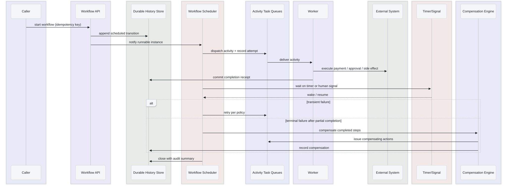</a>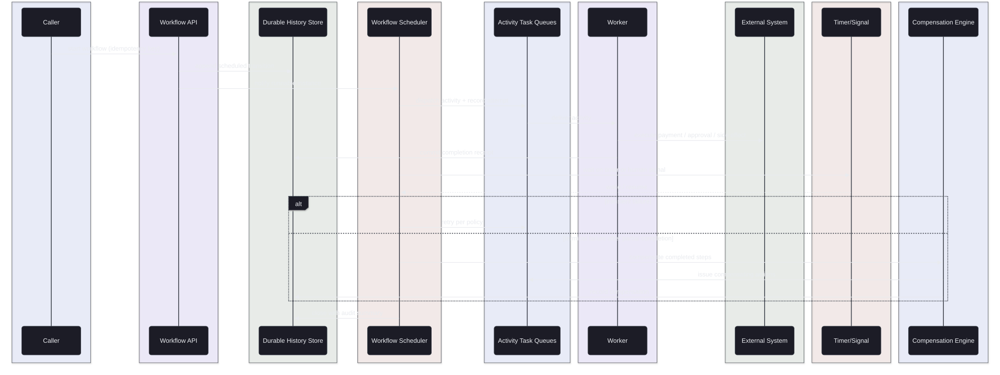<figcaption>Sequence across caller, Workflow API, history store, scheduler, queues, worker, external system, timer/signal and compensation engine, including the transient-retry and terminal-compensation branches, source figure. Open for full size.</figcaption></figure>

#### Read the flow as consistency points {#consistency-points}

The same flow as eight numbered guarantees:

1. An **idempotency key** arrives with the start request, so a retry cannot spawn a second business process.
2. The API checks the request, then appends a **scheduled transition** to durable history.
3. The scheduler picks up the transition, queues an **activity** and logs the attempt.
4. A worker runs the side effect and writes a **completion receipt** to durable history.
5. The workflow enters a **wait state** until a timer fires or a person signals.
6. A transient failure gets a **retry** under policy, not instant escalation.
7. A terminal failure after some steps are done triggers **compensating actions** for those steps.
8. The workflow ends with an **audit summary**: the route it took, its waits and retries, any manual interventions and the final effect.

Three consistency points hold the flow together. The request is durable before anything downstream changes. The side effect lands before the workflow reports success. The audit summary comes last, because it is built from history rather than from worker memory.

#### The failure to rehearse above all others {#crash-overlay}

Now inject the fault: the payment goes through and the worker crashes before writing the receipt. Trace order `o-123` through it.

1. The caller starts the workflow with `start:o-123`, and the API records the scheduled transition.
2. The scheduler dispatches the payment activity and logs an attempt; the queue hands it to a worker.
3. The worker sends the charge with `pay:o-123`, and the payment system reports success.
4. The worker dies before the completion receipt is written.
5. The scheduler notices that no completion arrived or that a timeout expired, and chooses a path from the state on record.
6. If the case is transient or recoverable, the queue redelivers the activity. The redelivered call reuses `pay:o-123`, so the provider returns the existing charge, and the worker records the completion receipt.
7. If the case is terminal after some steps are done, the compensation engine starts compensation for the finished steps and routes the compensating actions through the queue.
8. Finally the history store closes the workflow with an audit summary.

<figure class="source-diagram" id="figure-crash-overlay"><a href="source-assets/1bcdfc51f1d2ad8d.svg" target="_blank" rel="noopener"></a><figcaption>Failure overlay: the payment succeeds, the worker crashes before the receipt, and the scheduler either redelivers safely or compensates, source figure. Open for full size.</figcaption></figure>

The charge may have gone through before the worker died, so "worker lost" must never be read as "business action lost". Only the record prevents a double charge. The durable history and the completion receipt decide whether to redeliver or compensate; worker memory never does. This is the follow-up to expect most, so know that sentence cold.

### 7. Decide failure policy before the failure {#walk-failures}

#### Start from the uncomfortable question {#uncomfortable-question}

Picture the design review. Security, operations and the customer's admin are in the room, and within minutes someone asks: the payment went through, then the worker died; now what? That one injected fault teaches more than twelve happy-path questions, because it shows where the system's real edges are. The orchestration layer protects money movement, approval state, customer messages and downstream integrations from half-finished runs, replays, operator mistakes and hostile access. A design that fails this drill is a best-effort script with a database behind it.

#### Four security controls {#security-controls}

The threat model comes before failure policy, and it rests on four controls.

- **Authorise starts, signals and repairs at the correct strength.** Starting a workflow needs at least the permission to read the customer object it will change. Each signal (approval, rejection, resubmission, cancellation, override) must be authenticated, limited to the right tenant and instance, and checked against the current state machine. Repairs need the tightest control, because they can skip the normal sequence and change a business effect after it happened.
- **Keep secrets out of history.** History is how the system remembers, which makes it a target. A token, API key, password or full payment artifact stored there can be replayed, exported or shown to operators who need state but not credentials. Keep only opaque references in history. At execution time the worker fetches a short-lived secret from a secret manager or a KMS-backed vault (KMS is a key management service), with the narrowest scope and a clear expiry.
- **Restrict operator mutation paths.** An operator pauses, inspects and resumes. They do not rewrite transitions at will or quietly mark money as collected. Every manual change goes through a narrow repair API that validates input, checks versions and logs the approval. Authenticated admin access, role-based permission checks, immutable audit logs and state-machine rules each guard the same boundary from a different side.
- **Audit every compensation and manual override.** Reversed payments, voided document approvals and hand-repaired CRM records leave a trail: who started the action, the reason, the instance and the state version it targeted. The post-incident review then rests on facts.

#### Name how each branch fails {#failure-policies}

In the interview, say which branches fail closed, degrade, queue, need a person or may fail open. Using those words with care is itself a sign of judgement.

<p class="figure-caption">Failure policy for each class of step.</p>

<div class="source-table-wrap"><table><thead><tr><th>Policy</th><th>Steps it applies to</th></tr></thead><tbody><tr><td>Fail closed</td><td>Approval completion, payment authorisation, repair mutations, and any step that could record a business effect that never happened</td></tr><tr><td>Degrade</td><td>Email can fall back to queued sending or a later notice, if the customer accepts eventual delivery</td></tr><tr><td>Queue</td><td>CRM sync, internal analytics updates and noncritical enrichment wait in line while a transient outage clears</td></tr><tr><td>Human intervention</td><td>Unclear approvals, poison messages that keep failing, and policy exceptions code cannot settle safely</td></tr><tr><td>Fail open, only with extreme caution</td><td>Occasionally a read-only status view; never an external side effect that cannot be undone</td></tr></tbody></table></div>

Blast radius is a working control. Partition every retry queue, dead-letter stream and repair lane by tenant, region, workflow type and dependency, so a stuck CRM connector cannot block document approvals for unrelated tenants. A **dead-letter** stream holds items that keep failing, so they stop blocking the queue and wait for inspection. Likewise, a regional outage must not spill across a region line unless both the customer contract and the data policy allow it.

#### Five drills, each with detect, contain, recover and prevent {#failure-drills}

Each drill names how the failure becomes visible, how damage is limited, how the case is recovered and what stops it recurring.

##### Drill 1: the worker crashes after payment succeeds {#drill-payment-crash}

- **Detect:** the lease expires, heartbeats stop or the orchestrator's own timeout fires. A lease expiry presumes the worker is dead but does not prove it. A slow worker can still complete the charge after the redelivery starts, so the payment key must protect concurrent calls as well as later retries; Stripe answers a second request with the same key that arrives while the first is still executing with a conflict and saves nothing, and the worker retries later.
- **Contain:** never send the charge a second time.
- **Recover:** replay the history, see that the charge step finished, and continue at the first unfinished step.
- **Prevent:** put an idempotency key on the payment request, and keep a durable history that writes the intent before the call and the completion once the acknowledgement arrives.

<figure class="source-diagram" id="figure-drill-payment-crash"><a href="source-assets/3486c2298a54fe8a.svg" target="_blank" rel="noopener"></a><figcaption>Lease timeout leads to replay without reissuing the charge; after checking the recorded payment, a transient worker loss continues from the next unfinished step and a terminal failure triggers a refund, source figure. Open for full size.</figcaption></figure>

Of all the drills this one matters most. Security and operations inject the crash, and the candidate shows how the system limits damage and keeps the evidence, not how they would scramble to get it running. A lost worker is not a lost business action; tie detection, containment, recovery and prevention back to durable history every time.

##### Drill 2: email succeeds but the CRM update fails {#drill-email-crm}

- **Detect:** track side effects per step rather than per job. The email worker may report success while the CRM update times out or returns a permanent error.
- **Contain:** the workflow does not claim full success; it moves into a state that can be compensated or repaired.
- **Recover:** retry the CRM call idempotently, hand the item to dead-letter handling, or open a manual reconciliation task when a person must validate the record.
- **Prevent:** keep a status for each step, carry explicit correlation IDs, and set a policy that workflow state is authoritative and notifications are not.

<figure class="source-diagram" id="figure-drill-email-crm"><a href="source-assets/17607328cc81d73f.svg" target="_blank" rel="noopener"></a><figcaption>A sent email beside a failed CRM write: the workflow does not claim success, then retries idempotently or hands off to dead-letter and manual reconciliation, source figure. Open for full size.</figcaption></figure>

##### Drill 3: approval waits seven days {#drill-approval-wait}

In orchestration a long wait is ordinary. The system provides durable timers, visible state and a way to deal with stale instances.

- **Detect:** no failure alarm fires. A timeout threshold routes the instance to the queue that should act on it.
- **Contain:** do not burn worker capacity on polling that never ends.
- **Recover:** by policy, send the reminder again, escalate to a manager or let the request expire.
- **Prevent:** waiting is a first-class state in the workflow, not an improvised sleep loop.

<figure class="source-diagram" id="figure-drill-approval-wait"><a href="source-assets/b34fc13087ab819f.svg" target="_blank" rel="noopener"></a><figcaption>A durable wait state with a monitored threshold resumes on approval or escalates by policy, source figure. Open for full size.</figcaption></figure>

##### Drill 4: the definition changes while instances run {#drill-definition-change}

Treat this as versioning, not only deployment.

- **Detect:** the runtime notices that the definition hash or version does not match.
- **Contain:** each old instance keeps running on the version it began with, unless an explicit migration path exists.
- **Recover:** route steps by version so old instances stay forward compatible, or run a controlled, tested and audited migration.
- **Prevent:** each durable instance stores its definition version, and each deployment either publishes a compatible contract or declares a deliberate break.

<figure class="source-diagram" id="figure-drill-definition-change"><a href="source-assets/abc877394d0f6d25.svg" target="_blank" rel="noopener"></a><figcaption>A version check keeps old instances on their starting version, with forward-compatible routing or an audited migration, source figure. Open for full size.</figcaption></figure>

##### Drill 5: an external API never answers {#drill-api-timeout}

Four mechanisms are needed: bounded timeouts, retries that back off, a **circuit breaker** (which stops calling a failing dependency for a while after repeated errors) and a route to dead-letter handling or escalation.

- **Detect:** no progress inside a known limit.
- **Contain:** stop hammering the dependency and shield the worker pool.
- **Recover:** a scheduled retry, a fallback queue, or a person stepping in when the downstream system stays down for a long stretch.
- **Prevent:** put a time bound on every dependency call, and have orchestration policy treat transient and permanent failures differently.

<figure class="source-diagram" id="figure-drill-api-timeout"><a href="source-assets/a02e49f6dd4bc285.svg" target="_blank" rel="noopener"></a><figcaption>A bounded timeout opens the circuit breaker; backoff either resumes dispatch or sends the work to a fallback queue or a person, source figure. Open for full size.</figcaption></figure>

#### Have the evidence ready {#audit-evidence}

Before go-live you should be able to walk through the audit evidence and the runbooks. Who may start a workflow? How does someone request a repair, and who signs it off? Where do compensation logs live? How is a replay explained to support? How do you prove that a crash did not cause a duplicate payment? Make that evidence searchable by tenant and workflow ID, and keep it as long as the customer's policy and jurisdiction require.

For observability, trace each transition with correlation IDs. Emit counters for retries, compensations, dead-letter items and manual overrides. Alert when the counts of requested, completed and compensated steps drift apart. Beyond knowing something is broken, you want to know which tenant, which dependency and which failure policy is absorbing the impact right now.

#### Answer the trade-off pushes {#tradeoff-pushes}

Each push changes a dial and has a cost you should name:

- The customer wants faster recovery: automate more compensations, and accept a higher chance that an automated undo gets it wrong.
- The business wants stronger correctness: fail closed more often, and accept deeper queues and more work for people.
- The platform must serve many tenants: draw sharper blast-radius boundaries and tighten operator permissions.

An FDE is accountable for safe rollout, support and incident response as well as the happy path. A good answer keeps the customer's business effect safe, preserves evidence for the postmortem and still moves the workflow forward without repeating any irreversible action.

### 8. Release one workflow behind evidence {#walk-rollout}

#### Model one workflow, not the platform {#one-workflow}

The prototype runs and the customer asks when they can rely on it. The design conversation becomes a delivery plan with measurable gates, a named owner per step and a route into support. Begin by modelling a single workflow explicitly: document approval, then payment, then the email, then the three internal updates. A slice that narrow shows whether business effects survive retries, pauses and crashes, and keeps the first release small enough to reason through every transition. The aim is learning, not breadth. Confirm that the definition holds steady, that anyone can inspect the state model, and that the team can say what happens when a worker dies after the card is charged but before the email goes out. Naming that first workflow signals MVP (minimum viable product) thinking and a staged rollout instead of one risky launch.

#### Make determinism and crash recovery the first gate {#first-gate}

Test two things before any traffic grows. Feed a recorded workflow history back through the engine and check that every decision comes out the same. Replay can only do that if workflow code is deterministic: it takes the time, random values and activity results from history, never from the wall clock, a random generator or a direct network call made inside the workflow. Kill workers mid-run, bring them back, and check that the engine resumes from durable state without blindly firing side effects again. A spoken-answer example of the gate: "I won't promote this until we can replay a run from its history, recover from a worker crash, and show that no irreversible effect happens twice." Putting replay and crash recovery first, ahead of operator tooling and wider release, marks a seasoned plan; a weaker answer promises to "add monitoring later".

#### Give operators visibility before widening scope {#operator-visibility}

With recovery proven, give operators dashboards, logs, traces and admin screens. Support should quickly answer three things: what is in flight, what has stalled and what needs a human. Show workflow-level state in the business's words (pending approval, payment authorised, compensation pending, completed). Beside it, show activity signals: retry counts, timeouts, failed workers, queue depth and downstream latency. Link the two so a user complaint leads straight to the failed step. A good dashboard reads like the business story from left to right: request received, approval pending, payment authorised, internal systems updated, email sent, run closed. Triage gets faster, and the customer sees the platform is no black box, so visibility becomes part of what they are buying.

#### Version workflows instead of mutating them {#version-not-mutate}

Ship changes as a new workflow version and never edit running executions in place. A run in flight may wait days on an approval, a reviewer or an outside system; swap its logic while it waits and old and new instances start to behave differently. With versions, a run keeps the rules it began with, new runs get the new logic, and during an incident operators know which history applies. Customers start to trust the platform once changes ship predictably.

#### Score the rollout on six layers {#scorecard}

Strong candidates do not squash every number into "the system is up". The scorecard has six layers, each with its own data source, owner and alert.

<p class="figure-caption">The six-layer rollout scorecard, with data source, owner and alert condition.</p>

<div class="source-table-wrap"><table><thead><tr><th>Layer</th><th>Metric</th><th>Data source</th><th>Owner</th><th>Alert when</th></tr></thead><tbody><tr><td>Technical health</td><td>Workflow completion time: start to terminal state</td><td>Orchestration history and timer records</td><td>Platform team</td><td>p95, or a customer-agreed threshold, moves well above baseline</td></tr><tr><td>Technical health</td><td>Activity retry rate: retries over total attempts</td><td>Worker and scheduler telemetry</td><td>Worker-runtime owner</td><td>A sudden spike, or a rate that stays high over a rolling window</td></tr><tr><td>Technical health</td><td>Stuck workflow age: how long the oldest non-terminal run has waited past its expected time</td><td>Durable state and queue inspection</td><td>Operations</td><td>Any run passes the maximum acceptable age</td></tr><tr><td>Model quality</td><td>Replay determinism pass rate: sampled histories that give identical decisions on replay</td><td>Replay test jobs and history checks</td><td>Workflow-runtime engineering</td><td>It drops under the release gate, because nondeterminism can break the whole model</td></tr><tr><td>Model quality</td><td>State-transition validation failures caught by tests, canaries or runtime guards</td><td>Engine validation and canary telemetry</td><td>Platform team</td><td>Any persistent rise, which hints the model or versioning rules have drifted</td></tr><tr><td>Model quality</td><td>Schema or definition compatibility failures: changes old or new runs cannot load</td><td>Versioning checks and deploy-time validation</td><td>Release engineering</td><td>Any failure in staging or canary</td></tr><tr><td>Reliability and correctness</td><td>Duplicate effect count: effects caught happening twice</td><td>Idempotency logs, downstream receipts, reconciliation jobs</td><td>Workflow platform and integration owner</td><td>Any confirmed rise, because even a handful is costly</td></tr><tr><td>Reliability and correctness</td><td>Compensation rate: share of runs that take a compensating action</td><td>Workflow history</td><td>Product and operations</td><td>An unexpected climb, which can point to a bad release or brittle dependency</td></tr><tr><td>Operational burden</td><td>Manual repair count: runs needing a person</td><td>Operator actions and support tickets</td><td>Support operations</td><td>It outgrows team capacity or keeps climbing release over release</td></tr><tr><td>Adoption</td><td>Workflows real customers start, share of teams migrated, operator log-ins to the visibility tools</td><td>Product usage</td><td>Not named in the source</td><td>Not specified</td></tr><tr><td>Business outcome</td><td>Fewer failed approvals, shorter payment-to-email gap, fewer escalations, shorter end-to-end cycle</td><td>Business reporting</td><td>Not named in the source</td><td>Not specified</td></tr></tbody></table></div>

"Model quality" here means the orchestration model itself: whether the definition, replay behaviour and state transitions still match the business logic they encode. It is not about an AI model. Adoption matters because an elegant platform nobody trusts has failed as a product. Technical health tells you the machine works; business outcomes tell you the customer gains from it.

#### Phase the rollout with owners and rollback triggers {#phased-rollout}

Every phase has a named owner, exit criteria and a rollback trigger.

<p class="figure-caption">Four rollout phases with owner, exit criteria and rollback trigger.</p>

<div class="source-table-wrap"><table><thead><tr><th>Phase</th><th>Owner</th><th>Exit criteria</th><th>Rollback trigger</th></tr></thead><tbody><tr><td>1. Model one workflow explicitly</td><td>A platform engineer with product or a customer design partner</td><td>The definition has settled, each transition is written down and everyone agrees on the business effect</td><td>The workflow cannot be modelled cleanly, or the customer disputes what success means</td></tr><tr><td>2. Test replay determinism and crashes</td><td>Platform engineering with QA (quality assurance) or release engineering</td><td>Crash-recovery tests pass, replays are stable and failure drills show no duplicated side effects</td><td>Some crash path repeats an irreversible action with no idempotency guard</td></tr><tr><td>3. Add operator visibility</td><td>Operations with the orchestration team</td><td>Operators find stalled work, explain its state and carry out approved repairs from written runbooks</td><td>Support cannot diagnose an incident without pulling in engineering</td></tr><tr><td>4. Migrate workflows by version</td><td>Platform owner and release manager</td><td>Old and new versions run side by side, migration rules are written down and no in-flight run is rewritten</td><td>A versioned migration gives inconsistent results or blocks recovery</td></tr></tbody></table></div>

<figure class="source-diagram" id="figure-rollout-phases"><a href="source-assets/b0fedf68d9516fc0.svg" target="_blank" rel="noopener"></a><figcaption>Four rollout phases in order, each with its owners: model one workflow, test replay and crashes, add operator visibility, migrate by version, source figure. Open for full size.</figcaption></figure>

A real go/no-go gate never asks whether the code compiles. It asks whether support can run it, whether we can execute the rollback, and whether the customer can live with the remaining risk.

#### Decide what is core, adapter, configuration or shared {#core-adapter-config}

The core engine should not hold everything.

- **Core product:** durable workflow state, retry policy, compensation orchestration, replay, versioning and the building blocks of operator visibility. These are the reusable behaviours the platform should own.
- **Adapters:** the payment gateway, email providers, document systems and the three internal systems, each behind its own interface because they differ between customers and environments.
- **Configuration:** retry budgets, timeout windows, approval routing rules, escalation thresholds and per-tenant visibility settings. They change more often than code, so adjusting them must be safe.
- **Shared services:** identity, audit logging, metrics export and notification plumbing where the organisation already has a standard. Reuse cuts duplication only if ownership lines and support commitments stay intact.

The split shows product judgement: you extract reusable value from the pilot rather than building a bespoke engine for one customer.

#### Train operators and own the risks {#operators-and-risks}

Production readiness means trained people and written guidance. Support needs a runbook for the usual failures: a worker crash after payment, an outside call timing out during approval, an upstream system sending the same callback twice, and a run waiting on a human reply. The docs explain how to read state, when and how to escalate, and which compensations an operator may safely trigger by hand. Teach through scenarios: take each operator through a stalled run, a clean replay and a rollback decision. If they cannot explain a workflow from the dashboard and runbook, the system is not ready for wide use.

Keep the risk register short and owned, so the rollout does not drift into wishful thinking.

<p class="figure-caption">The owned risk register.</p>

<div class="source-table-wrap"><table><thead><tr><th>Risk</th><th>Owner</th><th>Mitigation</th><th>Trigger</th></tr></thead><tbody><tr><td>Worker crash after payment succeeds</td><td>Platform engineering</td><td>Idempotency keys, durable state and replay tests; history and the completion receipt decide redelivery or compensation</td><td>A payment event with no terminal workflow record</td></tr><tr><td>Replay nondeterminism</td><td>Workflow-runtime team</td><td>Deterministic APIs and history-driven replay tests</td><td>A replayed decision differs from the recorded one</td></tr><tr><td>Operator overload</td><td>Operations</td><td>Dashboards, runbooks and tuned alerts</td><td>The manual repair count keeps rising</td></tr><tr><td>Version migration error</td><td>Release manager</td><td>Version gating and a canary rollout</td><td>Old and new runs reach different outcomes</td></tr></tbody></table></div>

The rollout story goes in order: prove one workflow end to end, check replay and crash recovery, give operators visibility, then migrate by version behind a canary and a rollback plan. Throughout, watch six numbers: completion time, retries, stuck age, duplicated effects, compensations and manual repairs. Do not call it a success until customers use it, the business process improves and support runs it without heroics. The measurable impact is a platform that applies each business effect exactly once, keeps state visible and compensates failed steps, with recovery under control and manual work falling, so approval, payment, email and internal updates run as one dependable service instead of a chain of brittle scripts.

## Technical deep dives

### Durable records and API contracts {#dive-records}

#### Why the state machine is the part to make concrete {#smallest-safe-slice}

Boxes on a whiteboard do not convince an interviewer. Durable records, strict contracts and one code path that runs the riskiest part safely do. The riskiest part is the state machine that picks the next move after a step succeeds, fails or is replayed; the approval screen and email sender matter far less. Get the state machine wrong and the customer suffers however healthy the rest is: cards charged twice, lost approvals, workflows that look frozen for good.

#### Four records carry the design {#core-records}

Each record has a purpose, a key, a lifecycle and a retention rule.

<p class="figure-caption">Core durable records with purpose, key, lifecycle and retention.</p>

<div class="source-table-wrap"><table><thead><tr><th>Record</th><th>Purpose</th><th>Primary key</th><th>Lifecycle</th><th>Retention</th></tr></thead><tbody><tr><td><code>WorkflowInstance(id, definition_version, state, next_event)</code></td><td>The single row that owns one business process: where it stands and where it will resume</td><td><code>id</code></td><td>Created at start, changed on each transition, finally archived or kept as policy requires</td><td>Live row while running; a slimmer historical copy afterwards if audit or replay needs one</td></tr><tr><td><code>HistoryEvent(instance_id, sequence, type, payload_ref)</code></td><td>Append-only trail that rebuilds the exact order of events without memory or short-lived logs</td><td><code>(instance_id, sequence)</code></td><td>New events appended; past events never edited</td><td>While debugging, audits and replay need them; then cold storage or deletion by policy</td></tr><tr><td><code>ActivityReceipt(idempotency_key, external_ref, status)</code></td><td>A note of each side effect tried or finished, so a retry cannot pay again, send a second email or repeat an update</td><td><code>idempotency_key</code></td><td>Written just before or just after the external effect, depending on how the dependency behaves</td><td>As long as duplicates must be blocked</td></tr><tr><td><code>Timer(instance_id, fire_at)</code></td><td>Wakes a workflow after a long wait, expires an approval or checks whether an outside job finished</td><td><code>(instance_id, fire_at)</code>, or whatever key the scheduler uses</td><td>Inserted when a wait starts, deleted when it ends, inserted again if the workflow is retried</td><td>Not stated in the source</td></tr></tbody></table></div>

Ownership is split. The orchestrator holds workflow state, the history of steps and the intent to retry. Payments, document approval, email delivery and CRM updates belong to external systems. The orchestrator may record a payment, but it never acts as the financial ledger.

For order `o-123`, the instance row moves from waiting for approval to charging and onward. Each move appends a `HistoryEvent` with the next sequence number. The charge leaves an `ActivityReceipt` keyed `pay:o-123` holding the provider's reference, and the seven-day wait is a `Timer` row whose `fire_at` is a week after the request.

#### Four API contracts {#api-contracts}

Four endpoints expose the state machine. Each is quick to explain yet strict enough that no client can slip vague work into the engine.

- **`POST /v1/workflows/{type}`** begins a workflow. Authentication is normal caller authentication scoped to the tenant or customer. The caller sends an idempotency key, so a retried call never yields a second instance. The request carries the workflow type, business payload, caller context and optional correlation metadata. The response returns the instance ID, the starting state and a stable status reference. Errors: 400 for a malformed request, 401 or 403 when authentication or authorisation fails, 409 while a request with that key is still in flight, and 422 when the key returns with a different payload or the inputs make no business sense.
- **`POST /v1/workflows/{id}/signals`** accepts input from a person or another system. The caller needs permission to signal that workflow or tenant. A signal ID combined with a payload hash, or a caller key, filters out double-clicked approvals and repeated callbacks. The response is the accepted signal and the transition it caused, or a no-op when that signal was already applied.
- **`GET /v1/workflows/{id}/history`** returns the audit trail. The caller needs read rights for the workflow's tenant and policy scope. It never writes, and results come back in pages sorted by sequence. Errors: 404 when the workflow does not exist, 403 when access policy hides it.
- **`POST /v1/workflows/{id}/repair`** lets operators, or automation they approved, resume, replay or compensate. It requires elevated, narrowly scoped operator authorisation. Each repair carries its own idempotency token, so a double click does not double the side effects, and the call must state which action it takes: retry a step, compensate a finished step or resume from a known checkpoint.

The 409/422 split follows the IETF Idempotency-Key header draft, which had expired by September 2026. It is an Internet-Draft, not an RFC, so present it as a convention you adopt, not a standard you comply with.

Duplicates behave predictably. If the payment step sees one idempotency key twice, the first call takes the money and saves a receipt, and the second returns that receipt or a "completed already" response.

### The saga step in code {#dive-saga}

#### The source slice {#saga-code}

One saga step shows the key behaviour: wait for approval, take payment idempotently, update the CRM, and compensate if a downstream step fails for good. The sketch is narrow on purpose. Production code also needs a scheduler, queue workers, persistence, serialisation, distributed locking and stronger typing; the source keeps only the transitions an interviewer cares about most.

```python
from dataclasses import dataclass
from typing import Protocol


class PermanentError(Exception):
    pass


@dataclass(frozen=True)
class Order:
    id: str
    amount_cents: int
    customer_email: str


@dataclass(frozen=True)
class PaymentReceipt:
    idempotency_key: str
    external_ref: str
    status: str


class Activities(Protocol):
    async def charge(self, order: Order, idempotency_key: str) -> PaymentReceipt: ...
    async def update_crm(self, order: Order, idempotency_key: str) -> None: ...
    async def send_receipt(self, order: Order, idempotency_key: str) -> None: ...
    async def refund(self, payment: PaymentReceipt, idempotency_key: str) -> None: ...


async def order_workflow(order: Order, activities: Activities, wait_for_approval):
    if order.amount_cents <= 0:
        raise ValueError("order amount must be positive")

    approved = await wait_for_approval(order.id, timeout_days=7)
    if not approved:
        return "rejected"

    payment_key = f"pay:{order.id}"
    payment = await activities.charge(order, idempotency_key=payment_key)

    try:
        await activities.update_crm(order, idempotency_key=f"crm:{order.id}")
        await activities.send_receipt(order, idempotency_key=f"mail:{order.id}")
    except PermanentError:
        await activities.refund(payment, idempotency_key=f"refund:{order.id}")
        raise

    return "completed"
```

#### Read it in the order you would explain it {#saga-walkthrough}

- `Order` and `PaymentReceipt` are typed objects at the boundary, so the orchestration code never passes loose blobs around.
- `PermanentError` separates failures worth a business retry from failures that should start compensation.
- `Activities` is a protocol, an interface, rather than a concrete dependency. That makes it easy to test and keeps vendor SDK details out of workflow logic.
- `order_workflow(...)` coordinates the saga. Its opening check rejects plainly bad input before any side effect; that is typed validation at the workflow's edge.
- Waiting for approval creates a pause that must survive restarts. In production a timer and stored state back it, not a bare function call.
- `payment_key = f"pay:{order.id}"` guards the charge, so a retry, a worker crash or a redelivered message cannot trigger a second one.
- `activities.charge(...)` touches the outside world. The orchestrator reads the return value as a receipt; the payment ledger stays the source of truth.
- After payment the saga moves on to `update_crm(...)` and `send_receipt(...)`. `except PermanentError` compensates by issuing a refund, and raising the error again keeps the failure visible so the orchestrator records the terminal state in history. Read the catch block critically. It wraps the email as well as the CRM update, so a permanent email failure would refund a paid order, while the failure-policy table lets email degrade to queued sending. In a production definition only the steps whose failure voids the order trigger the refund, and a refund after the CRM write succeeded also needs a CRM compensation, or the record shows a sale that was reversed.

<figure class="source-diagram" id="figure-saga-flow"><a href="source-assets/1f99c2796b03645f.svg" target="_blank" rel="noopener"></a><figcaption>The saga as a flowchart: validate, wait for approval, charge with pay:, update CRM with crm:, send receipt with mail:, refund with refund: on a permanent error, source figure. Open for full size.</figcaption></figure>

Expect a question on how fine-grained the keys are. Each business action with a side effect gets its own key (`pay:`, `crm:`, `mail:`, `refund:`); the workflow as a whole does not share one. If it did, the CRM retry would collide with the payment's stored result, and a refund could be suppressed as a "duplicate" of the charge. That one detail moves an answer from a whiteboard sketch to something a team could run. One key per action has a limit too. Stripe saves the first response once the request starts executing, including a decline or a `500` error, so a retry under `pay:o-123` returns that saved failure. A deliberate new payment attempt, for example after the customer updates their card, needs a new key such as `pay:o-123:2`, written to history before the call.

#### What the whiteboard version leaves out on purpose {#whiteboard-omissions}

- **Optimistic concurrency.** Each `WorkflowInstance` update checks a version number, so two workers cannot both advance the same instance from stale state. In practice the write is "update where version = expected_version"; if another worker got there first, retry or abort. This answers the worksheet's sixth failure mode, two workers moving the same instance forward.
- **Schema and contract versioning.** `definition_version` on the instance lets old and new definitions run side by side. An in-flight instance stays on the version it began with unless an explicit migration policy says otherwise.
- **Idempotency at every write boundary.** Payment is only one case. Repair actions, email sends, CRM updates and approval signals should be as safe to replay, where that is feasible.
- **Observability.** Every transition produces metrics, trace spans and structured logs tagged with step name, outcome and `instance_id`. The history table is the system of record; telemetry is for fast diagnosis.
- **Policy checks around model output.** An LLM (large language model) might classify, route or summarise work inside a step. Before that output can change state or fire an external action, it must pass typed validation and policy checks. The model may propose; it must not quietly decide.

The contrast an interviewer listens for: the weak answer is "we'll add retries, and that makes it reliable". The strong answer says workflow state belongs to the orchestrator, each side effect has an idempotency key, each transition is versioned, each replay is driven by history and compensation is spelled out, never implied. With those parts concrete, the rest of the system can be explained rather than taken on faith.

### Tests that make the design believable {#dive-tests}

#### Contract test and failure-injection test {#source-tests}

Two tests carry the claims. The contract test sends `POST /v1/workflows/{type}` twice with the same idempotency key and asserts that both responses carry the same instance ID. The failure-injection test runs the key drill: `charge(...)` succeeds, the CRM update then fails permanently, the workflow refunds, and replaying from history finds the payment already made and skips the charge.

```python
import pytest


@pytest.mark.asyncio
async def test_start_workflow_is_idempotent(client):
    payload = {
        "workflow_type": "order_approval",
        "business_payload": {"order_id": "o-123", "amount_cents": 5000},
        "correlation_id": "corr-1",
    }
    headers = {"Idempotency-Key": "start:o-123"}

    first = await client.post("/v1/workflows/order_approval", json=payload, headers=headers)
    second = await client.post("/v1/workflows/order_approval", json=payload, headers=headers)

    assert first.status_code == 201
    assert second.status_code in (200, 201)
    assert second.json()["instance_id"] == first.json()["instance_id"]


@pytest.mark.asyncio
async def test_worker_crash_after_payment_does_not_double_charge(orchestrator, fake_activities):
    order = Order(id="o-123", amount_cents=5000, customer_email="a@example.com")
    async def approval(order_id, timeout_days):
        return True

    async def charge_succeeds(*args, **kwargs):
        return PaymentReceipt(idempotency_key="pay:o-123", external_ref="payref-1", status="captured")

    fake_activities.charge.side_effect = charge_succeeds
    fake_activities.update_crm.side_effect = PermanentError("crm unavailable")

    with pytest.raises(PermanentError):
        await order_workflow(order, fake_activities, approval)

    # On replay, the orchestrator should consult history/receipts and not charge again.
    await orchestrator.replay_from_history(order.id)
    assert fake_activities.charge.await_count == 1
    assert fake_activities.refund.await_count == 1
```

Together they show that the API contract is idempotent in practice and that the central drill holds: a failure after a successful payment ends in a refund, and replay never charges twice. The `client`, `orchestrator` and `fake_activities` fixtures are not defined in the source; read the second test as the shape of the check, which needs a real orchestrator with persisted history to run. A true crash-and-resume test, which kills the worker between the two steps, works the same way: replay reads history, skips the charge and continues at the first unfinished step.

#### The no-double-charge invariant {#no-double-charge-sketch}

The source's second sketch narrows the test further: crash the workflow at the worst moment, and replay must still not repeat an irreversible side effect. It is a teaching sketch sized for an interview, without persistence details, dependency wiring or a full engine; a production build would put the event log on durable storage, add validation and pin library versions.

```python
import pytest


class FakePayments:
    def __init__(self):
        self._charges = {}

    def charge(self, order_id: str) -> str:
        self._charges[order_id] = self._charges.get(order_id, 0) + 1
        return f"charge-{order_id}"

    def charge_count(self, order_id: str) -> int:
        return self._charges.get(order_id, 0)


class CrashAfterCharge(Exception):
    pass


class WorkflowEngine:
    def __init__(self, payments: FakePayments):
        self.payments = payments
        self.history = []
        self.completed = set()

    async def run_until_crash(self, order_id: str, crash_after: str | None = None):
        if "charge" not in self.completed:
            self.history.append(("intent", "charge", order_id))
            self.payments.charge(order_id)
            self.history.append(("done", "charge", order_id))
            self.completed.add("charge")
            if crash_after == "charge":
                raise CrashAfterCharge()

    async def resume_workflow(self, order_id: str):
        if "charge" not in self.completed:
            self.history.append(("resume", "charge", order_id))
            self.payments.charge(order_id)
            self.history.append(("done", "charge", order_id))
            self.completed.add("charge")
        self.history.append(("next", "crm", order_id))


@pytest.mark.asyncio
async def test_crash_after_payment_does_not_charge_twice():
    payments = FakePayments()
    engine = WorkflowEngine(payments)
    order_id = "order-123"

    with pytest.raises(CrashAfterCharge):
        await engine.run_until_crash(order_id, crash_after="charge")

    await engine.resume_workflow(order_id)
    assert payments.charge_count(order_id) == 1
```

The lesson is the distinction between "attempted" and "completed". The engine writes an `intent` entry before the charge and a `done` entry after it, and recovery checks completion before deciding to repeat the effect. Notice what the sketch does not prove: `completed` lives on the same in-memory object that survives the simulated crash, and this crash falls after `done` was recorded. In a real system that set must be rebuilt from durable history. A crash between `intent` and `done` is the harder case, where only the provider's idempotency key, or a lookup of its receipt, can tell whether money moved. A production version would also validate arguments, persist state, log in a structured format, handle timeouts and pass an explicit idempotency key to the payment gateway.

### Retry, backoff and compensation {#dive-retry}

The formula `backoff_n = min(cap, base × 2^n) + jitter` has four parts. `n` is the retry attempt number, `base` the first delay, `cap` the longest allowed delay and `jitter` a random variation so that many clients retrying at once do not fire in sync, a pattern called a thundering herd.

An illustrative schedule, with values chosen here rather than taken from the source: with `base` = 1 second and `cap` = 60 seconds, attempts wait about 1, 2, 4, 8, 16 and 32 seconds, then 60 seconds for every later attempt, each plus jitter. The cap stops the delay from growing without bound; the jitter spreads a thousand workers' retries across the interval instead of stacking them on the same instant. Adding jitter after the cap lets a delay overshoot the cap. AWS's comparison favours "full jitter", a random delay between zero and `min(cap, base × 2^n)`, which did less total work than variants that keep a fixed share of the backoff.

Choose `cap` and jitter as operational trade-offs tied to the process, never by habit. A low cap recovers user-facing work faster but can swamp a flaky dependency. A high cap protects the dependency but makes customers wait longer to see progress. Neither setting does anything for a charge that already landed; that needs the compensation path in the [saga code](#dive-saga).

### Trade-offs to defend {#dive-tradeoffs}

#### Orchestrated saga {#tradeoff-orchestration}

In an orchestrated saga, one control plane holds state transitions, retries, compensation and visibility. Trace `o-123`: the scheduler records that payment completed, dispatches the CRM update, sees it fail permanently and dispatches the refund. An operator asking "where is `o-123`?" reads one history. That suits long-lived, audit-heavy processes that must survive worker crashes and manual steps. The cost is a central dependency that needs high availability and careful versioning.

#### Choreography {#tradeoff-choreography}

In choreography, services share the work by reacting to each other's events with no central coordinator. Trace `o-123` again: the payment service emits "charged", the CRM service reacts and fails, and some service must notice and emit a refund request. Central coupling drops and each service's ownership can look tidier. But nobody can easily tell where a run has got to or what halted it, and reasoning about cross-service compensation and human review gets harder.

For a small event-driven system choreography can appeal. Once the customer wants visible state, controlled retries and recovery support can run, orchestration is easier to operate. Expect the blunt version, "why not let events drive it all?", and have a one-line verdict ready: choreography lowers coupling, but then nobody can point to where a run stands, which rules it out when the customer needs visible state and support-run recovery. Scale alone does not settle the question either way.

#### History size and debuggability {#tradeoff-history}

Keeping every transition, input, output and retry helps debugging, because you can replay the path a decision took and see where it failed. The price is growing storage, heavier reads and more care with redaction. Cutting history saves overhead but throws away the forensic record operators and support depend on. The defensible position: keep what you need to replay and explain each decision, compress or summarise older segments once it is safe, and hold the audit trail as long as customer policy says. "Keep everything forever" is not the answer.

#### Automatic compensation and human review {#tradeoff-compensation}

Automatic compensation works when the undo is deterministic and safe: cancel a reservation, void a pending authorisation, flag a record as failed or send a correcting notification. It is weaker when a side effect is irreversible, unclear or regulated; there a human review queue may be the better fallback. The tension is speed against correctness. Full automation cuts latency and manual effort but can magnify a wrong call. Human review is slower, yet legal, financial or high-risk operational lines may demand it.

#### Workflow code and declarative definitions {#tradeoff-definitions}

Workflow code allows rich branching, shared helper logic and complex compensation flows, at the cost of harder versioning and more testing. Declarative definitions are easier to inspect and validate, and non-engineers can follow them, but they can prove too rigid for the branching real enterprises need. A balanced position offers a declarative model for the common shape and lets code handle business-specific logic where it must.

### Cost, build or buy, governance and AI risk {#dive-gaps}

#### Where the source rates itself partial {#coverage-rubric}

The source author scored the tutorial twice against a fixed 20-item decomposition rubric. Sixteen items are full, three partial (unit economics, depth on regulation and governance, responsible-AI framing) and one absent (build or buy and vendor choice). The gaps follow the design's weight: it goes deep on durable execution, idempotency and crash recovery, and it does not invent detail on cost modelling and compliance frameworks it cannot back up. The table maps each item to where this casebook teaches it.

<p class="figure-caption">The source's 20-item self-assessment, mapped to this casebook.</p>

<div class="source-table-wrap"><table><thead><tr><th>Phase</th><th>Item</th><th>Source rating</th><th>Where it is taught here</th></tr></thead><tbody><tr><td>Problem framing and discovery</td><td>1. Feature request turned into a business outcome</td><td>Full</td><td><a href="#outcome-statement">Turn the feature request into an outcome</a></td></tr><tr><td>Problem framing and discovery</td><td>2. Stakeholders and personas</td><td>Full</td><td><a href="#stakeholder-jobs">Separate the four jobs</a></td></tr><tr><td>Problem framing and discovery</td><td>3. Questions that reshape the architecture</td><td>Full</td><td><a href="#question-tree">The question tree</a></td></tr><tr><td>Problem framing and discovery</td><td>4. Splitting and ranking requirements</td><td>Full</td><td><a href="#must-should-could">Must, should and could</a></td></tr><tr><td>Problem framing and discovery</td><td>5. A clear fence around scope</td><td>Full</td><td><a href="#mvp-non-goals">MVP non-goals</a></td></tr><tr><td>Estimation and architecture</td><td>6. Rough sizing of scale and capacity</td><td>Full</td><td><a href="#walk-sizing">Sizing</a></td></tr><tr><td>Estimation and architecture</td><td>7. What drives unit cost</td><td>Partial: cost is an SLI but no per-workflow figure is worked out</td><td><a href="#gap-cost">Cost per workflow</a></td></tr><tr><td>Estimation and architecture</td><td>8. Architecture and data flow end to end</td><td>Full</td><td><a href="#walk-architecture">Architecture</a> and <a href="#walk-flow">flow</a></td></tr><tr><td>Estimation and architecture</td><td>9. Records and API contracts</td><td>Full</td><td><a href="#core-records">Records</a> and <a href="#api-contracts">APIs</a></td></tr><tr><td>Estimation and architecture</td><td>10. Build or buy, vendor and model choice</td><td>Absent: touched once in the follow-ups</td><td><a href="#gap-build-buy">Build or buy</a></td></tr><tr><td>Trade-offs, security and reliability</td><td>11. Named trade-offs with fair verdicts</td><td>Full</td><td><a href="#dive-tradeoffs">Four trade-offs</a></td></tr><tr><td>Trade-offs, security and reliability</td><td>12. Threats and controls</td><td>Full</td><td><a href="#security-controls">Four security controls</a></td></tr><tr><td>Trade-offs, security and reliability</td><td>13. Failure and reliability drills</td><td>Full</td><td><a href="#failure-drills">Five drills</a></td></tr><tr><td>Trade-offs, security and reliability</td><td>14. How we test it</td><td>Full</td><td><a href="#dive-tests">Tests</a></td></tr><tr><td>Delivery, governance and communication</td><td>15. Layered metrics and observability</td><td>Full</td><td><a href="#scorecard">Six-layer scorecard</a></td></tr><tr><td>Delivery, governance and communication</td><td>16. Staged rollout, risks and rollback gates</td><td>Full</td><td><a href="#phased-rollout">Phases</a> and <a href="#operators-and-risks">risk register</a></td></tr><tr><td>Delivery, governance and communication</td><td>17. Depth on regulation and governance</td><td>Partial: audit, retention, residency and minimisation, but no named framework</td><td><a href="#gap-governance">Governance</a></td></tr><tr><td>Delivery, governance and communication</td><td>18. Responsible AI beyond the obvious failure</td><td>Partial: LLM policy checks mentioned in passing</td><td><a href="#gap-ai">AI risk</a></td></tr><tr><td>Delivery, governance and communication</td><td>19. Adoption and change management</td><td>Full</td><td><a href="#operators-and-risks">Operator training</a> and <a href="#scorecard">adoption metrics</a></td></tr><tr><td>Delivery, governance and communication</td><td>20. Planned talk track and self-scoring</td><td>Full</td><td><a href="#practice-interview">Interview rehearsal</a></td></tr></tbody></table></div>

The four subsections below are the source author's own view of how to close each gap live, using only the architecture already built. They are labelled as that author's perspective rather than part of the core design.

#### Cost per workflow (item 7) {#gap-cost}

Start from parts already sized. The base case holds about 400 GB of raw history as `HistoryEvent` rows. At the AWS US East list prices the source checked in September 2026 (S3 Standard at $0.023 per GB-month, gp3 block storage at $0.08 per GB-month), that is about $9 a month on S3 or about $32 on gp3, before replication. Those figures are small next to the manual repair count the scorecard already tracks.

The author's bet is that people, not machines, drive cost here: cost per workflow ≈ infrastructure marginal cost + (manual repair rate × loaded operator cost per incident). Both inputs come from metrics already collected, the compensation rate and manual repair count, so the spoken line is "we already have the inputs; we just haven't multiplied them yet". No new metric is needed. The loaded operator cost per repair is a customer fact, so it waits for discovery.

#### Build or buy (item 10) {#gap-build-buy}

The state machine, history store and replay engine form the durable-execution core, and managed durable-execution products already do that job well. For most teams the sensible default is to buy the execution runtime and build the workflow definitions and activities. Spend build effort only where you differ from everyone else: the compensation policy for each business action (the [failure-policy table](#failure-policies)), where each idempotency key's boundary sits (the [saga keys](#dive-saga)), and the domain saga logic, which is the `order_workflow` function itself. The rule to say aloud: buy the commodity execution layer and let the vendor answer for keeping it durable and available; build only the business state machine and policy layer, because no vendor can get those right for you.

#### Regulation and governance (item 17) {#gap-governance}

Name the frameworks an interviewer is likely fishing for and pin each to something already built.

- **PCI DSS (Payment Card Industry Data Security Standard).** If the orchestrator would ever handle card data, push it to the payment gateway and hold only opaque references. That matches "keep secrets out of history" and shrinks PCI scope. The PCI tokenisation guidance adds a caveat: tokens that can themselves start a transaction may stay in scope.
- **SOX-style controls (Sarbanes-Oxley Act),** if an approval counts as a financial authorisation. The `ActivityReceipt` record and audit-log fields already give an auditor the evidence trail they would request.
- **GDPR (General Data Protection Regulation) and data minimisation,** if an internal system handles PII (personally identifiable information). Enforce it through the retention policy on `HistoryEvent`, in line with Article 5's minimisation and storage-limitation principles.

Frame governance as rules on records you already keep, not a new stream of work.

#### Responsible AI past the obvious failure (item 18) {#gap-ai}

The design touches AI in one place: before an LLM-driven step changes state, it must pass typed validation and policy checks. Push that with a concrete case. Suppose an LLM misreads or misroutes an approval. It could quietly approve something a person should have seen, an irreversible business effect of exactly the kind the failure-policy table says to fail closed on. Responsible AI therefore needs no new framework. Treat any model output that could start a payment, complete an approval or trigger a repair as untrusted input, and route it through the same human-review lane already kept for irreversible or ambiguous compensation.

### References {#references}

The source checked these references on 27 September 2026. The notes record what each supports in this case; this rewrite does not re-verify current prices or draft status.

- [IETF draft-ietf-httpapi-idempotency-key-header-07](https://www.ietf.org/archive/id/draft-ietf-httpapi-idempotency-key-header-07.html): 400 for a missing key, 409 while the first request is in flight, 422 for a reused key with a different payload.
- [Datatracker: Idempotency-Key header draft status](https://datatracker.ietf.org/doc/draft-ietf-httpapi-idempotency-key-header/): an expired Internet-Draft, not an RFC.
- [Stripe API: Idempotent requests](https://docs.stripe.com/api/idempotent_requests): provider-side idempotency keys; keys can be pruned after 24 hours, so a retry much later than that cannot rely on the provider alone and needs the stored `ActivityReceipt`, or, when the crash came before the receipt was written, a lookup at the provider by a business reference such as the order ID stored with the charge. The first response is saved once execution begins, including errors, and a concurrent request with the same key is refused without saving a result.
- [AWS Architecture Blog: Exponential Backoff and Jitter](https://aws.amazon.com/blogs/architecture/exponential-backoff-and-jitter/): capped exponential backoff with jitter.
- [AWS Price List API: Amazon S3, us-east-1](https://pricing.us-east-1.amazonaws.com/offers/v1.0/aws/AmazonS3/current/us-east-1/index.json): S3 Standard at $0.023 per GB-month.
- [Amazon EBS pricing](https://aws.amazon.com/ebs/pricing/): gp3 at $0.08 per GB-month in US East.
- [PCI SSC: PCI DSS Tokenization Guidelines](https://listings.pcisecuritystandards.org/documents/Tokenization_Guidelines_Info_Supplement.pdf): tokenisation can reduce PCI DSS scope; tokens that can start a transaction may stay in scope.
- [GDPR Article 5 (EUR-Lex)](https://eur-lex.europa.eu/eli/reg/2016/679/oj): data minimisation and storage limitation principles.

## Practice

### Attempt the design on a blank page {#practice-prompt}

Answer this without looking back. The prompt: design a reliable workflow orchestration system for one business process that spans a document approval, a payment, an email and three internal systems, where any step can fail or wait for days. "Exactly once" refers to the business outcome, not to individual messages.

The source worksheet asks you to work through the parts below in order. Write your own answer first, then open the worked answers in the next group. The source also links an interactive worksheet on the original site that saves answers there; it was not imported. The note fields on this page save only in this browser.

1. **Clarify the customer problem.** Which event tells us a workflow has truly finished? When a step fails, do we undo it or run a compensating action? How long can each step wait: minutes, hours or days? Who has authority to resume, rerun or override a single case? Will the payment provider accept an idempotency key?
2. **Users and workflows.** For the workflow participant, operations team, application developer and auditor, fill in their workflow, current pain, AI assist opportunity and whether human approval is needed.
3. **Requirements.** List the functional requirements, then the non-functional ones: latency target, availability target, cost budget, security and privacy constraints, audit and compliance requirement.
4. **Data and integration map.** For each data source, give its format, owner, freshness, permission model and risk.
5. **Proposed architecture.** Fill in durable state and history, scheduling, timers and signals, activity workers, compensation and operator repair.
6. **Evaluation plan.** Start from the source's four rows below, then add your own.
7. **Failure modes.** Explain each: a worker dies just after the payment goes through; the email sends but the CRM write fails; an approval sits untouched for seven days; a new definition ships while old instances still run; an external API never returns; two workers try to move the same instance forward.
8. **Rollout plan.** Start with a single workflow and skip the platform. Make crash recovery the first gate. Show that no side effect happens twice. Give operators visibility early. Practise resume and compensation drills. Publish new versions and never edit live ones.

<p class="figure-caption">Source worksheet evaluation plan, the starting rows for step 6.</p>

<div class="source-table-wrap"><table><thead><tr><th>Metric</th><th>Good threshold</th><th>Bad threshold</th><th>Test dataset</th><th>Owner</th></tr></thead><tbody><tr><td>Duplicate business effects</td><td>0</td><td>Even one repeat</td><td>Idempotency key logs</td><td>Reliability team</td></tr><tr><td>Replay determinism</td><td>Same decisions on every replay</td><td>One divergent decision</td><td>Replay jobs over stored history</td><td>Runtime engineering</td></tr><tr><td>Age of stuck workflows</td><td>Inside the expected wait</td><td>Past the agreed limit</td><td>Queue and state inspection</td><td>Operations</td></tr><tr><td>Manual repairs</td><td>Inside agreed tolerance</td><td>Over tolerance</td><td>Operator ticket records</td><td>Support operations</td></tr></tbody></table></div>

### Compare with worked answers {#practice-worked}

The source model answer was written to be compared after an independent attempt. It models the questions, design, metrics, security controls and explanation a strong FDE candidate brings when a demo has to become a production system. Two answers below, for the users table and the integration map, are authored for this casebook because the source worksheet leaves those tables blank; they are labelled as such.

<details class="answer-reveal" id="answer-discovery"><summary>Which discovery questions would a strong candidate ask?</summary><div class="detail-body">
<ul>
<li>Which outcome counts as success: every technical step done, or the business effect landing exactly once? We would build differently for each.</li>
<li>When something fails, do we roll it back or compensate for it? Each path is its own design.</li>
<li>How much of this process runs without people? Which steps pause for minutes, which for hours, and which for days?</li>
<li>After it starts, may a workflow branch, return to an earlier step or be cancelled part way?</li>
<li>Which team owns each internal integration, and whose pager goes off when a workflow stalls?</li>
<li>Who has the right to resume, rerun or override a stuck case?</li>
<li>Will the payment provider honour idempotency keys? Without them, no retry can be called safe.</li>
<li>Which audit evidence do we have to retain, and which actions require an approval log or a signature trail?</li>
</ul>
</div></details>

<details class="answer-reveal" id="answer-users"><summary>How would you fill in the users and workflows table? (authored answer)</summary><div class="detail-body">
<p>This answer is authored from the source's stakeholder jobs and its single AI touchpoint, an LLM that may classify, route or summarise inside a step but must pass typed validation before it changes state.</p>
<div class="source-table-wrap"><table><thead><tr><th>User</th><th>Workflow</th><th>Current pain</th><th>AI assist opportunity</th><th>Human approval needed?</th></tr></thead><tbody>
<tr><td>Workflow participant</td><td>Reviews a case and approves or rejects it</td><td>Decides without the full context; approvals sit for days</td><td>A summary of the case for the reviewer, as a proposal only</td><td>Yes: the approval itself is the human decision</td></tr>
<tr><td>Operations team</td><td>Finds stuck cases, learns the cause and brings each back</td><td>Cannot see where a run is blocked; recovery crosses integration boundaries</td><td>Summarising a stuck instance's history for triage</td><td>Yes for repairs, which need elevated, audited authorisation</td></tr>
<tr><td>Application developer</td><td>Connects a system once as an adapter</td><td>Writes bespoke retry code for every corner case</td><td>None needed; the engine supplies retries and keys</td><td>No</td></tr>
<tr><td>Auditor</td><td>Rebuilds the trail of decisions and checks each control held</td><td>Evidence scattered across systems and spreadsheets</td><td>None; the trail must come from history, not a model</td><td>No; read-only access</td></tr>
</tbody></table></div>
</div></details>

<details class="answer-reveal" id="answer-functional"><summary>What are the strong functional requirements?</summary><div class="detail-body">
<ul>
<li>Core workflow: one process spans payment, email, document approval and three internal systems, and its business effect must land exactly once.</li>
<li>Persist state durably, with a history that is only ever appended to. A worker that dies resumes from its last point rather than restarting.</li>
<li>Model waiting as a proper state driven by timers and signals. While a person decides, no worker sleeps in a loop.</li>
<li>Pair each step with an action that undoes its effect, so partial failure leaves something repairable, never a silent half-success.</li>
<li>Put a version on every workflow definition. An instance finishes on the version it began with.</li>
<li>Operators can resume, replay or compensate a single named instance, and each action goes into the audit trail.</li>
</ul>
</div></details>

<details class="answer-reveal" id="answer-nonfunctional"><summary>What are the strong non-functional requirements?</summary><div class="detail-body">
<ul>
<li><strong>Latency:</strong> budget each step separately rather than the whole workflow. A person may take seven days to answer, yet every automatic step still has a bounded run time.</li>
<li><strong>Availability:</strong> size for 10 million active workflows and 100 million activities a day, near 1,200 activities a second. Most of that pressure lands on the queue and the history store.</li>
<li><strong>Security:</strong> check identity and permissions at workflow start and on every signal after it. Resuming or repairing an instance is as powerful as starting one.</li>
<li><strong>Compliance:</strong> from the append-only history alone, rebuild who approved what, when, on which definition version.</li>
<li><strong>Reliability:</strong> the exactly-once promise covers the business effect, not message delivery. Retries are safe only when backed by an idempotency key and a stored receipt.</li>
<li><strong>Cost:</strong> hold payloads outside workflow state. Inline documents would make the history store the largest cost.</li>
</ul>
</div></details>

<details class="answer-reveal" id="answer-data-map"><summary>How would you fill in the data and integration map? (authored answer)</summary><div class="detail-body">
<p>This answer is authored from the source's ownership split: the orchestrator owns state, history and retry intent, and external systems own the payment, documents, email and CRM records. Owners for the internal systems are named generically because the source leaves them to discovery.</p>
<div class="source-table-wrap"><table><thead><tr><th>Data source</th><th>Format</th><th>Owner</th><th>Freshness</th><th>Permission model</th><th>Risk</th></tr></thead><tbody>
<tr><td>Payment provider</td><td>API calls and receipts</td><td>Payment integration team</td><td>Live at execution; the provider ledger is the truth</td><td>Short-lived scoped secret fetched by the worker</td><td>Irreversible double charge</td></tr>
<tr><td>Approval/document service</td><td>Documents in object storage; decisions as signals</td><td>Document system owner</td><td>Decision applies when the signal is accepted</td><td>Signal caller authorised per tenant and instance</td><td>Lost or double-clicked approval</td></tr>
<tr><td>Email provider</td><td>Notification requests</td><td>Messaging owner</td><td>Eventual delivery is acceptable</td><td>Scoped worker credential</td><td>Duplicate email; degrades to queued sending</td></tr>
<tr><td>CRM and internal systems A, B, C</td><td>Record writes through adapters</td><td>Each owning team</td><td>Can queue during a transient outage</td><td>Scoped worker credentials per adapter</td><td>Half-applied update across systems</td></tr>
<tr><td>Durable history store</td><td>Append-only events with payload references</td><td>Orchestrator platform team</td><td>Authoritative once an event is accepted</td><td>Read by tenant and policy scope; no secrets stored</td><td>Leak or bloat from inline payloads</td></tr>
</tbody></table></div>
</div></details>

<details class="answer-reveal" id="answer-architecture"><summary>Explain the architecture as a strong candidate would.</summary><div class="detail-body">
<ul>
<li>Deciding what happens next is the control plane's job: the definition registry, scheduler, timer service, signal gateway, compensation engine and operations UI.</li>
<li>Doing the work is the data plane's job: queues and workers call payment, email, the CRM and the internal systems.</li>
<li>Only the start call is synchronous. It validates input, authenticates the caller, checks permissions, appends the first history event and returns the workflow ID.</li>
<li>All later work is asynchronous: dispatching activities, waiting on approvals, waking on timers, retrying and compensating.</li>
<li>Ownership splits cleanly. Workflow state, step history and the intent to retry belong to the orchestrator. External systems own CRM records, the payment itself, email delivery and document approval.</li>
<li>History only grows. Before a step runs it records the intent; once the external system acknowledges, it records completion. That order is what makes replay after a crash safe.</li>
<li>A deadline wakes an instance through the timer service and a human action through the signal gateway, so a seven-day wait ties up no worker.</li>
<li>Each instance row uses optimistic concurrency, so two workers holding stale state cannot both advance it.</li>
</ul>
<figure class="source-diagram" id="figure-answer-architecture"><a href="source-assets/9e448ebac1b70261.svg" target="_blank" rel="noopener"></a><figcaption>Model-answer architecture: start request, instance and append-only history, scheduler, queue, worker and external calls, with timer/signal gateway, compensation engine and operations UI, source figure. Open for full size.</figcaption></figure>
</div></details>

<details class="answer-reveal" id="answer-data-model"><summary>What data model and integration assumptions does the strong answer make?</summary><div class="detail-body">
<ul>
<li>Core records: <code>WorkflowInstance</code> carries id, state, definition_version and next_event. <code>HistoryEvent</code> carries instance_id, sequence, type and payload_ref. <code>ActivityReceipt</code> carries idempotency_key, external_ref and status. <code>Timer</code> carries instance_id and fire_at.</li>
<li>Nobody edits a <code>HistoryEvent</code> once written. After a crash, replaying those events tells the workflow what has already been done.</li>
<li>An <code>ActivityReceipt</code> exists for every external side effect. A repeat of the same idempotency key gets the saved receipt back, and the card is not charged again.</li>
<li>Every instance keeps the definition version it started on, so deploying mid-run cannot silently swap its rules.</li>
<li>Documents live in external storage and <code>payload_ref</code> points to them, which keeps state small and replay cheap.</li>
</ul>
</div></details>

<details class="answer-reveal" id="answer-red-team"><summary>What are the red-team risks, and what guards each?</summary><div class="detail-body">
<p>In summary: a worker dying just after payment, a sent email beside a failed CRM write, days-long approvals, definitions changing under live runs, and a hung external API.</p>
<ul>
<li>The charge succeeds, then the worker dies before writing the acknowledgement. Retry naively and the customer pays twice. Guard: the payment key and history-driven replay.</li>
<li>Steps can half-work. Email says it sent, the CRM write times out, and the workflow moves on pretending all is well. Guard: per-step status and a repairable state.</li>
<li>An approval can sit for days. Its home is a waiting queue that reminds and escalates, not an alert or a polling loop.</li>
<li>Definitions can change under running instances. Unless someone writes an explicit migration, older instances stay on the version they pinned.</li>
<li>An external API can hang. Give every call a time limit and classify errors as transient or permanent, so no retry runs forever.</li>
<li>The worksheet adds a sixth: two workers try to advance the same instance. Guard: optimistic concurrency on <code>WorkflowInstance</code>, so the second stale write fails and retries or aborts.</li>
</ul>
</div></details>

<details class="answer-reveal" id="answer-rollout"><summary>Lay out the rollout plan week by week.</summary><div class="detail-body">
<ul>
<li><strong>Week 0 to 1:</strong> pick a single workflow; do not build a platform. Record what we assume about payment idempotency and how long waits may last.</li>
<li><strong>Week 1 to 2:</strong> gate one is determinism plus crash recovery. Kill a worker mid-run and show the instance resuming from its history.</li>
<li><strong>Week 2 to 3:</strong> prove that no crash, retry or replay produces a second external effect, using the receipts and reconciling against downstream systems.</li>
<li><strong>Week 3 to 4:</strong> before scope grows, build the operator view. It shows what is stuck, why, and the way out.</li>
<li><strong>Week 5:</strong> rehearse repairs on a stuck instance from real traffic. Resume, replay and compensate it, with audit on every action.</li>
<li><strong>Week 6 to 8:</strong> ship each change as a new workflow version and leave live versions untouched. A change is compatible, or it is a planned and tested break.</li>
<li><strong>After the pilot:</strong> a second workflow comes on board only when stuck-workflow age, duplicate effects and the manual repair count are all within tolerance.</li>
</ul>
</div></details>

<details class="answer-reveal" id="answer-evaluation"><summary>What evaluation plan proves the design?</summary><div class="detail-body">
<p>The source author marks these thresholds as their own choices for this case, not industry standards, and expects them to be defended.</p>
<div class="source-table-wrap"><table><thead><tr><th>Metric</th><th>What it proves</th><th>Strong threshold</th><th>Dataset or method</th></tr></thead><tbody>
<tr><td>Duplicate effect count</td><td>The business outcome happens once</td><td>A customer never gets a second charge or email</td><td>Reconcile idempotency logs against downstream systems</td></tr>
<tr><td>Replay determinism pass rate</td><td>After a crash, a workflow reaches the same decisions again</td><td>Each sampled history gives an identical replay</td><td>Replay jobs over stored history</td></tr>
<tr><td>Stuck workflow age</td><td>No instance hides in a non-final state</td><td>Every instance inside its expected wait</td><td>Inspecting durable state and the queues</td></tr>
<tr><td>Activity retry rate</td><td>Failures are short-lived blips, not a systemic fault</td><td>Flat; a sustained spike triggers an investigation</td><td>Telemetry from workers and the scheduler</td></tr>
<tr><td>Compensation rate</td><td>Partial failures get cleared rather than building up</td><td>Flat, with a reason for each workflow type</td><td>Workflow history</td></tr>
<tr><td>Manual repair count</td><td>Recovery does not depend on operators</td><td>Within the agreed tolerance</td><td>Records of operator actions and tickets</td></tr>
</tbody></table></div>
</div></details>

### Follow-up drills and weak-answer repairs {#practice-drills}

The four follow-ups the source tells you to expect, then the push an interviewer is most likely to make. Answer each aloud before opening it.

<details class="answer-reveal" id="answer-drill-payment-crash"><summary>What if payment succeeds and the worker dies?</summary><div class="detail-body">
<p>Protection comes from idempotency plus durable workflow state, not from hoping the worker lives. Say the charge went through and the worker crashed before recording completion. The orchestrator replays the workflow and sees the payment step already committed. It then either continues from the persisted state or checks with the payment provider using the idempotency key or transaction reference. The durable history and the completion receipt decide whether to redeliver or compensate; worker memory never does. A restarted worker must never cause a second irreversible payment.</p>
</div></details>

<details class="answer-reveal" id="answer-drill-versioning"><summary>How do you change code for running workflows?</summary><div class="detail-body">
<p>Shipping new code and crossing your fingers is not an answer. In-flight runs need explicit versioning rules. One route is backward-compatible definitions. The other pins every new instance to a versioned definition while older instances finish on the logic they started under. When a change must reach in-flight workflows, use a deliberate migration path, a compatibility layer or a controlled cutover policy. Describe the operating routine too: try the new version on fresh instances, canary it, check the outcomes, then widen it.</p>
</div></details>

<details class="answer-reveal" id="answer-drill-idempotency-boundary"><summary>What is the idempotency boundary?</summary><div class="detail-body">
<p>It sits at each side-effecting business action, not around the whole workflow. Every effect the outside world can see gets its own key: submitting a payment, sending an email, writing to an internal system, posting an approval record. Match the boundary to how much harm a duplicate does. Payment is irreversible, so it gets the strictest discipline. Email is a notification, so it needs duplicate suppression but can be looser.</p>
</div></details>

<details class="answer-reveal" id="answer-drill-week-approval"><summary>How do you handle a week-long approval?</summary><div class="detail-body">
<p>Approval is a stored, durable wait; no thread stays busy for it. Persist the state, set a reminder or SLA (service level agreement) timer where needed, and resume once the approval event arrives. When it runs late, escalate it, reassign it or move it to a manual review lane. For waits like this, never lean on in-memory timers or worker leases.</p>
</div></details>

<details class="answer-reveal" id="answer-events-only"><summary>"Why not let events drive it all?" Defend orchestration in one line, then without repeating yourself.</summary><div class="detail-body">
<p>The one-line verdict: choreography lowers coupling, but nobody can then point to where a run stands, and that rules it out once the customer needs visible state and recovery that support can run. Then expand with the mechanisms: one history to read when someone asks where an order is, retries under a single policy, compensation dispatched from the place that knows which steps completed, and human review attached to a known state. Concede where choreography fits: a small event-driven system without a support team asking for case-level visibility.</p>
</div></details>

<details class="answer-reveal" id="answer-pushes"><summary>The interviewer pushes: faster recovery, stronger correctness, then many tenants. What changes each time?</summary><div class="detail-body">
<ul>
<li>Faster recovery: automate more compensations, and accept a higher chance that an automated undo is wrong.</li>
<li>Stronger correctness: fail closed more often, and accept deeper queues and more work for people.</li>
<li>Many tenants: draw sharper blast-radius boundaries, partition retry and dead-letter lanes by tenant and dependency, and tighten operator permissions.</li>
</ul>
</div></details>

Common weak answers each have a specific repair.

<p class="figure-caption">Source weak answers and how to repair them.</p>

<div class="source-table-wrap"><table><thead><tr><th>Weak answer</th><th>Repair</th></tr></thead><tbody><tr><td>&quot;I'd just retry until it works.&quot;</td><td>Separate transient failures from permanent ones; add limits and backoff, plus a clear dead-letter or human escalation path</td></tr><tr><td>&quot;The worker can keep the state in memory.&quot;</td><td>Workers crash, get redeployed and get scaled away; anything that runs for days must persist its progress</td></tr><tr><td>&quot;We can always compensate later.&quot;</td><td>Some effects cannot be undone; name the irreversible steps and the fallback for each</td></tr><tr><td>&quot;Choreography is more scalable.&quot;</td><td>Scale alone does not settle it; talk about observability, recovery and how support will run it</td></tr><tr><td>&quot;One generic retry policy is enough.&quot;</td><td>A payment, an approval and an email fail differently; give each its own retries and alerts</td></tr><tr><td>&quot;We'll change the code and restart everything.&quot;</td><td>Pin versions on live runs so instances already under way still work</td></tr></tbody></table></div>

The worksheet's own contrast is short. Weak: "I'd write an orchestrator that calls each API one after another and retries when something fails." Strong: "I'd guarantee exactly once for the business effect. An append-only history writes the intent before each step runs. Receipts are stored by idempotency key. Waiting is a proper timer state. Every step has its own compensation. Each instance stays pinned to the definition version it started on."

<details class="answer-reveal" id="answer-weak"><summary>Why is this answer weak? "I'd build an orchestrator that hits email, payment and the internal APIs one after another and retries on any failure."</summary><div class="detail-body">
<p>It is about wiring, not what the customer gets. Nothing makes state durable, nothing makes the business effect exactly once, and nothing compensates. Retry after a charge has gone through and the customer is charged again.</p>
</div></details>

<details class="answer-reveal" id="answer-average"><summary>Why is this answer only average? "I'd pick a workflow engine that keeps state durably, add backoff retries to each step, and write an audit log. An approval would hold the workflow until a signal comes in."</summary><div class="detail-body">
<p>It is better, but retry and compensation are blurred into one idea. Instances are not pinned to a definition version. And nothing explains how an operator can safely fix an instance that is stuck.</p>
</div></details>

<details class="answer-reveal" id="answer-strong"><summary>What does the strong answer say?</summary><div class="detail-body">
<p>Model answer, in the source's first person: "I'd open by restating the goal: long business processes where each business effect happens exactly once, state is visible, and a failed step has a compensation path. The thing at risk is a business transaction that lasts days, not messages in transit. That drives the design. History is durable and append-only, with intent logged before each step and completion logged after the acknowledgement. Retries stay safe thanks to idempotency keys and stored receipts. A wait is a timer or signal state. Every step has its own compensation. Each instance keeps its definition version, so deploying mid-run cannot rewrite its rules. Operators resume, replay or compensate, and all of it is audited. A second workflow waits until crash recovery works and nobody has ever been charged twice."</p>
</div></details>

### Rehearse and score the interview {#practice-interview}

#### Open with the business effect {#minute-zero}

Sound like an FDE already in the room with a customer under production pressure, not a candidate listing patterns. Start from the outcome, flag the riskiest assumptions early, and keep steering back to the business effect, how the system recovers and what control operators keep. A model opening (spoken-answer example):

> "Approval of documents, a payment, an email and three internal systems all have to move together, and any one of them can fail or sit waiting for days. My goal is to apply each business effect of a long-running process exactly once, keep its state visible, and compensate when a step fails. First I'll pin down what a successful business effect means here. Next I'll size the workflow volume. Then I'll propose the orchestration model, the storage and the recovery approach. I'll finish with failure handling, security and rollout."

That opening shows you grasp the need, centres the design on business effect rather than task execution, signals a plan for the hour, and lets the interviewer steer you if their setting has a different constraint.

#### Spend the 50 minutes where the risk is {#fifty-minute-plan}

<p class="figure-caption">Source 50-minute answer plan.</p>

<div class="source-table-wrap"><table><thead><tr><th>Minutes</th><th>Focus</th><th>What to cover</th></tr></thead><tbody><tr><td>0 to 5</td><td>Discovery and assumptions</td><td>What a finished workflow looks like, which steps are human and which automated, whether approval takes hours or days, which system owns state; say assumptions aloud and ask to be corrected</td></tr><tr><td>5 to 10</td><td>Scope and scale</td><td>Active workflows, average run length, peak concurrent instances, extra writes from history and retries; choose between a simple queue-based engine and a sturdier durable workflow service</td></tr><tr><td>10 to 20</td><td>Architecture</td><td>Orchestration boundary, state store, worker pool, idempotent activity executors, compensation handlers, external systems; the orchestrator owns ordering and durable state, workers carry out side effects</td></tr><tr><td>20 to 28</td><td>Failure modes</td><td>Worker crash after payment, timeout while approval is pending, a webhook delivered twice, partial completion across internal systems; for each, which guard stops the duplicate</td></tr><tr><td>28 to 35</td><td>Security and controls</td><td>Identity propagation at each hop, least privilege, secret handling, audit logs, retention, redaction and minimisation, each tied to a named failure or compliance need</td></tr><tr><td>35 to 42</td><td>Product and operations</td><td>Observability, operator dashboards, stuck-workflow handling, versioning in-flight workflows; one platform for many processes, not a factory for one-off scripts</td></tr><tr><td>42 to 47</td><td>Trade-offs and alternatives</td><td>Orchestrated saga against choreography, history size against debuggability, automatic compensation against human review, workflow code against declarative definitions</td></tr><tr><td>47 to 50</td><td>Executive summary</td><td>Customer outcome, architecture, the largest trade-off and the rollout gate</td></tr></tbody></table></div>

<figure class="source-diagram" id="figure-interview-plan"><a href="source-assets/88698369ea298d6f.svg" target="_blank" rel="noopener"></a><figcaption>The 50-minute plan as a timeline from discovery to the executive-summary close, source figure. Open for full size.</figcaption></figure>

Candidates often lose the hour drawing boxes and leave the fragile edges untouched. Let the risk profile set depth. Approvals that can wait a week make long-lived state and versioning outweigh small latency optimisations. Payments that cannot be undone make idempotency and compensation outweigh clever orchestration syntax. Several eventually consistent internal systems make event ordering and reconciliation outweigh the exact choice of queue.

State assumptions so the interviewer can change course (spoken-answer examples): "My assumption is that the workflow engine keeps a history per step and can pick up again after a crash. If a simpler build-versus-buy view would help, I can lay that out as well." "Workers may see a task more than once, so I'll make every action that changes something idempotent." "My assumption is that the business wants state it can see and audit, so the orchestrator stays the source of truth for progress."

#### Score yourself {#self-scoring}

The source's self-evaluation rubric asks seven questions:

- **Discovery:** did you find out what "done" means, which steps people do and which effects cannot be reversed?
- **Estimation:** were concurrency, duration and retry pressure sized sensibly, even with illustrative numbers?
- **Architecture:** was there a clean account of control flow, durable state, worker behaviour and external integrations?
- **Depth:** did crash recovery, idempotency and versioning get more time than drawing boxes?
- **Security:** were least privilege, secret handling, audit trails and data minimisation all raised?
- **Delivery:** were rollout, operator tools and the handoff to support covered?
- **Communication:** was the answer structured, were assumptions explicit, and did it close with an executive summary?

A strong answer has clear structure, uses numbers where they count, treats side effects safely, names its trade-offs and keeps returning to the customer outcome.

<p class="figure-caption">Source worksheet candidate scorecard, scored 1, 3 or 5.</p>

<div class="source-table-wrap"><table><thead><tr><th>Area</th><th>1</th><th>3</th><th>5</th></tr></thead><tbody><tr><td>Problem framing</td><td>&quot;We need an orchestrator&quot;</td><td>Lists the steps</td><td>Exactly once for the business outcome</td></tr><tr><td>Architecture</td><td>Calls APIs in a chain</td><td>Keeps durable state</td><td>Timers, signals, per-step compensation</td></tr><tr><td>Evaluation</td><td>&quot;It finished&quot;</td><td>Counts failures</td><td>Duplicates and replay determinism</td></tr><tr><td>Production thinking</td><td>Builds a platform first</td><td>Pilots one process</td><td>Crash-recovery gate, operator repair</td></tr><tr><td>Communication</td><td>Walks through the engine</td><td>Mostly clear</td><td>Opens with the double-charge case</td></tr></tbody></table></div>

<p class="figure-caption">Source interviewer scorecard from the model answer.</p>

<div class="source-table-wrap"><table><thead><tr><th>Area</th><th>1: Weak</th><th>3: Average</th><th>5: Strong</th></tr></thead><tbody><tr><td>Problem framing</td><td>&quot;We need an orchestrator&quot;</td><td>Names the steps, adds retries</td><td>Targets a business effect that happens once; separates the four stakeholder jobs</td></tr><tr><td>Requirements</td><td>&quot;It should finish&quot;</td><td>Wants durable state plus retries</td><td>Rollback or compensation, waiting as a true state, versioned definitions, repair rights</td></tr><tr><td>Architecture</td><td>API calls in a chain</td><td>A durable-state engine</td><td>Separate control and data planes; timer and signal services; a compensation engine; an operations UI</td></tr><tr><td>Data/integration</td><td>Mentions an audit log</td><td>Names instances and events</td><td>Append-only history, receipts keyed on idempotency key, a pinned version, payload references</td></tr><tr><td>Evaluation</td><td>&quot;It finished&quot;</td><td>Counts failures</td><td>Stuck age, duplicate effects, replay determinism, plus compensation and repair rates</td></tr><tr><td>Safety/security</td><td>Not covered</td><td>Authenticates at start</td><td>Authorises every signal and every repair; the audit trail rebuilds approvals and controls</td></tr><tr><td>Rollout</td><td>Builds the platform</td><td>Pilots one process</td><td>A single workflow, a crash-recovery gate, operator visibility, new versions in place of edits</td></tr><tr><td>Communication</td><td>Describes the engine</td><td>Clear but generic</td><td>Starts from the double-charge case, names its assumptions, finishes on the first gate</td></tr></tbody></table></div>

#### Calibrate the level {#level-calibration}

Levels separate on how well the answer protects one business effect stretched across days, then across teams, then across years of workflow changes.

<p class="figure-caption">Source level calibration.</p>

<div class="source-table-wrap"><table><thead><tr><th>Level</th><th>Sounds like</th><th>Missing</th></tr></thead><tbody><tr><td>Senior</td><td>&quot;Append-only history records intent before execution and completion after acknowledgement, each side effect gets its own idempotency key, and the seven-day approval is a timer state. If the worker crashes after payment succeeds, replay sees the charge and moves on; it never charges again.&quot;</td><td>Retry kept separate from compensation for each step, a pinned definition version per instance, and who is authorised to repair a stuck case</td></tr><tr><td>Staff</td><td>&quot;Starts, signals and repairs are authorised at different strengths, and repairs go through a narrow audited API. Retry and dead-letter lanes are scoped by tenant and dependency, so a stuck CRM connector cannot block other tenants. Replay determinism and crash recovery are the first gate, then operator visibility and runbooks.&quot;</td><td>What the core engine owns versus adapters and configuration once a second workflow arrives, and whether partitions survive 10x growth without a rewrite</td></tr><tr><td>Principal</td><td>&quot;Buy the durable-execution runtime and build the workflow definitions, compensation policy and idempotency boundaries. Core owns state, replay and versioning; payment, email and the three internal systems sit behind adapters. I'd size partitions for the 10x case of 100 million active workflows and about 11.6k activities a second.&quot;</td><td>The customer's real share of week-long waits and the loaded operator cost per repair, which decide whether history retention or manual repair dominates cost per workflow</td></tr></tbody></table></div>

#### Close, and keep practising {#close-and-loop}

<details class="answer-reveal" id="answer-ninety-second"><summary>Give the 90-second architecture summary for minute 50.</summary><div class="detail-body">
<p>"A durable workflow orchestrator is the source of truth for progress, and every business effect sits behind its own idempotent step. The orchestrator stores state and event history. That lets it survive worker crashes, wait out long approvals and pick up again without repeating irreversible actions such as payment. People review only the cases where compensation is unsafe or unclear. I'd version the workflow model so running instances keep going safely. Observability and operator tooling come early, so support can tell where any run is blocked. The riskiest trade-off is orchestration against choreography. Choreography is simpler across services. For a long, customer-facing process, orchestration wins on debugging, recovery and support. My first rollout gate: before wider adoption, a single end-to-end workflow must prove replay, crash recovery and visible state in a production-like setting."</p>
<p>Reuse its parts as a checklist: the durable orchestrator as source of truth, idempotent steps, surviving crashes and long waits with no repeated irreversible action, human review only for unsafe or unclear compensation, a versioned model, observability and operator tooling first, and the riskiest trade-off named beside the first rollout gate.</p>
</div></details>

<details class="answer-reveal" id="answer-two-minute"><summary>Give the final two-minute spoken answer.</summary><div class="detail-body">
<p>"I'd hold off on choosing an engine. We're asked to make payment, email, three internal systems and document approval work as one process, and any step in it may fail or stall for days. The tempting summary is 'build an orchestrator that calls these APIs.' That's only wiring. A better summary starts from the outcome. Long business processes must apply each business effect exactly once, show their state, and compensate when a step fails. Framed like that, the requirements fall out at once: idempotency, durable state, retries, pauses for human approval, an audit trail and compensating actions. The thing we're guarding is a single business transaction stretched over days, not messages crossing a network.</p>
<p>For the architecture, the control plane has the definition registry, the scheduler, the timer service, the signal gateway, the compensation engine and the operations UI. The data plane is queues plus workers, and those workers call payment, the CRM and email. Only the start is synchronous. It authenticates, authorises, appends the first history event and returns the ID. The rest runs asynchronously. History only grows: intent goes in before a step, completion goes in after the acknowledgement.</p>
<p>The key drill shows why that matters. Say a worker dies just after the payment succeeds. We don't charge again. We replay history, find the completed charge, and continue at the next step still open. Waiting seven days for approval is a timer state; nothing polls. Each instance keeps its definition version, so a deployment can't alter its rules partway. My first move is one workflow. It goes live only after crash recovery works and duplicate effects are zero, and operators get visibility before we widen scope."</p>
</div></details>

The source's practice loop has three exercises. **Solo:** run the 50-minute plan aloud, then answer the four follow-ups with no notes: the payment crash, the version change, the idempotency boundary and the week-long approval. **Pair mock:** a partner interrupts with the events-only challenge; defend orchestration without repeating a sentence. **Implementation:** sketch the states a workflow moves through by hand, then trace a crash at the moment the payment has succeeded but its state is not yet acknowledged, explaining how the system detects the completion and blocks a duplicate. Give that answer without rushing; it shows you can run a customer's multi-day process live and explain how it stays trustworthy off the happy path.

<details class="answer-reveal" id="answer-implementation-trace"><summary>Implementation exercise: trace the crash between charge and acknowledgement. (authored answer)</summary><div class="detail-body">
<p>This worked trace is authored from the source's records, sequence and drill; the state names are illustrative.</p>
<ol>
<li>States for <code>o-123</code>: started, awaiting approval (a <code>Timer</code> row exists), approved, charging, charged, updating CRM, sending receipt, completed; with failed-compensating and compensated as the failure branch.</li>
<li>In charging, history holds an intent event for <code>pay:o-123</code>. The worker calls the provider with that key and the provider captures the charge.</li>
<li>The worker crashes before the completion event or <code>ActivityReceipt</code> is written. History still says "intent, no completion".</li>
<li>Detection: the activity lease expires or heartbeats stop, so the scheduler sees an attempt with no completion.</li>
<li>Containment: the scheduler does not treat the missing receipt as a missing charge. It redelivers the activity with the same key, or queries the provider by key or transaction reference.</li>
<li>The provider returns the existing charge for <code>pay:o-123</code>. The worker writes the completion event and receipt, and the instance advances to updating CRM with an optimistic-concurrency check on its version.</li>
<li>Evidence: history now shows intent, a lost attempt, a redelivery and one completion; the provider shows one charge. The duplicate-effect count stays at zero.</li>
</ol>
</div></details>

## Quick review

### Recall the guarantees and who owns what {#review-decisions}

The goal in one line: apply each business effect of a long-running process exactly once, keep its state visible, and compensate when a step fails. Payment is the riskiest step because it cannot be reversed; whatever else degrades, the design must still block a second payment.

The control plane (registry, scheduler, timers, signal gateway, compensation engine, operations UI) decides; the data plane (queues and workers) acts, so decisions scale apart from side effects. Only the durable history store owns progress. Queues deliver, workers suggest effects, and the scheduler rebuilds its view from history each time. When the worker dies after payment succeeds, history and the completion receipt decide whether to redeliver or compensate; worker memory never does.

Each side-effecting action has its own key: `pay:`, `crm:`, `mail:`, `refund:`. Retry and compensation stay separate: capped exponential backoff with jitter spaces out attempts, and only an explicit step such as a refund reverses a charge that landed. The seven-day approval is a durable timer state, reminded, escalated or expired by policy, never a sleep loop.

Fail closed on approval completion, payment authorisation and repairs. Let email degrade and CRM sync queue. Partition retry and dead-letter lanes by tenant and dependency so a stuck CRM connector cannot block other tenants. Pin each running instance to its starting definition version, and ship changes as new versions. Prefer an orchestrated saga over choreography, because with choreography nobody can point to where a run stands.

### Recall the numbers and the gates {#review-numbers}

- 10 million active workflows and 100 million activities a day give about 1,157 activities a second on average. Plan peaks at 3x to 10x and headroom of at least double the observed peak.
- 40 events of 1 KB across 10 million workflows is about 400 GB of raw history; 2 KB events make about 800 GB. Keep documents in object storage behind `payload_ref`.
- At 10x, 1 billion activities a day or about 11.6k a second, expect replay latency, queue hot spots, storage fan-out or cost to break before application-server CPU.
- The 409/422 idempotency split comes from an expired IETF draft. Stripe can prune keys after 24 hours.
- Gate order: model one workflow, prove replay determinism and crash recovery, add operator visibility, then migrate by version behind a canary.
- Watch six numbers: completion time, retries, stuck age, duplicated effects, compensations and manual repairs.

### Close in one sentence {#review-close}

"A durable orchestrator owns progress in append-only history, every side effect runs under its own idempotency key with a stored receipt, waits are timers and signals, failures follow a named policy with explicit compensation, and I ship one workflow only after replay and crash recovery prove nobody is ever charged twice."
