## Case brief

### Prepare for an account meeting without inventing a promise {#brief}

A sales process is the path from "we might sell" to "the deal is won or lost": find a company, book a meeting, learn their pain, send a proposal, negotiate, update the customer relationship management (CRM) system, close. The CRM is the sales system of record, such as Salesforce or HubSpot, holding accounts, opportunities (deals in progress), contacts and activities. This case covers one slice of that loop: preparing an account executive (AE, the salesperson who owns the deal) for a meeting, then perhaps a follow-up email and a CRM update. Prospecting, legal review and billing stay out of scope.

Before the meeting the AE wants five things: an account summary, the opportunity risks, discovery questions to ask, an email draft and suggested CRM updates. These outputs carry different consequences. Reading a brief is assistance. Sending a draft or changing an opportunity can create a commitment. A ten-minute saving is worthless if the draft invents a security certification, promises an unapproved discount, or shows the rep a record from a peer's territory.

#### Follow Sara through one meeting {#brief-example}

The source traces one representative end to end. Sara's calendar says she meets Acme tomorrow.

1. Overnight, a scheduled job packs her Acme brief, built with only the records Sara is allowed to see.
2. In the morning she opens the copilot and asks for the summary, the risks, discovery questions, a draft email and suggested CRM fields.
3. The system checks who she is, picks a path (the cached brief, a structured lookup for a number, a search over call notes, or a short bounded agent) and fetches only evidence she may see.
4. It checks her permissions again on current attributes, and only then does the model write, citing that evidence.
5. If she wants an email that mentions a discount or a certification, anything not on the approved claims sheet is blocked.
6. If she wants the CRM changed, she previews the exact fields, clicks approve, and the change is written once.

The loop in one line: prepare, ask, prove it from her data, do not invent claims, do not write to the CRM until she says yes. The figure below shows the middle of that loop, from her question to the claim check.

<figure class="source-diagram" id="figure-1-0"><a href="source-assets/a67537243ba541a8.svg" target="_blank" rel="noopener"></a><figcaption>The core idea as a single path: identity and territory are checked before evidence is fetched, and the claim check decides whether the rep sees the draft or the claim is blocked. Open for full size.</figcaption></figure>

The two decision points in the figure are the whole safety story in miniature. "Check identity and territory" sits before any evidence is fetched, so the model never sees a record Sara cannot. "Claim approved?" sits after generation, so a fluent draft still cannot carry an unapproved claim. A customer usage pilot can inform an internal discussion without becoming a marketing promise; a polished sentence does not change its approval status.

#### What you need to design {#brief-task}

Design a permission-aware sales copilot that builds the account brief before the meeting as the rep, answers from evidence the rep may currently see, and previews every proposed write. The dangerous constraint is twofold: the rep must never see a record they may not access, and no unapproved claim or unapproved CRM write may leave the system. You should be able to explain the system end to end and then answer follow-ups on source authority, permission fidelity, routing, claims, write-back, failure modes, latency, evaluation and rollout.

The people around the system each own a boundary. The representative owns outgoing drafts and approves their own CRM changes. A sales manager approves high-risk drafts and writes above the threshold. Sales operations owns CRM data and sharing rules, security signs off each source and write tool, and an executive sponsor measures preparation time and seller adoption.

Day one excludes sending email autonomously, CRM writes without a previewed approval, prices or discounts outside policy, lead scoring or ranking, access outside the representative's territory, and long-term customer memory beyond the CRM record. The case assumes you are comfortable with retrieval (keyword, embedding and hybrid search), CRM permission models, LLM (large language model) agents and basic cloud architecture. Source timings and thresholds are example design targets, not results measured by this prototype.

## Design walkthrough

### 1. Name the workflow and who can approve its consequences {#discovery}

Do not start with the model. Start with the workflow: which sales task is slow, risky or inconsistent today, who decides at the end of it, and which risk cannot be automated. A copilot that saves ten minutes and sends one unapproved claim has lost more than it saved, so name the risk boundary before drawing the first box.

The workflow here is the pre-meeting hour, and its five outputs sit on three sides of the risk boundary:

| Output | Risk tier | What the rep may do with it |
| --- | --- | --- |
| Account summary, opportunity risks | Read-only assistance | Read it; nothing leaves the system |
| Discovery questions, email drafts | Draft-only | Edit and send it themselves; the copilot never sends |
| CRM update suggestions | Approved write-back | Preview the exact fields and approve before anything is written |

An opening line that frames this well in an interview: "I'll start from the pre-meeting workflow and separate reading, drafting and writing. I'll make the brief fast by precomputing it as the rep, then recheck their permissions at serve time. Any customer-facing claim must be approved and cited; any CRM write must be previewed and approved."

#### Three answers to the same prompt {#discovery-tiers}

The source grades answers to this prompt in three tiers, and the difference is entirely in what gets framed before the architecture.

- **Weak:** connect the documents to a vector database, use an LLM to answer questions and add a chat interface. It ignores the workflow, permission boundaries, source freshness, evaluation, human approval and monitoring.
- **Average:** build retrieval-augmented generation (RAG, retrieving documents and passing them to the model as context) over company data, add citations and test with sample questions. It never separates low-risk assistance from high-risk actions, never defines the data model or the permission checks, and never explains rollout gates. Citations improve evidence but still leave a territory change or an unapproved security claim unsafe.
- **Strong:** map the workflow and risk boundary first, then design a permission-aware system. Ingest approved sources with metadata, freshness and access control lists (ACLs, the per-record list of who may read it). Filter by permission before generation, use hybrid retrieval, generate cited answers, expose uncertainty and missing evidence, and route risky actions to human approval. Prove it with golden cases, permission red-team tests, groundedness and citation metrics, latency and cost budgets, and a staged rollout from offline prototype to approved write-back.

#### Questions that set the boundary {#discovery-questions}

Ask the questions that decide the design and keep the answers visible. The middle column turns each abstract question into the concrete version the interviewer is really asking about.

<p class="figure-caption">Discovery questions, the concrete version of each, and the design decision each answer settles.</p>
<div class="source-table-wrap"><table>
<thead>
<tr>
<th>Question to ask</th>
<th>What it is really asking</th>
<th>What the answer decides</th>
</tr>
</thead>
<tbody><tr>
<td>What exact sales workflow is slow, risky or inconsistent today, and what decision does the user make at the end of it?</td>
<td>Is this "prep me for the Acme call in 20 minutes", and does the brief change what they say on the call?</td>
<td>The first workflow, the five outputs, which side of the risk boundary each sits on, and the success metric</td>
</tr>
<tr>
<td>Who is the primary user, who reviews the output, and who owns the operational risk if the assistant is wrong?</td>
<td>If the email claims a certification we do not have, who gets blamed: the rep, sales ops or legal?</td>
<td>The approver for drafts and CRM writes, who audits, who we escalate to, and the trace store's audience</td>
</tr>
<tr>
<td>Which tasks are read-only, which are draft-only, and which need explicit approval before write-back?</td>
<td>Can it show CRM facts, only draft an email, or update the opportunity after a click?</td>
<td>The tool allowlist, the approval gate and what v1 may write</td>
</tr>
<tr>
<td>Which systems hold the trusted source of truth, and how do their permissions, freshness and ownership differ?</td>
<td>Can a rep see a peer's deal in another territory, and is last quarter's usage still "current"?</td>
<td>The connector map, the permission model per source, the structured versus semantic route and snapshot freshness</td>
</tr>
<tr>
<td>What are the top five recurring cases by volume and the top five highest-risk cases by impact?</td>
<td>Only the full design asks this one; it separates frequent asks from consequential ones</td>
<td>Which requests get a deterministic route and which need the agent</td>
</tr>
<tr>
<td>Which claims, prices, discounts or customer references are approved for external use?</td>
<td>Can the draft promise 20% off, or only prices from the approved sheet?</td>
<td>The claim verifier and which pricing policy version is live</td>
</tr>
<tr>
<td>What must the assistant refuse or escalate instead of generating?</td>
<td>If we do not have the contract, do we invent a renewal date or say we do not know?</td>
<td>Abstain, mark stale or fall back; refusals cover pricing promises, unapproved claims and competitor facts without a source</td>
</tr>
<tr>
<td>What does a successful 30-day pilot prove: less handling time, higher accuracy, better compliance, fewer escalations, or satisfaction?</td>
<td>After a month, did prep get faster without fake claims going out?</td>
<td>The success metrics agreed at intake: accuracy, prep time, adoption, claim safety and outcomes</td>
</tr>
<tr>
<td>What audit evidence must exist so security, legal or management can reconstruct why the system answered as it did?</td>
<td>If legal asks why that email mentioned HIPAA, can we show the source, the permission check and who approved sending it?</td>
<td>The audit log schema: evidence IDs, versions, permission checks, draft approval and write receipt</td>
</tr>
</tbody></table></div>

If these answers are missing, choose the safe default: keep the first release read-only, restrict sources to approved accounts, and treat external drafts and CRM writes as gated. These choices determine the system more than any model preference.

#### Map the people before the boxes {#discovery-people}

Each person around the copilot notices a different failure first, and that tells you what they need from it and what they must approve.

<p class="figure-caption">Stakeholders, the failure each notices first, and the approval each owns.</p>
<div class="source-table-wrap"><table>
<thead>
<tr>
<th>User</th>
<th>Workflow</th>
<th>Failure they notice first</th>
<th>What the copilot gives them</th>
<th>Approval needed</th>
</tr>
</thead>
<tbody><tr>
<td>Account executive</td>
<td>Prepares for the meeting; asks for summary, risks, questions, drafts, CRM updates</td>
<td>A wrong or invented account fact</td>
<td>A cited account brief, a risk list grounded in CRM fields, drafts from approved messaging</td>
<td>None for read-only; every draft is theirs to send; every CRM write is previewed</td>
</tr>
<tr>
<td>Sales manager / reviewer</td>
<td>Reviews pipeline hygiene and outbound claims</td>
<td>A polished draft with an unsupported claim</td>
<td>Claim-level flags, escalation reasons, pipeline updates as proposals</td>
<td>Approves high-risk drafts and writes above the threshold</td>
</tr>
<tr>
<td>Admin / security</td>
<td>Owns CRM permissions, connector credentials, audit export</td>
<td>A rep seeing an account outside their territory</td>
<td>Permission-aware retrieval, connector registry, immutable audit</td>
<td>Signs off each source and each write tool</td>
</tr>
<tr>
<td>Executive sponsor</td>
<td>Tracks adoption and time saved</td>
<td>A tool nobody opens before meetings</td>
<td>Preparation-time reduction, adoption, conversion and meeting-quality metrics</td>
<td>Approves rollout stages</td>
</tr>
</tbody></table></div>

The practice-set version of this prompt (described by the source as a likely OpenAI-style case, not an official question) asks for account briefs and lists what to explore: CRM, email, product-usage, support and public-data integrations; entity resolution; freshness and source prioritisation; permission boundaries; citation and provenance; personalisation; human review; and measuring seller adoption and time saved. Each lands in a later step: integrations and entity resolution in [step 3](#sources), permissions in [step 5](#snapshot) and the [permissions deep dive](#permissions), citation and personalisation in [step 7](#claims), adoption in [step 8](#evaluation).

#### Neighbouring cases that reuse this design {#discovery-variants}

This case anchors a small group of sales-assistant variants. They keep the same three-lane design and shift the weight.

<p class="figure-caption">Related cases and what changes from this one.</p>
<div class="source-table-wrap"><table>
<thead>
<tr>
<th>Related case</th>
<th>What changes from this case</th>
</tr>
</thead>
<tbody><tr>
<td>Account-research assistant question</td>
<td>Broader CRM, email, usage, support and public-source integration; entity resolution; seller adoption and time saved</td>
</tr>
<tr>
<td>Slow agentic CRM assistant</td>
<td>Serial tool calls and agent steps likely dominate (confirm in traces); precompute, cache, parallelise reads and bound the graph. See the <a href="#latency">latency pivot</a></td>
</tr>
<tr>
<td>Sales email model-regression incident</td>
<td>Claim-level release gates, online unsupported-claim monitoring and block-mode policy enforcement dominate. See the <a href="#incident">regression incident</a></td>
</tr>
</tbody></table></div>

### 2. Set constraints the customer can test {#requirements}

A requirement the customer cannot test is a preference. "Make the brief accurate" is a preference. "90 percent of claims supported by cited evidence, zero permission violations" is a constraint, and only the second changes the architecture.

Split the functional list with MoSCoW (must, should, could, won't) so the launch gate is the smallest set that keeps the promise. There are four **must-haves**:

1. Support the core workflow: account summary, opportunity risks, discovery questions, email drafts and CRM update suggestions, in that order of risk.
2. Return grounded answers with citations to approved source systems, and never state an unsupported claim confidently.
3. Apply user, role, tenant, region and sensitivity permissions before retrieval and again before final generation.
4. Keep every write tool behind a preview and a human approval.

The **should-haves** belong in the first usable version: show confidence, missing evidence and the escalation reason when the system is uncertain or policy risk is high; collect user feedback and reviewer corrections for evaluation, never for training without governance; give admins control over source inclusion, document freshness, policy rules, blocked actions and audit export; and precompute the account snapshot before the meeting so the interactive path stays fast. Personalisation by segment and playbook, public-data enrichment and conversion attribution **can wait**.

Declare the non-goals, because a sales copilot sprawls into a CRM replacement if nobody stops it. The copilot will not send email on the rep's behalf, write to the CRM without a previewed and approved draft, quote prices or discounts outside the approved policy, score or rank leads (biased lead scoring is a named red-team risk), read accounts outside the rep's territory or role, or keep long-term memory of a customer beyond the CRM record.

The non-functional requirements are the operating constraints, each stated so that a test can fail it.

<p class="figure-caption">Source operating constraints for latency, availability, cost, privacy, audit and reliability.</p>
<div class="source-table-wrap"><table>
<thead>
<tr>
<th>Constraint</th>
<th>Stated so it can be tested</th>
</tr>
</thead>
<tbody><tr>
<td>Latency</td>
<td>In this design, interactive answers in 3 to 8 seconds for normal questions. Longer workflows go asynchronous with progress state. The pre-meeting brief is precomputed, so the interactive ask reads a snapshot rather than fanning out to the CRM</td>
</tr>
<tr>
<td>Availability</td>
<td>Business-critical selling hours. Graceful degradation if the LLM, the vector store or the CRM is down: serve the last snapshot with a staleness label, or refuse</td>
</tr>
<tr>
<td>Cost</td>
<td>Token budgets, caching of stable documents, retrieval pruning, small models for classification, expensive reasoning only where the risk justifies it. Reported as cost per workflow</td>
</tr>
<tr>
<td>Security and privacy</td>
<td><abbr title="single sign-on: One company login for every app. It is also where you get the user's identity to enforce permissions.">SSO</abbr>, <abbr title="role-based access control: Permissions given by role: managers can do this, agents can do that.">RBAC</abbr> and <abbr title="attribute-based access control: Permissions decided by attributes (region, department, data sensitivity), not just role. Finer-grained than RBAC.">ABAC</abbr>, source-level ACLs, encryption in transit and at rest, secrets management, no training on customer data unless the contract allows it</td>
</tr>
<tr>
<td>Audit and compliance</td>
<td>Immutable logs of queries, retrieved evidence, model version, policy decisions, approvals and final output</td>
</tr>
<tr>
<td>Reliability</td>
<td>Fail closed on permission uncertainty, stale data, missing citations and high-risk write actions</td>
</tr>
</tbody></table></div>

<p class="figure-caption">Requirement ownership in the proposed architecture.</p>
<div class="source-table-wrap"><table>
<thead>
<tr>
<th>Requirement</th>
<th>Primary component(s)</th>
</tr>
</thead>
<tbody><tr>
<td>Five outputs by risk order</td>
<td>Intent router, snapshot service, draft generator, CRM write proposer</td>
</tr>
<tr>
<td>Grounded answers with citations</td>
<td>Approved-claims retriever, evidence selector, citation builder, claim verifier</td>
</tr>
<tr>
<td>Permissions before retrieval and before generation</td>
<td>Identity gateway, CRM permission mirror, ABAC pre-filter, policy post-check</td>
</tr>
<tr>
<td>Write tools behind preview and approval</td>
<td>Tool gateway, allowlist, draft store with approval status, idempotency keys</td>
</tr>
<tr>
<td>Confidence and escalation shown</td>
<td>Grader, output policy engine</td>
</tr>
<tr>
<td>Feedback for evaluation only</td>
<td>Feedback store separated from ground truth, <abbr title="subject-matter expert: The person at the customer who actually knows the domain; the one who can tell you if an answer is right.">SME</abbr> approval step</td>
</tr>
<tr>
<td>Admin controls and audit export</td>
<td>Control plane, audit log</td>
</tr>
<tr>
<td>Precomputed snapshot</td>
<td>Scheduled snapshot job, snapshot cache keyed on account and rep permission signature</td>
</tr>
</tbody></table></div>

Every must-have needs an owner in the architecture, which is what the second table records. If a requirement has no component, it will not survive the first busy sprint.

Read the latency row closely: three to eight seconds is only reachable because the brief is precomputed and the interactive ask reads a snapshot. Long work returns progress asynchronously. During selling hours an outage can fall back to a previously authorised snapshot with a staleness label, but never to an answer built on uncertain access. Security also includes tenant and region constraints and scoped secrets. The audit record must reach all the way to the write receipt, and there is no training on customer data without contract permission.

If asked "what are the requirements?" in the room, a short version that keeps both halves: "Functionally, I prep a permission-scoped brief, cite facts, block unapproved claims and preview CRM writes. Non-functionally, 3 to 8 second asks, recheck access at serve time, and never let a snapshot outlive a territory change."

### 3. Map each source's authority and permission model {#sources}

The source's answer key names seven sources: Salesforce or HubSpot, Gong or Zoom call transcripts, email and calendar, product docs, pricing and discount policy, customer support history, and the data warehouse. It does not say how each is permissioned, and that is exactly what an interviewer probes. The permission column below is added by the source's full design, and the freshness column is its working assumption for a typical setup, not a vendor figure.

Each source answers a different kind of question with a different authority. The CRM holds account and opportunity truth. Calls hold what participants said. Mailbox data belongs to the mailbox owner unless delegation is explicit. Product marketing owns approved feature descriptions, the deal desk owns versioned pricing, support owns account-scoped escalations, and analytics owns usage, ROI (return on investment) pilots and renewals.

<p class="figure-caption">Source map with format, owner, assumed freshness, access model and failure risk.</p>
<div class="source-table-wrap"><table>
<thead>
<tr>
<th>Data source</th>
<th>Format</th>
<th>Owner</th>
<th>Freshness</th>
<th>Permission model (added)</th>
<th>Risk</th>
</tr>
</thead>
<tbody><tr>
<td><abbr title="customer relationship management: The sales and customer system of record; Salesforce is the usual example.">CRM</abbr> (Salesforce / HubSpot)</td>
<td>Accounts, opportunities, contacts, activities, notes</td>
<td>Sales operations</td>
<td>Minutes; change events plus nightly reconciliation</td>
<td>Record access: org-wide defaults, owner, role hierarchy, territory, sharing rules; field-level security on amount and other restricted fields</td>
<td>A rep seeing a peer's territory; forecast fields leaking; stale stage after a close</td>
</tr>
<tr>
<td>Call transcripts (Gong / Zoom)</td>
<td>Transcript text, participants, timestamps</td>
<td>Sales enablement</td>
<td>Hours after the call</td>
<td>Participant and manager access; recording consent by region</td>
<td><abbr title="personally identifiable information: Anything that identifies a person; name, email, phone, account number. It needs masking, access control and care in logs.">PII</abbr> and customer confidences; prompt injection in what a customer said</td>
</tr>
<tr>
<td>Email and calendar</td>
<td>Threads, invites, attendees</td>
<td>Individual mailbox owner</td>
<td>Real time</td>
<td>Mailbox owner only, delegated access explicit</td>
<td>Reading another rep's mailbox; injection in inbound mail</td>
</tr>
<tr>
<td>Product docs</td>
<td>Pages, PDFs</td>
<td>Product marketing</td>
<td>Days</td>
<td>Internal, some partner-tier</td>
<td>Superseded features; internal roadmap leaking into customer drafts</td>
</tr>
<tr>
<td>Pricing and discount policy</td>
<td>Policy docs, approval matrices</td>
<td>Deal desk</td>
<td>Weeks; versioned</td>
<td>Internal; regional variants</td>
<td>Disallowed pricing promises; stale discount thresholds</td>
</tr>
<tr>
<td>Support history</td>
<td>Tickets, escalations</td>
<td>Support</td>
<td>Minutes</td>
<td>Account-scoped; tenant-scoped in multi-tenant support</td>
<td>Cross-account leakage; severity fields mis-summarised</td>
</tr>
<tr>
<td>Data warehouse</td>
<td>Usage metrics, <abbr title='return on investment: What the customer gets back for what they spend. Say it in hours saved or money saved, not "better AI".'>ROI</abbr> pilots, renewals</td>
<td>Analytics</td>
<td>Daily</td>
<td>Row-level by account and role; internal-only pilot results</td>
<td>Internal-only ROI numbers used as external claims (the incident)</td>
</tr>
</tbody></table></div>

The risk column is where the incident later in this case starts: an internal-only ROI number from the warehouse ends up in an external draft. Internal data is not wrong, it is just not approved to leave the building.

State the integration assumptions aloud. Every source record has a stable ID, owner metadata, a last-updated timestamp and access-control metadata. A source without ACL metadata is excluded from production retrieval until it is mapped. Embeddings never decide permissions: metadata filters do, backed by source-system authorisation checks for sensitive records. Because freshness varies by system, an answer shows a stale-source warning when a record is older than the approved threshold.

Map entities across CRM, calls, support and warehouse so the same account has one stable reference. Preserve source IDs and timestamps in the resulting evidence. An ambiguous match is a gap to resolve, not a reason to merge two customer histories (entity resolution is one of the practice prompt's explore items; this handling is an editorial addition). User feedback is stored separately from ground truth: a correction becomes evaluation data only after a subject-matter expert (SME) approves it, and never becomes training data automatically.

The core records these sources populate are listed in the [records deep dive](#records). Two of them carry the safety story: `Playbook.approved_claims` is the only place an outbound claim may come from, and `Draft.approval_status` is the gate every write passes through.

### 4. Separate precompute, interactive questions and write-back {#architecture}

One diagram carries the whole design. The organising split is the control plane, which holds versioned configuration and policy, against the data plane, which moves records and answers. Inside the data plane, two lanes must never share a hot path: the pre-meeting precompute lane is slow and scheduled, and the interactive ask lane reads what precompute produced. Write-back is a third, gated lane.

The compact version below is the one to draw first in an interview. Read it top to bottom as three bands: precompute, interactive ask and approved write-back.

<figure class="source-diagram" id="figure-11-0"><a href="source-assets/670850457261be6f.svg" target="_blank" rel="noopener"></a><figcaption>The compact three-lane architecture: precompute builds a permission-keyed snapshot, the ask lane rechecks access before the LLM copilot writes, and the write lane only reaches the CRM after the rep approves. Open for full size.</figcaption></figure>

Trace one request through it in seven steps:

1. **Prepare authorised data.** Connect the CRM and other sources, mirror their ACLs, and exclude any source whose permissions cannot be represented (the "No usable ACL" branch).
2. **Precompute a rep-scoped snapshot.** Keep structured facts and searchable prose. A calendar trigger builds the meeting snapshot as the rep and caches it with a permission signature, a compact fingerprint of the rep's current role, territory and sharing grants.
3. **Resolve the current rep context.** At question time, check single sign-on (SSO) identity, role, territory and deal stage.
4. **Route and fetch.** Use deterministic snapshot, structured lookup or prose routes for common asks; reserve a bounded agent path for ambiguous multi-step asks.
5. **Recheck access.** Apply fresh permission checks and field redaction before using cached or live evidence. A snapshot never grants access.
6. **Ground and verify.** The LLM copilot builds the brief, risks, questions or draft from authorised evidence. Citations and claims are verified; if they fail, the system refuses and escalates.
7. **Control CRM write-back.** Preview the exact proposed fields, require the rep's approval and send approved updates through the allowlisted, idempotent tool gateway. Rejected changes are discarded and logged.

The model's role is deliberately narrow. The LLM copilot summarises and drafts from permission-checked evidence. A bounded agent can coordinate ambiguous next steps, but common CRM counts and lookups stay on reviewed deterministic routes. The model cannot approve an external claim or write to the CRM.

#### Each lane at full detail {#architecture-lanes}

The full design draws each lane separately. The precompute lane shows what happens to source records before anyone asks a question.

<figure class="source-diagram" id="figure-45-0"><a href="source-assets/4f11af58ddf17715.svg" target="_blank" rel="noopener"></a><figcaption>Precompute lane: change events and nightly reconciliation keep the mirror current, prose goes to keyword and vector indexes while CRM fields go to a structured store, and the calendar-triggered snapshot is cached by account and rep permission signature. Open for full size.</figcaption></figure>

Two details here matter later. Prose and CRM fields land in different stores, which is what makes the [routing step](#routing) possible. And the ACL mirror refuses a source outright when it cannot represent its permissions, rather than indexing it and hoping a later filter catches the problem.

<figure class="source-diagram" id="figure-45-1"><a href="source-assets/d5b99fab79e9a194.svg" target="_blank" rel="noopener"></a><figcaption>Ask lane: the ABAC post-check sits between fetching evidence and reasoning, so the model only reasons over evidence that passed a fresh check, and the claim verifier is the last step before the rep sees anything. Open for full size.</figcaption></figure>

The ask lane uses attribute-based access control (ABAC), where access is decided from attributes such as territory, role and data sensitivity rather than from role alone. Note the order: fetch, then post-check, then reason. A cached snapshot is fetched like any other evidence and is checked again before use.

<figure class="source-diagram" id="figure-45-2"><a href="source-assets/b5356c156de0bdf7.svg" target="_blank" rel="noopener"></a><figcaption>Write lane: a proposed CRM update or email draft passes a policy check, a rep preview and approval, and an allowlisted gateway with an idempotency key before reaching the CRM or mail, and every write ends in an audit record. Open for full size.</figcaption></figure>

The write lane is short on purpose. Nothing in it is decided by the model: the policy check is code, the approval is a human click, and the idempotency key means a retried approval cannot write twice.

<figure class="source-diagram" id="figure-45-3"><a href="source-assets/2062a553de3f462e.svg" target="_blank" rel="noopener"></a><figcaption>End to end: the control plane above configures every lane, the ask lane routes counts and records to the structured store and prose to the keyword and vector index, ENFORCE marks the trust boundary and the approval step marks the write boundary, with traces, evals and dashboards underneath. Open for full size.</figcaption></figure>

The end-to-end diagram adds what the lane views leave out. The control plane versions the ABAC policy, CRM sharing rules, connector schedules, vault references, approved claims, pricing policy, prompts, models, routes, tool allowlists, approval thresholds, claim-level evaluations and budgets. The observability band traces the golden set, the permission red team and shadow cases, and monitors unsupported claims, permission violations, agent steps, snapshot hit rate, cost per workflow and adoption. The router has three labelled branches: "summary / risks" reads the snapshot cache, "question needs a count or a record" goes to the structured store, and "question needs prose" goes to the keyword and vector index. The last two are the structured-versus-semantic split taught in [step 6](#routing).

Point at three boundaries while the diagram is up:

- **Precompute versus ask** keeps slow CRM fan-out off the interactive path.
- **The trust boundary sits at ENFORCE.** Everything to its left may hold records the rep cannot see; nothing to its right may.
- **The write boundary sits at approval.** Nothing reaches the CRM or a mailbox without a previewed, approved draft carrying an idempotency key.

Precomputation speeds access but never grants access. The table lists the components in dependency order, which is both the order they come into existence and the order they fail; the last column says whether each failure closes the path or degrades it.

<p class="figure-caption">Components and the failure decision each one owns.</p>
<div class="source-table-wrap"><table>
<thead>
<tr>
<th>Component</th>
<th>Responsibility</th>
<th>Fails how</th>
</tr>
</thead>
<tbody><tr>
<td>Identity gateway</td>
<td>Validate the <abbr title="single sign-on: One company login for every app. It is also where you get the user's identity to enforce permissions.">SSO</abbr> token, load role, territory, tenant and deal-stage context, classify the request as read-only, draft-only or action-taking</td>
<td>Closed: no identity, no answer</td>
</tr>
<tr>
<td>Connector registry</td>
<td>One schedule and one credential reference per source; change tokens where the source API supports them; health as its own signal</td>
<td>Degrades: one source's outage is quarantined to that source</td>
</tr>
<tr>
<td>ACL and territory mirror</td>
<td>Translate CRM sharing rules, field-level security and transcript participant access into one attribute model</td>
<td>Closed: no usable ACL, not indexed</td>
</tr>
<tr>
<td>Snapshot job and cache</td>
<td>Build the brief before the meeting as the rep, cache it keyed on account plus the rep's permission signature</td>
<td>Degrades: serve the last snapshot with a staleness label</td>
</tr>
<tr>
<td>Intent router</td>
<td>Decide summary, risk, draft or update; decide structured query versus semantic search versus both</td>
<td>Degrades: fall through to the agent path</td>
</tr>
<tr>
<td>Structured store and indexes</td>
<td>CRM fields for counts, lookups and stage; documents and transcripts for prose</td>
<td>Degrades: keyword when vector is down, labelled</td>
</tr>
<tr>
<td>Policy post-check</td>
<td>Re-run ABAC on fresh attributes; redact PII from transcripts as an obligation</td>
<td>Closed: policy engine down, refuse</td>
</tr>
<tr>
<td>Reasoning layer</td>
<td>Risks from CRM fields and playbook objections; never from model memory</td>
<td>Refuses when evidence is missing</td>
</tr>
<tr>
<td>Claim verifier and output policy</td>
<td>Every outbound claim traced to an approved-claims entry; block, never warn, on external claims</td>
<td>Closed on an unapproved claim</td>
</tr>
<tr>
<td>Tool gateway</td>
<td>Allowlist, idempotency keys, preview, approval, audit</td>
<td>Closed: no approval, no write</td>
</tr>
<tr>
<td>Trace store, eval, dashboards</td>
<td>Replayable runs, claim-level slices, permission red team, online unsupported-claim monitor</td>
<td>Degrades: answer served, gap logged</td>
</tr>
</tbody></table></div>

### 5. Precompute as the user and reauthorise when serving {#snapshot}

The interactive path cannot fan out to the CRM, the transcript store and the warehouse on every question. But a meeting is on the calendar hours in advance, so build the brief then, before the rep opens the panel. That one decision is what makes the 3-to-8-second target, and the [latency drill](#latency), achievable.

The snapshot job runs on a calendar trigger, or on demand with a visible progress state. It builds the account summary, the open opportunities with stage and next step, the last interactions across calls and email, the open support escalations, and the approved claims and objections for the account's segment. It runs as the rep, so the permission check happens at build time, and it is cached under a key of account plus the rep's permission signature. A manager and a rep on the same account get different snapshots, because they may see different fields.

Precomputation is an optimisation, never a permission model. A snapshot is a materialised view: stored output derived from source records at one moment, and it can outlive a permission change. If a noon territory change removes the rep's effective access, they must not read the 9 a.m. snapshot at 2 p.m. Evaluate all current grants: ownership, sharing or another permitted relationship may independently retain access. So the ask lane rechecks policy on fresh attributes before serving it, and a territory or role change invalidates every snapshot keyed on that rep. This is the same two-layer rule as permission-aware retrieval in general: filter when building, check again when serving. Precompute improves p95 latency, but on its own it cannot honour a revocation.

Stamp source, index and policy versions. During a CRM outage, serve only a previously authorised snapshot still within approved staleness, after a valid current access decision. If that decision or freshness cannot be established, refuse. Do not turn precomputation into a second independent permission system.

Scale is bounded by this lane, not the interactive one. At ten times the accounts, shard snapshot jobs by territory and give each connector its own schedule so one rate-limited source does not block the others. Interactive load then scales with the snapshot hit rate rather than with live CRM fan-out.

### 6. Match the question to structured or semantic evidence {#routing}

"What are the risks on this opportunity?" is a structured question wearing a conversational coat. Embed it and search a document index, and you get the most similar-sounding notes, not the stage that has not moved in 40 days, the competitor named in the last call, or the close date that slipped twice. Semantic search answers "which things are like this". It never answers "how many", "which is most recent" or "did this field change".

So a router in front of retrieval decides which kind of question it has. A count needs a structured operation over permitted rows. An exact opportunity ID needs a lookup. A call summary needs transcript retrieval. A cross-deal objection question needs a structured filter followed by prose summarisation, because a filter cannot summarise and search cannot scope to "this quarter's late-stage deals".

<p class="figure-caption">Question shape determines the evidence route.</p>
<div class="source-table-wrap"><table>
<thead>
<tr>
<th>Question shape</th>
<th>Right tool</th>
<th>Why plain search fails</th>
</tr>
</thead>
<tbody><tr>
<td>"Summarise the last three calls with this account"</td>
<td>Authorised account lookup, timestamp sort and limit to three, then transcript summarisation</td>
<td>Similarity alone does not select the three most recent calls</td>
</tr>
<tr>
<td>"How many open opportunities does this account have past their close date?"</td>
<td>A structured query on CRM fields</td>
<td>Search returns similar records, not a count</td>
</tr>
<tr>
<td>"What is the status of opportunity 0065g00000?"</td>
<td>Direct lookup by ID</td>
<td>An ID is not ordinary text</td>
</tr>
<tr>
<td>"Which objections came up across all late-stage deals this quarter?"</td>
<td>Both: filter first, then summarise the filtered transcripts</td>
<td>A filter cannot summarise prose; search cannot scope to "this quarter's late-stage deals"</td>
</tr>
</tbody></table></div>

Prefer a fixed set of reviewed operations on the CRM, such as get account by ID, get opportunities by stage and get interactions since a date, over generating queries from natural language. A model that writes its own query can invent fields or touch every row, and "the copilot queried the whole pipeline" is a real incident. The fixed operations are a tool registry pointed at a record system, and they are the same allowlist the tool gateway enforces, so fields, rows and permission scope are bounded in one place. Revisit this only when the question set is genuinely open-ended and a validated query layer exists.

Opportunity risks are then reasoned from evidence the system fetched: stage age, slipped close dates, competitor mentions in transcripts, unanswered emails, open escalations, and the playbook's known objections for the segment. Each risk carries its citation. A stage unchanged for 40 days is a traceable signal; a model's sense of what a typical deal "probably" looks like is not. When fields are missing or transcripts are stale, the copilot lists what it could not check instead of filling the gap.

### 7. Block unapproved claims and preview exact writes {#claims}

An email draft is the copilot's most visible output, and its most dangerous, because it leaves the building. Every outbound product, certification, pricing or ROI claim must trace to an entry in `Playbook.approved_claims`. Account-specific facts also need current authorised source evidence and an explicit policy permitting their external use; an internal CRM note is not automatically an approved customer-facing statement. Pricing and discount language comes only from the current versioned deal-desk policy, including its regional variants, and the copilot refuses to quote outside it.

Personalisation is drawn from the account's own record and interactions: the rep's last thread, the customer's stated priorities from the transcript, the open escalation. It is never drawn from the model's sense of what a company like this probably cares about. Discovery questions follow the same rule: they come from the playbook's objection list and the gaps in the CRM record.

The claim verifier blocks an external draft when a claim has no approved entry or no correct citation. It does not warn. A warning beside a pending certification, an internal-only ROI figure or an unapproved customer reference is not enough, because the rep under time pressure sends the draft anyway; the [regression incident](#incident) shows exactly that. The verifier checks approval status and citation, not just whether the claim sounds similar to a source. Human review is a second line of control after this gate, not a replacement for it.

CRM update suggestions are proposals, not writes. The copilot proposes a stage change, a next step or a note, and it becomes a `Draft` with an `approval_status`. The path is fixed: exact fields previewed, policy check, human approval, idempotent gateway call, CRM receipt and audit. Bind approval to the account, field values, prior record version, actor and policy version; check current access and the record version again at execution. If another seller changed the opportunity, return a conflict for review rather than overwriting the newer state. The gateway persists a logical-operation ID, approved argument hash and expected record version before dispatch. Reuse that operation on retries and check the authoritative CRM result after an uncertain response. A CRM does not acquire Stripe-style idempotency merely because a client adds a header. The adapter must implement the documented contract; a conditional update can reject intervening edits but does not itself make every side effect replay-safe.

Read tools run automatically. Write tools require a policy check, an idempotency key, preview mode and human approval for anything above the risk threshold. Sending mail, closing an opportunity, changing an amount or stage, and emailing externally sit above that threshold on day one.

A later clean pilot may justify a narrow automatic route for a low-risk field such as `last_contacted`. The first release does not assume it, and that exception is a separately approved policy change, not implicit permission for all CRM writes.

### 8. Prove both trusted output and seller value {#evaluation}

An evaluation suite that measures grammar, tone and general groundedness will pass a model that writes beautifully and invents a security certification. In the [scenario incident](#incident), a 96.7 percent pass rate on 120 cases hid an 83.3 percent pass rate on the six regulated-claim cases that mattered. So the gate has slices, and the critical slices pass independently or the release does not ship. An aggregate score cannot hide them.

The test data comes from several places: SME-approved historical account briefs and deliberately sparse-record accounts, permission red-team questions asked by reps and managers across territories, exact citation audits, claim-level labels, and workflow replay. Ask the same question as different roles, territories and tenants, including counts that could leak hidden rows.

<p class="figure-caption">Source quality, safety and operational gates with owners and critical-slice thresholds.</p>
<div class="source-table-wrap"><table>
<thead>
<tr>
<th>Metric</th>
<th>Good threshold</th>
<th>Bad threshold</th>
<th>Test dataset</th>
<th>Owner</th>
</tr>
</thead>
<tbody><tr>
<td>Answer groundedness</td>
<td>≥ 90% supported claims</td>
<td>&lt; 80%</td>
<td>Golden Q&amp;A plus <abbr title="subject-matter expert: The person at the customer who actually knows the domain; the one who can tell you if an answer is right.">SME</abbr> review</td>
<td><abbr title="Forward Deployed Engineer: An engineer who sits with the customer, figures out the real problem, and ships a working system in their environment.">FDE</abbr> / SME</td>
</tr>
<tr>
<td>Permission violations</td>
<td>0</td>
<td>&gt; 0</td>
<td>Red-team set: same question from users with different roles, territories, tenants</td>
<td>Security</td>
</tr>
<tr>
<td>Citation accuracy</td>
<td>≥ 95% correct citations</td>
<td>&lt; 85%</td>
<td>Source-span audit of sampled drafts</td>
<td>SME</td>
</tr>
<tr>
<td>Task completion</td>
<td>≥ 80% of target workflows completed with less manual effort</td>
<td>&lt; 65%</td>
<td>Workflow replay tests</td>
<td>Product</td>
</tr>
<tr>
<td>Escalation quality</td>
<td>≥ 95% correct escalation on high-risk cases</td>
<td>Missed high-risk case</td>
<td>Risk-labelled scenarios</td>
<td>Product / support</td>
</tr>
<tr>
<td>Unsupported-claim rate (added, from the incident)</td>
<td>Zero critical failures on regulated-claim slices; online rate at baseline</td>
<td>Any pending-approval or internal-only claim in an external draft</td>
<td>Claim-level suite: security certifications, <abbr title='return on investment: What the customer gets back for what they spend. Say it in hours saved or money saved, not "better AI".'>ROI</abbr> numbers, customer references, with negative examples the model must refuse</td>
<td>Legal / enablement</td>
</tr>
<tr>
<td>Latency and cost</td>
<td>p95 within target; cost per workflow below budget</td>
<td>Breach at peak</td>
<td>Load test plus production telemetry</td>
<td>Platform</td>
</tr>
</tbody></table></div>

The source's example targets are at least 90% supported claims, 95% correct citations, 80% target-task completion and 95% correct high-risk escalation, with zero permission violations and zero critical failures on regulated-claim slices. The unsupported-claim row was added after the incident. Agree the actual thresholds and budgets with their owners before release, and treat each critical slice as a separate gate.

The practice-set version of the prompt adds the business metrics that prove adoption: preparation-time reduction, brief accuracy, citation coverage, seller adoption, conversion improvement where attributable, and meeting-quality improvement. Report them beside the safety metrics, because a copilot that is safe and unused has also failed. Online, monitor the unsupported-claim rate by model route, source and claim category. User corrections enter evaluation after review; they are not direct training data.

Red-team the boundary directly:

- invented customer facts and disallowed pricing promises;
- confidential account leakage across territories and tenants;
- biased lead scoring, which is why scoring is a non-goal;
- indirect prompt injection hidden in transcripts, email threads, tickets or uploaded files;
- data exfiltration: "summarise every account in the region", exposing hidden metadata, revealing the tool schema;
- unsafe automation: close, approve, refund, email externally or change priority without approval;
- staleness and conflict: an old discount policy contradicting the current one, where the system must surface the conflict and prefer the approved current source.

The rollout then moves one gate at a time, from read-only to approved write-back.

<p class="figure-caption">Source rollout from offline prototype through approved workflow actions.</p>
<div class="source-table-wrap"><table>
<thead>
<tr>
<th>Week</th>
<th>Gate</th>
</tr>
</thead>
<tbody><tr>
<td>0-1</td>
<td>Define the workflow, the risk boundary, success metrics, source owners, approval rules and non-goals</td>
</tr>
<tr>
<td>1-2</td>
<td>Ingest a limited approved corpus; offline prototype with no write-back and no external communication</td>
</tr>
<tr>
<td>2-3</td>
<td>Golden dataset from historical cases and SME-approved answers; red-team and permission tests; claim-level slices</td>
</tr>
<tr>
<td>3-4</td>
<td>Shadow mode against historical and live cases; compare with the rep's own briefs without showing output</td>
</tr>
<tr>
<td>5</td>
<td>Read-only pilot with citations, confidence, feedback capture and an escalation path</td>
</tr>
<tr>
<td>6-8</td>
<td>Draft-only workflow actions behind human approval; every high-risk action stays gated</td>
</tr>
<tr>
<td>After</td>
<td>Expand sources and users only while eval metrics, incident rate, latency and cost hold; keep the rollback plan</td>
</tr>
</tbody></table></div>

Week one is a slice of the diagram: one CRM connector, the territory mirror provably right for three reps in three distinct territories, a golden set built from historical account briefs with the enablement team, and the permission red team standing. Shadow mode means the copilot runs on real cases and is compared with the rep's own briefs without its output being shown to anyone. Throughout, keep model versions pinned, canary each route change, keep a rollback plan and require source-owner sign-off.

## Technical deep dives

### Identity, sharing rules, field masks and secrets {#permissions}

The source's answer key says "apply user, role, tenant, region and sensitivity permissions before retrieval" and stops there. This deep dive comes from the source's full design, which adds the mechanism from its identity, connector and structured-data concept material.

#### Establish identity before any permission logic {#permissions-identity}

Authorisation assumes identity is already established, so start in front of it. Authenticate through the customer's own identity provider (IdP), and validate the token's signature, issuer, audience and expiry. Map the customer's own groups into the platform's role vocabulary through configuration rather than inventing roles locally. Group mapping is configuration that can drift: a group renamed on the customer's side must raise an alert, not silently orphan a rep or widen their access. A user from a newly connected customer is provisioned just in time from the token's claims, scoped to their own company and given minimal rights by default.

#### Mirror CRM sharing into record attributes {#permissions-mirror}

CRM permissions are richer than document ACLs, and the mirror has to carry all of them. Salesforce decides record visibility from org-wide defaults (the baseline access everyone gets), then widens it by record owner, role hierarchy, sharing rules, teams and territories. Field-level security (FLS) separately decides which fields of a visible record show.

The mirror translates each rule into an attribute on the record: `owner_id`, `territory_ids`, `role_visible_from`, and a field mask computed from the current user's effective object and field permissions, including profile and permission-set grants. A sales role or territory alone does not establish field access. The pre-filter compiled into retrieval carries tenant, territory and role. The post-check, after retrieval and before generation or serving a snapshot, re-verifies effective object, record and field access. A generated summary may already blend restricted facts into prose, so masking a source column after generation is insufficient. Invalidate and rebuild it from currently permitted evidence, or omit every affected claim using retained field-level provenance.

A count of open opportunities that includes a peer's territory is as serious a leak as a forbidden document, even if no individual row appears, and it is held to the same zero-violation gate. Transcripts add their own rules: participant and manager access, and regional recording consent. Embeddings and snapshots are derived state and never grant access.

#### Keep credentials and keys per connection {#permissions-secrets}

Credentials for the CRM, the call recorder and the mailbox are references to a vault, never values. They are resolved at the moment of use, never logged, never written into a model prompt or trace, and scoped per connection rather than per connector type, so one customer's Salesforce credential can never reach another customer's Salesforce.

Per-tenant encryption keys mean one leaked key exposes one tenant, not all of them, and a tenant's data can be crypto-shredded (made unreadable) by destroying its key. An editorial caution beyond the source: key deletion does not by itself prove that every cache, export or plaintext copy is gone, so offboarding still has to govern those paths.

The source's interview line for this section: "Authorisation logic assumes identity is already established. In front of it I validate the customer's own token and map their groups. Underneath it, credentials come from a vault by reference and never appear in a trace."

### Records that preserve approval and provenance {#records}

The source defines six core records. Most carry context; two carry the safety story.

<p class="figure-caption">Core records and what each one does in the design.</p>
<div class="source-table-wrap"><table>
<thead>
<tr>
<th>Record</th>
<th>Fields</th>
<th>Role in the design</th>
</tr>
</thead>
<tbody><tr>
<td>Account</td>
<td>id, segment, industry, region, owner, entitlements</td>
<td>Account context; segment selects the playbook</td>
</tr>
<tr>
<td>Opportunity</td>
<td>id, stage, amount, close_date, competitors, next_step</td>
<td>Structured sales state; the source of stage-age and slipped-date risks</td>
</tr>
<tr>
<td>Interaction</td>
<td>id, account_id, type, transcript, participants, timestamp</td>
<td>Calls and email; participants drive transcript access</td>
</tr>
<tr>
<td>Playbook</td>
<td>id, segment, approved_claims, objections</td>
<td><code>approved_claims</code> is the only place an outbound claim may come from</td>
</tr>
<tr>
<td>Draft</td>
<td>id, account_id, user_id, content, approval_status</td>
<td><code>approval_status</code> is the gate every write passes through</td>
</tr>
<tr>
<td>AuditLog</td>
<td>user_id, account_id, source_ids, output_type</td>
<td>Connects each output to its evidence</td>
</tr>
</tbody></table></div>

The audit record needs more than the base schema to reconstruct a decision. Trace source IDs, retrieval and policy versions, field masks applied, citations, model and prompt versions, the claim verdict, the approval and the write receipt. A generated draft and an executed CRM change are different events and get separate entries.

### Fail visibly while preserving authorisation {#failure}

Design the failure path alongside the happy path, with one rule: authorisation and approval fail closed, and everything else degrades visibly with a label. Failing closed means refusing to answer or act; degrading means serving something narrower and saying so.

Apply that rule to each dependency. A missing context field produces an explicit list of what could not be checked, never a value from model memory. A CRM outage serves the last authorised snapshot, labelled as stale and only within the allowed staleness, and blocks all writes. A vector-store outage falls back to an authorised keyword or structured route with a limitation label. A model outage fails over to an approved secondary route, or queues drafts and long work with progress shown.

<p class="figure-caption">Source failure decisions for evidence, policy, tools and dependency loss.</p>
<div class="source-table-wrap"><table>
<thead>
<tr>
<th>Fails</th>
<th>Behaviour</th>
</tr>
</thead>
<tbody><tr>
<td>Bad retrieval or missing context</td>
<td>Say what could not be checked; list the missing evidence; never fill from model memory</td>
</tr>
<tr>
<td>Hallucinated policy or procedure</td>
<td>Claim verifier blocks; pricing language only from the versioned policy</td>
</tr>
<tr>
<td>Cross-tenant or role-based data leakage</td>
<td>Pre-filter on tenant, territory and role; post-check on fresh attributes; zero-violation gate</td>
</tr>
<tr>
<td>Unsafe tool call or write-back action</td>
<td>Allowlist, preview, approval, idempotency key; nothing above the threshold executes</td>
</tr>
<tr>
<td>Stale documents or bad sync</td>
<td>Staleness label on the snapshot; nightly reconciliation; connector health alert</td>
</tr>
<tr>
<td>Cost or latency spike</td>
<td>Step caps, snapshot cache, deterministic routes; see the latency deep dive</td>
</tr>
<tr>
<td>CRM down</td>
<td>Serve the last snapshot, labelled; no writes</td>
</tr>
<tr>
<td>Model provider down</td>
<td>Fail over to a secondary route; drafts queue with progress state</td>
</tr>
<tr>
<td>Prompt injection in a transcript or inbound email</td>
<td>Retrieved content is untrusted evidence; it may still sway the model, so write tools stay gated outside it and text cannot unlock them</td>
</tr>
<tr>
<td>Policy engine or approval service down</td>
<td>Fail closed. Refuse. Never fail open on authorisation or approval</td>
</tr>
</tbody></table></div>

The fail-closed rows are the policy engine, the ACL mapping and the approval service: if any of them is down, the system refuses, because an answer built on uncertain access is a possible leak. Prompt injection gets a precise treatment. Text in a transcript or inbound email is untrusted evidence. Marking it as data lowers the risk but does not stop it from swaying the model, so the defence is structural: write tools and claim policy are gated outside the model, and no text can unlock them.

Scale follows the same logic. At ten times the accounts, shard snapshot jobs by territory and make the connector registry config-driven, with one schedule and one health signal per source, so one rate-limited connector does not stall all preparation. The interactive path scales with the snapshot cache hit rate, not with the CRM's API limits. A latency complaint is a separate drill, answered in the [latency pivot](#latency).

### Diagnose the unsupported-claim model regression {#incident}

This incident is the failure the claim verifier in [step 7](#claims) exists to prevent. The source's incident sheet files it under its separate Evaluation and Release Gating case, because the lesson is about release control, and walks it here because the system is a sales copilot drafting outreach emails from CRM notes, product documentation and approved messaging. Everything below is a scenario, not a statement about any real company's certification or results.

**Detect.** On 8 July 2026 at 09:00 the company moved sales email drafting from `llm_standard_v2` to `llm_premium_v3`, after an offline evaluation showed better fluency and personalisation. Sales leaders then saw persuasive drafts claiming "SOC 2 Type II renewal completed in June 2026" and "average 34% support cost reduction". The SOC 2 claim was not yet approved for external use, and the ROI number came from an internal pilot. Offline evaluations had passed. Three log lines from about three hours later tell the story:


```text
2026-07-08T12:16:44.921Z level=warn service=online-eval-monitor
  workflow=sales_email_draft model_route=llm_premium_v3 previous_model_route=llm_standard_v2
  unsupported_claim_rate=8.7% baseline=1.2% sample_size=430
  external_claim_policy_failures=37 severity=high

2026-07-08T12:17:03.108Z level=info service=eval-runner
  eval_suite=sales_copilot_release_gate version=eval_v14
  total_cases=120 pass_rate=96.7% release_gate=pass
  regulated_claim_cases=6 regulated_claim_pass_rate=83.3%
  missing_cases=[security_cert_pending,roi_internal_only,customer_logo_permission]

2026-07-08T12:17:11.339Z level=error service=claim-verifier
  trace_id=trc_eval_4402 request_id=req_sales_91902 tenant_id=acme
  generated_claim="SOC 2 Type II renewal completed in June 2026"
  claim_status=pending_approval approved_for_external_use=false
  retrieved_claim_doc_id=doc_security_roadmap_internal visibility=internal_only
  policy_action=should_block actual_action=warn_only
```


Read the three lines in order. The online monitor shows the unsupported-claim rate at 8.7% against a 1.2% baseline, over a sample of 430 drafts with 37 external-policy failures. The release gate shows why nobody was stopped: 96.7% of 120 cases passed, but only six cases covered regulated claims, they passed at 83.3% (five of six), and the suite had no cases at all for pending security certifications, internal-only ROI numbers or customer-logo permission. The claim verifier line shows the last guard: it knew the claim was pending approval and internal-only, its policy said block, and it only warned. Detection, then, means comparing online failures with offline slices and with the policy action actually taken. The source reports 8.7% and 37 failures over 430 drafts, but 37 ÷ 430 is about 8.6%. Preserve those log values as reported, and resolve whether the rate uses another denominator or window before using it for an alert threshold. This discrepancy does not change the documented block-versus-warn failure.

**Contain.** Roll back to `llm_standard_v2`. Restore block mode for external claims. Add review banners to every draft produced during the experiment.

**Root cause.** The suite over-measured writing quality and under-measured unsupported business claims. The model upgrade increased persuasive extrapolation. And the policy evaluator had been switched from block to warn-only during the experiment to reduce false positives, so the risky drafts went through. Three changes lined up: a stronger model, a weaker gate, and a suite blind to the slice that mattered. The failure is in evaluation and release control, not prose style, so editing one draft or tightening the prompt leaves it in place.

**Prevent.** Build a claim-level evaluation suite with labelled approval status. Add slice-based release gates that require zero critical failures on regulated claims. Monitor the unsupported-claim rate online against baseline. Add negative examples where the model must refuse to use internal-only claims. Never run the policy evaluator in warn-only mode for external drafts, whatever the false-positive rate. At principal level, run the approved-claims playbook, pricing policy and model routes as control-plane releases with an owner, a canary and a rollback, so nobody quietly flips the verifier again.

The source's strong answer in the room: "The failure is an eval and launch-gate problem. The suite passed at 96.7%, but it had only six regulated-claim cases and the online unsupported-claim rate jumped to 8.7%. I would roll back the model route, restore blocking for external claims, add claim-level evals for security, ROI and customer-logo claims, and require critical slices to pass independently before release." The weak answer is "the model is too creative, make the prompt stricter and ask reps to review." The scorecard below separates the two.

<p class="figure-caption">Source incident scorecard separates telemetry-driven diagnosis from a style-only response.</p>
<div class="source-table-wrap"><table>
<thead>
<tr>
<th>Criterion</th>
<th>Strong Signal</th>
<th>Weak Signal</th>
</tr>
</thead>
<tbody><tr>
<td>Problem framing</td>
<td>Identifies eval coverage regression</td>
<td>Says model is "too creative" only</td>
</tr>
<tr>
<td>Telemetry interpretation</td>
<td>Reads slice pass rates, unsupported claim rate, policy action</td>
<td>Cites aggregate pass rate only</td>
</tr>
<tr>
<td>Root-cause reasoning</td>
<td>Connects model route, weak evals, warn-only policy</td>
<td>Blames prompt alone</td>
</tr>
<tr>
<td>Production debugging</td>
<td>Compares offline/online failures by slice</td>
<td>Manually edits one draft</td>
</tr>
<tr>
<td>Security/privacy awareness</td>
<td>Notes legal/commercial risk of unsupported claims</td>
<td>Treats as style issue</td>
</tr>
<tr>
<td>Mitigation quality</td>
<td>Rollback, block mode, claim-level gates</td>
<td>Adds generic human review only</td>
</tr>
<tr>
<td>Communication clarity</td>
<td>Explains why evals missed critical slice</td>
<td>Says "evals passed" defensively</td>
</tr>
</tbody></table></div>

### Replace a slow open loop with bounded account preparation {#latency}

The pivot after a good design is "sales users complain account prep takes 30 to 45 seconds." Answer it in the same sitting with the same architecture. The likely driver is serial tool calls and agent steps, not necessarily model inference, but that is a hypothesis to confirm in traces: which tools are called, serially or in parallel, how many agent steps run, and which data is needed synchronously. Switching to a faster model without reading the traces is the weak move.

The strong move is to precompute the account snapshot on the calendar trigger, route common questions deterministically, parallelise the independent read-only calls that remain, cache permission-scoped state, and cap steps, top-k (how many candidates retrieval returns) and timeouts. The agent then handles only the ambiguous next step instead of every CRM operation. Prove it with agent step count, tool latency, snapshot hit rate, timeout rate, p95 and cost per workflow, before and after.

<p class="figure-caption">Original ten-minute latency pivot.</p>
<div class="source-table-wrap"><table>
<thead>
<tr>
<th>Drill field</th>
<th>Worked answer</th>
</tr>
</thead>
<tbody><tr>
<td>Ask</td>
<td>Which tools are called? Serial or parallel? How many agent steps? Which data is required synchronously? Can account snapshots be precomputed?</td>
</tr>
<tr>
<td>Likely driver (confirm in traces)</td>
<td>Agent steps and serial tool calls</td>
</tr>
<tr>
<td>Weak move</td>
<td>Switch to a faster model without inspecting agent traces</td>
</tr>
<tr>
<td>Strong move</td>
<td>Trace the agent, cap steps, cache account data, parallelise read-only calls, precompute account summaries, route common requests to deterministic workflows</td>
</tr>
<tr>
<td>Path</td>
<td>user → deterministic intent route → account cache → parallel CRM/tool calls → summarisation → optional agent for ambiguous next steps</td>
</tr>
<tr>
<td>Trade-offs</td>
<td>Agent flexibility is useful, but common <abbr title="customer relationship management: The sales and customer system of record; Salesforce is the usual example.">CRM</abbr> operations should be deterministic and cache-backed</td>
</tr>
<tr>
<td>Metrics that prove it</td>
<td>Agent step count, tool latency, cache hit rate, timeout rate, cost per request</td>
</tr>
<tr>
<td>Recommendation</td>
<td>Replace the open-ended agent loop with a bounded execution graph</td>
</tr>
</tbody></table></div>

The sixty-second line: "Replace the open-ended agent loop with a bounded execution graph. Common CRM operations are deterministic and cache-backed; the agent handles only the ambiguous next step." The snapshot lane from [step 5](#snapshot) is that graph's first node, so the design already holds the drill answer.

Build any cost or latency answer from four verbs, in order. **Measure**: trace and attribute time first. **Route**: match model and path to risk. **Bound**: limit steps, tokens, top-k, timeouts and budgets. **Cache safely**: put tenant, permission and version in the key. Deliver it in six moves: frame the business impact, decompose the path, name the largest measured driver, fix it safely, prove it with before and after, and prevent recurrence.

The sibling drill is a real-time sales assistant with a sub-3-second target during live calls. That is a different system with a different clock, covered in the Real-Time Call Assistant case. Its answer is to precompute before the call, stream small suggestions during it, and enrich asynchronously afterwards.

### References and source limits {#references}

This case is assembled from a group of prompts rather than one bespoke worked design. The group had only a templated practice worksheet, so the source's CRM-permission and account-data detail ([step 3](#sources), the [permissions deep dive](#permissions) and [step 6](#routing)) was added for its full design from cross-cutting concept material, and is marked as added where it appears. The worksheet alone does not make those claims.

<p class="figure-caption">The cases in the source group and what each contributes.</p>
<div class="source-table-wrap"><table>
<thead>
<tr>
<th>Case in the group</th>
<th>What it contributes here</th>
</tr>
</thead>
<tbody><tr>
<td>Sales Copilot for Account Executives (anchor)</td>
<td>The worksheet, answer key, requirements, evaluation, rollout and spoken answer</td>
</tr>
<tr>
<td>OpenAI-style practice prompt: AI-Powered Sales or Account-Research Assistant</td>
<td>The explore list and success metrics in <a href="#discovery">step 1</a> and <a href="#evaluation">step 8</a>, and the fabricated-fact follow-up</td>
</tr>
<tr>
<td>Reduce latency for an agentic CRM assistant</td>
<td>The <a href="#latency">latency pivot</a></td>
</tr>
<tr>
<td>Incident 7, model regression missed by a weak eval suite (filed under Evaluation and Release Gating)</td>
<td>The claim-level release gate and the <a href="#incident">regression incident</a></td>
</tr>
<tr>
<td>Concept tutorials on identity, connectors and the structured-data router</td>
<td>The permission and CRM-connector detail</td>
</tr>
</tbody></table></div>

The November review corrects the last-three-calls route, distinguishes territory and field permissions, adds safe handling for derived snapshots and stale CRM approvals, and discloses the incident rate discrepancy. Salesforce's [sharing and field-security guidance](https://developer.salesforce.com/docs/platform/apex-dev/references/apex-dev/apex-security-sharing-rules.html) and [conditional REST requests](https://developer.salesforce.com/docs/platform/api-rest/guide/intro-rest-conditional-requests.html) support the permission and concurrent-update distinctions. The source checked its earlier references on 27 September 2026. They support the explanation; they do not make this prototype a live integration or state current provider guarantees.

- FDE (Forward Deployed Engineer) problem-decomposition question bank: reusable practice cases for ambiguous enterprise problems (no public link in the source).

- [Control Who Sees What (Salesforce Help)](https://help.salesforce.com/s/articleView?id=platform.security_data_access.htm&type=5): record access starts from org-wide defaults; FLS controls fields.
- [Field-Level Security (Salesforce Help)](https://help.salesforce.com/s/articleView?id=sf.admin_fls.htm&language=en_US&type=5): hiding fields such as amount by profile or permission set.
- [AWS KMS cryptography essentials (envelope encryption)](https://docs.aws.amazon.com/kms/latest/developerguide/kms-cryptography.html): what per-tenant data keys do and do not protect.
- [Stripe API reference: Idempotent requests](https://docs.stripe.com/api/idempotent_requests): idempotency keys stop a retried write from running twice.
- [OWASP GenAI LLM01:2025 Prompt Injection](https://genai.owasp.org/llmrisk/llm01-prompt-injection/): treating content as data lowers but does not stop injection.
- [OWASP GenAI LLM06:2025 Excessive Agency](https://genai.owasp.org/llmrisk/llm062025-excessive-agency/): gate write tools outside the model.
- [Deep Dive, latency pivot](https://forwarddeployedprep.com/design/sales-copilot#deep-dive): agent steps and serial tool calls are the likely driver, to confirm in traces.

## Practice

### Attempt the design on a blank page {#practice-start}

The source pairs this case with a "Sales Copilot for Account Executives" worksheet that asks for the same design from a blank page. That worksheet was not part of the captured source, so it is not reproduced here; the notes panel prompts below play its role. Close the walkthrough and write your answer before opening any reveal: the five outputs by risk, the three lanes, the two checks around the model, the write gate, and how you would release it.

Then try this exercise, which is authored for this casebook rather than taken from the source. One account, Acme, is visible to two reps: Sara, who owns it, and Dev, who covers a neighbouring territory and can see the account but not its forecast amount. Their manager, Lin, sees everything. At noon Sara is moved off Acme's territory, account ownership is reassigned and no other sharing grant retains her access. This final condition is an illustrative assumption for the drill.

<details class="answer-reveal" id="answer-exercise-territory"><summary>Worked answer: how do the three morning snapshots differ, and what happens to Sara's at 2 p.m.?</summary><div class="detail-body"><p>Each snapshot is built as its user and keyed on account plus that user's permission signature, so there are three entries. Lin's includes the forecast amount. Sara's includes it if her role's field-level security allows. Dev's has the amount masked, because the mirror carries the field mask and the snapshot job ran as Dev.</p><p>At noon the territory change invalidates every snapshot keyed on Sara. If anything still served her the 9 a.m. entry, the ask lane's post-check would re-run the policy on her current attributes and refuse, because her signature no longer grants the account. A count of "open Acme opportunities" requested by Sara after noon fails the same check, because an aggregate over rows she cannot see is a leak too.</p><p>If Sara had asked for a follow-up email before noon claiming "SOC 2 certified", the verifier would block it unless <code>Playbook.approved_claims</code> held an approved entry. A proposed stage change would sit as a <code>Draft</code> with <code>approval_status</code> pending until she previewed the exact fields and approved, then go through the gateway once with an idempotency key.</p></div></details>

#### Source self-checks {#practice-checks}

The source closes with eight check-yourself questions. Answer each aloud before revealing it.

<details class="answer-reveal" id="answer-1"><summary>Which of the five outputs may be written back without approval on day one?</summary><div class="detail-body"><p>None. The summary and risks are read-only. Discovery questions and drafts are the rep's to send. Every CRM update is previewed and approved through the tool gateway.</p></div></details>

<details class="answer-reveal" id="answer-2"><summary>Why is a precomputed snapshot re-checked at serve time?</summary><div class="detail-body"><p>A snapshot is a materialised view and can outlive a permission change. A rep moved off a territory must not read the morning's snapshot in the afternoon, so the ask lane re-runs policy on fresh attributes, and a role or territory change invalidates the rep's snapshots.</p></div></details>

<details class="answer-reveal" id="answer-3"><summary>What does the CRM permission mirror carry that a document ACL does not?</summary><div class="detail-body"><p>Org-wide defaults, owner, role hierarchy, territory assignment and sharing rules for records, plus field-level security, so the forecast amount or any other restricted field can be hidden from roles that cannot see it.</p></div></details>

<details class="answer-reveal" id="answer-4"><summary>Why prefer fixed CRM operations over generating queries from natural language?</summary><div class="detail-body"><p>A generated query can invent fields or touch every row. A reviewed set of operations bounds what can happen, and it is the same allowlist the tool gateway enforces.</p></div></details>

<details class="answer-reveal" id="answer-5"><summary>Where may an outbound claim come from, and what happens otherwise?</summary><div class="detail-body"><p>Only from the approved-claims playbook, with prices from the current versioned pricing policy. Otherwise the claim verifier blocks the draft instead of warning.</p></div></details>

<details class="answer-reveal" id="answer-6"><summary>What hid the regression in the incident?</summary><div class="detail-body"><p>A 96.7 percent aggregate pass rate over 120 cases, with only six regulated-claim cases passing at 83.3 percent, and a policy evaluator switched to warn-only. The suite also had no cases for pending certifications, internal-only ROI or customer-logo permission.</p></div></details>

<details class="answer-reveal" id="answer-7"><summary>What is the likely driver when account prep takes 30 to 45 seconds, and the fix?</summary><div class="detail-body"><p>Usually agent steps and serial tool calls, which you confirm in traces first. Then cap steps, cache and precompute the account, parallelise read-only calls, route common asks deterministically, and replace the open loop with a bounded execution graph.</p></div></details>

<details class="answer-reveal" id="answer-8"><summary>What is the answer to "what if the model fabricates a customer fact"?</summary><div class="detail-body"><p>Citations per claim to fetched records, refusal to fill missing fields from model memory, a blocking claim verifier, per-claim groundedness scoring on a golden set with deliberately sparse records, and an online unsupported-claim monitor against baseline.</p></div></details>

### Rehearse the interview and defend the alternatives {#interview}

Spend minutes in proportion to risk. The permission model, the claim boundary and the write gate deserve more of the hour than the retrieval stack.

<p class="figure-caption">The source's sixty-minute plan, mapped to this casebook's steps.</p>
<div class="source-table-wrap"><table>
<thead>
<tr>
<th>Minutes</th>
<th>Phase</th>
</tr>
</thead>
<tbody><tr>
<td>0–8</td>
<td>Workflow, decision owner, risk boundary, the five outputs by risk (<a href="#discovery">step 1</a>)</td>
</tr>
<tr>
<td>8–15</td>
<td>Sources and their permission models, the core records (<a href="#sources">step 3</a>)</td>
</tr>
<tr>
<td>15–25</td>
<td>The end-to-end diagram: precompute versus ask versus write-back (<a href="#architecture">steps 4</a> and <a href="#snapshot">5</a>)</td>
</tr>
<tr>
<td>25–40</td>
<td>Deep dive: CRM permissions and territory, structured versus semantic, claims and previews (<a href="#permissions">permissions</a>, <a href="#routing">step 6</a>, <a href="#claims">step 7</a>)</td>
</tr>
<tr>
<td>40–50</td>
<td>Failure modes, evaluation slices, rollout gates (<a href="#failure">failure</a>, <a href="#evaluation">step 8</a>)</td>
</tr>
<tr>
<td>50–60</td>
<td>Close: spoken summary, trade-offs, week one</td>
</tr>
</tbody></table></div>

#### The spoken answers {#interview-spoken}

The source gives a two-minute spoken answer. It is generic in places (it was written for the whole practice group), so treat it as a skeleton and fill it with the specifics above:

> "I would start by clarifying the broken B2B (business-to-business) sales productivity workflow, who uses the system, what decision they need to make, and what risk we cannot automate. For Sales Copilot for Account Executives, I would design a permission-aware assistant around the workflow: AE prepares for account meeting, asks for account summary, opportunity risks, suggested discovery questions, email drafts, and CRM update suggestions. The architecture would ingest approved sources from systems like Salesforce/HubSpot, Gong/Zoom transcripts, emails/calendar, product docs, pricing/discount policy, customer support history, data warehouse, preserve metadata, freshness, and ACLs, then use hybrid retrieval with permission filtering before generation. The LLM would produce cited answers, show uncertainty, and escalate when evidence is missing or risk is high. Tool use would be allowlisted: read-only tools can run automatically, but any write-back or externally visible action needs preview and human approval. I would evaluate with SME-approved golden cases, citation accuracy, groundedness, permission red-team tests, task completion, latency, and cost. Rollout would be staged: offline prototype, shadow mode, read-only pilot, then limited approved actions with monitoring and rollback. The production goal is not a flashy demo; it is a trusted workflow assistant that is secure, auditable, and measurably improves the business process."

The shorter interview-guide version is more specific to this case:

> "I'd design around the rep's pre-meeting workflow. I'd build an account snapshot ahead of time as that rep, keyed by their permission signature, but recheck current territory and field access before serving it. A router chooses the snapshot, reviewed CRM operations, or hybrid search. Every fact and opportunity risk comes from fetched, authorised evidence. External drafts pass a blocking approved-claims check; CRM changes are previewed and approved before an idempotent tool call. I'd start read-only, test cross-territory access and claim-level failures, then expand only when critical slices, adoption, latency, and cost hold."

Its final mental model in one chain: authorised sources, precompute as the rep, reauthorise at ask, route to evidence, cite and verify claims, preview and approve any write.

Eight lines carry the round. Each compresses a step you have already explained, so say them only after the explanation:

1. "The five outputs sit on three sides of the risk boundary: read-only, draft-only, and approved write-back."
2. "The brief is built before the meeting, as the rep, and re-checked at serve time. Precompute is an optimisation, never a permission model."
3. "A count that includes a peer's territory is as much a leak as a forbidden document."
4. "Risks come from CRM fields and transcripts the system fetched, never from what a typical deal looks like."
5. "Every outbound claim traces to an approved-claims entry, and the verifier blocks, it does not warn."
6. "Read tools run. Write tools preview, approve, and carry an idempotency key."
7. "A 96.7 percent pass rate hid the six cases that mattered. Critical slices pass independently or nothing ships."
8. "Fail closed on authorisation and approval. Degrade on everything else."

#### Follow-ups in the order they arrive {#interview-followups}

Try each follow-up before reading the source's answer in the table.

<p class="figure-caption">Original follow-ups for fabricated facts, territory isolation, write-back, latency and evaluation.</p>
<div class="source-table-wrap"><table>
<thead>
<tr>
<th>Follow-up</th>
<th>Answer</th>
</tr>
</thead>
<tbody><tr>
<td>What if the model generates a fabricated customer fact?</td>
<td>By design and by test. Every fact in a brief carries a citation to a record or transcript the system fetched; the reasoning layer refuses to fill a missing field from model memory; the claim verifier blocks any outbound claim without an approved source. Test it with a golden set that includes accounts with deliberately sparse records and score groundedness per claim, not per answer. Online, monitor the unsupported-claim rate against baseline</td>
</tr>
<tr>
<td>How do you stop a rep seeing accounts outside their territory?</td>
<td>Mirror the CRM's sharing model, org-wide defaults, owner, role hierarchy, territory and field-level security, into attributes on every record; compile territory and role into the retrieval pre-filter; re-check on fresh attributes at serve time; invalidate snapshots on any territory change; hold structured counts to the same zero-violation gate</td>
</tr>
<tr>
<td>Why not let the copilot update the CRM directly?</td>
<td>A CRM write is an externally consequential action. Propose, preview the exact fields, approve, then write through the tool gateway with an idempotency key. After a clean pilot, low-risk fields may earn auto-approval; amounts, stages and closes never do on day one</td>
</tr>
<tr>
<td>How do you keep answers fast when the CRM is slow?</td>
<td>Precompute the snapshot on the calendar trigger and serve from cache; route common asks deterministically; parallelise the read-only calls that remain; cap agent steps; see the <a href="#latency">latency pivot</a></td>
</tr>
<tr>
<td>How would you know the eval suite is good enough?</td>
<td>Compare offline pass rates with online failure modes by slice. If a slice is small and critical, it gets its own gate. Add negative examples the model must refuse</td>
</tr>
</tbody></table></div>

The interview guide adds one more short follow-up worth rehearsing separately.

<details class="answer-reveal" id="answer-9"><summary>The rep changed territory this morning. What happens to their cached brief?</summary><div class="detail-body"><p>Invalidate every snapshot keyed on that rep's permission signature as soon as the role or territory change arrives, and recheck fresh policy at serve time regardless, so a missed invalidation still cannot serve forbidden records. Structured counts over the old territory fail the same check.</p></div></details>

#### Defend the trade-offs {#interview-tradeoffs}

Close on the trade-offs and what would change each one. The table pairs each decision with its revisit condition.

<p class="figure-caption">Decisions and the conditions that would justify revisiting them.</p>
<div class="source-table-wrap"><table>
<thead>
<tr>
<th>Decision</th>
<th>Chose</th>
<th>Would revisit if</th>
</tr>
</thead>
<tbody><tr>
<td>Precomputed snapshot over live fan-out</td>
<td>Precompute on the calendar trigger, re-check permissions at serve time</td>
<td>Meetings were mostly unscheduled, then a fast partial snapshot on open</td>
</tr>
<tr>
<td>Fixed CRM operations over NL-to-query</td>
<td>Fixed, reviewed operations through the tool gateway</td>
<td>The question set were open-ended and a validated query layer existed</td>
</tr>
<tr>
<td>Block over warn on unapproved claims</td>
<td>Block</td>
<td>Never for external drafts; warn is acceptable only for internal notes</td>
</tr>
<tr>
<td>Draft-then-approve write-back</td>
<td>Every write previewed and approved</td>
<td>Low-risk field updates such as "last contacted" earned auto-approval after a clean pilot</td>
</tr>
</tbody></table></div>

Precompute suits scheduled meetings; if most meetings were unscheduled, build a fast partial snapshot when the rep opens the panel, with visible progress. Fixed CRM operations bound fields, rows and authorisation; a validated query layer could justify open-ended questions later. Blocking costs some draft convenience, but legal and commercial risk outweighs it: warnings are acceptable only for internal notes, never external drafts. Previewed writes are consequential and auditable; a field such as last contacted could earn a narrower automated route only after a clean pilot.

#### Calibrate for level {#interview-levels}

On this design, levels separate on how long the boundary around the brief holds through territory changes, model upgrades and release gates. How well the brief reads matters less.

<p class="figure-caption">Source level calibration for durable permission, claim and release contracts.</p>
<div class="source-table-wrap"><table>
<thead>
<tr>
<th>Level</th>
<th>Sounds like</th>
<th>Missing</th>
</tr>
</thead>
<tbody><tr>
<td>Senior</td>
<td>Builds the brief on the calendar trigger as the rep, caches it on account plus permission signature and rechecks access at serve time. Sends counts and ID lookups to fixed CRM operations and prose to hybrid search, blocks unapproved claims and previews every CRM write.</td>
<td>The release proof: claim-level slices that gate on their own, what keeps the verifier in block mode, and who signs off each source and write tool.</td>
</tr>
<tr>
<td>Staff</td>
<td>Adds a claim-level suite where regulated claims pass independently, so 96.7% over 120 cases cannot hide 83.3% on six, plus an online unsupported-claim monitor against baseline. Security owns the permission red team, and rollout runs from one CRM connector and three reps through shadow mode and a read-only pilot before drafts and write-back.</td>
<td>How the claim, pricing and permission contracts hold as tenants, sources and model routes multiply, and which writes ever earn a narrower automated route.</td>
</tr>
<tr>
<td>Principal</td>
<td>Runs the approved-claims playbook, versioned pricing policy, CRM sharing mirror and model routes as control-plane releases, each with an owner, a canary and a rollback, so nobody quietly flips the verifier to warn-only again. Makes IdP group mapping, per-tenant keys and per-connection vault credentials the contract every new customer onboards through, and keeps the in-call assistant a separate Real-Time Call Assistant system.</td>
<td>The allowed snapshot staleness, the cost per workflow budget and whether a field such as last contacted ever earns auto-approval wait on the customer's pilot data and risk appetite.</td>
</tr>
</tbody></table></div>

#### Repair weak answers on the spot {#interview-repairs}

- "RAG with a vector database and ask GPT" becomes a workflow with a risk boundary and permission-aware retrieval.
- "Sales reps will review the drafts" becomes a claim verifier that blocks, with human review as the second line.
- "The model is too creative" becomes an evaluation and launch-gate problem with slice-based gates.
- "We'll add the CRM write later" becomes a tool gateway designed on day one with preview and approval.

### Respond to the two pivots {#practice-pivots}

Interviewers usually follow a good design with a performance complaint or an incident. Work each one in about ten minutes before revealing the worked answer.

<details class="answer-reveal" id="answer-latency-pivot"><summary>Pivot: "Sales users complain account prep takes 30 to 45 seconds." What do you ask, conclude and change?</summary><div class="detail-body"><p>Ask which tools are called, whether serially or in parallel, how many agent steps run, which data is needed synchronously, and whether snapshots can be precomputed. The likely driver, to confirm in traces, is agent steps and serial tool calls. Do not just swap in a faster model.</p><p>Fix: precompute the account snapshot on the calendar trigger, route common requests deterministically, cache account data under a permission-scoped key, parallelise read-only calls, and cap steps, top-k and timeouts. The path becomes user, deterministic intent route, account cache, parallel CRM and tool calls, summarisation, and an optional agent only for ambiguous next steps. Prove it with step count, tool latency, cache hit rate, timeout rate and cost per request. Recommendation: replace the open-ended agent loop with a bounded execution graph. Full treatment in the <a href="#latency">latency pivot</a>.</p></div></details>

<details class="answer-reveal" id="answer-regression-drill"><summary>Incident: after a model upgrade, persuasive drafts claim a pending SOC 2 renewal and an internal 34% ROI figure. Offline evals passed. Walk detect, contain, root cause and prevent.</summary><div class="detail-body"><p>Detect: compare online failures with offline slices and the policy action taken. The online unsupported-claim rate is 8.7% against 1.2% (430 samples, 37 external-policy failures); the release gate passed 96.7% of 120 cases but regulated claims passed 83.3% of six, with pending-certification, internal-ROI and customer-logo cases missing; the verifier warned where it should have blocked.</p><p>Contain: roll back to <code>llm_standard_v2</code>, restore block mode, add review banners to experiment drafts. Root cause: stronger extrapolation, a gate weakened to warn-only to reduce false positives, and a suite blind to the critical slice. Prevent: claim-level suite with labelled approval status, independent zero-critical-failure gates, negative examples that must refuse, online monitoring against baseline, and no warn-only mode for external drafts. Full treatment in the <a href="#incident">regression incident</a>.</p></div></details>

## Quick review

### Recall the three lanes and two final gates {#review}

**One sentence.** Build the brief before the meeting as the rep, recheck access when serving it, cite every fact, block unapproved external claims, and preview every CRM write.

**Five outputs by risk.** Account summary and opportunity risks are read-only. Discovery questions and email drafts are draft-only. CRM update suggestions need preview and approval before write-back.

**Ask first.** The workflow and its decision; who uses and reviews; which tasks read, draft or write; which sources and permissions; which claims and prices are approved; what must be refused; the 30-day pilot metric; the audit proof.

**Three lanes.**

- Precompute: sources, ACL and territory mirror, structured store plus hybrid index, snapshot built as the rep, permission-keyed cache.
- Ask: SSO, role and territory, route, authorised evidence, fresh post-check, cited answer or draft, claim verifier.
- Write: proposed exact fields, preview, human approval, allowlisted idempotent gateway, CRM receipt.

The copilot LLM summarises and drafts; a bounded agent handles ambiguous steps; common CRM lookups are deterministic; the model cannot approve claims or writes.

**Rules.**

- A snapshot is a materialised view and never authorises access; recheck after a territory change.
- CRM org-wide defaults, owner, role hierarchy, territory, sharing rules and field masks all matter.
- Counts and ID lookups use reviewed CRM operations, not vector similarity; counts obey the same zero-leak rule as excerpts.
- Opportunity risk comes from fetched fields and interactions, not model memory.
- External claims require approved playbook or policy evidence, and the verifier blocks.
- Permission uncertainty and approval failures close the path.

**Targets (source examples).** Interactive asks in 3 to 8 seconds. At least 90% grounded claims, 95% correct citations, 80% task completion, 95% correct high-risk escalation; zero permission violations and zero critical unsupported external claims.

**Failure card.** CRM down: labelled authorised stale snapshot, no writes. Territory changed: invalidate and reauthorise. Missing fact: say so. Unapproved price or certification: block the draft. Injected email or transcript: untrusted data, with write tools gated outside the model.

**Rollout.** One connector and a territory matrix, offline golden set, shadow mode, read-only pilot, then approved drafts and writes. Gate critical claim slices independently, and measure rep adoption and prep-time reduction as well.

**Latency answer.** 30 to 45 second prep likely comes from agent steps and serial tools (confirm in traces). Precompute, route deterministically, cache with permission scope, parallelise safe reads, bound the graph. Measure step count, tool time, cache hit rate, p95 and cost per workflow.

**Regression card.** An aggregate 96.7% over 120 cases hid regulated claims at 83.3% over six. Online unsupported claims hit 8.7% against 1.2% after a model upgrade and a warn-only verifier. Roll back the route, restore blocking, add claim-level critical gates.

**Interview close.** "The system is useful only when the rep trusts both the account facts and the boundary around them: authorised evidence, approved claims, and approved writes."
