## Case brief
### A pilot that worked for a hundred volunteers {#brief-scenario}

An internal AI assistant answers employees' questions from company documents, cites its sources and calls two read-only tools. A hundred volunteers tried it and liked it. The business now wants it rolled out to a hundred thousand employees who did not ask for it.

That sounds like the same system with more servers. It is not. Scaling a prototype a thousandfold produces a different system that happens to share a prompt. The hard constraint is that the prototype proved usefulness and nothing else. It says nothing about cost, tail latency, permissions, fairness between departments or adoption, and the model provider's uptime caps what the system can promise.

A few terms carry the case. **Tail latency** is the response time of the slowest requests: p95 is the time that 95% of requests beat, p99 the time that 99% beat. A **token** is the unit a model provider meters and bills, roughly a short word or part of one; input tokens are what we send (system prompt, retrieved documents, conversation history) and output tokens are what the model writes. A **tenant** is a group whose data and capacity must be kept apart; here each department is one. A **gateway** is a single service that every model call passes through. A **429** is the HTTP status a provider returns when a caller exceeds its rate limit. A **cohort** is a group of users who receive a version at the same time.

The core idea fits in one sentence: walk the thousandfold jump in tenfold steps, and fix what breaks at each before taking the next. The figure shows the three steps and what fails at each.

<figure class="source-diagram" id="fig-tenfold"><figcaption>Three tenfold steps from 100 users: at 1,000 users identity breaks, at 10,000 capacity breaks, at 100,000 fairness and ownership break. Open for full size.</figcaption></figure>

The answer follows that picture. It sizes the jump from licensed users down to tokens and dollars, then walks it in tenfold steps and names what breaks at each. The design puts one gateway in front of every model call for identity, per-user limits, a fair queue, metering, routing and safe caching. It rebuilds the evaluation set from production traffic instead of the demo questions. It rolls out by cohort, with a rollback that is a pointer flip: the "live" label moves back to the previous version, which is still deployed, so nothing has to be rebuilt.

### What you need to design {#brief-task}

The prompt, verbatim from the question bank: "A prototype works for 100 users. The customer now wants to deploy it to 100,000 users." Your job is to explain the jump end to end at interview depth, from what the prototype hid to a cohort rollout. Expect follow-ups on turning users into tokens and dollars, the gateway, provider failover, rebuilding the eval set, rollback, ownership, measuring adoption and a cost pivot from Finance.

The case is written for engineers preparing for Forward Deployed, solutions or applied-AI engineering interviews, especially a round that asks what changes between a demo and production, or how to roll an AI tool out across a large company. It assumes comfort with <abbr title="large language model: The model that reads text and writes text, such as GPT, Claude or Llama. Powerful, but it will confidently make things up if you let it.">LLM</abbr> (large language model) APIs and token pricing, retrieval with permissions, and basic reliability and rollout practice.

There is no published worked design for this prompt. The source has talking points: the prompt, a list of seventeen items to cover and one adoption follow-up. The design here is assembled from those and from neighbouring material, listed below. Every number is a stated assumption for the whiteboard, not a measurement.

Where each part of the answer comes from.

<table>
<thead><tr><th>Source</th><th>What it contributes here</th></tr></thead>
<tbody>
<tr><td>A problem-decomposition interview prompt</td><td>The prompt, the seventeen items to cover, the adoption follow-up and its nine answers, reproduced verbatim in <a href="#walk-discovery">step 1</a>, the <a href="#dive-failures">seventeen-item check</a> and <a href="#walk-adoption">step 10</a></td></tr>
<tr><td>A neighbouring prompt, "AI Migration from Prototype to Production"</td><td>The notebook variant of the same question, in <a href="#walk-hidden">step 2</a></td></tr>
<tr><td>Cost &amp; Latency cram sheets and additions</td><td>Why demos die in production, Little's Law, prices, rate limits and the batch discount (steps 2 and 4, the <a href="#dive-gateway">gateway</a> and the <a href="#practice-cost-pivot">cost pivot</a>)</td></tr>
<tr><td>Production and operations tutorial</td><td>Retries, breakers, fallback, degradation, budgets and the 99.9% answer (the <a href="#dive-gateway">gateway</a> and <a href="#dive-reliability">failover</a> deep dives)</td></tr>
<tr><td>Notes on prompt versioning and rollback, and on delivery gates and metrics</td><td>Shadow, canary, pointer-flip rollback, override rate and week-4 retention (<a href="#walk-rollout">step 8</a> and <a href="#walk-adoption">step 10</a>)</td></tr>
<tr><td>Notes on identity, secrets and tenant fairness</td><td>Identity and fair queuing in the <a href="#dive-gateway">gateway</a> deep dive</td></tr>
<tr><td>The Secure Multi-Tenant AI Platform, Evaluation and Release Gating, Observability and Production Diagnosis, Consumer-Scale Chat Service, LLM Inference Serving and Production LLM Gateway cases</td><td>Cross-linked by section instead of re-explained</td></tr>
</tbody></table>

Work through the walkthrough in order. Before you read [step 5](#walk-steps), write down what you expect to break at each tenfold step, then compare. Rehearse the [45-minute plan](#practice-pivots) aloud with a timer. Mark each section as read when you finish it, and come back to the [level calibration](#practice-levels) and the [Quick review](#review-decisions) the night before the interview.

## Design walkthrough
### 1. Ask what "successful" meant before scaling it {#walk-discovery}

"Works" is the word to attack first. A prototype is usually judged on a demo and a few enthusiastic users. That evidence says the idea is valuable. It says nothing about cost, tail latency, abuse, or the users who never volunteered. The question bank's own list of biggest mistakes includes "Treating a prototype as a production system."

So ask before sizing anything. Each question below has an assumed answer we carry through the rest of the case, and each answer decides part of the design.

Discovery questions, the assumed answers and what each decides.

<table>
<thead><tr><th>Question</th><th>Assumed answer</th><th>What it decides</th></tr></thead>
<tbody>
<tr><td>What does the prototype do?</td><td>An internal assistant: answers from company documents and calls two read-only tools</td><td><abbr title="retrieval-augmented generation: Fetch the relevant documents first, then have the model answer only from them.">RAG</abbr> plus light tool use, not a free-form agent</td></tr>
<tr><td>Who are the 100,000?</td><td>Employees of one enterprise, across departments and three regions</td><td><abbr title="single sign-on: One company login for every app. It is also where you get the user's identity to enforce permissions.">SSO</abbr>, departments as tenants, residency questions</td></tr>
<tr><td>How was "success" measured?</td><td>Thumbs-up rate and a manager's impression from 100 volunteers</td><td>No real eval set exists yet; build one</td></tr>
<tr><td>What must stay true at scale?</td><td>Answers cite sources; no user sees a document they cannot open</td><td>Permission-aware retrieval is a gate, not a feature</td></tr>
<tr><td>What latency is acceptable?</td><td>First token under 2 s at p95; full answer under 10 s</td><td>Streaming, queueing and routing budgets</td></tr>
<tr><td>Is there a budget?</td><td>Yes, but nobody has priced it yet</td><td>The <a href="#walk-sizing">sizing in step 4</a> is part of the answer</td></tr>
<tr><td>When, and how fast?</td><td>Company-wide within a quarter</td><td>A staged rollout by cohort, not a launch day</td></tr>
</tbody></table>

Two answers reshape the design more than the rest. "Thumbs-up from 100 volunteers" means there is no evaluation set to trust, so building one becomes work in the plan. "No user sees a document they cannot open" turns permission filtering from a nice-to-have into a release gate: a single failure blocks the release.

The weak answer draws autoscaling and a load balancer. It treats the jump as a compute problem. The strong answer says three things in the first two minutes: the evidence of success does not transfer, the bill scales with request shape rather than with users, and adoption is a deliverable. Request shape means how many tokens each request carries and how many model calls it triggers, which can grow even when the user count does not.

A spoken version of that opening, from the source:

> "A hundred volunteers proved the idea is useful. A hundred thousand employees will test everything the volunteers forgave: cost, the slow tail, permissions, abuse and whether anyone changes how they work."

### 2. Name what the prototype was hiding {#walk-hidden}

A prototype hides problems by construction, not by accident. The cost cram sheet names four things demos hide.

- **Traffic shape.** A demo has one user, a warm cache and clean data. Production has concurrent users, spikes and messy inputs.
- **Tail latency.** A demo shows the average. Users feel p95 and p99, the slow requests that queueing creates.
- **Usage expansion.** Real users ask longer questions and upload bigger documents, so tokens grow faster than requests.
- **Governance cost.** Security review, audit logging, evaluation, human review and support all cost money and time the demo never paid.

The same sheet contrasts prototype and production on six axes. The middle column is the sheet's wording; the right column says what it means for this assistant.

Six axes on which prototype and production differ, and what each means here.

<table>
<thead><tr><th>Axis</th><th>Prototype → production (cram sheet)</th><th>What that means for this case</th></tr></thead>
<tbody>
<tr><td>Dataset</td><td>curated/static → large, messy, multi-tenant, churning</td><td>The eval set built from demo questions is biased toward what already worked</td></tr>
<tr><td>Security</td><td>mocked → OAuth/OIDC/SAML, RBAC/ABAC, permission filtering, audit</td><td>A shared API key and an unfiltered index become a data-exposure incident</td></tr>
<tr><td>Load</td><td>one user → concurrency, spikes, batch, retries</td><td>Provider rate limits appear at the Monday 9 a.m. spike</td></tr>
<tr><td>Observability</td><td>console logs → traces, token metrics, cost dashboards, alerts</td><td>Nobody can say why a bad answer happened</td></tr>
<tr><td>Latency</td><td>one happy path → tail latency, queueing, cold starts</td><td>The demo's 3 s answer becomes a 12 s p95 under queueing</td></tr>
<tr><td>Cost</td><td>small bill → budget ownership, allocation, anomaly detection, procurement</td><td>Nobody owns the invoice until it arrives</td></tr>
</tbody></table>

The table misses three gaps that matter in this case. Prompts drift, because the builder still edits the live prompt by hand. Provider quotas are sized for a pilot account. The support model is a chat message to the one engineer who built it. At a thousand times the users, that engineer becomes the outage.

The bank has a neighbouring prompt with the same shape: "A team has a successful notebook-based AI prototype. How do you productionise it?" Its discussion list, verbatim, is reproducibility, <abbr title="continuous integration and continuous delivery: The automated pipeline that tests and ships every change.">CI/CD</abbr> (continuous integration and continuous delivery), evaluation gates, model and prompt versioning, secrets management, monitoring, cost controls, security, <abbr title="service level agreement: The promise to the customer, usually with penalties. Looser than the SLO, so you have room.">SLAs</abbr> (service level agreements), rollback, ownership and support. Answer it with this case. The notebook variant adds one first step: turn the notebook into versioned, tested code before any of the rest applies.

### 3. State requirements as testable constraints {#walk-requirements}

A requirement that cannot fail a test is a wish. "Scalable" is a wish. "Sustains 20 requests a second at p95 first-token under 2 s" is a constraint, because a load test can fail it.

The functional core does not change from the prototype: answer questions from company documents with citations, call the two read-only tools, and keep a short conversation history. What changes is everything around that core: identity, limits, fairness, failure handling, evaluation, rollout and support. The table states each new property so that a test can fail it.

Production requirements stated as tests.

<table>
<thead><tr><th>Constraint</th><th>Stated so it can be tested</th></tr></thead>
<tbody>
<tr><td>Throughput</td><td>20 requests/s sustained at peak, 40 requests/s burst for 10 minutes</td></tr>
<tr><td>Latency</td><td>First token under 2 s p95; full answer under 10 s p95; measured per stage</td></tr>
<tr><td>Availability</td><td>99.9% for the assistant's own service; a provider outage degrades, never errors</td></tr>
<tr><td>Isolation</td><td>Zero answers citing a document the user cannot open, tested before every release</td></tr>
<tr><td>Fairness</td><td>One department's burst cannot raise another's p95 by more than 20%</td></tr>
<tr><td>Cost</td><td>Cost per daily active user tracked by department; monthly spend within the approved budget ±10%</td></tr>
<tr><td>Quality</td><td>No regression against the production-derived eval set on any intent slice</td></tr>
<tr><td>Operability</td><td>Every page has a runbook; rollback in under 5 minutes without a redeploy</td></tr>
<tr><td>Adoption</td><td>Week-4 retention and task success reported per department cohort</td></tr>
</tbody></table>

A few rows deserve a sentence each. Latency is measured per stage because streaming can hide a slow full answer behind a fast first token. Availability is stated for the assistant's own service only, since the provider's uptime is outside our control; the [failover deep dive](#dive-reliability) explains what to promise instead. Fairness is testable by replaying one department's burst while measuring another department's p95. These are case bars to agree with the customer; the prototype established none of them.

Every new constraint needs an owner in the architecture, meaning a component whose job is to keep it true.

The component that keeps each constraint true.

<table>
<thead><tr><th>Constraint</th><th>Primary component(s)</th></tr></thead>
<tbody>
<tr><td>Throughput and latency</td><td>Gateway queue, model router, streaming, provider capacity</td></tr>
<tr><td>Availability</td><td>Retry, circuit breaker, fallback provider, graceful degradation</td></tr>
<tr><td>Isolation</td><td>SSO at the gateway, permission filter in retrieval, scoped cache keys</td></tr>
<tr><td>Fairness</td><td>Per-user token buckets, weighted fair queue per department</td></tr>
<tr><td>Cost</td><td>Budget meter before the call, routing, caching, batch path</td></tr>
<tr><td>Quality</td><td>Eval gate in CI, sampled online evaluation</td></tr>
<tr><td>Operability</td><td>Prompt registry with a live pointer, runbooks, on-call</td></tr>
<tr><td>Adoption</td><td>Cohort waves with onboarding, department champions, per-cohort usage and retention metrics</td></tr>
</tbody></table>

Adoption is the one constraint kept true by people and process rather than a box on the diagram: cohort rollout in [step 8](#walk-rollout), a named owner in [step 9](#walk-ownership) and per-cohort measurement in [step 10](#walk-adoption).

### 4. Size the thousandfold jump from users down to tokens {#walk-sizing}

Say the arithmetic aloud. It turns "scale" into three numbers the customer must approve: requests per second, tokens per minute and dollars per month. Every figure below is an assumption; the method is what gets scored.

From licensed users to requests, tokens and concurrency.

<table>
<thead><tr><th>Step</th><th>Assumption</th><th>Result</th></tr></thead>
<tbody>
<tr><td>Licensed users</td><td>100,000</td><td>(starting point)</td></tr>
<tr><td>Daily active share</td><td>30% once adoption settles</td><td>30,000 daily active users</td></tr>
<tr><td>Requests per active user</td><td>8 a day</td><td>240,000 requests a day</td></tr>
<tr><td>Business-hours concentration</td><td>80% of traffic in 8 hours</td><td>≈ 6.7 requests/s during working hours</td></tr>
<tr><td>Peak</td><td>3× the working-hours average</td><td>≈ 20 requests/s</td></tr>
<tr><td>Input per request</td><td>6,000 tokens: 1,500 system and tools, 3,500 retrieved, 1,000 history</td><td>1.44B input tokens a day</td></tr>
<tr><td>Output per request</td><td>500 tokens</td><td>120M output tokens a day</td></tr>
<tr><td>Concurrency</td><td>Little's Law: 20/s × 5 s average</td><td>≈ 100 requests in flight at peak</td></tr>
<tr><td>Peak token rate</td><td>20/s × 6,500 tokens</td><td>≈ 130,000 tokens/s ≈ 7.8M tokens/minute</td></tr>
</tbody></table>

Follow the chain once. 30% of 100,000 licensed users are active on a given day, so 30,000 people send 8 requests each: 240,000 a day. 80% of those, 192,000, arrive in 8 working hours (28,800 seconds), about 6.7 a second. Traffic is lumpy inside those hours, so a 3× peak gives about 20 a second. Each request carries 6,000 input tokens, so the day uses 240,000 × 6,000 = 1.44 billion input tokens and 240,000 × 500 = 120 million output tokens. At peak, 20 requests a second × 6,500 tokens is 130,000 tokens a second, about 7.8 million a minute.

Little's Law, from the cost additions, says concurrency = throughput × latency. At 20 requests a second, each taking 5 seconds on average, about 100 requests are in flight at once, and each holds a connection, a queue slot and a share of the provider's limits. The law turns latency work into capacity work: halving average latency halves the in-flight slots to provision.

Now price it. On the source's September 2026 prices, the naive design (every request on one mid-tier model) costs about $4,080 a day, roughly $122,000 a month, against about $400 a month for the pilot. Two things follow. First, the bill went up about 300 times, not 1,000 times, because only 30% of licensed users are active. Adoption is a cost variable. Second, three cheap levers (routing 70% of requests to a smaller model, caching the stable prompt prefix, and capping output length) cut the naive bill by nearly half, to about $67,000, without touching quality on the hard 30% that still goes to the mid-tier model. The [cost deep dive](#dive-cost) works each row and its caveats. Prices change constantly, so in the interview state the mechanism and say "I'd check current pricing" for the digits.

The cost additions give a rule of thumb that a real agent request can become 5–20 sub-requests: planning, tool calls, retries and checks each call the model. This assistant makes few calls per question today. If the tools grow into an agent, multiply the call count before trusting any of this.

Then check the provider. 7.8 million tokens a minute at peak must fit the account's tokens-per-minute and requests-per-minute limits, split by model after routing, because each model has its own limit. Plan for twice the peak, because retries during an incident and the Monday spike stack on each other. That headroom is a procurement conversation with the provider, and it starts weeks before launch.

### 5. Walk each tenfold step and name what breaks {#walk-steps}

Scale in tenfold steps, because each step breaks something different. A plan that jumps from 100 to 100,000 finds all of them on the same morning. The table reads left to right: what breaks first, the first signal that shows it, and the fix to have in place before taking the next step.

What each tenfold step breaks, how it shows and what to fix first.

<table>
<thead><tr><th>Step</th><th>What breaks first</th><th>First signal</th><th>Fix before the next step</th></tr></thead>
<tbody>
<tr><td>100 → 1,000</td><td>Shared API key and no per-user identity; the demo eval set; prompt edited live; support is one engineer's inbox</td><td>Complaints reach the builder directly; answers wrong on documents the demo never touched</td><td>SSO and per-user identity; versioned prompts; structured logs and traces; first eval set from real logs</td></tr>
<tr><td>1,000 → 10,000</td><td>Provider 429s at peak; the bill becomes visible; queueing inflates p95; retrieval exposes documents across departments</td><td>429 rate; invoice; p95 rising while p50 stays flat; a permissions complaint</td><td>Gateway with rate limits, retry, breaker and fallback; permission-filtered retrieval; routing and caching; budgets per department</td></tr>
<tr><td>10,000 → 100,000</td><td>Department bursts starve each other; provider capacity; multi-region and residency; eval cost; incident blast radius; adoption stalls</td><td>One department's p95 degrades during another's peak; eval bill spikes; week-4 retention flat</td><td>Weighted fair queue; capacity commitment and a warm fallback; sampled online eval; on-call and runbooks; cohort rollout with change management</td></tr>
</tbody></table>

One signal in the middle row is worth learning to read. When p95 rises while p50 (the median) stays flat, most requests are as fast as before and a growing minority is waiting. That pattern points to queueing behind a limit, not to a slower model.

The source expects the prototype's weaknesses to show up in roughly this order: identity first, capacity second, fairness and organisation last. The fix for each step is cheap before that step and expensive during it. Treat the user counts as a planning device rather than exact triggers; a heavy department can hit the capacity problems at 5,000 users. Cohort rollout ([step 8](#walk-rollout)) is what lets each step happen on purpose.

### 6. Draw the architecture end to end {#walk-architecture}

The organising rule is admit, assemble, answer, learn. Each verb belongs to a part of the system that makes one decision.

- **Admit.** The gateway decides who may use a model and how much.
- **Assemble.** Retrieval decides what the answer may see.
- **Answer.** The model path decides what it costs and how it fails.
- **Learn.** The control plane decides what changes reach users, and on what evidence.

The first figure is the interactive answer path, top to bottom. A request arrives over SSE (server-sent events, a one-way stream from server to browser that lets the answer appear as it is written) and passes the gateway's checks before the orchestrator assembles context.

<figure class="source-diagram" id="fig-answer-path"><figcaption>The answer path: client over SSE, the gateway's checks, the orchestrator with permission-filtered retrieval and capped tools, a scoped cache, the model router, the primary model inside retry and breaker, the warm fallback and labelled degraded answer, then output checks and the stream back. Open for full size.</figcaption></figure>

The second figure shows the two paths that never make a user wait. The async lane takes reports, summaries and reindexing through a queue to workers and the provider's batch API. Ingestion parses sources, chunks and embeds them, and writes them to the index with ACL metadata, so the permission filter has something to filter on.

<figure class="source-diagram" id="fig-async-ingestion"><figcaption>Off the critical path: the async queue feeds report, summary and reindexing workers that call the batch API; ingestion parses, chunks, embeds and indexes sources with ACL metadata. Open for full size.</figcaption></figure>

Two pieces sit across both paths and are not drawn as boxes in those figures. The control plane versions the prompt registry and its live pointer, routing rules, department quotas, the CI evaluation gate, budgets, anomaly alerts and cohort flags. Observability traces each request's tokens, cost, stage timings and outcome.

The same flow, drawn a second way, groups the components into four planes: control plane, gateway, answer path and async lane.

<figure class="source-diagram" id="fig-planes"><figcaption>The same system in four planes: the control plane (prompt registry, eval gate, budgets, cohort flags), the gateway, the answer path with its pass, block, hit and miss branches, and the async lane. Open for full size.</figcaption></figure>

Follow one request through it. This example is illustrative. A finance analyst asks, "What is the limit for client dinners in the travel policy?" The gateway validates her SSO token, checks her token bucket and department budget, and the input guard screens the text. The fair queue places the request by her department's weight. The orchestrator assembles the frozen system prompt first (so the provider's prefix cache can reuse it), then retrieval returns only policy chunks her groups may open. The cache misses, so the router classifies the question as an easy lookup and sends it to the small model, inside retry and a breaker. The output check confirms a citation is present and no personal data leaks, and the answer streams back. The trace records tokens, cost, stage timings, the model that answered and the outcome.

The table lists the same components in request order. The right-hand column matters most: each component has a defined way to fail.

Components in request order, with each one's responsibility and failure behaviour.

<table>
<thead><tr><th>#</th><th>Component</th><th>Responsibility</th><th>Fails how</th></tr></thead>
<tbody>
<tr><td>01</td><td>Client</td><td>Streams the answer, shows citations</td><td>Degrades: shows a labelled partial or degraded answer</td></tr>
<tr><td>02</td><td>Gateway</td><td><abbr title="single sign-on: One company login for every app. It is also where you get the user's identity to enforce permissions.">SSO</abbr> token validation, per-user token bucket, budget meter</td><td>Closed on auth; sheds the async lane first under load</td></tr>
<tr><td>03</td><td>Input guard</td><td>Rule-based screen first, model-based screen second</td><td>Closed for known attacks; logs and allows on timeout for low-risk intents</td></tr>
<tr><td>04</td><td>Fair queue</td><td>Orders admitted work by department weight</td><td>Never drops an admitted request silently</td></tr>
<tr><td>05</td><td>Orchestrator</td><td>Assembles context in a prefix-stable order, calls tools under a step cap</td><td>Degrades: answer without the tool, say so</td></tr>
<tr><td>06</td><td>Retrieval</td><td>Filters by the user's permissions before vector search</td><td>Closed: no filter, no results</td></tr>
<tr><td>07</td><td>Cache</td><td>Serves repeated safe answers; key carries prompt version, model and permission scope</td><td>Degrades to a miss; never serves across scopes</td></tr>
<tr><td>08</td><td>Model router</td><td>Sends easy intents to the small model</td><td>Degrades to the mid-tier model</td></tr>
<tr><td>09</td><td>Primary provider</td><td>Answers under retry-with-backoff inside a breaker</td><td>Breaker opens; traffic moves to the fallback</td></tr>
<tr><td>10</td><td>Fallback provider</td><td>Warm second provider or region with its own validated prompt</td><td>Degrades to a labelled "try again shortly" answer</td></tr>
<tr><td>11</td><td>Output check</td><td><abbr title="personally identifiable information: Anything that identifies a person, such as a name, email, phone or account number. It needs masking, access control and care in logs.">PII</abbr> scan, citation presence</td><td>Closed: withholds the answer and says why</td></tr>
<tr><td>12</td><td>Async lane</td><td>Non-interactive work through a queue and the batch API</td><td>Delays; users see job status</td></tr>
<tr><td>13</td><td>Ingestion</td><td>Incremental indexing with <abbr title="access control list: The list of who is allowed to see or change a thing.">ACL</abbr> metadata</td><td>Stale but safe; freshness alert</td></tr>
<tr><td>14</td><td>Observability</td><td>One trace per request with tokens, cost, stages and outcome</td><td>Degrades: request still served, gap logged</td></tr>
<tr><td>15</td><td>Control plane</td><td>Versioned prompts, routing, quotas, flags, eval gate</td><td>Changes blocked until the gate passes</td></tr>
</tbody></table>

"Closed" means the component refuses when it cannot do its check; "degrades" means it serves a reduced but labelled result. The pattern is deliberate. Anything guarding identity, permissions or personal data fails closed, and anything guarding speed or convenience degrades.

Point at three boundaries while the diagram is up. The **admission boundary** is the gateway: nothing reaches a model without identity, a quota and a budget check. The **isolation boundary** is retrieval and the cache key: both carry the user's permission scope. The **change boundary** is the control plane: a prompt edit is a release with a gate, never a hot edit. The [gateway deep dive](#dive-gateway) and the [failover deep dive](#dive-reliability) explain the admission and model-path mechanisms in detail.

### 7. Rebuild the eval set from production, not the demo {#walk-eval}

The prototype's eval set, if it exists, is the demo questions. It measures what already worked on the questions the builder thought to ask. That is survivorship, not evaluation: the set contains only the cases that survived the builder's own selection. The Evaluation and Release Gating case designs the full release gate; this step names what the scale-up changes.

Build the new set from the first cohorts' real traffic. Sample by intent and by department, because 100,000 users ask questions the 100 never did. Label with the customer's subject-matter experts, not the builder, since only they know whether a policy answer is right. Add adversarial cases for permissions and prompt injection, and hold that security slice at zero failures. The source's phrase for the safety gate is "A hard block, not a review comment."

Gate on slices, not on the aggregate. A slice is one subset of the eval set, such as one department's questions of one intent. Section 8 of the Evaluation and Release Gating case makes the point: an average can rise while one department's intent collapses. Report each slice against a named baseline, which is the version currently serving.

Keep evaluating after launch. Run a sampled online evaluation on live traffic, and read the user signals beside it: thumbs, regenerates and escalations. The cost additions warn about the new bill: LLM-as-judge (using a model to grade answers) is inference too, and at 240,000 requests a day it is not free. Stratify the sample so small slices are still covered, use a cheaper judge with a periodic strong-judge audit, and cache judge calls on unchanged question-and-answer pairs. Section 14 of the Evaluation and Release Gating case has the full cost card.

### 8. Roll out by cohort with a pointer-flip rollback {#walk-rollout}

Never launch to 100,000 people on one day. Roll out by cohort, so each tenfold step in [step 5](#walk-steps) happens on purpose, to a group that can be supported. Use shadow, canary and promote, and know the risk each puts on a real user: shadow puts none, because users never see the new version; canary puts it on a small slice. The source adds cohort waves between canary and promote.

Release stages and the gate to leave each. Shadow and canary are quoted from the source's release notes; the cohort-wave row is the source author's addition for this design.

<table>
<thead><tr><th>Stage</th><th>What happens</th><th>Gate to move on</th></tr></thead>
<tbody>
<tr><td>Shadow</td><td>"The new version runs alongside the live one on real traffic; both outputs are logged; compared offline"</td><td>Eval gate passed; zero isolation failures in shadow</td></tr>
<tr><td>Canary</td><td>A small slice of real users sees it; "the same metrics are watched live"</td><td>p95, error rate and cost per request within limits for 48 hours</td></tr>
<tr><td>Cohort waves</td><td>In this design, 1% → 10% → 50% → 100%, one department wave at a time</td><td>Each wave: support tickets per 1,000 users, week-1 retention, no open severity-1 incidents</td></tr>
<tr><td>Promote</td><td>Repoint the live pointer</td><td>Executive sponsor signs on the success metrics</td></tr>
</tbody></table>

The cohort-wave gate uses adoption and support signals, not just system metrics. A wave that keeps p95 green but floods the helpdesk is not ready for the next wave.

Split cohorts per user, never per request. One person's experience must not flicker between versions mid-conversation, which happens if each request is assigned independently. Hold the safety gate identical across arms, so the new version cannot pass a looser security check than the old.

Make rollback a pointer flip. The source's rule: "If rollback requires a build, it is not a rollback; it is a hot-fix under pressure." The version that was live five minutes ago stays deployed, ready to take traffic, and rollback moves the live pointer back to it. That is how the operability requirement of rollback in under 5 minutes is met. Test the rollback before the first wave, and make `rollback_tested` a gate that blocks limited production.

### 9. Assign owners before the first page {#walk-ownership}

At 100 users, the builder is the owner, the on-call and the support desk. At 100,000, that arrangement is the single point of failure. Name the owners before the first cohort, not after the first incident.

Who owns each area and what they own.

<table>
<thead><tr><th>Area</th><th>Owner</th><th>What it owns</th></tr></thead>
<tbody>
<tr><td>Platform and gateway</td><td>AI platform team</td><td><abbr title='service level objective: The target you commit to internally: "95% of answers in under 3 seconds".'>SLOs</abbr>, capacity, provider relationships, on-call</td></tr>
<tr><td>Product behaviour</td><td>Product owner</td><td>Prompts, intents, routing policy, release decisions</td></tr>
<tr><td>Knowledge content</td><td>Department content owners</td><td>Source freshness, document permissions</td></tr>
<tr><td>Security review</td><td>Security team</td><td>The review gate, red-team results, incident response for leaks</td></tr>
<tr><td>Budget</td><td>Finance partner plus product owner</td><td>Department budgets, anomaly thresholds</td></tr>
<tr><td>Support</td><td>IT helpdesk (L1), app team (L2), platform (L3)</td><td>Tickets, known issues, escalation</td></tr>
<tr><td>Adoption</td><td>Product owner, with the executive sponsor and department champions</td><td>Cohort onboarding, the adoption metrics in step 10, the stalled-adoption investigation</td></tr>
</tbody></table>

The support row is a ladder: the helpdesk takes first contact (L1), the application team handles behaviour problems (L2), and the platform team handles serving problems (L3). The builder's inbox is no longer on it.

Write runbooks for the incidents that will happen. The cost cram sheet lists fifteen, and four matter from week one.

- **Cost 5× after rollout.** The sheet's diagnosis: "The increase is likely from request shape, not just user count." Look at tokens per request, retries and call counts before blaming headcount.
- **Latency 2 s to 20 s after a deploy.** Roll back the prompt or reranker, and activate the fallback provider.
- **One tenant over-using.** The sheet's instruction is to "distinguish healthy adoption from runaway automation": a department that adopted the tool is good news; a script calling it in a loop is not.
- **Cache hit rate dropping.** Look for a silent prefix invalidator, such as a timestamp or user name inserted at the top of the prompt, which makes every request's prefix different.

Add a fifth for a permissions leak, owned by security.

Run the security review against evidence, not a checkbox. A gate can be structurally real and still accept free text as evidence, so a reviewer ends up approving a sentence that says "tested". Require adversarial testing and permission-boundary probes as listed artefacts before the review passes.

### 10. Measure adoption, not only uptime {#walk-adoption}

A system can be technically ready and still fail, because nobody uses it. Adoption is the last item on the bank's list, and it is where the follow-up goes.

Measure adoption with numbers that cannot be faked by a launch email. Start with two.

- **The override rate**, how often a person who reviews an answer before acting on it edits, rejects or corrects it. A rate that falls over time means trust is being earned; a flat rate means the assistant is not ready for less supervision.
- **Week-4 retention**: "Whether the thing deployed is still the thing being used a month later."

The assistant's tools are read-only, so there is no action to approve; the override is a person changing or discarding an answer before using it. Measure it in the workflows where answers are reviewed, and read a falling rate beside outcome audits, since reviewers can also stop checking.

Add active users as a share of licensed users, task success by intent, and cost per successful task. The cost additions insist on the last one: a cheaper model that needs a retry or a human correction is not cheaper.

The bank's follow-up, verbatim: "The system is technically ready but users are not adopting it. What do you investigate?" Its answer list, verbatim: whether the problem is important enough, workflow fit, user trust, response quality, latency, training and onboarding, incentives, integration friction, and whether the product solves the user's actual pain point.

Nine causes in a flat list are hard to act on, so order them into an investigation.

1. **Start with data, not opinions.** Segment usage by department and intent, and find where users try once and stop.
2. **Read those sessions.** A drop after the first answer points to quality or trust. A drop before any answer points to latency or onboarding. Low first use points to workflow fit and integration friction: the assistant lives in a separate tab while the work lives in another tool.
3. **Only then talk to users**, and ask about their pain rather than the product. That is where importance, incentives and the actual pain point come out.

The cost cram sheet's executive table says adoption depends on "Perceived latency, workflow fit, reliability, explainability." Each of those maps to a part of the design: streaming, integration, failover and citations.

A spoken version of the stance, from the source:

> "Adoption is a deliverable. I would measure it per cohort, and treat a flat week-4 retention as a bug with a root cause, not a marketing problem."

## Technical deep dives
### Admit, queue and route at one gateway {#dive-gateway}

Put every model call behind one gateway. The prototype's direct calls leave no single place to enforce identity, limits, fairness or cost, so each rule would have to be repeated in every caller. The Production LLM Gateway case designs that gateway in depth, in its sections 5 to 10. This section names only what the scale-up adds.

#### Identity first

Authorisation logic assumes identity is already established. Validate the customer's own SSO token, map their groups to internal roles, and derive the user's permission scope once per request. The prototype's shared key cannot tell 100,000 people apart, so it cannot enforce a single rule about them.

#### Limits and fairness are two mechanisms

In one line, a rate limit answers "may this request proceed at all?"; a fair queue answers "in what order do requests get served under load?"

Give each user a **token bucket** sized in tokens, not only requests. A token bucket holds a budget that refills at a fixed rate; each request spends from it, and a request that would overdraw it waits or is refused. Sizing it in LLM tokens matters because one request with a 50-page upload can cost as much as fifty short questions.

Feed admitted work into a **weighted fair queue** per department. Instead of first come, first served, the queue serves departments in proportion to their weights, so a department with a burst gets its share but cannot take everyone's. Illustratively, if Finance submits 500 requests in a minute at quarter-end while HR submits 20, a single queue would make HR wait behind all 500; the fair queue keeps serving HR's 20 at their share while Finance's burst waits for its own. Section 7 of the Secure Multi-Tenant AI Platform case has the full argument.

#### Meter before the call

The production guide's rule: "The cap has to fire before the API call, not after — checking cost post-hoc only tells you what you already spent." Estimate the request's tokens, check the user's and department's budget, and only then call the provider. Use a real tokeniser for the estimate; the guide shows a word-count heuristic underestimating token counts and letting expensive requests through.

#### Route by intent

The production guide calls routing "The single biggest cost lever in a production LLM system." A router classifies each request and sends easy intents, such as a policy lookup, to the small model. Pick the routing threshold from a labelled sample of real traffic, not intuition, and measure the misroute rate against the cost saved.

The cost additions add a warning. Prompt caches are scoped to a model, so a three-model cascade means three cold prefixes, each paying full input price until it warms. Measure one strong model at lower effort before building a cascade; it may be cheaper overall once caching is counted.

#### Cache what is safe

The cram sheet's rule: caching is acceptable only when the key includes tenant and permission boundaries and invalidation respects document and access changes. Otherwise a cached answer built from a document one user may see is served to another who may not.

For this case, the cheapest win is the provider's prefix cache on the frozen system prompt and tool list. It stores no answer, only the provider's processing of an identical prompt start, so it cannot leak content between users. The answer cache comes second and carries the user's permission scope, prompt version and model in its key.

#### Stream, and move slow work off the critical path

Streaming buys perceived latency, not real latency: the first words arrive sooner, but the full answer takes as long. Report generation and document summaries do not need a waiting user. Send them through a queue to the batch API, which the cost additions put at 50% of standard cost. Workers scale by queue depth, as the cram sheet's infrastructure section says, not by CPU, because the workers spend their time waiting on the provider rather than computing.

### Fail over before the provider fails the users {#dive-reliability}

At 100 users, a provider outage is an anecdote. At 100,000, it is an incident with a headcount.

The production guide gives the chain in order. Retry with backoff handles a single failed call by waiting and trying again. A circuit breaker wraps the retried call: after enough failures it "opens" and stops sending traffic to the dependency for a while, so retries do not pile onto a provider that is already down. A fallback provider takes the traffic while the breaker is open. Graceful degradation is the floor when all of that fails. The guide's one-liner: "Retries handle one bad call; a circuit breaker handles a bad dependency — you want both, with the breaker wrapping the retried call."

Set the reliability target honestly. The guide's <abbr title="Forward Deployed Engineer: An engineer who sits with the customer, figures out the real problem, and ships a working system in their environment.">FDE</abbr> (Forward Deployed Engineer) track answers the "99.9% uptime" request directly: "Separate your infra's uptime from the upstream provider's — you can't promise more than your dependency provides, and fallback/circuit-breaker design is how you buy margin, not a guarantee." Say that sentence to the customer before the contract says something else. One limit is worth adding: a fallback buys nothing against a dependency both paths share, such as the customer's SSO, so name those dependencies in the agreement too.

Keep the fallback warm and validated. A fallback provider that has never served real traffic fails at the worst moment. The guide's agent track names the trap: tool schemas and structured-output contracts are not portable across models, so the fallback path needs its own prompt and its own eval run. Route a small, steady share of traffic to it so its latency and quality stay measured. Tag every response with the model that answered, because cost and quality shift silently when traffic moves.

Degrade in front of people and fail loudly in front of machines. That is the guide's own trade-off line. The assistant shows a person a labelled degraded answer, which they can judge. The async lane stops and alerts rather than writing a half-finished report that a downstream process would trust.

### Price the sizing and cut the bill {#dive-cost}

The cost additions list the tiers the source uses: Claude Sonnet 5 at $2.00 input and $10.00 output per million tokens, and Claude Haiku 4.5 at $1.00 and $5.00, checked in September 2026 on Anthropic's pricing page. These are source-reported inputs for the worked example, not current offers; recheck prices, cache minimums and routing quality before procurement.

The source's cost scenarios, each row adding one lever to the row above.

<table>
<thead><tr><th>Scenario</th><th>Daily cost</th><th>Monthly</th></tr></thead>
<tbody>
<tr><td>Prototype: 100 users × 8 requests, one mid-tier model</td><td>≈ $14</td><td>≈ $400</td></tr>
<tr><td>Naive scale: 240,000 requests on one mid-tier model</td><td>$2,880 input + $1,200 output = $4,080</td><td>≈ $122,000</td></tr>
<tr><td>+ route 70% of requests to the small model</td><td>≈ $2,650</td><td>≈ $80,000</td></tr>
<tr><td>+ cache the 1,500-token stable prefix (read price 10% of input; only the mid-tier 30% benefits, because Haiku 4.5 will not cache a prompt under 4,096 tokens)</td><td>≈ $2,460</td><td>≈ $74,000</td></tr>
<tr><td>+ cap average output at 350 tokens</td><td>≈ $2,220</td><td>≈ $67,000</td></tr>
</tbody></table>

Work each row once so you can rebuild it on a whiteboard.

- **Prototype.** One mid-tier request costs 6,000 × $2/M + 500 × $10/M = $0.012 + $0.005 = $0.017. 800 requests a day is about $14, about $400 a month.
- **Naive scale.** 1.44 billion input tokens × $2/M = $2,880, plus 120 million output tokens × $10/M = $1,200: $4,080 a day, about $122,000 over 30 days. That is about 300 times the pilot, not 1,000, because only 30% of licensed users are active.
- **Routing.** A small-model request costs 6,000 × $1/M + 500 × $5/M = $0.0085, half the mid-tier price. With 70% on the small model, the average is 0.7 × $0.0085 + 0.3 × $0.017 ≈ $0.011, about $2,650 a day.
- **Prefix caching.** Cached input tokens are read at 10% of the input price. The source's caching references give minimum cacheable lengths of 1,024 tokens for Sonnet 5 and 4,096 for Haiku 4.5, so the 1,500-token prefix caches only on the mid-tier model. Each of the 72,000 mid-tier requests that reads the cache saves 1,500 × $2/M × 0.9 = $0.0027. Writing the entry costs 1.25 times the input price, $0.00375 for the 1,500 tokens, and the entry lives five minutes, refreshed on each read. The prefix is identical for every user and mid-tier traffic runs at several requests a second in working hours, so the entry stays warm and is rewritten at most once per five-minute gap: no more than 288 writes a day, under $1.10 a day including the write premium. Net saving: about $193 a day, giving about $2,460.
- **Output cap.** Cutting average output from 500 to 350 tokens saves 150 output tokens per request: about $126 a day on the small model and $108 on the mid-tier model, giving about $2,220, or $67,000 a month.

The last row is about 55% of the naive bill, which is the "nearly half" saving. One assumption sits inside the arithmetic and is worth saying aloud. The routing row assumes the small model answers its 70% well enough; if misroutes cause retries or human corrections, cost per successful task rises even while the invoice falls. These are approximate scenarios, and the real savings depend on measured cache hits and quality-preserving routing.

The cost pivot that follows this section in an interview is worked in [Practice](#practice-cost-pivot).

### Failure modes and the seventeen-item check {#dive-failures}

The prompt lists seventeen things to cover. Check the answer against them, in the order given. The table maps each item to the part of this casebook that teaches it.

The bank's seventeen items and where this casebook covers each.

<table>
<thead><tr><th>Item (verbatim)</th><th>Where this casebook covers it</th></tr></thead>
<tbody>
<tr><td>Traffic and capacity modelling</td><td><a href="#walk-sizing">Step 4, sizing</a></td></tr>
<tr><td>Multi-tenancy</td><td><a href="#walk-discovery">Step 1</a> and the <a href="#dive-gateway">gateway</a>: departments as tenants, permission scope</td></tr>
<tr><td>Rate limits</td><td><a href="#walk-sizing">Step 4</a> and the <a href="#dive-gateway">gateway</a>: provider limits and per-user buckets</td></tr>
<tr><td>Queuing</td><td>The <a href="#dive-gateway">gateway</a>: fair queue per department</td></tr>
<tr><td>Caching</td><td>The <a href="#dive-gateway">gateway</a>: prefix cache first, scoped answer cache second</td></tr>
<tr><td>Model routing</td><td><a href="#walk-sizing">Step 4</a> and the <a href="#dive-gateway">gateway</a></td></tr>
<tr><td>Batch processing</td><td>The <a href="#dive-gateway">gateway</a>: async lane and the batch API</td></tr>
<tr><td>Streaming</td><td>The <a href="#dive-gateway">gateway</a></td></tr>
<tr><td>Cost controls</td><td><a href="#walk-sizing">Step 4</a>, the <a href="#dive-gateway">gateway</a>, the <a href="#dive-cost">cost deep dive</a> and the <a href="#practice-cost-pivot">cost pivot</a></td></tr>
<tr><td>Autoscaling</td><td>The <a href="#dive-gateway">gateway</a>: workers by queue depth</td></tr>
<tr><td>Observability</td><td><a href="#walk-architecture">Step 6</a> and <a href="#walk-ownership">step 9</a>; the Observability and Production Diagnosis case for the full design</td></tr>
<tr><td>Reliability targets</td><td><a href="#walk-requirements">Step 3</a> and the <a href="#dive-reliability">failover deep dive</a></td></tr>
<tr><td>Rollbacks</td><td><a href="#walk-rollout">Step 8</a></td></tr>
<tr><td>Security review</td><td><a href="#walk-ownership">Step 9</a></td></tr>
<tr><td>Support model</td><td><a href="#walk-ownership">Step 9</a></td></tr>
<tr><td>Change management</td><td><a href="#walk-rollout">Step 8</a> and <a href="#walk-adoption">step 10</a>: cohort waves, onboarding, champions</td></tr>
<tr><td>Adoption measurement</td><td><a href="#walk-adoption">Step 10</a></td></tr>
</tbody></table>

The change-management row names champions, people in each department who help colleagues adopt the tool; the source lists them here without a fuller treatment.

Then volunteer failure modes before the interviewer asks, each with the signal that catches it. A failure with no signal is one you learn about from a user.

Failure modes worth volunteering, the signal that catches each, and the mitigation.

<table>
<thead><tr><th>Failure</th><th>Signal</th><th>Mitigation</th></tr></thead>
<tbody>
<tr><td>Bill grows faster than users</td><td>Cost per active user rising</td><td>Request-shape breakdown; routing, prefix cache, output cap</td></tr>
<tr><td>Monday-morning 429 storm</td><td>Provider 429 rate at peak</td><td>Capacity commitment, jittered retry, fallback, shed async lane</td></tr>
<tr><td>Department A's burst slows department B</td><td>Per-department p95 divergence</td><td>Weighted fair queue</td></tr>
<tr><td>Answer cites a forbidden document</td><td>Isolation test failure; user report</td><td>Filter before search; scope in cache key; release gate at zero</td></tr>
<tr><td>Prompt edit silently regresses quality</td><td>Slice score drop on the online sample</td><td>Prompt registry, eval gate, pointer-flip rollback</td></tr>
<tr><td>Fallback fails when needed</td><td>Fallback error rate on first real use</td><td>Keep it warm with a steady traffic share and its own eval</td></tr>
<tr><td>Eval bill triples</td><td>Judge spend per release</td><td>Stratified sample, cheaper judge with audits, cached judge calls</td></tr>
<tr><td>Launch succeeds, usage decays</td><td>Flat week-4 retention</td><td><a href="#walk-adoption">Step 10's</a> investigation, per cohort</td></tr>
</tbody></table>

Jittered retry, in the second row, means each client waits a slightly random time before retrying, so thousands of clients that failed together do not all retry in the same instant and cause a second spike.

### References and source boundaries {#dive-sources}

The source has talking points for this prompt, not a worked design: the prompt, the seventeen items and one follow-up come from the question bank, and the rest is assembled from the cram sheets, the production guide and the notes listed in the [brief](#brief-task). The workload, thresholds, prices and cohort sizes are whiteboard assumptions. The related cases (Secure Multi-Tenant AI Platform, Evaluation and Release Gating, Observability and Production Diagnosis, Consumer-Scale Chat Service, LLM Inference Serving and Production LLM Gateway) teach their mechanisms in more depth.

Fact-check sources, checked 27 September 2026:

- [Anthropic pricing](https://platform.claude.com/docs/en/about-claude/pricing): Claude Sonnet 5 at $2/$10 and Claude Haiku 4.5 at $1/$5 per million tokens; cache reads at 0.1× input; Batch API at 50% off.
- [Anthropic prompt caching](https://platform.claude.com/docs/en/build-with-claude/prompt-caching): minimum cacheable prompt length of 1,024 tokens for Sonnet 5 and 4,096 for Haiku 4.5.

## Practice
### Attempt the design on a blank page {#practice-prompt}

"A prototype works for 100 users. The customer now wants to deploy it to 100,000 users." Without looking back, ask what "works" meant, size the jump from licensed users to requests a second, tokens a minute and dollars a month, and name what breaks at each tenfold step. Draw the architecture with its three boundaries, then defend it against a provider outage, a permission leak, a department burst and flat adoption. This blank-page exercise is authored guidance; the questions below are the source's self-checks, follow-ups and cost drill.

### Check yourself {#practice-checks}

These are the source's twelve self-check questions. Answer each aloud before opening it.

Why is "the prototype works" weak evidence for scaling?

It was judged by a hundred forgiving volunteers on demo questions. It says nothing about cost, tail latency, permissions, abuse or adoption.

Walk the sizing from 100,000 licensed users to tokens per minute.

30% daily active × 8 requests = 240,000 a day. 80% of them in 8 hours with a 3× peak gives about 20 a second. × 6,500 tokens (6,000 in, 500 out) ≈ 130,000 tokens a second ≈ 7.8M tokens a minute.

Why did the bill rise about 300 times rather than 1,000?

Only 30% of licensed users are active each day, so adoption sets cost as much as headcount does.

What breaks first between 100 and 1,000 users?

Identity and process: a shared key, a demo eval set, live prompt edits and one-person support.

How do a rate limit and a fair queue differ?

The limit decides whether a request may proceed; the queue decides the order admitted requests are served under load.

Why must the budget check fire before the call?

Checking after the call only reports what was already spent.

What do you tell a customer who asks for 99.9% uptime?

The service cannot promise more than its provider gives; fallback and breakers buy margin, not a guarantee.

Why rebuild the eval set?

The demo set measures what already worked; production traffic from real cohorts contains the questions that will fail.

What makes a rollback a real rollback?

It repoints to a version that is still deployed, in minutes, with no build.

Why split cohorts per user rather than per request?

So one person's experience does not flicker between versions mid-conversation.

The system is ready but nobody uses it. Where do you start?

Segment usage by department and intent, read the sessions where users stop, then check quality, trust, latency, onboarding and workflow fit.

What is the sixty-second cost answer?

Route easy intents down, cache the stable prefix, cap output, batch non-interactive work, budget per department before the call, and prove it with cost per successful task.

### Answer the follow-ups {#practice-followups}

The first follow-up is the question bank's own; the other five are the source's follow-ups beyond it. Answer each before opening it.

The system is technically ready but users are not adopting it. What do you investigate?

The bank's answer list: whether the problem is important enough, workflow fit, user trust, response quality, latency, training and onboarding, incentives, integration friction, and whether the product solves the user's actual pain point.

Order it. Segment usage by department and intent and find where users try once and stop. Read those sessions: a drop after the first answer points to quality or trust, a drop before any answer to latency or onboarding, and low first use to workflow fit and integration friction. Only then talk to users, about their pain rather than the product. Treat flat week-4 retention as a bug with a root cause.

Why not just autoscale?

LLM load does not correlate with CPU, as the cram sheet notes. The limits are provider tokens per minute, cost and fairness, none of which more servers fix.

Do you build the fallback now or later?

Now, warm, with its own eval. A cold fallback fails the first time it matters.

What do you cut to launch faster?

The answer cache and the model cascade. Never identity, permission filtering or rollback.

How do you know the router is right?

A labelled sample of real traffic: measure the misroute rate against the cost saved.

One department wants a custom prompt. What do you do?

Give it a configuration per department behind the same gate, never a fork. A fork escapes the eval gate and the rollback pointer.

### Answer the cost pivot in ten minutes {#practice-cost-pivot}

The interviewer's pivot: "The pilot cost $400 a month. Finance just saw the forecast." The source has no drill for this prompt, so the card below is a self-drill grounded in the cost cram sheets. Attempt it before opening.

The pilot cost $400 a month and Finance has seen the $122,000 forecast. What do you say?

The ten-minute cost card.

<table>
<thead><tr><th>Part</th><th>Answer</th></tr></thead>
<tbody>
<tr><td>Dominant driver</td><td>Input tokens per request (system prompt, retrieved chunks, history) multiplied by 240,000 requests a day; output verbosity second</td></tr>
<tr><td>Cheapest lever first</td><td>Route easy intents to the small model; cache the frozen prefix; cap and trim output; move non-interactive work to the batch API; budgets per department before the call</td></tr>
<tr><td>Metric that proves it</td><td>Cost per successful task by department and intent; cache-read share of input tokens; output tokens per answer; share of traffic per model; misroute rate</td></tr>
<tr><td>Do not</td><td>Cut quality globally by downgrading every request, or cache answers without the user's permission scope in the key</td></tr>
<tr><td>60-second line</td><td>The forecast grew with request shape more than with users. I would route easy intents to a small model, cache the stable prefix, cap output, batch what nobody waits for, and give every department a budget enforced before the call, then prove it with cost per successful task.</td></tr>
</tbody></table>

The cram sheet's incident line applies unchanged: "The increase is likely from request shape, not just user count. I would isolate token growth, retries, agent steps, and batch jobs before changing the model."

Its roadmap sentence is the right shape for Finance: first instrument the bottlenecks, then apply safe quick wins, and finally redesign heavy workflows with routing, caching and async processing.

Every strong cost answer follows four verbs in order. <strong>Measure</strong> tokens and cost per request path first. <strong>Route</strong> by intent. <strong>Bound</strong> output, context and tool steps. <strong>Cache safely</strong>, with the permission scope in every key.

### Deliver it in forty-five minutes {#practice-pivots}

Spend the time on the gap between prototype and production. The model choice is a sentence.

The forty-five-minute delivery plan.

<table>
<thead><tr><th>Minutes</th><th>Phase</th></tr></thead>
<tbody>
<tr><td>0–6</td><td>Clarify: what "works" meant, who the 100,000 are, the budget (<a href="#walk-discovery">step 1</a>)</td></tr>
<tr><td>6–10</td><td>What the prototype hides (<a href="#walk-hidden">step 2</a>)</td></tr>
<tr><td>10–16</td><td>Sizing aloud: requests, tokens per minute, dollars (<a href="#walk-sizing">step 4</a>)</td></tr>
<tr><td>16–22</td><td>The tenfold table (<a href="#walk-steps">step 5</a>)</td></tr>
<tr><td>22–30</td><td>Architecture and the gateway (<a href="#walk-architecture">step 6</a> and the <a href="#dive-gateway">gateway</a>)</td></tr>
<tr><td>30–36</td><td>Reliability, eval and rollout (<a href="#dive-reliability">failover</a>, <a href="#walk-eval">step 7</a> and <a href="#walk-rollout">step 8</a>)</td></tr>
<tr><td>36–41</td><td>Ownership and adoption, including the follow-up (<a href="#walk-ownership">step 9</a> and <a href="#walk-adoption">step 10</a>)</td></tr>
<tr><td>41–45</td><td>Failure modes and the cost pivot (<a href="#dive-failures">failure modes</a> and the <a href="#practice-cost-pivot">cost pivot</a>)</td></tr>
</tbody></table>

Requirements ([step 3](#walk-requirements)) have no slot of their own in the source's plan; state the key constraints inside the clarify phase or while sizing.

Give the two-minute spoken answer.

"First I would ask what 'works' meant, because a hundred volunteers prove the idea is useful and nothing about cost, the slow tail, permissions or adoption. Assuming an internal document assistant going to 100,000 employees, I would size it: about 30% daily active at eight requests each is 240,000 requests a day, around 20 a second at peak and roughly 8 million tokens a minute. On one mid-tier model that is about $120,000 a month; routing, prefix caching and an output cap cut it by nearly half.

Then I would walk the tenfold steps. At a thousand users I need SSO (single sign-on), versioned prompts and traces. At ten thousand I need a gateway with per-user limits, retry inside a circuit breaker, a fallback provider and permission-filtered retrieval. At a hundred thousand I need fair queuing per department, a capacity commitment, sampled online evaluation and on-call.

I would rebuild the eval set from real traffic, gate every release on slices with security at zero, and roll out by department cohort with shadow, canary and a pointer-flip rollback. Finally I would measure adoption, week-4 retention and override rate, because a system nobody uses has failed however well it scales."

The lines that carry the round, from the source:

- "A hundred volunteers proved the idea, not the system."
- "The bill scales with request shape, not with users."
- "Each tenfold step breaks something different."
- "A rate limit decides whether; a fair queue decides in what order."
- "You can't promise more than your dependency provides."
- "If rollback requires a build, it is not a rollback."
- "Adoption is a deliverable."

### Calibrate your answer to the level {#practice-levels}

The levels split on whether the thousandfold jump is treated as a capacity problem, an operating problem, or a change programme for a whole organisation.

How senior, staff and principal answers differ, and what each still misses.

<table>
<thead><tr><th>Level</th><th>Sounds like</th><th>Missing</th></tr></thead>
<tbody>
<tr><td>Senior</td><td>Sizes 240,000 requests a day down to about 20 a second and 7.8M tokens a minute, then puts one gateway in front of every call with per-user token buckets, retry inside a circuit breaker, a warm fallback and permission-filtered retrieval. Cuts the naive $122,000 month with routing, prefix caching and an output cap.</td><td>Who owns the prompt, the budget and the pager, and how 100,000 people arrive without a launch-day cliff.</td></tr>
<tr><td>Staff</td><td>Walks the tenfold steps and names what breaks at each: identity, then capacity, then fairness. Adds a weighted fair queue per department, an eval set rebuilt from real traffic and gated on slices, cohort waves with a pointer-flip rollback, and named owners with runbooks and a support ladder.</td><td>Whether anyone changes how they work, and what the provider relationship needs beyond one quarter.</td></tr>
<tr><td>Principal</td><td>Treats adoption as the deliverable, measuring week-4 retention and override rate per cohort and investigating a flat curve like a bug. Starts the capacity commitment weeks ahead, tells the customer the service cannot promise more uptime than its provider gives, and keeps per-department prompts as configuration behind one gate, never a fork.</td><td>The real department mix, active share and current prices, which only the first cohorts and the price sheet can confirm.</td></tr>
</tbody></table>

## Quick review
### The jump, the boundaries and the deliverable {#review-decisions}

Ask what "works" meant: a hundred volunteers prove usefulness, not cost, tail latency, permissions or adoption. Name what demos hide (traffic shape, tail latency, usage expansion and governance cost) plus drifting prompts, pilot-sized quotas and one-person support. State constraints as tests: requests a second, p95 first token, zero forbidden citations, fairness between departments and a budget.

Size from licensed users to requests, tokens per minute and dollars; adoption is a cost variable. Scale in tenfold steps, expecting identity to break first, capacity second, fairness and organisation last, and fix each before the next step.

Draw admit, assemble, answer, learn, with boundaries at the gateway (admission), retrieval and the cache key (isolation) and the control plane (change). Put one gateway in front of every call for identity, per-user limits, a fair queue, metering before the call, routing and safe caching. Chain retry inside a breaker, a warm fallback with its own eval, and degradation, and never promise more uptime than the provider gives.

Rebuild the eval set from production traffic, gate on slices against the serving version, and hold security at zero. Roll out by user cohort through shadow and canary, with a tested rollback that is a pointer flip. Name owners, runbooks and a support ladder before the first cohort. Measure adoption with week-4 retention and override rate, and investigate a stall from data, to sessions, to users.

### Numbers to recall {#review-numbers}

- Traffic (assumptions): 100,000 licensed, 30% daily active, 8 requests each = 240,000 a day; 80% in 8 hours ≈ 6.7/s; 3× peak ≈ 20/s.
- Tokens: 6,000 in (1,500 system and tools, 3,500 retrieved, 1,000 history) + 500 out; 1.44B in and 120M out a day; ≈ 7.8M tokens a minute at peak; plan for 2× peak.
- Little's Law: 20/s × 5 s ≈ 100 in flight; halve latency, halve the slots.
- Cost (September 2026 prices): pilot ≈ $400 a month; naive ≈ $122,000; + routing 70% ≈ $80,000; + prefix cache ≈ $74,000; + 350-token output cap ≈ $67,000. About 300×, not 1,000×.
- Requirements: 20/s sustained, 40/s burst for 10 minutes; first token < 2 s p95, full answer < 10 s p95; 99.9% own service; zero forbidden citations; ≤ 20% p95 impact across departments; budget ±10%; rollback < 5 minutes.
- Rollout: shadow, canary for 48 hours, waves of 1% → 10% → 50% → 100%, promote on the sponsor's sign-off.
- Agents: 5–20 sub-requests per request; batch API at 50% of standard cost.

### The closing answer {#review-closing}

Check the answer against the bank's seventeen items and volunteer the failure modes with their signals. Spend the forty-five minutes on the gap between prototype and production, not on the model choice. Answer the cost pivot with routing, prefix caching, output caps, batching and budgets before the call, proved by cost per successful task.

The closing line: a hundred volunteers proved the idea, not the system. Each tenfold step breaks something different, the bill scales with request shape rather than users, and adoption is a deliverable.
