## Case brief
### A customer wants an agent in two weeks {#brief-scenario}

A customer asks for an AI agent and expects something real in two weeks. The interview question is how you take that request from a scoping document to a deployed agent without cutting the corners that make the deployment safe. The running example is Northwind Logistics, which wants a tier-1 support triage agent. Northwind's measure of success is concrete: the first response to a tier-1 ticket should arrive in under five minutes.

The hard part is governance on a fixed calendar. Governance here means deciding who may approve each step and what proof they need. Every stage of the engagement must end with evidence signed by the right person. When a gate fails, the engagement stops or escalates. It does not continue as a quiet exception that nobody records.

A few terms recur throughout the case:

- **Engagement**: one customer delivery, from accepted intake to handover.
- **Gate**: a named condition that must pass before the engagement moves to the next stage, such as `security_review_passed`. A gate records who signed it and what evidence they attached.
- **SME (subject-matter expert)**: the person at the customer who knows the domain well enough to say whether an answer is right.
- **Sponsor**: the customer executive who owns the business outcome and makes the final go/no-go decision.
- **FDA (Forward Deployed Architect)**: the delivery lead who signs the evaluation and rollback gates.
- **Golden set**: a fixed collection of real example tickets with agreed correct handling, used as the exam the agent must pass.
- **Shadow mode**: the agent sees real traffic and drafts replies, but takes no action. Humans compare its drafts with what they actually sent.
- **Accelerator library**: reusable connectors, prompt templates, evaluation harnesses, guardrail policies and dashboards that each engagement assembles from instead of writing new code.

The figure shows the core idea in one line. The clock starts only when the outcome, the expert and the data sources are real, and each gate advances only on signed evidence.

<figure class="source-diagram" id="figure-core-idea"><a href="source-assets/31318147df45fb99.svg" target="_blank" rel="noopener"></a><figcaption>The engagement clock starts only after intake names the outcome and sources; signed gates lead to the sponsor's go/no-go, source figure 1. Open for full size.</figcaption></figure>

If intake cannot name the outcome and the sources, the clock never starts. Once it starts, the engagement moves through gated stages until the sponsor decides. A "go" leads to limited production and handover; a "no" leads to a stop or an escalation.

### Follow one Northwind engagement and one ticket {#brief-example}

The design contains two systems, and keeping them apart is the first useful move.

The first is a **deterministic delivery state machine**. Deterministic means the same inputs always produce the same decision, with no model judgement involved. It has seven gated stages, from the security review through data access, configuration, evaluation, shadow mode and limited production to the sponsor's go/no-go and handover. For Northwind, intake records the target ("first response under five minutes"), the baseline, the sponsor, the SME and three data sources: Zendesk for tickets, Confluence for the knowledge base, and Salesforce for customer records. Each stage then waits for its signer.

The second is the **agent the process delivers**. Follow one Northwind ticket through it. A ticket arrives in Zendesk. The agent redacts personally identifiable information (PII), meaning names, emails, phone numbers and account numbers. A model classifies the ticket; if it is not one of the top three categories, it goes straight to the human queue. Otherwise the agent reads context from Confluence and Salesforce with read-only access, and a large language model (LLM) drafts a reply grounded in that context. The draft is checked for groundedness (is every claim supported by the retrieved text?) and against Northwind's escalation rules. A human then approves or edits it before it is sent.

Speed comes from reuse. Northwind builds only one thing from scratch, its custom escalation policy. The other five of its six components come from the accelerator library.

### What you need to design {#brief-task}

Design the repeatable delivery process and the small agent it produces, as one answer. Specifically, explain the delivery pipeline end to end, starting from its dangerous constraint: no stage advances without evidence signed by the right owner, and a failed gate stops the engagement. Then be ready for follow-up questions on intake, gate enforcement, accelerator reuse, the agent runtime, evaluation, rollback, cost and handover.

The flow to hold in your head is: name the outcome, prove each gate, ship small, own rollback. Production is planned now, not deferred to "we'll figure production out later". Open-ended custom planners wait for a later engagement.

The case is written for engineers preparing for forward-deployed, solutions or applied-AI interviews, especially a delivery round. It assumes you are comfortable with LLM agents, grounded drafting from retrieved context, golden-set evaluation and staged rollouts such as shadow mode.

One caveat applies to every number below. The Northwind figures come from a scripted demo. Its day-14 results are demonstration values, not live production evidence, and the case teaches you to say so before the interviewer asks.

## Design walkthrough
### 1. Frame the round as an operating-model question {#walkthrough-framing}

This prompt arrives in a system design round, but it is an operating-model question: how should an organisation run deliveries so that they are repeatable and safe? Anyone can draw a pipeline with seven boxes. The signal the interviewer is looking for is whether each box is a real, enforced gate or only a status someone reports honestly. Say the framing in the first two minutes, before you draw anything.

<details class="source-chapter" id="framing-spoken"><summary>Spoken framing from the source</summary><div class="detail-body"><p>"This isn't really a software architecture question. It's an operating-model question. Anyone can draw a pipeline with seven boxes. The signal is whether each box is a real, enforced gate or just a status someone reports honestly. I designed it so the gates are code, not trust."</p></div></details>

The naive answer is "work faster" or "hire more people", and that is the trap. Two weeks is only possible if most of the work existed before the customer showed up. If every engagement starts from a blank page, two weeks is a wish rather than a schedule. Speed therefore has to be a side effect of reuse and hard gates, never a target chased by cutting corners. Two weeks is fast enough to lose the customer's trust by cutting a corner, and slow enough to prove the process never needed one.

That splits the answer into two questions, and a strong answer spends time on both.

<p class="figure-caption">The two questions the round is really asking, and what answers each.</p>
<div class="source-table-wrap"><table>
<thead>
<tr>
<th>QUESTION THE ROUND IS REALLY ASKING</th>
<th>WHAT ANSWERS IT</th>
</tr>
</thead>
<tbody><tr>
<td>How do we know each stage is safe to leave, beyond the fact that time passed?</td>
<td>Gates: a named, checkable condition, signed off by the right role, never by the person closest to the work</td>
</tr>
<tr>
<td>How do we make two weeks achievable for a different customer every time?</td>
<td>A library of reusable assets that most of each stage is assembled from, not written</td>
</tr>
</tbody></table></div>

A weak answer draws seven boxes labelled scoping, data, build, test and launch, then stops. That is a checklist, and checklists get skipped under deadline pressure. The difference between a gate and a checklist item is that a gate is enforced by code and names who may pass it.

If asked to restate the problem, do it in one breath: we are designing a repeatable delivery pipeline, not a one-off project plan, where speed comes from a reusable accelerator library and safety comes from hard, role-gated checkpoints between stages. Two weeks is then an achievable outcome of the process, not a deadline we hope to hit by cutting corners.

The whole case fits in one sentence: turn a customer request into a governed, two-week agent deployment with measurable value, named approvers, evidence-backed gates, a working rollback and a clear owner.

### 2. Ask the questions that change the design {#walkthrough-questions}

A clarifying question earns its minute only if a different answer changes a box on the board. The first table lists the customer-facing questions, with the concrete version that reveals what each one is really asking. Northwind's numbers make them specific: are we cutting first response from 40 minutes to 5, or just "launching an agent"?

<p class="figure-caption">Questions to ask the interviewer, the concrete version of each, and the decision each answer controls.</p>
<div class="source-table-wrap"><table>
<thead>
<tr>
<th>Question to ask</th>
<th>What it's really asking</th>
<th>What you then decide</th>
</tr>
</thead>
<tbody><tr>
<td>What customer outcome and baseline define success by week four?</td>
<td>Are we cutting first-response time from 40 minutes to 5, or just “launch an agent”?</td>
<td>Whether the build has a measurable goal.</td>
</tr>
<tr>
<td>Who is the sponsor, subject-matter expert and go/no-go owner?</td>
<td>If the Confluence owner is on vacation, who can still say ship or stop?</td>
<td>Approvals and escalation.</td>
</tr>
<tr>
<td>Which data sources, credentials and policies are available now?</td>
<td>Do we already have Zendesk + Salesforce read access, or is that a six-week ticket?</td>
<td>Whether two weeks is even possible.</td>
</tr>
<tr>
<td>Which accelerator parts can be reused, and what is bespoke?</td>
<td>Can we reuse the support template, or are we writing a custom planner?</td>
<td>Delivery time and later maintenance.</td>
</tr>
<tr>
<td>What happens when a gate fails or an SME misses a deadline?</td>
<td>If golden-set review slips two days, do we ship anyway?</td>
<td>No-go, escalation, and schedule impact.</td>
</tr>
<tr>
<td>Which agent actions require human review, and how is rollback tested?</td>
<td>If drafts go weird, can we kill send in two minutes?</td>
<td>Production autonomy and containment.</td>
</tr>
</tbody></table></div>

The second set targets the framework itself rather than one customer. Each of these five questions changes a specific part of the design.

<p class="figure-caption">Five framework questions and the part of the design each answer changes.</p>
<div class="source-table-wrap"><table>
<thead>
<tr>
<th>QUESTION</th>
<th>WHAT CHANGES WITH THE ANSWER</th>
</tr>
</thead>
<tbody><tr>
<td>Is "2 weeks" a hard SLA or a target?</td>
<td>Whether a gate failure means "slip the date" or "abort and re-scope"</td>
</tr>
<tr>
<td>Who owns the go/no-go decision: the FDA, the account team, or the customer?</td>
<td>Who the <code>success_metrics_met</code> gate's allowed role should be</td>
</tr>
<tr>
<td>What is genuinely reusable across customers versus inherently one-off?</td>
<td>Whether the library covers day 1 of a new engagement type, or only the 50th customer of a proven one</td>
</tr>
<tr>
<td>What happens if a hard gate fails outright, not late but genuinely?</td>
<td>Whether the engagement pauses or terminates when a security review finds a real blocker</td>
</tr>
<tr>
<td>Is this framework for one team or an org-wide standard?</td>
<td>Whether the library is a shared asset with ownership and versioning, or tribal knowledge</td>
</tr>
</tbody></table></div>

Take the first one. If two weeks is a hard service level agreement (SLA), a contractual promise with penalties, a failed gate means aborting and re-scoping. If it is a target, a failed gate means the date slips while the gate holds. Either way the gate does not move; only the consequence for the calendar changes.

Then scope out loud. Design the pipeline as a state machine with named, role-gated checkpoints and a reusable asset library behind each stage. Name the infrastructure-provisioning layer under "configure, do not code" as a real system in its own right, say what it must do, and move on. It is out of scope for this answer, but pretending it does not exist would be a gap.

Do not start the engagement clock without measurable success metrics, a named SME and named sources. The source treats those three as intake requirements, which step 4 turns into a hard refusal.

### 3. Write the success metrics and requirements before day 1 {#walkthrough-requirements}

A two-week clock started against something nobody can measure is worse than no clock, because it produces a "done" that means only that time passed. So the requirements of this case are the contents of the scoping document, and intake refuses the engagement if they are missing.

Northwind agreed two success metrics at intake, in writing. The table keeps the intake record's wording.

<p class="figure-caption">Northwind's two success metrics, verbatim from the intake record.</p>
<div class="source-table-wrap"><table>
<thead>
<tr>
<th>Metric</th>
<th>How it is measured</th>
</tr>
</thead>
<tbody><tr>
<td>Tier-1 ticket first-response time drops below 5 minutes for the top 3 ticket categories</td>
<td>Ticket timestamps</td>
</tr>
<tr>
<td>Agent-drafted replies are sent with no human edit on at least 60% of eligible tickets by week 4</td>
<td>Edit history</td>
</tr>
</tbody></table></div>

Both are measurable from data the customer already has: ticket timestamps and edit history. Compare that with "the agent should be helpful", which no system can measure. Say aloud that if a metric cannot be measured this cleanly, intake refuses rather than starting a clock against it.

There is a timing problem. The week-4 zero-edit target cannot be proved on day 14. Intake therefore also agrees a **limited-release acceptance rule** that the day-14 gate checks, and it names the owner who will measure the week-4 target later. Keep those two things separate in your answer: the sponsor decides on day 14 against the acceptance rule, and a named owner reports the week-4 number afterwards.

When framing requirements in an interview, functional requirements describe what the system does and non-functional requirements describe how well it does it and under what constraints. Here there are functional requirements for two systems.

The delivery framework must:

<p class="figure-caption">Functional requirements of the delivery framework, by priority.</p>
<div class="source-table-wrap"><table>
<thead>
<tr>
<th>Priority</th>
<th>Requirement</th>
</tr>
</thead>
<tbody><tr>
<td>Must</td>
<td>Intake refuses a request with no measurable success metric, no named customer SME, or no named data sources; no engagement object is created</td>
</tr>
<tr>
<td>Must</td>
<td>Seven stages in fixed order, each blocked by a gate; no code path skips a stage</td>
</tr>
<tr>
<td>Must</td>
<td>Every gate is signed by an allowed role, with evidence, in order; deny overrides</td>
</tr>
<tr>
<td>Must</td>
<td>Every stage pulls assets from the accelerator library before building custom, and every custom build is logged</td>
</tr>
<tr>
<td>Must</td>
<td>Data access still pending on day 3 raises an escalation automatically</td>
</tr>
<tr>
<td>Must</td>
<td>Every sign-off attempt, stage move, escalation and pull is written to a replayable event log, allowed or denied</td>
</tr>
<tr>
<td>Must</td>
<td>Day 14 hands over a runbook, dashboards and a named owner</td>
</tr>
<tr>
<td>Should</td>
<td>Scope changes after intake go through the sponsor's authority (named, not yet built)</td>
</tr>
<tr>
<td>Should</td>
<td>Gate evidence has a required shape, a checklist rather than a sentence (section 10)</td>
</tr>
<tr>
<td>Could</td>
<td>A portfolio view across engagements per FDA</td>
</tr>
</tbody></table></div>

The agent being delivered must classify incoming tier-1 tickets and handle the top three categories; draft a grounded reply from the Confluence knowledge base and the customer's Salesforce record; redact PII; and escalate anything outside policy to a human. In shadow mode it drafts without sending, and in limited production it sends only after human approval. People stay in control of sending while autonomy is earned.

The non-functional requirements set the bars both systems must clear.

<p class="figure-caption">Non-functional requirements, with the target and the reason each is the bar.</p>
<div class="source-table-wrap"><table>
<thead>
<tr>
<th>Attribute</th>
<th>Target</th>
<th>Why it is the bar</th>
</tr>
</thead>
<tbody><tr>
<td>Time to deploy</td>
<td>Day 14, or a named gate explains why not</td>
<td>The promise is the process, not the date</td>
</tr>
<tr>
<td>Agent latency</td>
<td>First response under 5 minutes on the top 3 categories</td>
<td>The customer's own success metric</td>
</tr>
<tr>
<td>Quality at handover</td>
<td>Eval score clears the agreed baseline (the demo scripts 0.83 against 0.75; no real eval harness runs)</td>
<td>The number true when responsibility transfers</td>
</tr>
<tr>
<td>Safety of rollout</td>
<td>Rollback tested, not documented (the demo's sign-off text says under 2 min; scripted, not timed)</td>
<td>The first real action must not be the first unwatched one</td>
</tr>
<tr>
<td>Auditability</td>
<td>Every gate decision replayable with signer, role, evidence and reason</td>
<td>"Why did it stall at day 3?" has one answer</td>
</tr>
<tr>
<td>Data access</td>
<td>Read-only access (for Zendesk, OAuth with the <code>read</code> scope; its API tokens are all-or-nothing and being retired), scoped to the engagement, revoked at handover</td>
<td>The delivery process holds live customer credentials</td>
</tr>
<tr>
<td>Repeatability</td>
<td>Accelerator reuse rate tracked per engagement (83% on Northwind)</td>
<td>The measure of productised versus bespoke</td>
</tr>
</tbody></table></div>

<p class="figure-caption">The shorter requirement summary from the interview guide.</p>
<div class="source-table-wrap"><table>
<thead>
<tr>
<th>Requirement</th>
<th>Example target / constraint</th>
</tr>
</thead>
<tbody><tr>
<td><strong>Schedule</strong></td>
<td>Two-week delivery target.</td>
</tr>
<tr>
<td><strong>Governance</strong></td>
<td>Auditability, separation of duties; failed gate stops advancement.</td>
</tr>
<tr>
<td><strong>Reuse</strong></td>
<td>Accelerators over bespoke planners.</td>
</tr>
<tr>
<td><strong>Security</strong></td>
<td>Tenant isolation, secure credentials.</td>
</tr>
<tr>
<td><strong>Reliability</strong></td>
<td>Reliable escalations; demo rollback under two minutes.</td>
</tr>
<tr>
<td><strong>Value</strong></td>
<td>Measurable first value. Northwind demo: first response &lt;5 min; ≥60% zero-edit sends by week four.</td>
</tr>
</tbody></table></div>

The data-access row matters more than it looks. Zendesk API tokens are all-or-nothing and are being retired, so read-only access needs OAuth with the read scope. Confluence supports scoped tokens. Every credential is scoped to the engagement and revoked at handover, because the delivery process itself holds live customer credentials.

**Constraints.** Two calendar weeks, a customer SME who has other work, and a security review before any connection is made. Three of the six gates need a customer signature (two from the SME, one from the sponsor), so customer-side delay is the default risk.

**Non-goals, said out loud.** Real infrastructure provisioning under "configure, do not code"; a running evaluation harness, even though the Evaluate stage references one; more than one engagement at a time; and a versioned rollback mechanism, since the gate only attests that rollback was tested elsewhere. One limit sits above all four: some engagements should not be two weeks, and knowing which ones to reject is part of the framework.

If asked "What are the requirements?", the short answer is: functionally, gated two-week delivery plus a small triage agent that drafts rather than sends. Non-functionally, two weeks, tested rollback, and a number for first-response time rather than "launch an agent".

### 4. Refuse at intake rather than start a clock {#walkthrough-intake}

Refusing an immeasurable metric is the cheapest, highest-signal move in the design, so say it before you draw a single box. When a request lacks a measurable success metric, a named SME or named data sources, intake raises `ScopingRefused` and creates no engagement object at all. There is no clock to start, so nothing can later be reported as late.

This mirrors a pattern from the retrieval-augmented generation (RAG) work in the same course, where the indexer refuses to index a document that has no usable access control list (ACL). In both places, the system refuses an input it cannot govern instead of accepting it and hoping.

The SME requirement is refused at intake for a structural reason. Two of the six gates need an SME signature (`data_access_granted` and `golden_set_signed_off`), and every later gate waits on them. An engagement with no SME cannot finish. It is better to learn that on day 0 than on day 8.

The trade-off has a revisit condition. A strategic customer may be accepted despite the risk. Then intake needs an explicit override path with its own sign-off, never a silent bypass. The override itself becomes a recorded decision with a named authority, just like a gate.

### 5. Draw both systems end to end {#walkthrough-architecture}

Two systems sit on this board, and naming both is the move. The delivery pipeline is the answer. The triage agent is what the pipeline produces, and one diagram of it shows that the gates protect something real. The delivery state machine is deterministic: an LLM does not approve its own release. Inside the delivered agent, model calls may classify tickets and draft replies, and nothing more.

The first diagram shows both halves together: the two-week delivery control plane on one side and the Northwind support agent runtime on the other. The runtime half is a design sketch grounded in the source; the source demo did not implement every runtime component.

<figure class="source-diagram" id="figure-two-planes"><a href="source-assets/c272542f0b55afe8.svg" target="_blank" rel="noopener"></a><figcaption>The two-week delivery control plane beside the Northwind support agent runtime it delivers, source figure 2. Open for full size.</figcaption></figure>

Read the control plane top to bottom as one engagement:

1. Intake records the target outcome, baseline, sponsor, SME and data sources. Incomplete intake does not start the delivery clock.
2. Security and data-access reviewers sign their own gates with evidence before the agent touches customer data.
3. The team pulls reusable connectors, prompts, evaluations and dashboards, then builds only the customer-specific escalation policy. The SME signs the golden set.
4. A baseline evaluation tests quality and safety.
5. Shadow mode compares agent behaviour with human behaviour without granting unrestricted sending, and the team proves rollback.
6. Limited production checks the agreed limited-release acceptance rule.
7. The sponsor makes the day-14 go/no-go decision on that rule. A named owner measures the week-4 target later. The team hands over a runbook, a dashboard, an owner and a credentials plan.

Before drawing boxes, write the nouns. They become the data model, and naming them early keeps the rest of the answer consistent.

```text
Engagement · Stage · Gate · Principal (role) · Artifact · AcceleratorAsset · Escalation · Metric
```

Then narrate one engagement end to end. A scoping request comes in. Intake checks that it is measurable, has an SME assigned and names its data sources, or refuses it outright. Once accepted, it enters day 1 at the Scoping stage. Each of the next six stages is blocked behind a named gate, signed off only by the role authorised for that gate: the FDA cannot sign the security gate, however senior they are. Every stage pulls what it needs from the accelerator library before building anything custom. On day 14, if the agreed limited-release acceptance rule was met, the sponsor signs the go/no-go gate and the engagement deploys with a runbook and dashboards handed over, while a named owner measures the week-4 target later.

The source draws the pipeline vertically and labels every gate with who signs it. Keep that habit on the whiteboard: an unlabelled gate invites the question "who decides?".

<figure class="source-diagram" id="figure-pipeline-signers"><a href="source-assets/a6a285211705b77b.svg" target="_blank" rel="noopener"></a><figcaption>The fourteen-day pipeline with each gate labelled by its signer and the day-3 auto-escalation, source figure 3. Open for full size.</figcaption></figure>

Follow the arrows: security reviewer, customer SME twice, FDA twice, then the sponsor. The side branch from data readiness is the day-3 escalation, which fires if access is still pending.

The next diagram puts the supporting pieces around the state machine. The delivery framework configures and gates the delivered agent. Each stage pulls a library asset when one is available; otherwise it builds the asset and logs the custom build. The engagement state stores the stage, day, gates, artifacts, asset pulls and escalations. Rollback is tested before limited production.

<figure class="source-diagram" id="figure-delivery-framework"><a href="source-assets/98435fa3d90b7c34.svg" target="_blank" rel="noopener"></a><figcaption>Intake either refuses with no engagement or creates the engagement state that the stage machine, library, escalation check, event log and metrics share, source figure 4. Open for full size.</figcaption></figure>

Notice that a failed intake check produces no engagement and no clock. A passed check creates the single engagement state that every other component reads and writes. The figure counts seven stages and six role-gated sign-offs: the seven stages run from Scoping to Go/no-go, and six gates sit between them.

The source also compresses the state machine into one horizontal strip, which is easier to sketch quickly. It shows intake's three questions, the refusal branch, and each numbered stage with its gate and signer.

<figure class="source-diagram" id="figure-pipeline-strip"><a href="source-assets/c049918296dfebf4.svg" target="_blank" rel="noopener"></a><figcaption>The pipeline compressed into one row: intake's three checks, the refusal branch and each stage with its gate and signer, source figure 5. Open for full size.</figcaption></figure>

Read the components in dependency order. The third column is the useful one in an interview: it says what failure each component exists to prevent.

<p class="figure-caption">Components of both systems, the job of each and what goes wrong without it.</p>
<div class="source-table-wrap"><table>
<thead>
<tr>
<th>Component</th>
<th>Job</th>
<th>What goes wrong without it</th>
</tr>
</thead>
<tbody><tr>
<td>Intake validation</td>
<td>Refuses unmeasurable, SME-less or source-less requests</td>
<td>A clock starts against a goal nobody can prove</td>
</tr>
<tr>
<td>Engagement state</td>
<td>The one piece of mutable state, threaded through every stage</td>
<td>Status lives in five trackers and disagrees</td>
</tr>
<tr>
<td>Stage state machine (<code>advance_stage</code>)</td>
<td>Moves only to the immediate next stage</td>
<td>A stage is skipped under deadline pressure</td>
</tr>
<tr>
<td>Gate engine (<code>sign_off</code>)</td>
<td>Role, evidence and order checks, deny overrides</td>
<td>The FDA certifies their own security review</td>
</tr>
<tr>
<td>Escalation check</td>
<td>Raises data-access delay on day 3, once, logged</td>
<td>The delay is noticed on day 6</td>
</tr>
<tr>
<td>Accelerator library (<code>pull_or_build</code>)</td>
<td>Pulls a named asset or logs a custom build</td>
<td>Week two turns into bespoke code</td>
</tr>
<tr>
<td>Event log</td>
<td>Every attempt, allowed or denied</td>
<td>"It's taking longer than expected"</td>
</tr>
<tr>
<td>Metrics</td>
<td>Computed on demand from the engagement's history</td>
<td>Success is argued, not read</td>
</tr>
<tr>
<td>Connectors (Zendesk, Confluence, Salesforce)</td>
<td>Read-only ingestion from the customer's systems</td>
<td>Data readiness slips; credentials sprawl</td>
</tr>
<tr>
<td>PII redaction policy</td>
<td>Strips personal data before the model sees it</td>
<td>Customer data leaks into prompts and logs</td>
</tr>
<tr>
<td>Triage classifier</td>
<td>Keeps the agent to the top 3 categories</td>
<td>The agent answers what it was never evaluated on</td>
</tr>
<tr>
<td>Draft plus groundedness check</td>
<td>Reply built from retrieved evidence, judged before a human sees it</td>
<td>A fluent, wrong reply reaches a customer</td>
</tr>
<tr>
<td>Custom escalation policy</td>
<td>Northwind's own rules for what goes to a human</td>
<td>The one custom asset is skipped because it is custom</td>
</tr>
<tr>
<td>Human approval step</td>
<td>The override signal in shadow and limited production</td>
<td>Trust is assumed rather than earned</td>
</tr>
<tr>
<td>Handover bundle</td>
<td>Runbook, dashboards, named owner</td>
<td>Day 15 has nobody to call</td>
</tr>
</tbody></table></div>

The first nine rows belong to the delivery framework; the rest belong to the agent, which the [agent runtime deep dive](#dive-agent-runtime) traces with its own diagrams. While the diagram is up, point out two parallels with the RAG project. The gate engine has the same decision shape as that project's attribute-based access control (ABAC) engine: a named rule, a role check, deny overrides, and an explicit reason. And there is no code path that jumps a stage, in the same way the RAG project has no code path that queries the vector store without the ACL filter.

### 6. Walk the fourteen days in order {#walkthrough-days}

The order is not optional. Configuring against unconnected data fails. Evaluating against an unsigned golden set proves nothing. Limited production without a tested undo is a gamble. So transitions form a state machine with hard gates rather than a checklist someone can reorder.

The table walks the fourteen days. The fourth column shows the evidence the Northwind demo attaches at each stage, and its notes mark which values were scripted.

<p class="figure-caption">The fourteen days, each stage's exit condition, the demo's Northwind evidence and the signer.</p>
<div class="source-table-wrap"><table>
<thead>
<tr>
<th>Days</th>
<th>Stage</th>
<th>What has to be true to leave it</th>
<th>Northwind evidence in the demo</th>
<th>Signed by</th>
</tr>
</thead>
<tbody><tr>
<td>0</td>
<td>Intake</td>
<td>Measurable metrics, a named SME, named sources; otherwise refused</td>
<td>Intake record accepted</td>
<td>—</td>
</tr>
<tr>
<td>1–2</td>
<td>Scoping and qualification</td>
<td>Metrics written down and measurable; SME assigned; security review started</td>
<td><code>scoping_questionnaire.pdf</code>, <code>success_metrics_signoff.pdf</code>; Zendesk and Confluence connectors pulled; "SEC-2026-0142 review report, no blocking findings"</td>
<td>Security reviewer</td>
</tr>
<tr>
<td>3–4</td>
<td>Data readiness</td>
<td>Sources connected; access live and verified, not "requested"</td>
<td>"Read-only Zendesk (OAuth read scope), Confluence (scoped token) and Salesforce (read-only integration user) access verified live"; escalation check runs on day 3</td>
<td>Customer SME</td>
</tr>
<tr>
<td>5–7</td>
<td>Configure, do not code</td>
<td>Assembled from the library and configured for this customer</td>
<td>Triage prompt, golden-set harness, PII policy pulled; Northwind escalation policy built custom; <code>golden_set_v1.json</code></td>
<td>Customer SME ("golden_set_v1.json reviewed, 40 cases approved")</td>
</tr>
<tr>
<td>8–9</td>
<td>Evaluate and iterate</td>
<td>Golden set signed off as representative; baseline clears the bar</td>
<td>"eval_baseline_report.pdf - 0.83 vs 0.75 agreed baseline" (scripted value, no eval harness run)</td>
<td>FDA</td>
</tr>
<tr>
<td>10–11</td>
<td>Shadow mode</td>
<td>Agent sees real traffic, decides, takes no action; humans compare</td>
<td>5 shadow approvals, 2 overridden; "rollback_runbook.md - tested in staging, verified &lt;2min" (scripted text, not timed)</td>
<td>FDA</td>
</tr>
<tr>
<td>12–13</td>
<td>Limited production</td>
<td>Agent acts for real with a human approving, and a tested rollback</td>
<td>6 approvals, 1 overridden; cumulative override rate 0.27</td>
<td>—</td>
</tr>
<tr>
<td>14</td>
<td>Go/no-go and handover</td>
<td>The agreed limited-release acceptance rule was met; runbook, dashboards, owner handed over; the week-4 target is measured later by a named owner</td>
<td>"Week-2 metrics: first-response 4m12s, 63% zero-edit sends" (scripted evidence text in the demo, not measured, and an interim reading rather than evidence for the week-4 target); <code>handover_runbook.md</code>, <code>dashboards_live.url</code></td>
<td>Sponsor</td>
</tr>
</tbody></table></div>

The evidence and figure columns come from the reference implementation's `scripts/run_engagement_demo.py`. Look at a few rows closely. On days 3–4, the exit condition is access "live and verified, not requested": an open access ticket does not pass. On days 5–7, three assets are pulled from the library and one, the Northwind escalation policy, is built custom. The SME's evidence names the artefact and its size ("40 cases approved"). On days 10–11, the shadow run records 5 approvals with 2 overridden. Limited production adds 6 approvals with 1 overridden, for a cumulative override rate of 0.27 (3 overrides in 11 approvals).

Shadow mode followed by limited production is a two-step trust ladder, the same idea as the SHADOW and LIVE stages in the course's Module 05. In shadow mode the agent decides but takes no action. In limited production it acts for real with a human approving each send, and a tested rollback ready. The rule behind the ladder: never let a system's first real action also be the first time nobody is watching.

### 7. Make every gate a decision with a named authority {#walkthrough-gates}

A checkbox is a status. A gate is a decision with a named authority behind it. The pseudocode below contrasts the two. The naive version is a box anyone can tick. The gated version is a function that checks three things before it records a pass.

```text
  Naive version:  "security review complete: [x]"     <- a checkbox anyone can tick
  This version:   sign_off(gate, signer, evidence)
                    signer.role must be in gate.allowed_roles   <- deny overrides
                    evidence must be non-empty                  <- "approved" is not evidence
                    every earlier gate must already be PASSED   <- no signing out of order
```

Each gate blocks entry to the next stage and has its own allowed signer.

<p class="figure-caption">The six gates, the stage each one blocks, and who may sign it.</p>
<div class="source-table-wrap"><table>
<thead>
<tr>
<th>Gate</th>
<th>Blocks entry to</th>
<th>Signed by</th>
</tr>
</thead>
<tbody><tr>
<td><code>security_review_passed</code></td>
<td>Data readiness</td>
<td>Security reviewer</td>
</tr>
<tr>
<td><code>data_access_granted</code></td>
<td>Configure</td>
<td>Customer SME</td>
</tr>
<tr>
<td><code>golden_set_signed_off</code></td>
<td>Evaluate</td>
<td>Customer SME</td>
</tr>
<tr>
<td><code>eval_baseline_met</code></td>
<td>Shadow mode</td>
<td>Forward Deployed Architect</td>
</tr>
<tr>
<td><code>rollback_tested</code></td>
<td>Limited production</td>
<td>Forward Deployed Architect</td>
</tr>
<tr>
<td><code>success_metrics_met</code></td>
<td>Go/no-go, deploy</td>
<td>Executive sponsor</td>
</tr>
</tbody></table></div>

The interview guide states the same mapping by stage and day, adding the day-14 go/no-go row and the day-3 escalation for pending access.

<p class="figure-caption">Gates by stage and day, with the signer for each.</p>
<div class="source-table-wrap"><table>
<thead>
<tr>
<th>Stage</th>
<th>Source gate</th>
<th>Signer</th>
</tr>
</thead>
<tbody><tr>
<td>Scoping, days 1–2</td>
<td><code>security_review_passed</code></td>
<td>Security reviewer</td>
</tr>
<tr>
<td>Data readiness, days 3–4</td>
<td><code>data_access_granted</code></td>
<td>Customer SME; pending access escalates on day 3</td>
</tr>
<tr>
<td>Configure, days 5–7</td>
<td><code>golden_set_signed_off</code></td>
<td>Customer SME</td>
</tr>
<tr>
<td>Evaluate, days 8–9</td>
<td><code>eval_baseline_met</code></td>
<td>FDA (Forward Deployed Architect)</td>
</tr>
<tr>
<td>Shadow, days 10–11</td>
<td><code>rollback_tested</code></td>
<td>FDA</td>
</tr>
<tr>
<td>Limited production, days 12–13</td>
<td><code>success_metrics_met</code></td>
<td>Sponsor</td>
</tr>
<tr>
<td>Day 14</td>
<td>Go/no-go and handover</td>
<td>Named decision owner</td>
</tr>
</tbody></table></div>

Three ordered deny rules decide every sign-off. Every attempt is logged, whether it was allowed or denied.

<p class="figure-caption">The three deny rules applied to every sign-off, in order.</p>
<div class="source-table-wrap"><table>
<thead>
<tr>
<th>#</th>
<th>Rule</th>
<th>Denies when</th>
</tr>
</thead>
<tbody><tr>
<td>1</td>
<td><code>wrong_role</code></td>
<td>The signer's role is not in the gate's <code>allowed_roles</code>, with no exception for seniority</td>
</tr>
<tr>
<td>2</td>
<td><code>no_evidence</code></td>
<td>An approval has no artefact behind it</td>
</tr>
<tr>
<td>3</td>
<td><code>prior_gate_incomplete</code></td>
<td>An earlier-stage gate has not passed</td>
</tr>
</tbody></table></div>

"Deny overrides" means a denial wins over any earlier optimistic state: if a later check fails, the gate does not stay passed because someone once marked it green. Seniority is not an override either. The reason is the same one that stops an LLM from enforcing its own access control: the person closest to the work is not automatically the person authorised to certify that it is safe.

Two pairs of gates sound alike but check different things, and interviewers like to ask about them.

- `security_review_passed` asks whether it is safe to touch this customer's systems at all. `data_access_granted` asks whether the agreed sources actually connected. The first is a go-ahead; the second confirms that the work done afterwards succeeded.
- `golden_set_signed_off` certifies that the exam is fair, judged by the SME who knows the business. `eval_baseline_met` certifies that the agent passed it, judged by the FDA. A representative set with a failing score fails, and so does a rigorous score against a bad set.

The Northwind stall answers "are the gates real?" in three rows. Each is a denial or escalation that happened without anyone choosing to enforce it.

<p class="figure-caption">Three Northwind events that show the gates enforcing themselves.</p>
<div class="source-table-wrap"><table>
<thead>
<tr>
<th>Who is asking</th>
<th>What actually happened</th>
</tr>
</thead>
<tbody><tr>
<td>The FDA, wanting to sign off the security gate themselves</td>
<td>Denied, <code>wrong_role</code>. Only a security reviewer can sign that gate, however senior the FDA is</td>
</tr>
<tr>
<td>The customer SME, signing the data-access gate with "looks good" as evidence</td>
<td>Denied, <code>no_evidence</code>. An approval with no artefact behind it is not a sign-off</td>
</tr>
<tr>
<td>Anyone, on day 3, with data access still not granted</td>
<td>The system escalated automatically; nobody had to notice and raise it</td>
</tr>
</tbody></table></div>

The production gate API should reject wrong roles, missing evidence and skipped prior stages, and it should log every attempt. Free-text evidence is weak. Require structured checklist items and links to the evaluation or rollback proof; the [evidence-bar deep dive](#dive-evidence-bar) explains what that checklist contains. A no-go is a valid outcome.

### 8. Evaluate, shadow, roll back and hand over {#walkthrough-rollout}

Evaluation starts from the golden set. Golden tickets must cover the top categories, retrieval misses, PII, policy escalations and cases where a draft should not be sent at all. A golden set that contains only easy, answerable tickets would let an agent pass that drafts confidently when it should escalate.

Measure response time, zero-edit sends, groundedness, escalation correctness, human overrides, rollback time, cost per resolved ticket, and week-four retention once it exists. Each measure answers a different question: response time is the customer's metric, zero-edit sends and overrides show trust, groundedness and escalation correctness show safety, and rollback time shows containment.

Run shadow mode before limited production. Shadow mode collects evidence without broad sending. Limited production runs under a defined approval policy and a rollback trigger, and the team proves rollback before it begins; the Northwind demo's target is to kill sending within two minutes. Refuse broad rollout until the sponsor-approved metrics and the rollback evidence hold.

The sponsor's day-14 go/no-go cites measured metrics against the limited-release acceptance rule, not only a checkbox. Handover then delivers a runbook, dashboards, a named owner and a credentials plan. The runbook names the ongoing owner, how to inspect the dashboards, how to stop sends, and which version to roll back to. Credentials scoped during the engagement are transferred or revoked at handover. Without that bundle, day 15 has nobody to call.

### 9. State the trade-offs, cost and honest limits {#walkthrough-limits}

Northwind reuses five of six accelerator components, about 83%. The bespoke part is the custom escalation (guardrail) policy. That ratio is the evidence that the two-week schedule comes from reuse rather than heroics.

Be precise about what the demo proves. The demo script hard-codes a 4m12s first response, 63% zero-edit sends, a 0.83 evaluation score against a 0.75 baseline, and a rollback note saying "under two minutes". None of these was measured or timed. Week-four retention was not observed, and its value is `None`; `None` does not mean zero. The source's deterministic gate demo has 17 tests, but it does not implement full agent provisioning, evaluation-harness wiring, scope-change approval, versioned rollback or multi-engagement operations. State those gaps plainly in the interview.

For cost, agree on cost per resolved ticket at intake. Bound model steps and tokens, reuse common connectors, and sample evaluation in proportion to risk. Keep customer credentials in a vault with scoped access, and revoke or transfer them at handover. Record tenant boundaries and the override rate. A low-cost pilot that fails its outcome metric is not a success.

<details class="source-chapter" id="walkthrough-two-minute"><summary>Two-minute interview answer, as a spoken example</summary><div class="detail-body"><p>"I start with a measurable business result, a named SME and real data sources; without those, the two-week clock is fiction. I run seven gated stages from scoping and security through data access, configuration, evaluation, shadow, limited production and sponsor go/no-go. Each gate needs evidence from the right owner and cannot be skipped. For the support-triage agent, a ticket is redacted, classified, enriched from read-only knowledge and CRM (customer relationship management), drafted by an LLM, checked for grounding and escalation, then human-approved as needed. I reuse standard components, measure first response and zero-edit sends, prove rollback, and hand over ownership. If a gate fails, I stop or escalate rather than calling an unverified demo deployed."</p></div></details>

## Technical deep dives
### Two distinct systems and where the model acts {#dive-two-systems}

The primary system is the deterministic delivery state machine: intake, gated progress, sign-off, evidence and handover. Its decisions depend only on recorded facts (who signed, with what role, with what evidence, in which order), so the same history always produces the same state.

The second system is the customer support-triage agent that the process delivers. An LLM helps it classify tickets and draft replies. The LLM does not adjudicate its own security review, evaluation baseline or production approval. Those belong to people with named roles, recorded by the first system.

Keep the evidence boundary clear as well. The source's agent runtime diagrams are design constructions. Only the gate demo is exercised, by 17 deterministic tests with no LLM anywhere. If an interviewer asks what was actually built, the honest answer is the gate engine, not the agent.

### Entry contract, stage rules and audit {#dive-entry-contract}

The entry contract is what intake requires before an engagement exists: a measurable target and baseline, a named SME, and named sources. A missing SME or data source is an intake failure, not a hidden implementation task to discover on day 6.

Intake is also where you ask the questions that change staffing, access and the schedule:

- Is the two-week SLA a target or a commitment?
- Who owns go/no-go?
- What is reused, and what is bespoke?
- What does a failed gate mean: pause, re-scope or terminate?
- Will this scale per team or across an organisation?

The seven-stage sequence is security review, data access, configuration with the golden set, baseline evaluation, shadow with rollback, limited production against the limited-release acceptance rule, and go/no-go. The day ranges are 1–2, 3–4, 5–7, 8–9, 10–11, 12–13 and day 14. If data access is still pending on day 3, the system escalates automatically.

Each gate records the signer's role and the evidence. The engagement moves to the next stage only when the previous gate is complete, and a deny overrides an earlier optimistic state. Audit every attempt, including rejected sign-offs, in a replayable event log. Replayable means you can rebuild the engagement's state from the log alone, so "why did it stall at day 3?" has one answer.

Two further controls keep the gates honest. Free-text evidence can rubber-stamp a gate, so the production form should require structured security controls, dataset lineage, a signed golden set, a baseline report and rollback evidence. And separate the people who build from the people who approve risk; the FDA who built the agent does not sign the security gate. Sponsor approval should cite measured metrics, not only a ticked box.

### Accelerator reuse as a number {#dive-reuse}

"Productised process, not bespoke heroics" is the thesis of this problem type, and a thesis on a slide proves nothing. The design makes it measurable. Every asset a stage needs is either pulled from the library or built custom and logged. There is no third option.

```text
  Every stage needs an asset (a connector, a prompt template, a guardrail policy...)
  Pull it from the library?  -> reused = true
  Not there yet?             -> build it custom, reused = false, LOGGED

  accelerator_reuse_rate = reused pulls / total pulls
```

The `pull_or_build` call records that choice for each component, so teams can see where bespoke work accumulates. The library holds connectors, prompt templates, an evaluation harness, guardrail policies and dashboard templates. By name: `zendesk_connector`, `confluence_connector`, `salesforce_connector`, `support_triage_prompt`, `groundedness_prompt`, `golden_set_harness` (a "recall@k / MRR / groundedness / leak-rate harness", where MRR is mean reciprocal rank), `pii_redaction_policy`, `destructive_action_gate`, `eval_baseline_dashboard` and `cost_attribution_dashboard`.

In the Northwind demo run the rate is 83%: 5 of 6 assets came straight from the library, and one custom escalation (guardrail) policy was built. Work it through: 5 reused pulls divided by 6 total pulls is 0.833. A rising custom-build count is the early signal that two weeks is about to slip. Tracked across engagements, the ratio says whether the framework works or is quietly turning bespoke again.

Reuse still has to be adapted. A pulled connector must respect the tenant's identity model, and a pulled guardrail must reflect the customer's own policy. Pulling an asset saves writing it, not configuring it.

Say what the library is not. Its entries are named assets, not the connector code or the evaluation harness itself. The real harness exists one project over, in the RAG platform, and wiring the Evaluate stage to call it is on the punch list. The gate mechanism is real; the number behind one piece of its evidence is not yet.

### The delivered agent runtime {#dive-agent-runtime}

The proposed runtime path is: Zendesk ticket, PII redaction, classification into the top three categories, Confluence knowledge base plus Salesforce read-only retrieval, grounded LLM draft, groundedness and escalation checks, human review and send policy, telemetry. The first diagram shows how the rollout stage changes what happens to the draft.

<figure class="source-diagram" id="figure-agent-rollout"><a href="source-assets/db7d39432e6d4652.svg" target="_blank" rel="noopener"></a><figcaption>A Northwind ticket from webhook to telemetry, with shadow and limited-production handling of the draft, source figure 6. Open for full size.</figcaption></figure>

Trace one ticket. Zendesk calls a webhook. PII redaction strips personal data before any model sees the text. The classifier asks whether the ticket is in one of the top three supported categories; if not, the ticket goes to the human queue, because the agent was never evaluated on anything else. A supported ticket triggers read-only retrieval from Confluence and Salesforce, and the agent drafts a reply. The groundedness check and the escalation policy then judge the draft before any human sees it. What happens next depends on the rollout stage. On days 10–11 (shadow), the draft is stored and compared with the reply a human actually sent. On days 12–13 (limited production), a human approves or edits the draft, then it is sent. Telemetry records first response, zero-edit sends, overrides and cost.

The second diagram draws the same agent with the library asset names attached, so you can see which components were pulled and which was built.

<figure class="source-diagram" id="figure-agent-assets"><a href="source-assets/ace5d4849a24e615.svg" target="_blank" rel="noopener"></a><figcaption>The delivered agent with its library assets: PII redaction policy, support_triage_prompt, groundedness check and the custom escalation policy, source figure 7. Open for full size.</figcaption></figure>

The draft uses `support_triage_prompt` from the library. The escalation policy is labelled custom: it is the one Northwind-specific asset, and the component table warns that it is also the one most likely to be skipped because it is custom.

Three runtime rules follow from the design. Keep source credentials scoped, secrets in a vault and customer data segregated. A retrieval miss should trigger abstention or escalation rather than a fluent guess. And the source does not demonstrate an autonomous action loop, so avoid calling the LLM draft an independent release authority. The human approval step is both a safety control and the source of the override signal the sponsor uses later.

### Risk mitigations as checks, not reminders {#dive-risk-checks}

A reminder fires only if someone is watching. A check fires anyway, and lands in the permanent event log. The table lists the four named risks, how each is enforced, and whether the enforcement exists in the reference implementation.

<p class="figure-caption">The four named risks, their mitigations, how each is enforced and whether it is built.</p>
<div class="source-table-wrap"><table>
<thead>
<tr>
<th>Risk</th>
<th>Mitigation</th>
<th>How it is enforced</th>
<th>Built?</th>
</tr>
</thead>
<tbody><tr>
<td>Data access delays</td>
<td>"Start day 1, escalate day 3"</td>
<td><code>check_escalation_triggers()</code> raises it once if <code>data_access_granted</code> is pending on day 3</td>
<td>Yes</td>
</tr>
<tr>
<td>Scope creep</td>
<td>Change-control on the signed scope</td>
<td>A <code>request_scope_change()</code> requiring the sponsor role, reusing <code>sign_off()</code>'s pattern</td>
<td>No, sized as low effort</td>
</tr>
<tr>
<td>Unmeasurable success criteria</td>
<td>Refuse to start</td>
<td><code>intake()</code> raises <code>ScopingRefused</code></td>
<td>Yes</td>
</tr>
<tr>
<td>No customer SME</td>
<td>Contractual prerequisite</td>
<td>Also enforced at <code>intake()</code></td>
<td>Yes</td>
</tr>
</tbody></table></div>

Three of the four are built: the day-3 escalation in `check_escalation_triggers()`, and the refusals for unmeasurable metrics and a missing SME in `intake()`. Scope-change control is not built. It would add a `request_scope_change()` that requires the sponsor role and reuses the `sign_off()` pattern, which the source sizes as low effort.

The source frames the honest gap as a spoken line worth keeping: "I'd rather show you three of four real and name the honest gap on the fourth than claim all four and get caught on it under a follow-up."

### Raise the evidence bar behind each signature {#dive-evidence-bar}

A gate can be structurally real and still be a rubber stamp. Requiring the right role to sign is a genuine control. But "does the gate exist?" and "what counts as sufficient evidence?" are separate questions. The security gate shows the difference most clearly. The table lists what a thorough security review should include and whether a generic "security review passed" checkbox proves it happened.

<p class="figure-caption">What a security review should include, and whether a generic checkbox proves it.</p>
<div class="source-table-wrap"><table>
<thead>
<tr>
<th>What a thorough security review should include</th>
<th>Does a generic "security review passed" checkbox prove it happened?</th>
</tr>
</thead>
<tbody><tr>
<td>Basic output validation</td>
<td>No, a quality check, not a security check</td>
</tr>
<tr>
<td>Retrieval and tool-selection accuracy</td>
<td>No</td>
</tr>
<tr>
<td>Task success on real test cases</td>
<td>No, that is the evaluation gate</td>
</tr>
<tr>
<td><strong>Adversarial testing: prompt injection, permission-boundary probes</strong></td>
<td><strong>This is what a security review should mean, and free-text evidence cannot prove it happened</strong></td>
</tr>
<tr>
<td>Ongoing production monitoring</td>
<td>No, continuous, not a gate</td>
</tr>
</tbody></table></div>

Only adversarial testing (prompt injection and permission-boundary probes) is what a security review should mean, and free-text evidence cannot prove it happened. The other rows belong to other places: output validation is a quality check, task success is the evaluation gate, and production monitoring is continuous rather than a gate.

The fix is a checklist, not a sentence. Adversarial testing done, permission boundaries tested and data agreements signed must all be present before the gate passes. That is intake's discipline applied to what a signature attests to.

Three more gaps sit in the delivery process itself. They are easy to miss because attention is on what gets deployed.

- **Credentials.** The process holds live customer credentials in two windows: when sources first connect, and when the agent first runs against the real environment. Those credentials need a vault, engagement scope and revocation at handover.
- **Golden-set sensitivity.** The golden set built with the SME often contains real customer data, so it follows that customer's sensitivity tier rather than one default.
- **Tenancy.** Many engagements at once is a tenancy decision, not only a capacity one. Are two customers' gate evidence and test sets separated by a tag, or physically?

The source sums up the credential gap in a line: "A gate proving access was granted proves a human attested it's live. It doesn't prove the credentials enabling that access were ever handled safely during the engagement: stored in a vault, scoped only to what this engagement needs, revoked cleanly at handover." The delivery process has to meet the same security bar as the product.

### Stalled engagements and portfolio scale {#dive-stalls-scale}

The framework does not guarantee that every engagement deploys in 14 days. It guarantees that when one does not, everyone knows which gate stopped it and why. The table lists the failure cases and the behaviour of each.

<p class="figure-caption">How the framework behaves when a gate fails, a sign-off is wrong or the acceptance rule is missed.</p>
<div class="source-table-wrap"><table>
<thead>
<tr>
<th>Fails</th>
<th>Behaviour</th>
</tr>
</thead>
<tbody><tr>
<td>A hard gate genuinely fails, not late but denied</td>
<td>The engagement stays at its current stage; the failure is a first-class event, not a silent stall</td>
</tr>
<tr>
<td>The wrong person attempts a sign-off</td>
<td>Denied, logged, state unchanged; no partial progress</td>
</tr>
<tr>
<td>The golden set never gets customer sign-off</td>
<td>Evaluate is blocked; a customer-side failure the framework surfaces rather than routes around</td>
</tr>
<tr>
<td>The limited-release acceptance rule is not met by day 14</td>
<td>The go/no-go gate does not pass; "no-go" is a legitimate outcome, and the week-4 target stays pending with its named owner</td>
</tr>
</tbody></table></div>

If data access, security or golden-set agreement fails, a no-go is safer than silently compressing the later stages to protect the date. Compressing evaluation or shadow mode would remove exactly the evidence the sponsor needs.

Scale here means one Forward Deployed Architect running six engagements at once, not ten million document chunks. The state machine does not change with portfolio size; capacity does. Gates start queueing behind a person's calendar rather than the customer's. Sizing that properly needs real engagement-duration data first, in the same way that tuning an embedding cache needs real query logs before you can predict its hit rate.

### Read the Northwind numbers honestly {#dive-northwind-numbers}

Five metrics are computed on demand from the engagement's own history, never tracked separately. Computing them from the event log means there is no second tracker that can disagree with it.

<p class="figure-caption">The five engagement metrics, what each tells, and the Northwind demo value.</p>
<div class="source-table-wrap"><table>
<thead>
<tr>
<th>Metric</th>
<th>What it tells</th>
<th>Northwind demo</th>
</tr>
</thead>
<tbody><tr>
<td>Time-to-first-value</td>
<td>How long until the customer saw anything real</td>
<td>1 day</td>
</tr>
<tr>
<td>Eval score at handover</td>
<td>The number true when responsibility transferred</td>
<td>0.83</td>
</tr>
<tr>
<td>Human-approval override rate</td>
<td>Falling means trust earned; flat means not ready for less supervision</td>
<td>0.27</td>
</tr>
<tr>
<td>Week-4 retention</td>
<td>Whether the deployed thing is still used a month later</td>
<td><code>None</code> until recorded, never a fake <code>0.0</code></td>
</tr>
<tr>
<td>Accelerator reuse rate</td>
<td>Productised process versus bespoke heroics</td>
<td>0.83</td>
</tr>
</tbody></table></div>

The override rate is the one to explain. A falling rate means the agent is earning trust; a flat one means it is not ready for less supervision. A high rate is also diagnostic: measure the override reasons, because they can reveal weak retrieval, an overly conservative policy or poor classification.

The run also shows 6 of 6 gates passed, deployed `True` on day 14, and one escalation, auto-raised on day 3 and resolved when the gate passed. The complete demo output is: 4m12s first response, 63% zero-edit sends, 0.83 evaluation score against a 0.75 baseline, a rollback note saying under two minutes (never timed), 0.27 override rate, first value in one day, and deployed `True` at day 14.

Read these as one engagement, run once. The evaluation score and time-to-value are demo-scripted, not measured on a real delivery. The week-four retention field has no value, so it cannot support a retention claim; a fake 0.0 would be worse than `None`. The 17 tests demonstrate gate enforcement, not agent quality in live production. The run proves only that the pipeline enforces its own gates. Say so before the interviewer asks; that is the signal.

The source also lists what is missing before you could promise the same calendar broadly: scope-change sponsor approval, real provisioning, evaluation-harness integration, versioned rollback and concurrent-engagement scaling. A production plan should add these first.

The most persuasive artefact is the negative-control demo (`demo_gate_failure.py`). It shows intake refusing an unmeasurable request, then three denials: `wrong_role`, `no_evidence` and `prior_gate_incomplete`. It then attempts a stage skip, which has no code path, and the day-3 escalation fires by itself. A demo of things being stopped proves more than a demo of things working.

### Evaluation, cost and operations {#dive-eval-cost}

Build the golden set with the top ticket classes, ambiguous cases, PII, retrieval gaps, escalation triggers and policy exceptions. Test classification, grounded replies, refusal and escalation behaviour, response latency and the human-edit rate. Each category exists to catch a different failure: an ambiguous ticket tests classification, a retrieval gap tests abstention, and a policy exception tests the custom escalation policy.

Shadow mode collects evidence without broad sending. Limited production uses a defined approval policy and a rollback trigger. Track cost per resolved ticket, the token and step budget, the human review load and post-handover retention separately from the demo results, so that scripted values never mix with measured ones.

Operations continue after handover. Credentials are scoped during the engagement and transferred or revoked at handover. The runbook names the ongoing owner, how to inspect the dashboards, how to stop sends and which version to roll back to. Override reasons remain the main diagnostic signal once the delivery team has left.

### References and source boundaries {#dive-references}

The source fact-checked its claims on 27 September 2026 against these references:

- [Demo script `run_engagement_demo.py`](https://github.com/Sourav692/ai-engineering-demystified-14-projects/blob/db71e98600bf98c145b6172968da489e05220352/projects/03_enterprise_realtime_capstones/04_fde_delivery_framework/scripts/run_engagement_demo.py) (reference implementation): the 0.83 evaluation score, "verified <2min" rollback and week-2 metrics are hard-coded evidence strings, not measurements.
- [Gate definitions `gates.py`](https://github.com/Sourav692/ai-engineering-demystified-14-projects/blob/db71e98600bf98c145b6172968da489e05220352/projects/03_enterprise_realtime_capstones/04_fde_delivery_framework/src/delivery_framework/gates.py) (reference implementation): the customer SME signs two gates; the FDA signs the evaluation and rollback gates.
- [Zendesk: Announcing the removal of API tokens](https://support.zendesk.com/hc/en-us/articles/10851263566234-Announcing-the-removal-of-API-tokens-as-an-authentication-method-for-API-requests): API tokens are all-or-nothing; no new tokens from 27 October 2026, all switched off on 30 April 2027.
- [Zendesk: Creating and using OAuth tokens with the API](https://developer.zendesk.com/documentation/authentication/creating-and-using-oauth-tokens-with-the-api/): read-only access needs the OAuth read scope.
- [Atlassian: Scoped API tokens in Confluence Cloud](https://support.atlassian.com/confluence/kb/scoped-api-tokens-in-confluence-cloud/): Confluence supports scoped tokens.

The original page drew this case together from several related sources, each contributing a different part. The tables keep those provenance notes.

<p class="figure-caption">Related cases and what each contributed to the original write-up.</p>
<div class="source-table-wrap"><table>
<thead>
<tr>
<th>Case in the group</th>
<th>What it contributes here</th>
</tr>
</thead>
<tbody><tr>
<td>Scoping Doc to Deployed Agent in Two Weeks, 60-minute whiteboard script (anchor)</td>
<td>Sections 1 to 11 and 14: framing, clarifying questions, gates, the library, risks, failure modes, scale, the close</td>
</tr>
<tr>
<td>Northwind Logistics tier-1 support triage, Module 10 running case and the AI_Engineer interview script and code project</td>
<td>The fourteen-day table, the five metrics, the evidence-bar critique and the verified numbers; the delta is in section 13</td>
</tr>
<tr>
<td>Self-drill, Drill Add-ons tab</td>
<td>Section 15</td>
</tr>
<tr>
<td>Module 10 doc 4 and the project's <code>docs/05</code></td>
<td>Sections 6, 9 and 10</td>
</tr>
</tbody></table></div>

<p class="figure-caption">The Northwind sources and what each adds beyond the anchor interview script.</p>
<div class="source-table-wrap"><table>
<thead>
<tr>
<th>Source in the Northwind case</th>
<th>What it adds beyond the anchor script</th>
</tr>
</thead>
<tbody><tr>
<td>Module 10 doc 3, Scoping to Production in Two Weeks</td>
<td>The fourteen-day table with exit conditions, the trust-ladder link to Module 05, the one-breath restatement</td>
</tr>
<tr>
<td>FDE delivery framework reference implementation, case-study data</td>
<td>The two success metrics verbatim, the three connectors, the SME id</td>
</tr>
<tr>
<td>AI_Engineer <code>INTERVIEW_SCRIPT.md</code></td>
<td>Identical to the anchor; the anchor was lifted from it, so reading one covers both</td>
</tr>
<tr>
<td>The code project (<code>run_engagement_demo.py</code>, <code>demo_gate_failure.py</code>, 17 tests)</td>
<td>The evidence strings and figures in section 5, and the negative-control demo</td>
</tr>
<tr>
<td>Module 10 doc 4 and <code>docs/05</code></td>
<td>The five metrics, the two gate pairs, the evidence-bar critique, credentials, residency and tenancy</td>
</tr>
</tbody></table></div>

The Northwind triage case is not a second design. It is the anchor's running case written three ways: as a course document, as an interview script, and as a code project with verified output. The code project supplies the evidence strings and figures in the fourteen-day table and the negative-control demo.

## Practice
### Attempt the design on a blank page {#practice-start}

Without looking back, design the delivery process for a new customer who wants an agent in two weeks. Name what intake requires, the seven stages and their days, the gate and signer for each, how reuse is measured, how the delivered agent handles one ticket, and what the sponsor decides on day 14. Then state which Northwind numbers you could not defend as measured. This blank-page prompt is newly authored for this casebook. The ten questions below are the source's own self-checks, with its answers.

<details class="answer-reveal" id="answer-work-faster"><summary>Why is "work faster" the trap?</summary><div class="detail-body"><p>Two weeks is achievable only if most of the work existed before the customer arrived. Speed has to come from the accelerator library and the gates, not from cutting corners under deadline pressure.</p></div></details>

<details class="answer-reveal" id="answer-seven-stages"><summary>Name the seven stages, their days, and what blocks each.</summary><div class="detail-body"><p>Scoping 1–2, data readiness 3–4, configure 5–7, evaluate 8–9, shadow 10–11, limited production 12–13, go/no-go 14. They are blocked in turn by the security review, data access, golden set, evaluation baseline, rollback tested and success metrics gates.</p></div></details>

<details class="answer-reveal" id="answer-deny-rules"><summary>State the three deny rules.</summary><div class="detail-body"><p><code>wrong_role</code>, <code>no_evidence</code> and <code>prior_gate_incomplete</code>. A deny overrides any earlier optimistic state, and every attempt is logged, allowed or denied.</p></div></details>

<details class="answer-reveal" id="answer-gate-pair"><summary>What separates golden_set_signed_off from eval_baseline_met?</summary><div class="detail-body"><p>The first certifies that the test is representative and is signed by the SME. The second certifies that the agent passed it and is signed by the FDA.</p></div></details>

<details class="answer-reveal" id="answer-refuse-intake"><summary>Why refuse at intake instead of warning?</summary><div class="detail-body"><p>A clock against an unmeasurable goal is worse than no clock. An engagement without an SME cannot pass the two SME gates, so nothing after them can pass either.</p></div></details>

<details class="answer-reveal" id="answer-reuse-rate"><summary>What does the reuse rate measure, and what is Northwind's?</summary><div class="detail-body"><p>Reused pulls over total pulls. Northwind's is 83%, five of six, with one custom escalation (guardrail) policy.</p></div></details>

<details class="answer-reveal" id="answer-rubber-stamp"><summary>How can a structurally real gate still be a rubber stamp?</summary><div class="detail-body"><p>Free-text evidence cannot prove that adversarial testing happened. Require a checklist: adversarial testing done, permission boundaries tested and data agreements signed.</p></div></details>

<details class="answer-reveal" id="answer-scale"><summary>What breaks first at scale?</summary><div class="detail-body"><p>Forward Deployed Architect capacity, with gates queueing behind a person's calendar rather than the customer.</p></div></details>

<details class="answer-reveal" id="answer-unbuilt"><summary>Which risk mitigation is not built?</summary><div class="detail-body"><p>Scope-creep change control, which would reuse <code>sign_off()</code> with the sponsor role.</p></div></details>

<details class="answer-reveal" id="answer-pilot-spend"><summary>What is the sixty-second pilot-spend answer?</summary><div class="detail-body"><p>Cost is a success metric agreed at intake. Cap the agent, sample the evaluations, and report cost per resolved ticket beside quality.</p></div></details>

### Answer follow-ups and changed constraints {#practice-follow-ups}

These follow-ups come from the source's clarifying questions and failure cases, rephrased as interviewer pushes. The answers draw only on the case.

<details class="answer-reveal" id="answer-sme-slip"><summary>Golden-set review slips two days because the SME is busy. Do we ship anyway?</summary><div class="detail-body"><p>No. Evaluate stays blocked until <code>golden_set_signed_off</code> passes, and the stall is recorded as a customer-side failure the framework surfaces rather than routes around. Whether the date slips or the engagement is re-scoped depends on whether two weeks was agreed as a hard SLA or a target. Either way, later stages are not compressed to recover the time.</p></div></details>

<details class="answer-reveal" id="answer-senior-fda"><summary>The FDA is the most senior person on the engagement and offers to sign the security gate to save a day. What happens?</summary><div class="detail-body"><p>The sign-off is denied with <code>wrong_role</code>, logged, and the state does not change. Only a security reviewer can sign <code>security_review_passed</code>. Seniority is not an override, because the person closest to the work is not automatically authorised to certify that it is safe.</p></div></details>

<details class="answer-reveal" id="answer-strategic-override"><summary>Sales insists on accepting a strategic customer that cannot name an SME. How do you handle it?</summary><div class="detail-body"><p>Intake would normally raise <code>ScopingRefused</code>. If the business accepts the risk, add an explicit override path with its own sign-off and record it, never a silent bypass. Make the consequence clear: two gates need an SME signature, so the engagement cannot finish until one is named.</p></div></details>

<details class="answer-reveal" id="answer-rollback-proof"><summary>The interviewer asks how you know rollback works. What is your evidence?</summary><div class="detail-body"><p>Rollback is tested in shadow before limited production and is signed by the FDA as <code>rollback_tested</code>, with the target of killing sends within two minutes. Be honest about the demo: its "verified &lt;2min" note is a scripted string, never timed, and versioned rollback is a named gap. In production the gate evidence should link to a timed rollback run and name the version to restore.</p></div></details>

<details class="answer-reveal" id="answer-no-go"><summary>On day 14 the limited-release acceptance rule has not been met. Is the framework a failure?</summary><div class="detail-body"><p>No. <code>success_metrics_met</code> does not pass, and no-go is a legitimate outcome. The week-4 target stays pending with its named owner. The framework's promise is that everyone knows which gate stopped the engagement and why.</p></div></details>

### Deliver it in sixty minutes {#practice-sixty-minutes}

Write the time budget in the corner of the board. Most of the hour goes to gates and reuse, because that is where the round is decided.

<p class="figure-caption">A sixty-minute time budget for the round.</p>
<div class="source-table-wrap"><table>
<thead>
<tr>
<th>Minutes</th>
<th>Phase</th>
</tr>
</thead>
<tbody><tr>
<td>0–8</td>
<td>Clarify and scope</td>
</tr>
<tr>
<td>8–15</td>
<td>High-level pipeline</td>
</tr>
<tr>
<td>15–35</td>
<td>Deep dive: gates and the reuse system</td>
</tr>
<tr>
<td>35–45</td>
<td>Cross-cutting: risk mitigation, metrics, CI/CD parallels</td>
</tr>
<tr>
<td>45–55</td>
<td>Failure modes and scale, portfolio not chunks</td>
</tr>
<tr>
<td>55–60</td>
<td>Close: trade-offs and what to build first</td>
</tr>
</tbody></table></div>

Announce the risk before the deep dive. Seven stages in order is easy. The hard part is making "done" mean something checkable instead of "time passed", and making the library real enough that week two does not turn into bespoke code. The CI/CD (continuous integration and delivery) parallel in minutes 35–45 is the same idea: a pipeline stage that cannot pass without its check.

The source suggests a three-sentence summary at minute 55. Here it is as a spoken example.

<details class="source-chapter" id="sixty-minute-summary"><summary>Minute-55 summary, as spoken</summary><div class="detail-body"><p>"A seven-stage pipeline where every transition is blocked behind a named, role-gated decision, not a status field. Reusable assets are pulled before anything is custom-built, and that ratio is tracked as the actual measure of whether the process is repeatable. Three of four named risk mitigations are automatic checks in code, not reminders on a tracker, and I can tell you exactly which one isn't, yet."</p></div></details>

The three are the day-3 escalation, the unmeasurable-metric refusal and the SME refusal; change control is the one still to build, as the [risk table](#dive-risk-checks) shows.

Close on the decisions, each with the condition that would make you revisit it.

<p class="figure-caption">Three decisions, what was chosen, and when each would be revisited.</p>
<div class="source-table-wrap"><table>
<thead>
<tr>
<th>Decision</th>
<th>Chose</th>
<th>Would revisit if</th>
</tr>
</thead>
<tbody><tr>
<td>Role-gated sign-off over self-certification</td>
<td>Six named gates, six named authorities</td>
<td>A single-person delivery team where role separation is impossible; gates compress, they do not disappear</td>
</tr>
<tr>
<td>Hard refusal at intake over "start and hope"</td>
<td>Refuse unmeasurable, SME-less or source-less requests</td>
<td>A strategic customer the business accepts anyway; add an explicit override with its own sign-off</td>
</tr>
<tr>
<td>Automatic escalation over manual tracking</td>
<td>Day-3 auto-escalate on data access</td>
<td>Mitigations multiply and a dashboard is clearer than N checks; then it becomes a rules engine</td>
</tr>
</tbody></table></div>

Close forward-deployed. Week one of an internal rollout should not attempt all seven stages. Pick the two gates most often skipped under deadline pressure, the golden-set sign-off and the rollback test, and make only those structurally unskippable. That proves that gates in code change behaviour before anyone argues about the other five.

The lines that carry the round:

- "A gate is a decision with a named authority behind it, not a checkbox anyone can tick."
- "There's no code path that skips a stage, the same way the RAG project has no code path that skips the ACL filter."
- "Refuse to start an engagement with no measurable success metric. The two-week clock is a consequence of readiness, not a target."
- "The reuse-vs-custom ratio is the actual measure of 'productised process,' not a slide bullet."
- "An automatic escalation on day 3 beats a reminder on a tracker. It fires whether anyone was watching or not."
- "A 'no-go' at day 14 is a legitimate outcome, not a failure of the framework."
- "Some engagements shouldn't be two weeks. Knowing which to reject is part of the design, not a gap in it."

Questions to ask them at the end: what the accelerator library looks like today (code, templates or tribal knowledge); where the two-week target actually broke and at which gate; who owns go/no-go in practice; and how many engagements one Forward Deployed Architect carries at once.

### Answer the pilot-spend pivot {#practice-cost-pivot}

After a good answer, the interviewer often pivots: "who pays for the pilot, and what stops it running away?" No ready-made drill covers this case, so the source answers with a self-drill card. Attempt it before opening the answer.

<details class="answer-reveal" id="answer-cost-card"><summary>Give the ten-minute pilot-spend answer: driver, first lever, proving metric and what not to do.</summary><div class="detail-body">
<div class="source-table-wrap"><table>
<thead>
<tr>
<th>Card field</th>
<th>Answer</th>
</tr>
</thead>
<tbody><tr>
<td>Dominant driver</td>
<td>Evaluation and logging overhead during the pilot, plus an unbounded agent in front of real tickets</td>
</tr>
<tr>
<td>Cheapest lever first</td>
<td>Agree cost per resolved ticket at intake alongside the quality metrics; sampled evals not full-corpus; step and token caps from day one; budget alert per pilot</td>
</tr>
<tr>
<td>Metric that proves it</td>
<td>Cost per resolved ticket vs the intake baseline; eval spend per day; P95</td>
</tr>
<tr>
<td>Do not</td>
<td>Instrument cost after the pilot proves value</td>
</tr>
<tr>
<td>60-second line</td>
<td>Cost is a success metric agreed at intake, not a cleanup after go-live. Cap the agent, sample the evals, and report cost per resolved ticket in the same dashboard as quality.</td>
</tr>
</tbody></table></div>
<p>The card fits the framework without a new box. Cost per resolved ticket becomes a third success metric at intake, so the refusal rule covers it: no baseline, no clock. <code>cost_attribution_dashboard</code> is already in the library, so it is pulled on day 1, not built on day 13. And <code>success_metrics_met</code> then certifies cost alongside first-response time in the day-14 limited-release acceptance rule, while the week-4 zero-edit target is measured later by its named owner.</p>
<p>Every strong cost answer follows four verbs in order. Measure cost per resolved ticket from day 1. Route only the top three categories to the agent. Bound steps, tokens and evaluation volume. Cache safely, never across customers.</p>
</div></details>

### Calibrate your level {#practice-levels}

In this round the level shows in whether each gate is a decision with a named authority, and in how far the answer reaches past one engagement. Use the table to check your attempt: the third column is what a candidate at that level usually leaves out.

<p class="figure-caption">What senior, staff and principal answers sound like, and what each is missing.</p>
<div class="source-table-wrap"><table>
<thead>
<tr>
<th>Level</th>
<th>Sounds like</th>
<th>Missing</th>
</tr>
</thead>
<tbody><tr>
<td>Senior</td>
<td>Seven stages in fixed order, each behind a role-gated sign-off with evidence, and intake that refuses an unmeasurable metric, a missing SME or no named data sources. The Northwind agent drafts, a human sends, and rollback is tested in shadow before limited production.</td>
<td>Who acts when the SME misses a deadline, what free-text evidence fails to prove, and the customer credentials the delivery process itself holds.</td>
</tr>
<tr>
<td>Staff</td>
<td>Adds the people around the gates: the day-3 auto-escalation, an explicit override path for a strategic customer, a checklist evidence bar for the security gate, and credentials vaulted and revoked at handover. Reads the Northwind numbers as scripted and says so before being asked.</td>
<td>The portfolio view: one FDA running six engagements, where gates queue behind a person's calendar rather than the customer.</td>
</tr>
<tr>
<td>Principal</td>
<td>Treats the accelerator library as an owned, versioned asset shared across teams, and the reuse rate across engagements as the test of whether delivery is productised. Decides which engagements should not be two weeks, and whether customers' gate evidence and test sets are separated by a tag or physically.</td>
<td>Real engagement-duration data from a portfolio of deliveries, which is needed before sizing how many engagements one FDA can carry.</td>
</tr>
</tbody></table></div>

## Quick review
### Recall the stages, gates and agent {#review-recall}

**Ask first.** Success metric and baseline? Sponsor and SME? Data sources and credentials? Reuse versus bespoke? Failed-gate policy? Human approval and rollback?

**Seven gated stages.** Intake, then security (days 1–2), data access (3–4), golden set (5–7), baseline evaluation (8–9), shadow plus rollback (10–11), limited production (12–13), sponsor go/no-go and handover (14). Each needs the right signer, evidence and the prior gate. Pending access escalates on day 3.

| Gate | Signer |
| --- | --- |
| `security_review_passed` | Security reviewer |
| `data_access_granted` | Customer SME |
| `golden_set_signed_off` | Customer SME |
| `eval_baseline_met` | FDA |
| `rollback_tested` | FDA |
| `success_metrics_met` | Sponsor |

**Deny rules.** `wrong_role`, `no_evidence`, `prior_gate_incomplete`; deny overrides; every attempt logged.

**Agent runtime.** Zendesk, PII redaction, LLM classification, knowledge base plus read-only CRM, grounded LLM draft, escalation and grounding checks, human approval and send, telemetry. The delivery gates are deterministic; the model cannot approve itself.

**Demo facts and caveat.** Northwind: five of six components reused (83%); 4m12s first response; 63% zero-edit sends; evaluation 0.83 against a 0.75 baseline; rollback note "<2 min" (not timed); 0.27 override rate; 17 gate tests. These are scripted demo results, and week-four retention is unobserved. Real provisioning, evaluation wiring, versioned rollback and scope-change control remain gaps.

**Key takeaways.**

- The round is an operating-model question; speed is a side effect of reuse and hard gates.
- Five clarifying questions each change a box: SLA or target, go/no-go owner, reusability, hard failure, scope of adoption.
- The requirements are the scoping document: two measurable metrics, a named SME, named sources, constraints and stated non-goals.
- Two systems share the board: the gated delivery pipeline and the triage agent it produces.
- Fourteen days run in a fixed order, and each stage exits only when a checkable thing is true.
- Every gate is a decision by an allowed role, with evidence, in order; seniority is not an override.
- Intake refuses rather than start a clock against something unmeasurable.
- The accelerator reuse rate, 83% on Northwind, turns "productised" into a number.
- Risk mitigations are checks in code, with change control named as the open gap.
- A real gate still needs an evidence bar with a required shape, and the delivery process meets the same security bar as the product.
- A stalled engagement names its gate, and scale means FDA capacity, not data volume.
- The Northwind numbers are one engagement run once; the proof is that the gates enforce themselves.
- The Northwind triage case is the anchor's running case in prose, code and verified output.
- The hour goes to gates and reuse, and the close makes two gates unskippable first.
- Pilot cost is a success metric agreed at intake, capped, sampled and reported beside quality.

**Close.** "I start the clock only when outcome, SME and sources are real. Each phase has evidence and an owner. I shadow, prove rollback, then limit production and let the sponsor make an informed go/no-go decision."
