## Case brief

### One platform, many customers, no shared bytes {#brief-scenario}

A provider wants to run one AI platform for many customer organisations, because building and operating a separate stack for each customer costs too much. Each customer organisation is a **tenant**: a company with its own users, documents, policies, budget and contract. Acme and Globex both use the platform. Acme must never see Globex's documents, whether the leak would come through a database row, a cache hit, a log line or the text placed in a model's prompt.

Putting a `tenant_id` column on every row does not deliver that promise. It protects one table, and only when every query remembers to filter on it. The design in this case derives tenant context once from verified identity, freezes it on the request, and has seven layers enforce it independently: row, object, cache, queue, log, vector index and key. Spend is metered before the model call, fair queues stop one heavy tenant from slowing the rest, region rules cover logs and backups as well as primary data, and offboarding proves that keys and copies are gone.

The diagram shows the core idea in its smallest form. Identity is verified, the tenant context is frozen, and a quota check decides whether the request continues to tenant-scoped retrieval and the model call or whether only that tenant is degraded.

<figure class="source-diagram" id="figure-core-idea"><a href="source-assets/7ee6abc4d09b3d1f.svg" target="_blank" rel="noopener"></a><figcaption>The core request path: identity once, frozen tenant context, a quota decision, then tenant-scoped retrieval and an audited model call. Open for full size.</figcaption></figure>

Shared infrastructure is the default. A dedicated tier, with its own cluster, region or keys, exists for tenants whose residency, risk or performance needs justify the extra cost, and the platform decides that by policy rather than by customer size.

### Follow Maya's request through the platform {#brief-example}

Maya works at Acme and asks the platform's assistant a question about her company's contracts. Six things happen, and each one is a design decision this case explains.

1. **Single sign-on (SSO) proves Maya belongs to Acme.** SSO is one company login for every application; the platform receives a signed token from Acme's identity provider (IdP), the service that holds Acme's user accounts. The platform maps that verified identity to the tenant `acme` and freezes the tenant on the request. Nothing later in the request can change it.
2. **Quotas and region rules apply.** Acme may be Frankfurt-only, and that rule covers its logs and backups, not only its documents.
3. **Retrieval, cache and the model see only Acme bytes.** Every store the request touches is scoped to Acme, and the retrieved text is checked once more before it enters the prompt.
4. **If Globex is noisy, Maya is protected.** Fair queues keep Globex's burst from making Maya wait, and no hot cache entry is shared across tenants.
5. **Spend is metered before the model call,** so Acme's traffic cannot consume Globex's budget, and a bill after the fact is never the only control.
6. **If Acme leaves the platform,** the provider reports verified deletion, any inaccessible retained backups, pending key destruction and named retention exceptions separately. It must not claim every copy is gone before those lifecycle steps finish.

The short form is: **verify the tenant once, enforce it everywhere, then meter and isolate.** Arbitrary tenant plugins stay out of the platform core, because code the tenant supplies would run inside the boundary the platform is trying to protect.

### The design task and what it covers {#brief-task}

Design one affordable AI platform for about 500 tenants with no cross-tenant read, write, cache hit or model-context leak. The platform hosts large language model (LLM) inference, retrieval-augmented generation (RAG) assistants and bounded agents. An LLM is the model that reads and writes text; RAG fetches relevant documents first and asks the model to answer from them. The model receives only tenant-scoped inputs. It never decides which tenant a user belongs to or what that user may do.

The dangerous failure is a query, cache lookup, queue message or export that runs without a tenant predicate (the `tenant_id = …` condition) and reads whatever matches. That is far worse than a bad answer, because it discloses another customer's data. A good design makes a missing predicate impossible rather than unlikely.

This case is the anchor for a group of related problems. They reuse the same tenant context and request path and change what dominates.

<p class="figure-caption">Variants that share this platform's foundation, and what each one changes.</p>
<div class="source-table-wrap">

| Variant | Shared foundation | What changes |
| --- | --- | --- |
| Secure platform for 500 tenants | Identity-derived scope, layered isolation, quotas, regional routing | Full platform design and the shared-versus-dedicated choice |
| Per-customer GenAI budgets | Same tenant context and request path | Meter before the model call; attribute spend and key caches by tenant and permission |
| One unusually active tenant | Same admission and usage ledger | Distinguish healthy adoption from a loop or abuse before throttling |
| Cross-tenant retrieval incident | Same retrieval and access-control boundary | Detect a mismatched request and document tenant, roll back the filter, purge the cache, notify the affected customer |

</div>

The source study combines four cases. The anchor case supplies the design, requirements, sizing, enforcement, evaluation, rollout and delivery plan. The per-customer budgets case supplies the cost drill. The high-usage tenant case supplies a scenario answer. The cross-tenant retrieval leak supplies an incident with its telemetry. All four appear below: the design in the walkthrough, the mechanisms in the deep dives and the drills in Practice. The Enterprise Knowledge Assistant case owns the detailed two-layer retrieval enforcement mechanics; this case applies them to tenants and extends isolation to every path that does not involve retrieval.

The case suits engineers preparing for Forward Deployed, solutions or applied-AI interviews, especially a round that asks for a shared AI platform or tenant isolation. It assumes comfort with single sign-on, database row-level security, caching, retrieval and basic cloud architecture; each is explained where the design relies on it. Work through the walkthrough in order, use the deep dives for follow-up questions, attempt Practice before opening the answers, and return to Quick review the night before an interview. The source's external worksheet is not connected to this page; Practice includes a local worksheet instead.

## Design walkthrough

### 1. Separate the feature from the business result {#walk-outcome}

Open with the outcome, not the topology. The feature asked for is one AI application for 500 enterprise tenants. The business result is a cost-efficient shared platform with defensible isolation, plus a dedicated path for the exceptions. An answer that opens with Kubernetes, a vector database and a model gateway signals feature-first thinking, which is exactly what an interviewer for a Forward Deployed Engineer (FDE) role listens for. An FDE sits with the customer, works out the real problem and ships a working system in the customer's environment.

Spoken-answer example from the source: *"Support 500 enterprise tenants preserving isolation, predictable performance and regional controls. I'd clarify shared versus dedicated tenants, cross-region data limits, and success criteria per stakeholder. Default: a shared control plane with tenant-aware data and inference paths, strong authorisation at every boundary, and an escape hatch for premium tenants that need dedicated infrastructure."*

The headline ask hides a disagreement between four stakeholders about what isolation and success mean. Map the people before drawing boxes, because each one will judge the platform by a different result.

<p class="figure-caption">Four stakeholders and their different definitions of success.</p>
<div class="source-table-wrap">

| Stakeholder | Job to be done | What they want |
| --- | --- | --- |
| Tenant end user | Summarise internal content and answer questions without exposing anyone else's data | Fast, reliable, useful, no cross-tenant exposure |
| Tenant administrator | Configure policy once and roll it out safely | Control over access, configuration, usage and regional placement; onboarding without platform tickets |
| Platform operator | Run one shared fleet without noisy neighbours dominating it | A control plane that is observable, supportable and cheap at scale |
| Security and compliance auditor | Prove access and residency constraints are enforced consistently | Evidence: policies, logs, boundaries, retention rules, isolation guarantees that hold under failure |

</div>

The source contrasts three answers to the same prompt. The weak answer reaches for microservices and Kubernetes, puts a `tenant_id` column on every row and adds row-level security. It starts from the solution, names no customer outcome and treats one row label as the whole enforcement stack.

The average answer builds a shared platform with per-tenant authorisation, quotas, regional routing, audit logging and per-tenant latency monitoring. It still never says where tenant context comes from, never makes the isolation layers agree, and never defines when a customer graduates to dedicated infrastructure.

The strong answer defaults to shared infrastructure because pooled economics are the point across 500 tenants. It derives tenant context once from verified identity, never from the request body, and makes it immutable. The control plane decides policy, region, quota and key; the data plane enforces them at the gateway, in the services and in every store. Seven layers enforce independently, a missing predicate fails closed, and an adversarial isolation suite gates every external tenant.

If the interviewer withholds answers, state assumptions that protect against the most dangerous failure. Assume tenants bring their own identity provider. Assume regional restrictions apply to stored data and inference logs. Assume premium customers may pay for dedicated capacity. Assume model selection is already approved. Keep a line ready for interviewer silence: *"If we do not know tenant variability yet, I will assume the shared tier must support most customers, but I will design an explicit dedicated path for customers with stricter residency or performance needs."*

### 2. Ask the questions that change the architecture {#walk-discovery}

Only about six questions fit a forty-five-minute interview, so choose the ones whose answers change the design. Each answer should produce scope, an assumption, a risk or an owner. The table merges the interview guide's questions with the full design's discovery list; the middle column shows what each question is really asking in concrete terms.

<p class="figure-caption">Discovery questions, what they are really asking, and what the answer decides.</p>
<div class="source-table-wrap">

| Question to ask | What it is really asking | What the answer decides |
| --- | --- | --- |
| Which tenant data classes and AI tasks are in scope, and which are explicitly out for the first release? | Are we hosting chat over tickets, or also embeddings of contracts and logs of prompts? | Storage, inference and logging design, and the trust surface of the first release |
| Are residency rules hard requirements, soft preferences or customer-specific exceptions? Do logs and backups count? | If a German tenant's data cannot leave Frankfurt, do chat logs and backups count too? | Regional placement, routing, storage, backup and logging design, and what must stay local |
| Which tenants may share infrastructure, and what qualifies for dedicated capacity, keys or clusters? | Can tenant A sit next to tenant B on the same GPU, or do banks get their own cluster? | One topology with tiered isolation, or a hybrid with an explicit premium tier, and how much isolation you pay for |
| What does "predictable performance" mean per tenant: throughput, latency, queue time or fairness? What is the workload shape and peak skew, and what noisy-neighbour tolerance is acceptable? | If one tenant sends 20 times the traffic, do the other 499 get slow? | Whether the answer is capacity, quotas or a fair scheduler: quotas, admission control, queue isolation and reserved lanes |
| Do customers federate identity or bring their own keys? Is deletion hard or best-effort, and what does verified deletion require? | When a customer leaves, can we prove that every copy, keys included, is gone? | Identity federation and membership mapping, key management, data inventory and the offboarding workflow |
| Which budgets are contractual, and can tenants choose model tiers? | Can a tenant burn $10k overnight on a frontier model, or do we stop them before the call? | Pre-call admission, model routing, metering and billing |
| What proof must an auditor or incident commander see: logs, policy snapshots, access reviews or data lineage? | After a suspected leak, can we show tenant B's documents never entered tenant A's context? | Isolation tests, the audit pipeline's schema, tenant-scoped audit and retention |
| Which failure is most expensive: leakage, unavailability, slow inference or misrouted regional traffic? | Where would one bad hour hurt the provider most? | Where the interview hour, and the engineering effort, is spent |

</div>

Two answers matter more than the rest. Residency decides whether logs and backups need regional storage, which is far harder to retrofit than a database. The definition of "predictable" decides whether you are building more capacity, quotas or a fair scheduler, which are three different mechanisms explained in steps 4 and 8.

### 3. State requirements as testable constraints {#walk-requirements}

Split the conversation into four buckets: functional requirements (what the system does), non-functional requirements (how well it does it and under what constraints), explicit exclusions and hard constraints. The trap is premature certainty, because the interviewer usually answers only half the questions.

The functional requirements below are in value order. The control plane is the foundation; the dedicated tier is an escape hatch, not a default.

1. **Tenant-aware control plane.** Onboard tenants, assign policies, provision configuration, manage keys and record administrator actions.
2. **Isolated data-plane request path.** Stamp immutable tenant context on every request from verified identity, and carry tenant identity, policy context and authorisation through the whole call chain so data, cache, queues, retrieval and inference are scoped to that tenant.
3. **Per-tenant policy, quotas, keys, regions, retention and configuration,** without bespoke code paths per customer.
4. **Regional routing and retention controls.** Send requests and artifacts to the correct region, then retain or delete them under the tenant's policy.
5. **Auditable administration.** Answer who changed what, when, under which tenant context.
6. **Dedicated deployment tier where justified,** as an explicit escape hatch for exceptional customers.
7. **Coordinated export and deletion** when a tenant leaves.

The first five are must-haves, because each protects against a highest-risk failure. Richer quota tuning and broader automation are should-haves. Advanced tenant analytics and convenience workflows are could-haves, and a could-have never expands the core design or delays launch. A tenant whose must-have the shared tier cannot meet safely is the justification for the dedicated path.

Exclude these from the first release unless the interviewer pushes, because each widens the trust surface or the support burden:

- arbitrary tenant-managed plugin execution inside the core platform
- cross-region active-active writes for every tenant
- fully custom per-tenant runtime stacks
- unlimited per-request model swapping; tenants choose from platform-approved models
- manual exception handling for every onboarding request
- ad hoc shared-secret administration outside the control plane

Tenants pick from approved models and cannot supply their own code to run. Each constraint below is phrased so that a test can fail it. A service level objective (SLO) is an internal target such as "95% of answers in under 3 seconds"; p95 is the latency that 95% of requests meet.

<p class="figure-caption">Safety goals and operating constraints, stated so they can be tested.</p>
<div class="source-table-wrap">

| Constraint | Stated so it can be tested |
| --- | --- |
| Zero cross-tenant reads or writes | No exposure of another tenant's data, prompts, embeddings, outputs, logs or admin state through authorised or accidental paths. Tenant context derives from verified identity, never the request body. Zero confirmed cross-tenant exposure, and security failures fail closed |
| Bounded resource contention (fairness) | One tenant's workload cannot cause unbounded latency or throughput collapse for its neighbours. Shared infrastructure shares constraints |
| Tenant-scoped blast radius | A failed deploy, bad policy or revoked credential affects only the minimum necessary set of tenants |
| Latency | Per-tenant p95 measured and alerted separately, not only as a fleet average. A 2-second budget forces fewer hops and more caching; a 15-second workflow permits durable queues and asynchronous work |
| Availability | Sized for load shape, not the average. 200 queries per second at peak with 20 times skew makes any uniform-tenant assumption unsafe |
| Observability | p95 and cost measured by tenant, not only across the fleet |
| Compliance and audit | Append-only audit of tenant, actor, action, resource and decision, retained per tenant policy; control-plane changes are auditable |
| Cost | `C_tenant = C_fixed/N + C_usage + C_isolation`. Share when safe; pay the isolation premium only for residency, risk or performance |

</div>

Every requirement then needs a component that enforces it. If a requirement has no component, it is probably not real yet. If a component has no requirement, it is probably scope creep. Say that aloud while presenting the table.

<p class="figure-caption">The component or mechanism accountable for each requirement.</p>
<div class="source-table-wrap">

| Requirement | Primary component or mechanism |
| --- | --- |
| Tenant-aware control plane | Tenant registry, provisioning workflow, admin API |
| Isolated data-plane request path | Auth gateway, request context propagation, policy enforcement point |
| Per-tenant policy, quotas, keys and configuration | Policy store, quota service, secrets management, config service |
| Regional routing and retention controls | Traffic router, region-aware storage, retention scheduler |
| Auditable administration | Append-only audit log, admin event pipeline |
| Dedicated deployment tier | Separate cluster or namespace boundary with tenant-specific capacity |
| Zero cross-tenant reads or writes | Authorisation checks, row-level or object-level isolation, test gates |
| Bounded resource contention | Quotas, admission control, queue isolation, autoscaling limits |
| Tenant-scoped blast radius | Deployment partitions, scoped rollout, tenant-level feature flags |
| Safe onboarding and offboarding | Provisioning workflows, deletion jobs, verification checks |

</div>

If you are asked for the requirements in one breath, the source's short answer is: *"Functionally, derive tenant once and enforce it at every store and model call. Non-functionally, zero cross-tenant leaks, per-tenant p95 and cost, fail closed, and isolation you can prove to an auditor."*

### 4. Size for the load shape, not the average {#walk-sizing}

A design that is plausible at average traffic fails exactly when customers feel pain. Size for average, peak, growth and skew. The source uses round, illustrative numbers whose only job is to force decisions: 500 tenants, 50,000 active users, 200 queries per second (QPS) at peak and 20 times workload skew.

Divide 200 QPS across 500 tenants and the average tenant looks trivial at 0.4 QPS. That mean hides the shape. With 20 times skew, a few large tenants drive a material share of the peak, so no uniform-tenant assumption is safe for queue sizing, cache partitioning, rate limiting, retry policy or noisy-neighbour protection. The estimate that matters most is usually peak concurrency after retries, fan-out and long-tail inference latency, not raw QPS. A design sized exactly to the naive peak is already broken. Reserve headroom for tenant concentration, retried requests, failover overhead, capacity lost during deploys and growth before the next tuning cycle.

Pooled capacity needs four per-tenant controls beside it:

- A **token quota** caps hourly or monthly usage to protect spend and fairness.
- A **concurrency quota** stops one tenant from saturating worker pools or model backends.
- A **burst quota** allows short spikes without immediate throttling.
- **Reserved capacity** protects contractual performance for premium tenants.

Name the trade-off when you propose them. Quotas set too tight produce artificial failures that customers see. Quotas set too loose let one tenant's burst consume the shared budget and land on its neighbours.

Anchor SLOs in the customer's workflow rather than in what the platform team prefers to measure:

- availability as successful requests or job completions over a window
- latency as end-to-end response time or completion time
- freshness as the time from a source update to the model seeing it
- quality as task success rate and grounded-answer rate
- security indicators as authorisation failures, policy denials and blocked cross-tenant attempts
- cost per request, per tenant and per successful task

Tie one target to a workflow aloud. If the platform powers support agents, the latency budget must preserve the agent's interaction loop; a technically successful response that arrives too late is not useful.

The unit economics settle the shared-versus-dedicated argument:

```
C_tenant = C_fixed / N + C_usage + C_isolation
```

The first term is shared platform cost spread across N tenants. The second is the variable cost a tenant drives directly in tokens, storage, retrieval, egress and compute. The third is the premium for stronger separation: dedicated pools, stricter network boundaries, regional duplication, customer-specific encryption and extra compliance controls. Pooled economics win when most tenants can share safely, so pay the isolation premium only where a requirement demands it. The [unit economics deep dive](#dive-economics) works through an illustrative example.

Size the 10 times case too, because the dominant risk changes as well as the numbers.

<p class="figure-caption">The source's illustrative current case beside its 10x growth case.</p>
<div class="source-table-wrap">

| Assumption | Current illustrative case | 10x growth case |
| --- | --- | --- |
| Tenants | 500 | 5,000 |
| Active users | 50,000 | 500,000 |
| Peak QPS | 200 | 2,000 |
| Skew | 20x | 20x or worse |
| Shared capacity strategy | pooled plus quotas | pooled plus stricter partitioning |
| Isolation posture | shared by default, dedicated for exceptions | more dedicated pools, more explicit regional controls |

</div>

At 10 times, noisy neighbours, cache churn and operational complexity move the architecture from one shared tier with guardrails to tiered tenancy with explicit partitioning, more regional partitions and more dedicated pools. One bigger inference pool will not cover it.

Define two things before the happy path. First, the per-region recovery objectives: the recovery point objective (RPO) is how much data, measured in time, you can afford to lose in a disaster, and the recovery time objective (RTO) is how long you can afford to be down. Together they decide replication, failover routing and queue durability. Second, the missing-tenant-predicate drill: can a request, query, export, cache lookup or admin action cross a tenant boundary if a filter is omitted? A design without that test is incomplete.

Spoken-answer example from the source: *"I will size for average, peak, and growth; reserve headroom for skew and failover; give each tenant token and concurrency quotas; and tie latency and availability targets to the customer's workflow. I prefer pooled economics for the common case, but I will pay for stronger isolation when the risk, performance, or regional requirement justifies it."*

### 5. Draw the control plane and the data plane {#walk-architecture}

One diagram carries the design, and its organising split is control plane against data plane. The **control plane** decides who may do what, where and under which limits; its changes are slower, more privileged and more auditable. The **data plane** does the work for each request and enforces those decisions. Moving a tenant to the dedicated tier is a controlled configuration change in the control plane, not an ad hoc code path.

The first figure is the interview guide's whole-platform view. On the left, the control plane holds customer identity federation, the tenant directory, the policy decision point, the regional scheduler, per-tenant key context, and quota and model-routing policy. On the right, the regional data plane carries one user request through each gate.

<figure class="source-diagram" id="figure-platform"><a href="source-assets/373ac42664867ee6.svg" target="_blank" rel="noopener"></a><figcaption>The platform end to end: the control plane decides membership, policy, region, keys and quotas; the regional data plane enforces them on every request, with fail-closed and over-limit branches. Open for full size.</figcaption></figure>

Follow Maya's request through the data plane in eight steps:

1. The API gateway validates the identity token and maps the principal (the verified user or workload) through the tenant directory. It ignores any tenant ID supplied in the request body.
2. The platform creates immutable actor, tenant, role and region context, then evaluates policy for the specific action and resource. If the tenant, action or region is not allowed, the request fails closed and is audited.
3. The request is routed only to an allowed region and to the shared or dedicated tier; tenant-specific keys and retention policy are selected.
4. Tokens, concurrency and budget are metered before inference. A tenant over quota is queued or rejected without stalling its neighbours.
5. Tenant-aware services read and write scoped database rows, object namespaces, cache keys, queue envelopes and vector indexes. A missing scope fails closed.
6. Vector retrieval applies a tenant filter at ingestion and at query time, then independently checks `request.tenant_id == chunk.doc_tenant_id` before building the LLM prompt. A request that needs no retrieval goes straight to inference.
7. The permitted request goes to fair shared or reserved LLM inference. Typed model output is validated before any persistence or downstream action.
8. Tenant-scoped audit and usage events are emitted, and the answer is returned only within the verified context.

The platform's agent role is narrow. It hosts RAG assistants and bounded agents rather than one universal autonomous agent. Every model prompt, retrieval, tool call, cache hit, output and trace inherits the same immutable tenant context, and an agent's plan is a proposal that platform policy checks. Model output can never establish identity or authority.

The full design draws the same platform as separate views. The first shows the control plane's dependency chain: the customer's identity provider feeds identity federation, which feeds the tenant directory; the directory produces the immutable tenant context and informs the policy decision point, which drives the regional scheduler (allowed region and tier) and per-tenant key selection.

<figure class="source-diagram" id="figure-control-plane"><a href="source-assets/fc09a1ba19c9812e.svg" target="_blank" rel="noopener"></a><figcaption>Control-plane view: identity becomes tenant membership, and policy then chooses the allowed region, tier and tenant key. Open for full size.</figcaption></figure>

The second view is the request path read top to bottom: the gateway validates shape and rejects early, the request is authorised by role, tenant, action and region, routed to a region and tier, admitted within concurrency, token and budget quotas, and handled by a tenant-aware service. That service either reaches tenant-scoped stores, emits an audit event and answers, or, when the tenant predicate is missing, fails closed with a rejection, a 404 or no result.

<figure class="source-diagram" id="figure-request-path"><a href="source-assets/c9d8f10366834b7a.svg" target="_blank" rel="noopener"></a><figcaption>Data-plane view: each gate runs before expensive work, and the missing-predicate branch ends in rejection, 404 or no result. Open for full size.</figcaption></figure>

The control plane keeps central policy definition, regional enforcement, group synchronisation through the System for Cross-domain Identity Management (SCIM), per-tenant retention, quotas, keys, the tenant registry and provisioning. SCIM is the standard an identity provider uses to push user and group changes to other systems; a removal arrives on the next push, not instantly. Downstream services never re-derive tenant context. The data plane carries tenant scope in physical layout and in every predicate: database partitions, object namespaces, cache keys, queue envelopes and dead letters, vector ingestion and query, and envelope-encryption keys. Inference uses fair queues and reserved lanes where required, and residency comes from the scheduler. Audit and usage events feed attribution, and monitoring tracks p95 per tenant, quota rejections, cost per tenant, cross-tenant retrieval count, isolation tests and failover time.

The third view puts both planes and every store on one page. Dotted lines carry the immutable tenant context from the control plane into the gateway and authorisation step, and the tenant-aware service fans out to the partitioned database, a queue with a tenant envelope, a vector index scoped at ingest and query, a cache with the tenant in its key, the audit pipeline, fair-queued inference workers and a namespaced object store. A missing tenant predicate branches to "fail closed", and the audit pipeline feeds a per-tenant usage ledger and dashboards.

<figure class="source-diagram" id="figure-full-flow"><a href="source-assets/87d682bd513274ec.svg" target="_blank" rel="noopener"></a><figcaption>The same flow with every tenant-scoped store drawn, the fail-closed branch and per-tenant observability. Open for full size.</figcaption></figure>

If time is short, draw the compressed form from the source's answer key first: identity federation, tenant directory, policy decision point, key manager and regional scheduler on the control side; API gateway, tenant-aware services, quota service and one partitioned store, cache, queue and vector index on the data side; an audit pipeline; and the fail-closed exit on a missing tenant predicate.

<figure class="source-diagram" id="figure-compressed"><a href="source-assets/3d2fb4231b3ad23a.svg" target="_blank" rel="noopener"></a><figcaption>The compressed whiteboard version: the control plane decides, the data plane enforces, and the missing predicate fails closed. Open for full size.</figcaption></figure>

Read the components in dependency order, because that is the order in which they must exist and the order in which they fail. The last column states each component's failure posture: fail closed means the request is refused; degrade means service continues with reduced capability.

<p class="figure-caption">Components in dependency order, with trust boundary, plane and failure posture.</p>
<div class="source-table-wrap">

| Component | Responsibility | Trust boundary | Plane | Fails how |
| --- | --- | --- | --- | --- |
| Identity federation | Authenticate the caller through the customer's identity provider and deliver verified claims | External customer boundary to platform boundary | Control | Closed: no verified token, no request |
| Tenant directory | Map identity to tenant membership, posture and allowed regions | Platform authority boundary | Control | Closed: unresolved membership is denied |
| Policy decision point | Decide whether the action is permitted for this tenant, principal and region | Privileged policy boundary | Control | Closed: no decision, no admission |
| API gateway | Admit, shape and route requests; reject malformed or disallowed traffic early | Edge boundary | Data | Closed on auth, degrades on capacity |
| Tenant-aware services | Execute business logic using immutable tenant context only | Service boundary inside the shared platform | Data | Closed on a missing predicate |
| Partitioned databases and indexes | Persist tenant-scoped records with tenant-aware keys and predicates | Storage boundary | Data | Closed: the store refuses an unscoped read |
| Quota service | Enforce concurrency, token and budget limits per tenant or tier | Shared-resource governance boundary | Control with data-plane hooks | Degrades that tenant only; closed if the quota system is compromised |
| Per-tenant key manager | Select or issue tenant-specific encryption context | Key-management boundary | Control | Closed: no key, no read |
| Regional scheduler | Place workload into an allowed region and tier | Placement and residency boundary | Control | Closed for sensitive writes; queue or reroute otherwise |
| Audit pipeline | Capture immutable tenant-scoped events for investigation and billing | Observability and compliance boundary | Data | Degrades: the action completes, the gap is alerted |

</div>

Point at three boundaries while the diagram is up. The synchronous/asynchronous boundary sits after audit: authentication, authorisation, quota admission and region selection happen synchronously, while reporting, logging and offline enrichment may be asynchronous. Anything that could cross a trust boundary or consume scarce capacity is never deferred blindly to a background task.

The systems of record are the tenant directory for membership, the partitioned database for tenant data, the quota service for usage and the audit pipeline for traceability. A boundary mistake among them is a security incident. Caches improve latency and are never the source of truth for membership or authorisation. Queues carry tenant identifiers and policy context explicitly, because backpressure is only safe when the worker knows which tenant it is slowing down.

The minimum viable product (MVP), the smallest version that real users can rely on, is one policy service, one gateway, one tenant-aware application tier, one partitioned data store, one quota service, one regional control plane and one audit stream. That is enough to prove isolation, performance shaping and regional routing. Dedicated customer clusters, per-service SLOs, richer workload classification and a more granular policy language are extensions, not prerequisites.

### 6. Derive tenant context once and make it immutable {#walk-context}

Tenant context comes from verified identity, never from the request body. A signed token, a verified claim or a server-side session can be authenticated and logged. A header or JSON field that the client sets can be spoofed, replayed or forwarded across tenants by accident, unless a trusted gateway sets it. That one choice governs everything downstream, because row filters, object ownership, cache keys, queue partitions, log redaction and vector-index lookups must all consume the same verified context.

The dependency order is strict, and each position has a reason. Identity must come first. Context must become immutable early. Policy must run before expensive work. Region is a control-plane decision, not a late optimisation. Audit happens after the action but close to it.

1. **Identity federation** authenticates the human or workload through the customer's IdP.
2. **Tenant directory** maps the principal to tenant membership and allowed deployment posture.
3. **Policy decision point** evaluates principal, action, resource and region together.
4. **API gateway** admits, shapes and routes into the correct service tier.
5. **Tenant-aware services** execute only after receiving immutable context.
6. **Partitioned databases and indexes** carry the tenant key in physical layout and in every predicate.
7. **Quota service** tracks concurrency, token and budget limits.
8. **Per-tenant key manager** selects the encryption context for tenant and tier.
9. **Regional scheduler** decides which region and cluster class may serve the request.
10. **Audit pipeline** records tenant-scoped activity.

Narrate the happy path and tie each step to a customer reason. Authenticate through federation, because the customer keeps its own identity source. Derive immutable tenant context, because one company may have several subsidiaries and the platform must decide which one is acting. Authorise against policy, because authorisation must be explainable and centrally governed. Route to the allowed region and tier, because location control is part of the product promise. Apply quota before inference, because shared must not mean noisy neighbour. Read and write only tenant-scoped resources. Emit a tenant-scoped audit event, because enterprise buyers need traceability.

The sequence diagram shows the same order as messages between components, then a failure branch. In the happy path the gateway validates identity, receives the immutable tenant context from the directory, gets "Allow" from the policy decision point, a placement decision from the scheduler and "Admit" from the quota service, and forwards the request. In the failure branch the tenant-aware service queries without a tenant key; the store rejects it or returns no result, a failed-access audit event records the reason, and the user receives a denied response.

<figure class="source-diagram" id="figure-sequence"><a href="source-assets/c0ae7c1fdc818379.svg" target="_blank" rel="noopener">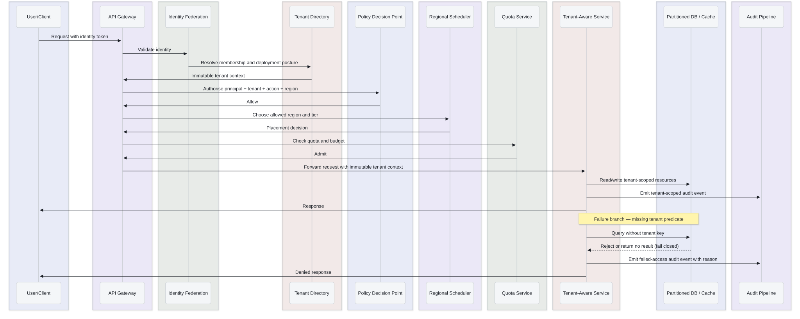</a>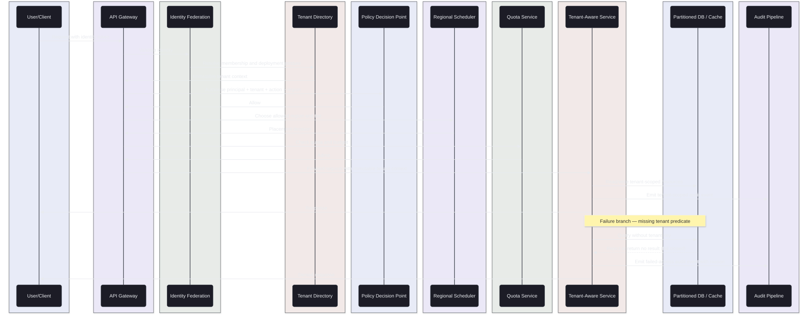<figcaption>The request as a sequence: identity, membership, authorisation, placement and quota happen before work, and a query without a tenant key fails closed and is audited. Open for full size.</figcaption></figure>

If your diagram does not make the missing-predicate case obvious, the design is still too vague. The strongest signal in the round is how you narrate identity, data, state and failure moving through the diagram, more than the drawing itself.

Production identity has three problems to solve before the policy engine runs, and none of them is authorisation:

- **Token validation** checks the signature against the IdP's published keys, the issuer, the expiry and the audience (that the token was issued for this application), before any permission logic runs.
- **Group mapping** belongs to the customer. Their Okta or Microsoft Entra ID (formerly Azure AD) groups are the source of truth, mapped into the platform's role vocabulary. That mapping is configuration, and it drifts silently when a group is renamed, so renamed groups and mapping drift need alerts.
- **Just-in-time provisioning** creates the first local user record from the token's claims, scoped to the customer and granting the minimum local role by default.

The [tenant context deep dive](#dive-context) covers the data model that holds this context and the write rules around it.

### 7. Enforce isolation at seven layers that do not trust each other {#walk-isolation}

One row label is one layer of defence. It is easy to omit in application code, ad hoc queries, background jobs and admin tools, and it covers nothing in backups, object storage, search indexes, caches, analytics pipelines or service-to-service authentication. Seven layers therefore enforce tenant scope independently, so that one missed check does not become a full breach.

<p class="figure-caption">The seven isolation layers: what must be true at each, and the rule that enforces it.</p>
<div class="source-table-wrap">

| Layer | What must be true | Enforced rule |
| --- | --- | --- |
| Row | Every query includes the tenant predicate, and the database enforces it where possible | Database or session policy refuses an unscoped query, with a non-owner app role that has neither superuser nor BYPASSRLS privilege; FORCE ROW LEVEL SECURITY additionally subjects an owner to the policy; application convention alone is not enough |
| Object | Files, blobs and embeddings are namespaced or separately authorised by tenant | Blob and embedding namespaces are tenant-scoped |
| Cache | Every cache key includes the tenant ID; a shared cache never returns data with ambiguous authorisation context | Key includes tenant, permission signature and version; a cross-tenant hit is an incident |
| Queue | Messages never expose payload metadata across tenants, especially in shared dead-letter and retry channels | Envelope and dead-letter path preserve tenant scope |
| Log | Logs never expose secrets, raw prompts or cross-tenant identifiers that let someone reconstruct another customer's state | No raw prompt, secret or other tenant's identifiers in shared telemetry |
| Vector index | Tenant scoping applied at ingestion and at query time, because semantic search otherwise surfaces neighbouring content | Tenant-scoped at ingestion and search, with a post-retrieval tenant invariant |
| Key | Tenant-scoped encryption keys with envelope encryption, so one compromise does not span the fleet | Raw storage yields only ciphertext; a leaked tenant key opens one tenant, not all, and crypto-shredding requires destroying all recoverable tenant decryption paths |

</div>

The tenant predicate is the mechanism this case owns. The store itself refuses to return a row unless the request is already scoped to one tenant. Row-level security (RLS), where the database returns only the rows the current session may see, does that when it is bound to the verified session context. In PostgreSQL use a non-owner app role without superuser or BYPASSRLS privilege. FORCE ROW LEVEL SECURITY subjects a table owner to the policy; it does not constrain superusers or BYPASSRLS roles. Isolation then never depends on every engineer remembering `WHERE tenant_id = …`. A future API that forgets the clause returns nothing rather than another company's data. Partitioning tables by tenant helps only if each tenant's partition sits behind its own credentials.

The same predicate is compiled into the vector-search filter and into the cache key, which is built from tenant, permission signature and version. The Enterprise Knowledge Assistant case teaches a two-layer retrieval pattern in which a pre-filter makes search cheap and a post-check makes it authoritative, and it applies here unchanged. The tenant predicate in the search is layer 1. The post-retrieval invariant `request.tenant_id == chunk.doc_tenant_id` is the layer 2 check, and the [cross-tenant leak incident](#dive-leak) shows what happens when it is skipped. Tenant isolation must also extend to every path that does not involve retrieval.

Pick a tenancy level and justify it, because the interviewer will ask how strongly tenants are isolated.

<p class="figure-caption">Three tenancy levels, what each means, and when each fits.</p>
<div class="source-table-wrap">

| Level | What it means | When |
| --- | --- | --- |
| Shared infrastructure with a tenant ID on every row | One database, one set of tables. Every row is tagged; every read and write includes the tag | The default: cheapest, fastest to ship |
| Separate schema or namespace per tenant | Same cluster; one tenant's tables are not another's | Stronger isolation without an extra deployment |
| Dedicated deployment per tenant | Separate cluster, region and encryption keys | Customers whose contracts or risk policy rule out sharing, often in banking and healthcare |

</div>

Start at level 1 and make that default honest with two follow-ups. First, the database enforces the tenant, not the application. Second, regulated customers get a named escalation path from a tagged row to their own keys, region or deployment. The [tenancy tiers deep dive](#dive-tiers) traces one tenant through each level.

Per-tenant keys answer the question *"what happens if someone gets raw read access to the storage layer?"* With per-tenant data keys wrapped by a master key, storage access alone yields only ciphertext. A leaked tenant key opens one tenant, not the fleet, and cryptographic erasure requires destroying every recoverable decryption path, not merely deleting one wrapped data-key record. A backup containing that wrapped key can still be decrypted while its shared wrapping key remains usable. With one platform-wide key, a single leaked key exposes every customer at once. The master key still guards everyone, so it lives in the key management service (KMS) and never leaves it. The [key deep dive](#dive-keys) explains envelope encryption step by step.

Two more principles belong on the board. **Least privilege:** each service identity sees only the tenant scope it needs, only for the operation it performs. **Blast radius as the design unit:** measure what a failure can reach by tenant, region, workflow and dependency. Negative isolation tests matter more than positive ones, because the platform must prove that the wrong tenant cannot read, infer, cache, dequeue or search another tenant's data.

Spoken-answer example from the source: *"I'd start with shared infrastructure and a tenant id on every record, that's the right default. The filter has to live in the data layer, not in application code: the store should refuse to return a row unless the request is tenant-scoped. For regulated customers I'd escalate to a separate schema or a dedicated region and keys, not just a different tag in the same table."*

### 8. Meter before the call and share fairly {#walk-fairness}

Apply quota and budget before inference, storage growth or batch fan-out, never after. A budget checked after the call is a bill, not a control, and in this platform budgets are contractual. The quota service enforces token, concurrency, burst and monetary limits per tenant or tier. The usage ledger attributes every request to a tenant, and quota alerts fire before the limit rather than at it.

Rate limiting and fairness are different problems, and a real platform needs both. A rate limit answers whether this request may proceed at all: it is a ceiling on one tenant's own allotment. A fair queue answers in what order requests are served when the workers are busy. Without fairness, a large tenant's burst can make a small, well-behaved tenant wait for its turn even though the small tenant never exceeded any limit. The mechanism is weighted fair queuing across per-tenant queues feeding a shared worker pool, so throughput is shared proportionally under contention instead of first come, first served. A token bucket per tenant caps each tenant's rate on top. Premium reserved lanes protect contractual performance without forcing every such tenant into a dedicated cluster. The [admission and fairness deep dive](#dive-fairness) traces both mechanisms with numbers.

Contain a noisy neighbour in two steps. First apply per-tenant quotas, rate limits, concurrency caps and workload classification. Then isolate the expensive parts: admission control before inference, queue partitioning, reserved capacity for premium tenants and circuit breakers when a tenant goes past its envelope. Noise caused by a bug gets fast detection and a kill switch. Legitimate burst demand gets fairness, not punishment. Autoscaling alone does not solve this, because it adds capacity without deciding who gets it.

When one tenant's usage is unusually high, diagnose before throttling. Segment usage by API key, user, feature, time, model route, prompt version, tokens per request, batch jobs and agent steps, then decide whether it is healthy adoption, a loop, abuse or a missing quota. Support legitimate adoption with capacity planning; throttle or pause loops and abuse.

Move a customer to dedicated infrastructure when shared tenancy no longer satisfies risk, performance or operational requirements at acceptable cost. The triggers are regulatory residency constraints, unusually strict latency SLOs, high-value workloads with low tolerance for contention, and a customer policy demanding a harder boundary. Avoid "big customers get dedicated"; define measurable thresholds and an exception review path.

### 9. Route by region and keep policy central {#walk-regions}

Regional controls reshape routing, storage, backup and logging, so settle early whether they are hard requirements or customer exceptions. The balanced answer is central policy definition with regional enforcement, unless residency or availability forces local control. A central control plane keeps policy consistent but can become a latency and residency problem. A fully regional one improves locality but multiplies duplication, rollout complexity and the risk that policies drift apart.

The regional scheduler places work in an allowed region and tier as a control-plane decision. The same rule covers artifacts: a tenant's residency rule includes data, prompts, outputs, inference traces, logs, backups and derived indexes, which follow the tenant's policy rather than the platform's convenience. Retention is part of the data model. It attaches to the tenant record or to a versioned policy the record references, so no service rediscovers policy from scattered flags or brittle configuration.

A control-plane outage is not always a full outage, but it is always serious. Policy distribution, deployment coordination and configuration updates may be impaired while requests still flow. Monitor control-plane health separately from the data plane, and alert when the local authority source stops refreshing.

During the outage, continue only operations whose locally held verified policy and preloaded keys remain sufficient: safe reads can keep serving. Fail closed for sensitive changes, queue non-critical writes where that is safe, or reroute. Never silently continue with stale control state for an irreversible action. Recover by restoring the regional controller, reconciling queued changes and confirming synchronisation with the authoritative policy source. Prevent recurrence by designing for tolerance of stale control state, caching the minimum policy state locally, rehearsing regional failover and keeping distinct emergency access paths.

Export and deletion across regions need their own answer. A tenant inventory and a deletion workflow span every store: relational rows, blobs, embeddings, caches, queues, logs, backups and derived artifacts. Export assembles a complete package with clear ownership and time bounds. Deletion is a coordinated job with verification, named retention exceptions and an auditable completion record. A database delete alone is not offboarding. Backup deletion follows retention windows and restore controls rather than ad hoc surgical erasure; the [offboarding deep dive](#dive-offboarding) explains why.

### 10. Fail closed on security, degrade on capacity {#walk-failures}

Memorise the pattern, not the table. Security defects fail closed: the request is refused. Capacity pressure degrades: service continues more slowly or with less, for the affected tenant only. Metadata leaks quarantine the affected path and escalate to a human. Control-plane loss depends on whether local enforcement still holds.

<p class="figure-caption">Failure scenarios with the recommended behaviour and the reason for it.</p>
<div class="source-table-wrap">

| Scenario | Recommended behaviour | Why |
| --- | --- | --- |
| Missing tenant predicate, or a request routed to a disallowed region | Fail closed immediately; reject, audit and stop the affected path | An unscoped read or write is a security defect, not a transient error |
| Cache key omits tenant ID | Fail closed: disable the path, invalidate affected entries, inspect what was served | A shared cache hit can leak data across tenants even when the database is safe |
| Shared queue leaks payload metadata | Fail closed, quarantine the queue, investigate and rotate credentials if needed | Message metadata can reveal customer identity or workflow state |
| One tenant exhausts model quota | Throttle or degrade that tenant only; keep service fair for the rest | Shared capacity should protect neighbours and preserve fairness |
| Regional control-plane outage | Queue, reroute or degrade depending on dependency criticality | Control-plane loss should not take down data-plane operations if local enforcement still works |
| Key or policy authority unavailable | Fail closed for protected data or actions | No verified key or decision means no safe read or change |
| Vector index surfaces a neighbour's chunk | Fail closed on the post-retrieval tenant invariant; block the response | Usually a tenant filter missing or wrong at query time, as in the leak incident, or chunks ingested without a tenant tag |
| Misrouted regional traffic | Reject at the scheduler; alert; audit the route | A route sending protected data to an unauthorised region is a residency breach |

</div>

The first five scenarios each have a rehearsed drill in the source tutorial, and the drills share one shape: detect, refuse and log, contain, recover, prevent. The figure traces that shape for a repository method called without a tenant predicate.

<figure class="source-diagram" id="figure-missing-predicate"><a href="source-assets/95106278b857f210.svg" target="_blank" rel="noopener"></a><figcaption>The missing-predicate drill: detect, refuse and log, contain, recover, prevent. Open for full size.</figcaption></figure>

Walk the drill in order. **Detect** through code review, automated tests and runtime alerts on any query that reaches a repository without tenant scope; detection never depends on a customer ticket. **Refuse and log** with a security error, never a silently substituted default tenant, and log the identity, trace, operation and the fact that scope was missing. **Contain**: before production, block the release; in production, disable the feature path, rotate credentials and freeze logs and traces as evidence. In-flight retries keep failing closed rather than retrying into a different scope. **Recover** by re-running affected requests through the corrected path, verifying that no cross-tenant result was returned, and confirming that idempotency keys and replay logs cannot bypass the fixed check. **Prevent** with a negative test that fails if any unscoped repository method is reachable, plus static linting of query shape, so the unscoped path is hard to call rather than merely discouraged.

Candidates often underrate the cache drill. A cache bug looks harmless in isolation because the database stays protected, but a shared cache replays the wrong tenant's object if the key misses tenant scope. Detect it by instrumenting key components in metrics and traces. Contain it by disabling the cache path or namespace, invalidating suspect entries and falling back to the source of truth. Recover by rebuilding from correctly scoped reads and re-checking the responses served in the affected window. Prevent it by requiring the tenant ID in every cache-key helper, centralising key construction and adding a negative test that asserts a cross-tenant lookup is a miss. If the cache holds authorisation-sensitive material, treat the event as a security incident, not a performance bug.

Production failure behaviour separates a toy from a system:

- Timeouts tight enough to avoid pile-ups of stale work.
- Retries only for transient failures, never for authorisation failures or malformed requests.
- Idempotency on writes, billing events and workflow triggers, so a repeated request cannot apply twice.
- Circuit breakers on dependencies that keep returning failures.
- Dead-letter queues that hold poison messages for inspection rather than reprocessing them forever.
- Human escalation for policy corruption, suspected isolation failure or ambiguous tenant ownership.

An honest design says which failures it recovers from automatically and which need a human with authority. Say what breaks first at 10 times: noisy-neighbour risk and cache churn become dominant, so pooled-plus-quotas becomes pooled-plus-partitioning, with more dedicated pools and more explicit regional controls.

### 11. Gate the release on an adversarial isolation suite {#walk-evaluation}

A suite that tries to break the tenant boundary proves the central promise. Its goal is to show that the system fails safely and visibly under attack, not to prove perfection. A single unexplained boundary failure halts promotion, and the target for confirmed cross-tenant incidents is zero.

The suite tries cross-tenant object reads with wrong-tenant IDs, stale-cache hits, replayed tokens, malformed filters, namespace collisions, missing predicates and cross-tenant vector retrieval. Each metric below has a good threshold, a bad threshold, a test dataset and an owner. Site reliability engineering (SRE) is the team and practice that keeps production running.

<p class="figure-caption">Release metrics with thresholds, datasets and owners.</p>
<div class="source-table-wrap">

| Metric | Good threshold | Bad threshold | Test dataset | Owner |
| --- | --- | --- | --- | --- |
| Cross-tenant incident count | Zero confirmed | Any incident halts promotion | Incident reports and audit-log review | Security / incident commander |
| Isolation-test pass rate | Full pass | Any new boundary failure blocks release | Adversarial negative-test suite: cross-tenant object access, stale cache reads, replayed tokens, malformed filters, namespace collisions, missing predicates | Security engineering |
| Per-tenant p95 latency | Within SLO per tenant, not in aggregate | Sustained breach | Request telemetry segmented by tenant | SRE |
| Quota rejection rate | Low and explainable per tenant class | Mis-sized quotas or poor onboarding | Admission and quota logs | Platform ops + product |
| Cost per tenant | Within the band for the tenant class | Above band | Billing mapped to tenant usage | Finance + platform |
| Regional failover time | Within the agreed RTO | Recovery exceeds target | Game-day and failover drills | SRE |

</div>

Keep technical health, model quality, adoption and business outcome as separate metric layers. Once they blur, you cannot tell an engineering problem from a product-fit problem or from customer behaviour. Trace a user complaint back to component telemetry in one chain: "document processing feels slow" becomes request arrival, quota admission, queue depth, inference duration, retrieval latency, cache hit ratio and regional routing.

The [isolation test deep dive](#dive-release-test) shows the interview-sized test that proves one invariant at the API level. Before launch, also hold the evidence that the controls exist and are exercised:

- access logs showing tenant context derived from identity
- the negative isolation tests
- role and permission reviews
- queue and cache namespace checks
- key-rotation procedures
- incident runbooks for suspected boundary failures

The operational question is "can we prove the system fails in the right direction, and recover without widening the blast radius?", not "do we have security?" Every external dependency and irreversible action needs an explicit failure and recovery policy. The absence of a policy is itself a policy, and it usually fails open.

### 12. Roll out internal tenants first and the dedicated tier last {#walk-rollout}

The platform is done only when users adopt it, the workflow improves and the operating team can support it. A staged rollout with measurable gates, named owners and rollback paths answers "when can this be trusted in production?"

<p class="figure-caption">Four rollout phases with owners, exit criteria and go/no-go rules.</p>
<div class="source-table-wrap">

| Phase | Owner | Exit criteria | Go / no-go |
| --- | --- | --- | --- |
| 1. Onboard internal test tenants | Platform engineering; security and product as reviewers | Authentication, tenant resolution, row-level filtering, storage partitioning and logging all work; every access path carries tenant context end to end; every admin action is attributable | Stop if identity propagation is inconsistent, tenant data is queryable from the wrong context, or support cannot trace a request |
| 2. Run the adversarial isolation suite | Security engineering; platform engineering fixes | Repeatable negative tests: cross-tenant object access, stale cache reads, replayed tokens, malformed filters, namespace collisions, missing predicates | The suite passes consistently before any external tenant; one unexplained boundary failure halts promotion |
| 3. Introduce small shared tenants | Product operations; support and reliability on call | Low-risk customers in the shared tier under conservative quotas and strict monitoring | Continue only if boundaries hold, latency stays in target, and operators explain every incident without guessing |
| 4. Offer a dedicated tier by policy and economics | Product management + platform operations; finance and security input | A dedicated option for customers whose regulatory, residency, workload or risk profile makes shared tenancy a poor fit, as a deliberate policy choice | The team can explain when a customer belongs in shared versus dedicated, and the cost and support implications of each |

</div>

The figure shows the same four phases with the gate between each: identity and isolation clean before the suite, the suite passing consistently before shared tenants, and latency and boundaries holding under real load before the dedicated tier.

<figure class="source-diagram" id="figure-rollout"><a href="source-assets/e320a840f5f7fe7f.svg" target="_blank" rel="noopener"></a><figcaption>Rollout phases and gates: internal tenants, the adversarial suite, small shared tenants, then the dedicated tier. Open for full size.</figcaption></figure>

In weeks, the source plan runs: weeks 0 to 1, name stakeholders, the dangerous failure and explicit exclusions; weeks 1 to 2, internal tenants; weeks 2 to 3, the isolation suite; weeks 3 to 4, hold promotion until it passes; week 5, low-risk shared tenants under conservative quotas; weeks 6 to 8, validate boundaries, latency and operator understanding. After the pilot, open the dedicated tier on measurable thresholds rather than for whoever asks loudest.

Rollout is more than code promotion:

- A **canary** takes a tiny slice of low-risk traffic first.
- **Rollback** returns to the prior configuration by tenant and region, with no data loss and no cross-tenant contamination of caches or data.
- **Migration** moves tenant metadata, quotas and routing with validation at each step.
- **Training** makes support and customer-facing teams fluent in the guarantees and the non-guarantees.
- **Documentation** covers setup, limits, escalation paths and what a quota error means.
- **Audited admin actions and operator runbooks** are part of delivery, not follow-up work.

Ownership is named: platform engineering owns the runtime and the predicates, security owns isolation gates and boundary validation, SRE owns service health, failover and its rehearsals, product owns tiering policy, and support owns first-response triage.

Keep four kinds of thing apart, because anything re-implemented per customer is a sign the platform is turning into a bundle of one-off projects. **Configuration** varies per customer without code: quotas, region preferences, feature flags, retention and routing policy. **Adapters** absorb external variance: identity providers, storage systems, logging sinks and approval workflows. **Shared services** are expensive to rebuild and central to reuse: the tenant registry, policy enforcement, metering, audit and failover orchestration. **Core product** defines the platform: isolation, admission, data access boundaries, observability primitives and internal APIs.

<p class="figure-caption">Risk register entries with owner, mitigation and trigger.</p>
<div class="source-table-wrap">

| Risk | Owner | Mitigation | Trigger |
| --- | --- | --- | --- |
| Missing tenant predicate | Platform engineering | Negative tests, code review checklists | Any request reaching a non-tenant-scoped path |
| Cache bleed | SRE + platform engineering | Tenant-keyed cache design, namespace validation | Any cache hit crossing tenant boundaries |
| Misrouted regional traffic | Infra + security | Region-aware routing rules, deployment checks | A route sending protected data to an unauthorised region |

</div>

Name the failure conditions explicitly. Cost went down but users do not adopt: not succeeded. Users adopt but support cannot operate it: not succeeded. Fast but unable to prove tenant boundaries: not succeeded.

## Technical deep dives

### Tenant context, authority and the data model {#dive-context}

Authentication comes before authorisation. Validate the token's signature, issuer, audience and expiry with the customer's IdP before any permission logic runs. The tenant directory then maps the verified principal to membership, allowed region and deployment posture. Customer-owned groups may be synchronised through SCIM, so a renamed group or drifting mapping can silently change who holds which role; alert on both.

Just-in-time provisioning grants the minimum local role for that tenant on first sign-in. A `tenant_id` in the request body is untrusted, and so is any header the client sets rather than a trusted gateway. Establish context once, make it immutable, and propagate it to services, database sessions, cache helpers, queue messages, vector filters, inference and audit. "Immutable" means no downstream component can replace the tenant on the request object; a service that needs a different tenant must fail rather than rewrite it.

The data model carries four ownership boundaries rather than four arbitrary tables:

<p class="figure-caption">Four records and the boundary each one owns.</p>
<div class="source-table-wrap">

| Record | Fields | Owns |
| --- | --- | --- |
| `Tenant` | id, region, tier, key_ref, retention_policy | Data ownership: placement, key and retention policy |
| `Membership` | user_id, tenant_id, role, status | Authority: who may act for the tenant, and how |
| `UsageLedger` | tenant_id, period, tokens, requests, cost | Commercial control: metering and attribution |
| `AuditEvent` | tenant_id, actor, action, resource, decision | Defensibility: evidence that the control ran |

</div>

Every write boundary needs two protections. An **idempotency key** identifies the intended operation, so a retried request returns the original result instead of writing twice. **Optimistic concurrency** attaches an expected version to a write, so a concurrent writer's change causes a conflict instead of being silently overwritten. Model output never flows raw into the system: it is parsed into a typed schema and policy-checked before persistence or any downstream action.

### Row-level security and the tenant predicate {#dive-row-security}

The aim is a store that refuses an unscoped read. Follow one query. The app opens a database session and sets the verified tenant on it, for example a session variable holding `acme`. An RLS policy on the table says rows are visible only when their `tenant_id` equals that session value. A developer then writes a new report query and forgets the `WHERE tenant_id = …` clause. Because the policy is applied by the database, the query still returns only Acme's rows; if no tenant was set, the policy must fail closed with no rows or an error. Scope the tenant setting to the current transaction and clear it before a pooled connection is reused. Test Acme followed by Globex on the same connection. A session variable is not authenticated by itself: untrusted SQL must not be allowed to replace it. The failure is "no data", never "all data".

That guarantee has a precondition the source states precisely. In PostgreSQL, superusers and BYPASSRLS roles always bypass row security. Table owners normally bypass it, but FORCE ROW LEVEL SECURITY can subject the owner to the policy. An application that connects as the table owner, a common default in development, has silently switched the protection off. Connect the application as a separate non-owner role without bypass privileges, and use FORCE for owner coverage where required. Test both row visibility and INSERT/UPDATE checks; a read-only test does not prove writes cannot cross tenants.

Partitioning a table by tenant does not create the same guarantee on its own. If one database credential can read every partition, a missing predicate still reads across them. Partitioning becomes an isolation layer only when each tenant's partition sits behind its own credentials.

The same predicate must reach the other layers. Vector chunks receive tenant metadata at ingestion; every query compiles a tenant filter; and a final check compares the request tenant with each chunk's tenant before prompt assembly. Cache keys carry tenant, permission signature and source or policy version, so a change of permission or content cannot replay an old entry. Queue and dead-letter envelopes carry tenant context. Logs omit raw prompts and secrets. The Enterprise Knowledge Assistant case's pre-filter plus authoritative post-check is the retrieval form of this rule; tenant isolation must also cover every path that does not retrieve.

### Per-tenant keys and envelope encryption {#dive-keys}

Envelope encryption uses two levels of key. Each tenant's data is encrypted with that tenant's own data key. The data key is itself stored only in encrypted ("wrapped") form, encrypted by a master key held in the KMS, the service that stores and rotates encryption keys so the KMS wrapping key stays inside KMS. A conventional envelope-encryption application may temporarily hold a plaintext data key while encrypting or decrypting; minimise that lifetime and remove it from memory after use. To read Acme's data, a service asks the KMS to unwrap Acme's data key for an authorised request, then decrypts.

Trace three events through this design. Someone obtains raw read access to the storage layer: they hold ciphertext, because no data key is stored in plaintext. Acme's data key leaks: one tenant's data is exposed, not the fleet's. Acme leaves: inventory plaintext and wrapped data-key copies, replicas, cached keys and exports before claiming cryptographic erasure. A per-tenant wrapping key with controlled deletion can make the remaining ciphertext unusable once every recovery path is gone. Deleting only the active wrapped-key row does not erase a backup that retains it under a usable shared master key. That distinction determines whether crypto-shredding actually occurred.

Compare one platform-wide key. A single leaked key exposes every customer at once, and there is no per-tenant way to make one customer's data unreadable. The master key still protects everyone in the envelope design, which is why it stays inside the KMS and never leaves it. For a dedicated tenant, the per-tenant key can also be a customer-managed key, which is one of the triggers discussed in the tiers deep dive.

### Tenancy tiers and the dedicated threshold {#dive-tiers}

The three tiers trade cost for separation. Each has a different topology, so trace the same tenant, Acme, through each one before comparing them.

<figure class="authored-diagram" id="figure-tiers">
<svg viewBox="0 0 720 250" role="img" aria-labelledby="tiers-title" style="width:100%;height:auto;max-width:720px" font-family="Inter, sans-serif" font-size="13" fill="none" stroke="currentColor">
<title id="tiers-title">Three tenancy tiers: shared tables with tenant rows, a separate schema per tenant in one cluster, and a dedicated cluster with its own region and keys.</title>
<rect x="10" y="30" width="220" height="200" rx="6"/><text x="120" y="20" text-anchor="middle" fill="currentColor" stroke="none" font-weight="600">1. Shared rows (default)</text>
<rect x="30" y="50" width="180" height="150" rx="4" stroke-dasharray="4 3"/><text x="120" y="70" text-anchor="middle" fill="currentColor" stroke="none">one database, one table</text>
<text x="120" y="100" text-anchor="middle" fill="currentColor" stroke="none">row: tenant=acme</text><text x="120" y="122" text-anchor="middle" fill="currentColor" stroke="none">row: tenant=globex</text><text x="120" y="144" text-anchor="middle" fill="currentColor" stroke="none">row: tenant=acme</text>
<text x="120" y="185" text-anchor="middle" fill="currentColor" stroke="none" font-size="12">boundary: RLS predicate</text>
<rect x="250" y="30" width="220" height="200" rx="6"/><text x="360" y="20" text-anchor="middle" fill="currentColor" stroke="none" font-weight="600">2. Schema or namespace</text>
<rect x="265" y="50" width="90" height="150" rx="4" stroke-dasharray="4 3"/><text x="310" y="75" text-anchor="middle" fill="currentColor" stroke="none">acme</text><text x="310" y="95" text-anchor="middle" fill="currentColor" stroke="none" font-size="12">tables</text>
<rect x="365" y="50" width="90" height="150" rx="4" stroke-dasharray="4 3"/><text x="410" y="75" text-anchor="middle" fill="currentColor" stroke="none">globex</text><text x="410" y="95" text-anchor="middle" fill="currentColor" stroke="none" font-size="12">tables</text>
<text x="360" y="220" text-anchor="middle" fill="currentColor" stroke="none" font-size="12">same cluster, separate schemas</text>
<rect x="490" y="30" width="105" height="200" rx="6"/><rect x="605" y="30" width="105" height="200" rx="6"/>
<text x="600" y="20" text-anchor="middle" fill="currentColor" stroke="none" font-weight="600">3. Dedicated deployment</text>
<text x="542" y="70" text-anchor="middle" fill="currentColor" stroke="none">acme</text><text x="542" y="100" text-anchor="middle" fill="currentColor" stroke="none" font-size="12">own cluster</text><text x="542" y="120" text-anchor="middle" fill="currentColor" stroke="none" font-size="12">own region</text><text x="542" y="140" text-anchor="middle" fill="currentColor" stroke="none" font-size="12">own keys</text>
<text x="657" y="70" text-anchor="middle" fill="currentColor" stroke="none">shared</text><text x="657" y="100" text-anchor="middle" fill="currentColor" stroke="none" font-size="12">tier for</text><text x="657" y="120" text-anchor="middle" fill="currentColor" stroke="none" font-size="12">other</text><text x="657" y="140" text-anchor="middle" fill="currentColor" stroke="none" font-size="12">tenants</text>
</svg>
<figcaption>Authored figure: the three tenancy tiers. The boundary moves from a database predicate, to a schema boundary in one cluster, to a separate deployment with its own region and keys.</figcaption>
</figure>

**Shared rows with database enforcement (the default).** Acme's rows sit in the same tables as Globex's, tagged with `tenant_id`. Acme's request reaches the shared database, the session carries `acme`, and RLS returns only Acme's rows. Cost is lowest and shipping is fastest. The boundary is a predicate, so its strength depends on the database enforcing it and on the six other layers.

**Separate schema or namespace per tenant.** Acme has its own schema or namespace in the same cluster. Acme's request is routed to the `acme` schema, and database grants prevent Acme's role from reading Globex's tables. A schema name or search_path setting alone does not revoke cross-schema privileges. This gives a stronger boundary without a second deployment, at the cost of more objects to migrate and monitor per tenant. In the source's trade-off pairs, namespace isolation with strong network policy, admission control, resource quotas and service identity is the default for compute.

**Dedicated cluster, region and keys.** Acme's request is routed by the regional scheduler to Acme's own deployment, which shares no database, cache or inference pool with Globex. This is the strongest boundary and the most expensive: the isolation term in the unit-economics equation is largest here.

Escalate a tenant to a harder tier on documented thresholds rather than on customer size alone: residency rules, strict latency SLOs, contention the shared tier cannot absorb, or a customer policy that demands harder separation. The source's fact-check notes a useful limit on that argument. US Department of Health and Human Services guidance says HIPAA (the Health Insurance Portability and Accountability Act, the US law protecting health data) does not require single-tenant hosting, and US banking regulators' third-party guidance is risk-based rather than a single-tenant mandate. Regulated industry alone therefore does not force the dedicated tier; a specific contract, risk assessment or residency rule does.

### Admission, rate limits and weighted fair queuing {#dive-fairness}

Two mechanisms work together. A **token bucket** meters one tenant's rate. Picture a bucket that holds up to B tokens and refills at r tokens per second; each request spends tokens, and when the bucket is empty the request is delayed or rejected. B sets the burst a tenant may send at once, and r sets its sustained rate. RFC 2697 describes this kind of meter, and the source's note on it is precise: a token bucket meters rate, it does not schedule fairly.

**Weighted fair queuing** schedules. Each tenant has its own queue, and the shared worker pool takes requests from the queues in proportion to their weights rather than in arrival order. Demers, Keshav and Shenker's 1989 analysis is the classic description of fair queuing sharing a saturated resource proportionally.

An illustrative trace, with invented numbers, shows why both are needed. Assume equal-cost, non-blocking work units and a pool serving 40 requests per second. For LLM calls with unequal lengths, fair scheduling must account for estimated tokens or service work as well as request count, and bound non-preemptible long requests. Globex submits 400 requests in one burst, all within its contractual quota, and a moment later Acme submits 4. With one first-come, first-served queue, Acme's requests wait behind all 400 of Globex's, about 10 seconds, although Acme exceeded nothing. With per-tenant queues and equal weights, the scheduler alternates between Acme and Globex while both have work, so Acme's 4 requests are served within roughly the first 8 slots, about 0.2 seconds. Globex's burst still completes at nearly the same time, because the pool stays fully used. Rate limits alone could not have produced that result unless they were set so low that Globex's legitimate burst was refused.

Reserved lanes add a third control: a slice of capacity held for contractual tiers, so a premium tenant's latency target survives contention without a dedicated cluster. Enforce token, concurrency, burst and monetary budgets before inference. Atomically reserve an upper-bound charge using input size, output cap and allowed branch fan-out, then reconcile actual usage and release the unused reservation. Concurrent calls must not each spend the same remaining balance. A post-call bill is not a budget gate. Attribute tokens, storage, retrieval, egress and reserved capacity per tenant in the usage ledger. Quotas set too tight create artificial failures; quotas set too loose shift one tenant's burst onto its neighbours.

For one high-usage tenant, segment by key, user, feature, time, prompt version, tokens per request, batch jobs and agent steps. Decide whether this is healthy adoption, a loop, abuse or a missing quota. Support the first with capacity planning. Throttle or pause the others, then add contract-aligned budgets and alerts.

### Unit economics: when isolation pays {#dive-economics}

The equation `C_tenant = C_fixed/N + C_usage + C_isolation` divides a tenant's cost into three parts that respond to different decisions. Adding tenants shrinks the first term. Model routing, caching and quotas change the second. Tier choice changes the third.

An illustrative example, with invented figures, makes the shape concrete. Suppose shared platform cost is $60,000 a month and N is 500, so each tenant carries $120 of fixed cost. A typical tenant drives $300 of usage and pays no isolation premium: $420 a month. A tenant moved to a dedicated cluster with its own keys and regional duplication might add $9,000 of isolation cost, about twenty times the shared tenant's total. At 5,000 tenants the fixed share falls to $12, which widens the gap further.

The lesson is the source's: pooled economics win when most tenants can share safely, and the isolation premium is paid only where a requirement demands it, then priced into that tenant's contract. Use the equation to justify the dedicated threshold with numbers in the interview, never "big customers get dedicated".

### Region, outage and offboarding contracts {#dive-offboarding}

Define policy centrally and enforce it regionally where feasible. A tenant's residency rule includes data, prompts, outputs, traces, logs, backups and derived indexes such as embeddings. Retention attaches to the tenant record or a versioned policy it references, not to scattered service flags. Decide RPO and RTO per region before designing replication and failover routing.

A regional controller outage may leave safe reads serving from valid local policy and preloaded keys. Sensitive changes fail closed, and work queued during the outage is reconciled after recovery against the authoritative policy source.

Export and deletion require an inventory of every tenant-owned surface: relational rows, objects, embeddings, caches, queues, logs and derived artifacts. A verified deletion job runs across that inventory, records completion and lists retention exceptions named up front. Backups need honesty. Erasure follows restore and retention semantics, and the platform must not claim an immediate surgical delete that its backup design cannot provide. The UK Information Commissioner's guidance on the right to erasure allows backups to be put "beyond use" until they are overwritten on schedule, while GDPR Article 17 sets the erasure duty itself. Per-tenant keys strengthen the answer: verified destruction of every tenant decryption path can make remaining ciphertext unreadable before backups age out. Record pending KMS deletion separately from completed destruction, and clear cached plaintext keys; neither a scheduled deletion nor one deleted database row proves immediate erasure.

### Reading the cross-tenant retrieval leak {#dive-leak}

This incident is the design's failure mode seen in production. Acme uses an enterprise support copilot over customer contracts, escalation policies and entitlements. The vector database stores chunks from several enterprise customers in one collection, each with `tenant_id`, `doc_tenant_id`, `visibility`, `source_connector`, `acl_hash` and `metadata_filter_version`. The intended invariant is that `tenant_id` on the request matches `doc_tenant_id` on every retrieved chunk, and that the access-control list (ACL) service, which records who may read each resource, authorises each chunk before it reaches the prompt.

On 2026-07-08 an Acme support agent asked whether Acme customers could receive premium onboarding under the 2026 renewal terms. The assistant said yes and cited a "Premium Success Addendum" that belonged to Globex. The source's telemetry for that request follows.

```
2026-07-08T09:12:44.129Z level=warn service=rag-api env=prod region=eu-central-1
  trace_id=trc_7f91c2 request_id=req_acme_88421 query_id=q_20260708_091244_19
  user_id=u_acme_support_044 tenant_id=acme user_role=support_agent
  workflow=contract_entitlement_answer retriever_version=2026-07-07
  metadata_filter_version=v3 filter_expression="visibility in ['public','internal']"
  expected_filter_expression="tenant_id == 'acme' AND visibility in ['public','internal']"

2026-07-08T09:12:44.388Z level=info service=vector-retriever
  trace_id=trc_7f91c2 collection=enterprise_contract_chunks index=contracts_hnsw_v22
  retrieval_k=12 returned_k=12 top_score=0.81
  retrieved_chunk_ids=[chk_globex_9921,chk_acme_1710,chk_acme_1709,chk_globex_9922]
  retrieved_doc_ids=[doc_globex_renewal_2026,doc_acme_msa_2025]
  doc_tenant_ids=[globex,acme,acme,globex]

2026-07-08T09:12:44.421Z level=error service=acl-enforcer
  trace_id=trc_7f91c2 acl_check=skipped reason="pre_authorized_connector_flag=true"
  connector=sharepoint connector_scope=tenant_shared acl_cache_key=acl:v2:sharepoint:contracts
  request_tenant_id=acme doc_tenant_id=globex policy_decision=not_evaluated

2026-07-08T09:12:45.221Z level=error service=response-evaluator
  trace_id=trc_7f91c2 eval=tenant_isolation_violation severity=critical
  response_served=true citation_doc_id=doc_globex_renewal_2026 citation_chunk_id=chk_globex_9921
  tenant_id=acme doc_tenant_id=globex human_review=false
```

Read the four log lines as one trace, following `trace_id=trc_7f91c2`. The first line shows the request was correctly stamped `tenant_id=acme`, but filter version `v3` applied only `visibility in ['public','internal']`; the expected expression also contained `tenant_id == 'acme'`. The second line shows the consequence: the retriever returned chunks whose `doc_tenant_ids` include `globex` twice. The third line shows the second layer failing: the ACL enforcer skipped its check because `pre_authorized_connector_flag=true`, so the policy decision was `not_evaluated`. The fourth line shows the response evaluator flagging a critical isolation violation only after `response_served=true`, with the citation pointing at the Globex renewal document.

The source's root cause: a retrieval deploy on 2026-07-07 introduced filter version v3 to support global product documentation. The filter builder treated connector-level "pre-authorised" documents as safe and omitted the tenant equality predicate for one SharePoint collection. The ACL service then skipped chunk-level checks because it trusted the connector-level scope. The rollout reached 15% of Acme traffic at 08:45 on 2026-07-08, so the live filter version and canary cohort are part of the diagnosis. Two supposedly independent layers both trusted the same connector shortcut, which is exactly what the seven-layer independence rule exists to prevent.

This is a confidentiality incident, not a hallucination. The model accurately summarised text it should never have received. The enforcement therefore belongs outside the LLM and outside prompt instructions: a malicious user could deliberately query for rare phrases that retrieve neighbouring tenants' documents if the filters are weak, and no prompt wording would stop that. OWASP's guidance on vector and embedding weaknesses (LLM08:2025) lists this cross-tenant leak from missing vector access controls. The response, containment and prevention are worked as a drill in [Practice](#practice-leak).

### The interview-sized isolation test {#dive-release-test}

The test below, from the source, proves one invariant at the API level, not only in the database: a secret created under one tenant is invisible to another, and the other tenant does not even learn that the object exists. A 404 rather than a 403 is the point, because "forbidden" would confirm that the ID is real.

```python
import pytest

class TenantSession:
    def __init__(self, tenant_id, store, next_id):
        self._tenant_id = tenant_id
        self._store = store
        self._next_id = next_id

    async def create_secret(self, value):
        secret_id = str(self._next_id())
        self._store[(self._tenant_id, secret_id)] = value
        return type("Secret", (), {"id": secret_id})()

    async def get_secret(self, secret_id):
        if (self._tenant_id, secret_id) not in self._store:
            return type("Response", (), {"status_code": 404})()
        return type("Response", (), {"status_code": 200, "value": self._store[(self._tenant_id, secret_id)]})()

class FakeApi:
    def __init__(self):
        self._store = {}
        self._next_id_value = 1

    def _next_id(self):
        current = self._next_id_value
        self._next_id_value += 1
        return current

    def as_tenant(self, tenant_id):
        if not tenant_id:
            raise ValueError("tenant context required")
        return TenantSession(tenant_id, self._store, self._next_id)

@pytest.mark.asyncio
async def test_cross_tenant_ids_are_invisible():
    api = FakeApi()
    created = await api.as_tenant("alpha").create_secret("A")
    response = await api.as_tenant("beta").get_secret(created.id)
    assert response.status_code == 404
```

Trace it. `as_tenant("alpha")` refuses to build a session without a tenant, which mirrors failing closed on missing context. The store is keyed by the pair `(tenant_id, secret_id)`, so the tenant is part of the address, not a filter applied afterwards. Alpha creates secret `1`. Beta asks for secret `1`; the lookup key `("beta", "1")` does not exist, so beta receives 404. The IDs are sequential and shared, which makes the test meaningful: beta can guess alpha's ID and still learns nothing.

The test deliberately omits authentication middleware, request signing, database transactions, observability hooks and retry wrappers, and you should say so in the interview. It is one row of the adversarial suite; the full suite repeats the same shape for stale cache reads, replayed tokens, malformed filters, namespace collisions, missing predicates and cross-tenant vectors, and its owner is security engineering.

### References {#references}

The November review corrects PostgreSQL FORCE/BYPASSRLS behaviour, pooled-session and schema enforcement, and envelope-key erasure claims. It adds concurrent spend reservation and states the fair-queue example's equal-work assumption. [PostgreSQL RLS](https://www.postgresql.org/docs/18/ddl-rowsecurity.html), [transaction-local settings](https://www.postgresql.org/docs/18/sql-set.html), [AWS data keys](https://docs.aws.amazon.com/kms/latest/developerguide/data-keys.html) and [KMS deletion](https://docs.aws.amazon.com/kms/latest/developerguide/deleting-keys.html) support these corrections. The source's earlier fact-check was dated 27 September 2026. They support the specific claims beside them; this rewrite does not assert anything newer about the products named.

- [OWASP Authorization Cheat Sheet](https://cheatsheetseries.owasp.org/cheatsheets/Authorization_Cheat_Sheet.html): trust only verified tokens, claims or sessions, never client-set fields.
- [New name for Azure Active Directory (Microsoft Learn)](https://learn.microsoft.com/en-us/entra/fundamentals/new-name): Azure AD is now Microsoft Entra ID.
- [PostgreSQL docs: Row Security Policies](https://www.postgresql.org/docs/current/ddl-rowsecurity.html): superusers and BYPASSRLS always bypass RLS; FORCE can subject the table owner to it.
- [HHS: Guidance on HIPAA and Cloud Computing](https://www.hhs.gov/hipaa/for-professionals/special-topics/health-information-technology/cloud-computing/index.html): HIPAA does not require single-tenant hosting.
- [OCC Bulletin 2023-17: Interagency Guidance on Third-Party Relationships](https://www.occ.gov/news-issuances/bulletins/2023/bulletin-2023-17.html): bank rules are risk-based, not a single-tenant mandate.
- [AWS KMS cryptography essentials (envelope encryption)](https://docs.aws.amazon.com/kms/latest/developerguide/kms-cryptography.html): what per-tenant data keys wrapped by a master key protect.
- [Demers, Keshav, Shenker 1989: Analysis and Simulation of a Fair Queueing Algorithm](https://dl.acm.org/doi/10.1145/75247.75248): fair queuing shares a saturated resource proportionally.
- [RFC 2697: A Single Rate Three Color Marker](https://www.rfc-editor.org/rfc/rfc2697): a token bucket meters rate; it does not schedule fairly.
- [ICO: Right to erasure](https://ico.org.uk/for-organisations/uk-gdpr-guidance-and-resources/individual-rights/individual-rights/right-to-erasure/): backups can be kept "beyond use" until overwritten on schedule.
- [GDPR Article 17: Right to erasure](https://gdpr-info.eu/art-17-gdpr/): the erasure duty itself.
- [OWASP GenAI LLM08:2025 Vector and Embedding Weaknesses](https://genai.owasp.org/llmrisk/llm082025-vector-and-embedding-weaknesses/): cross-tenant leaks from missing vector access controls.

## Practice

### Attempt the design on a blank page {#practice-prompt}

Design a shared AI platform for 500 tenants without looking at the diagrams. Say where tenant context comes from and why it cannot change, name the seven layers and what each refuses, show where quota is checked, state what fails closed and what degrades, and give the release gate and rollout order. Then answer the source's check-yourself questions below before opening each worked answer. The blank-page prompt and worksheet are authored for this page; the questions and answers are the source's.

<details class="answer-reveal" id="check-1"><summary>Why is tenant_id on every row insufficient?</summary><div class="detail-body"><p>It is one defence layer that covers nothing in caches, blob stores, indexes, background jobs, analytics or admin tooling, and it fails the first time a developer omits the predicate. Enforcement has to exist independently in several layers.</p></div></details>

<details class="answer-reveal" id="check-2"><summary>Where does tenant context come from, and why not the request body?</summary><div class="detail-body"><p>From verified identity, because a signed token, verified claim or server-side session can be authenticated and logged, while a client-set header or JSON field can be spoofed, replayed or forwarded across tenants.</p></div></details>

<details class="answer-reveal" id="check-3"><summary>What is the fail-closed rule for a missing predicate?</summary><div class="detail-body"><p>Reject with a security error and never substitute a default tenant; log identity, trace, operation and the missing-scope fact; keep in-flight retries failing closed.</p></div></details>

<details class="answer-reveal" id="check-4"><summary>A cache key omits the tenant id and the database is still protected. What kind of incident is it?</summary><div class="detail-body"><p>A security incident, because a shared cache can replay another tenant's object. Disable the path, invalidate, rebuild from scoped reads, and add a negative test asserting that a cross-tenant lookup is a miss.</p></div></details>

<details class="answer-reveal" id="check-5"><summary>What is the difference between a rate limit and a fair queue?</summary><div class="detail-body"><p>A rate limit is a ceiling on one tenant's own allotment. A fair queue decides the order of service under load, so a large tenant's burst cannot delay a small tenant that never exceeded any limit.</p></div></details>

<details class="answer-reveal" id="check-6"><summary>What does the unit-economics equation say about when to pay for isolation?</summary><div class="detail-body"><p><code>C_tenant = C_fixed/N + C_usage + C_isolation</code>. Pooled economics win when most tenants can share safely, and the isolation premium is paid only where a requirement demands it.</p></div></details>

<details class="answer-reveal" id="check-7"><summary>What are the three tenancy levels and the honest default?</summary><div class="detail-body"><p>Shared infrastructure with a tenant ID on every row, a separate schema or namespace per tenant, and a dedicated deployment per tenant. Start at level 1 with the database enforcing the tenant and a named escalation path for regulated customers.</p></div></details>

<details class="answer-reveal" id="check-8"><summary>In the incident, which two layers failed and why did that matter?</summary><div class="detail-body"><p>The filter builder dropped the tenant predicate for pre-authorised connectors, and the ACL service skipped chunk checks because it trusted connector scope. Two layers failing together is exactly what independent enforcement is meant to make impossible.</p></div></details>

<details class="answer-reveal" id="check-9"><summary>What is the sixty-second cost answer?</summary><div class="detail-body"><p>Make <code>tenant_id</code> and <code>permission_signature</code> first-class in every service, and meter before the call because budgets are contractual.</p></div></details>

### Deliver it in fifty minutes {#practice-delivery}

Spend time in proportion to risk. Isolation, export and deletion, quotas, regional controls and rollback deserve depth; a row of generic services does not. The source's time plan maps each phase to a walkthrough step.

<p class="figure-caption">A fifty-minute plan, with the walkthrough step each phase draws on.</p>
<div class="source-table-wrap">

| Minutes | Phase |
| --- | --- |
| 0–5 | Frame the outcome: shared platform, 500 tenants, defensible isolation, predictable performance, regional controls (step 1) |
| 5–12 | Discovery and assumptions: data classes by region, bring-your-own-key, hard delete, burst pattern, what "predictable" means, the highest-risk tenant action (steps 2 and 3) |
| 12–18 | Rough sizing, proportional to risk: tenant count, peak concurrency per tenant, request size, storage growth, export and delete frequency (step 4) |
| 18–28 | Core architecture: where tenant context is attached, verified and made impossible to bypass (steps 5 to 7) |
| 28–35 | Defend the trade-offs, each tied to a customer outcome, an operational burden and a failure mode (table below) |
| 35–42 | Failure cases and controls: why a row tag is not enough, export and delete, noisy neighbours, the dedicated threshold (steps 8 to 10) |
| 42–46 | Delivery and operability: staged rollout, kill switches, tenant migration, support tooling (steps 11 and 12) |
| 46–50 | Executive summary: what was built, why it is the right default, who gets dedicated, and the first production gate |

</div>

A sample exchange starts at minute zero. The interviewer says "start from minute zero, what do you say?", and the candidate frames the outcome and the cheapest-safe-shared assumption. The probe follows.

<details class="answer-reveal" id="followup-cheapest-shared"><summary>What if your cheapest-shared assumption is wrong?</summary><div class="detail-body"><p>Change the control boundary as well as the capacity. Test whether any customer needs strict residency or dedicated inference, and if so bias the architecture toward stronger isolation: a separate namespace, regional placement or the dedicated tier, rather than only more shared capacity.</p></div></details>

Defend four trade-off pairs, each with a balanced verdict.

<p class="figure-caption">Four trade-off pairs with the default and the verdict.</p>
<div class="source-table-wrap">

| Pair | Default | Verdict |
| --- | --- | --- |
| Shared database vs database per tenant | Shared: cost, fleet simplicity, product reuse; raises the bar on filtering, backup, export/delete and containment | Shared by default, with a pathway to dedicated storage when isolation, regulatory or performance needs justify the cost |
| Namespace vs cluster isolation | Namespace with strong network policy, admission control, resource quotas and service identity | In this design, namespace is the default; dedicated clusters are the premium or exception path |
| Central vs regional control plane | Central policy is simpler and consistent but can become a latency and residency problem | Central policy definition with regional enforcement, unless residency or availability forces local control |
| Pooled vs reserved inference capacity | Pooled fits the shared-platform goal; needs backpressure, quotas and admission control | Mature platforms support both in a tiered model; the trade-off is cost and fairness |

</div>

The follow-ups arrive in a predictable order. Answer each one aloud before opening it.

<details class="answer-reveal" id="followup-row-tag"><summary>Why is tenant_id on every row insufficient? (follow-up)</summary><div class="detail-body"><p>It is one line of defence. It does not protect caches, blob stores, indexes, background jobs, analytics or admin tooling, and it fails if a developer omits the predicate once. A secure system needs enforced policy in multiple layers, not a convention in application code.</p></div></details>

<details class="answer-reveal" id="followup-export-delete"><summary>How does a tenant export and delete all its data?</summary><div class="detail-body"><p>A tenant inventory and a deletion workflow spanning every store. Export is a complete package with ownership and time bounds. Deletion is a coordinated, verified, auditable job. Backup semantics follow the retention policy.</p></div></details>

<details class="answer-reveal" id="followup-noisy-neighbour"><summary>How do you contain a noisy neighbour?</summary><div class="detail-body"><p>Quotas, rate limits, concurrency caps and workload classification first; then admission control before inference, queue partitioning, reserved capacity and circuit breakers. Noise caused by a bug gets a kill switch; legitimate burst gets fairness.</p></div></details>

<details class="answer-reveal" id="followup-dedicated"><summary>When does a customer move to dedicated infrastructure?</summary><div class="detail-body"><p>When shared tenancy no longer meets risk, performance or operational requirements at acceptable cost: residency constraints, strict latency SLOs, contention-intolerant workloads, or a customer policy demanding a harder boundary. Use measurable thresholds and an exception review path, never "big customers".</p></div></details>

<details class="answer-reveal" id="followup-prove-deletion"><summary>How do you prove deletion?</summary><div class="detail-body"><p>A verification pass across every store in the tenant inventory, an auditable completion record, and the retention exceptions named up front.</p></div></details>

<details class="answer-reveal" id="followup-what-breaks"><summary>What breaks under a noisy neighbour?</summary><div class="detail-body"><p>Shared worker pools and model backends saturate, and queue depth and p95 rise for the neighbours. The fix is admission control and fair queuing, not autoscaling alone.</p></div></details>

Repair weak answers on the spot by naming the mechanism the weak phrase skipped.

<p class="figure-caption">Weak answers and the repair that names the missing mechanism.</p>
<div class="source-table-wrap">

| Weak answer | Repair |
| --- | --- |
| "I'd just put tenant_id on every query." | Describe the enforcement stack and the failure mode of a missed predicate |
| "I'd isolate everything." | Ask what everything costs, then give the shared default with an exception path |
| "The control plane can be centralised for all cases." | Separate policy management from residency and regional execution |
| "We'll autoscale if latency rises." | Treat capacity planning, queue control, fairness and reserved tiers as different things |
| "Deletion is just a database delete." | List every place tenant data can exist, with retention and backup constraints |
| "Noisy neighbours are rare." | Present a containment plan before the incident |

</div>

The ninety-second architecture summary, a spoken-answer example from the source:

> I'd default to a shared platform because it gives the best cost and operational efficiency across 500 enterprise customers. Each request carries authenticated tenant context; that context is enforced at the application boundary, in the data layer, and in storage and queue paths. I'd use namespace-level isolation plus network policy and quotas for the common case, with reserved inference capacity for premium or burst-sensitive customers and dedicated clusters or databases only when risk or performance requires it. The control plane would manage policy and rollout, while regional enforcement would preserve residency and latency constraints. Defence in depth is the point, one control alone is not enough. I'd verify tenant isolation with adversarial tests, monitor for cross-tenant access attempts, and define a clear export/delete workflow that spans all tenant-owned data stores.

The two-minute spoken answer from the source:

> I would start by separating the feature they asked for, one AI application for 500 tenants, from the business result, which is a cost-efficient shared platform with defensible isolation plus a dedicated path for the exceptions. Four stakeholders mean four definitions of success, so I would clarify which data classes are in scope, whether regional controls are hard requirements, what predictable performance means, and which failure is most expensive. My default is shared-by-default with tiered isolation. The non-negotiable rule is that tenant context comes from verified identity, never the request body, is established once, and becomes immutable. The control plane federates identity, resolves the tenant directory, evaluates policy, schedules the region, and selects keys; the data plane admits at the gateway, applies quotas before expensive inference, and reads and writes only tenant-scoped resources. Seven isolation layers enforce independently, row, object, cache, queue, log, vector index, and key, so a single missed check is not a breach, and a missing tenant predicate fails closed rather than reading whatever matches. I would size for load shape rather than the average, since 20x skew means a few tenants drive peak. I would gate the rollout on an adversarial isolation suite, then internal tenants, small shared tenants, and finally a dedicated tier justified by measurable thresholds. Success is not elegance; it is adoption, an improved workflow, and an operations team that can support it.

The delivery close, in ninety seconds:

> I would deliver this platform in four steps: internal tenants, adversarial isolation testing, small shared tenants, then a dedicated tier for customers whose policy or economics justify it. I would track isolation-test pass rate, cross-tenant incidents, per-tenant p95 latency, quota rejections, cost per tenant, and regional failover time, while separating technical health from adoption and business outcomes. The rollout would have named owners, explicit go/no-go gates, rollback triggers, training, support, and documentation. The system is successful only when users adopt it, the workflow improves, and the operating team can support it.

The interview guide's shorter close makes the same points in five lines:

> I would default to a shared platform for 500 tenants, but derive tenant context from verified identity once and make it immutable. The control plane sets membership, policy, region, keys, and quotas; the data plane enforces scope independently in rows, objects, caches, queues, logs, indexes, and keys. I would meter before LLM inference and use fair queues so a large tenant cannot starve the rest. A missing tenant predicate or cross-tenant retrieved chunk fails closed. I would prove that with an adversarial suite before external rollout, then offer dedicated capacity only when the customer's risk, residency, or SLO requires it.

Practise it three ways: ten minutes answering aloud, then cut every sentence that does not change a design decision; a pair mock in which the partner interrupts on "secure", "scale" and "optimised" until you name the mechanism; and one enforcement point (row-level authorisation, tenant-scoped export and delete, or per-tenant rate limiting) written with tests, failure handling and a rollback plan.

### Answer the cost pivot {#practice-cost-pivot}

After a good design the interviewer often pivots to budgets: a SaaS company wants GenAI features across its customers with strict tenant isolation and budget controls. Answer in the same sitting with the same architecture, because the budget check is already in the request path.

<p class="figure-caption">The ten-minute cost drill card for per-customer GenAI budgets.</p>
<div class="source-table-wrap">

| Element | Answer |
| --- | --- |
| Ask | How are tenants isolated today? Which budgets are contractual? Can tenants choose model tiers? What data retention and audit policies apply? How is billing reported? |
| Dominant driver | Uncontrolled spend with no attribution, and a shared cache that leaks across tenants |
| Weak move | Add a global token limit and a shared cache |
| Strong move | Tenant-aware gateway, per-tenant budgets, permission-aware cache, tenant-specific observability, model-routing policy, quota alerts, isolation tests |
| Path | tenant gateway → auth → budget check → cache/model route → tenant-scoped data plane → cost attribution → dashboards |
| Trade-off | Caching and routing are powerful but dangerous without tenant keys and budget ownership |
| Metrics that prove it | Cost per tenant, quota usage, cross-tenant access tests, cache hit rate by tenant, p95 latency |
| Recommendation | Make `tenant_id` and `permission_signature` first-class across every service |

</div>

The sixty-second line: make `tenant_id` and `permission_signature` first-class in every service, and because budgets are contractual, meter before the call, not after.

Every strong cost answer follows four verbs in order. **Measure** by tracing and attributing spend first. **Route** by matching model and path to risk. **Bound** with limits on steps, tokens, top-k, timeouts and budgets. **Cache safely** with tenant, permission and version in the key. Deliver it in six moves: frame the business impact, decompose the path, name the largest measured driver, fix it safely, prove the result with before and after numbers, and prevent recurrence.

<details class="answer-reveal" id="pivot-high-usage"><summary>Second pivot: one tenant has unusually high usage. What do you do?</summary><div class="detail-body"><p>First distinguish healthy adoption from runaway automation, because the response differs. Ask whether it is legitimate adoption, abuse, a loop, a batch job or an integration bug. Likely causes are an automated integration loop, heavy document processing, a power-user workflow or a missing quota.</p><p>Segment usage by API key, user, feature, time of day and prompt version. Watch cost per tenant, cost per user, request source, tokens per request, batch jobs and agent steps.</p><p>Now: apply a tenant rate limit, talk to the customer, and pause the suspicious workflow if necessary. Later: add tenant budgets, a usage dashboard, anomaly alerts and integration safeguards. Prevent recurrence with contract-aligned quotas and notifications.</p><p>Spoken-answer example: "I would first distinguish healthy adoption from runaway automation. The response differs: support scale-up for healthy usage, throttle loops or abuse."</p></div></details>

### Debug the cross-tenant leak {#practice-leak}

Use the telemetry in the [leak deep dive](#dive-leak). An Acme support agent received a "yes" citing Globex's Premium Success Addendum. The drill tests whether your debugging goes beyond retrieval quality; frame it as a multi-tenant isolation failure, never as a hallucination.

<details class="answer-reveal" id="leak-response"><summary>Walk through detection, containment, root cause and prevention.</summary><div class="detail-body"><p><strong>Detect.</strong> Start from the known bad answer and open the full trace. Compare <code>tenant_id</code> on the request with <code>doc_tenant_id</code> on the retrieved chunks, read the filter expression the retriever actually used, and check whether the ACL was evaluated per chunk. The telemetry already shows it: the filter dropped the tenant equality, two Globex chunks came back, the ACL check was skipped because of a connector flag, and the evaluator flagged a critical violation after the response was served. Then query every trace on <code>metadata_filter_version=v3</code> for <code>tenant_id != doc_tenant_id</code>, and compare the canary cohort with the control cohort still on v2. Do not re-run the question in the UI: it may not reproduce the canary route, the cache state or the retrieval order. The path is trace-first: request, filter, retrieved chunks, ACL decision, prompt context, citation.</p><p><strong>Contain.</strong> Disable <code>metadata_filter_version=v3</code>. Purge affected answer-cache entries. Block every response in which any retrieved chunk has <code>tenant_id != doc_tenant_id</code>. Force human review for contract-entitlement answers generated in the incident window. Notify the customer, because a leaked clause can expose pricing, support commitments or regulated data.</p><p><strong>Root cause.</strong> The 2026-07-07 deploy introduced filter v3 for global product documentation; the filter builder treated "pre-authorised" connector documents as safe and omitted the tenant predicate for one SharePoint collection, and the ACL service skipped chunk checks because it trusted connector scope. The rollout had reached 15% of Acme traffic at 08:45 on 2026-07-08. Two layers failed together.</p><p><strong>Prevent.</strong> Make tenant isolation a non-bypassable server-side predicate. Add a hard post-retrieval invariant check before context assembly. Remove connector-level ACL shortcutting. Add an automated eval that fails deployment if cross-tenant chunks appear in retrieved context. Add a dashboard panel for <code>cross_tenant_retrieval_count</code> by tenant, connector, retriever version and filter version. Explain why enforcement lives outside the LLM and its prompt: a malicious user could query for rare phrases that pull neighbouring tenants' documents if filters are weak.</p><p>Spoken-answer example from the source: "I would treat this as a critical data isolation incident. First I would disable the new filter version and stop serving answers from suspicious traces. Then I would inspect the trace for request tenant, retrieved chunk tenant, filter expression, and ACL decision. The telemetry already shows tenant_id=acme, doc_tenant_id=globex, and acl_check=skipped, so the root cause is likely the filter/ACL path, not the model. The fix is to enforce tenant equality as a hard backend invariant before context assembly, add post-retrieval validation, purge affected cache, and add a deployment gate that fails on cross-tenant retrieval."</p></div></details>

Score your answer against the source's criteria.

<p class="figure-caption">Strong and weak signals for the leak drill.</p>
<div class="source-table-wrap">

| Criterion | Strong signal | Weak signal |
| --- | --- | --- |
| Problem framing | Identifies a critical multi-tenant isolation failure | Calls it a generic bad answer |
| Telemetry interpretation | Compares request tenant, document tenant, filter version, ACL decision | Looks only at latency or model output |
| Root-cause reasoning | Traces the filter builder and the ACL shortcut | Blames prompt quality |
| Production debugging | Uses traces, canary cohort, cache audit, invariant checks | Reproduces manually in the UI only |
| Security/privacy awareness | Mentions confidentiality, blast radius, customer notification | Ignores data-leak impact |
| Mitigation quality | Rollback, block invariant violations, purge cache, add gates | "Improve the prompt" |
| Communication clarity | Explains severity and remediation to security, product and the customer | Gives a vague engineering update |

</div>

### Calibrate your level {#practice-levels}

On this design the levels separate on how many boundaries enforce tenant scope on their own, and who proves it, not on how the model is served.

<p class="figure-caption">What each level sounds like and what it is still missing.</p>
<div class="source-table-wrap">

| Level | Sounds like | Missing |
| --- | --- | --- |
| Senior | Derives tenant context once from the verified token, never the request body, and makes it immutable. Enforces it with row-level security, tenant-keyed caches and a vector filter plus the post-retrieval tenant check, and meters budget before inference so a tenant over quota degrades alone. | Everything past the request path: queue and dead-letter envelopes, logs, per-tenant keys, verified offboarding, and an adversarial suite that blocks promotion on one unexplained failure. |
| Staff | Adds the queue, log and key layers so all seven enforce independently, weighted fair queuing behind per-tenant token buckets, and an isolation suite Security engineering owns as the release gate. Rolls out internal tenants first, then small shared tenants on conservative quotas, with named owners and rollback by tenant and region. | What breaks at 10x, 5,000 tenants and 2,000 QPS: cache churn and noisy neighbours push pooled-plus-quotas towards partitioning, and nobody has said when shared stops being the right default. |
| Principal | Turns the dedicated tier into a policy with measurable thresholds and an exception review path, priced by `C_tenant = C_fixed/N + C_usage + C_isolation`, never "big customers get dedicated". Keeps policy central and enforcement regional, so residency covers logs, backups and derived indexes, and a control-plane outage never carries stale state into an irreversible action. | The actual dedicated-tier thresholds, RPO and RTO per region, and the backup erasure window depend on the customers' contracts and residency rules, so they wait for discovery. |

</div>

## Quick review

### The rule and the request flow {#review-flow}

**Derive tenant context from verified identity once; enforce it independently everywhere; meter before LLM inference.** The control plane decides tenant policy, region, tier, keys and budgets; the data plane enforces scope at every store and inference boundary.

Flow: verified IdP → tenant directory → immutable context → policy and allowed region → pre-call quota → tenant-scoped stores and retrieval → chunk-tenant post-check → LLM inference → typed output check → audit and usage. The platform hosts assistants and bounded agents whose plans, prompts, tools, caches and traces inherit tenant context. Model output cannot establish identity or authority.

Ask first: data classes; residency for data, logs and backups; shared versus dedicated exceptions; peak skew and per-tenant SLO; federated identity and keys; contractual budgets; verified export and deletion; audit evidence.

### Seven layers, numbers and the tier trade-off {#review-layers}

**Row · object · cache · queue · log · vector index · key.** The store refuses an unscoped read through RLS, with an app role that is not owner, superuser or BYPASSRLS. Vector scoping happens at ingest, at query and at final context assembly. Cache keys include tenant, permission signature and version. Per-tenant data keys under a KMS master key mean storage access yields ciphertext and verified destruction of every decryption path is required for crypto-shredding.

Illustrative sizing: 500 tenants, 50k active users, 200 QPS peak, 20x skew; a mean of 0.4 QPS per tenant hides concentration. At 10x: 5,000 tenants and 2,000 QPS, with partitioning replacing pooled-plus-quotas. `C_tenant = C_fixed/N + C_usage + C_isolation`. Shared enforced rows by default → separate namespace → dedicated region, cluster and keys when risk, residency, SLO or contention justifies it, on measurable thresholds.

Rate limits cap a tenant's own usage with a token bucket; weighted fair queuing decides order under contention; reserved lanes protect contracts. Budgets are checked before the call.

### Failure defaults and the leak drill {#review-failures}

<div class="source-table-wrap">

| Trigger | Default |
| --- | --- |
| Missing predicate or mismatched retrieved chunk | Fail closed, audit, stop the path |
| Cross-tenant cache hit | Security incident; disable, purge, inspect the served window |
| Queue leaks metadata | Quarantine, investigate, rotate credentials if needed |
| One tenant over quota | Degrade that tenant; the fair queue protects others |
| Policy or key unavailable | Block the protected operation |
| Regional control outage | Safe local-policy reads only; queue or block sensitive changes |

</div>

The pattern: security defects fail closed, capacity pressure degrades, metadata leaks quarantine, and the drill is detect, refuse and log, contain, recover, prevent.

Leak drill: an Acme request cited a Globex document because filter v3 dropped tenant equality and a connector flag skipped the ACL. Roll back v3, purge caches, block mismatched chunks, search mismatch traces, notify the customer; add a non-bypassable predicate, a post-retrieval check and a negative release gate. It is an isolation failure, not a model hallucination.

### Release, rollout and the closing lines {#review-release}

Release gate: an adversarial isolation suite; any unexplained boundary failure blocks promotion; the confirmed cross-tenant incident target is zero. Track per-tenant p95, quota rejections, cost per tenant, isolation-test pass rate and regional failover time separately. Rollout: internal tenants → adversarial suite → small shared tenants on conservative quotas → policy-justified dedicated tier, each with an owner, a go/no-go and rollback by tenant and region.

Lines that carry the round, from the source:

1. "Tenant context comes from verified identity, never the request body, is established once, and becomes immutable."
2. "The control plane decides; the data plane enforces."
3. "Seven layers enforce independently, so one missed check is not a breach."
4. "A missing tenant predicate fails closed. It never reads whatever matches."
5. "The store refuses to return a row unless the request is already tenant-scoped."
6. "Security defects fail closed; capacity pressure degrades; metadata leaks quarantine."
7. "Size for the load shape, not the average. 20x skew means a few tenants drive peak."
8. "Pay the isolation premium only where a requirement demands it."
9. "A cache hit across tenants is a security incident, not a performance bug."
10. "Blast radius is the design unit."

Success is adoption, an improved workflow and an operations team that can support the platform, with tenant boundaries it can prove.
