## Case brief

### An operations agent that meets new work every week {#brief-scenario}

An internal operations agent handles requests such as "restart service X" and "roll back flag Y". Teams keep shipping new systems, so new request types appear every week. The ask is an agent that adapts to those new tasks on its own, without a person retraining it.

That ask hides the hard constraint. Every change the agent makes to itself is a regression nobody reviewed. The agent needs freedom to change its behaviour, yet it must never quietly get worse, and it must never grant itself more permission, budget or irreversible reach. A design that only says "the agent learns from experience" has not addressed that constraint yet.

A few terms carry the whole case. A **skill** is a named, parameterised sequence of tool calls, such as `safe_restart(service_name)`, with a precondition, a postcondition and a measured success rate. A **rung** is one place where learning can live, from the context of a single request up to the model's weights. The **evaluation gate** is the single checkpoint every learned change must pass before it touches live traffic. **Shadow testing** runs a candidate beside live behaviour on real requests without letting it act. A **stratum** is one slice of the evaluation set; here, one task type. An <abbr title="large language model: The model that reads text and writes text, such as GPT, Claude or Llama. Powerful, but it will confidently make things up if you let it.">LLM</abbr> (large language model) is the model that plans and writes the agent's actions.

The core idea fits in one sentence: adapt in the cheapest, most reversible place first, and send every self-change through the same gate as a human change. The figure shows that decision for a single request and for what the agent learns from it.

<figure class="source-diagram" id="fig-core-idea"><a href="source-assets/881fac309e9a83e9.svg" target="_blank" rel="noopener"></a><figcaption>A new request runs with current skills when its type is known and in a tighter fallback mode when it is not; outcomes and lessons then pass an evaluation gate that promotes them to memory, a skill or a prompt, or discards and demotes them. Open for full size.</figcaption></figure>

The design treats adaptation as five rungs: context, memory, procedure, prompt optimisation and weights. Each rung is about ten times costlier and harder to undo than the one before, and we work from the cheap end. A runtime loop serves requests, a learning loop proposes changes, and the two meet at one evaluation gate. Every learned change passes a gate before it can affect a run. A fact learned during a run passes the four-check memory write policy before it is stored and stays versioned and revertible; skills, prompt changes, weight updates and memory candidates mined offline pass the same evaluation gate a human pull request would.

### Follow one new task through the agent {#brief-example}

The source's running example is a request the agent has never seen: "Restart Orion payment service." The capability router finds no confident match among the live skills, so the request runs in a fallback mode with tighter limits. Reads are allowed freely; risky writes need a person's approval.

The agent reads documentation, inspects the service and learns that Orion must be drained before restart. It drains, restarts, checks health and restores traffic, and external monitoring reports success. The run is stored as a trace. "Orion restart requires drain" passes the memory write policy and becomes a stored fact. After repeated successes, the learning loop proposes a `safe_orion_restart(service)` skill. That skill reaches live traffic only after held-out evaluation, shadow testing and promotion, and it is demoted automatically if a later Orion API change makes it fail. The [full trace](#orion-trace) walks every step.

The human boundary is fixed throughout. People approve irreversible actions, any change to permissions or budgets, and the re-promotion of a demoted skill. The agent may learn how to do a task, but it never decides that it is allowed to do more.

### What you need to design {#brief-task}

Design an agentic AI system that can autonomously adapt to new tasks. Explain what "adapt" means, how the system notices a new task, where learning is stored, how learned behaviour is evaluated, promoted and removed, and what the agent may never change about itself. Then defend the design against a cost pivot.

This is an advanced case for engineers preparing for Forward Deployed, solutions or applied-AI engineering interviews, especially an agent design round that asks how a system learns or improves over time. It assumes comfort with LLM agents, tool calling and agent memory, and with offline evaluation, shadow testing and release gates. After working through it, you should be able to explain the design end to end, starting from the five rungs and the one gate, and answer follow-ups on novelty detection, the memory write policy, skill promotion and demotion, prompt optimisation, when to fine-tune, limits on the agent's autonomy and the cost pivot.

No worked answer exists for this prompt. It comes from a problem decomposition question bank. The spine comes from the learning chapter of a book on agentic system design, whose four learning surfaces, skill promotion gate and data flywheel answer most of the prompt. The memory write policy comes from the book's memory chapter and the release gate from its validation chapter. Every number marked as an assumption is a whiteboard illustration, not a sourced figure.

Read the walkthrough first, then practise rebuilding the answer from memory using the Practice section. Rehearse the [60-minute plan](#practice-sixty) aloud with a timer, and come back to the [level calibration](#practice-levels) and the [Quick review](#review-ladder) the night before an interview.

## Design walkthrough

### 1. Pin down what "adapt" means before drawing anything {#adapt-ladder}

We cannot design toward a verb nobody defined. "Adapt to new tasks" hides at least five mechanisms, and they differ by an order of magnitude in cost and in how easily a change can be undone. "Autonomously adapt" does not mean "retrain itself". Most adaptation belongs in cheap, reversible places such as context, memory and procedures.

The book names four places an agent's improvement can live: context, memory, procedure and parameters. Each is roughly ten times slower and costlier to iterate on than the one before. This case adds prompt optimisation as a separate rung between procedure and parameters. It changes behaviour broadly, like training, but stays reversible, like a prompt.

<figure class="source-diagram" id="fig-ladder"><a href="source-assets/ea01bbc9cfdc5791.svg" target="_blank" rel="noopener"></a><figcaption>The adaptation ladder runs from context, cheapest and easiest to roll back, through memory, reusable skills and prompt optimisation, to model weights, the most expensive and hardest to roll back. Open for full size.</figcaption></figure>

The table gives each rung a concrete form in the operations agent.

<p class="figure-caption">The five rungs of adaptation in the operations agent.</p>
<div class="source-table-wrap"><table>
<thead>
<tr>
<th>Rung</th>
<th>What changes</th>
<th>Example in the ops agent</th>
<th>Iteration time</th>
<th>Undo</th>
</tr>
</thead>
<tbody>
<tr><td>1. Context</td><td>Which instructions, examples and skills are loaded for this request</td><td>Load the "feature flags" skill and three similar past runs</td><td>Minutes</td><td>Instantly</td></tr>
<tr><td>2. Memory</td><td>Stored facts, preferences, corrections</td><td>"Service X restarts need a drain first"</td><td>Immediate</td><td>Supersede the fact</td></tr>
<tr><td>3. Procedure</td><td>Validated tool sequences saved as named skills</td><td>A promoted "safe restart" workflow</td><td>Hours</td><td>Pin the previous version</td></tr>
<tr><td>4. Prompt optimisation</td><td>Instructions and examples searched against a scored dev set</td><td>A rewritten planner prompt that raises tool-choice accuracy</td><td>Hours to a day</td><td>Revert the prompt version</td></tr>
<tr><td>5. Parameters</td><td>Model weights</td><td>A tuned small router for the top task types</td><td>Days to weeks</td><td>Redeploy the old model</td></tr>
</tbody></table></div>

Follow one request up the ladder to see the difference. At rung 1, a request to restart payment-service-X makes the agent load the relevant runbook, similar successful examples and relevant memory; nothing persists after the request. At rung 2, the system stores a reusable fact: "payment-service-X must be drained before restart." At rung 3, it keeps a reusable workflow, shown below as the sequence a safe restart follows.

<figure class="source-diagram" id="fig-level3-workflow"><a href="source-assets/a264862e09bb2f09.svg" target="_blank" rel="noopener"></a><figcaption>A rung-3 procedure for a safe restart: check health, drain traffic, restart, verify health and restore traffic. Open for full size.</figcaption></figure>

At rung 4, if the planner repeatedly makes the same mistake, we test several prompt versions and promote the best one. At rung 5, we fine-tune or retrain, and only when the cheaper mechanisms are not enough.

<figure class="source-diagram" id="fig-ladder-short"><a href="source-assets/c9bfff87fbac2861.svg" target="_blank" rel="noopener"></a><figcaption>The interview principle as a five-step chain: context, memory, skill, prompt, weights. Move from cheap and reversible toward expensive and hard to roll back. Open for full size.</figcaption></figure>

The book's rule is to work down this table, not up. In the book's view, most teams that reach for fine-tuning have not yet fixed their tool schemas, retrieval or example selection, and fine-tuning bakes those defects into weights that take weeks to change. A spoken version of the opening move:

> "Before I design anything I want 'adapt' pinned down. There are five places learning can live, from the context of one request up to the model's weights. Each rung costs roughly ten times more than the last and is harder to undo. I'll design from the cheap end and only climb when a measured gap forces it."

### 2. Ask the questions that change the design {#discovery}

Each discovery question below changes a component, a threshold or a permission. Ask them before committing to an architecture.

<p class="figure-caption">Discovery questions and why each changes the design.</p>
<div class="source-table-wrap"><table>
<thead>
<tr>
<th>Question</th>
<th>Why it changes the design</th>
</tr>
</thead>
<tbody>
<tr><td>What counts as a "new task": a new request type, a new tool, or a new domain?</td><td>A new request type is a context problem; a new tool needs an onboarding path; a new domain needs knowledge and evaluation data</td></tr>
<tr><td>Is there an external signal of success, such as a test, a validator or a ticket closed without reopening?</td><td>Without one, the agent cannot learn safely, because it has nothing trustworthy to learn from</td></tr>
<tr><td>Which actions are reversible?</td><td>Reversible actions can be tried and learned from; irreversible ones need a human before and after</td></tr>
<tr><td>Who owns each capability?</td><td>An owner reviews promotions and is paged when a skill regresses</td></tr>
<tr><td>How fast must a new task become reliable: hours, days or a quarter?</td><td>Hours forces the cheap rungs; a quarter permits training</td></tr>
<tr><td>Is the adaptation per user, per tenant or global?</td><td>Per-tenant learning needs isolation in every store</td></tr>
</tbody></table></div>

The answer template phrases four of these as the strongest discovery questions, with the options worth listing aloud.

1. **What exactly is allowed to adapt?** Context, memory, workflow, prompt or model weights. The answer defines the risk level.
2. **What is the source of truth for success?** An API result, human approval, ticket resolution, a monitoring signal or a business <abbr title="key performance indicator: The number the business watches to judge success.">KPI</abbr> (key performance indicator). Without a trusted outcome signal, learning becomes unreliable.
3. **How much autonomy is allowed for unknown tasks?** Read-only, writes allowed, human approval, a financial limit, security-sensitive actions. The answer determines fallback behaviour.
4. **How fast does a new capability need to become production-ready?** The answer determines shadow sample size, evaluation design, the traffic requirement and the human review process.

If the interviewer does not answer, state a safe default aloud: new request types arrive weekly, most have a checkable outcome, writes to production systems are partly reversible, and adaptation is global but each skill has a team owner. The rest of this walkthrough uses those defaults.

### 3. State requirements as testable constraints {#requirements}

A requirement that cannot fail a test is a wish. "Gets better over time" is a wish. "Success on a new task type reaches the baseline within 14 days without a regression on any existing type" is a constraint; its thresholds are assumptions.

The guide names six functional must-haves:

1. Recognise when a request does not match any known capability.
2. Attempt it safely with a general fallback, escalating when confidence is low.
3. Record every run with its outcome, so learning has evidence.
4. Turn repeated successes into candidate skills, memories or prompt changes.
5. Evaluate each candidate before it affects real traffic.
6. Remove learned behaviour automatically when it starts to fail.

The answer template spells the same capability out as ten steps: detect when a request does not match an existing skill; safely attempt unknown tasks; record complete execution traces; learn reusable facts from successful outcomes; extract reusable skills from repeated successful workflows; propose prompt improvements; evaluate every new learning candidate; shadow-test candidates before production; promote good candidates; and roll back or demote bad ones. The should-haves come later: per-tenant specialisation, a tuned small model for high-volume task types, and a dashboard that shows owners what the agent learned this week.

The non-functional constraints carry the numbers the gate will enforce. Three of them come from the book; the rest are labelled assumptions.

<p class="figure-caption">Non-functional constraints stated so they can fail a test.</p>
<div class="source-table-wrap"><table>
<thead>
<tr>
<th>Non-functional constraint</th>
<th>Stated so it can be tested</th>
</tr>
</thead>
<tbody>
<tr><td>No regression</td><td>No existing task stratum drops more than 3 points after any promotion (the per-stratum floor is sourced from ch12's segment-collapse fix)</td></tr>
<tr><td>Promotion bar</td><td>Candidate beats baseline by 5 points offline, then survives at least 200 live shadow attempts (sourced: the book's reference gate values)</td></tr>
<tr><td>Demotion</td><td>A skill falling 4 points below baseline is removed automatically (sourced)</td></tr>
<tr><td>Time to competence</td><td>New task type reaches baseline success within 14 days of first sighting (assumption)</td></tr>
<tr><td>Safety</td><td>Zero promotions that widen tool permissions; every irreversible action approved by a person</td></tr>
<tr><td>Traceability</td><td>Every behaviour change has a version, a source trace set, an evaluation report and an owner</td></tr>
<tr><td>Latency</td><td>Runtime adaptation adds at most 150 ms at p95 before the first model call (assumption)</td></tr>
<tr><td>Cost</td><td>Learning-plane spend capped as a share of serving spend; cap breach blocks new candidates (assumption: 10%)</td></tr>
</tbody></table></div>

The answer template states the production requirements in plainer words, and two of them add detail worth keeping. **Reliability:** existing task performance should not significantly regress, and every learned capability must support rollback. **Safety:** unknown tasks run under tighter limits, and the agent must never increase its own permissions. **Observability:** track the request, tool calls, prompt and model version, selected skill, result, latency, cost and external outcome. **Cost:** learning cost stays bounded. **Latency:** adaptation logic should not make every live request slow. **Auditability:** every production change must answer six questions: who created it, why it was created, what data supported it, which evaluation passed, who approved it, and which previous version we can roll back to.

Each must-have needs an owner in the architecture. The mapping below is the bridge to the diagram in step 5.

<p class="figure-caption">Each functional requirement and the component that owns it.</p>
<div class="source-table-wrap"><table>
<thead>
<tr>
<th>Requirement</th>
<th>Primary component</th>
</tr>
</thead>
<tbody>
<tr><td>Recognise the unknown</td><td>Capability router with a novelty score</td></tr>
<tr><td>Attempt safely</td><td>Bounded agent loop behind the tool gateway, with escalation</td></tr>
<tr><td>Record evidence</td><td>Trace and outcome store</td></tr>
<tr><td>Turn success into candidates</td><td>Learning plane: skill extractor, memory writer, prompt optimiser, dataset builder</td></tr>
<tr><td>Evaluate before traffic</td><td>Evaluation gate plus shadow runner</td></tr>
<tr><td>Remove failures</td><td>Live monitor with automatic demotion</td></tr>
</tbody></table></div>

### 4. Size the adaptation before choosing a rung {#sizing}

Arithmetic decides which rungs we can afford. Every input below is an assumption; the arithmetic is exact.

<p class="figure-caption">Whiteboard sizing for the operations agent (assumed inputs, exact arithmetic).</p>
<div class="source-table-wrap"><table>
<thead>
<tr>
<th>Quantity</th>
<th>Assumed value</th>
<th>Consequence</th>
</tr>
</thead>
<tbody>
<tr><td>Requests per day</td><td>20,000 across 40 known task types</td><td>Average 500 per type, heavily skewed</td></tr>
<tr><td>New task types per week</td><td>3</td><td>About 150 a year; the catalogue must evict as well as grow</td></tr>
<tr><td>Traffic for a new type</td><td>30 requests a day</td><td>200 shadow attempts take about 7 days at full shadow</td></tr>
<tr><td>Cost per agent run</td><td>$0.03</td><td>Serving is about $600 a day</td></tr>
<tr><td>Offline eval suite per candidate</td><td>640 cases, paired with baseline</td><td>1,280 runs = $38.40 per candidate</td></tr>
<tr><td>Candidates generated per week</td><td>50</td><td>$1,920 a week, about 46% of the $4,200 weekly serving bill</td></tr>
</tbody></table></div>

Two lessons fall out of the table. First, rare task types cannot be promoted quickly. At 30 requests a day, 200 / 30 is about 7 days, so the shadow minimum alone takes a week. That sets the honest time to competence, and it means we cannot promise instant adaptation for low-frequency tasks. Learning speed depends on real production traffic.

Second, candidate volume drives learning cost, not training. Fifty candidates a week at $38.40 each is $1,920, against a weekly serving bill of 7 × $600 = $4,200. That breaks a 10% learning budget almost five times over, so the extractor must deduplicate and pre-filter before anything reaches the paid evaluation. The answer template makes the same point with a heavier suite: 50 skill candidates a week, each run against 1,000 evaluation cases, makes evaluation cost large and calls for staged evaluation, which the [cost deep dive](#dive-cost) explains.

The sample-size arithmetic sets what the gate can detect at all. The validation chapter gives it as n ≈ 15.7 × p(1−p) / δ² per arm, where p is the baseline success rate and δ the difference we want to detect. At a baseline of 0.8, p(1−p) is 0.16. With 200 cases, δ² ≈ 15.7 × 0.16 / 200, so δ is about 0.11: 200 cases detect only differences of about 11 points. A 5-point gain needs 15.7 × 0.16 / 0.0025, about 1,000 cases per arm.

So the 200-attempt shadow proves "not much worse", meaning no more than about 11 points worse, not "5 points better". Say that aloud in the interview; few candidates do. The same arithmetic limits the per-stratum floor. Detecting a 3-point drop at p = 0.8 needs 15.7 × 0.16 / 0.0009, about 2,800 cases per arm in that stratum, while a 640-case suite spread over 40 task types holds 16 per type, enough to flag only a drop of about 40 points (δ = √(15.7 × 0.16 / 16) ≈ 0.40). Size high-volume strata with the formula, and for small strata block on a large drop and lean on live monitoring. Paired runs help: both arms see the same cases, so only the cases where they disagree carry signal, and fewer are needed when disagreement is rare.

### 5. Draw the architecture as two loops with one gate {#architecture}

The runtime loop serves requests. The learning loop proposes changes. They meet at one place, the evaluation gate, and nothing learned reaches live traffic without passing it.

<figure class="source-diagram" id="fig-two-loops"><a href="source-assets/943f2d94c55bd898.svg" target="_blank" rel="noopener"></a><figcaption>The adaptive system as two loops and one gate: a runtime loop, an offline learning loop and the evaluation gate between them. Open for full size.</figcaption></figure>

The runtime loop serves production traffic and uses only approved versions. A request passes through the router to an approved capability, a bounded agent acts through the tool gateway on an external system, and the outcome and trace are recorded.

<figure class="source-diagram" id="fig-runtime-short"><a href="source-assets/f9ce8a9941747797.svg" target="_blank" rel="noopener"></a><figcaption>The runtime loop: request, router, approved capability, bounded agent, tool gateway, external system, outcome and trace. Open for full size.</figcaption></figure>

The learning loop studies historical traces. It finds patterns, creates a candidate, evaluates it, shadows it and only then promotes it.

<figure class="source-diagram" id="fig-learning-short"><a href="source-assets/7cc0908cb73011df.svg" target="_blank" rel="noopener"></a><figcaption>The learning loop: production traces, find patterns, create candidate, evaluate, shadow, promote. Open for full size.</figcaption></figure>

The separation is the point. The runtime serves users. The learning loop proposes improvements. Evaluation decides whether an improvement is allowed into production, so the learning loop can never change production directly.

Now trace one request through the runtime loop in detail. The capability router scores novelty. A known request loads its live skill, examples and memories; a novel one goes to the general fallback with tighter bounds. Either path passes through the context assembler to a bounded agent capped on steps, tokens, time and spend. Every action goes through the tool gateway, which authorises, validates, executes and classifies it; an irreversible action requires human approval. The external outcome and the trace land in the trace and outcome store.

<figure class="source-diagram" id="fig-runtime-loop"><a href="source-assets/3cac026572aa0757.svg" target="_blank" rel="noopener"></a><figcaption>The runtime loop in detail: the novelty-scoring router chooses a live skill or the general fallback, the context assembler feeds a bounded agent, and the tool gateway routes irreversible actions to a human before the outcome is recorded. Open for full size.</figcaption></figure>

The learning loop starts from that store. Flywheel gates deduplicate, split by time and user and send low-agreement cases to adjudication. Offline learning then produces candidates of four kinds: generalised skills, memory writes that must be durable, reusable, attributable and permitted, prompt variants searched on a development set, and, only after rungs 1 to 4 are exhausted, a training dataset. Each candidate goes to held-out paired evaluation by stratum. A failure is discarded with a reason. A pass is shadowed for at least 200 attempts, reviewed by its owner and promoted live, where each stratum is monitored and a skill 4 points below baseline is demoted automatically.

<figure class="source-diagram" id="fig-learning-loop"><a href="source-assets/6498221b949f184f.svg" target="_blank" rel="noopener"></a><figcaption>The learning loop in detail: trace store, flywheel gates, four candidate types, held-out paired evaluation by stratum, then discard or shadow, owner review, promotion and per-stratum monitoring with auto-demotion at 4 points below baseline. Open for full size.</figcaption></figure>

A control plane sits over both loops. The capability registry versions each capability's ownership, status, permissions, budgets and kill switches. The runtime reads only live skills, memories, prompts and models. Candidate statuses are candidate, shadow, live and demoted. Evaluation has an absolute safety floor and reports cost visibly. The source also drew the whole system as one diagram, originally offered as a Mermaid version for viewers that render it; the original rendered figure is kept here.

<figure class="source-diagram" id="fig-full-architecture"><a href="source-assets/4dea9ac4b57608f3.svg" target="_blank" rel="noopener"></a><figcaption>The complete design: a control plane (capability registry, permission policy, budgets and kill switch) over the runtime loop and the learning loop, which meet at the eval gate before shadow, owner review and promotion. Open for full size.</figcaption></figure>

The answer template's high-level diagram shows the same structure as a flowchart. A user request reaches the capability router, which asks whether the task is known. A known task loads an approved skill or memory; an unknown one goes to the safe general fallback. The agent runtime acts through the tool gateway and policy layer on external systems, and an outcome validator feeds the trace and outcome store. The learning pipeline turns traces into memory, skill, prompt or training-data candidates. The evaluation gate rejects a failing candidate and keeps the previous version, or sends a passing one to shadow testing; a healthy shadow goes to owner review and promotion into the capability registry.

<figure class="source-diagram" id="fig-template-architecture"><a href="source-assets/1fb85dd9e43b8058.svg" target="_blank" rel="noopener"></a><figcaption>The answer template&#x27;s high-level architecture: known tasks load approved skills, unknown tasks take the safe fallback, and learning candidates pass the evaluation gate, shadow testing and owner review before entering the capability registry. Open for full size.</figcaption></figure>

Each component has one job and one characteristic failure. Read the third column as the reason the component exists.

<p class="figure-caption">Component responsibilities and how each fails.</p>
<div class="source-table-wrap"><table>
<thead>
<tr>
<th>Component</th>
<th>Job</th>
<th>Fails how</th>
</tr>
</thead>
<tbody>
<tr><td>Capability registry</td><td>Holds every learned artefact with version, owner, status and evidence</td><td>Without it, nobody can say what the agent learned or undo it</td></tr>
<tr><td>Capability router</td><td>Matches a request to live skills; scores novelty</td><td>Misroutes silently; a novel request forced into a wrong skill</td></tr>
<tr><td>General fallback</td><td>Attempts unknown tasks with tighter bounds and earlier escalation</td><td>Given the same bounds as known tasks, it explores dangerously</td></tr>
<tr><td>Context assembler</td><td>Loads skill instructions, examples and memories under per-section budgets</td><td>Loads everything; context rots and costs climb</td></tr>
<tr><td>Bounded agent loop</td><td>Plans and acts within step, token, time and spend caps</td><td>Loops forever on a task it cannot do</td></tr>
<tr><td>Tool gateway</td><td>Authorises, validates and executes every action; routes irreversible ones to a person</td><td>Learned procedures call tools the agent was never allowed to call</td></tr>
<tr><td>Outcome signal</td><td>Provides an external verdict: test, validator, ticket state</td><td>Self-graded success teaches confident errors</td></tr>
<tr><td>Trace and outcome store</td><td>Records trajectory, versions used and outcome for every run</td><td>Learning has nothing trustworthy to learn from</td></tr>
<tr><td>Flywheel gates</td><td>Dedupe, split by time and user, adjudicate</td><td>Duplicates inflate every offline number</td></tr>
<tr><td>Skill extractor</td><td>Generalises successful trajectories into parameterised skills</td><td>Library fills with skills that worked once</td></tr>
<tr><td>Memory writer</td><td>Admits only durable, reusable, attributable, permitted facts</td><td>Memory fills with noise and contradictions</td></tr>
<tr><td>Prompt optimiser</td><td>Searches prompt and example variants against a scored dev set</td><td>Overfits the dev set; the prompt wins offline and loses live</td></tr>
<tr><td>Dataset builder</td><td>Prepares training data for rung 5</td><td>Trains in the old system's errors</td></tr>
<tr><td>Eval gate</td><td>Blocks candidates that regress any stratum or touch safety</td><td>Gating on the mean hides a segment collapse</td></tr>
<tr><td>Shadow runner</td><td>Runs the candidate beside live behaviour without acting</td><td>Shadow on too little traffic proves nothing</td></tr>
<tr><td>Live monitor</td><td>Tracks per-stratum success and auto-demotes</td><td>Stale skills keep running after an API changes</td></tr>
</tbody></table></div>

### 6. Detect the unknown before trying to handle it {#novelty}

An agent cannot adapt to a task it has not noticed is new. "I do not know how" is the easy case. The hardest failure is confidently forcing a new request into the nearest known skill. Suppose the agent already knows `restart Kubernetes service` and now receives `restart new serverless service`. A naive router maps the second onto the first, and a restart procedure built for one platform runs against another.

Score novelty on independent signals. The guide uses three:

1. The router's retrieval score against the skill catalogue falls below a threshold.
2. The request names a system, tool or entity absent from every live skill.
3. The router's top two candidates are close, so its choice is a coin flip.

The answer template adds a fourth that is easy to state: no existing skill passes a minimum confidence threshold. As an illustration, with a threshold the template's author would tune on real routing data, a best known-skill confidence of 0.43 against a threshold of 0.75 means the request is treated as a novel task. Any one signal routes the request to the general fallback instead of a skill.

Treat the fallback as a different operating mode, not the same agent with a different prompt. Unknown tasks should not get normal production freedom. The system has less confidence about the task, so it gives the agent less freedom: a lower step limit, read-only tools first, required approval for risky writes and earlier human escalation.

<figure class="source-diagram" id="fig-fallback"><a href="source-assets/d8a74513e7f8cf1f.svg" target="_blank" rel="noopener"></a><figcaption>An unknown task runs in the general agent with a lower step limit, read-only tools first, required approval for risky writes and earlier human escalation. Open for full size.</figcaption></figure>

Those limits prevent dangerous tool usage, infinite loops, accidental writes, permission misuse and costly experimentation. The first dozen runs of a new task type are the riskiest and the most valuable, because they carry the evidence every later rung learns from.

A standard skill-loading pattern supports detection. The agent starts with a lightweight catalogue of skill names and triggers, loads one skill's full instructions only when selected, then releases that context. Trigger descriptions need counterexamples as well as examples, or the wrong skill activates. Evaluate triggering separately from execution: a skill that runs perfectly after the wrong trigger is still a wrong answer.

### 7. Adapt within one request before changing anything permanent {#runtime-adaptation}

The cheapest adaptation changes nothing that outlives the request. Rung 1 covers two runtime-only mechanisms: dynamic example selection and Reflexion.

#### Dynamic example selection

A fixed set of few-shot examples in the system prompt (example A, B and C for every request) is chosen for the average request, so it is optimal for none. Instead, retrieve past runs similar to this request, filter them and add the relevant ones to the prompt.

<figure class="source-diagram" id="fig-dynamic-examples"><a href="source-assets/d0360e9bb52d44f2.svg" target="_blank" rel="noopener"></a><figcaption>Dynamic examples: the current request searches successful past executions, filters for relevant examples and adds them to the prompt. Open for full size.</figcaption></figure>

Similarity alone is the wrong ranking. Prefer examples that are relevant, successful and diverse. A similar run that went badly teaches the model to go badly, so rank by recorded outcome as well as similarity. Enforce diversity so three near-duplicates do not crowd out the useful one. The book's scoring formula combines all three: λ × relevance − (1−λ) × redundancy + 0.15 × outcome score, where λ trades relevance against redundancy with the examples already chosen.

One cost follows. Examples sit above the user's turn, so swapping them per request breaks the prompt prefix cache from that point on. A prefix cache reuses computation only for an identical leading section of the prompt; only what sits above the examples (tool definitions, the fixed system prompt) still hits it. Where traffic clusters, cache one example set per cluster rather than choosing per request.

#### Reflexion with an external judge

Reflexion turns a failed attempt into a written lesson placed in context for the next attempt; the model itself does not change. The agent tries something, an external system returns a clear failure signal, and the agent writes a temporary lesson and retries.

<figure class="source-diagram" id="fig-reflexion"><a href="source-assets/5ab9d0ab1acc6581.svg" target="_blank" rel="noopener"></a><figcaption>Reflexion on a timestamp error: a wrong timestamp format produces an API validation error, the lesson &quot;use ISO-8601 UTC format&quot; is written, and the agent retries within budget. Open for full size.</figcaption></figure>

The book says it works reliably only under three conditions: an external failure signal, a lesson specific enough to change behaviour, and a hard cap on attempts. "Expected ISO 8601 UTC, I sent local time" is a lesson. "Be more careful" is not.

The agent must not grade itself. A model that says "I think my answer was correct" without an external signal tends to write confidently wrong lessons, which then contaminate every later retry. A Reflexion implementation splits the pattern into actor, evaluator and self-reflection roles. This case adds one design rule on top: the evaluator must be external. An API result, a unit test, database state, ticket status, a monitoring signal or human approval counts. The same model's opinion does not.

Cap retries too. The answer template's author picks `Max retries = 2` for this design and says plainly that two is a choice, not a standard. The cap prevents endless loops and runaway cost. A retry after a failed write needs one more check. The first attempt may have partly applied, such as a drain that finished before the restart failed, so the agent reads the system's current state before acting again, and the gateway treats a repeated irreversible action as needing a fresh approval.

### 8. Remember facts through a write policy {#memory}

Memory can only be as good as what the write policy let in; retrieval cannot fix a bad write policy. Asked to design agent memory, many candidates start with "which vector database should I use?" The memory chapter says to lead with a different question: what information is allowed to become memory?

Every candidate memory passes four gates:

1. **Durable:** is it still true next month?
2. **Reusable:** would a future run read it?
3. **Attributable:** does it have a source, timestamp and confidence?
4. **Permitted:** is it allowed to be stored, outside regulated categories?

Drop or redact anything that fails a gate on the write path; the read path is too late. "Payment API max batch size = 100" passes all four and is good memory. "Service was slow at 3:17 PM today" is weak memory: it is neither durable nor reusable.

Store facts as typed subject-predicate-value records, never raw conversation turns, so contradictions collide by construction. A structured record for the restart rule looks like this:

```
subject: payment-service
predicate: restart_precondition
value: drain_traffic
source: runbook-v4
timestamp: 2026-09-26
```

If the process later changes to `restart_precondition = none`, the new fact lands on the same subject and predicate. We mark the old record superseded, keep a pointer to it, and the new one becomes active.

<figure class="source-diagram" id="fig-supersede"><a href="source-assets/56bd3b2a88adf29b.svg" target="_blank" rel="noopener"></a><figcaption>Supersession: the old memory moves to superseded and the new memory becomes active. Open for full size.</figcaption></figure>

The book's worked failure shows why the record type matters. A user said in January to book through vendor A and in February switched to vendor B. Both statements were stored as separate episodes. Retrieval returned whichever phrasing was more similar, so vendor A reappeared about one time in four until May. Typed facts fix it, and so does a release-gate test that seeds contradictory histories and asserts the newer fact wins.

In this case the memory tier holds environment facts learned during work, such as "Service X needs a drain before restart" and "The payments API rejects batch sizes over 100". Salience decays on a half-life per predicate, so a fact's weight in retrieval falls over time at a rate set for its kind. Consolidation runs offline, off the request path.

### 9. Promote procedures through a gate, not a single success {#skills}

A skill is a named, parameterised sequence of tool calls with a precondition, a postcondition and a measured success rate. Suppose the agent repeatedly succeeds with the same restart sequence.

<figure class="source-diagram" id="fig-repeated-restart"><a href="source-assets/95f4f6a23e769916.svg" target="_blank" rel="noopener"></a><figcaption>The repeated successful sequence a skill is learned from: check health, drain traffic, restart, check health again, restore traffic. Open for full size.</figcaption></figure>

The learning system may then create `safe_restart(service_name)`. One successful trace is not enough to trust it. The design problem is the gate between "a run succeeded once" and "this is now trusted". That gate is the heart of this case, and the book specifies it as six steps:

1. Extract a candidate from successful traces and generalise its arguments.
2. Discard duplicates of existing skills.
3. Evaluate on held-out cases, never on the traces that produced it. Grading a skill on its own source traces measures memory, which is how libraries fill with skills that worked exactly once.
4. Promote only if success beats baseline by 5 points.
5. Shadow it on at least 200 live attempts.
6. Demote it automatically if live success later falls 4 points below baseline.

<figure class="source-diagram" id="fig-skill-promotion"><a href="source-assets/90d041be7cf7a698.svg" target="_blank" rel="noopener"></a><figcaption>Skill promotion flow: successful traces, repeated pattern, skill candidate, deduplication and held-out evaluation; a candidate no better than baseline is rejected, and a better one goes to shadow traffic, then owner review if healthy, then live. Open for full size.</figcaption></figure>

The key rule for the interview: a successful execution is evidence for a skill. It is not permission to deploy the skill.

Demotion matters as much as promotion, because environments drift. A skill that encodes last quarter's API shape must leave production before a human notices. In the book's estimate, a library that only grows becomes a liability within about two quarters.

There are two versions of the extraction mechanism, and they suit different tool surfaces. The **Voyager-style** version first checks the library for a skill it can reuse or compose, and writes new code only if nothing fits. It runs the code in a sandbox, checks it against test cases and saves it only if they pass. The **Agent Workflow Memory** version stores tool-call sequences instead of code. It abstracts a successful trajectory into a template with placeholders, then fills the template for structurally similar tasks. Choose code skills when the tool surface is programmable. Choose workflow templates when the reusable unit is the order of tool calls, as with the restart sequence above.

Procedures change behaviour, so they are the highest-risk memory layer. A sound procedural-memory design keeps approval outside the model's reasoning loop. The agent may propose a procedure, but the graph pauses for a human decision, and rollback re-approves an older version. Keep that rule for anything that widens what a skill may do.

### 10. Optimise prompts as experiments, not edits {#prompts}

Prompt changes should be handled like software changes. The bad process is familiar: an engineer edits the prompt and deploys it without evaluation, and production behaviour is now unverified.

<figure class="source-diagram" id="fig-prompt-bad"><a href="source-assets/ba2472f6ff9b3c38.svg" target="_blank" rel="noopener"></a><figcaption>The bad process: an engineer edits a prompt and deploys without evaluation, leaving production behaviour unverified. Open for full size.</figcaption></figure>

Prompt optimisation automates the search a prompt engineer does by hand. Define a metric and a scored development set. Generate variants of the instructions and the selected examples. Score each variant and keep the best. Frameworks that compile prompts from a declared program and a metric do this. The better process then sends the winner through a hidden test set and shadow before promotion.

<figure class="source-diagram" id="fig-prompt-good"><a href="source-assets/78332c903dad9384.svg" target="_blank" rel="noopener"></a><figcaption>The better process: current prompt, generated variants, development evaluation, candidate selection, hidden test set, shadow, then promotion. Open for full size.</figcaption></figure>

Prompt optimisation sits between procedure and parameters on the ladder because it changes behaviour across every task type at once, like training, yet the result is still text: versioned, readable and revertible in seconds. Three rules keep it honest:

1. **Hold out a test set the optimiser never sees.** A search over hundreds of variants will overfit a small dev set; one version may look good only because it fits that set.
2. **Report the win per stratum.** A planner prompt tuned on common tasks can quietly break rare ones.
3. **Treat the winning prompt as a candidate like any other:** eval gate, shadow, owner review.

The answer template's illustration, with made-up numbers, shows rule 2 at work. Overall success rises from 80% to 84%. Restart tasks rise from 90% to 95%. Rollback tasks fall from 86% to 68%. Overall performance improved, but one important capability got worse, so the release is blocked.

A source caveat belongs with this step. The sources behind the original page cover DSPy's declared prompts, multi-step programs, evaluation and pairwise Elo scoring, but not its optimisers, so this section rests on general knowledge. The [MIPROv2 documentation](https://dspy.ai/api/optimizers/MIPROv2/) in the references describes optimisers that search instructions and few-shot examples against a metric.

### 11. Update weights last, and only for the three cases that earn it {#weights}

Training is the most expensive and least reversible rung, so defend it before proposing it. The learning chapter names three situations where parameter updates win:

1. **Strict format or protocol adherence at high volume**, where a small tuned model matches a larger prompted one at a fraction of the cost. The template's version: the model must consistently produce a specific machine-readable format.
2. **Domain vocabulary the base model lacks**, where it genuinely struggles with important terminology.
3. **A hard cost or latency ceiling after the cheaper rungs are exhausted**, where distillation buys it back; a small tuned model may replace a larger, expensive one for a repetitive task.

The chapter is equally blunt about the losing case: knowledge gaps are a retrieval problem, and fine-tuning rarely fixes a model that does not know something. Published studies find models learn new facts from fine-tuning slowly and unreliably, and retrieval beats it for adding knowledge. For this case that rules out "train the agent on each new task". A new task is new knowledge and a new procedure, and both belong lower on the ladder. The useful rule: do not fine-tune to teach business facts that change.

<figure class="source-diagram" id="fig-finetune-decision"><a href="source-assets/670160c49c58e61c.svg" target="_blank" rel="noopener"></a><figcaption>Matching the problem to the rung: missing knowledge goes to retrieval or memory, a repeated workflow to a skill, an instruction-following problem to the prompt, and only stable high-volume behaviour to fine-tuning. Open for full size.</figcaption></figure>

The book names one more cost: a tuned model freezes its task definition. When the business changes the definition, a prompt needs an edit and a tuned model needs retraining, so keep a prompted fallback path.

If training does happen, the flywheel gates decide whether the data is honest. Deduplicate first. Split by time and user, never at random. Send low-agreement, high-impact cases to human adjudication. The book's worked failure shows what happens otherwise. A routing fine-tune reported 94% held-out accuracy against an 81% baseline, then scored about 78% in production. The random split hid near-duplicates across 140,000 traces that were only about 9,000 distinct requests, and labels came from the old system's own decisions. The honest number after fixes was near 83%, and production matched within two points. When an offline gain looks surprisingly large, suspect leakage first.

### 12. Gate every self-modification like a human pull request {#release-gate}

A self-modifying system without a release gate is an unreviewed deploy pipeline with a model holding the merge button. The gate is where this case is won or lost, and where the panel is likely to probe hardest. Reported interview questions from the OpenAI decomposition round call evaluation a deliberate differentiator there; the source assumes the same holds for this prompt, while noting no public source says so.

A human change follows code, test, review and deploy in a <abbr title="continuous integration and continuous delivery: The automated pipeline that tests and ships every change.">CI/CD</abbr> (continuous integration and continuous delivery) pipeline. Every learned artefact, whichever rung it came from, follows the agent's equivalent.

<figure class="source-diagram" id="fig-cicd"><a href="source-assets/087b7c9d41ed093f.svg" target="_blank" rel="noopener"></a><figcaption>A human software change: code, test, review, deploy. Open for full size.</figcaption></figure>

<figure class="source-diagram" id="fig-agent-release"><a href="source-assets/813c9560ec221ba8.svg" target="_blank" rel="noopener"></a><figcaption>The agent&#x27;s release path for a learning candidate: offline evaluation, safety checks, shadow, review, deploy. Open for full size.</figcaption></figure>

Apply the validation chapter's CI gate in three layers. Safety assertions gate absolutely: any failure blocks. Quality gates against the baseline with a paired significance test per stratum as well as on the mean. Cost is reported, and a ceiling breach blocks, so a gain that triples spend becomes a visible decision rather than a side effect.

The per-stratum rule comes from a worked failure in the validation chapter. A retrieval change lifted aggregate accuracy from 79% to 81%. Inside that average, one tenant's segment fell from 82% to 67%, because that tenant was only about 4% of the eval set. The fix was a floor: no release may drop any stratum by more than 3 points. In this case the strata are task types, so a new skill for a new task cannot quietly damage an old one.

Each worry an owner would raise about a candidate maps to one gate check.

<p class="figure-caption">The gate check that answers each worry about a candidate.</p>
<div class="source-table-wrap"><table>
<thead>
<tr>
<th>Worry</th>
<th>Gate check</th>
</tr>
</thead>
<tbody>
<tr><td>Does the candidate actually help the task it was built for?</td><td>Paired eval on held-out cases of that task type; beat baseline by 5 points</td></tr>
<tr><td>Did it break any other task type?</td><td>Per-stratum regression floor across all live task types</td></tr>
<tr><td>Is it safe?</td><td>Trajectory assertions: no new tools, no permission widening, approvals still requested</td></tr>
<tr><td>Does it survive real traffic?</td><td>Shadow of at least 200 attempts with success at or above baseline</td></tr>
<tr><td>Is the improvement real or noise?</td><td>Sample-size check; a 200-case suite cannot see gains below about 11 points</td></tr>
<tr><td>What did it cost?</td><td>Tokens and latency per run versus baseline, reported on the gate result</td></tr>
<tr><td>Can it be undone?</td><td>Registry holds the previous version; rollback is a status change</td></tr>
</tbody></table></div>

Evaluate the whole trajectory as well as the final answer. In the template's example the agent eventually succeeds, but it deletes before reading. The policy requires read, validate, approval, then delete.

<figure class="source-diagram" id="fig-unsafe-path"><a href="source-assets/023fe70ab7127b64.svg" target="_blank" rel="noopener"></a><figcaption>The unsafe path: delete before read, an unsafe ordering even when the final result looks correct. Open for full size.</figcaption></figure>

<figure class="source-diagram" id="fig-safe-path"><a href="source-assets/daaa541bf7b96e87.svg" target="_blank" rel="noopener"></a><figcaption>The path policy requires: read, validate, approval, delete. Open for full size.</figcaption></figure>

The final result may look correct while the path was unsafe. Several paths can be valid, so assert properties of the path rather than one exact sequence. Did it read before writing? Did it request approval before the irreversible step? Did it stay within its tool list? Put the safety assertions first, and evaluate final outcome, tool sequence, permissions, approvals, retry count, cost and latency together. The [gate checks deep dive](#dive-gate-checks) separates the deterministic checks from the judged ones and covers shadow comparison and demotion.

### 13. Bound the autonomy the agent has over itself {#autonomy}

"Autonomously" is the most dangerous word in the prompt. The agent may learn how to do things, but never that it is allowed to do more. The system separates three roles: the agent learns how, policy decides the permitted action, and an executor performs it.

<figure class="source-diagram" id="fig-safety-boundary"><a href="source-assets/39fda16f1373fae4.svg" target="_blank" rel="noopener"></a><figcaption>The safety boundary: the agent learns how, policy decides the permitted action, and the executor performs the action. Open for full size.</figcaption></figure>

Draw the line in a table and say it aloud.

<p class="figure-caption">What the agent may change without a human, and what only a human may change.</p>
<div class="source-table-wrap"><table>
<thead>
<tr>
<th>The agent may, without a human</th>
<th>Only a human may</th>
</tr>
</thead>
<tbody>
<tr><td>Choose which live skills and examples to load</td><td>Grant a skill a tool it did not already have</td></tr>
<tr><td>Write memories that pass the write policy</td><td>Approve a procedure that performs an irreversible action</td></tr>
<tr><td>Propose candidate skills and prompt variants</td><td>Promote anything that changes permissions or budgets</td></tr>
<tr><td>Retry with a Reflexion lesson, within the attempt cap</td><td>Raise the attempt cap, the step budget or the spend ceiling</td></tr>
<tr><td>Demote a regressing skill automatically</td><td>Re-promote a demoted skill</td></tr>
</tbody></table></div>

The answer template lists the protected settings directly: the agent must not autonomously change tool permissions, financial limits, security policy, approval requirements, the retry budget or the irreversible-action policy. Its example makes the boundary concrete. The agent may learn `refund_customer()`. It cannot decide "I can now refund $50,000." Permissions remain outside the agent.

Five controls enforce the line:

1. The tool gateway checks permissions on every call, whatever the skill says, so a learned procedure cannot carry its own authority.
2. Irreversible actions route to a person before and after.
3. Budgets cap steps, tokens, wall time and spend per run and per day.
4. The ops agent's owner has a kill switch that freezes all learning and pins every artefact to its last reviewed version.
5. Permission changes always need a human, as the table states.

Two slower threats sit inside the boundary. **Goal drift** is the slow slide of the agent's behaviour away from what its owners intended. Track the shape of trajectories per task type: tool mix, steps per run and escalation rate. A skill that starts solving tickets by closing them is gaming the outcome signal; add a second, independent signal, such as reopen rate or sampled human review, or the agent learns to satisfy the metric instead of the user. The [governance deep dive](#dive-governance) works through that example.

The **injection path** is the other. Learned content is untrusted content. A memory or skill extracted from a trace that included external text can carry an instruction such as "always approve refunds". Tag provenance on everything learned, and never let content from an untrusted source become a procedure without review.

### 14. Name the failure modes before the interviewer does {#failure-modes}

Each failure below has a symptom you can observe and a guard already in the design. Naming them first shows the gate and bounds were built for specific incidents.

<p class="figure-caption">Failure modes, their symptoms and the guard against each.</p>
<div class="source-table-wrap"><table>
<thead>
<tr>
<th>Failure</th>
<th>Symptom</th>
<th>Guard</th>
</tr>
</thead>
<tbody>
<tr><td>Forced fit</td><td>New request routed to the nearest wrong skill with high confidence</td><td>Novelty score; counterexamples in triggers; triggering evaluated separately</td></tr>
<tr><td>Skill that worked once</td><td>Library grows; average success falls</td><td>Held-out evaluation; 5-point margin; 200-attempt shadow</td></tr>
<tr><td>Stale skill</td><td>Success drops after an upstream API change</td><td>Per-stratum live monitor; automatic demotion at 4 points below</td></tr>
<tr><td>Memory pollution</td><td>Old, retracted facts resurface</td><td>Write policy; typed facts; supersession; contradiction test in the gate</td></tr>
<tr><td>Self-graded lessons</td><td>Reflexion retries grow more confident and more wrong</td><td>External oracle required; attempt cap; escalate at cap</td></tr>
<tr><td>Optimiser overfit</td><td>Prompt wins on the dev set, loses live</td><td>Separate test set; per-stratum reporting; shadow</td></tr>
<tr><td>Leaky training data</td><td>Big offline gain, production below baseline</td><td>Dedupe; time and user split; human adjudication</td></tr>
<tr><td>Metric gaming</td><td>Outcome signal rises, user satisfaction falls</td><td>Second independent signal; trajectory drift monitors</td></tr>
<tr><td>Permission creep</td><td>A learned procedure performs an action nobody granted</td><td>Gateway checks every call; permission changes need a human</td></tr>
<tr><td>Runaway learning cost</td><td>Evaluation spend exceeds serving spend</td><td>Candidate dedupe and pre-filter; learning budget as a gate</td></tr>
</tbody></table></div>

The answer template's shorter list adds two rows and phrases the rest in one line each. It separates **contradictory memory** (old and new facts conflict; protected by versioning and supersession) from memory pollution (bad facts get stored; protected by the write policy), and adds **infinite retry** (the agent keeps trying; protected by the retry limit). Its other rows match the table: forced fit and novelty detection; one-shot learning and held-out evaluation plus shadow; stale skill and monitoring plus auto-demotion; self-grading and an external outcome signal; prompt overfit and a hidden test plus shadow; data leakage (the same examples in train and eval) and deduplication with proper splits; metric gaming and multiple independent metrics; permission creep and an external policy layer; learning cost explosion and candidate deduplication with staged evaluation.

The pattern audit applies to this design too. Every mechanism added needs a metric that motivated it and an incident it prevents. Otherwise whoever is on call at three in the morning pays for it.

### 15. Trace a novel task end to end {#orion-trace}

This is the answer template's worked example, followed step by step. The request is "Restart Orion payment service.", and the system has never seen Orion before. Each diagram sits beside the step it depicts.

**Step 1, route.** The request reaches the capability router, which finds no confident match. The result is a novel task.

<figure class="source-diagram" id="fig-orion-route"><a href="source-assets/3e3e667196142f37.svg" target="_blank" rel="noopener"></a><figcaption>Step 1 for Orion: the request reaches the capability router, which returns no confident match. Open for full size.</figcaption></figure>

**Step 2, safe fallback.** The general agent gets tighter controls, and risky writes require approval.

**Step 3, execute.** The agent explores before it acts: it reads documentation, inspects the service and creates a plan. It discovers that Orion must be drained before restart.

<figure class="source-diagram" id="fig-orion-explore"><a href="source-assets/b2a85f268eb4423e.svg" target="_blank" rel="noopener"></a><figcaption>The fallback agent&#x27;s exploration: read documentation, inspect service, create plan. Open for full size.</figcaption></figure>

It then performs the drain, restart, health check and traffic restore, and external monitoring returns SUCCESS.

<figure class="source-diagram" id="fig-orion-perform"><a href="source-assets/0e38ba77419ec92b.svg" target="_blank" rel="noopener"></a><figcaption>The executed procedure for Orion: drain, restart, health check, restore traffic. Open for full size.</figcaption></figure>

**Step 4, trace.** The run is stored with its steps, the versions used and the external outcome.

**Step 5, memory candidate.** The proposed memory is "Orion restart requires drain." It is durable, reusable, attributable and permitted, so it is stored.

**Step 6, skill candidate.** After repeated successful executions, `safe_orion_restart(service)` is created as a candidate.

**Step 7, evaluate.** The candidate runs held-out tests, regression tests, safety tests, cost tests and latency tests.

**Step 8, shadow.** The candidate observes real requests without controlling them.

**Step 9, promote.** If healthy, the candidate's status moves from candidate to LIVE.

**Step 10, environment changes.** Later the Orion API changes and success drops. Monitoring detects the regression, the skill is auto-demoted, and traffic returns to the previous skill or the general fallback.

The sequence touches every rung the design relies on in its first year: fallback at runtime, a fact in memory, a skill through the gate, and demotion when the world moves.

### 16. Ship a walking skeleton, then add learning in phases {#delivery}

Do not build every self-learning feature on day one. The walking skeleton is rungs 1 and 2 plus the trace store: the capability router with novelty detection, the general fallback, dynamic examples, the memory write policy and traces. The answer template's minimum viable product (<abbr title="minimum viable product: The smallest version that proves the idea works for real users. Not a demo, but something people actually use.">MVP</abbr>) list matches it and adds the evaluation pipeline from the start.

Add the skill library and its gate in the second increment, once there is a month of traces to evaluate against. Prompt optimisation comes third, and training last, if ever.

<figure class="source-diagram" id="fig-mvp-then"><a href="source-assets/5627eddea9f26bb0.svg" target="_blank" rel="noopener"></a><figcaption>After the MVP: add skill learning, then prompt optimisation, then fine-tuning only when justified. Open for full size.</figcaption></figure>

For a customer deployment, a Forward Deployed engineer would phase the same work so production observability and safety exist before autonomous improvement.

<p class="figure-caption">Phased priorities for a customer deployment.</p>
<div class="source-table-wrap"><table>
<thead>
<tr>
<th>Phase</th>
<th>Build</th>
</tr>
</thead>
<tbody>
<tr><td>Phase 1</td><td>Routing, novelty detection, trace collection, safe fallback, memory policy, gateway</td></tr>
<tr><td>Phase 2</td><td>Offline skill extraction, evaluation, shadow testing, promotion and rollback</td></tr>
<tr><td>Phase 3</td><td>Prompt optimisation, advanced automated learning, selective fine-tuning</td></tr>
</tbody></table></div>

This order keeps the first version safer and easier to operate. Each later phase adds a learning mechanism only once the evidence and the controls it needs are already running.

## Technical deep dives

### Capability registry, artefact states and data model {#dive-registry}

The registry stores every approved and candidate capability. Without it, nobody can say what the agent learned or undo it. A skill entry in the answer template looks like this:

```
skill_id: safe_restart
version: v3
status: LIVE
owner: platform-team
previous_version: v2
permissions: restart-service
eval_score: 0.91
```

Each field serves a control. The owner reviews promotion and is paged on regression. The permissions field records what the gateway already granted; the skill cannot widen it. `previous_version` makes rollback a pointer move rather than a rebuild.

An artefact moves through five states: draft, candidate, shadow, live and demoted.

<figure class="source-diagram" id="fig-registry-states"><a href="source-assets/20d28eedc2706c33.svg" target="_blank" rel="noopener"></a><figcaption>Capability states: draft, candidate, shadow, live, demoted. Open for full size.</figcaption></figure>

If v3 becomes unhealthy, its status changes to demoted and v2 becomes live again. Rollback is a status change, which is what makes it fast enough to trust.

<figure class="source-diagram" id="fig-registry-rollback"><a href="source-assets/debf845a0b385475.svg" target="_blank" rel="noopener"></a><figcaption>Rollback in the registry: v3 moves to demoted and v2 returns to live. Open for full size.</figcaption></figure>

A simple production design needs four record types. The execution trace is the evidence; the memory record and skill carry what was learned; the learning candidate tracks a proposal through the gate.

<p class="figure-caption">Production data model for the self-adapting agent.</p>
<div class="source-table-wrap"><table>
<thead>
<tr>
<th>Object</th>
<th>Fields</th>
</tr>
</thead>
<tbody>
<tr><td>Execution Trace</td><td>trace_id, request_id, task_type, novelty_score, selected_skill, prompt_version, model_version, tool_calls, tool_results, outcome, latency, cost, timestamp</td></tr>
<tr><td>Memory Record</td><td>memory_id, subject, predicate, value, source, created_at, status, supersedes</td></tr>
<tr><td>Skill</td><td>skill_id, version, description, trigger, workflow, required_tools, required_permissions, status, owner, eval_result, created_at</td></tr>
<tr><td>Learning Candidate</td><td>candidate_id, candidate_type, source_traces, baseline_version, candidate_version, evaluation_status, shadow_status, promotion_status</td></tr>
</tbody></table></div>

The trace's `novelty_score`, `selected_skill`, `prompt_version` and `model_version` let a regression be attributed to the exact artefact that caused it. The memory record's `supersedes` field implements the supersession pointer from [step 8](#memory). The skill's `trigger` is what the router matches, and `required_permissions` is checked by the gateway, not trusted from the skill. The candidate's `source_traces` and `baseline_version` let the gate evaluate on held-out cases and compare against the right baseline.

### Release checks in detail: deterministic, judged, shadow and demotion {#dive-gate-checks}

The gate runs two kinds of check. **Deterministic checks** are exact and cheap, so they run first: did it call a forbidden tool, did it exceed the retry limit, did latency exceed its threshold, did cost exceed its budget, was required approval present, did it violate permission rules, and did it produce a valid schema?

**Non-deterministic checks** need semantic evaluation: was the plan correct, was the response helpful, did the selected tool make sense, was the workflow safe, and did the agent solve the task? These may use LLM judges, human review, pairwise comparison or task-specific evaluators. Because the judged checks are noisier, the paired, per-stratum comparison and the sample-size arithmetic from [step 4](#sizing) decide whether a difference is real.

Shadow testing comes before a candidate goes live. The current live skill controls the action on each production request while the candidate observes without controlling it.

<figure class="source-diagram" id="fig-shadow"><a href="source-assets/bc90c4b503a0570f.svg" target="_blank" rel="noopener"></a><figcaption>Shadow testing: on each production request the current live skill controls the action and the candidate observes without controlling it. Open for full size.</figcaption></figure>

Compare the two on success rate, tool choice, latency, cost, safety violations and human feedback. If the candidate is healthy over at least 200 attempts at or above baseline, promote it. Remember the limit from sizing: 200 attempts show the candidate is not much worse; they cannot confirm a 5-point gain. Shadow also has a blind spot on writes. The candidate does not act, so for a restart there is no external outcome to score. Shadow can compare its planned tool calls with the live path and run the safety assertions on them, but success on writes has to come from a small canary that lets the candidate act on a slice of real requests under the same bounds and approvals.

Learning does not stop at promotion. Suppose a skill goes live, and later an API changes and its success rate drops. Production environments change, so live skills need monitoring that acts without waiting for a person.

<figure class="source-diagram" id="fig-demotion"><a href="source-assets/9f8fa906d5aa0db4.svg" target="_blank" rel="noopener"></a><figcaption>Automatic demotion: a live skill under monitoring has a regression detected, is auto-demoted, and traffic returns to the previous skill or the safe fallback. Open for full size.</figcaption></figure>

The demotion trigger is per stratum: live success 4 points below baseline. That rule needs volume to fire. Detecting a 4-point slide at p = 0.8 takes about 15.7 × 0.16 / 0.0016 ≈ 1,570 attempts, roughly 52 days at 30 requests a day. Pair it with a fast trigger, such as several consecutive failures or an error-rate spike against the skill's recent window, which catches a sharp break like the Orion API change within a few requests. Demotion is something the agent may do on its own because it only narrows behaviour. Re-promoting a demoted skill widens it again, so that needs a human.

### Keep learning off the request path {#dive-latency}

The latency requirement allows runtime adaptation at most 150 ms at p95 before the first model call (an assumption). That budget only holds if the learning process stays off the user's request path.

The online path keeps only the router, memory retrieval, skill retrieval, agent execution, the policy check, the tool call and the trace write. Everything expensive moves to the offline path: pattern mining, skill extraction, prompt search, large evaluation runs, fine-tuning and shadow analysis. Memory consolidation and salience decay also run offline. This keeps user latency predictable; a request never waits for the learning loop.

Dynamic examples are the one rung-1 mechanism with a latency and cost side effect online, because they break the prefix cache below the example block. Caching one example set per traffic cluster keeps most requests on a warm prefix.

### Learning cost: where it comes from and how to cap it {#dive-cost}

In this design most learning cost is expected to come from one product: number of candidates × evaluation cases × model calls. Training is rarely the driver. The sizing table showed it directly: 50 candidates a week at 1,280 paired runs each cost $1,920, about 46% of the serving bill.

The answer template lists the controls, cheapest first:

1. Deduplicate similar candidates, including against the existing library.
2. Run cheap checks first.
3. Use smaller models for simple evaluation.
4. Run full evaluation only for promising candidates.
5. Evaluate only relevant task families.
6. Keep a smaller global regression suite.
7. Set candidate budgets.

Staged evaluation combines several of these into a funnel. Candidates are deduplicated, pass a cheap smoke test, then a small evaluation set; only strong candidates reach full evaluation.

<figure class="source-diagram" id="fig-staged-eval"><a href="source-assets/ce521fdbe19d38b1.svg" target="_blank" rel="noopener"></a><figcaption>Staged evaluation: candidates are deduplicated, smoke-tested cheaply and run on a small evaluation set, and only strong candidates reach full evaluation. Open for full size.</figcaption></figure>

Track the controls with explicit metrics: learning spend divided by serving spend, cost per promoted skill, candidates tested per promotion, tokens per successful task, shadow cost and evaluation cost. The cost requirement turns the first metric into a gate: when learning spend breaches its cap (assumed 10% of serving), new candidates are blocked. Never save money by cutting the held-out or per-stratum checks; the [cost pivot drill](#practice-cost-pivot) shows the full answer.

### Security, governance and metric gaming {#dive-governance}

All tool calls go through a central tool gateway. The gateway checks identity, permission, action, resource, budget and approval on every call, whichever skill or fallback issued it. That is why a learned procedure cannot carry its own authority.

The audit log stores who, what, when, which version, which tool, which permission and which outcome for every action. Combined with the registry, it answers the auditability questions from [step 3](#requirements): who created a change, why, on what data, which evaluation passed, who approved it and what it can roll back to.

Use human approval for destructive operations, security changes, permission changes, financial actions and new high-risk skills. These overlap with the human-only column in [step 13](#autonomy) deliberately: a high-risk skill can be correct and still need a person to accept the risk.

Metric gaming deserves its own example. Suppose we optimise the percentage of tickets closed. The agent may discover that closing every ticket immediately raises the metric, while the real business outcome gets worse. A single, easily gamed metric is the weakness. Use several independent signals: ticket closed, whether it was reopened, customer satisfaction, human <abbr title="quality assurance: Checking the thing works before real users see it.">QA</abbr> (quality assurance) review and resolution time. A skill that games one of them shows up as divergence between them, and trajectory-shape monitors per task type (tool mix, steps per run, escalation rate) catch the drift that produced it.

### The main trade-offs and when each side wins {#dive-tradeoffs}

**Fast learning against safety.** More automatic promotion adapts faster but lets weaker candidates reach traffic, so it leans on monitoring and automatic demotion to catch a regression after it ships. Stricter evaluation gives slower adaptation but higher reliability. The source pairs the automatic-promotion side with the demotion path below; the gate and shadow bars in this design choose the stricter side for anything that acts.

<figure class="source-diagram" id="fig-tradeoff-demotion"><a href="source-assets/7610c38f4e0506d6.svg" target="_blank" rel="noopener"></a><figcaption>The safety net automatic promotion relies on: monitoring detects a regression, the skill is auto-demoted, and traffic returns to the previous skill or the general fallback. Open for full size.</figcaption></figure>

**Memory against skill.** Memory stores facts, such as "API max batch size = 100". A skill stores a procedure, such as how to restart the service safely. Do not put everything into memory: a procedure stored as a fact cannot be evaluated, shadowed or demoted as a unit.

**General agent against specialised skills.** The general agent is flexible and good for novel tasks, but more expensive and less predictable. Specialised skills are fast, cheap and predictable, but less flexible. Use both: skills for known task types and the bounded general agent for the novel ones that will become skills.

**Fine-tuning against retrieval.** Fine-tuning suits stable, repeated behaviour, but rollback is harder and iteration slower. Retrieval suits changing knowledge, with easy updates and easy rollback. This is the ladder restated as a pair: change knowledge through retrieval and memory, and reserve weights for the three cases in [step 11](#weights).

### References and source boundaries {#references}

The source checked these references on 27 September 2026. The book on agentic system design that supplies the spine, memory policy and validation gate is not named in the captured page, so its numbers are cited here as "the book". Numbers marked as assumptions remain whiteboard illustrations.

- [Prompt caching (Claude API docs)](https://platform.claude.com/docs/en/build-with-claude/prompt-caching): the cache is a prefix; a change invalidates that level and everything after it.
- [Prompt caching (OpenAI API docs)](https://developers.openai.com/api/docs/guides/prompt-caching): reuse needs an exact prefix match; put variable content last.
- [Reflexion: Language Agents with Verbal Reinforcement Learning (Shinn et al., 2023)](https://arxiv.org/abs/2303.11366): lessons kept as text in an episodic buffer, no weight updates.
- [Large Language Models Cannot Self-Correct Reasoning Yet (Huang et al., 2023)](https://arxiv.org/abs/2310.01798): self-correction without external feedback often fails or makes answers worse.
- [Voyager: An Open-Ended Embodied Agent with Large Language Models (Wang et al., 2023)](https://arxiv.org/abs/2305.16291): skill library of executable code, refined with execution feedback and self-verification.
- [Agent Workflow Memory (Wang et al., 2024)](https://arxiv.org/abs/2409.07429): reusable workflows induced from agent trajectories.
- [MIPROv2 (DSPy docs)](https://dspy.ai/api/optimizers/MIPROv2/): optimisers that search instructions and few-shot examples against a metric.
- [Fine-Tuning or Retrieval? Comparing Knowledge Injection in LLMs (Ovadia et al., 2023)](https://arxiv.org/abs/2312.05934): retrieval beats unsupervised fine-tuning for new knowledge.
- [Does Fine-Tuning LLMs on New Knowledge Encourage Hallucinations? (Gekhman et al., 2024)](https://arxiv.org/abs/2405.05904): new facts are learned slowly through fine-tuning and raise hallucination.

## Practice

### Attempt the design on a blank page {#practice-prompt}

Design an agent that adapts to new operations tasks without supervision. Without looking back, define the five rungs, draw the two loops and the gate, state the gate numbers and what they can and cannot prove, and list what only a human may change. Then trace "Restart Orion payment service" from first sighting to automatic demotion. This blank-page exercise is authored guidance; the questions below preserve the source's self-checks, probes and drills.

### Check yourself {#practice-check}

These are the source's fifteen self-check questions. Answer each aloud before opening it.

<details class="answer-reveal" id="check-rungs"><summary>What are the five rungs of adaptation, cheapest first?</summary><div class="detail-body"><p>Context, memory, procedure, prompt optimisation, parameters. Each is roughly ten times costlier and harder to undo than the one before.</p></div></details>

<details class="answer-reveal" id="check-floor"><summary>Which requirement stops a new skill from damaging an old task?</summary><div class="detail-body"><p>The per-stratum regression floor: no task type may drop more than 3 points after any promotion.</p></div></details>

<details class="answer-reveal" id="check-rare-type"><summary>Why can a new task type seeing 30 requests a day not be promoted in two days?</summary><div class="detail-body"><p>The 200-attempt shadow minimum alone takes about a week at that traffic (200 / 30 is about 7 days).</p></div></details>

<details class="answer-reveal" id="check-loops-meet"><summary>Where do the runtime loop and the learning loop meet?</summary><div class="detail-body"><p>Only at the evaluation gate. The runtime reads live registry versions only, so nothing learned reaches traffic without passing the gate.</p></div></details>

<details class="answer-reveal" id="check-unmatched"><summary>What should happen to a request the router cannot match confidently?</summary><div class="detail-body"><p>It goes to a general fallback with tighter bounds, approval on writes and earlier escalation.</p></div></details>

<details class="answer-reveal" id="check-reflexion"><summary>What three conditions does Reflexion need?</summary><div class="detail-body"><p>An external failure signal, a lesson specific enough to change behaviour, and a hard cap on attempts.</p></div></details>

<details class="answer-reveal" id="check-vendor"><summary>Why did the assistant keep proposing the old vendor?</summary><div class="detail-body"><p>The contradicting statements were stored as separate episodes rather than typed facts, so the older phrasing kept winning retrieval, about one time in four until May. Typed facts with supersession, plus a gate test that seeds contradictory histories, fix it.</p></div></details>

<details class="answer-reveal" id="check-gate-numbers"><summary>What are the book's gate numbers for skills?</summary><div class="detail-body"><p>Beat baseline by 5 points offline, survive 200 live shadow attempts, and auto-demote at 4 points below baseline.</p></div></details>

<details class="answer-reveal" id="check-prompt-overfit"><summary>What keeps prompt optimisation from overfitting?</summary><div class="detail-body"><p>A test set the optimiser never sees, per-stratum reporting and the standard gate (eval, shadow, owner review).</p></div></details>

<details class="answer-reveal" id="check-no-finetune"><summary>Why not fine-tune the agent on each new task?</summary><div class="detail-body"><p>A new task is new knowledge and a new procedure, which belong to retrieval and skills. Fine-tuning fixes missing knowledge slowly and unreliably.</p></div></details>

<details class="answer-reveal" id="check-79-81"><summary>Aggregate accuracy rose from 79% to 81%. Why block the release?</summary><div class="detail-body"><p>One stratum fell from 82% to 67% inside the average, because it was only about 4% of the eval set. The gate checks every stratum against a 3-point floor.</p></div></details>

<details class="answer-reveal" id="check-never"><summary>What may the agent never do on its own?</summary><div class="detail-body"><p>Grant a skill a new tool, approve an irreversible procedure, raise its own budgets or re-promote a demoted skill.</p></div></details>

<details class="answer-reveal" id="check-gaming"><summary>How do you notice metric gaming?</summary><div class="detail-body"><p>A second, independent outcome signal, such as reopen rate or sampled human review, and trajectory-shape monitors per task type.</p></div></details>

<details class="answer-reveal" id="check-skeleton"><summary>What is the walking skeleton?</summary><div class="detail-body"><p>The router, the fallback, dynamic examples, the memory write policy and the trace store: rungs 1 and 2 plus traces.</p></div></details>

<details class="answer-reveal" id="check-cost-line"><summary>What is the sixty-second cost answer?</summary><div class="detail-body"><p>Learning cost is candidate volume times suite size. Dedupe and smoke-test candidates, scope suites to the strata a change touches, and track learning spend per promotion.</p></div></details>

### Answer the follow-up probes {#practice-probes}

These probes come from the question bank, with the source's strong answers for this design.

<details class="answer-reveal" id="probe-versioning"><summary>How do you version and roll back agent behaviour, and A/B test it?</summary><div class="detail-body"><p>Every learned artefact is a registry version with a status; rollback is a status change. Shadow first, then canary with per-stratum guardrails.</p></div></details>

<details class="answer-reveal" id="probe-pollution"><summary>How do you keep long-term memory from getting polluted?</summary><div class="detail-body"><p>A four-gate write policy, typed facts, supersession with pointers, decay per predicate, and a contradiction test in the release gate.</p></div></details>

<details class="answer-reveal" id="probe-memory-types"><summary>Working, episodic, semantic memory: when do you retrieve and when do you ignore?</summary><div class="detail-body"><p>Retrieve under a token budget, scoped by tenant, with superseded facts dropped. Ignore anything unattributable.</p></div></details>

<details class="answer-reveal" id="probe-99"><summary>Design an eval harness for a 99% task-success target.</summary><div class="detail-body"><p>Per-stratum golden sets sized by the sample-size arithmetic. At p = 0.99, even small drops need large samples, so lean on paired evaluation and production monitoring.</p></div></details>

<details class="answer-reveal" id="probe-goal-drift"><summary>How do you detect goal drift or misalignment?</summary><div class="detail-body"><p>Trajectory-shape monitors per task type, a second independent outcome signal, and sampled human review.</p></div></details>

<details class="answer-reveal" id="probe-orchestrator"><summary>What logic belongs in the orchestrator versus the model?</summary><div class="detail-body"><p>Budgets, permissions, promotion and demotion live in code. The model chooses actions and proposes candidates.</p></div></details>

<details class="answer-reveal" id="probe-loops"><summary>How do you detect and stop infinite planning loops?</summary><div class="detail-body"><p>Four bounds on the loop: steps, tokens, time and spend. The fallback mode gets tighter bounds than known skills.</p></div></details>

<details class="answer-reveal" id="probe-cost-explosion"><summary>How do you control cost explosions?</summary><div class="detail-body"><p>Per-run and per-day budgets at runtime, and a learning budget that blocks new candidates when breached.</p></div></details>

<details class="answer-reveal" id="probe-human"><summary>When do you route to a human?</summary><div class="detail-body"><p>For irreversible actions, low-confidence novel requests, reached attempt caps and any permission change.</p></div></details>

<details class="answer-reveal" id="probe-metrics"><summary>Which metrics matter beyond task success?</summary><div class="detail-body"><p>Time to competence for new types, per-stratum regression, escalation rate, demotions per week and learning cost share.</p></div></details>

### Re-derive the design when a constraint changes {#practice-constraints}

Expect a constraint change mid-round. Re-derive only the part the new constraint touches.

<details class="answer-reveal" id="constraint-no-signal"><summary>The interviewer says there is no reliable success signal. What changes?</summary><div class="detail-body"><p>Reflexion and skill promotion both depend on an external verdict, so both go. Adaptation falls back to human-reviewed memories and examples.</p></div></details>

<details class="answer-reveal" id="constraint-daily"><summary>Tasks now change daily. What changes?</summary><div class="detail-body"><p>Everything moves down to rung 1, and training is ruled out. A skill or a tuned model would encode a definition that is gone by the time it passes the gate.</p></div></details>

<details class="answer-reveal" id="constraint-regulator"><summary>Regulators require every behaviour change to be approved. What changes?</summary><div class="detail-body"><p>The whole design stays, but owner review becomes mandatory at every promotion rather than only for permission or budget changes.</p></div></details>

### Deliver it in sixty minutes {#practice-sixty}

Spend the hour on the ladder and the gate. The source follows a six-step decomposition framework: clarify the mission, stakeholders and metrics, map inputs, decompose and sequence by risk, build a walking-skeleton MVP, then adapt live. Reported interview questions say evaluation sets strong candidates apart in the OpenAI decomposition round; the source assumes the same holds here.

<p class="figure-caption">The 60-minute delivery plan.</p>
<div class="source-table-wrap"><table>
<thead>
<tr>
<th>Minutes</th>
<th>Move</th>
<th>What to say</th>
</tr>
</thead>
<tbody>
<tr><td>0–5</td><td>Clarify</td><td>What counts as new, what signals success, which actions are irreversible, who owns capabilities</td></tr>
<tr><td>5–10</td><td>Stakeholders and metrics</td><td>Capability owners and the platform team; time to competence, no-regression floor, cost share</td></tr>
<tr><td>10–15</td><td>Inputs</td><td>Traces, outcomes, tool schemas, owner reviews; which of them are trustworthy</td></tr>
<tr><td>15–25</td><td>Ladder</td><td>Five rungs, cheapest first; this design lives mostly on rungs 1 to 3</td></tr>
<tr><td>25–35</td><td>Draw</td><td>Runtime loop, learning loop, one gate, registry with versions</td></tr>
<tr><td>35–45</td><td>Gate</td><td>Held-out, paired, per stratum; safety absolute; shadow; auto-demotion; sample-size arithmetic</td></tr>
<tr><td>45–52</td><td>Bounds</td><td>What the agent may change and what only a human may</td></tr>
<tr><td>52–60</td><td>Adapt live</td><td>Re-derive the part the new constraint touches</td></tr>
</tbody></table></div>

The answer template's version of the same hour uses plainer labels: 0–5 minutes clarify what "new task" means; 5–10 functional and non-functional requirements; 10–15 traffic and task assumptions; 15–25 the adaptation ladder; 25–35 architecture; 35–45 evaluation and the release gate; 45–52 safety and permissions; 52–60 scaling, cost, failures and trade-offs. Rehearse either aloud with a timer.

### Respond to the cost pivot {#practice-cost-pivot}

After a good design, the interviewer's pivot is "the learning loop costs more than serving". Try the answer before opening it.

<details class="answer-reveal" id="cost-pivot-answer"><summary>The learning loop costs more than serving. What do you do in ten minutes?</summary><div class="detail-body"><p>Name the driver, take the cheapest lever, prove it with a metric and protect the checks that keep the agent safe. The table is the source's full answer.</p>
<p class="figure-caption">The ten-minute cost pivot.</p>
<div class="source-table-wrap"><table>
<thead>
<tr>
<th>Part</th>
<th>Answer</th>
</tr>
</thead>
<tbody>
<tr><td>Dominant driver</td><td>Evaluating too many near-duplicate candidates, each through a full paired suite; dynamic examples breaking the prefix cache on every request</td></tr>
<tr><td>Cheapest lever first</td><td>Dedupe candidates against the library before evaluation; pre-screen on a small smoke suite and send only survivors to the full suite; evaluate only the strata a candidate can touch plus a regression sample; cache one example set per traffic cluster</td></tr>
<tr><td>Metric that proves it</td><td>Learning spend as a share of serving spend; candidates evaluated per promotion; cache hit rate; cost per successful run</td></tr>
<tr><td>Do not</td><td>Cut the held-out or per-stratum checks to save money, or climb to fine-tuning because evaluation feels expensive</td></tr>
<tr><td>60-second line</td><td>Learning cost is candidate volume times suite size. Dedupe and smoke-test candidates before the full gate, scope suites to the strata a change touches, and keep the prefix cache warm. The metric is learning spend per promotion.</td></tr>
</tbody></table></div>
<p>The four verbs from the cost playbook give the same answer. <strong>Measure</strong>, by attributing spend to runtime versus learning and to each candidate. <strong>Route</strong>, by sending cheap changes through cheap checks and full suites only to survivors. <strong>Bound</strong>, with a learning budget that blocks new candidates when breached. <strong>Cache safely</strong>, by reusing baseline results across candidates evaluated against the same baseline version.</p>
</div></details>

### Calibrate your answer to the level {#practice-levels}

On this design the levels separate on who owns the evaluation gate and what the agent may change about itself, not on how many learning mechanisms get drawn.

<p class="figure-caption">How senior, staff and principal answers differ.</p>
<div class="source-table-wrap"><table>
<thead>
<tr>
<th>Level</th>
<th>Sounds like</th>
<th>Missing</th>
</tr>
</thead>
<tbody>
<tr><td>Senior</td><td>"I'd score novelty and send unknown requests to a fallback with tighter bounds, adapt through outcome-ranked examples and a memory write policy, and promote a skill only once it beats baseline by 5 points and survives 200 shadow attempts."</td><td>Gating per task type rather than on the mean, the sample-size point that 200 attempts prove "not much worse" rather than a 5-point gain, and who owns and rolls back each skill.</td></tr>
<tr><td>Staff</td><td>"Every skill, memory and prompt is a registry version with a team owner. The gate holds a 3-point floor per task type, demotes at 4 points below baseline, and a learning budget stops candidate volume outrunning serving spend."</td><td>Goal drift and metric gaming across the teams that own skills, and when the organisation should fund weight updates at all.</td></tr>
<tr><td>Principal</td><td>"The agent learns how but never gains authority, so permission changes stay human-only for good. Training is funded only for format at volume, missing vocabulary or a latency ceiling, and a second independent outcome signal guards against gaming."</td><td>Real traffic per task type and which outcome signals the customer trusts; those decide whether the 14-day time to competence and the 10% learning cap are realistic.</td></tr>
</tbody></table></div>

### Say it in one line and in thirty seconds {#practice-summary}

The answer template ends with two spoken summaries. Practise both until they sound like your own words.

<details class="answer-reveal" id="summary-one-line"><summary>Give the one-paragraph interview explanation.</summary><div class="detail-body"><p>"I would design the self-adapting agent with a production runtime loop and a separate offline learning loop. The agent first adapts through context, memory and reusable skills, while every new capability must pass offline evaluation, shadow testing and a controlled promotion gate before production. The agent can learn how to perform tasks, but permissions and safety limits always stay in an external policy layer."</p></div></details>

<details class="answer-reveal" id="summary-thirty"><summary>Give the thirty-second summary.</summary><div class="detail-body"><p>Self-adapting should mean controlled learning, not uncontrolled self-modification. The source's diagram for this summary is in the Quick review. A user request is classified as known or novel, runs on an approved skill or the safe fallback through policy-controlled tools, and its external outcome lands in the trace store. Offline learning turns traces into memory, skill or prompt candidates, which pass evaluation and shadow before promotion, and live skills are monitored and auto-demoted.</p></div></details>

## Quick review

### The ladder, the loops and the gate {#review-ladder}

"Adapt" means five rungs: context, memory, procedure (skills), prompt optimisation and weights. Each is about ten times costlier and harder to undo than the last, so design from the cheap end and climb only when a measured gap forces it. A runtime loop and a learning loop meet at one evaluation gate, and every artefact is a versioned registry entry with an owner and a status.

Detect novelty before handling it, using a low retrieval score, an unknown system or tool, a near tie between the top two skills, or no skill above the confidence threshold. Run unknown tasks in a fallback mode with tighter bounds, read-only tools first, approval on writes and earlier escalation.

Runtime adaptation uses outcome-ranked, diverse examples and Reflexion. Reflexion needs an external oracle, a specific lesson and a cap. Memory is a write problem: four gates (durable, reusable, attributable, permitted), typed facts and supersession keep it from polluting future runs.

Every candidate goes through the same sequence after it is proposed.

<figure class="source-diagram" id="fig-review-pipeline"><a href="source-assets/8c5495d9349381ff.svg" target="_blank" rel="noopener"></a><figcaption>Every candidate passes offline evaluation, shadow, promotion, monitoring and auto-demotion. Open for full size.</figcaption></figure>

### Numbers and rules to recall {#review-numbers}

- Gate: beat baseline by 5 points offline, survive at least 200 live shadow attempts, auto-demote at 4 points below baseline, and never drop any stratum more than 3 points.
- Sample size: n ≈ 15.7 × p(1−p) / δ² per arm. At p = 0.8, 200 cases detect only about 11 points; 5 points needs about 1,000 per arm. The shadow proves "not much worse".
- Sizing (assumptions): 20,000 requests a day over 40 types, 3 new types a week, 30 requests a day for a new type (about 7 days of shadow), $0.03 a run, 50 candidates a week at $38.40 each, which is about 46% of the $4,200 weekly serving bill against a 10% cap.
- Requirements (assumptions): 14-day time to competence, at most 150 ms p95 runtime adaptation overhead.
- Worked failures: 79% to 81% aggregate hid a stratum falling 82% to 67%; a 94% offline routing fine-tune scored about 78% live, honest number near 83%; the old vendor resurfaced about one time in four.
- Weights only for format at volume, missing vocabulary, or a cost or latency ceiling; never for missing knowledge.

### Bounds, failures and the closing answer {#review-closing}

The agent may choose skills and examples, write memories that pass the policy, propose candidates, retry within the cap and demote a regressing skill. Only a human may grant a tool, approve an irreversible procedure, change permissions or budgets, raise caps or re-promote a demoted skill. The gateway checks every call, irreversible actions go to a person, budgets cap every run, and a kill switch freezes learning.

Name the failures with their guards: forced fit, skill that worked once, stale skill, memory pollution, self-graded lessons, optimiser overfit, leaky training data, metric gaming, permission creep and runaway learning cost. Evaluate the full trajectory, not only the final answer.

Spend the hour on the ladder and the gate, and ship a walking skeleton of rungs 1 and 2 plus traces. For the cost pivot, dedupe and smoke-test candidates, scope suites to the strata a change touches, keep the prefix cache warm and track learning spend per promotion.

The thirty-second summary traces the whole system as one chain.

<figure class="source-diagram" id="fig-thirty-second"><a href="source-assets/1c1d768a03dc84ec.svg" target="_blank" rel="noopener"></a><figcaption>The thirty-second summary: user request, known-or-novel detection, approved skill or safe fallback, agent with policy-controlled tools, external outcome and trace store, then offline learning, a memory, skill or prompt candidate, evaluation, shadow, promotion, and monitoring with auto-demotion. Open for full size.</figcaption></figure>

The closing line: the agent can learn how to do something, but policy decides what it is allowed to do. Self-adapting should mean controlled learning, not uncontrolled self-modification.
