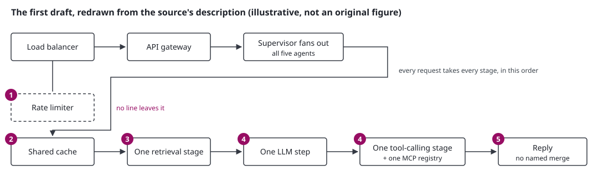

## Case brief
### A travel assistant whose diagram does not match how agents run {#brief-scenario}

A travel company wants an AI assistant for its customers in three regions: AMER (the Americas), EMEA (Europe, the Middle East and Africa) and APJ (Asia Pacific and Japan). Five specialist agents share the work. Search finds flights and hotels, Booking reserves and pays, Pricing quotes fares, Recommendation suggests trips and Policy applies the company's travel rules.

An **agent** here is a program built around an <abbr title="large language model: The model that reads text and writes text, such as GPT, Claude or Llama. Powerful, but it will confidently make things up if you let it.">LLM</abbr> (large language model) that works in a loop: it reads its task, decides on a step, calls a tool, reads the result and decides again until it is done. A **supervisor** agent decides which specialists to start. A **synthesiser** agent merges what they return into one reply. A **semantic cache** stores earlier answers and can return one for a question that means the same thing as an earlier one, even when the wording differs.

The first draft of the design ran every request through one shared cache, one retrieval stage, one LLM step and one tool-calling stage, in that order. The hard constraint of this case is that the diagram has to match how agents actually run. Each agent loops on its own, calls its own tools and finishes at its own pace, so a single shared pipeline either wastes work or holds it up. Two independent reviews found five places where the draft broke that rule, and this case takes the draft apart and redraws it.

The core idea fits in one sentence: check the cache first, start only the agents a query needs, and let a synthesiser settle what they return. The figure shows that order for a single request.

<figure class="source-diagram" id="figure-core-idea"><figcaption>The core idea: Request, Gateway with rate limiting, Semantic cache, then either the Reply on a hit or the Supervisor starting only the agents needed and the Synthesiser merging and settling conflicts. Open for full size.</figcaption></figure>

Read the figure from left to right. The cache sits before the supervisor, so a repeated question never reaches an agent. The supervisor starts a subset of specialists, not all five, and nothing reaches the user until the synthesiser has merged their outputs.

### Follow one request through both drawings {#brief-example}

The source gives no sample query, so here is an illustrative one. A traveller in Frankfurt asks: "Book me a flight to Singapore next Tuesday that fits my company's travel policy."

In the first draft, the gateway passes the request on and all five agents start, including Recommendation, which this request does not need. Only after they have all run does the request reach the shared cache, so even if the same question was answered an hour ago, the work is already spent. Every agent then queries the vector database (a store that finds text by meaning) whether it needs travel content or not. Booking cannot call the flight or payment service until the single tool-calling stage, which comes after every agent has finished. Finally, nothing in the drawing says what happens when Booking picks a fare and Policy says that fare breaks the company's rules.

In the corrected design, the gateway checks the request against its rate limit, and the supervisor looks in the semantic cache before anything else. Suppose it misses. The supervisor starts Search, Pricing, Booking and Policy, and leaves Recommendation idle. Search queries the EMEA vector store for route content inside its own loop. Booking calls the Flight and Payment servers when its own work reaches that point. The synthesiser collects the four results; if Policy rules against Booking's choice, Policy wins, and the user sees one consistent answer. That answer is saved to the cache for the next similar question.

There is no human approval step in the source design. The user receives the synthesised reply directly, so the synthesiser is where conflicting results must be settled.

### What you need to work through {#brief-task}

Your task is to critique the first draft, name its five structural faults, explain the fix for each, and redraw the corrected architecture. Then defend three trade-offs: shared or per-agent retrieval, regional or global data stores, and when another agent is worth its coordination cost.

The case is written for engineers preparing for Forward Deployed, solutions or applied-AI engineering interviews, especially a round that hands you a multi-agent diagram to critique or asks you to draw one under time pressure. After it, you should be able to put the same five questions to any multi-agent diagram, your own included.

It assumes you are comfortable with AI agents, retrieval and tool calling. The source asks you to read The Twelve-Part Design Framework and Design Principles as Tie-Breakers in its Learn section first; this case applies their principles to one diagram and does not reproduce them.

To use it well, try to spot each fault in the draft yourself before you read its fix. When you reach the corrected architecture, redraw it from memory and compare it with the figure. Come back to the level calibration in Practice the night before an interview.

The original page had two parts: a mandatory Worked Example (the draft, the five fixes, the corrected design, trade-offs, the interview lens, a checkpoint and level calibration) and an optional 12-Part Framework write-up that restated the corrected design as one reference. This casebook merges them. The walkthrough follows the worked example, and the reference write-up's extra detail sits in the walkthrough steps and deep dives where it belongs.

## Design walkthrough
### 1. Read the draft as a pipeline {#walk-original}

Principles stay abstract until you watch them repair a real diagram, so we start from the draft. It was a rigid pipeline. Five agents fanned out, and then all of their work squeezed through a single shared cache, a single retrieval stage, a single LLM step and a single tool-calling stage, one after another.

The figure below redraws that draft from the source's description. It is an illustration for this casebook, not an original source figure, and the numbered markers point at the five faults the following steps fix.

<figure class="source-diagram" id="figure-draft"><figcaption>The first draft as the source describes it, redrawn for this casebook. 1: a rate limiter with no exit. 2: the cache after the agents. 3: one compulsory retrieval stage. 4: one shared LLM step and one shared tool stage. 5: no named merge before the reply.</figcaption></figure>

The reason to study this draft is that most first-pass multi-agent sketches repeat the same five faults, including the ones you will draw under time pressure. Keep the habit of spotting them; the fixed diagram matters less.

The five faults came from two independent reviews. An architecture review of the draft found the first four. A separate blueprint, written independently, reached the same four and added the fifth: a named synthesiser to fill the missing aggregation step. The corrected design combines all five.

### 2. Fault 1: a rate limiter that leads nowhere {#walk-rate-limit}

In the draft, a Rate Limiter box hung off the load balancer as its own box, side by side with the gateway. No line left it, so anything sent there went nowhere. It was a dead end.

Rate limiting is a rule the gateway applies to every request, not a route a request takes. A separate box on a diagram implies a component that requests travel through, and rate limiting is a behaviour of the component they already travel through. The fix moves it inside the API gateway, which becomes the single policy layer for routing, request validation and throttling (refusing or delaying requests over a set rate).

You can still run rate limiting as its own service behind the scenes. What the diagram must show is where it is enforced: on the one path every request takes, with no extra hop.

### 3. Fault 2: a cache behind the work it should avoid {#walk-cache}

The draft put the cache behind the five agents, so it was only consulted after they had all run. A cache exists to cut LLM latency and cost. It can only do that if it comes before the costly work, because a hit after all five agents have run avoids nothing.

The fix makes the cache the first thing the supervisor checks. On a hit, the stored answer goes straight back and no agent is spawned at all. On a miss, the supervisor goes on to choose which specialists to start. In the 12-part framework's terms this is **short-circuiting**: ending a request early when a cheaper path already has the answer. The placement decides whether the cache saves money or nothing.

Trace both paths with the Frankfurt request. If an equivalent question was answered recently, the cache returns that answer and the cost is one cache lookup. If not, the lookup adds a small delay and the request continues to the supervisor. The cache also only stays useful if the synthesised reply is written back to it at the end, which step 6 adds.

The source leaves one question open, and its level calibration counts it as a gap in a senior answer: which queries may be served from the cache at all. We return to it in [the semantic cache deep dive](#dive-cache).

### 4. Fault 3: retrieval forced on every agent {#walk-retrieval}

The draft had a single compulsory retrieval box after all five agents. That made every agent query the vector database, whether it needed to or not.

The agents' needs differ. Search and Recommendation draw on regional travel content, such as destination guides and route information. Booking and Policy rarely do: Booking works through booking and payment services, and Policy applies rules. **RAG** (<abbr title="retrieval-augmented generation: Fetch the relevant documents first, then have the model answer only from them.">retrieval-augmented generation</abbr>) only helps an agent whose task needs documents.

In the fix, each agent calls retrieval itself, within its own loop, and only when its task calls for it. Retrieval becomes a tool an agent can choose, not a stage the request must pass. In the Frankfurt trace, Search queries the EMEA store and Booking and Policy skip it.

### 5. Fault 4: one shared LLM and tool turn {#walk-agents}

In the draft, all five agents passed in sequence through a shared LLM box, a shared tool-calling box and a shared <abbr title="Model Context Protocol: An open standard for plugging tools and data sources into an AI app, so each tool is written once and reused.">MCP</abbr> (Model Context Protocol) registry. That reads as though the whole request gets a single turn: one model call, then one round of tool calls, for everyone.

Agents do not work that way. Booking calls the Flight and Payment MCP servers during its own work, and it may call them several times as it checks availability, holds a seat and pays. It cannot wait until four unrelated agents finish.

The redraw makes the LLM, the MCP registry, the external APIs and the vector databases a **shared backend** that each agent calls on demand. Shared here means many agents may use the same service. It does not mean they take turns through one stage. Each agent runs its own loop in parallel and reaches into the backend whenever its next step needs it.

### 6. Fault 5: no step that merges the results {#walk-synthesis}

Nothing in the draft explained how five parallel results became a single reply. The flow carried on as one line, as though merging took care of itself.

Merging is real work with real decisions. Someone must collect the outputs of the agents that ran, notice when two of them disagree and decide which one wins. The classic example is a Policy ruling that overrides a Booking choice: Booking found a fare, and Policy says the traveller may not take it.

In the fix, a named Synthesiser Agent gathers the output of each agent that ran, settles any clash between them and writes one grounded reply before the user sees anything. The reply then goes to the user, and a copy is written to the semantic cache so the next similar query can reuse it.

The source leaves a second question open, which its level calibration also counts as a senior-level gap: what the synthesiser does when one spawned agent fails or times out. The answer depends on what the missing agent supplies. A missing recommendation can be left out and labelled; a missing Policy ruling cannot, because the reply might then break the company's rules. Treat this as a design decision to state, not a detail to skip.

### 7. Redraw the corrected architecture {#walk-corrected}

The corrected design keeps every component and the regional footprint of the first draft. What changes is the structure: a cache hit is now cheap, each agent uses its tools within its own loop, and all results pass through one accountable step before the reply leaves.

Read the figure with its legend. Solid lines are the request path and the agents, each running its own loop in parallel. Dashed lines are the shared backend, called only when needed. The Synthesiser Agent is the one component new in this version.

<figure class="source-diagram" id="figure-corrected"><figcaption>The corrected architecture. Gateway (routing, auth check, rate limiting); Semantic Cache checked by the Supervisor before any agent spawns; Supervisor spawning only the specialists it needs; Search, Booking, Pricing, Recommendation and Policy, each owning its retrieval and tool calls; a shared backend of Foundation LLM, AMER, EMEA and APJ vector DBs, MCP Tool Registry and External APIs, called on demand; the Synthesiser Agent merging every agent that ran and resolving conflicts (Policy overrides Booking); Response to user, with the hit path and the cache write-back; Monitoring and Logging (latency, token usage, per-agent execution traces, cache hit rate, alerts) spanning every stage. Open for full size.</figcaption></figure>

The figure carries three rules. A cache hit returns before the supervisor spawns any agent, and on a miss the supervisor spawns only the agents this query needs. Each spawned agent calls the shared backend on its own (the Foundation LLM, the regional vector databases, the MCP registry and the external APIs) for only what its task requires. The synthesiser then combines whatever ran into a single reply, and that reply is written back to the cache so the next similar query can reuse it.

Now redraw it from memory before you read on, and compare.

### 8. Follow the data flow in order {#walk-data-flow}

The draft had ten steps in its data flow. The corrected design keeps ten steps but puts them in a new order, so that the cache check comes before any decision about agents.

1. A user sends a request from the web or mobile client.
2. Authentication confirms who they are, the load balancer sends the request to a free API instance, and the gateway enforces rate limits before handing the request to the supervisor.
3. Before making any decision about agents, the supervisor looks up the semantic cache.
4. A hit returns the stored answer at once, and no agent is spawned.
5. On a miss, the supervisor starts only the agents this query calls for, from Search, Booking, Pricing, Recommendation and Policy.
6. Inside its own loop, an agent that needs context makes a tool call to the matching regional vector database.
7. In that same loop, it calls the external APIs it needs (flights, hotels, maps, payment) through the MCP tool registry.
8. The synthesiser gathers every agent's output, settles conflicts and writes one grounded reply.
9. The user receives the reply, and a copy goes into the semantic cache so later queries can reuse it.
10. Across the whole request, monitoring and logging capture latency, token counts and a trace per agent.

Steps 6 and 7 happen inside each agent, possibly several times, and in parallel across agents. Steps 3 and 4 are the short-circuit. Step 9 is what makes step 4 possible for the next user.

### 9. Meet the non-functional requirements {#walk-operations}

Non-functional requirements are the qualities the system needs beyond producing the right answer: how it scales, stays up, performs, stays secure, costs and can be observed and changed. They are the same as in the first draft. What changes is that the new order makes the cache-first rows true in practice; in the draft, "semantic cache" sat in the performance and cost rows, but its position meant it saved nothing.

The table lists each requirement and the source's example solution.

Non-functional requirements and the source's example solutions.

<table>
<thead>
<tr>
<th>Requirement</th>
<th>Example solution</th>
</tr>
</thead>
<tbody><tr>
<td>Scalability</td>
<td>Scale out horizontally, autoscale and balance load.</td>
</tr>
<tr>
<td>Reliability</td>
<td>Run in several regions, retry and fail over.</td>
</tr>
<tr>
<td>Availability</td>
<td>Regions run in active-active mode.</td>
</tr>
<tr>
<td>Performance</td>
<td>A semantic cache placed <em>ahead of</em> the fan-out, Redis, a <abbr title="content delivery network: Servers around the world that cache content close to users.">CDN</abbr> and tuned vector search.</td>
</tr>
<tr>
<td>Security</td>
<td>OAuth, JWT, encryption, <abbr title="role-based access control: Permissions given by role: managers can do this, agents can do that.">RBAC</abbr> and managed secrets.</td>
</tr>
<tr>
<td>Cost optimisation</td>
<td>A cache-first design where the cache decides whether agents spawn, small models for easy tasks, and routing by region.</td>
</tr>
<tr>
<td>Observability</td>
<td>Metrics, logs, a distributed trace for each agent, dashboards and alerts.</td>
</tr>
<tr>
<td>Maintainability</td>
<td>Microservices, modular agents that each own their tools, <abbr title="continuous integration and continuous delivery: The automated pipeline that tests and ships every change.">CI/CD</abbr> and infrastructure as code.</td>
</tr>
</tbody></table>

A few rows need a word. **Active-active** means every region serves live traffic at the same time, so losing one region shifts load rather than switching a standby on. A **CDN** (content delivery network) keeps static content close to users. **RBAC** (role-based access control) grants permissions by role, and **CI/CD** (continuous integration and continuous delivery) is the automated pipeline that tests and ships every change. The cost row has three levers: the cache gate avoids whole fan-outs, smaller models handle easy tasks, and routing by region keeps traffic near its data.

The source's observability row names a trace per agent. Its key takeaways and the monitoring box in the corrected figure add cache hit rate to latency and token usage as a monitored signal, and that is the number that tells you whether the cost row is working. The source sets no target for it or for p95 latency (the latency 95% of requests beat); both stay open until the customer supplies traffic and regional constraints.

### 10. Turn the fixes into review questions {#walk-interview-lens}

Each of the five fixes turns into a question you can put to any multi-agent diagram, your own included. This is the part to carry into an interview.

1. Is each box a real component, or a policy that should live inside another one? (Fault 1, the rate limiter.)
2. Does the cache come ahead of the costly work it is meant to avoid? (Fault 2.)
3. Are agents made to retrieve when they have no need to? (Fault 3.)
4. Does every agent loop and call tools by itself, or must the whole request squeeze through a single shared stage? (Fault 4.)
5. Where do the parallel results meet, and who settles disagreements between them? (Fault 5.)

A diagram that passes all five still needs its trade-offs defended, which the deep dives cover, and its open numbers named, which the level calibration in Practice shows.

## Technical deep dives
### Components and what changed from the draft {#dive-components}

The list of components matches the first draft. The gateway, the cache and the agent-owned services have a new scope, and the synthesiser is new. The table merges both source component tables and marks what changed.

Components, their purpose and what changed from the first draft.

<table>
<thead>
<tr>
<th>Component</th>
<th>Purpose</th>
<th>Change</th>
</tr>
</thead>
<tbody><tr>
<td>Client</td>
<td>The web and mobile app where users search, book and manage trips.</td>
<td>Unchanged</td>
</tr>
<tr>
<td>Authentication</td>
<td>Runs first, before any other step. Confirms identity through <abbr title="single sign-on: One company login for every app. It is also where you get the user's identity to enforce permissions.">SSO</abbr> with OpenID Connect (an identity layer built on OAuth 2.0), issuing <abbr title="JSON Web Token: A signed token that carries who the user is and what they may do, checked on every request.">JWTs</abbr> as tokens.</td>
<td>Unchanged</td>
</tr>
<tr>
<td>Load balancer</td>
<td>Shares traffic across API instances to keep the service available.</td>
<td>Unchanged</td>
</tr>
<tr>
<td><strong>API gateway</strong></td>
<td>The one way in. Routing, request validation and throttling form a <em>single</em> policy layer rather than an extra hop.</td>
<td>Now holds rate limiting</td>
</tr>
<tr>
<td><strong>Supervisor agent</strong></td>
<td>Reads the query and checks the cache. Only when the cache misses does it choose which specialised agents to spawn.</td>
<td>Refocused</td>
</tr>
<tr>
<td><strong>Semantic cache</strong></td>
<td>Consulted as soon as the supervisor has the query. On a hit, the answer goes back with no agent spawned.</td>
<td>Now checked first</td>
</tr>
<tr>
<td><strong>Search, Booking, Pricing, Recommendation and Policy agents</strong></td>
<td>Each fetches its own domain context and calls its own tools. Booking talks to the payment gateway itself, and nothing passes through a single shared LLM step.</td>
<td>Own their RAG and tools</td>
</tr>
<tr>
<td>Regional vector DBs (AMER, EMEA, APJ)</td>
<td>Still the shared retrieval layer, but now something agents call into when they choose, not a stage every request must pass through in turn.</td>
<td>Called, not passed through</td>
</tr>
<tr>
<td>MCP tool registry</td>
<td>Finds tools at run time. Any agent can reach it on its own, whenever it needs to.</td>
<td>Reached by each agent</td>
</tr>
<tr>
<td>External APIs</td>
<td>Flight, hotel, map and payment providers, called through MCP servers.</td>
<td>Reached by each agent</td>
</tr>
<tr>
<td><strong>Synthesiser agent</strong></td>
<td>Combines the output of every agent that ran, settles conflicts between them (for example, Policy overriding a Booking choice) and returns one coherent reply.</td>
<td>Added</td>
</tr>
<tr>
<td>Monitoring and logging</td>
<td>Records latency, token usage, failures and per-agent traces for the whole request.</td>
<td>Unchanged</td>
</tr>
</tbody></table>

Two identity terms in the authentication row are worth separating. **OAuth 2.0** lets an app act with a user's permission but does not, on its own, say who the user is. **OpenID Connect** (<abbr title="OpenID Connect: The login layer on top of OAuth. OAuth only says what an app may do; OIDC adds who the user is, as a signed ID token.">OIDC</abbr>) adds that identity as a signed ID token. **SSO** (single sign-on) is the one company login that uses it, and a **JWT** (JSON Web Token) is the signed token that carries who the user is and what they may do on each request.

Notice what the table does not contain: a separate rate limiter, a shared retrieval stage, a shared LLM step or a shared tool stage. Each of those became a behaviour of another component or a backend service that agents call.

### The semantic cache: placement, matching and what may be reused {#dive-cache}

A **traditional cache** only hits on an exact repeat of a request. A **semantic cache** also matches near-duplicates: it turns the question into an embedding (a list of numbers that represents its meaning) and returns a stored answer when an earlier question's embedding is similar enough. Redis LangCache, which the source cites, works this way, matching similar questions by embedding similarity rather than exact text.

That difference is why the semantic cache can do more here. Placed before the supervisor, a hit skips the entire fan-out of agents, rather than saving a single model call further down. "Fly Frankfurt to Singapore next Tuesday" and "Flights from FRA to SIN on Tuesday" can share one answer; an exact-match cache would miss the second. The cost is that the system must decide whether a similar earlier answer really applies to the new request.

The source does not say which queries may be served from the cache, and its level calibration marks that as what a senior answer is missing. The following points are this casebook's reasoning about how to approach it, not source content. Fares and seat availability change, so a cached price may be stale by the time a second user asks. A cached reply must not carry one user's personal or policy-specific details to another user. A booking or payment is an action, not an answer, and must never be replayed from the cache. In an interview, name these limits and ask the customer for freshness and personalisation rules before you set a hit-rate target.

### Retrieval: a shared service or per-agent RAG {#dive-retrieval}

Once retrieval leaves the request path, you still have to decide how agents reach it. There are two defensible positions.

**A shared retrieval service.** One retrieval layer serves every agent. It gives you a single place to enforce data residency (keeping data in the region where rules require it) and guardrails (rules on what content may be retrieved or returned). The cost is that every agent depends on that one service, so its outage or slowdown reaches all of them.

**Per-agent retrieval.** Each agent wires up its own retrieval as one of its tools. This matches how frameworks such as LangGraph and CrewAI attach tools to each agent; CrewAI's documentation gives each agent its own `tools` list, so per-agent tool wiring is the framework default. The cost is that, without governance, you end up running several copies of the embedding stack (the models, indexes and pipelines that turn text into searchable vectors).

You can defend either choice. The real mistake, the one an interviewer listens for, is drawing RAG beside the agents as if it were one of them. Retrieval is infrastructure, or a tool an agent calls. It does not answer the user.

The source's level calibration places this choice at Staff level: shared for residency and guardrails, or per-agent with governance so embedding infrastructure is not duplicated. What it says the Staff answer still misses is who owns each regional vector database and the MCP tool registry.

### Regional or global vector stores {#dive-regions}

The draft and the corrected design both keep separate vector stores for AMER, EMEA and APJ. The alternative is one global store.

**Stores per region** make data-residency rules easier to meet, because a region's content and queries can stay in that region, and they bring retrieval latency down, because the store sits near its users. The cost is running three stores and keeping them consistent where they should agree.

**One global store** is simpler to run and keeps the regions consistent with each other automatically. The cost is distance for some users and a harder residency story.

The source adds a caution through its GDPR reference. <abbr title="General Data Protection Regulation: The EU's data-privacy law: consent, the right to be forgotten, where data may live.">GDPR</abbr> (the General Data Protection Regulation, the EU's data-privacy law) Article 46 allows transfers outside the EU under appropriate safeguards. Regional stores therefore help with residency requirements, but they are not what compliance means, and a global store is not automatically non-compliant.

The level calibration's Principal answer makes this call region by region on an active-active footprint. What even that answer cannot supply is each region's residency rules and the real traffic mix, which only the customer can give.

### When another agent earns its cost {#dive-multi-agent}

Every extra agent adds coordination (the supervisor must decide whether to start it) and a synthesis step you must pay for (the synthesiser must merge and reconcile its output). A single agent with several tools avoids both.

Pay that cost when sub-tasks differ in their tools or guardrails, or must scale on their own. Booking and Policy plainly do. Booking needs payment and flight tools and must be careful with actions that spend money; Policy needs the company's rules and must be able to overrule the others. Merging them into one agent would mix those tools and guardrails in one loop.

The source's level calibration says a Staff answer still misses the rule for when a new agent earns its coordination overhead. A workable rule follows from the paragraph above: add an agent only when its tools, guardrails or scaling needs differ from every existing agent's, and otherwise give an existing agent another tool.

### Tools and MCP discovery {#dive-mcp}

The MCP tool registry "finds tools at run time". In the MCP specification, a client discovers a server's tools by calling `tools/list`, and the server can send a `list_changed` notification when its tools change. That is the dynamic discovery the registry relies on: a new hotel provider can appear without redeploying every agent.

In the corrected design, any agent that needs a tool calls the registry on its own. Booking finds and calls the Flight and Payment MCP servers during its own loop, and the payment gateway is reached directly by Booking rather than through a shared stage.

One caution, added here rather than taken from the source: discovering a tool does not authorise a particular user to use it. The user's identity from authentication still has to reach the tool call, so that Booking pays with the right account and Policy applies the right company's rules.

### The airport mental model {#dive-analogy}

The source compares the corrected design to an international airport, stretched to cover the cache gate and the synthesiser. The table merges both versions of the comparison.

The airport comparison mapped to components.

<table>
<thead>
<tr>
<th>Airport</th>
<th>System</th>
</tr>
</thead>
<tbody><tr>
<td>Travellers</td>
<td>Users</td>
</tr>
<tr>
<td>Terminal entrance</td>
<td>Authentication</td>
</tr>
<tr>
<td>Security screening and bag scan in a single lane, not two</td>
<td>API gateway with rate limiting inside it</td>
</tr>
<tr>
<td>Help desk that asks "have we answered this already?"</td>
<td>Semantic cache, checked before any staff member is sent out</td>
</tr>
<tr>
<td>Control tower</td>
<td>Supervisor agent</td>
</tr>
<tr>
<td>Airline crews, each with its own manuals and radios</td>
<td>Specialised agents, each with its own retrieval and tool access</td>
</tr>
<tr>
<td>Reference binders kept at each desk</td>
<td>Vector databases, used by whichever desk needs them</td>
</tr>
<tr>
<td>Ground handlers, caterers and fuel trucks</td>
<td>External APIs (flights, hotels, maps, payments)</td>
</tr>
<tr>
<td>Dispatcher who writes one departure report from every crew (added)</td>
<td>Synthesiser agent</td>
</tr>
<tr>
<td>CCTV and the operations room</td>
<td>Monitoring, logging and observability</td>
</tr>
</tbody></table>

The analogy maps onto the five fixes. Screening happens in the lane travellers already walk through, not in a side room they never leave (fault 1). The help desk answers repeat questions before any crew is sent (fault 2). Crews consult binders only when they need them (fault 3) and use their own radios rather than queueing for one (fault 4). The dispatcher turns many crews' reports into one (fault 5).

### Sources {#dive-sources}

The source checked these references on 27 September 2026. Each line gives the claim it supports.

- [OpenID Connect Core 1.0](https://openid.net/specs/openid-connect-core-1_0.html): OIDC is the identity layer on OAuth 2.0; OAuth alone does not authenticate a user.
- [MCP specification: Tools](https://modelcontextprotocol.io/specification/2025-06-18/server/tools): clients discover tools with `tools/list` and get `list_changed` notifications, which is the dynamic discovery the registry relies on.
- [Agents (CrewAI docs)](https://docs.crewai.com/en/concepts/agents): each agent carries its own `tools` list, so per-agent tool wiring is the framework default.
- [Semantic caching with Redis LangCache](https://redis.io/tutorials/semantic-caching-with-redis-langcache/): semantic caches match similar questions by embedding similarity, not exact text.
- [GDPR Article 46: transfers subject to appropriate safeguards](https://gdpr-info.eu/art-46-gdpr/): GDPR allows safeguarded transfers, so regional stores help with residency requirements rather than being what compliance means.

## Practice
### Attempt the critique on a blank page {#practice-prompt}

Before opening any answer, draw the first draft from the description in the Case brief, mark its five faults, and redraw the corrected architecture without looking at the figure. Trace the Frankfurt request, or one of your own, through both a cache hit and a cache miss. Show which specialists run, which tools each one calls, where Policy can override Booking and what happens if one agent times out. Name the numbers you would ask the customer for, such as the cache hit-rate target and the p95 latency target, rather than inventing them.

### Checkpoint questions from the source {#practice-checks}

These six questions are the source's checkpoint. The source gives no written answers; the answers below are drawn from this casebook.

List the five structural fixes.

Rate limiting moves inside the API gateway. The semantic cache is checked by the supervisor before any agent spawns. Each agent owns its retrieval and calls it only when its task needs it. The LLM, MCP registry, external APIs and vector databases become a shared backend that each agent calls on demand inside its own loop. A named synthesiser merges the outputs and settles conflicts before the reply.

Which principle from the previous document does each fix apply?

The previous document, Design Principles as Tie-Breakers, is not part of this case, and the source names a principle for only one fix: the cache fix is <strong>short-circuiting</strong> in the 12-part framework's terms. For the other four, state the idea each fix applies in your own words. Fault 1: draw a component only where something is, and put a policy inside the component that enforces it. Fault 3: do work only where the task needs it. Fault 4: the diagram must show how the agents actually run, each in its own loop. Fault 5: give every decision, including merging and conflict resolution, a named owner. Check these against the principles document itself before an interview.

Why does the position of a semantic cache decide whether it saves anything?

A cache saves only the work that would have run after it. In the draft it sat after all five agents, so a hit came too late to avoid any agent, retrieval or model call. Placed before the supervisor spawns anything, a hit returns at once and the whole fan-out is skipped, which is where the latency and cost live.

When teams argue shared versus per-agent RAG, which mistake matters?

Both positions hold up: shared retrieval puts residency and guardrails in one place but makes every agent depend on it, and per-agent retrieval matches how LangGraph and CrewAI wire tools but duplicates embedding stacks without governance. The mistake that matters is drawing RAG as a peer of the agents, when it is infrastructure or a tool.

Which job of the synthesiser is hidden when a diagram just "carries on as one line"?

Settling conflicts. Collecting outputs is the visible part; deciding which agent wins when they disagree, such as Policy overriding a Booking choice, is the hidden decision. A single line also hides what happens when an agent that was spawned fails or times out.

Redraw the corrected architecture without looking.

Check your drawing against these points: authentication, load balancer and an API gateway with rate limiting inside it; a supervisor that checks the semantic cache first, with a hit going straight to the reply; on a miss, only the needed agents among Search, Booking, Pricing, Recommendation and Policy, each running its own loop; a dashed shared backend of Foundation LLM, AMER, EMEA and APJ vector DBs, MCP tool registry and external APIs; a synthesiser that merges and settles conflicts; the reply written back to the cache; and monitoring across every stage.

### Put the review questions to a diagram {#practice-lens}

These reveals turn the interview lens from step 10 into answers about the travel draft. Use the same questions on the next diagram you are given.

Is each box a real component, or a policy that should live inside another one?

In the draft, Rate Limiter is a policy drawn as a component. No line leaves it, so it cannot be a step on the request path. It belongs inside the API gateway, alongside routing and validation.

Does the cache come ahead of the costly work it is meant to avoid?

Not in the draft: it sits behind all five agents. Move it to the supervisor's first step, so a hit spawns no agent and the reply is written back after synthesis.

Are agents made to retrieve when they have no need to?

Yes: one compulsory retrieval stage makes Booking and Policy query the vector DB even though they rarely need travel content. Make retrieval a tool each agent calls in its own loop.

Does every agent loop and call tools by itself, or must the whole request squeeze through a single shared stage?

The draft forces one shared LLM step, one tool stage and one MCP registry pass, so Booking waits for four other agents before it can reach the Flight and Payment servers. Draw these as a shared backend each agent calls on demand.

Where do the parallel results meet, and who settles disagreements between them?

Nowhere named in the draft. Add a synthesiser that collects the outputs of the agents that ran, applies the conflict rule (Policy over Booking) and decides what to do when an agent fails.

### Changed constraints and follow-ups {#practice-followups}

The source does not include these drills. They are added in this casebook and built from the gaps its level calibration names. Answer each before opening it.

The Policy agent times out on a booking request. What does the synthesiser do?

It must not send a booking that Policy has not cleared, because the synthesiser exists to let Policy override Booking. Hold the action, retry Policy within a deadline, and if it still fails, tell the user the booking is pending a policy check. A missing Recommendation result is different: the synthesiser can leave it out and say so. State the rule per agent: which outputs are required and which are optional.

The interviewer asks which queries may be served from the cache. What do you say?

General, slowly changing answers are good candidates, such as baggage rules or destination guidance. Live fares and availability need a short expiry or a fresh check. Answers containing one user's details or one company's policy must be scoped to that user or company. Bookings and payments are actions and are never replayed. Ask the customer for freshness and personalisation rules before naming a hit-rate target.

A team wants to add a Visa agent. Does it earn its place?

Apply the rule from the multi-agent deep dive: add an agent only when its tools, guardrails or scaling needs differ from every existing agent's. If visa checks need their own data sources and rules and must be able to block a booking, as Policy can, a separate agent is justified and the synthesiser needs a rule for it. If they are one lookup, give Policy or Search a visa tool instead.

EMEA content must not leave the EU. Does one global vector store still work?

It becomes harder to defend. A regional EMEA store keeps that content and its queries in the region and lowers latency for EMEA users. The GDPR caution still applies in both directions: regional stores help with residency, but compliance depends on the actual rules and safeguards, which the customer must supply.

Who owns the regional vector DBs and the MCP tool registry?

The source names this as what a Staff answer misses and does not answer it. Give each shared service a named owning team responsible for its availability, access rules and changes, and make agent teams its consumers. Without an owner, per-agent retrieval drifts into duplicate embedding stacks, which is the cost the trade-off warned about.

### Calibrate your answer to the level {#practice-levels}

On the travel assistant, the levels split on whether the candidate only fixes the diagram's flow or also owns how the fixed system runs across regions and teams. The table gives what each level sounds like and what it is still missing.

Senior, Staff and Principal answers.

<table>
<thead>
<tr>
<th>Level</th>
<th>Sounds like</th>
<th>Missing</th>
</tr>
</thead>
<tbody><tr>
<td>Senior</td>
<td>"Rate limiting lives inside the gateway. The supervisor checks the semantic cache before it spawns anything, and each agent calls retrieval and MCP tools inside its own loop. A synthesiser merges whatever ran and lets Policy override Booking."</td>
<td>Which queries may be served from the cache at all, and what the synthesiser does when one spawned agent fails or times out.</td>
</tr>
<tr>
<td>Staff</td>
<td>"Shared retrieval versus per-agent RAG is a deliberate choice: shared for residency and guardrails, or per-agent with governance so embedding infrastructure isn't duplicated. I'd run it like a platform, with per-agent traces, cache hit rate and token usage on dashboards, smaller models for simple agents, and retries and failover per region."</td>
<td>Who owns each regional vector DB and the MCP tool registry, and the rule for when a new agent earns its coordination overhead.</td>
</tr>
<tr>
<td>Principal</td>
<td>"AMER, EMEA and APJ stores buy residency and latency, and one global store buys simpler operations, so I'd make that call region by region on an active-active footprint. Then I'd turn the five fixes into a review standard every team's multi-agent diagram has to pass."</td>
<td>Each region's residency rules and the real traffic mix, which only the customer can supply. Until then, the cache hit-rate target and the p95 latency target stay open.</td>
</tr>
</tbody></table>

Read the table as a ladder. The Senior answer gets all five fixes right, and its gaps are cacheability and partial failure, which the follow-up drills above practise. The Staff answer treats the design as a platform to operate, and its gaps are ownership and the admission rule for new agents. The Principal answer turns the fixes into a standard across teams, and its gaps are facts only the customer holds. The source's next case for timed delivery practice is The 60-Minute Whiteboard Method.

## Quick review
### The corrected order {#review-order}

Authenticate, balance load, and pass the gateway, which applies rate limiting. The supervisor checks the semantic cache; a hit replies with no agent spawned. On a miss, it spawns only the specialists the query needs. Each runs its own loop, calling the shared LLM, regional vector DBs, MCP registry and external APIs only when its task needs them. The synthesiser merges what ran, settles conflicts and replies, and the reply is written back to the cache. Monitoring traces every stage.

### Five faults, five fixes, five questions {#review-faults}

Each fault, its fix and the question it becomes.

<table>
<thead>
<tr>
<th>Fault in the draft</th>
<th>Fix</th>
<th>Question for any diagram</th>
</tr>
</thead>
<tbody><tr>
<td>Rate limiter box off the load balancer, leading nowhere</td>
<td>Rate limiting inside the API gateway</td>
<td>Is each box a component, or a policy that belongs inside another?</td>
</tr>
<tr>
<td>Cache after all five agents</td>
<td>Supervisor checks the cache before spawning; a hit spawns nothing</td>
<td>Does the cache come ahead of the work it avoids?</td>
</tr>
<tr>
<td>One compulsory retrieval stage</td>
<td>Each agent retrieves in its own loop, only when needed</td>
<td>Are agents made to retrieve without need?</td>
</tr>
<tr>
<td>One shared LLM, tool and MCP stage</td>
<td>Shared backend each agent calls on demand</td>
<td>Does every agent loop and call tools by itself?</td>
</tr>
<tr>
<td>No merge step</td>
<td>Named synthesiser that settles conflicts</td>
<td>Where do results meet, and who settles disagreements?</td>
</tr>
</tbody></table>

### Trade-offs and open numbers {#review-tradeoffs}

- **Shared or per-agent retrieval:** shared puts residency and guardrails in one place but every agent depends on it; per-agent matches LangGraph and CrewAI but risks duplicate embedding stacks. The mistake is drawing RAG as a peer of the agents.
- **Single or multi-agent:** extra agents cost coordination and synthesis; they pay off when tools, guardrails or scaling differ, as for Booking and Policy.
- **Semantic or traditional cache:** semantic matching catches near-duplicates, so a hit skips the whole fan-out; deciding what may be reused is the hard part.
- **Regional or global stores:** regional eases residency and cuts latency; global is simpler and consistent. Regional stores help with GDPR residency but are not compliance by themselves.
- **Open until the customer answers:** cacheable queries, cache hit-rate target, p95 latency target, each region's residency rules and the traffic mix.

### Key takeaways {#review-takeaways}

- The first draft was a rigid pipeline in which five agents squeezed through one shared cache, one retrieval stage, one LLM step and one tool-calling stage, and it needed five structural fixes.
- Rate limiting is a rule the gateway applies to every request, not a box that leads nowhere.
- The cache's placement decides whether it saves money or nothing; on a hit, no agent is spawned.
- On a miss, the supervisor spawns only the specialists this query calls for, not all five by default.
- Each agent retrieves inside its own loop, because Search and Recommendation need regional content while Booking and Policy rarely do.
- The LLM, MCP registry, external APIs and vector DBs are a shared backend each agent calls on demand, so Booking reaches the Flight and Payment servers during its own work.
- A named synthesiser gathers every agent that ran and settles clashes, such as Policy overriding Booking, before the user sees anything; its reply is written back to the cache.
- Monitoring spans every stage with latency, token usage, cache hit rate and a trace per agent.

Closing answer, in one breath: check the cache first, start only the agents a query needs, let each agent use the shared backend in its own loop, and let a synthesiser settle what they return before the reply goes out and back into the cache.
