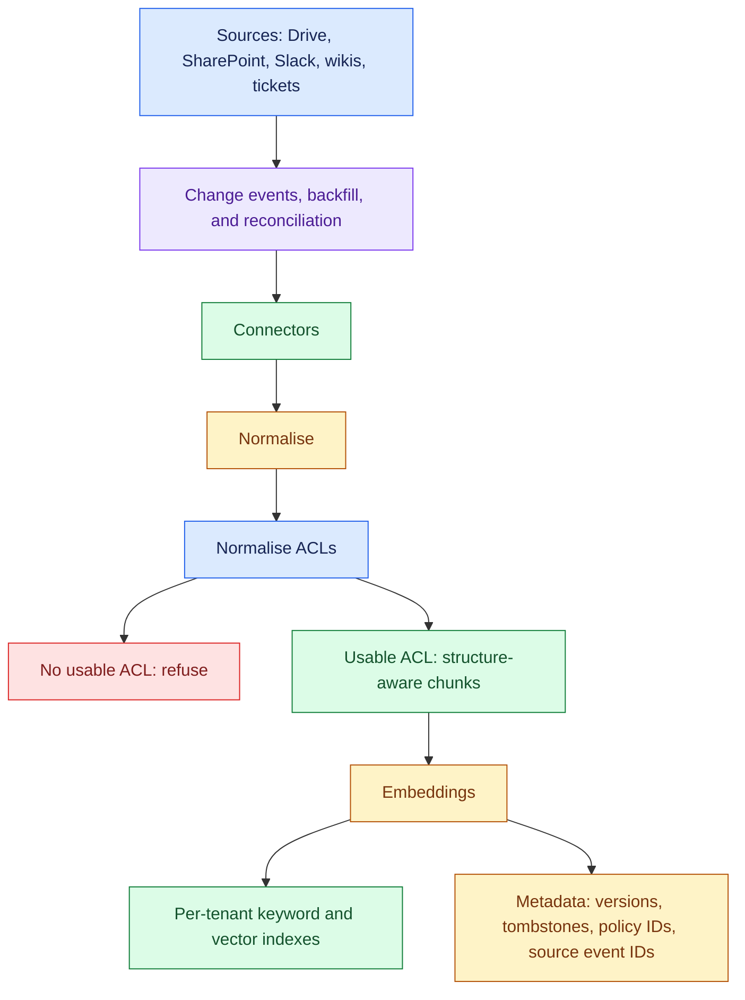
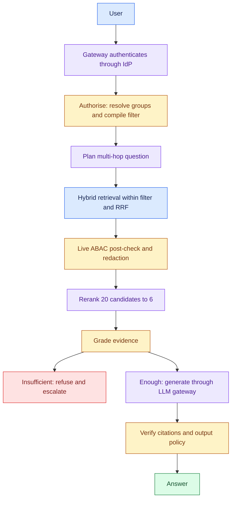
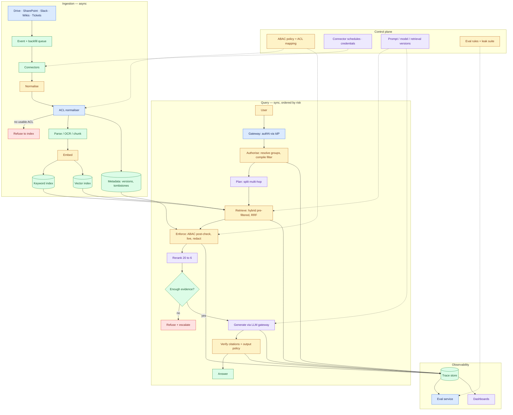
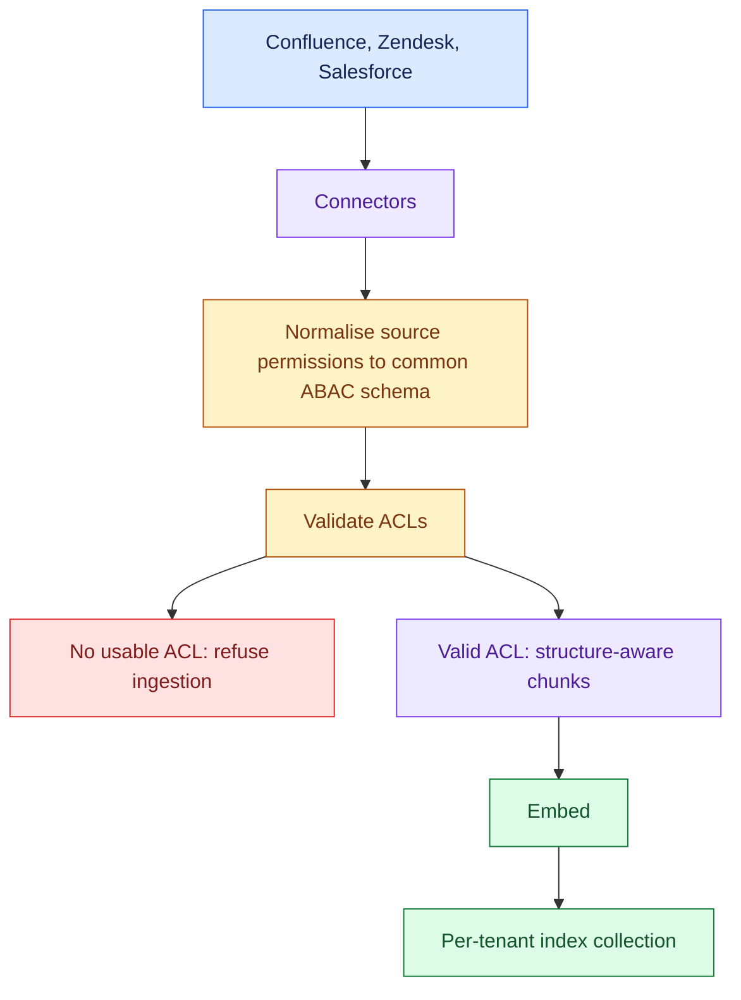
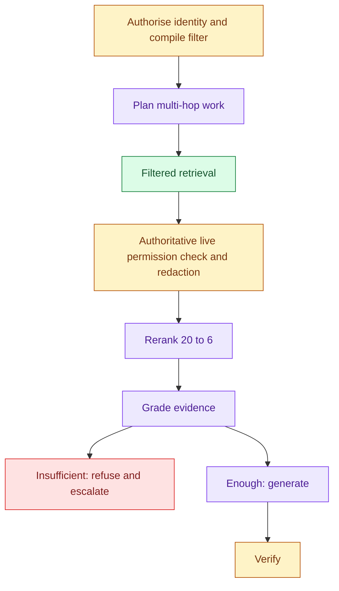
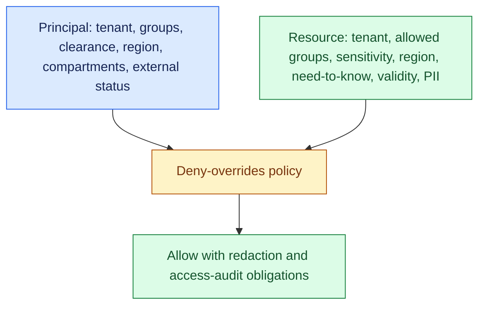
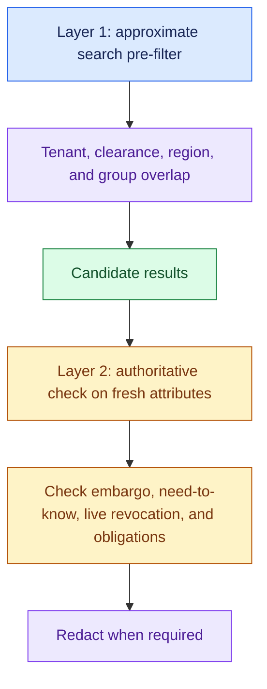
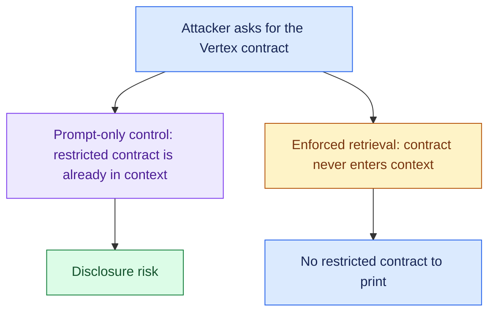

# Enterprise Knowledge Assistant with Permission-Aware RAG, part 2

## 4. Map Every Source With Its Permission Model

The connector's main job is to translate each source system's permission model into one internal model. A wrong translation is one of the most common ways enterprise RAG leaks data, so map each source's permission model before you choose an embedding model.

| Data source                         | Format                           | Owner                      | Freshness                                            | Permission model                                                         | Risk                                                                                            |
| ----------------------------------- | -------------------------------- | -------------------------- | ---------------------------------------------------- | ------------------------------------------------------------------------ | ----------------------------------------------------------------------------------------------- |
| Google Drive                        | Docs, Sheets, Slides, PDFs       | Individual and team owners | Minutes to hours; change notifications plus backfill | Per-file and folder sharing, inherited unless a folder has limited access; external sharing possible | Personal files leaking in; over-shared folders; missed deletions                                |
| SharePoint                          | Office docs, PDFs, lists         | Site owners                | Hours; scheduled plus change events                  | Site and library groups, item-level breaks of inheritance                | Broken-inheritance items indexed with the site's ACL; stale library permissions                 |
| Slack                               | Threads, messages, attachments   | Channel admins             | Real time; high churn                                | Public channels, private channels, DMs                                   | Private-channel content; pasted secrets; injection in messages; DMs excluded by policy          |
| Wikis (Confluence)                  | Pages, tables, attachments       | Space owners               | Days; scheduled with event refresh                   | Space and page restrictions                                              | Superseded pages outranking current policy; injection in page bodies; tables lost by the parser |
| Tickets (Jira, Zendesk, ServiceNow) | Structured fields plus free text | Team queues                | Minutes; event-driven                                | Project, organisation and queue membership; customer-specific visibility | Cross-customer leakage via ticket text; error codes that need lexical match; PII in transcripts |

**Assumptions:** stable ID, owner, updated-at, ACL on every record. No usable ACL → not indexed (never default to "internal"). Embeddings are not the permission authority. Indexes hold derived search state; re-read the system of record on doubt. Sync and delete are idempotent. Version boundaries (schema, checkpoint, embedding model, retrieval policy) are in the trace. Re-chunking is a retrieval-model change.

Document(id, source, title, version, owner, acl_policy_id, sensitivity, effective_date, deleted_at). Chunk(id, document_id, text, section_path, citation_url, embedding_ref, offsets, acl_hash). Ticket(id, customer_id, product, severity, symptoms, resolution, linked_docs). Feedback(event_id, user_id, answer_id, rating, correction). QueryTrace(id, actor_hash, query_type, retrieval_set, policy_decision, model_version, prompt_version, citation_set, latency, outcome). `deleted_at` tombstones retrieval without erasing history. A chunk cannot outlive its parent's ACL or freshness.

## 5. Draw the Architecture End to End

- One diagram carries the whole design; the two after it zoom in on its halves.
- The design splits into a control plane and a data plane. Policy, configuration, credentials, schedules and evaluation rules live in the control plane.
- Every live question, evidence fetch, enforcement decision and answer lives in the data plane.
- A control-plane change is a release; a data-plane call is a request.

- Version the ABAC policy, ACL mappings, connector schedules, credentials, IdP/SCIM settings, prompts, models, and retrieval policy.
- Release changes to alpha, top-k, reranking gates, evaluation rules, leak tests, and budgets through the control plane.
- Trace every stage. Run the golden set, leak suite, and shadow evaluation; monitor freshness, refusals, cost per answer, and disagreement between the two authorisation layers.

The same flow as a diagram:

Components, in the order they exist and the order they fail:

| Component                     | Responsibility                                                                                             | Fails how                                              |
| ----------------------------- | ---------------------------------------------------------------------------------------------------------- | ------------------------------------------------------ |
| Identity and gateway          | Authenticate via the IdP, load role, tenant and region, classify the request as read-only or action-taking | Closed: no identity, no answer                         |
| Connectors and queue          | Pull change events, run backfill, reconcile missed events                                                  | Degrades: stale source is labelled, not hidden          |
| ACL normaliser                | Translate each source's permission model into one attribute model                                          | Closed: no usable ACL, nothing indexed                 |
| Indexes and metadata store    | Keyword and vector per tenant; versions, tombstones, event IDs                                             | Degrades: vector down, keyword serves a labelled answer |
| Authorise and pre-filter      | Resolve groups, compile attributes into the search filter                                                  | Closed                                                 |
| Retriever and fusion          | Hybrid search inside the filter, RRF                                                                       | Degrades: fusion order without rerank                  |
| Policy post-check             | Re-run the full ABAC policy on fresh attributes; redact as an obligation                                   | Closed: policy engine down, refuse                     |
| Reranker and grader           | 20 to 6, then decide if the evidence is enough                                                             | Degrades or refuses                                    |
| LLM gateway and verifier      | One place for prompts, model choice, guardrails; reject any citation outside the permitted set             | Closed on citation failure                             |
| Trace store, eval, dashboards | Replayable runs, golden set, leak suite, freshness and cost signals                                        | Degrades: answer still served, gap logged              |

**Boundaries:** sync/async sits between ingest and query. Trust sits at ENFORCE: text the user cannot see exists only to its left. One owner each: sources own truth, metadata store owns versions and tombstones, indexes own derived search state, trace store owns what happened. Caches are keyed on tenant + permission signature + version and die on a permission change.

## 6. Normalise Permissions at Ingestion and Refuse What Has None

Zoom-in of the ingest half. Point at VALIDATE.

Say both lines while drawing: the connector translates permissions, and nothing without a usable ACL is indexed. A default of "internal" is a latent leak.

## 7. Enforce Before the Model Sees Anything

Authorise first and enforce before generation, and encode that order in the graph's edges rather than in a code convention someone can forget. A model cannot leak text that never entered its context.

One request, before the boxes: Tier-3 asks about the March incident → resolve identity → search only their slice → re-check policy → rerank to six → generate with citations → verify each citation is real, permitted, and grounded. The hard parts are access control and retrieval quality; the choice of vector database barely matters. Then pick a pattern:

| Search design | Behaviour | Consequence |
|---|---|---|
| Post-filter | Retrieve everything, then drop inaccessible results | The top 6 can shrink to 2 help documents; restricted results crowd out useful evidence. Result counts can also leak information. |
| Partitioned indexes | Separate tenant or group indexes | Strong isolation, but expensive and awkward for overlapping groups. |
| Pre-filter | Search within tenant, clearance, region, and group-overlap limits | Unauthorised chunks are never scored, ranked, or returned. |

- Use (b) and (c) together: partition by tenant and pre-filter within it.
- That is defence in depth: if the metadata filter is ever wrong, the blast radius stops at the tenant boundary.
- Post-filtering is wrong twice over: it crowds a restricted user's top-k out with material they will never see, and it can leak through result counts if those are shown.

Model the policy as attributes on both sides, not as roles. "EU engineers on the vuln-response team may read restricted advisories, but only after the embargo lifts" is one rule in ABAC and a combinatorial explosion of roles in RBAC.

| # | Rule             | Denies when                               |
| - | ---------------- | ----------------------------------------- |
| 1 | tenant isolation | different tenant; nothing crosses, ever   |
| 2 | clearance        | document outranks the principal           |
| 3 | data residency   | region-locked doc, principal elsewhere    |
| 4 | embargo          | before publication / after expiry         |
| 5 | need-to-know     | principal not in the compartment          |
| 6 | external         | contractors can't read commercial sources |
| 7 | default deny     | nothing granted it                        |

Enforcement has two layers, and only the second one decides. It is the strongest single point you can make in the round. The filter makes retrieval cheap; the post-check makes it correct.

- Payoffs: an IdP removal takes effect on the next query after it syncs, with no reindex.
- If layer 2 denies what layer 1 should have caught, the index is stale or the filter is broken, so alert on it.
- The filter language is weaker than the policy: Chroma before 1.5 could not hold a list (1.5+ adds array metadata with `$contains`), so each group is `grp__engineering: true` and `$or` fakes overlap.

Caches are a latency trick, invalidated on permission change, never a permission model. Query-time ACL is the control. Precompute only where permissions are stable. A stale materialized view outlives a revocation.

The LLM is never the enforcement point.

A prompt that says "do not reveal confidential information" is not access control. Unauthorised text never enters the context. Retrieved docs and tool outputs are untrusted input: they cannot change the system prompt or unlock a tool.

## 8. Retrieve Hybrid, Fuse by Rank, Rerank After Enforcement

- Hybrid retrieval is the baseline, because enterprise text is full of error codes, SKUs, ticket IDs and workspace IDs.
- Embeddings blur `MRD-5031` and `MRD-4290` because they look alike; BM25 treats them as rare tokens and nails them.
- BM25 in turn is fooled by common words on a paraphrase. Dense finds what means the same; lexical finds what says the same.

| Query | Dense result | BM25 result |
|---|---|---|
| “What is MRD-4290?” | MRD-5031 document: wrong | Rate-limit document: right |
| “Telemetry disappears before it is saved” | Durability passage: right | Getting Started: wrong |

Fuse with Reciprocal Rank Fusion, because a 0.82 cosine and a 14.3 BM25 score are not comparable but second place and first place always are.

- Reciprocal rank fusion: `score(d) = Σ 1 / (k + rank)`, with `k ≈ 60`.
- Dense ranking: A, B, D. BM25 ranking: C, B, E.
- B ranks second in both lists and wins the fused ranking over a document ranked first in only one.

- Where the interviewer wants a weight instead of a fusion, write `S_hybrid = α·S_vector + (1−α)·S_keyword` and say that α is a tuning parameter, not a constant.
- Exact titles, team names, error codes and ticket numbers push weight to keyword; conceptual questions push it to semantic.
- Expect the follow-up on how α is tuned, and answer "against a representative query set segmented by query type", never a number from memory.

Each other technique earns its cost in a specific situation. Reranking is often one of the biggest single wins.

| Technique                       | Fixes                                         | Cost                         |
| ------------------------------- | --------------------------------------------- | ---------------------------- |
| Multi-Query (+RRF = RAG-Fusion) | user's wording ≠ corpus wording              | N× retrieval, 1 LLM call    |
| HyDE                            | questions and answers are written differently | 1 LLM call + latency         |
| Decomposition                   | multi-hop questions no single chunk answers   | 1 LLM call, only when needed |
| Reranking                       | recall-optimised retrieval is imprecise       | often the biggest win        |

HyDE embeds a fake answer as the search probe and never shows it. Over-retrieve about 20, rerank to 6 (this design's numbers; tune on your eval set). A bi-encoder cannot compare question and document; a cross-encoder sees both.

Rerank after ACL enforcement, so a restricted user's top-6 is the best of their pool. Rerank-then-filter hands them an empty context. Keep the candidate set tight. Widen context only for a synthesis task.

## 9. Degrade on Everything Except Authorisation

Design the failure path alongside the happy path; a design that only describes success is half an architecture. Authorisation fails closed, and everything else degrades visibly. Say the last row slowly.

| Fails                                 | Behaviour                                                                                                                                                    |
| ------------------------------------- | ------------------------------------------------------------------------------------------------------------------------------------------------------------ |
| Model provider down                   | fail over to secondary/smaller model; queue + backoff                                                                                                        |
| Vector store down                     | fall back to keyword search and say the answer is degraded                                                                                                   |
| Connector stale                       | answer with a staleness label; refuse only when permission data is stale                                                                                     |
| Reranker unavailable                  | fall back to fusion order; trace records it                                                                                                                  |
| Low retrieval confidence              | refuse and escalate to a human                                                                                                                               |
| Stale ACL cache serves a revoked user | short-lived permission cache with a versioned identity snapshot, revocation on IdP change events, a bounded and stated stale window; layer 2 catches it      |
| Fabricated citation                   | citation verifier against the retrieval set and live authorisation; the response is rejected or rewritten                                                    |
| Prompt injection in a ticket or wiki  | retrieved content is evidence, never instructions; it cannot alter the system prompt or unlock tools, and unauthorised text never entered the context anyway |
| Policy engine unavailable             | fail closed. Refuse. Never fail open on authorisation                                                                                                        |

**Missed deletion (the failure to rehearse):** user authenticates, stale chunk is still indexed, ACL passes (permissions are still valid; this is a freshness failure, not an access one), reranker promotes it, generator is about to answer from a deleted policy. Fix: staleness label, suppress once confirmed, re-read the system of record, reconciliation job replays the delete. The trace shows a prior answer used a now-deleted document.

**What breaks at 10×:** per-request BM25 over the authorised pool. Replace with a lexical store that has native document security (OpenSearch DLS) or a cached per-group shard. Content-hash cache so only changed text is re-embedded. ACL sync is separate from re-embedding. LLM calls usually dominate latency: cache embeddings and retrieval, semantic-cache answers, parallelise fan-out, stream tokens.
