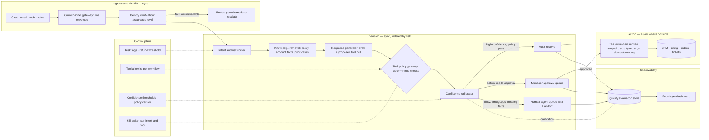

# AI Customer-Support Automation as a Routed Decision Pipeline, part 2

## 3. Map Every Source and Its Authority

The automation layer owns workflow state and the evidence for its decisions. It never owns the customer's truth. The CRM, billing, order and identity systems remain the systems of record, and if the source says an account is locked no cache may say otherwise.

| Data source           | What it holds                                             | Authority                         | Freshness before action                                         | Safe to cache               | Risk                                                    |
| --------------------- | --------------------------------------------------------- | --------------------------------- | --------------------------------------------------------------- | --------------------------- | ------------------------------------------------------- |
| CRM                   | Customer profile, entitlements, case history              | System of record for the customer | Live lookup before any account change                           | References only             | Stale plan or entitlement drives a wrong commitment     |
| Order management      | Orders, shipments, tracking events                        | System of record for orders       | Live before refund or replacement                               | Non-authoritative summaries | A stale shipping event produces a confident wrong reply |
| Billing and payments  | Charges, refunds, ledger                                  | System of record for money        | Live before every money-moving action; reconcile after timeouts | Never                       | Duplicate refund; refund on the wrong order             |
| Policy knowledge base | Refund, warranty, cancellation policy articles, versioned | Approved policy source            | Policy version stamped on every answer                          | Yes, by version             | Superseded policy cited as current                      |
| Ticketing system      | Prior cases, tags, resolutions                            | Operational history               | Recent enough for context                                       | Summaries                   | Injection in copied ticket history                      |
| Identity provider     | Authentication, assurance level                           | Authority for who the customer is | Every session; account tools unavailable when it is down        | Never                       | "Sounds right" mistaken for verified                    |

The three core records carry the workflow. `Case(id, customer_id, channel, intent, risk, state)` is the live object, with lifecycle `new`, `triaged`, `waiting_approval`, `escalated`, `resolved`, kept hot while the support window is open. `ProposedAction(id, case_id, tool, args_hash, decision)` is the proposed or executed step. `args_hash` deduplicates logically identical requests without storing raw sensitive arguments, which is where idempotency becomes real. The record is immutable once its outcome is recorded. `Handoff(case_id, summary, evidence_refs, attempted_actions)` is what a human receives when the machine stops, and its job is to make the agent faster and safer. `Case.version` supports optimistic concurrency, so a race between automation and a human fails cleanly instead of overwriting.

Every write boundary carries an idempotency key. A chat client sends `POST /v1/support/messages` twice with `Idempotency-Key: msg_9f1c` because the first response timed out. The first request creates `case_123` and returns `{"case_id": "case_123", "state": "triaged", "risk": "medium", "next_action": "draft_for_agent"}`. The second must not create `case_124`; it returns the same `case_123` and logs that the duplicate was deduplicated at the write boundary. The API surface stays small and boring: messages, `POST /v1/cases/{id}/actions`, `POST /v1/cases/{id}/escalate`, `POST /v1/cases/{id}/quality-review`, each with an authenticated caller, tenant scoping, schema validation and idempotency semantics. Payload schemas and endpoint contracts are versioned separately, so a case written at one version stays readable after the policy engine learns a new risk label.

## 4. Draw the Architecture End to End

One diagram carries the design, and each component exists because the one before it needs a narrow next step. The organising idea is the split. The data plane carries the conversation, the facts and the draft through the low-latency path. The control plane decides whether that path may continue, whether extra checks are needed and whether a human must intervene. In my view, most escalation failures are control decisions made too late or in the wrong place, not generation failures.

```
 ╔═══════════════════════════ CONTROL PLANE (decides whether the path may continue) ═══════════════════════════╗
 ║  risk tags per intent · refund threshold · tool allowlist per workflow · confidence thresholds · policy version ║
 ║  prompt + model versions · routing weights · low-risk intent list · kill switch per intent and per tool          ║
 ╚═════════════════════════════════════════════╤═══════════════════════════════════════════════════════════════════╝
                                               │ configures every gate below
 ╔═══════════════════════════ DATA PLANE (carries the conversation, facts and draft) ═════════════════════════════╗
 ║                                                                                                                  ║
 ║  INGRESS — sync                        IDENTITY — sync when account data or action is possible                   ║
 ║   chat · email · web · voice ─> omnichannel gateway ─> identity verification ─> assurance level                  ║
 ║                                 (one envelope,           (consults auth system      │ fail: limited generic mode ║
 ║                                  owns no state)            of record)               v        or escalate         ║
 ║                                                                                                                  ║
 ║  DECISION — sync, ordered by risk                                                                                ║
 ║   intent + risk router ─> knowledge retrieval ─> response generator ─> TOOL POLICY GATEWAY ─> confidence        ║
 ║   informational ·         policy articles ·      draft reply and/or    deterministic:          calibrator        ║
 ║   account-sensitive ·     account facts ·        proposed tool call    assurance ok? action     ┌─ auto-resolve  ║
 ║   money-moving ·          prior cases            (a recommendation,    allowed? refund over     ├─ request       ║
 ║   legal · safety          (live before action)    never a decision)     threshold? facts fresh?  │  approval      ║
 ║                                                                         ── the authorization    └─ escalate     ║
 ║                                                                            boundary                    │         ║
 ║  ACTION — async where the side effect allows                                                           v         ║
 ║   tool execution service (scoped credentials, typed args, idempotency key) ─> CRM · billing · orders · tickets  ║
 ║   refunds, warranty, shipping investigations run in the background; "your request has been submitted" now      ║
 ║                                                                                                                  ║
 ║  HUMAN — operational boundary                                                                                    ║
 ║   human-agent queue (prioritised by risk and impact) <── Handoff(summary, evidence_refs, attempted_actions)     ║
 ║   manager approval queue for gated actions                                                                       ║
 ║                                                                                                                  ║
 ║  OBSERVABILITY — every stage writes                                                                              ║
 ║   quality evaluation store (solved · reopened · corrected · overridden) ─> calibration, routing, policy updates  ║
 ║   traces (prompt + model + policy version, tool calls, latency, cost) ─> four-layer dashboard                    ║
 ╚══════════════════════════════════════════════════════════════════════════════════════════════════════════════════╝
```

The same flow as a rendered diagram, for viewers that draw Mermaid:



Read the components in dependency order, because that is the order they exist and the order they fail.

| Component                | Responsibility                                                                                          | Owns                                                | Fails how                                                                      |
| ------------------------ | ------------------------------------------------------------------------------------------------------- | --------------------------------------------------- | ------------------------------------------------------------------------------ |
| Omnichannel gateway      | Normalise chat, email, web, voice transcript into one conversation envelope                             | No business state                                   | Degrades: sheds enrichment on a burst, keeps the conversation                  |
| Identity verification    | Confirm the customer and assign an assurance level                                                      | Identity session state                              | Closed: account tools unavailable, not half-working                            |
| Intent and risk router   | Classify the issue; tag informational, account-sensitive, money-moving, legal, safety                   | The routing decision                                | Degrades to a narrower safe mode; low confidence escalates rather than guesses |
| Knowledge retrieval      | Pull approved policy, account facts, prior cases; live before any action                                | Nothing; reads systems of record                    | Degrades: draft may proceed, action is blocked on incomplete facts             |
| Response generator       | Draft a reply or a proposed tool call as a recommendation                                               | Nothing; never the final authority                  | Circuit-breaks; eligible tickets queue, risky ones go to humans                |
| Tool policy gateway      | Deterministic checks: assurance sufficient, action allowed, threshold, freshness, human review required | Action approval rules; the authorization boundary   | Closed                                                                         |
| Confidence calibrator    | Decide auto-resolve, request approval, or escalate with reason codes                                    | Decision support                                    | Escalates                                                                      |
| Tool execution service   | Run allowed actions with scoped credentials, typed arguments and an idempotency key                     | The action record                                   | Queues for reconciliation after a timeout; never blind retry                   |
| Human-agent queue        | Surface escalations with full context, prioritised by risk and impact                                   | The handoff lifecycle                               | Backpressure by risk, not arrival order                                        |
| Quality evaluation store | Record solved, reopened, corrected, overridden; feed calibration and policy                             | Analytics; not the source of truth for live actions | Degrades: the answer is still served, the gap is logged                        |

Three boundaries are worth pointing at while the diagram is up. The identity boundary sits before the router, so pre-auth traffic can only ever reach a limited generic mode. The authorization boundary is the tool policy gateway: everything to its left may suggest, nothing to its left may act. And the sync/async boundary sits at the action layer. A refund, warranty cancellation or shipping investigation runs in the background while the customer hears "your request has been submitted" immediately. Partition every queue by conversation, customer or account ID, because without an ordering key duplicate replies and out-of-order handoffs multiply under load. Cache policy articles, language detection results and non-authoritative summaries; never cache identity assertions, money movements, account status or authorization decisions.

## 5. Verify Identity Before Any Account Tool

"The customer sounds right" is not authentication. Once a workflow reaches billing, PII, address changes, password resets or account access, identity is confirmed through the customer's approved path before the tool layer can act. Verification returns an assurance level, and the gateway checks it on every action. Low-risk pre-auth FAQ traffic stays in a limited generic mode with no account tools at all.

Security here is a chain, not a check, and the threat model has four seams. Customer text can carry prompt injection, malformed account numbers, copied ticket history, hostile instructions or social engineering. It belongs in a message channel and is never treated as a privileged instruction. Tools are scoped by workflow with least privilege: an assistant that only needs order status is never handed refund, cancellation or payment-history power. Identity is verified before account tools, as above. And an immutable audit records the whole decision: who requested the action, which model version suggested it, which tool was invoked, what fields were validated, which policy version was in force, and whether a human reviewed or overrode it. The evidence survives the incident.

Blast radius is defined in layers so one failure stays contained:

- by tenant, so a bad policy prompt does not disable support for every customer
- by region, so a queue outage does not corrupt the global audit log
- by workflow, so a refund-tool failure does not affect FAQs
- by dependency, so a language-routing outage does not take down ticketing

 Any one control can fail, which is why the chain matters.

## 6. Let a Deterministic Gateway Decide, Never the Model

Model output is not truth. It is one input to a controlled workflow. Every place the system can take an action, reveal account data or assert a policy needs a guardrail around identity, authorization, validation and recovery. The router tags each case informational, account-sensitive, money-moving, legal-sensitive or safety-sensitive. The generator produces a draft or a proposed tool call, still a recommendation. The tool policy gateway then applies deterministic checks. Is identity assurance sufficient? Is the requested action allowed? Does the refund exceed the threshold? Does the case require human review? Is the data accessible to this agent tier? The calibrator chooses among three outcomes. High confidence plus policy pass auto-resolves. A plausible answer whose action needs approval pauses for human confirmation. Risky, ambiguous, missing-context or failed-check cases route to the human queue with the full trail and reason codes.

The casebook's approval workflow shows where the AI's own validation sits relative to the human.

```
Refund Request → AI Validation → Approval Required? ─yes─▶ Manager Approval Queue → Approved → Execute Refund
                                          └──no──▶ Execute
```

The AI validates first, so most requests never reach a human. Only those crossing a risk or value threshold route to a manager queue before execution. That set is refunds above the threshold, VIP escalations, account deletion, legal or compliance requests, and changes to payment information.

Not every request needs a planner. "Track my order" is a single tool call. "My laptop arrived damaged. Refund the order, cancel the warranty, notify shipping, and create a high-priority ticket" requires planning across Knowledge, CRM, Refund, Ticket, Shipping and Notification agents and merging the results. That is when a planner earns its cost. Simple requests take a single agent or a direct tool call, which is faster and cheaper. RAG, tool calling and memory sit side by side as capabilities the orchestrator draws on, not as a pipeline every request passes through. "What is your refund policy?" retrieves from the knowledge base. "Refund my order" invokes a business system. An LLM does neither by itself.

Memory is three layers, and keeping them apart is what makes each one fixable.

| Layer                | Holds                                   | Example                                                                         |
| -------------------- | --------------------------------------- | ------------------------------------------------------------------------------- |
| Short-term           | Context within the session              | *"Where's my package?"* … *"Can you refund it?"*: *it* is the same order |
| Long-term customer   | Preferences and history across sessions | Language, channel, past purchases, past support interactions                    |
| Enterprise knowledge | Stored separately in RAG                | Product docs, policies, FAQs, troubleshooting                                   |

A stale preference and an outdated policy fail very differently, and conflating them makes both harder to fix. Route models by risk in the same spirit. FAQ traffic goes to a small model, a refund investigation to a large reasoning model. Deterministic rules handle tagging wherever a rule can. Downgrading the model globally harms the few cases where quality matters most; tiered routing, caching, shorter context and better retrieval are the levers.

## 7. Hand Off With Full Context

A thin handoff is operational leakage, not a UX flaw. The agent gets a thinner ticket, repeats the questions the machine already asked, and the customer loses trust. The Handoff record therefore carries the original message, the parsed intent, tool outputs, policy checks, identity status, error codes, the attempted actions and the specific reason automation stopped. The agent sees the triggering intent, the risk rule that fired, the missing facts, the conflicting evidence, or the exact uncertainty that blocked automation. Explainability lives at the workflow level, not the model level.

The human queue sits on the boundary between automation and operations, not deep inside the model path, so high-volume routine traffic never competes with slower manual work. Backpressure lives in three places. Ingress sheds non-essential enrichment on a burst and preserves the conversation. Retrieval degrades to a narrower safe mode when lookups slow rather than waiting indefinitely. Escalation prioritises by risk and customer impact when humans are saturated, never by arrival order alone.
