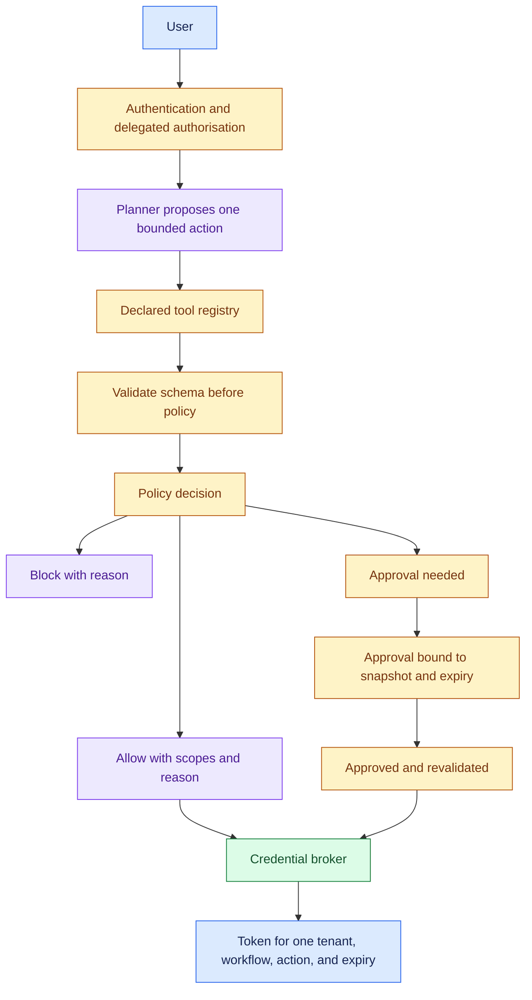
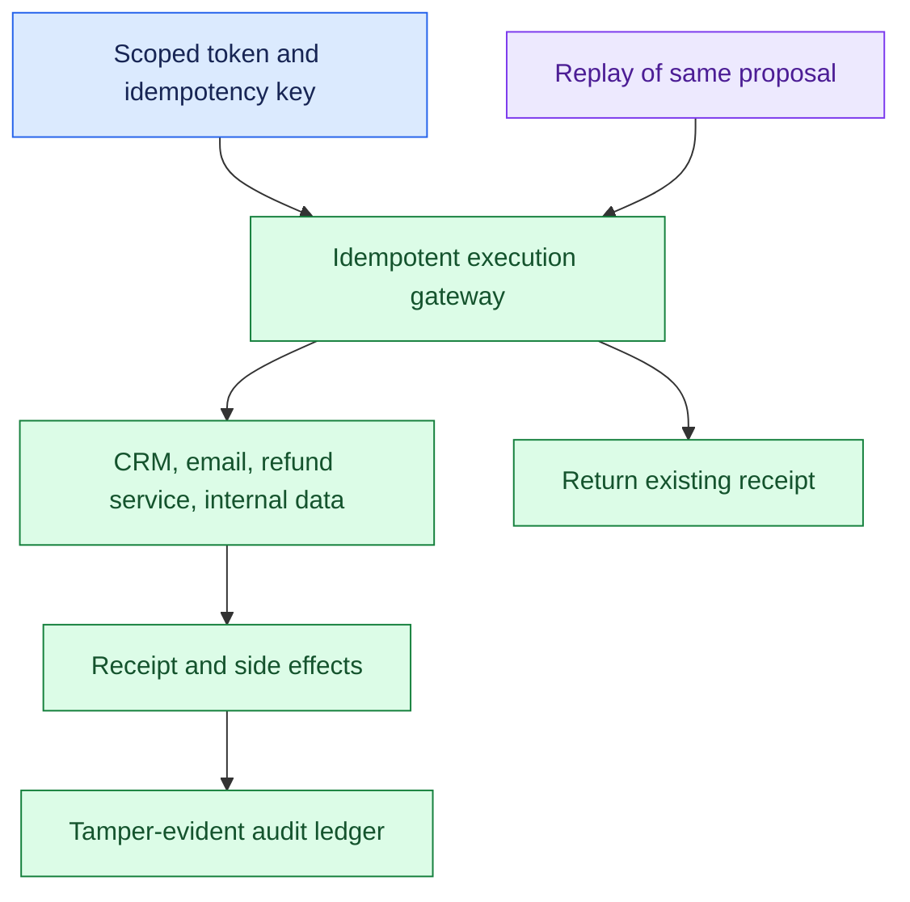
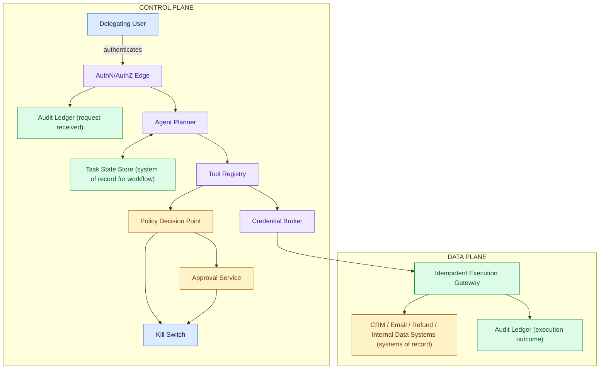
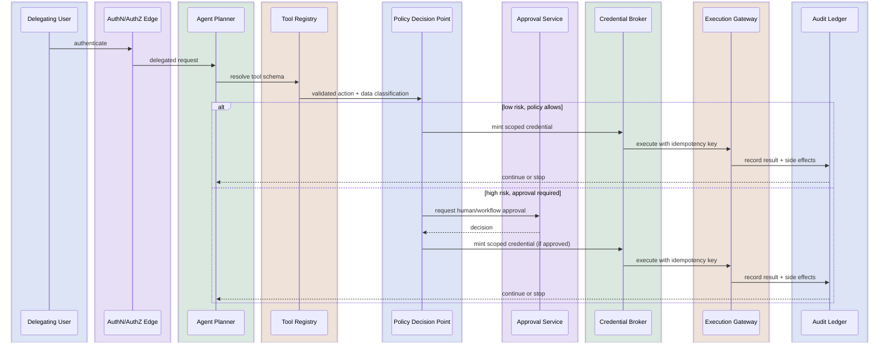
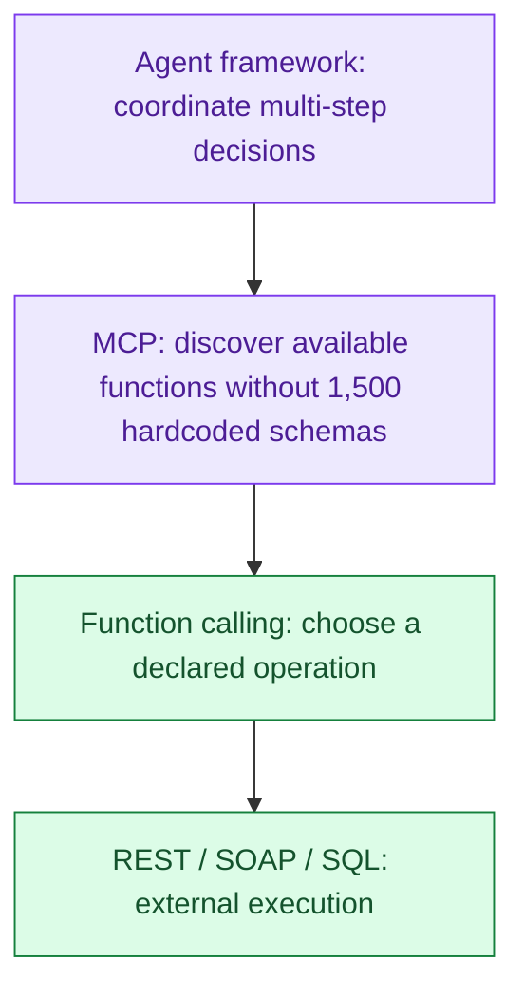
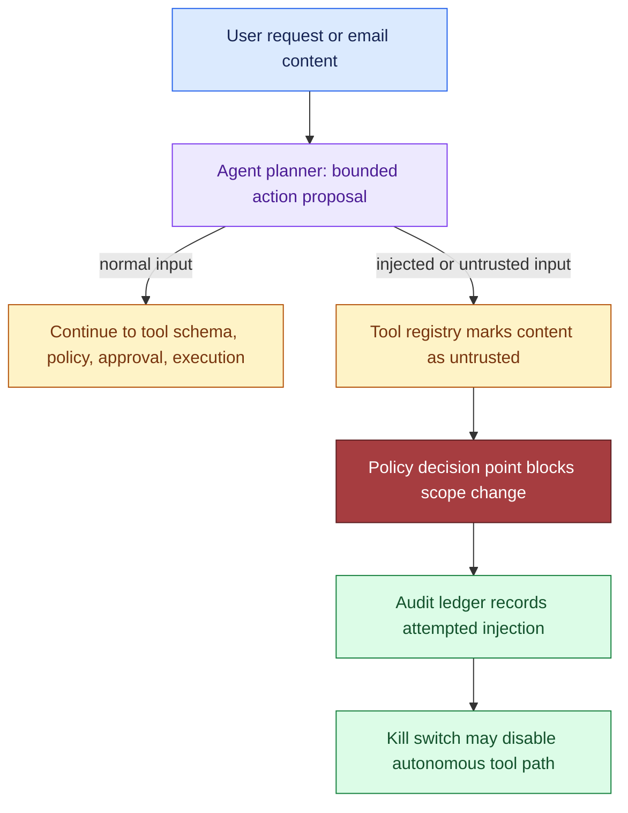

# Tool-Using AI Agent with Safety Controls, part 2

## 4. Draw the Architecture End to End

- One diagram carries the whole design, and the organising split is control plane against data plane.
- The control plane decides what the agent is allowed to do, under what conditions and with which approvals.
- The data plane performs the bounded business work once those decisions are made.
- The model sits entirely inside the control plane's proposal step and never touches the data plane directly.

- Persist workflow progress in the task state store; enterprise systems remain the business systems of record. Tool outputs remain untrusted data.
- A kill switch halts new calls, cancels queued work, revokes tokens, and marks in-flight work. The planner cannot execute directly.
- Audit requests, proposals, policy verdicts, approvals, and receipts. Monitor denials, unsafe actions, duplicate effects, approval delay, and overrides.

The same flow as a rendered diagram, for viewers that draw Mermaid:

Read the nine components in dependency order: the order they have to exist and the order they fail.

| Component | Responsibility | Trust boundary | Fails how |
|---|---|---|---|
| Agent planner | Propose the next bounded action, never execute | Model to control plane | Degrades: pauses and escalates on low confidence |
| Task state store | Track workflow progress and intermediate results | Durable workflow state, not business truth | Closed for writes: no state, no continuation |
| Tool registry | Declare allowed tools, schemas, data class, risk label | Approved tool catalog | Closed: undeclared tool cannot be called |
| Policy decision point | Return allow, block or needs-approval with scopes and a reason | Authorisation and risk gate | Closed: unavailable means no writes |
| Credential broker | Mint one scoped, short-lived token per approved action | Identity and secret boundary | Closed for writes; reads degrade only where policy allows a cached path |
| Approval service | Capture human sign-off bound to a snapshot with expiry | Human-in-the-loop control | Closed: expired approval means re-request |
| Idempotent execution gateway | Exactly one side effect per proposal, replay returns the receipt | Execution safety boundary | Reconciles: uncertain writes go to a reconciliation state, never blind retry |
| Audit ledger | Intent, decision, approval, outcome, tamper-evident | Immutable trace layer | Closed: incomplete evidence means stop and escalate |
| Kill switch | Halt autonomous paths without a deploy | Operational safety boundary | Tested before launch; it is the last layer |

- Four trust-boundary sentences are worth saying verbatim. The user boundary ends at authentication.
- The planner boundary ends at proposing intent, not action. The policy boundary ends at allow, deny or approve.
- The execution boundary ends at a scoped, logged side effect in a downstream system of record.
- Mark the systems of record explicitly. CRM owns customer attributes and refund history.
- The email system owns transport and inbox state. The internal data source owns account and entitlement data.
- The task state store owns workflow progress but not business truth. Caches may sit beside the planner or registry for low-risk lookups and must never become the source of truth for permissions or refunds.

- Not every boundary is synchronous. "Plan the next action" and policy evaluation are synchronous, because a human waits on a gating decision.
- Tool execution may be synchronous for one low-latency action, but bulk and slow steps go through queues.
- Audit writes can be asynchronous as long as the log never falls behind the point where a failure becomes unrecoverable.
- Use backpressure when risk rises faster than capacity: if approvers are saturated, slow autonomous execution rather than letting risky actions accumulate.
- Partition by workflow or account, so all actions for one account share a key and two conflicting refunds cannot run in parallel.

## 5. Narrate One Request Before Drawing the Deep Dive

Walk the representative request in order without skipping a handoff. The request is: "Read the customer's email, check whether the account qualifies for a refund, update the CRM note, and issue the refund if policy allows." The interviewer should hear where control moves from the model to deterministic services and back.

1. Authenticate the delegating user. The front door verifies who is asking and what delegation rights they hold; a support agent is not a finance approver.
2. Plan the bounded next action. The planner selects the next smallest step, such as "retrieve the latest email thread", not the whole workflow.
3. Resolve the tool schema. The registry returns the exact contract, including field names and data sensitivity labels.
4. Validate arguments and data classification, for shape, missing fields, dangerous content and regulated data that changes handling.
5. Evaluate policy and risk. The decision point compares action, user role, data class and downstream effect against current policy; a note update may pass, a refund may need approval.
6. Obtain approval if required, captured as a record bound to the exact payload.
7. Execute with a scoped credential and an idempotency key, so a retry cannot duplicate the refund.
8. Record the result and decide whether to continue. The ledger stores input, policy result, approval outcome, tool result and side effects; the planner picks the next bounded action or stops.

- The data model follows from the walk, and two records must never be conflated.
- AgentTask(id, actor, goal, state, step_budget). ToolDefinition(name, schema, data_class, scopes). ActionProposal(id, task_id, tool, args_hash, policy_decision).
- PolicyDecision(proposal_id, verdict, scopes, reason). ActionReceipt(proposal_id, idempotency_key, outcome). The proposal is the model's recommendation; the receipt is the only proof a side effect occurred.
- Arguments are canonicalized before hashing, so the same logical input always yields the same idempotency seed.
- A repeated key returns the stored receipt instead of calling the tool again, which is what makes retries safe.
- Schema validation runs before policy evaluation, so malformed arguments are rejected before any authorisation logic executes.

## 6. Layer the Integrations and Propagate Identity Through Every Call

The tool layer is where the "agent over 100+ applications" case joins this one. REST, function calling, MCP and agent frameworks are layers, not competing technologies, and the interviewer checks whether you treat them that way.

- REST is ideal when the interface is stable, operations are deterministic and no reasoning is needed.
- But a model does not natively understand authentication, endpoint discovery or request schemas, so REST alone never adds up to an assistant.
- Function calling works while the tool count is small. The model chooses reasonably among twenty functions.
- Scale to 1,500 functions across 100 applications and it breaks: prompt size explodes, selection gets inaccurate, every schema has to be maintained and re-embedded.
- MCP solves discoverability, one server per application advertising its tools and resources, so the assistant asks what is exposed instead of hardcoding schemas.
- MCP does not replace REST; MCP itself runs JSON-RPC over stdio or Streamable HTTP, and an MCP server may call REST, SOAP, SQL or a legacy system underneath.
- The axis that separates REST from function calling is who decides to make the call: fixed application code, or the model from natural language.
- Same wire call, two layers, because another REST endpoint is cheap and another function the model must choose between costs prompt space and accuracy.

| Technology | Best use |
|---|---|
| REST API | Direct application communication |
| Function calling | Small, deterministic tool execution |
| MCP | Enterprise tool discovery and standardised AI integration |
| Agent framework | Multi-step planning, orchestration, reasoning |

- Agent frameworks earn their place when a request needs multi-step reasoning.
- "Prepare a renewal report for our top customers and email their managers" means finding customers, retrieving CRM data, generating a report, storing a PDF and sending an email.
- No single function coordinates that. A single agent suits one tool, a short workflow and deterministic execution.
- A multi-agent shape suits planning across many domains with independent specialists. "Create a Jira ticket" with an orchestrator would be overhead.

- The tool registry is what makes this scale. Loading every MCP server up front does not scale.
- The registry sits between the planner and the universe of servers and loads only the ones relevant to the current task, keeping the prompt small.
- In this design the registry also carries the arg schema, the data class and the risk label, so the policy point can decide without asking the model.
- At 500+ applications and 200,000 employees the rest of the scaling list is short:

- caching of employee profiles, org hierarchy and holiday calendar
- stateless horizontal scaling of planner, gateway and LLM routing
- per-user and per-application quotas, with circuit breakers against runaway agents
- async execution that returns a job ID for long workflows
- regional gateways, region-local MCP servers and data-residency controls

- No application trusts the LLM; applications trust enterprise identity.
- Every request propagates the user's identity, an OAuth token, RBAC or ABAC, and an audit record, and the gateway attaches the identity so no backend ever trusts the model directly.
- That is identity propagation, and it is the same rule as the credential broker: the model receives context to reason with, never a secret to act with.

- The reported Salesforce prompt asks for the loop, the tool interfaces, the memory design, the orchestration and the safety in one architecture, and the shape above answers it.
- The loop is propose, validate, decide, execute, record, repeat, with a step budget.
- Tool interfaces are the registry's typed schemas with data class and risk.
- Memory is the task state store for workflow progress plus the ledger for what happened, and neither is business truth.
- Orchestration is the planner choosing one bounded action at a time over a queue partitioned by account.
- Safety is every layer below the planner.

## 7. Hold the Four Security Controls as One Set

- Security starts from the hostile case, not the happy path.
- A message that looks like ordinary customer email is a prompt injection asking the agent to ignore policy, pull a privileged record and issue an unauthorised refund.
- Do not debate whether the model understands the instruction. Contain the blast radius, preserve evidence and keep every irreversible action behind deterministic checks.
- The model sees information; it does not inherit trust.

- Four controls answer almost any "how do you secure an agent with tool access" question, so memorise them as a set.
- Treat tool observations as untrusted. A CRM response, ticket thread, database row or fetched page can carry hostile instructions.
- If the model can read it, the model can be manipulated by it, so tool output is never a command, a policy override or an approval signal.
- Never give the model broad, long-lived credentials. A broker mints capability tokens tied to one tenant, one workflow, one action type and one expiry window.
- If the broker is down, writes fail closed. Validate output before downstream use.
- The model may propose "refund $5,000", and a $500 task limit rejects it however confident the model sounds.
- Validation is where policy becomes enforceable. Bound the dangerous dimensions with hard ceilings on tool calls, per-task spend, maximum refund amount, allowable CRM objects and destinations.

- Blast radius is a design variable along four axes: tenant, region, workflow and dependency.
- A single-tenant outage beats a cross-tenant incident. A regional backlog beats a global write failure.
- A refund-workflow failure should not block email triage. A broker outage should not take down read-only analytics that can safely degrade.
- Defence in depth means no single control is load-bearing.
- The model is constrained by policy, the action layer validates output, the broker scopes identity, the gateway tracks idempotency, the ledger preserves evidence, and the operator can kill the workflow.
- When asked for the single most important control, name all six.

## 8. Fail Closed on Writes and Degrade Only Reads

Design the failure path with the happy path. Five rules organise the table. Reads that support a recommendation may degrade or queue. Writes that change customer state fail closed when authorisation, validation or identity is uncertain. Irreversible effects require approval or a second deterministic check. A write is never retried without proven idempotency. Incomplete evidence means stop and escalate.

| Fails | Behaviour |
|---|---|
| Prompt injection requests an unauthorised tool | Detected by policy evaluation on the proposed action, not by the model's judgement. The tool is never invoked, the message and observation are preserved, the task is quarantined or routed to a human. The model never held a credential that could have succeeded |
| Tool succeeds but the response is lost | If idempotent, reconcile via the idempotency key or transaction record before any retry. If not, move to a reconciliation state, mark the action uncertain, escalate if the final state cannot be confirmed. Never repeat a write blindly |
| Approval becomes stale before execution | Approval is bound to a snapshot: tenant, record version, amount, expiry. If the snapshot no longer matches at execution time, the approval is invalid and is re-requested |
| Agent loops on the same action | Attempt counter, backoff, circuit breaker that opens after repeated failure. N attempts without a state change means stop and escalate |
| Credential broker is unavailable | Writes fail closed. Reads degrade only to a cached, non-sensitive path that policy explicitly allows. Queue the work, notify the operator, keep the evidence. Never fall back to a broad static secret to keep the demo alive |
| Proposal exceeds the task's refund limit | Validator rejects before policy runs, regardless of model confidence |
| Policy engine unavailable | Fail closed for every write. Say this row slowly |

- Replay the path under the one failure that matters most. A malicious instruction arrives inside an email.
- The planner still extracts a bounded action. The registry marks the email content as untrusted.
- The policy decision point rejects any instruction that attempts to modify scope.
- The approval service is never reached. The ledger records the attempted injection.
- The kill switch can disable the autonomous tool path if the pattern repeats.
- This is where the control-plane split becomes concrete: the model may read adversarial content in the data plane, but that content must not rewrite policy in the control plane.

- Before launch the team needs evidence and a runbook. Evidence shows which prompt version ran and which proposals were generated.
- It shows which validations passed or failed, which approval artifact was attached, which identity token was used and which external calls were made.
- The runbook tells an operator how to quarantine a workflow, revoke a capability, replay a safe read-only step and reconcile uncertain writes without making things worse.
- That record is what answers, after the fact, what happened, what was allowed, what was blocked and what the recovery path was.
