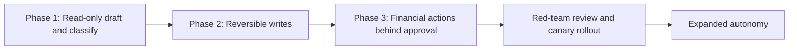
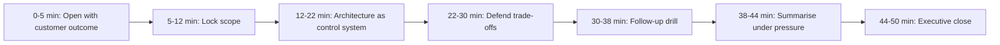

# Tool-Using AI Agent with Safety Controls, part 3

## 9. Gate the Release on Unsafe Actions and Duplicate Effects

The two counts that gate every expansion are unsafe actions and duplicate effects, and both must be zero. High tool success with a rising duplicate-effect count is a deployment blocker, not a product victory.

| Metric | What it proves | Strong threshold | Dataset / method | Owner |
|---|---|---|---|---|
| Unsafe action count | The control boundary held | Zero in any sensitive workflow | Audit review, incident tickets, rule checks | Incident commander / ops lead |
| Duplicate-effect count | Retries and replays cannot double-charge | Zero; any occurrence alerts immediately | Idempotency logs and reconciliation reports | Reliability engineer |
| Policy denial rate | Denials reflect real policy, not a broken prompt | Stable against baseline; spikes investigated | Policy engine logs | Platform / trust-and-safety |
| Approval rate and delay | Human gates protect without stalling the workflow | Delay within SLO; rate stable | Approval service logs | Business operations |
| Tool success rate | Downstream systems are called in supported ways | Stable; failures alert when throughput stalls | Tool execution telemetry | Downstream system owner |
| Task completion rate | Automation finishes work without manual rescue | Holds or improves after each expansion | Workflow state machine, case closures | Product and FDE |
| Human override rate | The agent is earning its place in the queue | Low enough to justify the automation | Review UI, post-action edits | Operations manager |

Report four dashboard layers, because the customer buys workflow improvement under control, not model accuracy. Technical health is tool success, duplicate effects, error rate, queue latency, denial rate. Model quality is task completion, approval rate and delay, and how often a proposed action is later corrected. Adoption is override rate, usage by team, share of eligible requests routed through the agent. Business outcome is time to resolution, refund cycle time, backlog reduction and the customer KPI the workflow exists to move. A healthy service can still fail the business. A high denial rate may mean the guardrails work or the schema is too restrictive. A high override rate may mean the model underperforms or policy needs calibration.

Red-team before granting more power, as a release gate rather than a stunt. Feed the system emails, documents and ticket text with adversarial instructions hidden in legitimate content. Ask whether it can be steered into calling tools it should not, leaking context, or skipping approvals. The go/no-go for autonomy has three parts. The obvious attack paths were exercised. The policy layer rejected them. The agent degraded to read-only or human review instead of improvising around the control plane. The red-team list covers five attack families:

- indirect injection in CRM records, tickets, database rows and fetched pages
- over-broad credentials that turn one manipulated plan into fleet-wide access
- unvalidated proposals, such as a confident $5,000 refund against a $500 limit
- lost responses that a naive retry turns into a second refund
- stale approvals or action loops that authorise the wrong state or retry into a bill

## 10. Roll Out Read-Only First and Keep Money Behind a Human

Autonomy is earned in phases, and the go/no-go at each phase is a control claim, not a model claim.

| Week | Gate |
|---|---|
| 0-1 | Classify every action by reversibility and financial impact; name the approver for each risky class |
| 1-2 | Read-only triage and drafting, no write path at all. Exit when drafts are useful for a defined slice, the policy layer blocks disallowed actions correctly, and every recommendation traces back to inputs and tool calls |
| 2-3 | Prove reversibility on a narrow set of CRM writes. Each tool has an owner, a documented revert procedure and an idempotency strategy |
| 3-4 | Add write paths only where rollback is demonstrated; every financial action stays behind a human. The gate is "the tool succeeded, the change was logged, the revert path exists, duplicates are under control" |
| 5 | Red-team the prompt with hostile tool observations before any additional power |
| 6-8 | Canary a small representative slice; watch policy denials, duplicate effects, approval delay and override rate; stop and fix on any of them |
| After | Expand autonomy only where unsafe-action count stays at zero and duplicate effects never appear |

A practical approval gate includes reviewer identity, decision timestamp, policy rationale and the exact payload that will execute. An approval that ages out expires rather than executing later. A policy change updates the gate before the next rollout step, not after an incident.

Keep a risk register with the shape risk, owner, mitigation, trigger, rollback, and reuse it for any de-risking question. Prompt injection causes an unauthorised tool call: security reviewer; injection tests, allowlists, policy checks, read-only fallback; any confirmed unauthorised attempt; disable autonomous tool calls and revert to human review. Duplicate CRM writes after retries: reliability engineer; idempotency keys, reconciliation jobs, replay-safe contracts; any duplicated side effect; pause write traffic and drain the queue. Refund approvals stall operations: finance operations lead; approval SLAs, escalation path, reviewer training; delay exceeds target or queue depth climbs; narrow the eligible refund scope or route more to manual.

The rollout is also a training and support plan. Users need to know what the agent can do, what it will refuse, how approvals work and how to escalate when a result looks wrong. Support needs a runbook for inspecting logs, finding the policy rule that fired and recovering a stuck workflow. Build the approval service, idempotency layer, policy engine and ledger as shared services, and keep the customer-specific pieces, CRM fields, refund rules, routing and thresholds, in configuration and adapters. The durable product asset is the control plane.

## 11. Deliver It in Fifty Minutes

Organise the sketch around trust boundaries, not the model, and spend minutes where the stakes are: identity, authorisation, duplicate execution and malicious instructions. A weak answer covers prompts, vector search, OCR, channels and regions at once; a better one narrows by risk.

| Minutes | Phase |
|---|---|
| 0–5 | Open with the customer outcome and the hidden constraint (section 1); invite redirection: strict safety, lower latency or faster rollout |
| 5–12 | Lock scope: what may the agent do versus suggest, which actions are reversible, dollar thresholds, staged CRM updates, stable identifiers (sections 1 and 2) |
| 12–22 | Architecture as a control system: model plans, policy decides, gateway executes, ledger records, state machine tracks (sections 4 and 5) |
| 22–30 | The four trade-offs (below) |
| 30–38 | The follow-up drill (below) |
| 38–44 | What to build first: read-only, then reversible writes with approval, then low-value automated writes, refunds last (section 10) |
| 44–50 | The ninety-second decision memo |

The four trade-offs each have a resolved shape, "give a little here to protect X", and interviewers probe exactly these pairs.

| Trade-off | Resolution |
|---|---|
| Agent flexibility vs deterministic workflow | Flexible interpretation, deterministic execution. The model drafts, the workflow validates; letting the model choose the final action raises variance, audit complexity and blast radius |
| Fine-grained scopes vs integration burden | Optimise scopes around irreversible effects first, then simplify with shared auth patterns and reusable wrappers |
| Automatic execution vs approval latency | Tiered automation: low risk auto-runs, medium risk queues for review, high risk needs explicit approval or a second check. Accept approval latency to protect against irreversible financial harm |
| Central tool gateway vs direct integrations | The gateway is the default, because it is the one place for auth, policy, audit, idempotency and schema validation; direct integrations multiply the places a bad prompt can reach a write API |

The follow-ups arrive in a predictable order, and each has a prepared answer.

| Follow-up | Answer |
|---|---|
| Can the model hold credentials? | No. It receives the minimum context to reason, never a long-lived secret. Credentials live in a secrets manager or token broker; the model requests an action and a trusted service mints a constrained token for that exact operation |
| How do you stop duplicate refunds? | Idempotency at the business-action layer, not only the API layer. Every refund carries a durable identifier tied to case, customer and policy decision; before execution the workflow checks whether it completed, is in flight or partially applied, and on retry returns the existing outcome |
| What if the email contains malicious instructions? | Assume it will. Email is untrusted input, never command authority. The model classifies and extracts facts and does not obey embedded instructions about overrides, credentials or approvals. Prompt separation, tool allowlisting, policy outside the model, strict role boundaries |
| How does the kill switch work mid-task? | More than a flag on new requests: halt new tool invocations, cancel queued workflows, revoke or expire delegated tokens, and mark in-flight tasks so downstream services reject completion. The state machine makes the pause point explicit |
| OpenAI-style practice Q6, an agent that reads incoming requests and performs actions across Salesforce, SAP, Jira and email: "The agent wants to issue a refund. Should it be allowed to do so automatically?" | Only below a threshold, only as a delegated actor with a scoped token, only through the idempotent gateway, and only where the revert path is proven. Above the threshold it creates a proposed refund ticket for approval. Assume the model will occasionally be wrong and design so the blast radius is limited |
| How do tool schemas reduce hallucinated actions? (Tier 2) | Typed arguments, enums over free text, required fields, a data-class and risk label per tool, and validation before policy so a malformed proposal never reaches authorisation |
| How do you sandbox tool execution? | Restricted adapters only, no shell escape, per-tool concurrency limits, and a gateway that is the only path to any write API |
| How do you control cost explosions from runaway tool calls? | Step budgets per task, retry caps, a circuit breaker on repeated identical calls, per-user and global concurrency, and a spend ceiling that trips the kill switch |
| When do you route to a human, and how does auditing drive that? | On risk tier, on low confidence, on policy ambiguity, on any inconsistency. The ledger's denial and override rates recalibrate the thresholds |
| Circuit breakers, rate limits, degradation when the model is unavailable? | Per-tool breakers, per-user and per-tool quotas, and degradation to read-only or human-review mode, never to a bigger static credential |

The ninety-second decision memo that closes the round:

> *"We're building an agent that turns unstructured email into safe operational action, but we are not giving the model unchecked authority. The model handles interpretation and recommendation; deterministic services handle identity, authorisation, idempotency, approvals, audit, and execution. The key trade-off is flexibility versus control: we accept some workflow rigidity so that refunds and CRM writes are gated, logged, and reversible where possible. The first gate is not 'the agent can do everything'; it is that the control plane demonstrably prevents unauthorised actions, duplicate execution, and uncontrolled side effects."*

The interviewer will challenge the riskiest assumption: "what if the email itself is trying to steer the agent into a refund it should not make?" Answer calmly and specifically. The email is untrusted input for classification and extraction only. The policy engine outside the model decides whether the request is eligible for any write path. The workflow requires a durable action record plus approval for risky cases. Content that looks like injection or conflicting instructions fails closed.

The two-minute spoken answer, for when the whole design has to fit in a summary:

> *I would not start with the model. The customer asks for an agent that reads email, queries internal systems, updates CRM records, and issues refunds, and everyone nods at the feature list before disagreeing completely: operations wants speed, security wants hard gates, finance fears irreversible money movement. That disagreement is the design problem. So I would restate the outcome as enabling useful automation while deterministic controls govern identity, permissions, risk, and irreversible effects. The crucial consequence is that the model is not the authority: it can interpret and propose, but deterministic systems decide who may act, what may change, and whether an action can be reversed. Concretely, the planner proposes one bounded action, a typed schema validates the arguments before policy even runs, a deterministic policy engine returns allow, block, or needs-approval with the scopes it grants, a credential broker mints a short-lived token tied to one workflow and one action type, and an idempotent execution gateway guarantees exactly one side effect no matter how many retries occur. Tool observations are untrusted data, never commands, so a prompt injection hidden in a ticket fails at the policy gate rather than depending on the model to notice it. Loops, per-task spend, refund amounts, and destinations all carry hard ceilings. I would roll out read-only first, prove reversibility before enabling any write path, keep money behind a human, and red-team the prompt before granting more autonomy. Success is fewer handling minutes with zero unauthorised or unreviewed irreversible changes.*

The lines that carry the round:

1. *"The model proposes; it never decides."*
2. *"Flexible interpretation, deterministic execution."*
3. *"Tool output is untrusted data, never instructions."*
4. *"The model sees information; it does not inherit trust."*
5. *"No application trusts the LLM. Applications trust enterprise identity."*
6. *"Validation is where policy becomes enforceable, and it runs before policy does."*
7. *"A retry without idempotency is how one refund becomes two."*
8. *"Fail closed on writes. Degrade only the lowest-risk reads. Never fall back to a broad secret to keep the demo alive."*
9. *"Ceilings on steps, spend, refund amount and destinations are guardrails, not tuning knobs."*
10. *"The first production gate is that the control plane prevents unauthorised actions, duplicate execution and uncontrolled side effects."*

Repair the common weak answers on the spot. Talking about the model too long becomes re-centring the control plane. Optimising for elegance becomes acknowledging the cost of fine-grained scopes and approval queues. Assuming email is trustworthy becomes stating untrusted-input handling early. Describing the kill switch as a UI flag becomes tying it to cancellation, token revocation and downstream rejection. Drowning the interviewer in components becomes saying what ships first and what is deferred.
