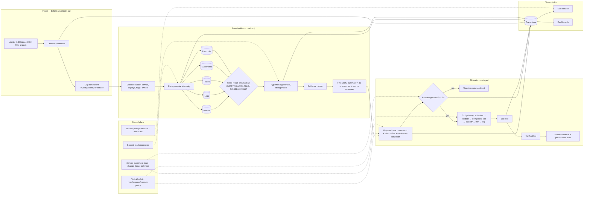
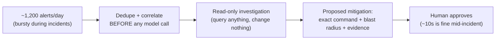
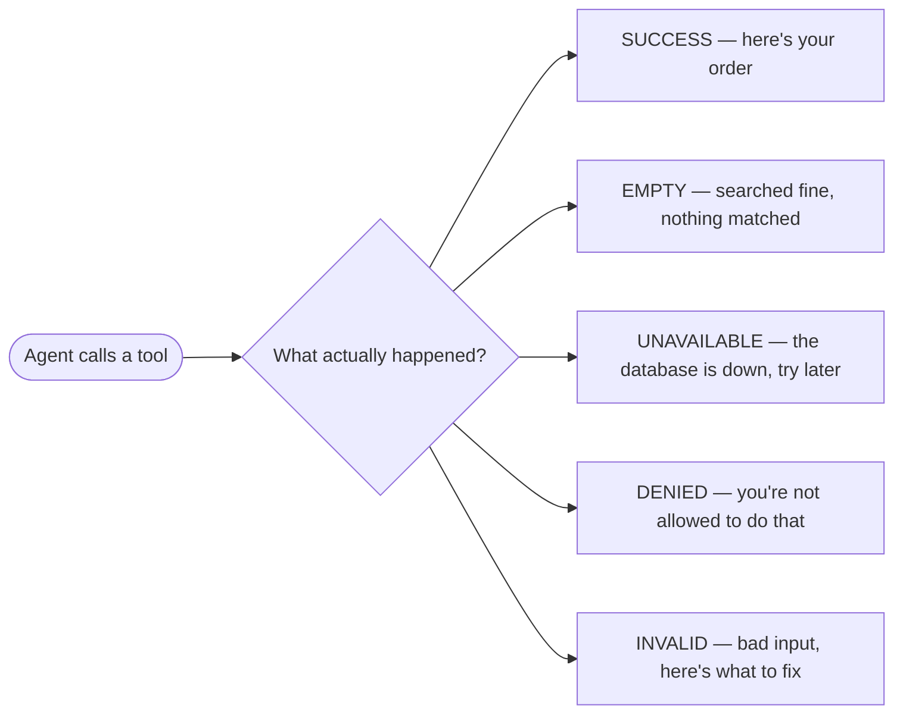
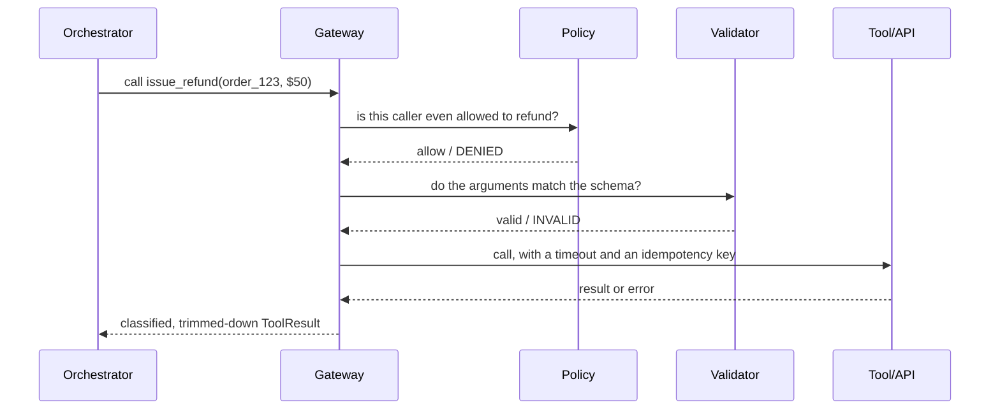

# Incident Response Agent for an SRE Team, part 2

## 4. Draw the Architecture End to End

One diagram carries the design, and the sections after it zoom in. The organising split is control plane against data plane. Policy, tool allowlists, credentials, runbook and catalog sync, model versions and evaluation rules live in the control plane; every alert, query, hypothesis, proposal and approval lives in the data plane. The second split is the read-only line inside the data plane: everything to the left of the approval gate may query, nothing to its left may change.

```
 ╔═══════════════════════════════ CONTROL PLANE (changes are releases) ═══════════════════════════════╗
 ║  tool allowlist + policy (read / propose / execute) · scoped read credentials · service-ownership map  ║
 ║  runbook + service-catalog sync · change-freeze calendar · model + prompt versions · eval rules        ║
 ╚═════════════════════════════════════════╤═══════════════════════════════════════════════════════════╝
                                           │ configures every box below
 ╔═══════════════════════════════ DATA PLANE (runs outside the affected blast radius) ═════════════════╗
 ║                                                                                                       ║
 ║  INTAKE — before any model call                                                                       ║
 ║   alerts (~1,200/day, 400 in 90 s at peak) ─> DEDUPE + CORRELATE (rules, small model) ─> per-service ║
 ║                                                  cap on concurrent investigations                     ║
 ║        │ one investigation per correlated cluster                                                     ║
 ║        v                                                                                              ║
 ║  INVESTIGATION — read-only                                                                            ║
 ║   context builder ─> PRE-AGGREGATE telemetry ─┬─> metrics  ┐                                          ║
 ║   (service, deploys, flags, owners)           ├─> logs     │ parallel, bounded lookback,               ║
 ║                                               ├─> traces   │ typed results: SUCCESS / EMPTY /         ║
 ║                                               ├─> k8s      │ UNAVAILABLE / DENIED / INVALID           ║
 ║                                               └─> runbooks ┘                                          ║
 ║        │ evidence + source coverage                                                                   ║
 ║        v                                                                                              ║
 ║   HYPOTHESIS (strong model) ─> evidence ranker ─> first useful summary (< 30 s, streamed)             ║
 ║        │ ranked causes · confidence · missing evidence · sources not reached                          ║
 ║        v                                                                                              ║
 ║  MITIGATION — staged                                                                                  ║
 ║   proposal: exact command + blast radius + evidence + runbook + freeze check + simulation             ║
 ║        │                                                                                              ║
 ║        v                                                                                              ║
 ║   ══ APPROVAL GATE (owner + commander, ~10 s) ══ ─> TOOL GATEWAY (authorise → validate → idempotent   ║
 ║                                                     call with timeout → classify → trim → log)        ║
 ║        │                                                                                              ║
 ║        v                                                                                              ║
 ║   execute ─> verify effect ─> incident timeline ─> postmortem draft                                   ║
 ║                                                                                                       ║
 ║  OBSERVABILITY — every stage writes                                                                   ║
 ║   trace store (alert → signals → hypotheses → proposal → decision → outcome) ─> eval service          ║
 ║                                 ─> dashboards (time to first output · hypothesis precision · source    ║
 ║                                    coverage · approval decision time · later reversal rate)            ║
 ╚═══════════════════════════════════════════════════════════════════════════════════════════════════════╝
```

The same flow as a rendered diagram, for viewers that draw Mermaid:



The anchor's own diagram is the four-box version to draw when the board is small. Reproduce it exactly; it is the shape interviewers recognise.



Read the components in dependency order, because that is the order they have to exist and the order they fail.

| Component                                | Responsibility                                                                              | Fails how                                                                                                           |
| ---------------------------------------- | ------------------------------------------------------------------------------------------- | ------------------------------------------------------------------------------------------------------------------- |
| Alert intake, dedupe, correlation        | Collapse 400 alerts into a handful of investigations before any model call; cap per service | Degrades: uncorrelated alerts queue, never dropped silently                                                         |
| Context builder                          | Load service, recent deploys, flag changes, owners, freeze status                           | Degrades: missing context is disclosed in the summary                                                               |
| Telemetry query tools                    | Parallel, bounded-lookback reads over metrics, logs, traces, Kubernetes                     | Typed: `EMPTY` and `UNAVAILABLE` are different facts; `UNAVAILABLE` is reported, never retried into the ground |
| Pre-aggregator                           | Summarise, bucket and diff telemetry before it becomes tokens                               | Degrades: raw slices are capped, not stuffed                                                                        |
| Runbook retriever                        | Ground the next check and the proposal in an approved runbook                               | Degrades: no runbook means a lower-confidence proposal, flagged                                                     |
| Hypothesis generator and evidence ranker | Ranked causes with confidence and the evidence for each; refuse an uncited cause            | Closed: no telemetry, no root-cause claim                                                                           |
| Proposal builder                         | Exact command, blast radius, evidence, freeze check, simulation result, owner routing       | Closed: no simulation for a destructive command, no proposal                                                        |
| Approval gate                            | Owner and commander decide; decision and time recorded                                      | Closed: no approval, no execution; expiry after the incident window                                                 |
| Tool gateway                             | Authorise, validate, bound, execute with idempotency key and timeout, classify, trim, log   | Closed on `DENIED`; `INVALID` returned as a dead end with no workaround hint                                     |
| Timeline writer                          | Every event, hypothesis, decision and outcome into the incident record                      | Degrades: the incident proceeds, the gap is logged                                                                  |
| Trace store, eval, dashboards            | Replayable investigations; precision, coverage, decision time, reversal rate                | Degrades: output still served, gap logged                                                                           |

Point at three boundaries while the diagram is up. The model-call boundary sits after dedupe and correlation, so a burst never becomes 400 model invocations. The write boundary sits at the approval gate, so nothing left of it can change production, and the gateway behind it is the single doorway for anything that can. The blast-radius boundary sits around the whole data plane, which runs outside the systems it investigates.

## 5. Deduplicate and Correlate Before Any Model Call

Design for the burst, not the daily average. 1,200 alerts a day is trivial; 400 alerts in 90 seconds during an incident is not. An agent that starts 400 investigations produces 400 shallow answers while the metrics store it queries falls over. One thorough investigation beats 400 shallow ones.

So deduplicate and correlate with rules and a small model before any strong-model call, and cap concurrent investigations per service. A cluster of alerts on one service within one window becomes one investigation. Alerts that arrive while it runs attach to it as new signals rather than opening new runs.

The same rule governs what enters the model's context. Raw logs, traces and deploy diffs are input tokens, and under a latency ceiling you win by sending less. Pre-aggregate telemetry first: bucket the metric, diff the deploy, count the log signature, sample the trace. Bound the lookback window. Send the summary and keep the raw slice reachable by a tool call if the hypothesis needs it. Reserve the strong model for hypothesis synthesis and use smaller models or rules for clustering and correlation.

## 6. Investigate Read-Only, Stage the Mitigation

Four decisions matter more than the diagram, and the first is the whole risk model. Read-only investigation, staged mitigation: the agent may query anything and change nothing on its own. A ten-second human approval is acceptable mid-incident. An autonomous rollback on a wrong hypothesis is not.

A proposal has a fixed shape: the exact command, the blast radius, the evidence, the runbook it follows, the change-freeze status, and a simulation or dry-run result where the platform allows one. Reject any proposal without a blast radius. Route it to the service owner and the incident commander, record the decision and the decision time, and let it expire when the incident window closes.

Give every tool a typed result with five states, because a string return cannot tell the agent what happened. `SUCCESS` carries the data. `EMPTY` means the query ran and nothing matched. `UNAVAILABLE` means the source is down. `DENIED` means the caller may not. `INVALID` means the arguments were wrong and says what to fix. Mixing up `EMPTY` and `UNAVAILABLE` can cause retry storms during a real outage, which is when this agent runs. Mixing up `DENIED` and `INVALID` teaches the agent to work around policy instead of respecting it.



Never explain a denial. A `DENIED` that says "restarts of this service need commander approval" can read to the model as a hint, and the next attempt may be the same restart phrased as a scale-to-zero. Denials are a dead end to the model, with the reason logged for humans.

Every write, once approved, walks through one gateway in one order. Authorise before validating, otherwise a denied caller learns the tool's schema from the validation error. Validate the arguments against the schema. Execute with a timeout and an idempotency key, which is a hash of run id, tool name and arguments, so a retry after a timeout runs the restart once. Classify the result into the five states. Trim it to the declared fields before it returns. Log all of it.



Hold credentials to match. Read tools run with scoped read-only credentials. Write tools exist only behind the gate and only for the allowlisted, reversible actions of the current rollout stage. The blast radius on a proposal is computed from the service catalog and topology, not estimated by the model, and a rollback path is part of the proposal or the proposal is refused.

## 7. Say the Latency Arithmetic Aloud

Thirty seconds is a ceiling, not a target. A first useful summary must land inside it while 400 alerts arrive, because I'd expect a responder who has already started typing a manual query to stop reading the agent. Say the budget in slices and where each second goes.

Dedupe and correlation are rules, so they cost under a second. Context building reads a cached service catalog, deploy metadata and flag history in parallel, another second or two. Telemetry queries fan out in parallel with bounded lookback windows and a per-query timeout, budgeted at five to ten seconds for the slowest source, with `UNAVAILABLE` returned rather than waited for. Pre-aggregation runs on the query results as they arrive. In my budget, hypothesis synthesis on the strong model is the largest slice, ten to fifteen seconds, streamed so the first ranked cause appears before the last. Citation and evidence verification runs inline for anything that will become a proposal, and asynchronously for explanatory text.

Rehearse the mock's objection: the prototype takes 18 seconds and users will not adopt it. Don't answer with a faster model. Break the 18 seconds into authentication, retrieval, reranking, generation, tool calls and verification, then fix the slice that dominates. Parallelise independent queries. Cache embeddings and the service catalog. Reduce top-k before reranking. Stream partial responses. Route low-risk requests to a smaller model. Remove tool calls that do not change the hypothesis. Keep citation verification, because it is a safety feature. You can make it asynchronous for low-risk explanatory answers and keep it inline for proposals. Avoid long chain-of-thought loops in a live incident; a bounded set of parallel checks beats a long serial reasoning chain.

## 8. Treat the Observability Stack as Degraded

Here partial dependency degradation is the normal operating condition, because the agent's inputs are the systems that are failing. So one rule organises the failure table: authorisation and writes fail closed, and every telemetry gap degrades visibly with the gap disclosed.

| Fails                                        | Behaviour                                                                                                                          |
| -------------------------------------------- | ---------------------------------------------------------------------------------------------------------------------------------- |
| Metrics store slow or down during the spike  | `UNAVAILABLE` returned inside the timeout; summary lists metrics as not reached; hypotheses marked lower confidence              |
| Log index rate-limited                       | Bounded lookback and sampled signatures; the coverage field says "logs: partial"                                                   |
| Trace backend degraded                       | Fall back to metrics and deploy diff; do not wait                                                                                  |
| Deploy metadata missing                      | Summary says no deploy correlation was possible; the most common cause is not silently excluded                                    |
| Runbook absent or stale                      | Proposal flagged as unguided; stale-source warning shown                                                                           |
| Prompt injection in a log line or runbook    | Retrieved content is data, never instructions; flagged chunks excluded; the action selector cannot fabricate a tool call from text |
| Alert storm exceeds the per-service cap      | New alerts attach to the running investigation; the queue is visible, nothing is dropped                                           |
| Model provider degraded                      | Fail over to a second provider behind an adapter; smaller tier for correlation; investigation continues read-only                  |
| Approval gate unreachable or approver absent | Fail closed. No execution. The proposal waits or expires; the responder acts manually with the evidence                            |
| Policy engine or credential service down     | Fail closed on every write; reads continue with cached scopes only if the scope is read-only                                       |

Instrument the ladder. A degradation ladder is an ordered set of rungs from full capability to honest refusal, selected by a pure function of a health snapshot. The selected rung is disclosed to the responder and emitted as a span attribute. In this design, a breaker per telemetry source trips on a windowed failure rate with a minimum sample size, not on a run of consecutive failures. Agent traffic is bursty, so a consecutive-failure trigger tends to trip too often or too late.

Then say what breaks first at 10×. The binding constraint is provider quota and the telemetry sources' rate limits during a storm, so the per-service cap and pre-aggregation do the scaling, not the model. Ten times the alerts means ten times the correlation load on rules and small models, which is cheap, and the same number of strong-model calls per real incident. Source coverage per investigation is the metric that shows the sources falling behind before the responders notice.
