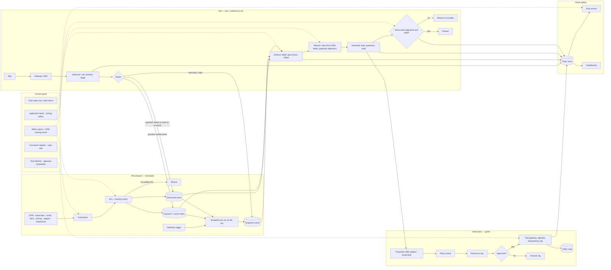

# Sales Copilot for Account Executives, part 2

## 3. Map Every Source With Its Permission Model

The answer key names the sources: Salesforce or HubSpot, Gong or Zoom transcripts, email and calendar, product docs, pricing and discount policy, customer support history, and the data warehouse. What it does not say is how each one is permissioned, and that is the part the interviewer probes. The permission model per source below is added for this pack. The freshness column is my working assumption for a typical setup, not a vendor figure.

| Data source | Format | Owner | Freshness | Permission model (added) | Risk |
|---|---|---|---|---|---|
| CRM (Salesforce / HubSpot) | Accounts, opportunities, contacts, activities, notes | Sales operations | Minutes; change events plus nightly reconciliation | Record access: org-wide defaults, owner, role hierarchy, territory, sharing rules; field-level security on amount and other restricted fields | A rep seeing a peer's territory; forecast fields leaking; stale stage after a close |
| Call transcripts (Gong / Zoom) | Transcript text, participants, timestamps | Sales enablement | Hours after the call | Participant and manager access; recording consent by region | PII and customer confidences; prompt injection in what a customer said |
| Email and calendar | Threads, invites, attendees | Individual mailbox owner | Real time | Mailbox owner only, delegated access explicit | Reading another rep's mailbox; injection in inbound mail |
| Product docs | Pages, PDFs | Product marketing | Days | Internal, some partner-tier | Superseded features; internal roadmap leaking into customer drafts |
| Pricing and discount policy | Policy docs, approval matrices | Deal desk | Weeks; versioned | Internal; regional variants | Disallowed pricing promises; stale discount thresholds |
| Support history | Tickets, escalations | Support | Minutes | Account-scoped; tenant-scoped in multi-tenant support | Cross-account leakage; severity fields mis-summarised |
| Data warehouse | Usage metrics, ROI pilots, renewals | Analytics | Daily | Row-level by account and role; internal-only pilot results | Internal-only ROI numbers used as external claims (the incident) |

State the integration assumptions aloud. Every source record has a stable ID, owner metadata, a last-updated timestamp and access-control metadata. A source that lacks ACL metadata is excluded from production retrieval until it is mapped. Embeddings are not the authority for permissions; permissions are checked through metadata filters and, for sensitive records, through source-system authorisation checks. Source freshness varies by system, so the answer shows a stale-source warning when a record is older than the approved threshold. User feedback is stored separately from ground truth, and SME-reviewed corrections become evaluation data only after approval.

The core records follow. Account(id, segment, industry, region, owner, entitlements). Opportunity(id, stage, amount, close_date, competitors, next_step). Interaction(id, account_id, type, transcript, participants, timestamp). Playbook(id, segment, approved_claims, objections). Draft(id, account_id, user_id, content, approval_status). AuditLog(user_id, account_id, source_ids, output_type). Two of these carry the safety story: `Playbook.approved_claims` is the only place an outbound claim may come from, and `Draft.approval_status` is the gate every write passes through.

## 4. Draw the Architecture End to End

One diagram carries the whole design. The organising split is control plane against data plane. Inside the data plane, two lanes must never share a hot path. The pre-meeting precompute lane is slow and scheduled. The interactive ask lane reads what precompute produced. Write-back is a third, gated lane.

```
 ╔══════════════════════════════ CONTROL PLANE (changes are releases) ══════════════════════════════╗
 ║  ABAC policy + CRM sharing-rule mirror · connector registry + schedules · credentials (vault refs) ║
 ║  approved-claims playbooks · pricing policy versions · prompt / model / route versions              ║
 ║  tool allowlist + approval thresholds · eval suites incl. claim-level slices · budgets              ║
 ╚═══════════════════════════════════════╤═══════════════════════════════════════════════════════════╝
                                         │ configures every box below
 ╔══════════════════════════════ DATA PLANE (calls are requests) ═══════════════════════════════════╗
 ║                                                                                                   ║
 ║  PRECOMPUTE — scheduled, before the meeting                                                       ║
 ║   CRM · transcripts · email/calendar · docs · pricing · support · warehouse                        ║
 ║        │ change events + nightly reconciliation (connector registry, one schedule per source)     ║
 ║        v                                                                                          ║
 ║   connectors ─> normalise ─> ACL + territory mirror ─> chunk / embed ─┬─> keyword + vector index   ║
 ║                                     │ refuse: no usable ACL           └─> structured store (CRM)   ║
 ║   calendar trigger ─> SNAPSHOT JOB: summary · open risks · last interactions · approved claims     ║
 ║                       (built as the rep, permission-checked, cached on account + rep signature)    ║
 ║                                                                                                   ║
 ║  ASK — synchronous, ordered by risk                                                               ║
 ║   rep ─> gateway ─> AUTHORIZE ─> ROUTE ─> FETCH ─> ENFORCE ─> REASON ─> GENERATE ─> VERIFY ─> answer
 ║           SSO      resolve      intent:   snapshot   ABAC     risks from  cited      claim +      ║
 ║           via      role,        summary   cache;     post-    CRM fields; brief,     citation     ║
 ║           IdP      territory,   risk      structured check,   playbook    questions, check,       ║
 ║                    deal stage   draft     query or   redact   objections  draft      output       ║
 ║                                 update    hybrid                                     policy       ║
 ║                                           search                                         │        ║
 ║                                                                     insufficient / unapproved     ║
 ║                                                                     claim ─> REFUSE + escalate    ║
 ║                                                                                                   ║
 ║  WRITE-BACK — gated                                                                               ║
 ║   proposed CRM update or email draft ─> policy check ─> PREVIEW to rep ─> APPROVE ─> tool gateway ║
 ║   (allowlist, idempotency key) ─> CRM / mail ─> audit                                              ║
 ║                                                                                                   ║
 ║  OBSERVABILITY — every stage writes                                                               ║
 ║   trace store ─> eval service (golden set · claim-level slices · permission red team · shadow)     ║
 ║               ─> dashboards (unsupported-claim rate · permission violations · step count ·         ║
 ║                  snapshot hit rate · cost per workflow · adoption)                                 ║
 ╚═══════════════════════════════════════════════════════════════════════════════════════════════════╝
```

The same flow as a rendered diagram:



Read the components in dependency order, because that is the order they exist and the order they fail.

| Component | Responsibility | Fails how |
|---|---|---|
| Identity gateway | Validate the SSO token, load role, territory, tenant and deal-stage context, classify the request as read-only, draft-only or action-taking | Closed: no identity, no answer |
| Connector registry | One schedule and one credential reference per source; change tokens where the source API supports them; health as its own signal | Degrades: one source's outage is quarantined to that source |
| ACL and territory mirror | Translate CRM sharing rules, field-level security and transcript participant access into one attribute model | Closed: no usable ACL, not indexed |
| Snapshot job and cache | Build the brief before the meeting as the rep, cache it keyed on account plus the rep's permission signature | Degrades: serve the last snapshot with a staleness label |
| Intent router | Decide summary, risk, draft or update; decide structured query versus semantic search versus both | Degrades: fall through to the agent path |
| Structured store and indexes | CRM fields for counts, lookups and stage; documents and transcripts for prose | Degrades: keyword when vector is down, labeled |
| Policy post-check | Re-run ABAC on fresh attributes; redact PII from transcripts as an obligation | Closed: policy engine down, refuse |
| Reasoning layer | Risks from CRM fields and playbook objections; never from model memory | Refuses when evidence is missing |
| Claim verifier and output policy | Every outbound claim traced to an approved-claims entry; block, never warn, on external claims | Closed on an unapproved claim |
| Tool gateway | Allowlist, idempotency keys, preview, approval, audit | Closed: no approval, no write |
| Trace store, eval, dashboards | Replayable runs, claim-level slices, permission red team, online unsupported-claim monitor | Degrades: answer served, gap logged |

Three boundaries are worth pointing at while the diagram is up. The precompute-versus-ask boundary keeps CRM fan-out off the interactive path. The trust boundary sits at ENFORCE: everything to its left may hold records the rep cannot see, nothing to its right may. The write boundary sits at APPROVE: nothing reaches the CRM or a mailbox without a previewed, approved draft carrying an idempotency key.

## 5. Precompute the Account Snapshot Before the Meeting

The interactive path cannot fan out to the CRM, the transcript store and the warehouse on every question. A meeting is on the calendar hours in advance. So the brief is built then, not when the rep opens the panel. That single decision is what makes the 3-to-8-second target and the latency drill in section 13 achievable.

The snapshot job runs on a calendar trigger, or on demand with a visible progress state. It builds the account summary, the open opportunities with stage and next step, the last interactions across calls and email, the open support escalations, and the approved claims and objections for the account's segment. It runs as the rep, so the permission check happens at build time. It is cached keyed on the account and the rep's permission signature. A manager and a rep on the same account get different snapshots. They may see different fields.

Precomputation is an optimisation, never a permission model. A snapshot is a materialised view, and a materialised view can outlive a permission change: a rep moved off a territory at noon must not read the 9 a.m. snapshot at 2 p.m. So the ask lane re-checks the policy on fresh attributes before serving it, and a territory or role change invalidates every snapshot keyed on that rep. Say that sentence in the room; it is the same two-layer rule as permission-aware RAG.

## 6. Propagate CRM Permissions and Territory Rules Into Retrieval

*This section is added for this pack. The answer key says "apply user, role, tenant, region and sensitivity permissions before retrieval" and stops there. The material below draws on Handbook Module 06 docs 1 and 5.*

Identity is established before any permission logic runs. Authenticate through the customer's own identity provider, validate the token's signature, issuer, expiry and audience, and map the customer's own groups into the platform's role vocabulary rather than inventing roles locally. Group mapping is configuration that can drift, so a renamed group on the customer's side must surface as an alert, not silently orphan a rep. A user from a newly connected customer is provisioned just in time from the token's claims, scoped to their company, never with more access than intended by default.

CRM permissions are richer than document ACLs, and the mirror has to carry all of them. Salesforce decides record visibility by org-wide defaults, owner, role hierarchy, sharing rules, teams and territories, and field-level security decides which fields show. The mirror translates each into an attribute on the record: `owner_id`, `territory_ids`, `role_visible_from`, and a field mask that hides forecast amount, or any other FLS-restricted field, from roles that cannot see them. The pre-filter compiled into retrieval carries tenant, territory and role; the post-check re-verifies the field mask and any sharing rule that changed since the index was written. A structured leak is still a leak: a count of open opportunities that includes a peer's territory is as serious as a forbidden document, and it is held to the same zero-violation gate.

Credentials for the CRM, the call recorder and the mailbox are references to a vault, never values. They are resolved at the moment of use, never logged, never written into a trace, and scoped per connection rather than per connector type, so one customer's Salesforce credential can never reach another customer's Salesforce. Per-tenant encryption keys mean one leaked key exposes one tenant, not all of them, and a tenant's data can be crypto-shredded by destroying its key.

The interview lens, in one line:

> *"Authorisation logic assumes identity is already established. In front of it I validate the customer's own token and map their groups. Underneath it, credentials come from a vault by reference and never appear in a trace."*

## 7. Ground Opportunity Risks in CRM Fields, Not Model Memory

"What are the risks on this opportunity?" is a structured question wearing a conversational coat. Embed it and search a document index, and the answer is the most similar-sounding notes. It is not the stage that has not moved in 40 days, the competitor named in the last call, or the close date that slipped twice. Semantic search answers "which things are like this", never "how many", "which is most recent" or "did this field change". A router in front of retrieval decides which kind of question this is.

| Question shape | Right tool | Why plain search fails |
|---|---|---|
| "Summarise the last three calls with this account" | Semantic search over transcripts | — |
| "How many open opportunities does this account have past their close date?" | A structured query on CRM fields | Search returns similar records, not a count |
| "What is the status of opportunity 0065g00000?" | Direct lookup by ID | An ID is not ordinary text |
| "Which objections came up across all late-stage deals this quarter?" | Both: filter first, then summarise the filtered transcripts | A filter cannot summarise prose; search cannot scope to "this quarter's late-stage deals" |

Prefer a fixed set of reviewed operations on the CRM over generating queries from natural language: get opportunities by stage, get account by ID, get interactions since a date. A model that generates a query can invent fields or touch every row, and "the copilot queried the whole pipeline" is a real incident. The fixed operations are the tool registry pointed at a record system, and they are the same allowlist the tool gateway enforces.

Opportunity risks are then reasoned from evidence the system fetched: stage age, slipped close dates, competitor mentions in transcripts, unanswered emails, open escalations, and the playbook's known objections for the segment. Each risk carries its citation. When the fields are missing or the transcripts are stale, the copilot says so and lists what it could not check, rather than filling the gap from what a typical deal looks like.
