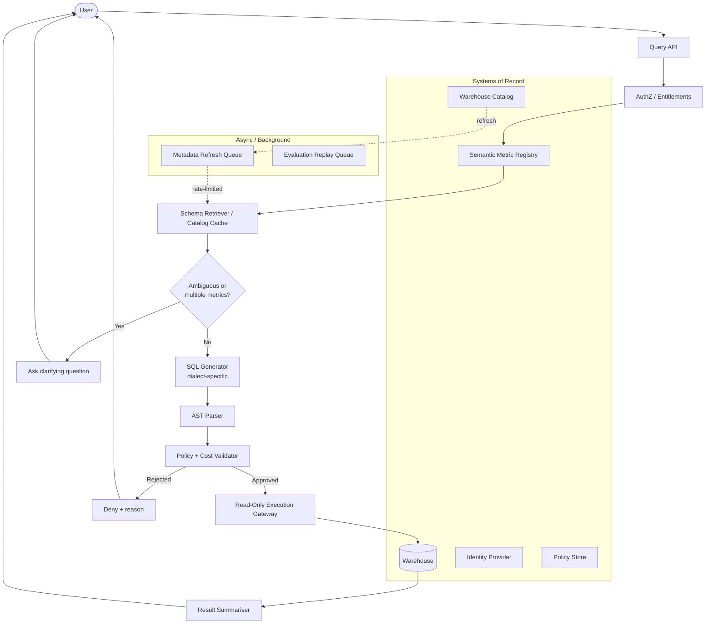
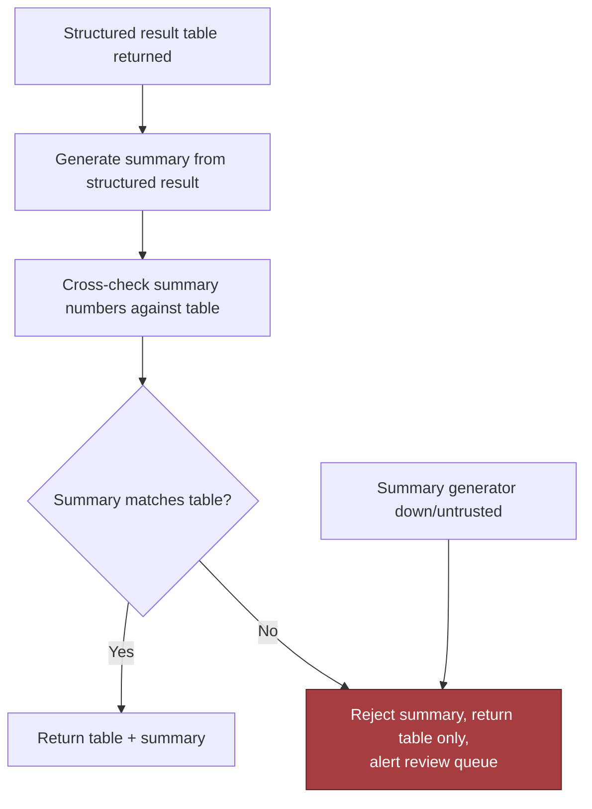

# Natural Language over Governed Data, part 2

## 4. Draw the Architecture End to End

The architecture is a chain of trust boundaries; explain it in dependency order rather than as a flat list of boxes. One diagram carries the whole design; sections 5 to 8 zoom into its stages. The organising split is control plane against data plane: definitions, policies, schedules and evaluation rules are releases; every question is a request.

```
 ╔═══════════════════════════════ CONTROL PLANE (changes are releases) ═══════════════════════════════╗
 ║  semantic metric registry (versioned, owner-approved) · policy bundles (tables, columns, joins,     ║
 ║  scan budgets) · warehouse-native RLS/CLS · catalog crawl schedules · prompt + model versions ·      ║
 ║  golden question/SQL/result cases · dashboards of record                                             ║
 ╚══════════════════════════════════════╤═══════════════════════════════════════════════════════════════╝
                                        │ configures every box below
 ╔═══════════════════════════════ DATA PLANE (calls are requests) ════════════════════════════════════╗
 ║                                                                                                      ║
 ║  BACKGROUND — asynchronous, partitioned by tenant / warehouse / dataset family                       ║
 ║   catalog crawler ─> metadata refresh queue (rate-limited) ─> catalog cache (TTL + version stamp)    ║
 ║   evaluation replay queue ─> golden-set replay on every change ─> regression report                  ║
 ║                                                                                                      ║
 ║  QUERY — synchronous, ordered by risk                                                                ║
 ║   user ─> query API ─> AUTHZ ─> METRIC REGISTRY ─> SCHEMA RETRIEVER ─> AMBIGUITY? ─> SQL GEN ─>      ║
 ║           authN,      entitle-  governed         only the tables,   < threshold:  dialect-          ║
 ║           intent      ments     definition       joins, freshness   ASK, not      specific,          ║
 ║                                 first            needed; freshness  guess         narrowed context   ║
 ║                                                  gate                                                 ║
 ║        ─> AST PARSE ─> POLICY + COST VALIDATOR ─> READ-ONLY GATEWAY ─> WAREHOUSE ─> SUMMARISER ─> answer
 ║           tree, not    tables, columns, joins,    narrowest creds,    RLS/CLS      table + SQL +     ║
 ║           text         writes, cross joins,       timeout, row        enforced     lineage + caveats;║
 ║                        scan budget; re-check      limit, cost         natively     summary cross-    ║
 ║                        entitlement at execution   estimate                          checked vs table  ║
 ║                              │ reject                    │ budget exceeded                │ mismatch   ║
 ║                              v                           v                               v            ║
 ║                        deny + reason           cancel + safe fallback        table only + review queue ║
 ║                                                                                                      ║
 ║  OBSERVABILITY — every stage writes                                                                  ║
 ║   append-only query runs (actor, sql_hash, policy decision, bytes scanned, metric + schema versions) ║
 ║   ─> dashboard: business outcome / model quality / system health · alerts on escaped policy, scan   ║
 ║      drift, trust decline                                                                            ║
 ╚══════════════════════════════════════════════════════════════════════════════════════════════════════╝
```

The tutorial's own component view, with its systems of record and queues, is the rendered form of the same flow.



Read the components in dependency order. Every box should answer who owns its state, how fresh it is, and why it exists; a box without those answers was premature.

| Component | Responsibility | State owner | Boundary type | MVP or later |
|---|---|---|---|---|
| Catalog crawler | Ingest warehouse schema, comments, freshness, lineage | Warehouse metadata source | Async background | MVP if warehouse is small; later if manually seeded initially |
| Semantic metric registry | Governed metric definitions and allowed grains | Product/data governance | Sync read, async update | MVP |
| Schema retriever | Fetch relevant tables, joins, freshness, permissions | Cache with source-of-record fallback | Mostly sync | MVP |
| SQL generator | Produce dialect-specific candidate SQL | Stateless service | Sync | MVP |
| AST parser | Normalise and inspect candidate SQL | Stateless service | Sync | MVP |
| Policy and cost validator | Enforce entitlement, query shape, scan limits, and execution rules | Policy store | Sync | MVP |
| Read-only execution gateway | Submit approved queries with limits and audit | Warehouse credentials / gateway | Sync | MVP |
| Result summariser | Convert rows into explanation, SQL, lineage, caveats | Stateless service | Sync | MVP |
| Evaluation harness | Replay prompts, compare outputs, detect regressions | Test corpus / telemetry store | Async | Later evolution, but useful early |

Point at three boundaries while the diagram is up. The sync/async boundary follows one rule: anything that must be correct before one answer is returned stays synchronous; anything that improves future answers can be asynchronous. The trust boundary sits at the read-only gateway, which holds the narrowest credentials and no write path; nothing the model generates reaches the warehouse except through it. Consistency points are explicit. Entitlement and policy are re-checked at execution as well as at planning, so a user who loses access between planning and execution is refused. A material registry version change never silently reuses an old interpretation. The partitioning key for queues preserves the natural isolation boundary, usually tenant, warehouse, region or dataset family, so one noisy customer or one large catalog refresh cannot starve unrelated work.

## 5. Anchor Every Question on a Governed Metric

The semantic layer is the product, and the model is a translator into it. "Revenue last week" must anchor on the governed definition of revenue before the system starts searching for tables. A model cannot infer a business definition that the business has not written down. The system consults the registry before any physical table; raw schema access is an escape hatch for approved exploratory workflows, never the default.

The insurer engagement in section 13 makes the same choice: a handful of governed metric views instead of raw fact tables. If the agent and a human analyst compute "claims by region" differently, with different date logic or different exclusions, trust in the whole system collapses. A metric view makes the KPI definition one versioned artefact every consumer shares.

Put a router in front of retrieval, because a real deployment mixes structured and semantic questions freely. Semantic search answers "which things are like this", never "how many", "which is most recent" or "sum this field".

| Question shape | Right tool | Why plain search fails |
|---|---|---|
| "Why did this customer's system break in March?" | Semantic search over documents and post-mortems | — |
| "How many high-priority tickets did they file last week?" | A structured query (count/filter) | Search returns *similar* records, not a count |
| "What's the status of ticket #4821?" | Direct lookup by ID | Treating an ID as ordinary text is wasteful and imprecise |
| "Summarise the pattern across all high-priority billing tickets this quarter" | **Both**: filter first, then summarise the filtered set | A filter cannot summarise prose; search cannot reliably scope to "this quarter's high-priority billing tickets" |

The structured path itself is a choice between two mechanisms. Generate a query from natural language and run it against a small, fixed, well-documented view. That is fast, but the model can invent fields, so the query must be validated or its result sanity-checked before it is trusted. Or call a small set of fixed, well-defined operations. That is safer, because the surface of what can happen is a reviewed set of operations rather than an open-ended language. Fixed operations are usually the better default in an enterprise. The insurer design made that decision per specialist. A managed text-to-SQL service over curated tables is the safe default. One deliberately narrower place allows hand-generated SQL for ad-hoc questions outside the curated scope.

Two rehearsed answers live here. When asked how to handle revenue with three definitions, name the ambiguity and ask a clarifying question. Show the supported definitions. Default only where the business has an approved canonical meaning for that context. If users ask it often, put it in the semantic layer with explicit aliases. When the interviewer pushes on the riskiest assumption, that the model can infer the right business meaning from the prompt, answer:

> *"I would not rely on the model to infer business definitions from raw text. I would anchor every answer to a governed semantic layer, and treat any question that falls outside that layer as an explicit ambiguity to resolve, not a guess to make."*

## 6. Ask When Ambiguous, Never Guess

If a question could map to multiple governed metrics or grain levels, the system stops and asks. A valid SQL query that answers the wrong business question is still a failure, and a clarifying question costs one round trip where a guess costs an executive decision. The gate has three modes, agreed with the customer in discovery: ask a clarifying question, refuse, or escalate to an analyst.

Give the gate a number. The insurer supervisor classifies each question into `simple_kpi`, `deep_analysis`, `document_lookup`, `visualization` or `conversational` with a confidence score, and its clarify node fires only below 60%. "Show me the numbers" gets a clarifying question, not a guess. A threshold makes the behaviour testable and tunable; "the model will ask when unsure" does not.

Ambiguity is also a freshness signal. When the catalog is stale beyond a threshold, the retriever refreshes through the async queue before allowing generation, falls back to a narrower supported question set, or asks. Do not pretend precision when freshness is uncertain. The failure policy for a business-definition conflict is human intervention, because a wrong answer is worse than a slower one.

## 7. Validate SQL as a Tree, Then Execute Read-Only

Valid SQL is not safe SQL. Regex can spot an obvious `DROP TABLE` string but cannot understand aliases, nested selects, CTEs, comments, obfuscation or a harmless-looking subquery that becomes unsafe after rewrite. A parser can inspect structure: statements allowed, tables allowed, columns allowed, joins allowed, functions allowed, limits present, aggregate semantics acceptable. Safety depends on syntax trees and policy rules, not pattern-matching theatre.

Four controls make up the boundary. Each stops a different abuse, so together they give defence in depth.

| Control | What it does | Abuse it stops |
|---|---|---|
| Least privilege | A read-only identity that can inspect only approved datasets and only the operations needed for analysis | A prompt injection or bad plan becoming a write, delete or privilege escalation. A request for hidden customer emails is rejected because the identity cannot read that column, not because the model probably refuses |
| Warehouse-native row and column policies | Let the warehouse enforce which tenant, region or role sees which slice, instead of reimplementing it in application code | The classic bug where the application filters one path and forgets another; an error in one tenant's policy exposing another tenant |
| Parse, do not regex | Inspect the AST for writes, unbounded cross joins, unauthorised tables, unexpected functions, missing limits and scan-budget violations | Obfuscated or nested SQL that passes a string filter |
| Result hygiene | Mask sensitive fields on the response path; log hashes or redacted fingerprints instead of raw data | A second leakage channel through logs; a replayable copy of sensitive output |

Prove the hidden-column invariant in front of the interviewer: the sketch below rejects a valid SQL string that requests a column outside the actor's permissions. A production version uses a dialect-aware parser and a policy source from the warehouse or a central registry, and logs the decision with redacted evidence.

```python
class PolicyError(Exception):
    pass

@dataclass(frozen=True)
class Actor:
    name: str
    permitted_columns: frozenset[str]

marketing_user = Actor(name="marketing", permitted_columns=frozenset({"customer_id", "country", "plan"}))

def parse_selected_columns(sql: str) -> list[str]:
    normalized = " ".join(sql.strip().split())
    upper = normalized.upper()
    if not upper.startswith("SELECT ") or " FROM " not in upper:
        raise PolicyError("Only simple SELECT queries are allowed in this sketch")
    select_part = normalized[7 : upper.index(" FROM ")].strip()
    if select_part == "*":
        raise PolicyError("Wildcard selects are not allowed")
    columns = [c.strip() for c in select_part.split(",")]
    if any(not c for c in columns):
        raise PolicyError("Malformed column list")
    return columns

def approve(sql: str, actor: Actor) -> bool:
    columns = parse_selected_columns(sql)
    denied = [col for col in columns if col not in actor.permitted_columns]
    if denied:
        raise PolicyError(f"actor {actor.name} may not access columns: {', '.join(denied)}")
    return True

def test_rejects_hidden_column_exfiltration():
    sql = "SELECT email FROM customers"
    with pytest.raises(PolicyError):
        approve(sql, actor=marketing_user)
```

After policy, estimate cost. Approved queries get a cost estimate, a timeout and a row limit, then run through the read-only gateway. Prefer bounded date windows and pre-aggregations. When a request would scan beyond the configured threshold, ask the user to narrow it, propose a cheaper rewrite, or require approval from a more privileged role. Never let the model "just try it". The model must not rewrite access predicates either, and any schema metadata the assistant sees is filtered to what the user can see.

Execution is risk-based. Auto-run only when confidence is high, the query fits an approved pattern, the user has permission and the estimated cost is below threshold. Otherwise show the draft SQL and ask for confirmation or analyst review. Full auto-execution feels magical and is dangerous when a query may touch sensitive rows, incur high cost or answer an ambiguous request.

## 8. Explain Variance From the Data, Not From Memory

The executive reads the prose, not the rows, so generate the summary from the structured result and cross-check its key values against the table. Reject any summary whose numbers do not match; return the table alone and alert the review queue. If the summary generator is down or untrusted, degrade to the table rather than fabricate confidence.



The two copilot personas extend the summary into an explanation, and the same rule holds: every driver named must trace to a query. The executive copilot explains variance against the governed definition, cites the metric definition it used, and escalates uncertain answers to analysts. The retail explainer attributes a forecast variance to drivers from sales history, promotions, weather, inventory and events, then recommends planning actions that a human reviews before any order changes. Its red-team list names the risks: confusing correlation with causation, hallucinated drivers, stale promotions data, recommendations biased against stores or regions, and over-ordering because an explanation sounded confident.

Keep the statistics deterministic. The insurer design's analysis agent computes Z-score anomalies and trend statistics rather than reasoning about them, so the model cannot invent a plausible but wrong number. The explanation layer then narrates computed drivers; it never produces them. Show confidence, missing evidence and the escalation reason whenever the drivers are weak, and route board-level narratives through an analyst before they leave the system.
