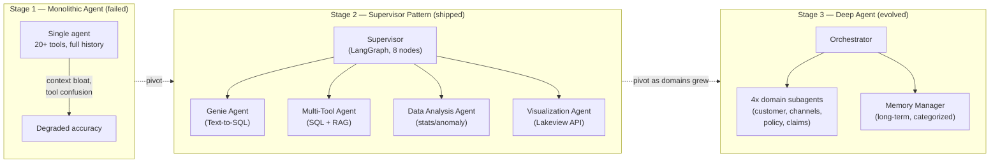

# Natural Language over Governed Data, part 4

## 12. Deliver It in Fifty Minutes

Begin where the customer is already hurt, executives wanting governed natural-language answers with correct definitions and no unsafe queries, not with a diagram. Then spend the minutes where the risk is.

| Minutes | Phase |
|---|---|
| 0–5 | Discovery: the questions in section 1, the ten metrics, the meaning of revenue |
| 5–10 | Success and failure in business language: correct interpretation, acceptable latency, low unsafe-query rate, adoption; and the failure modes: wrong business question, RLS leakage, harmless-looking expensive scans |
| 10–18 | Sketch the architecture with the semantic layer in the centre; raw schema access as an escape hatch |
| 18–28 | Trade-offs, each tied back to the customer outcome |
| 28–35 | Security and correctness end to end; the service account cannot query unrestricted data on behalf of users |
| 35–50 | One implementation slice (validation and approval for one metric), rollout gates, questions |

The 90-second architecture summary:

> *"We're building a governed natural-language-to-SQL assistant for executives and analysts who need fast answers but cannot afford incorrect metrics or unsafe queries. I'd put a semantic layer between the model and the warehouse so the assistant generates SQL from approved business definitions rather than raw table names. The service would accept a user question, classify intent and risk, resolve the relevant metric definitions, generate a constrained draft query, validate it for policy and cost, and then either execute automatically or route for approval depending on sensitivity and confidence. Row-level security must be enforced in the warehouse, not in the prompt. I'd log the question, the generated SQL, the metric mapping, the cost estimate, the execution result, and the user identity for audit and debugging. The biggest trade-off is flexibility versus correctness: I'd optimise for governed answers first, then add templates and fallback pathways for the long tail. My first rollout gate would be a small set of executive metrics with a golden test corpus and a hard stop on ambiguous or expensive queries."*

The 2-minute spoken answer:

> *I would not start with the model. The naive pitch here is to let an LLM write the SQL, and that loses immediately, because generation is not the hard part. The hard part is that "revenue" might mean booked, recognized, or collected, and a syntactically perfect query against the wrong definition is a governance failure dressed up as a working feature. So I would reframe the problem as building a governed decision-support system that only speaks in terms the business has already agreed to. That means three things from day one: a semantic layer of governed metric definitions, a safety boundary around the warehouse that is read-only and cost-bounded, and an explicit way to say "I don't know which definition you mean" instead of guessing. Architecturally, the query API authenticates and resolves entitlements, the metric registry is consulted before any physical table, the schema retriever pulls only what is needed, ambiguity triggers a clarifying question, and the generated SQL is parsed into an AST and checked against policy and a scan budget before a read-only gateway executes it with timeouts and row limits. I would prove it on ten governed metrics with golden cases pairing question, approved SQL, and expected result, then shadow analysts before any executive sees output, then expand domain by domain with named metric owners. Success is not a fast answer; it is an answer nobody has to re-check.*

The lines that carry the round:

1. *"The danger isn't failing to produce SQL. It's producing valid SQL that confidently answers the wrong business question."*
2. *"Anchor on the governed metric before touching a table. The semantic layer is the product."*
3. *"Ask rather than guess. A clarifying question costs a round trip; a guess costs a decision."*
4. *"Parse, don't regex. Safety lives in the syntax tree, not in pattern matching."*
5. *"Row-level security is enforced in the warehouse, not in the prompt."*
6. *"Valid SQL is not safe SQL. Estimate cost before you execute."*
7. *"Anything that must be correct before one answer is returned stays synchronous; anything that improves future answers can be asynchronous."*
8. *"Ten metrics, golden cases, shadow analysts, then domain by domain. Trust is earned, not assumed."*
9. *"Success is not a fast answer; it is an answer nobody has to re-check."*

Name the trade-offs with a balanced verdict each. Raw schema prompting versus semantic layer: default to the layer for governed metrics, allow raw schema only for approved exploratory workflows. Automatic execution versus approval: risk-based execution, auto-run only on high confidence, an approved pattern, permission and low cost, otherwise show the draft and ask. Flexibility versus templates: a hybrid, templates for common governed workflows, free-form for the long tail, and a policy gate deciding when free-form is allowed. Speed versus warehouse cost: bound the search space with the semantic layer and cache aggressively for repeat questions. Treat any large scan as a signal to narrow scope, not to optimise the query.

| Follow-up | Answer |
|---|---|
| How do you handle "revenue" with three definitions? | Name the ambiguity and force clarification. Show the supported definitions, default only where the business has an approved canonical meaning, and surface the definition used. If it is asked often, put it in the semantic layer with explicit aliases |
| What if the SQL is valid but catastrophically expensive? | Valid is not safe. A cost-estimation and policy step before execution looks for unbounded scans, missing date filters, explosive joins and table-specific budget breaches. Too expensive: narrow the question, propose a cheaper rewrite, or require a privileged approval |
| What is the riskiest assumption in this design? | That the model can infer business meaning from the prompt. Say the rehearsed line from section 5 |
| How do you keep a service account from reading unrestricted data on a user's behalf? | Run the query as the user (on-behalf-of login) so warehouse-native RLS/CLS applies to them, not to the service account; resolve entitlements per request and re-check at execution; filter schema metadata to what the user may see |
| Two queries look different but should return the same number. How do you know? | Golden cases pair question, approved SQL and expected result shape; semantic correctness is judged against the governed definition, not by comparing SQL text |
| The executive says the number changed since last quarter. Why? | Metric versions are retained; the query run records the metric and schema versions used, so the two runs are diffed by definition, not by guesswork |
| How does an executive get an explanation, not just a table? | Section 8: summary generated from the structured result and cross-checked; drivers computed deterministically and narrated; uncertain explanations escalated to an analyst |

Repair the weak answers on the spot. "Let the LLM write the SQL" becomes registry first, AST policy, read-only gateway. "The database handles permissions" becomes warehouse-native policies reused plus entitlement re-check at execution. "We'll test the SQL" becomes golden cases judged for semantic correctness. "It will ask when unsure" becomes a confidence threshold with a number. "We'll just run it and see" becomes cost estimation before execution.

Score a dry run on six dimensions: estimation, architecture, depth (ambiguity, cost, failure paths), security (authorisation, RLS, validation, audit), delivery (gates, fallback, support) and communication. A miss in any one is a design gap to fix, not a phrase to memorise.

## 13. Tell It as Something Built

For "tell me about a project you led end to end", the same system exists as a production engagement. It is a governed data assistant for a large Asian life insurer, built in about two months on a short build engagement. Tell it as an architecture evolution with two real pivots. Lead with one sentence and then stop talking.

> *"At a large Asian life insurer, I built a multi-agent system to replace a BI queue that took days with natural-language, self-serve answers, and my first design broke down live in testing, which is actually the more interesting part of the story."*

The problem beat: actuaries, claims managers and regional analysts needed answers over governed data, but every question went through a BI queue. An ad-hoc question took days; a new dashboard took weeks.



The first-pivot beat is the failure that taught the architecture. One agent, one prompt, twenty-plus tools broke on two axes in real testing. Context bloat, because every tool schema sat in context on every turn. Tool confusion, because with that many tools competing the agent picked the wrong one often enough to be unusable. The fix was not a bigger model or better prompting. It was architectural: split deciding what to do from doing it. If asked why it broke specifically, say that stuffing 20-plus tool schemas plus full history into one prompt measurably degrades tool-selection accuracy. It is a context-bloat effect, not vague confusion.

The supervisor is an eight-node state machine.

```
classify_intent → clarify_or_disambiguate → resolve_assets_with_context_index
    → route_to_{genie | multi_tool | analysis | visualization} → compose_answer
```

Intent is classified with a confidence score. Clarification fires only below 60%. The supervisor, and only the supervisor, resolves assets against a 16-asset Context Index of Genie Spaces (now Genie Agents; Genie itself is now Genie One), metric views, tables and document indexes, with endorsed assets ranked first. It passes the resolved list to one of four specialists on shared state. Centralising resolution costs one hop of latency. It buys a single auditable source of truth for what data any answer is based on. Two workers resolving to different tables for the same question is a governance nightmare in insurance.

| Agent | Role | Tools | The trade-off it embodies |
|---|---|---|---|
| **Genie** | BI specialist | Genie Conversation API (managed text-to-SQL; Genie Spaces renamed Genie Agents in 2026) | A managed service over a hand-rolled text-to-SQL chain: less flexible, but its SQL is always read-only and runs under each user's Unity Catalog permissions, and analysts curate the space's tables, instructions and example SQL without code |
| **Multi-Tool** | Generalist | LLM-generated SQL + Databricks AI Search (formerly Vector Search) RAG over policy docs | The *one* place hand-generated SQL was allowed, for ad-hoc questions outside Genie's curated scope, under deliberately narrower governance |
| **Data Analysis** | Statistical | Z-score anomaly detection, trend statistics | Kept **deterministic**: thresholds are computed, not "reasoned about", so the model cannot invent a plausible but wrong number |
| **Visualization** | Dashboard creator | Lakeview REST API | Publishes real, clickable dashboards rather than a static chart image, closing the loop on the weeks-long dashboard pain |

The governance beat sits underneath, in five pieces:

- a handful of governed metric views instead of raw fact tables
- short-term memory in a Delta table keyed by thread, short retention, so conversations survive a restart and stay auditable
- base-plus-overlay prompts in a governed table with a five-minute cache, so behaviour is tunable without a redeploy
- MLflow tracing on every node, so a wrong answer traces to the exact node and tool call
- an AI Gateway (now Unity Gateway) doing rate limiting, PII filtering and guardrails on the model endpoints the agent calls (as of 2026 it can't guardrail the agent endpoint itself), because the raw endpoint is never exposed

| Requirement | Why LangGraph fit |
|---|---|
| **Conditional routing on confidence** | Explicit conditional edges: `classify_intent` routes to `clarify_or_disambiguate` only when confidence < 60%. Role-based crews delegate by conversation; CrewAI Flows now add `@router` branching, but a LangGraph conditional edge states it most directly |
| **Durable, resumable state** | Multi-turn conversations backed by Delta checkpoints, a governance requirement; every conversation state must be auditable. In this build I wrote a custom checkpointer over a Delta table; Databricks' documented path today is a Lakebase (Postgres) checkpointer |
| **Deterministic composition** | A governed insurance environment cannot tolerate open-ended agent-to-agent chat deciding its own flow. The graph is inspectable and fixed at build time: eight nodes, each nameable |

The second-pivot beat is the same failure one level up. As domains grew, the supervisor's own tool list re-approached the original bloat. So the fix was applied again, as a deep-agent pattern. An orchestrator delegates to fully self-contained sub-agents, one per analytics domain: customer, distribution channels, policy and underwriting, claims. Each has its own prompt, small toolset, context window and Genie Space (now a Genie Agent). A memory-manager sub-agent owns long-term memory in a categorised table of preference, fact, decision, project and feedback. The cost was more infrastructure surface. The gain was a ceiling on tool-selection degradation that does not reappear as the system grows.

The platform-reality beat: the managed multi-agent feature (now Agent Bricks Supervisor Agent, GA in 2026) wasn't an option for this customer at the time, so I hand-built the supervisor. More code to own, in exchange for a production path nobody outside the engagement controlled.

State the results honestly. In that engagement, the team reported time-to-insight going from days to minutes. Dashboard delivery went from weeks to governed self-serve. Adoption grew after rollout, though I can't attribute it cleanly, and it's worth saying exactly that before being asked. MVP in about two months. If rebuilt today: instrument resolution-time and accuracy metrics from day one rather than relying on tracing for post-hoc debugging, and invest earlier in the offline evaluation dataset.

Close on whichever thread the conversation ended on. On the pivots: the same failure showed up twice at two scales, and both times the fix was the same instinct, specialise and keep each unit's context small. On governance: the part that matters most at an insurer is something provably safe to hand to a regulated business user. On results: better to say exactly what can and cannot be claimed than to let a number go unquestioned.
