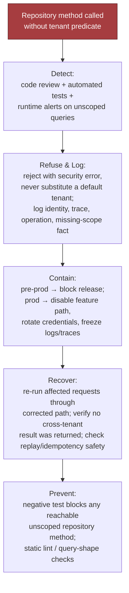
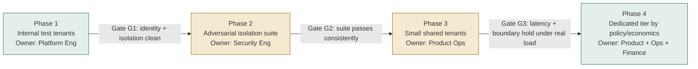

# Secure Multi-Tenant AI Platform, part 3

## 8. Route by Region and Keep Policy Central

Regional controls reshape routing, storage, backup and logging, so settle early whether they are hard requirements or customer exceptions. The balanced answer is central policy definition with regional enforcement, unless residency or availability forces local control. A central control plane keeps policy consistent but can become a latency and residency problem; a fully regional one improves locality but multiplies duplication, rollout complexity and policy-drift risk.

The regional scheduler places work in an allowed region and tier as a control-plane decision. The same rule covers artifacts. Logs, backups and inference traces follow the tenant's residency policy, not the platform's convenience. Retention is part of the data model, attached to the tenant record or a versioned policy it references, so no service rediscovers policy from brittle configuration.

A control-plane outage is not always a full outage, but it is always serious. Policy distribution, deployment coordination and config updates may be impaired while requests still flow. Monitor control-plane health separately from the data plane and alert when the local authority source stops refreshing. If local auth, cached policy and preloaded keys are sufficient, keep serving verified-safe operations only. Otherwise fail closed for sensitive changes, queue non-critical writes, or reroute. Never silently continue with stale control state for irreversible actions. Recover by restoring the regional controller, reconciling queued changes and confirming sync with the authoritative policy source. Prevent by designing for stale-control tolerance, caching minimum policy state locally, rehearsing regional failover, and keeping distinct emergency access paths.

Export and delete across regions deserve their own answer. A tenant inventory and a deletion workflow span every store: relational rows, blobs, logs, embeddings, caches, queues and derived artifacts. Export assembles a complete package with clear ownership and time bounds. Deletion is a coordinated job with verification, retention exceptions and an auditable completion record. Backup deletion semantics follow retention windows and restore controls, not ad hoc surgical erasure.

## 9. Fail Closed on Security, Degrade on Capacity

Memorise the pattern, not the table. Security defects fail closed. Capacity pressure degrades. Metadata leaks quarantine and escalate to a human. Control-plane loss depends on whether local enforcement still holds.

| Scenario | Recommended behaviour | Why |
|---|---|---|
| Missing tenant predicate | Fail closed immediately | An unscoped read/write is a security defect, not a transient error |
| Cache key omits tenant id | Fail closed and invalidate affected entries | A shared cache hit can leak data across tenants even when the database is safe |
| Shared queue leaks payload metadata | Fail closed, quarantine the queue, and rotate credentials if needed | Message metadata can reveal customer identity or workflow state |
| One tenant exhausts model quota | Degrade for that tenant, not the whole platform | Shared capacity should protect neighbours and preserve fairness |
| Regional control plane outage | Queue, reroute, or degrade depending on dependency criticality | Control-plane loss should not take down data-plane operations if local enforcement still works |
| Vector index surfaces a neighbour | Fail closed on the post-retrieval tenant invariant; block the response | Usually a tenant filter missing or wrong at query time (as in section 14), or chunks ingested without a tenant tag |
| Misrouted regional traffic | Reject at the scheduler; alert; audit the route | A route sending protected data to an unauthorised region is a residency breach |

Each of the first five has a rehearsed drill in the tutorial, and they share a shape: detect, refuse and log, contain, recover, prevent. For the missing predicate, detection is code review plus automated tests plus runtime alerts on any query reaching a repository without tenant scope; it never depends on a customer ticket. Refusal is a security error, never a silently substituted default tenant, with identity, trace, operation and the missing-scope fact logged. Containment blocks the release in pre-production. In production it disables the feature path, rotates credentials and freezes logs and traces. In-flight retries keep failing closed rather than retrying into a different scope. Recovery re-runs affected requests through the corrected path and confirms idempotency keys and replay logs cannot bypass the fixed check. Prevention is a negative test that fails if any unscoped repository method is reachable, plus static query-shape lint, so the unscoped path is hard to call rather than merely undesirable.



The cache drill is the one candidates underrate. A cache bug looks harmless in isolation, because the database stays protected, but a shared cache replays the wrong tenant's object if the key misses tenant scope. Detect by instrumenting key components in metrics and traces. Contain by disabling the cache path or namespace, invalidating suspect entries and falling back to the source of truth. Recover by rebuilding from correctly scoped reads and re-checking responses served in the window. Prevent by requiring tenant id in every cache-key helper, centralising key construction, and a negative test asserting a cross-tenant lookup is a miss. If the cache holds auth-sensitive material, treat it as a security incident, not a performance bug.

Production failure behaviour is the difference between a toy and a system. Timeouts tight enough to avoid pile-ups of stale work. Retries only for transient failures, never for authorisation failures or malformed requests. Idempotency on writes, billing events and workflow triggers. Circuit breakers on dependencies returning repeated failures. Dead-letter queues that hold poison messages for inspection rather than endless reprocessing. Human escalation for policy corruption, suspected isolation failure or ambiguous tenant ownership. The honest system says what it can recover automatically and what needs a human with authority.

Say what breaks first at 10x. Noisy-neighbour risk and cache churn become dominant, so pooled-plus-quotas becomes pooled-plus-partitioning, with more dedicated pools and more explicit regional controls.

## 10. Gate the Release on an Adversarial Isolation Suite

The central promise is proven by a suite that tries to break the boundary, and a single unexplained boundary failure halts promotion. The goal is not to prove perfection but to prove the system fails safely and visibly under attack.

| Metric | Good threshold | Bad threshold | Test dataset | Owner |
|---|---:|---:|---|---|
| Cross-tenant incident count | Zero confirmed | Any incident halts promotion | Incident reports and audit-log review | Security / incident commander |
| Isolation-test pass rate | Full pass | Any new boundary failure blocks release | Adversarial negative-test suite: cross-tenant object access, stale cache reads, replayed tokens, malformed filters, namespace collisions, missing predicates | Security engineering |
| Per-tenant p95 latency | Within SLO per tenant, not in aggregate | Sustained breach | Request telemetry segmented by tenant | SRE |
| Quota rejection rate | Low and explainable per tenant class | Mis-sized quotas or poor onboarding | Admission and quota logs | Platform ops + product |
| Cost per tenant | Within the band for the tenant class | Above band | Billing mapped to tenant usage | Finance + platform |
| Regional failover time | Within the agreed RTO | Recovery exceeds target | Game-day and failover drills | SRE |

Keep technical health, model quality, adoption and business outcome as separate metric layers, because blurring them loses the ability to tell an engineering problem from product fit from customer behaviour. Trace a user outcome back to component telemetry in one chain. "Document processing feels slow" becomes request arrival, quota admission, queue depth, inference duration, retrieval latency, cache hit ratio and regional routing.

The interview-sized isolation test proves one invariant at the API level, not only in the database. A secret created under one tenant is invisible to another. The other tenant does not even learn that the object exists.

```python
import pytest

class TenantSession:
    def __init__(self, tenant_id, store, next_id):
        self._tenant_id = tenant_id
        self._store = store
        self._next_id = next_id

    async def create_secret(self, value):
        secret_id = str(self._next_id())
        self._store[(self._tenant_id, secret_id)] = value
        return type("Secret", (), {"id": secret_id})()

    async def get_secret(self, secret_id):
        if (self._tenant_id, secret_id) not in self._store:
            return type("Response", (), {"status_code": 404})()
        return type("Response", (), {"status_code": 200, "value": self._store[(self._tenant_id, secret_id)]})()

class FakeApi:
    def __init__(self):
        self._store = {}
        self._next_id_value = 1

    def _next_id(self):
        current = self._next_id_value
        self._next_id_value += 1
        return current

    def as_tenant(self, tenant_id):
        if not tenant_id:
            raise ValueError("tenant context required")
        return TenantSession(tenant_id, self._store, self._next_id)

@pytest.mark.asyncio
async def test_cross_tenant_ids_are_invisible():
    api = FakeApi()
    created = await api.as_tenant("alpha").create_secret("A")
    response = await api.as_tenant("beta").get_secret(created.id)
    assert response.status_code == 404
```

It deliberately omits authentication middleware, request signing, database transactions, observability hooks and retry wrappers, and says so. Before launch, hold the evidence that the controls exist and are exercised:

- access logs showing tenant-derived context
- the negative isolation tests
- role and permission reviews
- queue and cache namespace checks
- key-rotation procedures
- incident runbooks for suspected boundary failures

The operational question is not "do we have security?" It is "can we prove the system fails in the right direction, and recover without widening the blast radius?" Every external dependency and irreversible action needs an explicit failure and recovery policy. The absence of a policy is itself a policy, and it usually fails open.

The data model carries four ownership boundaries rather than four tables. Tenant(id, region, tier, key_ref, retention_policy) is data ownership. Membership(user_id, tenant_id, role, status) is authority. UsageLedger(tenant_id, period, tokens, requests, cost) is commercial control. AuditEvent(tenant_id, actor, action, resource, decision) is defensibility. Every write boundary needs an idempotency key, which stops duplicate writes from retries, and optimistic concurrency, which stops lost updates from concurrent writers. Model output never flows raw into the system; it is parsed into a typed schema and policy-checked before persistence.

## 11. Roll Out Internal Tenants First and the Dedicated Tier Last

The platform is done only when users adopt it, the workflow improves and the operating team can support it. A staged rollout with measurable gates, named owners and rollback paths is the answer to "when can this be trusted in production?"

| Phase | Owner | Exit criteria | Go / no-go |
|---|---|---|---|
| 1. Onboard internal test tenants | Platform engineering; security and product as reviewers | Authentication, tenant resolution, row-level filtering, storage partitioning and logging all work; every access path carries tenant context end to end; every admin action is attributable | Stop if identity propagation is inconsistent, tenant data is queryable from the wrong context, or support cannot trace a request |
| 2. Run the adversarial isolation suite | Security engineering; platform engineering fixes | Repeatable negative tests: cross-tenant object access, stale cache reads, replayed tokens, malformed filters, namespace collisions, missing predicates | The suite passes consistently before any external tenant; one unexplained boundary failure halts promotion |
| 3. Introduce small shared tenants | Product operations; support and reliability on call | Low-risk customers in the shared tier under conservative quotas and strict monitoring | Continue only if boundaries hold, latency stays in target, and operators explain every incident without guessing |
| 4. Offer a dedicated tier by policy and economics | Product management + platform operations; finance and security input | A dedicated option for customers whose regulatory, residency, workload or risk profile makes shared tenancy a poor fit, as a deliberate policy choice | The team can explain when a customer belongs in shared versus dedicated, and the cost and support implications of each |



In weeks: 0-1 name stakeholders, the dangerous failure and explicit exclusions. 1-2 internal tenants. 2-3 the isolation suite. 3-4 hold promotion until it passes. 5 low-risk shared tenants under conservative quotas. 6-8 validate boundaries, latency and operator understanding. After the pilot, the dedicated tier on measurable thresholds rather than for whoever asks loudest.

Rollout is more than code promotion. A canary takes a tiny slice of low-risk traffic first. Rollback returns to the prior configuration with no data loss and no cross-tenant contamination. Migration moves tenant metadata, quotas and routing with validation at each step. Training makes support and customer-facing teams fluent in the guarantees and non-guarantees. Documentation covers setup, limits, escalation paths and what a quota error means. Ownership is named: platform engineering owns runtime, security owns boundary validation, support owns first-response triage, product owns tiering policy, SRE owns service health and failover rehearsals.

Keep four kinds of thing apart, because anything re-implemented per customer is the symptom of a platform becoming a bundle of one-off projects. Configuration is what varies per customer without code: quotas, region preferences, feature flags, retention, routing policy. Adapters absorb external variance: identity providers, storage systems, logging sinks, approval workflows. Shared services are expensive to rebuild and central to leverage: tenant registry, policy enforcement, metering, audit, failover orchestration. Core product defines the platform: isolation, admission, data access boundaries, observability primitives, internal APIs.

| Risk | Owner | Mitigation | Trigger |
|---|---|---|---|
| Missing tenant predicate | Platform engineering | Negative tests, code review checklists | Any request reaching a non-tenant-scoped path |
| Cache bleed | SRE + platform engineering | Tenant-keyed cache design, namespace validation | Any cache hit crossing tenant boundaries |
| Misrouted regional traffic | Infra + security | Region-aware routing rules, deployment checks | A route sending protected data to an unauthorised region |

Name the failure conditions explicitly. Cost reduced but users do not adopt: not succeeded. Users adopt but support cannot operate it: not succeeded. Fast but unable to prove tenant boundaries: not succeeded.
