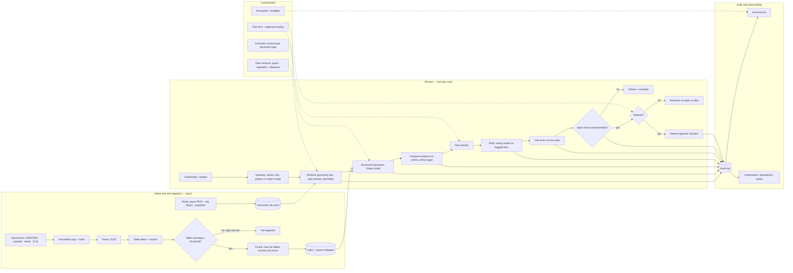

# Document Review Copilot with a Policy Check, part 2

## 3. Map the Three Personas Onto One Spine

The spine is the same in every persona. The interviewer will pick one. Learn the spine once and swap the nouns.

| | Prior authorisation | Financial compliance | Legal contract |
|---|---|---|---|
| Document in | Patient encounter, clinical notes, labs, imaging, prior therapies | Advisor email, chat, marketing draft, client or regulatory document | Uploaded contract |
| Governing rule | Payer policy, versioned by payer, plan, procedure, diagnosis, date of service | Regulatory rule library and internal policy, by jurisdiction and product | Negotiation playbook and clause library, by clause type |
| Extraction | Medical-necessity evidence mapped to payer requirements | Policy gaps, promissory language, disclosure gaps | Clauses by type, normalised text |
| Comparison | Evidence versus criteria; missing documents; conflicting notes | Text versus obligation; severity | Clause versus preferred position; deviation |
| Output | Draft packet with citations, denial-risk explanation | Findings with rule citations, risk class, remediation notes | Flagged deviations, risk rationale, proposed fallback language |
| Human | Clinician approves before submission | Analyst then supervisor or legal on high risk | Counsel on material changes |
| Records | Patient, Encounter, PayerPolicy, AuthRequest, EvidenceLink, AuditLog | Document, Rule, Finding, ReviewerDecision, AuditLog | Contract, Clause, PlaybookRule, RiskFinding, ReviewAction |
| Sources | EHR via FHIR, payer portals, document store, claims system, IdP, audit logs | DMS, policy repository, regulatory rule library, GRC platform, case management, IdP | CLM, contract repository, clause library, playbook, DMS, e-signature, IdP |
| Persona-specific red-team | PHI leakage, invented necessity, stale payer rule, wrong patient, "just submit it anyway" | Missed violation, outdated regulation, hallucinated rule, over-automation of legal judgement | Unauthorised legal advice, privilege leakage, wrong jurisdiction, hallucinated clause, risky fallback accepted without a lawyer |

The claims-processing prompt from the OpenAI-style practice set is the same spine again. Its discussion list is classification, OCR and structured extraction, policy lookup, missing-information detection, fraud or anomaly signals, human review thresholds, explainability, regulatory constraints, PII protection, evaluation against human decisions, and gradual rollout by claim type. Its one instruction is to avoid promising full automation. Start with extraction, triage, summarisation and missing-information detection before any adjudication.

Map each source with its permission model before choosing an embedding model. The connector translates each permission model into one internal representation.

| Data source | Format | Owner | Freshness | Permission model | Risk |
|---|---|---|---|---|---|
| EHR via FHIR | Structured codes, notes, labs, imaging reports | Clinical informatics | Minutes if the EHR supports FHIR Subscriptions; otherwise polled | Patient-level and role-based; break-the-glass audited | Wrong patient; PHI over-exposure; "rule out" read as confirmed |
| Payer policy portals and PDFs | Semi-structured PDFs, portal pages | Payer relations | Days to weeks; versioned by effective date | Public or contract-restricted | Outdated rule version; tables dropped by the parser; injection in an uploaded PDF |
| Regulatory rule library and GRC | Structured obligations, policy documents | Compliance | Weeks; versioned | Business-unit and jurisdiction | Superseded obligation; wrong jurisdiction |
| Advisor communications | Email, chat, drafts | Surveillance | Real time; immutable ingestion | Supervisory and legal hold | Injection inside reviewed messages; PII and financial data |
| CLM and contract repository | Contracts, clause library, playbook | Legal ops | Days | Matter-level and confidentiality level; privilege | Privilege leakage; wrong jurisdiction; stale playbook |
| Case, claims and e-signature systems | Structured records | Operations | Minutes | Queue and role membership | Write-back without approval |

## 4. Draw the Architecture End to End

One diagram carries the design. This page constructed it from the three answer keys and the vendor case. The organising split is control plane against data plane. Rule versions, schemas, risk thresholds, credentials and evaluation gates live in the control plane. Every document, extraction, comparison, draft and approval lives in the data plane. A control-plane change is a release. A data-plane call is a case.

```
 ╔══════════════════════════════ CONTROL PLANE (changes are releases) ═══════════════════════════════╗
 ║  rule versions (payer policy · regulation · playbook) · extraction schema per document type          ║
 ║  risk tiers + approval routing rules · ACL mapping · credentials · prompt/model/parser versions       ║
 ║  eval gates (extraction audit · citation span · escalation · PHI leak = 0) · budgets                  ║
 ╚═════════════════════════════════════════╤═════════════════════════════════════════════════════════╝
                                           │ configures every box below
 ╔══════════════════════════════ DATA PLANE (calls are cases) ═══════════════════════════════════════╗
 ║                                                                                                     ║
 ║  INTAKE + RULE INGESTION — asynchronous                                                             ║
 ║   documents (EHR/FHIR · uploads · email · CLM)     rules (payer PDFs · reg library · playbook)       ║
 ║        │ immutable copy + content hash                    │ versioned by effective date             ║
 ║        v                                                  v                                         ║
 ║   PARSE / OCR ─> TABLE DETECT + EXTRACT ─> layout QA gate ─> chunk (rows for tables) ─> index      ║
 ║        │ table coverage < threshold on a high-risk doc = FAIL ingestion, not warn                    ║
 ║                                                                                                     ║
 ║  REVIEW — synchronous per case, ordered by risk                                                     ║
 ║   user ─> gateway (authN, role, patient/matter scope) ─> RULE RETRIEVE (right version, permitted)   ║
 ║        ─> STRUCTURED EXTRACT (schema, cheap model) ─> COMPARE (evidence ↔ criteria, gap detect)     ║
 ║        ─> RISK CLASSIFY (tier) ─> DRAFT (strong model only on flagged tiers) ─> CITE (exact span)   ║
 ║        ─> VERIFY (span match + permission) ─> ROUTE ─┬─ low tier: reviewer accepts/edits            ║
 ║                                                      └─ material: named approver decides            ║
 ║                                              refuse + escalate when evidence missing/conflicting    ║
 ║                                                                                                     ║
 ║  AUDIT + OBSERVABILITY — every stage writes                                                         ║
 ║   audit log (rule IDs + versions · evidence IDs · draft · edits · approval)                          ║
 ║   trace store ─> eval service (golden cases · red-team · shadow) ─> dashboards (operational | safety)║
 ╚═════════════════════════════════════════════════════════════════════════════════════════════════════╝
```

The same flow as a rendered diagram, for viewers that draw Mermaid:



Read the components in dependency order, which is the order they exist and the order they fail.

| Component | Responsibility | Fails how |
|---|---|---|
| Gateway and identity | Authenticate via SSO, load role and tenant, scope to the patient or matter, classify the request as read, draft or action | Closed: no scope, no case |
| Rule ingestion and version store | Ingest payer policies, regulations, playbooks; version by effective and expiry date | Degrades: an unversioned rule is excluded, not guessed |
| Parser, table extractor, layout QA | Convert PDFs to text and tables; emit coverage and confidence; gate high-risk documents | Closed: low table coverage on a high-risk document fails ingestion |
| Extraction service | Map document content into the schema for its type with a cheap model | Degrades: low-confidence fields flagged as missing, never filled |
| Rule retriever | Fetch the governing rule at the right version, under the user's permissions | Closed: no permitted rule, no draft |
| Comparison and gap detector | Evidence against criteria; missing, stale, conflicting flagged | Degrades: gaps listed, draft marked incomplete |
| Risk classifier and router | Assign a tier; decide reviewer-accept versus named-approver | Closed: unknown tier routes up, never down |
| Drafting service | Strong model only on flagged tiers; never writes decision language | Refuses when evidence is missing or conflicting |
| Citation builder and verifier | Cite the exact supporting span; reject any citation that is not the span used or not permitted | Closed on span mismatch |
| Approval workflow | Named approver edits, approves, rejects; nothing external leaves without it | Closed: no approver, no submission |
| Audit, trace, eval, dashboards | Rule IDs and versions, evidence IDs, draft, edits, approval; golden and red-team evals; operational and safety metrics apart | Degrades: case still served, gap logged |

With the diagram up, point at three boundaries, each a line on the board. The cheap-to-expensive boundary sits between EXTRACT and DRAFT. Everything to the left runs a small model on every page. Everything to the right runs the strong model only on what was flagged. The trust boundary sits at VERIFY: no citation leaves that was not the span used and permitted. The decision boundary sits at ROUTE: to its left the system drafts and explains, to its right a named human decides.

## 5. Make the Extraction Schema the Seam

The schema turns the copilot from a chatbot into a workflow. Structured extraction with a typed schema per document type is the one component every downstream step depends on. Comparison, risk tiering and citation all key on fields, not on prose. A model cannot compare evidence to criteria it has not first named.

For prior authorisation the fields are payer, plan, procedure, diagnosis codes, date of service, prior therapies, labs, imaging and the clinical facts that map to each payer requirement. For compliance they are document type, jurisdiction, business unit, the obligation that applies, and the evidence span that meets or breaks it. For contracts they are clause type, the normalised clause text, the counterparty, the jurisdiction and the confidentiality level. Every record in the answer keys is a row in one of those schemas. The EvidenceLink, Finding and RiskFinding records are the join between an extracted field and the rule it was compared against, with a confidence.

Two rules follow. In this design, extraction runs on the cheap model and on every page, because it is a narrow, schema-bound task whose output can be checked. A low-confidence field is flagged as missing rather than filled. A confident wrong field poisons every step after it. The vendor case's step-therapy test names the failure. A payer rule requires step therapy and the EHR has no record of it. The right output is a gap, not an invented history.

## 6. Refuse to Index What the Parser Dropped

A model cannot reason over data that never reached the index. In table-heavy policy documents, data goes missing silently. A plain text-extraction PDF loader usually flattens a table into disconnected fragments. The header row and the data rows land in different chunks with no schema linking them. The parser incident in section 14 is this failure: 17 tables detected, 9 extracted, pages 31 to 33 missing, and an escalation-threshold matrix never indexed.

The chunking reference gives the rule. For PDFs, validate extraction order before trusting chunk boundaries. Keep page-number metadata as the only anchor back to the source. Extract tables separately with a table-mode parser rather than as prose. For tables, chunk by row or row group and never split a row. Use zero overlap, because rows are independent records. Then gate ingestion on what the parser reports: `extraction_coverage`, `table_count_detected`, `table_count_extracted` and `layout_confidence`. Fail a high-risk policy document when table coverage falls below the agreed threshold instead of logging a warning. Classify documents as policy-with-tables when they are. The incident's gate only warned because the document had been labelled plain policy text.

Store page-level extraction coverage in the retrieval metadata. A query that lands on a section with ingestion warnings then carries a warning to the reviewer. Re-run the offline evaluation after any parser or chunking change. Chunking is a retrieval-model change, not a set-once parameter.

## 7. Cite the Span That Supported the Claim, Then Verify It

Answer correctness and citation correctness are separate dimensions. In a regulated workflow the second one is what the reviewer relies on. A correct answer with a wrong citation is more dangerous than a refusal, because the reviewer trusts the citation and repeats it in a negotiation or a submission.

The citation builder quotes the exact span the drafting step used, rather than the most concise or highest-ranked chunk nearby. Before anything leaves, the verifier checks two things: the cited span contains the claim, and the user may see it. A span mismatch fails closed. The citation incident in section 14 shows the alternative. A changed citation generator preferred concise citations, the verifier over-weighted answer groundedness, and the draft cited the data-processing addendum for a termination clause.

Playbook comparison in the contract persona is the same mechanism pointed at a rule. The copilot compares each extracted clause against the playbook's preferred position for its type and flags a deviation with a rationale. It proposes the playbook's fallback language rather than inventing its own. Material deviations route to counsel. A fallback is never accepted without a lawyer's approval. In the compliance persona the rule citation is the obligation text by jurisdiction and product. The finding carries the evidence span and a severity.

## 8. Handle Sensitive Data as a Boundary, Not a Setting

PHI, privileged material and financial data change where content may travel, as well as who may read it. Minimise what enters the prompt to the fields the task needs. Redact unnecessary PHI from logs. Store policy and evidence IDs rather than raw content with every generated claim. Keep patient-level and matter-level access restrictions in retrieval, never in the prompt. Break-the-glass access, where it exists, is audited with a reason. No training on customer data unless the contract allows it. No vendor system sees raw content that the data classification forbids.

The regulated-industry prompt from the OpenAI-style practice set is a checklist for this section. Each item already has a home in the design:

- data classification and sensitive-data handling
- encryption
- access control
- tenant isolation
- retention and deletion
- audit logging
- data residency
- human oversight
- explainability
- model and prompt versioning
- incident response
- vendor and third-party risk
- governance approvals

When the business wants to skip the governance review for the MVP, narrow the scope. Use synthetic or masked data where possible. Start read-only or assistive. Define explicit approval gates, and obtain security and legal review before any production exposure.

Risk tiers decide what reaches a human. The vendor case's list is the model. Refuse unsupported claims. Flag missing evidence. Escalate to the clinician. Cite the source. Prevent unauthorised access. Never submit without approval. Anything that would read as a clinical decision, a regulatory ruling or legal advice is a tier the model does not write.
