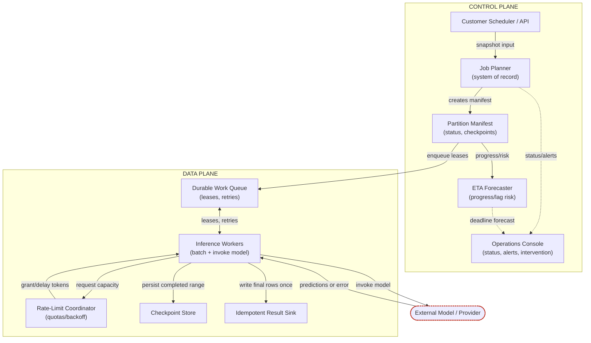
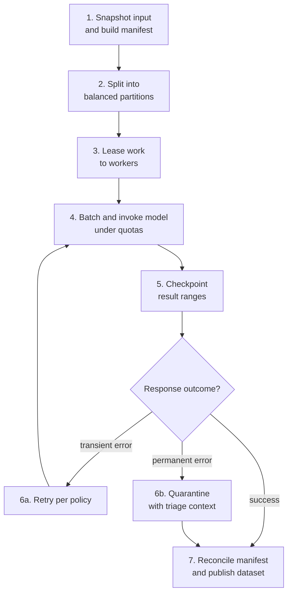
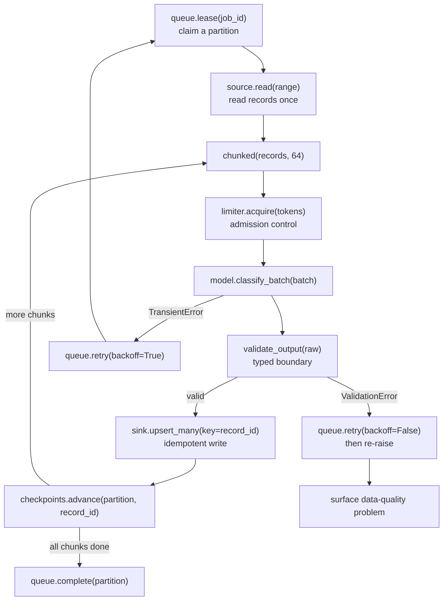

# High-Volume Batch Inference and Document Pipelines, part 2

## 4. Size From the Deadline and the Tail

The first pass is always too optimistic: a queue, a few workers and a model endpoint. That works at average load. It ignores the deadline, the retry rate and the hard last 5%.

Derive the number live rather than reciting it. With 100,000,000 records and a window of 6 × 3,600 = 21,600 seconds, the base rate is about **4,630 records/second**. That is the floor, not a design. Adding 15% headroom for retries, stragglers and reconciliation gives a planning rate of about **5,320 records/second**.

| Scenario | Records | Window | Base rate | With 15% headroom |
|---|---|---|---|---|
| Current batch | 100M | 6 hours | ~4,630 rps | ~5,320 rps |
| 10x growth | 1B | 6 hours | ~46,300 rps | ~53,200 rps |

The 10x row is not tomorrow's expectation. It tests whether the design is fragile or absurdly overbuilt. Keep headroom and growth apart: headroom covers noise inside one batch, while growth covers next quarter's larger batch. State average, peak, growth and headroom rather than one point estimate.

Tokens turn the record rate into a factory. At 250 input plus 20 output tokens, each record costs 270 tokens before retries. I'd let that token figure, not the record count, drive partitioning and component choice.

Say the uncertainty out loud rather than hiding it:

> *"At 100 million records, I would plan for about 4,630 records per second before retries. If the average prompt is smaller than expected, model throughput becomes easier; if the tail of large records is heavier, we need more headroom or more aggressive partitioning. I would size the system around the tail, not the mean."*

The chapter treats cost only qualitatively. The V2 tutorial's author closes the gap with a live dollar formula, which is supplementary perspective and not chapter content. At 270 tokens a record and ~5,320 rps, the fleet sustains roughly 1.43M tokens/second. Across the window that is about 27B tokens for 100M records (100M × 270). Apply the per-million-token price for a cost per run, then divide by 100 for cost per million records. Retries of calls that actually ran re-spend the full 270 tokens each; a call rejected up front, such as a 429, generally costs nothing. At a 5% retry rate that is roughly 5% more spend. The 15% headroom is itself a cost line, and stragglers burn compute past the window. So the cost ceiling belongs inside the rate-limit coordinator's backoff behaviour, not in a separate finance conversation.

## 5. Draw the Architecture End to End

The organising rule is that each layer owns a different kind of truth. The planner owns what "this batch" means. The queue owns who is working on what. The sink owns what has been published. Planner, manifest, forecaster and console are control-plane concerns that coordinate the run. Workers and sink are data-plane concerns that move records through the model into durable output. They scale and change at different rates, which is why they are drawn apart.

The system with its planes and trust boundaries *(own construction)*:

```
 ╔══════════════════════════ CONTROL PLANE (coordinates the run) ══════════════════════════╗
 ║  customer scheduler / API ─> JOB PLANNER ─> PARTITION MANIFEST ─> ETA FORECASTER          ║
 ║  (idempotency key)          freeze snapshot  ranges, attempts,     progress vs deadline   ║
 ║                             model_version,   checkpoints              │                   ║
 ║                             deadline, policy     │                    v                   ║
 ║                                                  │            OPERATIONS CONSOLE          ║
 ║                                                  │            status · pause · replay ·   ║
 ║                                                  │            contingency mode + owner    ║
 ╚══════════════════════════════════════════════════╪════════════════════════════════════════╝
            TRUST BOUNDARY 1: snapshot frozen ───────┤ enqueue leases (opaque ids only)
 ╔══════════════════════════ DATA PLANE (moves records) ═════════╪═════════════════════════╗
 ║                                                               v                         ║
 ║   DURABLE WORK QUEUE ── lease ──> INFERENCE WORKERS (autoscaled) ── read range once     ║
 ║   leases, visibility timeout      │   chunk into batches (e.g. 64)                        ║
 ║   retries, dead letter            │                                                      ║
 ║        ^                          v                                                      ║
 ║        │               RATE-LIMIT COORDINATOR  grant / delay tokens + concurrency        ║
 ║        │               (global + per tenant; backpressure lives here)                    ║
 ║        │                          │                                                      ║
 ║        │     TRUST BOUNDARY 2 ────┼──> EXTERNAL MODEL / PROVIDER (timeouts, 429s, junk)   ║
 ║        │                          v                                                      ║
 ║        │               validate_output()  typed boundary; bad output -> quarantine       ║
 ║        │                          │                                                      ║
 ║        │     TRUST BOUNDARY 3 ────┼──> IDEMPOTENT RESULT SINK                             ║
 ║        │                          │    upsert on job_id + record_id + model_version      ║
 ║        │                          v                                                      ║
 ║        └── ack / release ── CHECKPOINT STORE  advances only after the sink write succeeds ║
 ╚═════════════════════════════════════════════════════════════════════════════════════════╝
```

The source's control-plane and data-plane diagram:



The components, with the failure behaviour of each *(the "Fails how" column is own construction)*:

| # | Component | Responsibility | State owned | Fails how |
|---|---|---|---|---|
| 01 | Job planner | Accepts the nightly run, freezes the input snapshot, and creates the batch plan | Run metadata, snapshot pointer, deadlines | Closed: a broken snapshot hash or unknown model version stops the run |
| 02 | Partition manifest | Lists balanced work units and their status | Partition IDs, ranges, attempts, checkpoints | Closed: a corrupted manifest is never guessed around |
| 03 | Durable work queue | Hands out partitions to workers with leases | Lease state, visibility timeout, retry eligibility | Degrades: an expired lease is reissued; dead-letter after too many attempts |
| 04 | Rate-limit coordinator | Shapes outbound calls to stay under quota | Token budget, concurrency budget | Degrades: slows leases rather than letting retries stampede |
| 05 | Autoscaled inference workers | Batch records and call the model | Ephemeral execution state | Degrades: a crash loses no committed work; the lease expires |
| 06 | Checkpoint store | Persists completed ranges and partial progress | Last successful offset, result hashes | Closed: a corrupted checkpoint fails the partition, never skips it |
| 07 | Idempotent result sink | Writes final classifications once per record | Final output by record key | Degrades: bounded buffer and backpressure, then circuit-break |
| 08 | ETA forecaster | Estimates completion and lag risk | Progress rate, remaining work, backlog | Degrades: a missing forecast is itself an alert |
| 09 | Operations console | Shows run status, warnings, and intervention controls | Human-facing incident and rollout state | Degrades: runbook and pager still work without it |

Walk the happy path in seven steps. First, snapshot the input and build the manifest, recording dataset version, deadline and run policy. Second, split into partitions balanced by processing cost. Tenant, payload-size band or historical latency beats record count alone. Third, lease work to workers through the durable queue, so the planner never waits on any worker. Fourth, batch records and ask the rate-limit coordinator for capacity before calling the model. Fifth, checkpoint the completed range and write rows to the idempotent sink. Sixth, retry transient errors per policy and quarantine permanent ones with triage context. Seventh, reconcile the manifest and publish the completed dataset.



Three trust boundaries carry the security story. After the planner freezes the snapshot, the run cannot drift if upstream data changes. The model call is external, so the worker assumes timeouts, throttling, malformed responses and partial failures. Publication must be idempotent, so replays cannot create duplicate classifications.

The MVP is planner, manifest, queue, worker fleet, checkpointing, idempotent sink and a basic ETA panel. Smarter rebalancing, historical throughput prediction and tenant-aware scheduling come later. The common mistake is treating those later items as the architecture itself. Draw the flow, but speak in obligations: every component protects deadline, cost, replayability or operator confidence.

## 6. Make Duplicate Work Harmless

A crashed worker will redo some work. The design choice is whether that is dangerous or harmless. A sink cannot duplicate a row it upserts by the same key.

Three records carry the durable state.

| Record | Key | Fields | Lifecycle |
|---|---|---|---|
| BatchJob | `id` | `input_snapshot`, `deadline`, `model`, `state` | `queued`, `running`, `paused`, `completed`, `failed`, `replaying` |
| Partition | `job_id + partition_id` | `range`, `lease`, `attempts`, `completed_count`, checkpoint | `available` → `leased` → `completed`; `retryable` on transient failure; `abandoned`/`dead_lettered` after too many attempts |
| InferenceResult | `job_id + record_id + model_version` | `output`, `status`, confidence | `pending` → `written` → `validated`; `failed` if rejected or unpersistable |

The `input_snapshot` is an immutable pointer to the exact dataset version. It is the ownership boundary that makes replay possible. The result is keyed by business identity plus model version, never by worker or attempt. Be ready for "why not just `record_id`?" Without the model version, a rerun under a new model silently overwrites yesterday's answer and replay loses its meaning.

The API surface stays small.

| Endpoint | Contract |
|---|---|
| `POST /v1/batch-jobs` | Authenticated; validates manifest and model reference. Idempotency key, so a client retry after a timeout does not create two jobs. Same key with a different payload is a conflict, not a merge |
| `GET /v1/batch-jobs/{id}` | Read model: progress, partition counts, failure counts, deadline, model version, state, compact error summary. Unknown id and no access both return not-found, so a caller cannot tell whether a job it may not see exists |
| `POST /v1/batch-jobs/{id}/pause` | Stops new leases and preserves progress. Optimistic concurrency via ETag. Already terminal is a state conflict, not a pretend success. Retried pauses are harmless |
| `POST /v1/batch-jobs/{id}/replay-failures` | Privileged, because replay reconsumes capacity. Selector for all failed, a named subset, or after a checkpoint. Reused key returns the same replay outcome, never a second attempt |

Idempotency applies at every write boundary, not only the sink. A duplicate create must not create a second job. A duplicate lease renewal must not invalidate the original lease. A duplicate result write overwrites the same logical record. A duplicate pause or replay request is harmless. Versioning matters for the same reason: when the model, schema or validation policy changes, old and new results must stay distinguishable.

The smallest code path that proves the design is one worker loop. It claims a lease and reads the range once. It chunks records into batches of 64 and acquires tokens from the limiter before the call, because admission control belongs before the quota breach. It then validates output at a typed boundary and upserts by `record_id`. The checkpoint advances only after the sink write succeeds, which prevents false progress. The partition completes only after every batch succeeds. A `TransientError` retries with backoff. A `ValidationError` retries once without backoff and then surfaces as a data-quality problem.



Two tests prove it. The contract test repeats `POST /v1/batch-jobs` with the same key and confirms one job and one id. The failure-injection test crashes the worker after `upsert_many()` but before `complete()`. On retry the sink still holds one logical result per `record_id`. The source's assertion is that distinct `record_id` count equals row count.

The sketch deliberately omits multi-worker contention, logging, metrics, tracing, cancellation, authentication, throttling and dead-letter routing. That is acceptable only when each omission can be named and placed.

## 7. Scope Workers to Immutable Snapshots

The most important security control is not on the model. It is that every worker processes a versioned snapshot that cannot change beneath it. A retry against a mutable table cannot prove what it retried.

Snapshot immutability does three jobs at once. It removes ambiguity during retries, it makes evidence replayable after an incident, and it limits blast radius. A malformed or malicious tenant dataset touches only that tenant's snapshot, not a global table.

Keep raw payloads out of queue metadata. Messages carry only opaque identifiers, snapshot versions, partition keys and lease information. An exported or replayed queue then discloses nothing. Encrypt result and checkpoint stores and restrict them to least privilege. Checkpoint state reveals business data shape and partial outputs, so treat it as sensitive.

Record model version, code version, prompt or feature schema version and deployment identity for every run. That is how the team proves which artifact produced which result when a customer asks why today's classification differs from yesterday's.

The chapter names no external framework, and the V2 author treats that as a gap. Their supplementary answer: ask which framework applies before claiming compliance. With personal data, purpose limitation and data minimisation apply to snapshot and result retention. In healthcare, HIPAA's audit-control rule applies to the audit trail; in finance, rules such as SEC 17a-4 or SOX do. SOC 2 is a voluntary audit report that customers in any industry may ask for. They also propose a per-run "processing basis" field on `BatchJob`. The controls are necessary but not sufficient without a named framework to test them against.
