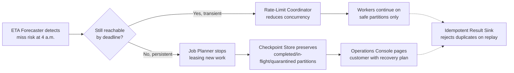

# High-Volume Batch Inference and Document Pipelines, part 3

## 8. Decide the Failure Policy Before the Run

A failure policy goes beyond "we retry". It answers what to retry, how long, against which snapshot, with what evidence, and who is paged. Every external dependency and every irreversible action needs one.

| Failure policy | Example triggers |
|---|---|
| Fail closed | Broken snapshot hash, unauthorised worker, corrupted checkpoint, unknown model version |
| Degrade | Transient downstream throttling, temporary feature store slowness, short-lived queue depth spikes |
| Queue | Quota reduction, noncritical partition backlog, scheduled maintenance window |
| Human intervention | 45% complete at 4 a.m. with no plausible path to deadline, repeated sink throttling, repeated crash loop, or any case where delayed output is worse than no output |

Memorise one trigger per row. An interviewer who invents a novel failure wants it classified into this table on the spot.

The five drills, each as detection, containment, recovery and prevention:

| Drill | Detect | Contain | Recover | Prevent |
|---|---|---|---|---|
| 1. The 4 a.m. incident | Progress metrics, partition completion, deadline projection, not the pager at 5:59 | Freeze risky retries, preserve the checkpoint, snapshot evidence: lease holder, active partitions, error budget, queue depth, sink health, quota state | Raise concurrency within safe limits if reachable; otherwise degraded mode | Tighter scheduling assumptions, earlier canaries, a forecast visible long before the final hour |
| 2. Provider quota reduction | Spike in rate-limit responses, drop in successful calls per minute | Immediate backoff and a circuit breaker | Rebalance across remaining capacity, smaller batches, defer low-priority partitions | Quota-aware scheduling, preflight capacity checks, a runbook naming which tenant classes pause first |
| 3. Hot partition, stragglers | Partition duration histograms, worker idle time | Split the hot partition or reassign workers if the snapshot model allows | Redistribute load; cap retries per shard | Partition keys with better cardinality; detect "elephant" tenants before the run |
| 4. Worker crash after the model call | Lease expiry | Nothing is marked complete until every row is durable | Resume from the immutable snapshot; overwrite identical results or skip finalised rows | Deterministic record keys; complete only after all rows are written |
| 5. Result sink throttles | Sink latency, queue age | Bounded retries with jitter, then circuit-break the sink and slow intake upstream | Past the retry budget, move partitions to a dead-letter path or durable retry queue and page a human | Escalation policy in the runbook before launch |

Across all five, never push harder against a failing dependency. Slow the arrival rate at the coordinator, preserve evidence before repair, and escalate when the deadline is no longer recoverable. The ownership statement to say in the room:

> *"This design contains blast radius by tenant, region, workflow, and dependency; it retries only within a bounded policy; it preserves evidence before repair; and it escalates when the deadline is no longer recoverable."*

## 9. Answer the 4 a.m. Question Before It Is Asked

The signature follow-up is that the job is 45% complete at 4 a.m. The forecaster should have flagged it already. The console should answer three questions instead of only turning red. Can we still finish by 6:00 a.m.? Which lever do we pull first? What is the blast radius if we keep going?

Find the bottleneck before choosing the lever: compute, a hot partition, provider throttling or downstream backpressure. Then choose the smallest intervention that restores schedule confidence. That means raising concurrency if there is headroom, splitting slow partitions, or switching remaining work to a fallback model. Alternatively, publish only the subset that meets the correctness and policy bar. If throttling is temporary, the coordinator reduces concurrency and keeps the run stable. If it is persistent, stop taking new leases, checkpoint everything and page the customer with a recovery plan.

The contingency modes are business decisions agreed before launch, each with a named owner. They are: continue at full accuracy until cutoff, switch to a cheaper or smaller model, or reduce low-value record classes. The other two are narrowing scope to the highest-priority segments and pausing nonessential enrichment. The product owner and operations lead agree them before the first run, not after the first miss.

Partial results are publishable only under a partial-acceptance policy the customer defined. Some workloads can publish completed partitions if each unit is independently valid and clearly labelled. Others need all-or-nothing, because downstream cannot handle mixed vintages. State which regime applies. If partial, define the exact publish gate and completeness metadata.

Two more probes arrive in this part of the round. To rebalance a hot partition, detect it early through lag, runtime histograms and queue age. Split it with a deterministic key so work stays replayable. If it is in flight, move only the unprocessed remainder and record the new ownership. To avoid paying twice after a timeout, treat the timeout as ambiguous: it may or may not have completed. Idempotency keys, durable checkpoints and write-side deduplication make the retry cheap and harmless.

## 10. Defend Four Trade-Offs With a Verdict First

State each verdict in one sentence before the justification. Slogans like "always batch bigger" cost more than missing detail.

| Trade-off | Verdict |
|---|---|
| Larger batches vs tail latency | Batch as large as needed for throughput, but small enough that a failed or slow partition can be retried without jeopardising the window. Batch size is a risk-control knob |
| Provider API vs self-hosting | Provider when time-to-value and operational simplicity dominate; self-hosting when latency control, cost predictability or data residency justify the burden |
| Dynamic repartitioning vs manifest simplicity | Start with a static manifest, which is easier to replay and audit, and explain how skew is detected and the offending slice split manually |
| Full quality vs fallback model at deadline risk | Switch remaining work to a cheaper, faster fallback only if the output is still useful and clearly marked, under a publishability policy the business owns |

The riskiest assumption is that the backlog is evenly distributed and model runtime is stable. When the interviewer challenges it, agree rather than defend.

> *"If skew is worse than expected, I would treat partition imbalance as the first-class risk, because a few hot shards can dominate the batch window. I would size the system so that we can split or retry those shards without restarting the entire job."*

## 11. Measure Deadline, Duplicates and Stragglers

"The job finished" proves little. A batch can finish and still have published duplicates, run twice the budget, or been saved by one operator at 5:50. The scorecard separates throughput, correctness and cost.

| Metric | What it proves | Calculation and source | Strong threshold | Owner |
|---|---|---|---|---|
| Completion forecast vs deadline | The run will land before 6 a.m. | Completed work / remaining work plus observed throughput | Never crosses the deadline without a contingency activated | Operations |
| Duplicate logical result count | Replay is safe and the sink truly idempotent | Comparing logical keys, not storage rows | Within the tolerated replay window | Data engineering |
| Records per second | Sustained throughput meets the required rate | Worker telemetry and sink acknowledgments | At or above the forecast needed to finish | Platform |
| Tokens per second | Explains cost and quota pressure better than records | Request logs, model client instrumentation | Does not rise faster than the representative distribution | ML platform |
| Straggler age | No single partition monopolises the fleet | Partition timestamps and duration histograms | Oldest active partition within the recovery budget | Batch platform |
| Retry rate | Failures are transient, not systemic | Retry counters and failure taxonomy | Within the normal band by failure class | On-call |
| Cost per million records | Unit economics hold under retries and stragglers | Cloud billing plus model usage logs | Inside the approved budget envelope | Finance / platform |

Build the dashboard top-down. The headline asks one question: will the batch complete by 6:00 a.m.? It shows the forecast, remaining partitions and the contingency mode. Below it sit the levers that explain the forecast: records/sec, tokens/sec, retry rate, straggler age, queue depth and sink lag. Below those sit correctness signals: duplicates, rejected inputs, checkpoint freshness and replayed partitions. A business user sees whether the run is on track. An operator sees which subsystem is slowing it. An engineer traces a retry spike to a quota cut or a bad input cohort.

Keep four layers distinct: technical health, model quality from sampled evaluation, adoption by downstream teams, and business outcome.

## 12. Roll Out Through a Load-Test Ladder

Launch is a sequence of controlled reductions in uncertainty. The customer asks "when can this be trusted in production?", a harder question than "does it work?"

| Stage | Gate | Owner |
|---|---|---|
| Week 0-1 | Agree who consumes the output, whether partial results have value, and the cost ceiling | FDE with the business sponsor |
| Week 1-2 | Benchmark the representative token distribution: short records, long records, edge cases, known skew, not a toy sample | Platform / ML infrastructure; data owner confirms representativeness |
| Week 2-3 | 1% load test: parsing, auth, model invocation, sink writes and checkpointing hold under real concurrency | Engineering, operations and business jointly |
| Week 3-4 | 10% load test: retry behaviour, throttling and downstream capacity still fit the deadline envelope. A failed 1% gate blocks it, not "a little delayed" | Same joint gate |
| Week 5 | Practise failure on purpose: crash a worker, cut quota, kill a downstream dependency, drain and restore a queue | Batch platform (crash), dependency owner (quota), on-call (incident log) |
| Week 6-8 | Confirm bounded replay, durable checkpoints and graceful degradation rather than retry-storm oscillation | Batch platform |
| After pilot | Define contingency modes with named owners before the job is ever late | Product owner and operations lead |

A wrong input distribution makes every later estimate wrong: throughput, queue pressure, quota burn and downstream lag. That is why the benchmark comes first.

Carry a risk register with owner, mitigation and trigger.

| Risk | Owner | Mitigation | Trigger |
|---|---|---|---|
| Quota shrinks unexpectedly | Dependency owner | Lower-rate contingency mode | Sustained throttling or forecast slippage |
| Duplicate logical results rise | Data engineering | Stricter idempotency checks and replay review | Duplicate count above tolerated threshold |
| Sink latency spikes | Platform ops or downstream team | Buffering and backpressure | Queue age exceeding the recovery window |
| Worker crash loop | On-call owner | Rollback or reduced concurrency | Repeated restarts in the canary slice |

The go/no-go gate is blunt. Without stable throughput, rehearsed crash recovery and an available contingency owner, do not expand. That sounds conservative until the batch misses one deadline because nobody wanted to say no.

Complete the launch plan with canarying, rollback, migration, training, support and documentation. A slice of nightly work runs the new path while the old one stays as fallback. Rollback stops new work, preserves checkpoints and resumes on the stable path. Separate reusable value from delivery work too. Thresholds, deadlines, model choice and contingency policy are configuration. Warehouse, queue and identity integrations are adapters. Retry, checkpoint and rate-limit wrappers become a common service. Partition orchestration, replay semantics and the push/degrade/stop policy engine are core product.
