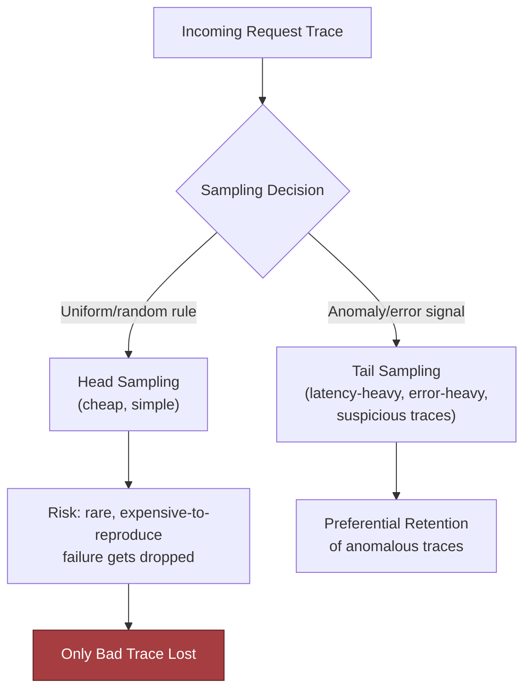
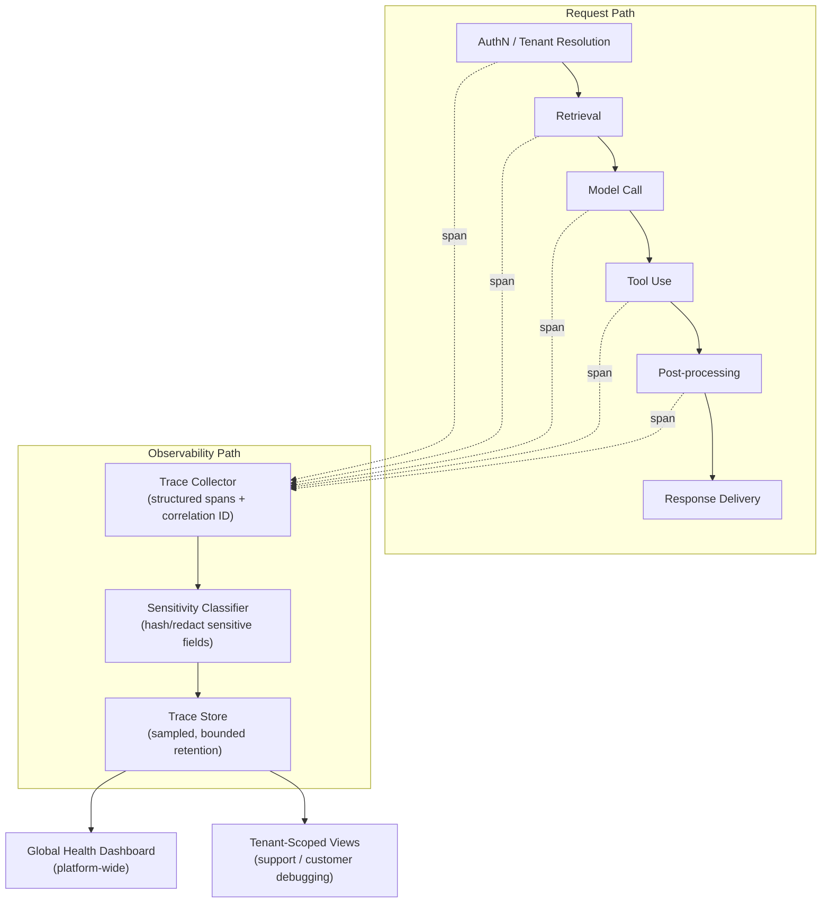

# Observability and Production Diagnosis for a Customer-Facing AI Application

*Capture enough to explain every failure without turning the telemetry into a second copy of the customer's data.*

◷ 34 min

"The AI is slow and sometimes wrong, and nobody knows why" is three problems wearing one sentence. This page consolidates the group's prompts into one read for the day before. The anchor design comes first. Two incident walk-throughs follow, then the neighbouring prompts, then a card for every cost and latency pivot the group contains.

| Case in the group | What it contributes here |
|---|---|
| #24 Observability for a Customer-Facing AI Application (anchor) | Sections 1 to 9, 13 and 14: discovery, the no-capture list, requirements, sizing, architecture, redaction, sampling, failure policy, triage, rollout, delivery |
| #87 Incident: latency spike after a reranker and model-routing change | Section 10 |
| #88 Incident: cost spike from a prompt-template and cache-key regression | Section 11 |
| #53 OpenAI Q9 Latency Regression in an LLM Application | Section 12, and card 15.3 |
| #54 OpenAI Q10 RAG System with Poor Answer Quality | Sections 9 and 12 |
| #74 Reported OpenAI prompt: diagnose high latency in an LLM inference pipeline | Section 12 |
| #44 Playbook drill: LLM costs exploded after launch | Card 15.1 |
| #104, #105, #109, #110, #113, #114, #115 §15 scenarios 1, 2, 6, 7, 10, 11, 12 | Cards 15.2 to 15.8 |
| #119 Rate limits throttling at peak, #121 Users abandon mid-stream | Cards 15.9 and 15.10 |

Sections and tables marked *(own construction)* were built for this page from the sources' arguments and are not in the sources verbatim. The sizing numbers in section 4 come from the V2 tutorial's "My Perspective on the Gaps" note, which is supplementary and not chapter content.

---

## 1. Split "Slow and Sometimes Wrong" Into Three Problems

The customer is not asking for logging. The customer is asking to connect a user-visible failure to a technical cause, fast, safely, and without drowning operators in noise. A vague complaint cannot be instrumented, so the first job is to make it measurable.

Good discovery separates three problems the complaint compresses. Latency asks whether the request is slow, and where in the pipeline. Correctness asks whether the answer is wrong, and whether the fault is upstream in retrieval or downstream in the model or a tool. Diagnosability asks whether support and engineering can explain a failure without exposing sensitive content.

Each stakeholder wants a different signal. Support wants to triage a complaint without waiting on engineering. Engineering wants to know whether the fault is retrieval, the model or a tool integration. Security wants assurance that telemetry does not become a new exposure surface. The executive sponsor wants proof that quality improves release over release, not just green dashboards.

| Question | Why it changes the design |
|---|---|
| What counts as slow: which percentile, on which path, for which workflow? | Sets the SLO the whole trace model is built to explain |
| What counts as wrong: incorrect, empty, hallucinated, or a surfaced tool failure? | Decides which outcome tags every request carries |
| Which users and tenants are most affected? | Decides where instrumentation starts |
| What may be captured by default, and what is contractually off limits? | Writes the no-capture list before anything else |
| Who must diagnose a failure: support alone, or engineering every time? | Decides whether a trace-linked support workflow is a requirement |
| What telemetry overhead is acceptable? | Makes instrumentation a budgeted constraint |
| What retention window applies, and who may read traces under which role? | Sets the store's retention and the access gateway |
| What must the sponsor see to believe quality is improving? | Decides the top panel of the dashboard |

Open the round with one sentence: connect user-visible failures to technical causes without violating privacy or drowning operators in telemetry. Then ask the first two questions, state assumptions aloud, and invite redirection.

## 2. Decide What Not to Collect First

The unusual first design decision is the no-capture list. Full capture maximises forensic power, but it raises privacy exposure, access-control burden and storage cost at once. Data never collected cannot leak, cannot explode a metrics backend, and costs nothing to store.

| Must be observable by default | Must not be captured by default |
|---|---|
| Request identity: a stable request ID and tenant context | Full prompts |
| Retrieval evidence: what was retrieved, and whether it was relevant | Raw customer documents |
| Model invocation metadata: model version, prompt template version, generation settings | Secrets |
| Tool call outcomes: status, latency, error class | High-cardinality free-form labels: arbitrary user text, unbounded metadata keys |
| Timing at each hop of the pipeline | |
| User-visible outcome tags: success, partial answer, escalation | |

The balanced verdict is not "never capture." Capture enough structure to diagnose most incidents. Redact by default and record hashes or stable references. Keep a narrow, audited break-glass path for approved deep debugging, with time-bounded retention.

The interviewer usually injects this as a hidden constraint mid-round: the customer will not allow raw prompts to be broadly retained. A design that started from "capture everything" has to restart. A design that started from the no-capture list only has to name its break-glass path.

## 3. State Requirements as Testable Constraints

A requirement that cannot fail a test is a preference. "Observable" is a preference. "Support moves from a complaint to the request family without seeing raw content" is a constraint, and it shapes the architecture.

The functional requirements are six. Support the core workflow: a support agent moves from a user complaint to the exact request family and explains the failure without seeing raw sensitive content. Attach a stable correlation ID to every request and propagate trace context across services, integrations and queue boundaries. Capture per-hop timing across authentication, tenant resolution, retrieval, model call, tool use, post-processing and delivery. Record retrieval evidence, model version, prompt template version, generation settings and tool outcomes as structured attributes. Keep an aggregate global dashboard for platform health separate from tenant-scoped views for customer debugging. Tag every request with a user-visible outcome, so complaints map to telemetry.

| Constraint | Stated so it can be tested |
|---|---|
| Latency | Instrumentation must not become the outage; telemetry overhead is a budgeted constraint, measured with and without export |
| Availability | Telemetry export failure degrades diagnostics but never blocks the user request |
| Security | Full prompts, raw documents and secrets are never captured by default; sensitive fields are classified and hashed before storage; redaction pass rate is zero raw prompts in any sink |
| Compliance | Audit logs (who accessed what) stay separate from debugging traces (what failed where) |
| Reliability | No single global sampling rule governs all error paths |
| Cost | Volume scales with request rate, trace rate, retention window and sampling rate, so the first decision is what not to collect |
| Diagnosability | Trace coverage high enough that complaints map to traces; mean time to diagnose falling after the support workflow lands |

Every requirement then needs an owner in the architecture *(own construction)*.

| Requirement | Primary component(s) |
|---|---|
| Complaint to request family, unaided | Support and access gateway, tenant-scoped views, outcome tags |
| Correlation across services and queues | Trace collector, queue serialisation contract |
| Per-hop timing | Spans emitted at every hop into the collector |
| Structured evidence without raw content | Sensitivity classifier, keyed hash (HMAC) |
| Global versus tenant views | Two consumers of one store, with a permission boundary |
| Overhead within budget | Sampling policy, attribute caps, bounded retention |
| Audit separate from debug | Audit and redaction pipeline with its own write path |

## 4. Size the Telemetry by Collection Policy

The chapter frames estimation around collection policy, not raw QPS. Telemetry volume, storage and query load all scale with sampling rate, cardinality bounds and retention window. Observability data is not free, and instrumentation that is not budgeted becomes the outage.

The chapter itself gives no numbers. The V2 gap note supplies a worked version, and it is worth saying aloud because it lands on a surprising conclusion.

| Step | Figure (V2 gap note, supplementary) |
|---|---|
| Peak traffic | 500 requests/second |
| Spans per request | ~6: auth, retrieval, model, tool, post-processing, plus the collector envelope |
| Raw span rate | ~3,000 spans/second before sampling |
| Tail-biased retention | 100% for error and latency-outlier traces, roughly 2-5% of volume |
| Head sampling for the rest | 5% |
| Effect | Raw trace volume cut by roughly 90%, failure population preserved |
| Stored size | ~200 bytes/span after redaction, 30-day retention, about 110–155 GB (roughly 270–390 GB at a more typical ~500 bytes/span) |

The note's conclusion, which I'd defend at this scale, is that storage is not the constraint. Classifier CPU and redaction-policy correctness are. Every span passes through the classifier before storage, so the classifier sits on the observability path's critical line.

Sampling is a control, not a compromise. Head sampling decides at the start of a request, which is simple and cheap but blind to how the request ends. Tail sampling decides after the request completes, so it can keep slow and failed traces, but it needs more infrastructure and careful policy. The interview-safe position is preferential retention for latency-heavy, error-heavy and anomalous traces.



## 5. Draw the Architecture End to End

The design is tracing-first: structured spans, selective redaction, and a stable correlation ID on every request from the edge inward. Two paths run side by side. The request path serves the user. The observability path explains the request path, and it must never be able to break it.

The same system drawn with its trust boundaries *(own construction)*:

```
 REQUEST PATH (serves the user; never waits on telemetry)
 ┌──────────┐  ┌──────────┐  ┌───────────┐  ┌───────┐  ┌──────┐  ┌──────────┐  ┌──────────┐
 │ AuthN +  │─▶│ Tenant   │─▶│ Retrieval │─▶│ Model │─▶│ Tool │─▶│ Post-    │─▶│ Response │
 │ corr. ID │  │ resolve  │  │           │  │ call  │  │ use  │  │ process  │  │ + outcome│
 └────┬─────┘  └────┬─────┘  └─────┬─────┘  └───┬───┘  └──┬───┘  └────┬─────┘  └────┬─────┘
      │ span        │ span         │ span       │ span    │ span      │ span        │ outcome tag
      ▼             ▼              ▼            ▼         ▼           ▼             ▼
 ═════════════════ async, bounded buffer; export failure degrades, never blocks ═══════════════
      │
 OBSERVABILITY PATH
 ┌────────────────────┐   ┌──────────────────────────┐   ┌────────────────────┐
 │ Trace collector    │──▶│ Sensitivity classifier   │──▶│ Sampling policy    │
 │ correlation ID,    │   │ classify, keyed HMAC,    │   │ tail-biased, error │
 │ structured spans   │   │ cap cardinality          │   │ overrides, exemplar│
 └────────────────────┘   └──────────────────────────┘   └─────────┬──────────┘
          ── TRUST BOUNDARY: nothing raw crosses this line ──       │
                                                        ┌──────────▼──────────┐
                                                        │ Trace store         │
                                                        │ retention-bounded   │
                                                        └───┬─────────────┬───┘
                                   ┌────────────────────────┘             └──────────────┐
                        ┌──────────▼──────────┐                              ┌───────────▼───────────┐
                        │ Global dashboard    │                              │ Support + access      │
                        │ aggregates only,    │                              │ gateway → tenant-     │
                        │ cross-tenant        │                              │ scoped views          │
                        └─────────────────────┘                              └───────────────────────┘
 AUDIT PATH (separate write path, durable, fail closed): who accessed which trace, when, why
```

The source's diagram, kept verbatim:



The source's component table, with a column added for how each part fails *(the last column is own construction)*.

| Component | Primary responsibility | Notes | Fails how |
|---|---|---|---|
| Trace collector | Attach correlation ID, propagate context, capture spans per hop | Structured, not raw text by default | Context lost at a queue; orphan spans |
| Sensitivity classifier | Classify and hash sensitive fields before they reach telemetry | Runs before storage, not after | A missed pattern writes PII into every downstream sink |
| Trace store | Durable, retention-bounded storage of exported traces | Retention window is a cost and privacy control | Unbounded retention turns it into a data lake of customer content |
| Global dashboard | Platform-wide health, release regressions | Cross-tenant, aggregate only | A tenant label on a global chart explodes cardinality |
| Tenant-scoped views | Customer-specific debugging, support triage | Access scoped by role and tenant | One misconfigured view spans every tenant |
| Support and access gateway | Role-based, tenant-scoped access to evidence | Enforces least privilege | "Can read all traces" becomes the default |
| Audit and redaction pipeline | Enforces retention and redaction on export | Defense in depth: code, collector, review | Combined with debug traces, it inherits their sampling and short retention |

Four questions organise the walk-through. How does each request get a correlation ID? How does trace context flow across services and customer integrations? How does a support operator jump from an alert to the request family without seeing raw content? How are global and tenant visibility separated? Answer each one against the diagram.
