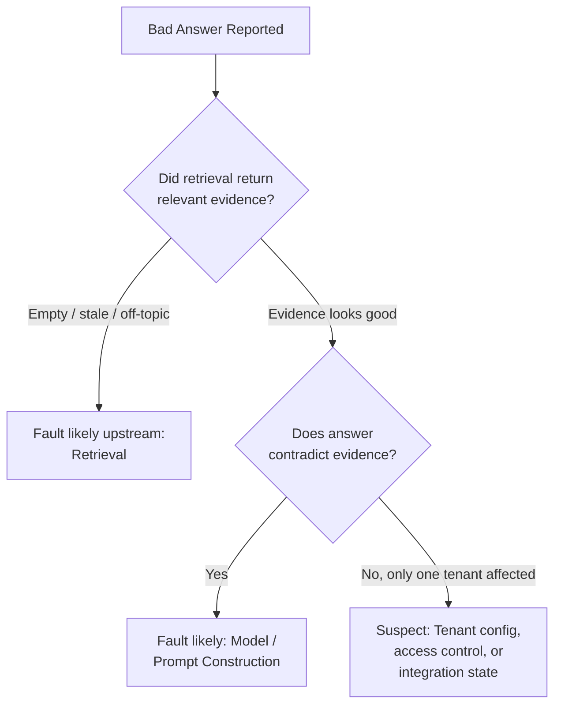

# Observability and Production Diagnosis for a Customer-Facing AI Application, part 2

## 6. Classify and Hash Before Storage

A classifier that runs after storage protects nothing, because the raw value has already been written. So classification happens before a value can reach a trace. A keyed hash (HMAC with a secret key) then preserves correlation without retaining content.

The data model is small. `Request` carries tenant ID, prompt and an optional user ID. `ExportedTrace` carries only a bounded, structured attribute dictionary: correlation ID, tenant ID, prompt classification, query hash, spans and result status. It never carries raw prompt text by default.

The hash is HMAC-SHA256 with a secret key, so the same prompt always maps to the same fingerprint. That fingerprint deduplicates and correlates requests across the store. Without the secret key, nobody can brute-force common prompts back out of the hash. If the key leaks, they can, so it lives in a vault and gets rotated. A missing key raises an error rather than silently hashing without one.

Three tests turn the design into executable contracts:

| Test | What it proves |
|---|---|
| Idempotent trace ingestion: post the same trace twice | The second post returns "deduplicated", so a retry never double-counts |
| Privacy invariant: a request containing `person@example.com` | The address never appears in the exported JSON; the query hash is present; the classification is "sensitive" |
| Failure injection: the retriever raises a timeout after acceptance | The failure is still observable; the trace summary is written in a `finally` block with an `outcome="partial_failure"` field |

The last test guards the chapter's central failure drill: sampling and redaction must never hide a failure.

Telemetry attributes are schema-validated at ingestion. Unknown high-cardinality fields are rejected or collapsed into a bounded "other" bucket. Queue serialisation contracts carry trace context, idempotency key and tenant scope explicitly, or traces break silently at async handoffs.

## 7. Sample Toward the Failures

The chapter's signature phrase is "sampling drops the only bad trace." Uniform sampling keeps a fixed fraction of everything. When failures are rare, a fixed fraction of a rare thing is often zero. Expect the interviewer to inject this mid-round and have the answer ready cold.

Walk it as a four-step drill.

| Step | Sampling drops the only bad trace |
|---|---|
| Detection | Compare complaint intake, request errors and anomaly signals against sampled trace volume. Complaints rising while traces for that workflow fall is a blind spot, not a healthy system |
| Containment | Switch the affected tenant, route or error class to higher-fidelity sampling temporarily; preserve the raw event envelope in a protected quarantine store if policy allows |
| Recovery | Reconstruct from neighbouring evidence: API gateway logs, model gateway errors, dependency spans, support tickets. Mark the missing trace explicitly in the incident record |
| Prevention | Never let one global sampling rule govern all error paths. Use error-class overrides, low-rate always-on exemplars and per-tenant incident escalation hooks |

The first move under this injection is to contain impact, preserve evidence and make the failure legible. Defending the sampler or arguing probability is the weak move.

## 8. Name the Failure Policy for Every Layer

Every dependency needs an explicit answer to one question: what happens when it is gone? Use five terms for the answer. Fail open continues with reduced visibility. Fail closed refuses the action when integrity, privacy or authorisation would be compromised. Degrade serves a reduced but safe experience. Queue buffers with explicit bounds and retention. Human intervention escalates when risk or ambiguity is too high for automation.

| Failure | Policy |
|---|---|
| Auth token missing | Fail closed; do not infer identity; ask the caller to re-authenticate |
| Telemetry export unavailable | Degrade; continue serving, buffer a bounded summary, alert |
| Retriever timeout | Retry once with jitter; if still failing, degrade to a reduced-answer path or ask for refinement |
| Model gateway rate limit | Queue briefly if the SLA allows; otherwise fail gracefully with a specific retry message |
| Audit sink unavailable | Usually fail closed for the audited action, or require a human; silent loss of audit evidence is unacceptable |
| Support lookup outside tenant scope | Fail closed; no cross-tenant fallback |
| Repeated downstream timeouts | Trip a circuit breaker; serve a safe degraded response or queue if the workflow permits |
| Evidence buffer full | Dead-letter the overflow into a restricted quarantine queue with an incident marker, then alert a human |

Say aloud why the rows differ. A user-facing answer can sometimes degrade; an audit trail usually cannot. A retriever timeout can be retried; a permission check cannot be guessed.

Name the blast radius along four axes: tenant, region, workflow and dependency. A raw-prompt leak is usually tenant-scoped but workflow-wide. A queue-boundary trace break can hit one integration path across many tenants. A model outage may be regional. A misconfigured support tool can span every tenant.

Four more named failures get the same drill.

| Failure | Detection | Containment | Recovery | Prevention |
|---|---|---|---|---|
| Tenant ID has a high-cardinality bug | Cardinality budgets and exporter rejections; a spike in unique tenant labels is itself an incident | Strip or normalise untrusted attributes at ingestion; collapse unknowns into "other" | Fix the mapper; backfill only the minimal aggregates for the review | Schema-validate attributes; reject unknown high-cardinality fields before export |
| Logs store a raw prompt | Scanners and red-team tests search logs, traces and support transcripts for PII and secret formats | Revoke sink access, rotate exposed credentials, quarantine the log set | Delete or redact per retention policy and contract; notify owners | Enforce redaction in code, in the collector and in review |
| Trace context breaks at a queue | A trace starts, then vanishes after async handoff; orphan spans; a spike in "unknown root" events | Propagate a minimal correlation envelope through the queue | Stitch spans by correlation ID and timestamp; mark the join as reconstructed | Queue contracts carry trace context, idempotency key and tenant scope, and are tested |
| Quality metric improves while adoption falls | Pair technical metrics with completion rate, retries, abandonment, support contacts | Treat it as a product problem, not a hotfix | Product review, metric reset, possibly roll back the latest change | Track task completion and business outcome, not usage volume alone |

In the abuse case, a developer adds a raw prompt field to a debug span to speed triage. It works once, then becomes the easiest way to move PII into every downstream system. The fix is a redaction policy, an exporter guardrail, and a test that fails whenever exported telemetry contains raw sensitive strings.

Inject sampler loss, queue-boundary breakage, redaction regressions and dependency timeouts in staging. Chaos practice proves the failure policy works before production forces the discovery.

## 9. Triage From the Complaint Down

A dashboard built from component metrics shows rates without telling anyone whether the user's experience improved. So build it from one incident story, top down. The complaint is "the AI is slow and sometimes wrong."

The top panel shows the user outcome: latency percentile, failure rate, incident volume. The middle panel shows likely causes: retrieval success, tool success, model error class, token cost. The bottom panel shows support mechanics: trace coverage, redaction rate, queue age for incidents, mean time to diagnose.

To answer the correctness question, compare the retrieved evidence with the final answer. If retrieval is empty, stale or off-topic, the fault is upstream. If retrieval looked good but the answer contradicts it, suspect the model or prompt construction. If the bad answer appears for only one tenant, suspect tenant configuration, access control or integration state before blaming the shared model.

This works because of the signals section 2 kept: request and tenant correlation IDs; retrieval query fingerprints and document identifiers, not raw text; model version, prompt template version and generation settings; tool call status, latency and error class; and outcome tags.

Alert on customer harm or likely impending harm, not on telemetry volume. Good triggers are sustained latency above the SLO, elevated error rates, repeated empty retrievals, a spike in fallback responses and critical tool failures. So is a sudden rise in "wrong answer" feedback for one tenant or cohort.

## 10. Walk Through the Latency Spike

A slow pipeline is rarely one slow component. The latency incident is the proof: no single span explains it, and every small change looked safe alone.

**Setting.** A B2B SaaS support copilot runs inside a live support console. Agents expect answers in under 5 seconds because the customer is waiting in chat. The path is Support Console → RAG API → query rewrite → hybrid retriever → cross-encoder reranker → context compressor → LLM gateway → model provider → response evaluator → UI stream. The target is a 7-second p95 with a 12-second hard timeout.

**Symptom.** On 2026-07-08, during peak European hours, agents saw the spinner for 18–35 seconds. Some answers arrived after the human agent had already replied. Handle time rose 21%. It was not an outage: success rate stayed acceptable, but p95 and p99 broke the SLO.

**Telemetry.**

| Signal | Value |
|---|---|
| p50 / p95 / p99 (eu-central-1, 5-minute window) | 5310 ms / 22180 ms / 34890 ms |
| Timeout rate | 12.8% against a 1.1% baseline, over 1842 requests |
| Retrieval p95 | 4200 ms |
| Reranker | 3100 ms; `cross_encoder_large_v4`; 80 candidates in, 12 out; batch size 1; GPU queue depth 29; light-reranker fallback off |
| LLM gateway queue | 2800 ms; primary provider degraded; 1 retry, retry-after 750 ms |
| Provider latency | 9360 ms, routed to us-east-1 from eu-central-1 |
| Context compression | 740 ms |
| Tokens | 18500 in, 610 out |
| First token / total | 14120 ms / 23840 ms against a 12000 ms timeout budget |

**What changed.** Two changes landed within 24 hours. The reranker moved from `cross_encoder_small_v2` to `cross_encoder_large_v4`. The router moved standard answers from a faster mid-tier model to a larger one after a quality experiment. The canary ran only in low-traffic hours and never tested peak GPU queue depth.

**Root cause.** Compounded latency. A larger candidate set, a slower reranker, a bigger context, gateway queueing and cross-region routing stacked up. The pipeline broke its budget because several "small" changes landed together.

**Debugging path.** Decompose the trace into spans and compare each stage's p95 with its baseline. Check candidate count, context tokens, queue time, provider latency and regional routing. Compare canary with control and peak with off-peak. Check whether timeouts land before or after the first token. A 14-second first token means streaming cannot rescue the experience.

**Fix.** Now: roll back the model route, cap reranker candidates at 30, and enable the light reranker when GPU queue depth exceeds 10. Also reduce max context tokens and route EU traffic to an EU-capable endpoint. Later: add a latency budget per stage and load-test gates for reranker queue depth. Enforce context caps per workflow and add circuit breakers for provider degradation. Quality experiments must pass latency and cost SLOs, not only answer quality.

**Abuse angle.** Latency becomes a safety risk when users abandon the assistant or bypass review. Broad queries that trigger large candidate sets and expensive reranking are a cheap denial-of-wallet or denial-of-service vector.

> *"I would start with span-level latency decomposition. The trace shows retrieval at 4.2s, reranker at 3.1s, LLM queue at 2.8s, and provider latency at 9.3s, with 18.5k input tokens. That means this is a pipeline-budget failure, not just one slow API. I would roll back the model route, cap reranker candidates, enforce context compression, add queue-depth fallback, and make future quality experiments pass p95 latency and timeout-rate gates."*

The weak answer is "increase the timeout and maybe use a faster model." It never reads a span.
