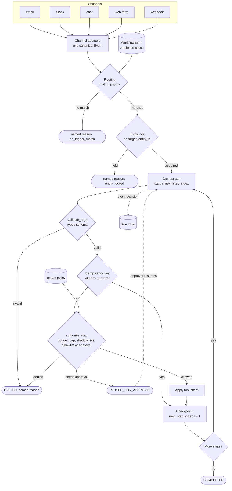

# Agent Platform for Non-Technical Users

*A business user must be able to switch on an automation that moves real money, without being able to read the code that decides whether it should.*

◷ 30 min

An agent platform is a safety and orchestration problem wearing an AI costume. The model can choose which value goes into an argument; everything that decides whether a destructive action runs is code. This page puts the group's prompts into one read for the day before. The group has one whiteboard script and one handbook module that teaches the same built project in prose.

| Case in the group | What it contributes here |
|---|---|
| #8 Agent Platform for Non-Technical Users, 60-min whiteboard script (anchor) | Sections 1 to 12 and 14: the framing, the pipeline, determinism, durability, the guardrail, the two bugs, the close |
| #64 Cascade Robotics, Module 05 running case and code project | Section 13 for what the module adds; its figures run through sections 2, 5, 6, 10 and 11 |
| Self-drill on #8, Drill Add-ons tab | Section 15 |

Sections and tables marked *(own construction)* were built for this page from the sources' arguments and are not in the sources verbatim.

---

## 1. Frame the Round as Trust, Not Tool Selection

Say the framing sentence in the first two minutes, because a design that starts with an LLM choosing tools spends forty minutes on the wrong thing. The mechanics of "LLM picks a tool" have been a standard model API feature since 2023. The hard part is handing a non-programmer a button that refunds real money.

> *"Anyone can wire an LLM to a tool call. The hard part is letting someone who has never seen a stack trace configure that safely — which means the system has to make the dangerous decisions itself, deterministically, and never delegate them to the model's judgement in the moment."*

The prompt, as quoted in a company's system-design prep guide: *"Design an AI agent platform for non-technical users to configure workflow automations across multiple channels."* Four phrases carry it.

| Phrase in the prompt | What it really means |
|---|---|
| "AI agent" | Something that looks at an event and *takes an action* (reply, refund, escalate, tag) instead of only answering a question |
| "platform" | Not one workflow: many tenants, each defining many workflows |
| "for non-technical users to configure" | The person building the automation is not a programmer and should never need to read a stack trace |
| "across multiple channels" | The same automation fires from email, Slack, a chat widget, a web form or a raw webhook |

Five clarifying questions change the design. Ask them in this order.

| Question | What it decides |
|---|---|
| How non-technical is "non-technical"? | Whether natural-language authoring is a nice-to-have or the whole product |
| Which channels, and do we own each integration? | Slack and webhook are easy; email threading and web-form dedup hide the real work |
| Read-only, or can it act? | Write actions turn this into a guardrail problem instead of a UI problem |
| What is the blast radius of a bad workflow? | A wrong Slack reply is embarrassing; a wrong refund is money. Sets how aggressive the default guardrails are |
| Multi-tenant from day one? | Whether isolation is a retrofit or load-bearing from the start |

Then scope out loud:

> *"I'll design for a multi-tenant platform where non-technical users configure declarative workflows — never code — that can take real, destructive actions under a guardrail service. I'm explicitly not designing the visual builder UI or a natural-language-to-spec compiler — those are their own projects — I'll name what they need to produce and move on."*

## 2. Anchor Every Answer on One $500 Refund

One concrete tenant keeps every later claim testable. Cascade Robotics wants Tier-1 support triage across two channels: a Zendesk webhook for new tickets, and an `#support-escalations` Slack channel for urgent messages. A high-priority ticket gets a drafted reply. A billing complaint also gets an automatic refund up to $50; above that, a human must approve. A duplicate or retried step must never issue a second refund.

The user's request, in their own words: *"If a customer messages us anywhere asking for a refund and it's under $50, just refund them. Don't bother me for small stuff."* The platform must silently guarantee six things the user never has to name.

| Guarantee | Component |
|---|---|
| Email, Slack DM and widget messages become one internal shape before any decision | Channel adapters |
| Only refund messages fire the workflow, and exactly one workflow wins | Routing |
| The workflow went `draft → test → shadow → live` and someone with authority approved it | Staged rollout |
| "Under $50" is a spend-cap check at execution time, not a sentence in a prompt | Guardrails |
| A retried refund call refunds once | Idempotency |
| A restart mid-run resumes rather than restarting | Durable, checkpointed execution |

The demo question that drives the round: *"Why didn't Cascade Robotics' $500 refund fire automatically?"*

| Question | What actually happened |
|---|---|
| Wasn't the workflow autonomous? | Yes, but `issue_refund` was not allow-listed for autonomous use on this tenant, so it still needed a human |
| Wasn't there budget? | The tenant's spend cap is $50. A $500 refund is refused outright (`spend_cap_exceeded`), never silently clamped down to the cap |
| What if it retries and refunds twice? | It cannot. The idempotency key on that action exists after the first apply, so a retry is a no-op |

> *"Notice the refund cap isn't a nice-to-have — it's the difference between 'the agent can act autonomously' and 'the agent can act autonomously up to the point where a mistake actually costs real money, and then it stops and asks.'"*

## 3. State Requirements as Testable Constraints

A requirement that cannot fail a test is a preference. The source project proves every safety claim with a deterministic test, including the negative cases, so state requirements the same way. The functional list splits into must-haves and later work *(the split is own construction; the items are the sources')*.

The must-haves are eight:

1. Normalise every channel into one canonical event.
2. Route each event to exactly one live workflow, or to none with a named reason.
3. Store workflows as versioned, declarative specs.
4. Validate typed tool arguments before execution.
5. Checkpoint execution so a crash resumes mid-run.
6. Make destructive side effects idempotent.
7. Run a per-step guardrail covering budget, spend cap, rollout stage and approval.
8. Promote through staged rollout under separation of duties.

The should-haves come after the safety core is trusted. They are a template library with `clone()`, natural-language authoring compiled to a reviewable spec, a plain-language run history, automatic retries around `resume()`, and gradual migration between live versions.

| Constraint | Stated so it can be tested |
|---|---|
| Safety | A destructive action never executes without an explicit human approval or an explicit per-tenant allow-list entry, even on a fully autonomous workflow |
| Money | A $500 refund against a $50 cap is refused outright, never silently clamped; the cap uses the real dollar amount |
| Idempotency | A retried or redelivered action never applies its side effect twice; external call count stays at 1 |
| Durability | A crash mid-run never re-runs a step that already completed |
| Runaway | A 30-step workflow halts at a 5-step cap instead of looping |
| Concurrency | A second run on an in-flight ticket is refused with `entity_locked` |
| Separation of duties | Nobody can promote their own workflow, and no stage can be skipped |
| Tenancy | Every event, workflow and policy carries `tenant_id`; guardrail caps are per tenant; routing matches only a tenant's own workflows |
| Auditability | Every guardrail decision, allowed or denied, is on the run's event log with a named rule and reason |
| Testability | 21 tests, deterministic, no LLM, well under a second |

Every must-have then needs an owner in the architecture *(own construction)*.

| Requirement | Primary component |
|---|---|
| One shape for every channel | Channel adapters |
| Exactly one workflow per event | Routing: priority plus entity lock |
| Declarative, versioned workflows | Workflow store |
| Typed arguments | Tool registry with `validate_args()` |
| Crash-safe execution | Orchestrator checkpoint, `next_step_index` |
| No double side effect | Idempotency store keyed `{run_id}:{step_name}` |
| Budget, cap, stage, approval | Guardrail engine, `authorize_step()` |
| Rollout discipline | `promote()` with role checks |
| Replayable record | Run trace |

## 4. Draw the Architecture End to End

Write the nouns before the boxes, because the nouns are the contract every box shares:

```
Event · Channel · WorkflowSpec (versioned) · Trigger · Step · Tool · Run · Guardrail · Principal
```

Then narrate one event before drawing. A ticket webhook arrives, and a channel adapter normalises it into a canonical event. Routing finds the highest-priority live workflow that triggers on it and checks that no other run is already active on that ticket. The orchestrator executes the workflow's steps one at a time and checkpoints after each. A non-destructive step, such as drafting a reply, runs straight away. A destructive one, such as issuing a refund, goes through the guardrail first. It checks whether the workflow is live enough to act, whether this tool is allow-listed for autonomous use, whether a human is needed and whether it fits the spend cap. If it passes, it executes with an idempotency key, so a retry can never double-refund. Every decision, allowed or denied, is logged.

The anchor's board, verbatim. Label the two independent decisions in routing.

```
  raw payload (any channel) --> ADAPTER --> canonical Event
                                                  |
                                                  v
                                    ┌─────────────────────────┐
                                    │  ROUTING                 │
                                    │  1. priority match        │  <- design-time: which SHOULD run
                                    │  2. entity lock check      │  <- run-time: can TWO ever run
                                    └─────────────────────────┘
                                                  |
                                                  v
                              ┌───────────────────────────────────┐
                              │  ORCHESTRATOR (durable, checkpointed) │
                              │   step -> validate args -> guardrail  │
                              │   -> execute (idempotent) -> checkpoint│
                              └───────────────────────────────────┘
                                                  |
                                    COMPLETED / PAUSED_FOR_APPROVAL / HALTED
```

The full platform adds the authoring plane and the stores *(own construction from the sources' components)*. The authoring plane changes what may run; the runtime plane decides whether a given step runs now.

```
 AUTHORING PLANE (slow, human)                     RUNTIME PLANE (every event)
 ┌──────────────────────────────┐                 ┌───────────────────────────────────────────┐
 │ builder / NL-to-spec (gap)   │                 │ email  slack  chat  web_form  webhook     │
 │        │                     │                 │   └──────┴──────┴──────┴────────┘         │
 │        v                     │                 │           CHANNEL ADAPTERS                │
 │ WorkflowSpec (DRAFT)         │                 │                  │ canonical Event        │
 │        │  promote()          │                 │                  v                        │
 │        │  approver/admin     │   all_live()    │ ROUTING: match -> priority -> entity lock │
 │        v  one stage at a time├────────────────>│                  │                        │
 │ WORKFLOW STORE (versioned)   │                 │                  v                        │
 └──────────────────────────────┘                 │ ORCHESTRATOR loop (from next_step_index)  │
                                                  │   resolve args -> validate_args()         │
 ┌──────────────────────────────┐                 │   -> idempotency check (replay = no-op)   │
 │ TENANT POLICY                │  caps,          │   -> authorize_step()  <──── policy       │
 │ spend_cap_usd, max_steps,    ├── allow-list ──>│   -> apply side effect -> CHECKPOINT      │
 │ allowed_destructive_tools    │                 │                  │                        │
 └──────────────────────────────┘                 │     tools: draft_reply  tag_ticket        │
                                                  │            issue_refund* close_ticket*    │
 ┌──────────────────────────────┐                 │            (* destructive)                │
 │ HUMAN APPROVER (role-checked)├── approval ────>│                  │                        │
 └──────────────────────────────┘                 └──────────────────┼────────────────────────┘
                                                                     v
                              STORES: lock store · idempotency store · run store + trace
```



| Component | Job | What goes wrong without it *(own construction)* |
|---|---|---|
| Channel adapters (`from_webhook`, `from_slack`, `from_email`) | Translate each payload once into `Event` | Every downstream component learns every channel, forever |
| Canonical `Event` | `channel`, `event_type`, `tenant_id`, `target_entity_id`, `payload`, `raw_ref` | No tenant scope, no lock key, no audit pointer |
| Routing (`matching_workflows`, `route`) | Highest-priority live workflow, or a named non-selection | Two workflows both claim the event, or a silent no-op |
| Entity lock (`acquire_lock`, `release_lock`) | One active run per target entity | A priority misconfiguration becomes a concurrent-mutation bug |
| Workflow store (`WorkflowStore`) | Every version kept; a run pins to its version | Editing a workflow changes runs already in flight |
| Tool registry (`REGISTRY`, `validate_args`) | Typed schema, required fields, `destructive` flag, `scopes` | A hallucinated or wrong-typed argument reaches a real system |
| Orchestrator (`run_workflow`, `resume`, `_continue`) | Walks the step list, checkpoints after each step | A crash re-runs completed steps |
| Idempotency store (`_apply_side_effect`) | First apply of a key wins; repeats are no-ops | A redelivered event refunds twice |
| Guardrail engine (`authorize_step`) | Five ordered deny rules, two allows | A destructive step runs without authority |
| Tenant policy (`GuardrailPolicy`) | Spend cap, max steps, autonomous allow-list | One tenant's risk appetite applies to another |
| Promotion (`promote`) | One stage at a time, approver or admin only | An author ships their own workflow straight to live |
| Run trace (`observability.py`) | Every decision with rule and reason | Nobody can say why a refund did or did not fire |
