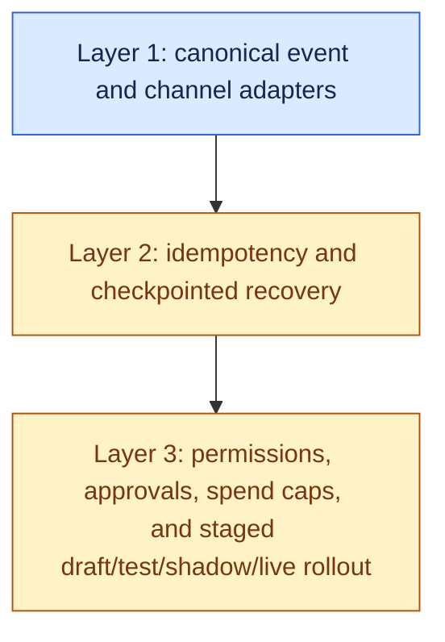

# Agent Platform for Non-Technical Users, part 3

## 10. Deny in a Fixed Order, and Let Deny Override

Every step of every run goes through one decision. `authorize_step()` returns `Decision(allowed, rule, reason)`, and deny overrides allow.

| # | Rule | Denies when |
|---|---|---|
| 1 | `step_budget_exceeded` | The run has used its step allowance, the tighter of the workflow's `max_steps` and the tenant's |
| 2 | `spend_cap_exceeded` | This step's real cost, the actual refund amount for a financial tool, would exceed the cap, again the tighter of workflow and tenant |
| 3 | `shadow_mode` | The workflow is in `SHADOW`; destructive steps never execute here, regardless of role or approval |
| 4 | `not_live` | The workflow has not been promoted to `LIVE` |
| 5 | `needs_human_approval` | Destructive, not allow-listed for autonomous use on this tenant, and no approver present |
| — | `autonomous_allowlisted` / `human_approved` | The two ways a destructive step is actually allowed to run |

- Non-destructive steps pass after the two budget checks. Destructive steps must clear all five rules and then match one of the two allows, so the full set is seven rules: five deny, two allow.
- The whiteboard script draws the same logic as a seven-line ladder, with "non-destructive? just run it" as its third rung.
- The handbook's five-rule table is the cleaner version to draw.

- The step budget and the spend cap count different things; they are not two severities of one check.
- The step budget counts how many steps a run has taken, so it catches a loop no matter how cheap each step is.
- The spend cap counts the dollars one step is about to spend, so it catches one expensive action on step one.
- Both halt and escalate. Neither retries, and neither clamps the amount down to fit.

> **"Autonomous status raises the ceiling on which actions can skip approval. It never removes the ceiling itself."**

The tenant policy is `GuardrailPolicy(spend_cap_usd, max_steps, allowed_destructive_tools_autonomous)`. A workflow can be tighter than its tenant's policy but never looser. The allow-list belongs to the tenant alone.

- Build the negative control for anything claimed safe. `scripts/demo_guardrail_failure.py` shows seven denials.
- `wrong_role`: the author cannot promote their own workflow. `cannot_skip_stage`: draft cannot jump to autonomous.
- `type_mismatch` or missing arguments: rejected before execution. `not_live`: a draft workflow never fires a destructive step.
- `spend_cap_exceeded`: a 500 USD refund against a 50 USD cap is refused, not clamped.
- `step_budget_exceeded`: a 30-step workflow halts at the 5-step cap. `entity_locked`: a second run on an in-flight ticket is refused.
- A demo that shows things being stopped proves more than one that shows things working.

## 11. Make Autonomy Something a Workflow Earns Through Four Gates

A workflow moves `DRAFT → TESTING → SHADOW → LIVE → AUTONOMOUS`, one stage at a time. Only an approver or admin may promote it, never its author. Each stage removes exactly one kind of "we don't actually know yet".

| Stage | The one question it answers | What breaks if skipped |
|---|---|---|
| `DRAFT` | Is this even wired correctly? | The first idea is tested against real customer messages |
| `TESTING` | Does it behave correctly on realistic input, run against sample or historical data? | It is found wrong only once it is watching live traffic |
| `SHADOW` | Does it decide correctly on live traffic, with every write mocked? | Bad decisions surface only after a real refund |
| `LIVE` | Will a human still vouch for each individual action? | Straight from "looked fine in shadow" to acting alone |
| `AUTONOMOUS` | Has it earned the right to act without asking every time? | The destination, not a gate; the same guardrails still apply |

Fewer gates lose a distinct answer. Merge `TESTING` into `SHADOW` and cheap, repeatable replay disappears. Merge `SHADOW` into `LIVE` and debugging moves into production. More gates add stages someone must remember to promote through. The guardrail policy already scales risk within a stage.

`promote(store, workflow_id, to_status, signer)` denies two things. `wrong_role` stops an author promoting their own work; only an approver or admin can promote at all. `cannot_skip_stage` stops a jump from `DRAFT` to `LIVE`. The identity fixture includes `u_author_wrong_hat`, a negative control proving an author cannot approve their own work however the request is framed.

The same mechanism answers the two follow-ups the round always gets. How does a user try a workflow before it is live? Shadow mode. How is a bad one stopped mid-flight? The step and spend budget halts it, and the entity lock stops a second run compounding the damage.

## 12. Name the Gaps Before the Interviewer Does

The source project contains no LLM at all, on purpose, so every property can be proven with fast, reproducible tests. Say so plainly, and never imply the demo proves an LLM planner is safe.

| Gap | Status | What to say |
|---|---|---|
| Planner | 🟡 Fixed step list | Swapping in an LLM or rule engine that picks the next tool is a moderate change. The architecture stays: a reasoning loop with deterministic guardrails around it |
| Authoring surface | 🟡 / ❌ | The spec is what a builder would serialise to. NL-to-spec needs a real LLM call, and its output enters at `DRAFT` behind the same `promote()` gate |
| Automatic retries | ❌ | `resume()` is correct, but nothing calls it automatically. A retry wrapper with backoff is low effort because idempotent resumption is done |
| Connector secrets | ❌ | A `Connector` model referencing a vault secret is moderate work; the vault itself is infrastructure |
| PII redaction | ❌ | Low effort. The RAG project's `redact_pii()` is reusable on step outputs before a human sees them for approval |
| Custom tools | 🟡 | Schema validation and scoping exist. Sandboxed execution and review-before-publish reuse `promote()`'s role-gated pattern |
| Gradual version migration | ❌ | A `traffic_split` on the spec, consulted by routing |

The scale answer is one sentence of mechanism and one of storage:

> *"Every lock and idempotency key in this demo lives in an in-process dict - correct in shape, wrong in storage. At real volume that becomes a distributed lock (a unique-constraint row in a database, or a Redis lease checked with a fencing token) and a durable idempotency store shared across workers. The mechanism doesn't change - `acquire_lock`/`release_lock` stay the same two functions - only where they're backed changes."*

The failure table tells the interviewer what a workflow does, not what breaks.

| Fails | Behaviour |
|---|---|
| A step's arguments don't validate | Rejected before execution; run halts with a named reason |
| A destructive step needs approval that never comes | Run stays `PAUSED_FOR_APPROVAL` indefinitely; it does not silently expire into either action |
| A workflow runs away (misconfigured self-trigger) | Halts at the step budget |
| The process crashes mid-run | Resumes from the last checkpoint; the completed step never re-runs |
| An event is redelivered (at-least-once channel semantics) | The idempotency key makes the redelivery a no-op |

## 13. Walk Through the Cascade Robotics Example

Cascade Robotics is a worked, runnable build of this design. Nothing in it contradicts the answer above, and it adds four things.

First, the three-layer map that organises the whole answer:

A weak answer spends its time on Layer 1 and waves at an LLM doing reasoning. A strong answer spends most of it on Layers 2 and 3, because that is where real incidents happen: double refunds, a skipped human check, a re-run completed step.

Second, the example data. The tenant is `cascade_robotics`, with three workflows. `wf_ticket_triage` runs at priority 10 on `webhook / ticket.created`. `wf_legacy_ticket_tagger` runs at priority 1 on the same trigger, to demonstrate the conflict. `wf_slack_escalation` runs at priority 10 on `slack / urgent_message`.

- Third, the cross-project shape. The RAG platform, this agent platform and the delivery framework all return `Decision(allowed, rule, reason)` from a named policy where deny overrides.
- The three functions are `authorize_step()` here, `sign_off()` in the delivery framework and `decide()` in enterprise RAG.
- Access control, delivery gates and workflow guardrails are the same kind of problem wearing three different hats.
- That line works well as a bridge when the interviewer has seen the G01 or G12 design.

Fourth, the coverage discipline: every claim is marked *built and runnable* or *known but not demonstrated*, with an effort label to close it. The punch list, by effort:

- **Low:** template library with `clone()`, a retry wrapper around `resume()`, PII redaction on step outputs, a plain-language run summary.
- **Moderate:** a `Connector` model with a vault abstraction, a real planner, sandboxed custom-tool review, canary migration between versions.
- **Large:** a visual builder, and a real secrets manager with a distributed lock store.

Memorise the one-breath restatement:

> *"We're building the safety and orchestration layer that sits between a non-technical user's plain-English intent and a real, destructive action — so that no matter which channel the trigger came from, the action only runs when it's actually supposed to, runs exactly once, and survives crashes and retries without ever surprising anyone."*
