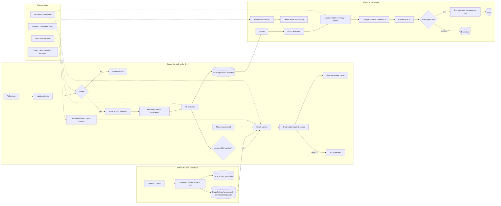

# Real-Time Call Assistant for Sales and Service Calls, part 2

## 4. Draw the Architecture End to End

The organising rule is three lanes on three clocks. They share the snapshot and the transcript store and nothing else. A slow summary can never queue in front of a live suggestion.

The drill's own architecture line, kept verbatim:

```
before call → precompute context.
During call → small prompt → fast model → streamed suggestion.
After call → async summary + CRM update.
```

The voice project's streaming pipeline, kept verbatim as the nearest system built end to end:

```
User Voice → VAD (Silero) → STT (Deepgram) → LLM (Groq)
                                                  ↓
                                    [Function Call: Search KB]
                                                  ↓
                                   RAG Service (Vector Search)
                                                  ↓
                                MongoDB Atlas (Top 5 Chunks)
                                                  ↓
                          LLM Response (with context)
                                                  ↓
                               TTS (ElevenLabs) → Audio Output
```

The call assistant keeps the front half of that pipeline: voice activity detection, streaming speech-to-text and a model with retrieval. It replaces speech output with a text panel for the rep. It adds the before and after lanes the voice project does not need.

The full system, drawn with its planes and lanes *(own construction)*:

```
 ╔══════════════════════ CONTROL PLANE (changes are releases) ══════════════════════════╗
 ║ suggestion + summary templates (versioned) · trigger rules · redaction patterns        ║
 ║ live-lookup allowlist + timeouts · CRM field schema · confidence thresholds            ║
 ║ consent + retention policy per region · model routes · budgets · eval gates            ║
 ╚═══════════════════════════════════════╤════════════════════════════════════════════════╝
                                         │ configures every box below
 ╔══════════════════════ DATA PLANE ══════════════════════════════════════════════════════╗
 ║                                                                                        ║
 ║ BEFORE — scheduled, hours ahead                                                        ║
 ║  calendar / dialer ─> snapshot builder (runs AS the rep) ─> CRM, tickets, past calls   ║
 ║        ─> account snapshot cache  [key: account + rep permission signature]            ║
 ║                                                                                        ║
 ║ DURING — the 3-second lane                                                             ║
 ║  telephony ─> media gateway ─> consent check ─> VAD ─> streaming ASR + diarization     ║
 ║                                   │ no consent: stop                  │                ║
 ║                                   v                                   v                ║
 ║                            PII redaction on the stream ─> transcript store (redacted)  ║
 ║                                   │                                                    ║
 ║                   trigger detector: customer asked something answerable?               ║
 ║                                   │ yes                                                ║
 ║       snapshot cache ──> small prompt <── playbook retrieval (segment-filtered)        ║
 ║                                   │   <── allowlisted live lookup (timeout, parallel)  ║
 ║                                   v                                                    ║
 ║                       SMALL FAST MODEL (streamed) ─> rep's suggestion panel            ║
 ║                                   │ timeout: no suggestion                             ║
 ║                                                                                        ║
 ║ AFTER — asynchronous, minutes                                                          ║
 ║  call ended ─> queue ─> post-call worker ─> LARGER MODEL: summary, action items        ║
 ║        ─> CRM proposer + confidence ─> review queue ─> rep APPROVES / CORRECTS         ║
 ║        ─> tool gateway (idempotency key) ─> CRM ─> audit                               ║
 ║        corrections ─> eval store  ·  retention scheduler ─> delete audio + transcript  ║
 ║                                                                                        ║
 ║ OBSERVABILITY — events, never raw audio                                                ║
 ║  latency by stage · timeout rate · accept rate · WER by language · edit distance       ║
 ╚════════════════════════════════════════════════════════════════════════════════════════╝
```

The same system for viewers that render Mermaid *(own construction)*:



Read the components in dependency order *(own construction; the capabilities are the anchor prompt's list)*.

| # | Component | Responsibility | Fails how |
|---|---|---|---|
| 01 | Telephony connector and media gateway | Audio ingestion, per-speaker channels where available | Degrades: no live assist; post-call from the platform's recording |
| 02 | Consent check | Records and enforces consent per jurisdiction | Closed: no consent, no recording, no transcript |
| 03 | Voice activity detection | Finds end-of-utterance to start the clock | Degrades: longer threshold, slower suggestions |
| 04 | Streaming ASR with diarization | Partial and final transcript, rep vs customer | Degrades: no live assist; retry post-call on the recording |
| 05 | PII redaction | Masks names, numbers, card data on the stream | Closed: unredacted text is never stored or sent |
| 06 | Snapshot builder and cache | Account context built before the call, as the rep | Degrades: generic playbook suggestions, labelled |
| 07 | Trigger detector | Decides whether an utterance merits a suggestion | Degrades: fewer suggestions, never more |
| 08 | Playbook retrieval | Approved answers for the account's segment | Degrades: snapshot-only suggestions |
| 09 | Live-lookup allowlist | Price, stock, case status, each with a timeout | Degrades: fact omitted, marked "check" |
| 10 | Suggestion model | Small fast model, streamed bullets | Degrades: silence on timeout |
| 11 | Post-call worker and larger model | Summary and action items in a fixed schema | Degrades: queued, retried; the rep's next call is unaffected |
| 12 | CRM proposer and confidence scorer | Maps extractions to CRM fields with confidence | Degrades: low confidence goes to review, never auto-applied |
| 13 | Review queue and tool gateway | Human correction, idempotent CRM write, audit | Closed: no approval, no write |
| 14 | Retention scheduler | Deletes audio and transcripts on schedule | Closed: a failed deletion alerts; it is not retried silently |
| 15 | Telemetry and eval store | Latency by stage, accept rate, corrections by call type and language | Degrades: suggestion still served, gap logged |

Point at three boundaries while the diagram is up *(own construction)*. The three lanes share the snapshot and the transcript store and nothing else. The privacy boundary sits at redaction: nothing past it has seen raw PII. The action boundary sits at approval: the model proposes CRM changes, and only a person makes them.

## 5. Precompute the Account Context Before the Call Starts

You cannot count on a live CRM lookup fitting inside three seconds. The CRM's own latency is out of the design's control, and its tail is worse than its median. So the account context is built before the call, when there is time. The drill names this lever first: "precompute account context".

The snapshot holds the account summary, open opportunities with stage and next step, the last interactions, open support cases, and the approved answers for the account's segment. This is the same snapshot G05 section 5 builds for the pre-meeting hour, and the same rules carry over. It runs as the rep. It is cached on the account and the rep's permission signature. A role or territory change invalidates it.

Trigger the build from the calendar for scheduled calls, and from the dialer for outbound campaigns *(own construction)*. Inbound calls are the hard case, because the account is unknown until the number is matched. Match on caller ID, then build a minimal snapshot in the first seconds of the call, while the greeting is still happening. I'm assuming the first real question rarely lands in the first ten seconds, and that gap is the window.

A snapshot is a copy, and copies go stale. Mark each field with its age. Keep the few facts that must be current, such as price, stock and case status, out of the snapshot. Fetch those live from an allowlist, in parallel with the model call, under a hard timeout.

## 6. Stream the Transcript and Suggest From a Small Prompt

Streaming changes when the rep sees the first word, not how long generation takes. The cram sheet puts it this way: "Streaming improves *perceived* latency. It does not reduce total latency or cost." The live lane therefore does two things. It streams transcription so the text is ready when the customer stops. And it keeps the prompt small so the model's first token comes fast.

Voice activity detection starts the clock. The voice project uses Silero for it, with Deepgram Nova-3 (Pipecat's default model) for real-time speech-to-text. Streaming ASR emits partial text as the customer speaks and a final segment at the pause. Only the final segment triggers a suggestion, because partials change *(own construction)*.

Not every utterance deserves a suggestion. A trigger detector asks one question: did the customer just ask something the playbook or the snapshot can answer? Pricing questions, objections, product comparisons and case-status questions qualify. Small talk does not. Keep the detector cheap, a small classifier or rules, so it never spends the budget it protects *(own construction)*.

The suggestion prompt is small by construction. It holds the last few turns of redacted transcript, the relevant slice of the snapshot, one or two playbook entries and any live fact that arrived in time. It does not hold the whole call or the whole account. The model is small or mid-sized, as the drill says. It streams two or three short bullets, not a paragraph, because the rep is reading while listening.

On timeout, show nothing. A suggestion that arrives after the rep has already answered is noise at best. At worst it contradicts them in front of the customer.

## 7. Diarize and Redact Before Anything Is Stored

A summary that swaps speakers is wrong in a way no rubric forgives. "The customer agreed to renew" and "the rep offered a renewal" are different facts. Diarization, telling one speaker from another, is on the anchor prompt's list for that reason. Take per-speaker channels from the telephony platform when it offers them. A stereo recording with the rep on one channel makes diarization trivial. Fall back to model-based diarization only for single-channel audio *(own construction)*.

PII redaction runs on the transcript stream, before storage and before any model call *(own construction on placement; redaction itself is the anchor prompt's)*. Spoken card numbers, account numbers, dates of birth and addresses are masked with typed placeholders. The summary can still say "customer gave a card number" without holding it. Keep card details out of the audio in the first place: pause or mask recording while the card is read out, because PCI DSS bans storing the security code after authorisation, even encrypted. Other raw audio goes in a separate, short-retention store with tighter access, because redacting audio is harder than redacting text.

Retention is a policy the platform enforces, not a promise *(own construction; retention is the anchor prompt's item)*. Set a retention period per region and per data type: audio shortest, redacted transcript longer, summary and CRM fields as long as the CRM keeps them. A scheduler deletes on time and writes an audit record. A failed deletion raises an alert. Consent is checked before recording starts. With no recorded consent, the assistant does not record, transcribe or suggest.

## 8. Summarise and Extract Actions After the Call, Asynchronously

After the call, the latency constraint relaxes from seconds to minutes, so the model choice changes too. The post-call worker reads the full redacted transcript and uses a larger model. That model is too slow for the live lane and is worth its cost once per call *(own construction)*. The drill's line: "After call → async summary + CRM update."

The output is a fixed schema, not free text, because a CRM consumes it. A summary of what was discussed. Action items, each with an owner, a due date and the transcript span it came from. Commitments made by either side. Objections raised. Proposed CRM field changes such as stage, next step and close date. Every extracted item cites its span, so the reviewer can check it in one click, and so the evaluation can score it *(own construction)*.

Queue the work. Retry on failure. Never let a slow summary delay the rep's next call, which gets a fresh live lane with its own snapshot.
