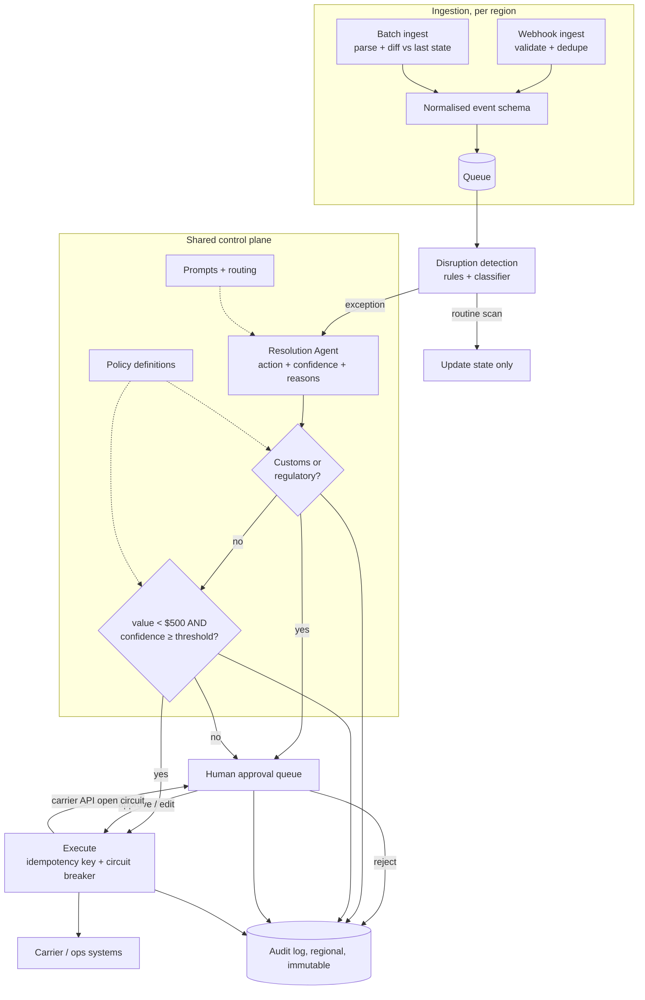

# Logistics Exception Handling and Shipment Rerouting Agent

*The agent has to act fast enough to unstick a shipment, and never act at all on the one class of case the customer will be held accountable for.*

◷ 24 min

This is a low-scale, high-stakes design, not a traffic problem. Only 150 people use it, and the engineering bar is correctness at one decision boundary. This page consolidates the group's prompts into one read for the day before. It reuses the deny-first gate from G03 and the tenancy ladder from G07, and names them rather than repeating them.

| Case in the group | What it contributes here |
|---|---|
| #5 AI Logistics Exception-Handling Assistant, the FDE round (anchor) | Sections 1 to 9, 12 and 13: the four questions, the gate, both ingestion paths, regional planes, reliability, governance, trade-offs |
| #66 OpenAI FDE prompt: shipment rerouting over SAP, weather APIs and 500 warehouse managers | Section 10, the evaluation plan the prompt demands; section 11, the stakeholder and data-unification delta; follow-ups in section 13 |
| Self-drill on #5 (written for this page) | Section 14 |

Sections and tables marked *(own construction)* were built for this page from the sources' arguments and are not in the sources verbatim. The group has no playbook cost drill, so the whole of section 14 is own construction.

---

## 1. Ask the Four Questions That Decide the Design

This case is framed as an FDE round, and it runs in interview order. Clarifying questions come first; you record each answer and draw out its implication. In this format, the questions shape the design.

The prompt: the FDE is embedded with a mid-size logistics customer. They want an AI exception-handling assistant that watches their shipment pipeline and detects disruptions: customs holds, missed carrier scans, weather delays. It either auto-resolves them or drafts a resolution for a human ops agent to approve. It works across multiple carriers and a mix of real-time and batch feeds.

| Asked | Answer | Implication |
|---|---|---|
| **Data volume and freshness per carrier?** | Mixed. ~60% of carriers push real-time webhooks (scan events, status changes), ~200 events/s combined at peak. ~40%, mostly smaller regional carriers, provide batch file drops (CSV/EDI) every 2–6 hours, a few thousand records each | Ingestion needs both a streaming path and a scheduled batch path feeding the same pipeline, not a single uniform interface |
| **Who are the users, and what scale?** | Internal only: the customer's ops team. ~150 agents across three shifts, ~40 concurrent at peak during shift handoff, each handling 30–50 cases a day | **Low-DAU, high-stakes-per-interaction.** Scale pressure comes from event throughput, not concurrent users. That is a very different sizing profile from a consumer assistant |
| **What is the auto-resolve vs human-approval boundary?** | Value- and confidence-based: under $500 shipment value + high confidence → auto-resolve. Customs/regulatory holds → always human, regardless of confidence. Over $500, or below the confidence threshold → always human | **The core risk-boundary decision.** It defines a policy layer in front of every auto-resolution, with customs as a distinct always-gated path, separate from the low-confidence case |
| **Regional or multi-tenant topology?** | One customer, one assistant experience, operating across US, EU and APAC with different carriers per region, and the customer requires that EU data stays in the EU (their requirement; GDPR itself allows transfers with safeguards) | Rules out a single global deployment or data store. Regional data isolation behind one coherent experience |

Each answer moved a box. That adaptation is the signal the round scores. The source's auto-resolve example is rebooking a missed scan on a known route.

The mock session in the source folder ran exactly these four questions. It ended on the architecture prompt below; practise picking up from there:

> *"Walk me through your high-level architecture. What are the major components, and how does an event — say, a missed carrier scan — flow through the system from ingestion to either auto-resolution or a human agent's queue?"*

Section 4 is the model answer to that prompt.

## 2. State Requirements as Testable Constraints

A requirement that cannot fail a test is a preference. "Reliable" is a preference. "Zero customs holds auto-resolved, ever" is a constraint, and it is the one that shapes the architecture.

The functional list is the source's. The priority split and the acceptance column are own construction.

| Priority | Functional requirement | Accepted when |
|---|---|---|
| Must | Ingest shipment events from carriers, real-time and batch | Both paths write the same normalised schema; a batch diff emits only changed shipments |
| Must | Detect disruptions: customs holds, missed scans, weather delays | Recall per exception type measured on a labelled replay set (section 10) |
| Must | Classify each exception by type, value and confidence | Every exception reaching the gate carries all three fields; a missing field routes to a human |
| Must | Auto-resolve low-risk, low-value, high-confidence cases | Only under $500, only when confidence meets the threshold, never customs |
| Must | Draft a proposed resolution for everything else and route it to a human ops agent | The draft shows the action, the signals and the confidence |
| Must | Let an ops agent approve, edit or reject a drafted resolution | Each choice is logged with the agent's identity and the original draft |
| Must | Maintain a full audit trail of every decision, automated or human | Any resolution can be reconstructed from the audit log alone |
| Should | Extend to new carriers without redeploying the core pipeline | A new carrier is an adapter plus config, no pipeline release |

The non-functional list is the source's. The measurable targets in the right column are own construction.

| Quality | Source requirement | Testable form *(own construction)* |
|---|---|---|
| Residency | EU data never leaves the EU | A cross-region query from a US session is refused; replication config has no EU→non-EU path |
| Reliability | A missed exception is a real shipment sitting stuck | Detection recall per type tracked daily; zero dropped events on the queue |
| Latency | Low latency from disruption detection to draft resolution | Time-to-draft p95 tracked separately for real-time and batch carriers |
| Auditability | Every auto-resolution and every human decision traceable | 100% of gate verdicts and agent actions in the immutable log |
| Cost | Cost-efficient at a modest, bounded user scale (150 agents, not millions of consumers) | Cost per resolved exception, with the model called only on detected exceptions |
| Extensibility | New carriers without a redeploy of the core | Adapter contract test passes before a carrier goes live |

The customs rule dominates the rest. The gate holds it as an invariant for every input, including a model that is wrong and confident, and nobody tunes it like a threshold.

## 3. Size by Event Throughput, Not by Users

Event throughput and correctness constrain this system, not user count. I'd treat forty concurrent agents as a single-server load. Two hundred events a second, bursting during a regional storm, is the real sizing problem.

The arithmetic below is own construction from the source's figures. Say it aloud, because it decides where the model sits.

| Quantity | Figure | Consequence |
|---|---|---|
| Real-time events at peak | ~200 events/s | The stream and detection must absorb bursts; a queue sits in front |
| Upper bound per day at the peak rate | 200 × 86,400 ≈ 17.3M events | Far too many to send to an LLM; detection must be cheap |
| Human-handled cases per day | 150 agents × 30–50 ≈ 4,500–7,500 | The model drafts thousands of cases a day, not millions |
| Concurrent approvers at peak | ~40, during shift handoff | The approval queue, not the model, is the human bottleneck |
| Batch drops | every 2–6 hours, a few thousand records each | Batch exceptions surface hours late by design |

The gap between the first two rows and the third is the design. Most events are routine scans. Detection is a rules-and-classifier layer on the stream, and the resolution model runs only on the small fraction that is an exception. Put the model on the event stream and cost and latency scale with every scan. Put it behind detection and they scale with disruptions.

## 4. Draw the Architecture End to End

Two ingestion paths, one exception pipeline, a policy gate before anything acts. The diagram should say that before you explain any box.

The source's own diagram, kept verbatim:

```
Carriers (60% real-time, 40% batch)
        │
   ┌────┴────┐
Webhook   Batch File
Ingest    Ingest (EDI/CSV, scheduled)
   │         │
   └────┬────┘
        │
Event Normalization & Stream
        │
Disruption Detection Service
   (customs hold · missed scan · weather delay)
        │
Resolution Agent
 (drafts action + confidence score)
        │
   Policy Gate
 (value + confidence + always-human customs rule)
   │            │
Auto-Resolve   Human Approval Queue
   │            │  (ops agent: approve / edit / reject)
   └─────┬──────┘
         │
   Carrier / Ops Systems (execute the resolution)
         │
   Audit Log (every decision, automated or human)
```

The same system drawn with its planes and trust boundaries *(own construction)*. The control plane is shared and versioned identically everywhere. The data plane is one copy per region.

```
 ╔═══════════════════ SHARED CONTROL PLANE (versioned identically in every region) ═══════════════════╗
 ║  agent prompts + tools · model routing · POLICY DEFINITIONS (customs rule, $500, threshold) · UI     ║
 ║  carrier adapter registry · confidence threshold · eval gates · release versions                      ║
 ╚══════════════════════════════════════════════╤═════════════════════════════════════════════════════╝
                                                │ deploys the same logic into each region
 ┌──────────────────────────────── ONE REGIONAL DATA PLANE (US | EU | APAC) ─────────────────────────────┐
 │                                                                                                        │
 │  webhook carriers ─► [Webhook ingest: validate, dedupe] ─┐                                             │
 │                                                          ├─► [Normalise] ─► [Queue] ─► [Detection]     │
 │  batch carriers ──► [Batch ingest: parse, DIFF vs last] ─┘                   (rules + classifier)      │
 │                       state; tag "detected late"                                  │ exceptions only    │
 │                                                                                   ▼                    │
 │                                            [Resolution Agent: draft action + confidence + reasons]     │
 │                                                                                   │                    │
 │  ════════════════════════ TRUST BOUNDARY 1: nothing acts without the gate ═══════╪══════════════════  │
 │                                                                                   ▼                    │
 │                               [POLICY GATE]  1. customs/regulatory? → HUMAN, stop                      │
 │                                              2. value < $500 AND confidence ≥ threshold? → AUTO        │
 │                                              3. otherwise → HUMAN                                      │
 │                                    AUTO │                         │ HUMAN                              │
 │                                         ▼                         ▼                                    │
 │  ═══ TRUST BOUNDARY 2: least-privilege  [Execute]         [Approval queue] ◄── ops agents, this region │
 │      carrier scopes, idempotency key ══  │ circuit breaker    │ approve / edit / reject                │
 │                                          ▼                    ▼                                        │
 │                                  [Carrier / ops systems] ◄────┘                                        │
 │                                                                                                        │
 │  [Event store]   [Audit log: every verdict + action + confidence + reasoning, immutable]               │
 │  ═══ TRUST BOUNDARY 3: no replication out of the region; EU data never leaves the EU ═══               │
 └────────────────────────────────────────────────────────────────────────────────────────────────────────┘
```

The same flow in Mermaid *(own construction)*, with the gate's ordering visible:



Read the components in the order an event meets them. The component names and responsibilities are the source's. The failure column is own construction.

| # | Component | Responsibility | Fails how |
|---|---|---|---|
| 01 | Webhook ingest | Validates, deduplicates and pushes real-time carrier events onto the stream immediately | Closed on a bad payload; events buffer at the carrier's retry |
| 02 | Batch file ingest | Picks up EDI/CSV drops on schedule, parses, diffs against last known state per shipment | Degrades: a late drop is flagged, not silently skipped |
| 03 | Event normalisation and stream | One schema for both paths, queue-backed | Degrades to backlog; alert on depth |
| 04 | Disruption detection | Classifies events into customs hold, missed scan, weather delay | Degrades: an unclassifiable event routes to a human |
| 05 | Resolution Agent | Drafts an action with a confidence score and reasons; never executes | Degrades: no draft, case goes to the queue bare |
| 06 | Policy Gate | Customs first, then value and confidence; the auto-versus-human verdict | Closed: any missing field or error means human |
| 07 | Auto-resolve executor | Executes the resolution with an idempotency key behind a circuit breaker | Degrades to the human queue when the carrier API is flaky |
| 08 | Human approval queue | Ops agents approve, edit or reject drafted resolutions | Alerts on depth during shift handoff |
| 09 | Carrier / ops systems | The systems of record that move the shipment | Outside the design; guarded by least-privilege scopes |
| 10 | Audit log | Every gate verdict and every action, with confidence and reasoning | Closed: an action that cannot be logged does not run |
| 11 | Shared control plane | Logic, routing, policy definitions, UI, versioned identically per region | A bad release rolls back everywhere at once |
| 12 | Regional data plane | Event store, any vector store, audit log; never replicates across regions | Closed at the region boundary |

Point at three things while the diagram is up *(own construction)*. The gate is its own box, not a check inside the agent. Both ingestion paths converge after ingestion, not before. The region boundary cuts through storage, not through logic.

## 5. Unify Streaming and Batch After Ingestion, Not Before

Forcing the 40% batch-only carriers onto a fake "real-time" interface buys nothing. It means polling a file drop every few seconds. The data does not get fresher, and only the infrastructure gets more complex. A poll cannot make a carrier report sooner than it reports.

Both paths converge *after* ingestion instead. Webhook ingest validates and deduplicates, then pushes onto the stream immediately. Detection must be low-latency on this path. Batch ingest picks up the carrier's drop on its schedule, every 2–6 hours. It parses the drop and diffs it against the last known state per shipment, so only changes enter the stream. Both paths write the same normalised event schema. Detection never needs to know which path an event came from.

A missed scan on a batch carrier is detected late by design. Surface that latency to agents instead of hiding it, because it changes how urgently they should act. Tag every batch-sourced exception with its detection lag, and show it on the draft.

The same idea appears as channel adapters in G15. Here the channels are carrier feeds.
