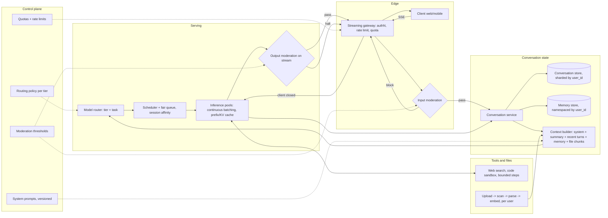

# Consumer-Scale Chat Service

*Every user expects the first token instantly and the whole history remembered, while every remembered token is paid for again on the next turn.*

◷ 24 min

"Design ChatGPT" is not a model question. It is a distributed-systems question about conversation state, token streaming, admission control and cost at hundreds of millions of users. This page consolidates the group's prompts into one read for the day before.

| Case in the group | What it contributes here |
|---|---|
| #71 OpenAI reported prompt: "Design ChatGPT." (anchor) | Sections 1 to 12, 14 and 15: the full design |
| #78 Anthropic reported prompt: "Design the Claude chat service." | Section 13: the same design, with the emphasis an Anthropic panel is reported to probe |
| Self-drill on #71 *(own construction)* | Section 15 |
| The [Enterprise Knowledge Assistant](../G01_Enterprise_Knowledge_Assistant/), [Secure Multi-Tenant AI Platform](../G07_Secure_Multi_Tenant_AI_Platform/) and [Observability and Production Diagnosis](../G14_Observability_And_Production_Diagnosis/) designs, plus the cost, latency, memory and production material | Sections 5 to 12, cited per section |

**No worked design exists for this prompt.** Both sources are one-line prompts that candidates report. Everything below the prompt is *own construction*, assembled from the designs above and this site's material on memory, caching, tenancy, observability and cost. Sizing numbers are stated assumptions, not measurements. Treat each figure as a placeholder to be replaced by measured throughput.

---

## 1. Clarify the Product Before the Scale

Ask what "ChatGPT" means in this room before drawing anything. The question bank's first failure mode is jumping to architecture before clarifying scope. An OpenAI FDE candidate reported the interviewer stopping them to ask: *"What questions would you ask the customer before designing anything?"*

The prompt, from the reported-question bank: **"Design ChatGPT."** Nothing else is given. The framework on the same page says to clarify the mission first: *"Are we optimising for response time, cost, accuracy, or equity of coverage? Who's the primary user?"* State assumptions explicitly if the interviewer does not confirm them.

| Question | Assumed answer *(own construction)* | What it decides |
|---|---|---|
| Consumer app, API, or both? | Consumer web and mobile chat | Sessions and UX matter; API quotas are out of scope |
| How many users? | 100M daily active users | Sizing, sharding and multi-region from day one |
| Free and paid tiers? | Yes, with different models and quotas | Routing and rate limits are per tier |
| Multi-turn memory? | Yes, within a conversation; optional across conversations | Conversation store plus a user-scoped memory store |
| File uploads and tools? | Files, web search, a code sandbox | Untrusted content enters the prompt; sandboxing |
| Do we train the model? | No, we serve given models | The design is serving, state and safety, not training |

The weak answer draws a load balancer in front of a model and stops. It forgets that the model is stateless and the product is not. The strong answer names the three hard problems in the first two minutes: conversation state that grows every turn, streaming at huge concurrency, and cost that scales with tokens rather than requests.

> *"The model is stateless and the product is not. The design is conversation state, streaming, admission control and cost, with the model as one expensive dependency behind them."*

## 2. State Requirements as Testable Constraints

A requirement that cannot fail a test is a preference. "Fast" is a preference. "Time to first token under one second at p95" is a constraint, and only the second shapes the architecture. The split below is *own construction*.

The must-haves are six. Send a message and receive a streamed answer. Keep and list conversation history per user, with rename and delete. Carry context across turns within a conversation. Enforce per-user and per-tier usage limits. Moderate input and output. Stop generation on request or when the client leaves.

The should-haves round out a competitive product: file uploads, web search, a code sandbox, cross-conversation memory the user can inspect and erase, regenerate and edit-and-resend, and sharing a conversation by link. Voice and image generation come later.

| Constraint | Stated so it can be tested *(own construction)* |
|---|---|
| Latency | Time to first token under 1 s p95 for the default model; steady streaming after that; no UI freeze before the first token |
| Availability | 99.9% for send-and-stream; a regional outage degrades to another region, not to an error page |
| Durability | A sent message and a completed answer are never lost; a partial answer survives a disconnect |
| Isolation | Zero cross-user reads of conversations, files or memory; `user_id` comes from auth, never from the model |
| Safety | Input and output moderation on every turn; measured false-positive and false-negative rates |
| Fairness | A burst from one user or tier cannot starve another tier's queue |
| Cost | Cost per daily active user tracked by tier; cache-read share of input tokens tracked as a first-class metric |
| Privacy | Content excluded from logs by default; deletion propagates to history, memory, files and caches |

Every must-have then needs an owner in the architecture *(own construction)*.

| Requirement | Primary component(s) |
|---|---|
| Streamed answers | Streaming gateway, inference pool |
| History and context across turns | Conversation service, conversation store, context builder |
| Usage limits | Rate limiter and quota service at the gateway |
| Moderation both ways | Input moderation before admission, output moderation on the stream |
| Stop on request or abandon | Streaming gateway cancellation, propagated to inference and tools |
| Isolation | Auth service, namespaced stores, retrieval filter on uploads |

## 3. Size It From Daily Users Down to GPUs

Say the arithmetic aloud, because it decides whether multi-region and caching are optional. They are not. Every number below is an assumption for the whiteboard *(own construction)*. The method is what gets scored.

| Step | Assumption | Result |
|---|---|---|
| Daily active users | 100M | — |
| Messages per user per day | 10 | 1B messages a day |
| Average rate | 1B ÷ 86,400 s | ≈ 11,600 messages/s |
| Peak | 3× average | ≈ 35,000 messages/s |
| Output per answer | 400 tokens | ≈ 14M output tokens/s at peak |
| Input per turn | 2,000 tokens (system prompt, summary, recent turns) | ≈ 70M input tokens/s at peak, most of it a repeated prefix |
| Decode speed per stream | 50 tokens/s | 8 s to stream one answer |
| Concurrent streams | Little's Law: 35,000/s × 8 s | ≈ 280,000 open streams |
| Streams per model replica | 100 concurrent, batched | ≈ 2,800 replicas at peak |
| Storage | ~2 KB text per message | ≈ 2 TB of conversation text a day |

Little's Law is `concurrency = throughput × latency`, from the cost study guide. It turns latency work into capacity work: halving the answer length halves the concurrent streams to provision. The input line explains why prefix caching matters more here than anywhere. Seventy million input tokens a second are mostly history the model already processed last turn.

Split the two latency phases before going further. Prefill processes the whole prompt in parallel and sets time to first token, so it scales with input tokens. Decode generates one token at a time and sets total time, so it scales with output tokens. A bloated history is a first-token problem. A verbose answer is a completion-time problem.

## 4. Draw the Architecture End to End

The organising rule is admit, assemble, stream, persist. Admission control decides whether a request may use a GPU at all. The context builder decides what the turn costs. The stream decides what the user feels. Persistence decides what survives.

The whole system, drawn with its planes *(own construction)*:

```
 ╔══════════════════════ CONTROL PLANE (changes are releases) ═══════════════════════╗
 ║ model catalogue + routing policy per tier · quotas and rate limits per tier       ║
 ║ system prompts (versioned, prefix-stable) · moderation thresholds · region map    ║
 ║ feature flags · eval gates (G13) · budgets and alerts                             ║
 ╚═══════════════════════════════════════╤═══════════════════════════════════════════╝
                                         │ configures every box below
 ╔══════════════════════ DATA PLANE, per region (calls are requests) ════════════════╗
 ║                                                                                   ║
 ║ client (web, mobile) ──SSE──> edge + GeoDNS ──> STREAMING GATEWAY                 ║
 ║                                                 authN · rate limit · quota        ║
 ║                                                 input moderation · cancel-on-close║
 ║                                                        │ admitted                 ║
 ║                                                        v                          ║
 ║                   CONVERSATION SERVICE ──> CONTEXT BUILDER                        ║
 ║                   (history, titles,        system prompt + summary + recent turns ║
 ║                    partial answers)        + user memory + retrieved file chunks  ║
 ║                        │                        │                                 ║
 ║            conversation store         MODEL ROUTER (tier + task)                  ║
 ║            (sharded by user_id)             │                                     ║
 ║            memory store                     v                                     ║
 ║            (namespaced by user_id)   SCHEDULER + FAIR QUEUE per tier              ║
 ║                                      session affinity -> warm KV cache            ║
 ║                                             │                                     ║
 ║                                             v                                     ║
 ║                          INFERENCE POOLS (small · default · premium)              ║
 ║                          continuous batching · prefix/KV cache                    ║
 ║                                             │ tokens                              ║
 ║                                             v                                     ║
 ║                          OUTPUT MODERATION on the stream ──> gateway ──> client   ║
 ║                                                                                   ║
 ║ TOOLS (bounded steps): web search · code sandbox · file retrieval                 ║
 ║ FILES: upload -> object store -> scan -> parse -> chunk + embed (per user)        ║
 ║                                                                                   ║
 ║ OBSERVABILITY: stage timings, tokens, cache reads, abandon, moderation — no text  ║
 ╚═══════════════════════════════════════════════════════════════════════════════════╝
      replicated across regions: conversation store (home region per user),
      control-plane config; inference pools are regional and independent
```

The same flow for viewers that render Mermaid *(own construction)*:



Read the components in request order. The failure column is *own construction*.

| # | Component | Responsibility | Fails how |
|---|---|---|---|
| 01 | Client | Renders the stream, resumes on reconnect | Degrades: shows the persisted partial answer |
| 02 | Edge + GeoDNS | Sends the user to the nearest healthy region | Fails over to the next region |
| 03 | Streaming gateway | Holds the SSE connection, auth, rate limit, quota, cancellation | Closed on auth; sheds free-tier traffic first under load |
| 04 | Input moderation | Blocks severe harm and abuse before a GPU is used | Closed for severe categories; logs and allows on a timeout for low-risk tiers |
| 05 | Conversation service | Owns messages, titles and partial answers | Closed for writes; history reads degrade to a cache |
| 06 | Conversation store | Durable history, sharded by `user_id` | Replicated; home-region failover |
| 07 | Memory store | Cross-conversation facts, inspectable and erasable | Degrades: answer without memory, say nothing false |
| 08 | Context builder | Assembles the prompt in prefix-stable order | Degrades: fewer turns, same order |
| 09 | Model router | Chooses the model by tier and task | Degrades to the default model |
| 10 | Scheduler + fair queue | Admits work per tier, keeps a conversation on a warm replica | Sheds lowest tier first; never drops an admitted stream silently |
| 11 | Inference pools | Continuous batching, prefix/KV cache | Fails over region or model; circuit breaker on a sick pool |
| 12 | Output moderation | Checks the stream in chunks, can halt it | Closed: halts the stream and says why |
| 13 | Tools | Search, sandbox, file retrieval under step caps | Degrades: answer without the tool, say so |
| 14 | File pipeline | Scan, parse, embed per user | Degrades: file unavailable, never cross-user |
| 15 | Observability | Stage timings, tokens, cache reads, abandonment | Degrades: request still served, gap logged |

Point at three boundaries while the diagram is up *(own construction)*. The admission boundary sits at the gateway, so nothing reaches a GPU without passing auth, quota and input moderation. The isolation boundary sits at every store, because each one is namespaced by a `user_id` that comes from auth. The cost boundary sits at the context builder, because it decides how many tokens each turn re-sends.

## 5. Store the Conversation, Send Only What the Turn Needs

Store everything and send little. The memory study guide draws the line: trimming bounds what reaches the model, not what is stored. A model cannot be billed for history the context builder never sent.

The conversation service writes every message durably, keyed by `(user_id, conversation_id)`. It also persists the partial answer as tokens stream. A disconnected user then reconnects to the text generated so far rather than to nothing. The store is sharded by `user_id`, so one user's history lives on one shard and a list-conversations call touches one partition.

The context builder assembles each turn in a fixed order: system prompt, rolling summary, recent turns, memory facts, retrieved file chunks, then the new message. A sliding window alone loses anything that scrolls out. Summarisation keeps a condensed record once the buffer crosses a threshold, at the cost of one extra model call per compression. The memory guide's worked answer folds the buffer at about 15 turns, an illustrative threshold rather than a rule, so cost stays flat on long chats. The failure to volunteer is losing a detail the summariser judged unimportant.

Cross-conversation memory is a different store with a different key. A checkpoint key answers "which conversation"; a user namespace answers "which person". Semantic memory holds stable facts under a stable key that overwrites in place. Episodic memory appends one record per completed task and is pruned. The isolation rule from the memory guide is non-negotiable: read `user_id` from the server-side session on every request, never from a tool argument the model could set. Make memory visible and erasable in the product, because a user who cannot see a remembered fact cannot correct it.
