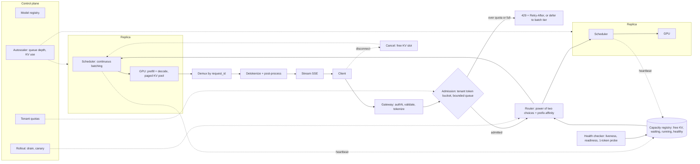

# LLM Inference Serving: Batching, Routing and Failover

*A bigger batch buys throughput, and every request inside it pays for that throughput in latency.*

◷ 26 min

These prompts look like AI questions and are graded as distributed-systems questions: queues, batches, load balancing, health and backpressure. Treat the GPU as an expensive, stateful server with a memory budget, and the rest follows. This page consolidates the group's prompts into one read for the day before.

| Case in the group | What it contributes here |
|---|---|
| #76 Anthropic: end-to-end batching system for LLM queries, with "which GPU has capacity?" and "how do you handle failover?" (anchor) | Sections 1 to 11, 16 and 17: the whole design |
| #75 Anthropic: one GPU, up to 100 inputs per batch, synchronous callers | Section 12: the anchor shrunk to one box |
| #77 Anthropic: token-generation service at 100,000 requests per second | Section 13: the anchor scaled out, with admission control |
| #79 Anthropic: review a junior developer's batching design | Section 14: the anchor used as a critique rubric |
| #74 OpenAI favourite: diagnose high latency in an LLM inference pipeline | Section 15: the stack walk, shared with G14 |
| Self-drill for G20 *(own construction)* | Section 17 |

**Read this first.** No worked design exists for this group, and the sources have no notes on continuous batching, paged attention or any serving engine. The design on this page is therefore *own construction*, built from general serving practice. It is grounded where the sources do speak: the air-gapped chapter's replica memory and sizing formula, and the cost playbook additions on prefill, decode, Little's Law and goodput. Every number below is a stated assumption, never a benchmark. In the room, say "I would replace these with a load test of the actual model."

---

## 1. Ask What Kind of Request Before Sizing Anything

The request shape sets the design, and "100,000 requests per second" means nothing until the tokens per request are known. A 20-token completion and a 2,000-token essay differ in decode work by two orders of magnitude.

Ask five questions first, and state an assumption for each one the interviewer declines *(own construction)*.

| Question | Why it matters | Anchor assumption |
|---|---|---|
| How many input and output tokens per request, at p50 and p95? | Input drives prefill; output drives decode. They cost GPU time differently | 1,000 in, 250 out on average |
| Interactive or offline? Streamed or whole? | Interactive needs a first-token target; offline can batch hard | Interactive, streamed |
| What latency matters: first token, per token, or total? | Three different SLOs with three different fixes | First token and per-token both |
| One model or many? Fixed or variable output length? | Variable length rules out static batching | One model, variable output |
| Peak rate, burst shape, tenants and priorities? | Sets headroom, fairness and shedding policy | 1,000 rps peak, bursty, several tenants |

The weak answer draws a load balancer, a queue and a pool of GPUs, then stops. It never says what a batch is or why a GPU fills up. The strong answer names the two phases of inference in the first two minutes *(from the additions file, section B1)*. Prefill processes the whole prompt in parallel and sets time to first token. Decode generates one token at a time and sets tokens per second. Every later decision is a way of scheduling those two phases on scarce memory.

> *"A GPU is a stateful server with a memory budget. Prefill sets first-token time, decode sets streaming speed, and the KV cache decides how many requests fit at once. I'll design the scheduler around those three facts."*

## 2. State Requirements as Testable Constraints

A requirement that cannot fail a test is a preference. "Fast" is a preference. "First token under 500 ms at p95 at 1,000 rps" is a constraint. The split and the numbers are *own construction*; the nouns come from the prompts.

The must-haves come straight from #76's wording. Accept generation requests with a prompt, a token limit, sampling parameters and a stream flag. Batch them onto GPUs. Route each batch or sequence to a GPU with capacity. Deliver the response to the right caller, streamed or whole. Detect a failed GPU and move its work elsewhere. Reject or queue excess load rather than collapse under it.

The should-haves make it operable: per-tenant quotas and priorities, cancellation when a caller disconnects, prefix reuse for repeated system prompts, rolling model upgrades without dropping traffic, and metrics that separate queue wait from service time.

| Constraint | Stated so it can be tested |
|---|---|
| First-token latency (TTFT) | p95 ≤ 500 ms at peak for interactive traffic |
| Per-token latency (TPOT) | p95 ≤ 50 ms between streamed tokens |
| Throughput | 1,000 rps sustained at peak with the anchor request shape |
| Utilisation target | ≤ 70% of measured replica capacity, because queueing delay climbs steeply past roughly 70–80% utilisation (rule of thumb) *(additions file, section D)* |
| Availability | 99.9% of requests complete or fail explicitly; none vanish |
| Failover | Loss of one GPU loses no un-streamed request; loss of one zone keeps service at reduced headroom |
| Fairness | No tenant above its quota can raise another tenant's p95 |
| Goodput | Requests per second that finish inside the SLO, reported next to raw throughput *(additions file, section D)* |

Every must-have then needs an owner in the architecture *(own construction)*.

| Requirement | Primary component(s) |
|---|---|
| Accept and validate requests | API gateway, tokenizer service |
| Batch onto GPUs | Per-replica scheduler with continuous batching |
| Route to a GPU with capacity | Router plus capacity registry |
| Deliver to the right caller | Response demultiplexer keyed by request ID, streaming layer |
| Survive GPU failure | Health checker, router eviction, retry with a budget |
| Reject excess load | Admission controller, bounded queues |
| Fairness | Per-tenant token buckets at admission |

## 3. Size by Tokens per Second, Then Check With Little's Law

GPU count is the answer, never the method. The method converts requests into token work, then token work into replicas. The air-gapped chapter gives the formula verbatim:

```
Replicas = ⌈ (QPS × Tokens_request) / (TokensPerSecond_replica × UtilizationTarget) ⌉
```

That chapter also warns that a candidate who talks GPU count without throughput misses the bottleneck. One who talks memory without throughput misses the placement constraint. Both checks follow.

**Step one: token work per request.** Prefill and decode run at very different rates, so price each request in replica-seconds. Every rate below is an assumption for an illustrative 8B-class model on one 80 GB H100-class GPU; an A100's peak compute could not reach this prefill rate *(own construction)*.

| Assumption | Value |
|---|---|
| Prefill rate per replica (assumed, H100-class) | 20,000 input tokens/s |
| Decode rate per replica | 2,500 output tokens/s aggregate, at ~64 concurrent sequences |
| Anchor request | 1,000 input, 250 output tokens |
| Peak arrival | 1,000 rps |
| Utilisation target | 70% |

One request costs 1,000 ÷ 20,000 + 250 ÷ 2,500 = 0.05 + 0.10 = 0.15 replica-seconds. At 1,000 rps that is 150 replicas of pure work. Divided by 0.70, provision about 214 replicas. Decode is two-thirds of the bill, so output tokens are the biggest lever.

**Step two: concurrency by Little's Law.** Work in flight equals arrival rate times time in system *(additions file, section B3)*. Each sequence streams at about 2,500 ÷ 64 ≈ 39 tokens/s, or roughly 26 ms a token. A request therefore lives about 0.5 s to first token plus 250 × 26 ms ≈ 6.4 s, so ~7 s in total. At 1,000 rps that is ~7,000 sequences in flight. At 64 slots a replica, that needs ~110 replicas' worth of slots.

**Step three: take the larger number.** Compute says 214 and slots say 110, so compute binds. Provision about 214, then add N+1 per zone for failover. Say both checks aloud. A reviewer trusts the number that survived two independent methods.

**Step four: check memory.** The KV cache stores each sequence's attention keys and values. It grows with every token *(section 7 does the arithmetic)*. The air-gapped chapter's replica budget, kept verbatim, shows the shape. Quantised weights 12 GB, runtime overhead 2 GB, KV cache and activations 6 GB, batch buffers and fragmentation slack 2 GB. That totals roughly 22 GB, too tight for a 24 GB card. The same chapter's rule applies here: if the replica count exceeds the pool, challenge the request profile rather than ask for more hardware.

## 4. Draw the Architecture End to End

The organising rule is admit, then route, then batch per GPU. Admission and routing are global and stateless. Batching is local, because only the replica knows its own memory.

The whole system *(own construction)*, with the control plane above and the request path below:

```
 ╔══════════════════════ CONTROL PLANE (changes are deployments) ═══════════════════════╗
 ║  model registry + versions · autoscaler (queue depth, KV use) · tenant quotas         ║
 ║  routing policy · health policy · SLO targets · rollout controller (drain, canary)    ║
 ╚═══════════════════════════════════════╤═══════════════════════════════════════════════╝
                                         │ configures every box below
 ╔══════════════════════ DATA PLANE (per request) ═══════════════════════════════════════╗
 ║                                                                                       ║
 ║ client ─> GATEWAY ─> ADMISSION ────────────> ROUTER ────────────────> REPLICA k      ║
 ║           authN      token bucket per         reads capacity           ┌───────────┐ ║
 ║           validate   tenant, weighted by      registry: free KV,       │ SCHEDULER │ ║
 ║           TOKENIZE   estimated tokens;        queue, running seqs;     │ continuous│ ║
 ║           (CPU)      bounded queue;           power-of-two choice      │ batching  │ ║
 ║                      429 + Retry-After        + prefix affinity        │ ┌───────┐ │ ║
 ║                        │ reject                    │                   │ │  GPU  │ │ ║
 ║                        v                           │                   │ │prefill│ │ ║
 ║                   shed or defer                    │                   │ │decode │ │ ║
 ║                   to batch tier                    │                   │ │KV pool│ │ ║
 ║                                                    │                   │ └───────┘ │ ║
 ║                                                    │                   └─────┬─────┘ ║
 ║  CAPACITY REGISTRY <── heartbeat every ~1 s ───────┼─────────────────────────┤       ║
 ║  (free KV blocks, waiting, running, healthy)       │                         │ tokens║
 ║                                                    │                         v       ║
 ║  HEALTH CHECKER ── liveness · readiness · 1-token probe ──> evict / drain    │       ║
 ║                                                                              │       ║
 ║ client <── STREAM (SSE) <── DETOKENIZE + post-process <── DEMUX by request_id┘       ║
 ║            cancel on disconnect ──────────────────────────> free KV slot now          ║
 ║                                                                                       ║
 ║  OBSERVABILITY: TTFT · TPOT · queue wait vs service time · goodput · KV use · errors  ║
 ╚═══════════════════════════════════════════════════════════════════════════════════════╝
```

The same flow for viewers that render Mermaid *(own construction)*:



Read the components in request order *(own construction)*.

| # | Component | Responsibility | Fails how |
|---|---|---|---|
| 01 | Gateway | Authenticates, validates, assigns `request_id`, tokenizes | Closed: bad request rejected before any GPU work |
| 02 | Tokenizer | Converts text to token IDs on CPU, counts tokens for admission | Degrades: add CPU replicas; never on the GPU hot path |
| 03 | Admission controller | Per-tenant token buckets weighted by estimated tokens; bounded queue | Closed: 429 with Retry-After, never an unbounded wait |
| 04 | Router | Picks a replica by free capacity, with prefix affinity | Degrades: falls back to least-loaded if affinity target is hot |
| 05 | Capacity registry | Holds each replica's free KV blocks, queue and running count | Degrades: stale data tolerated by random-two choice plus replica-side check |
| 06 | Replica scheduler | Continuous batching: admits and evicts sequences every decode step | Degrades: preempts lowest priority when KV is full |
| 07 | GPU worker | Runs prefill and decode on a paged KV pool | Fails: evicted by health checker, work rerouted |
| 08 | Health checker | Liveness, readiness, and a one-token synthetic probe | Closed: an unready replica gets no traffic |
| 09 | Demultiplexer | Returns each sequence's tokens to its caller by `request_id` | Closed: an unmatched ID is dropped and logged, never misdelivered |
| 10 | Detokenizer and post-processor | Incremental text, stop sequences, safety or schema checks | Degrades: skip optional checks, never skip required ones |
| 11 | Streaming layer | Server-sent events or websocket, flushes per token | Degrades: fall back to whole response |
| 12 | Autoscaler | Scales on queue depth and KV use, not on CPU | Degrades: headroom absorbs the minutes a new replica often takes to provision and load |
| 13 | Rollout controller | Drains a replica before upgrade; canaries a new model version | Closed: a failing canary stops the rollout |

Point at three boundaries while the diagram is up. Admission is the only place load is refused, so no queue downstream grows without limit. The router decides where but never how, because only the replica sees its memory. The request ID is the thread through everything, so a response can never reach the wrong caller.

## 5. Tokenize at the Edge, Not on the GPU

Tokenization is CPU work, and CPU work on the GPU's request thread steals time from the most expensive machine in the building. Move it to the gateway.

Tokenizing early buys three things. The admission controller can charge a tenant by real tokens, not by request count. The router can estimate KV memory before it picks a replica. A malformed or oversized prompt fails before it reaches a queue. Cap input length at the gateway and return a clear error, because one 100,000-token prompt can monopolise a replica's prefill.

Detokenization runs at the other end, incrementally. Some tokens are partial characters, so the streaming layer must buffer until a complete character exists. Stop sequences are checked on text, not tokens, for the same reason.
