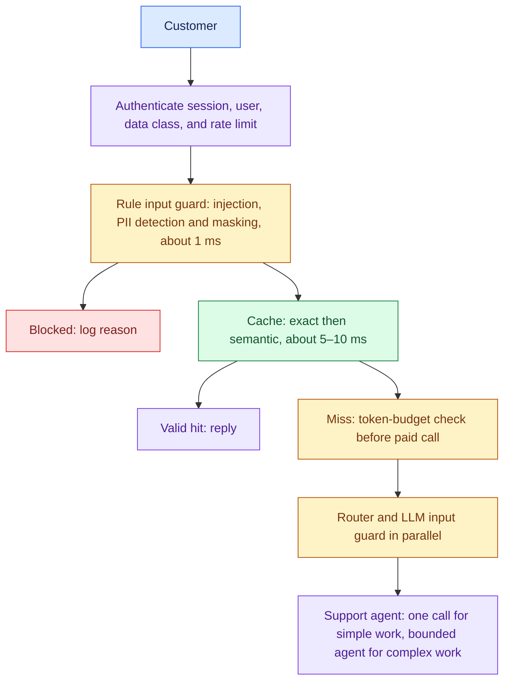
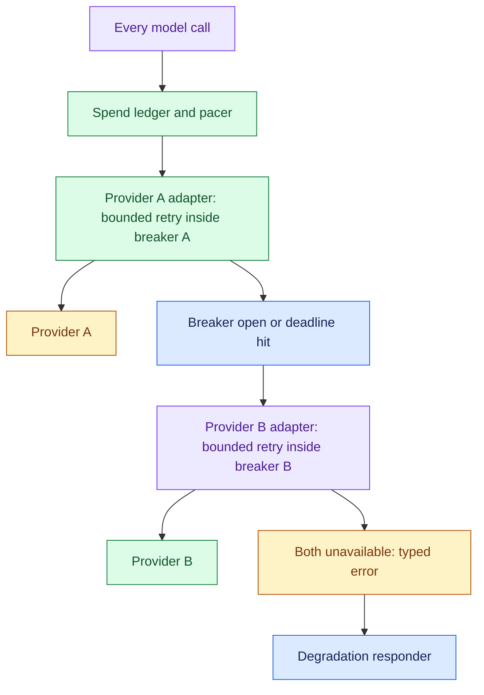
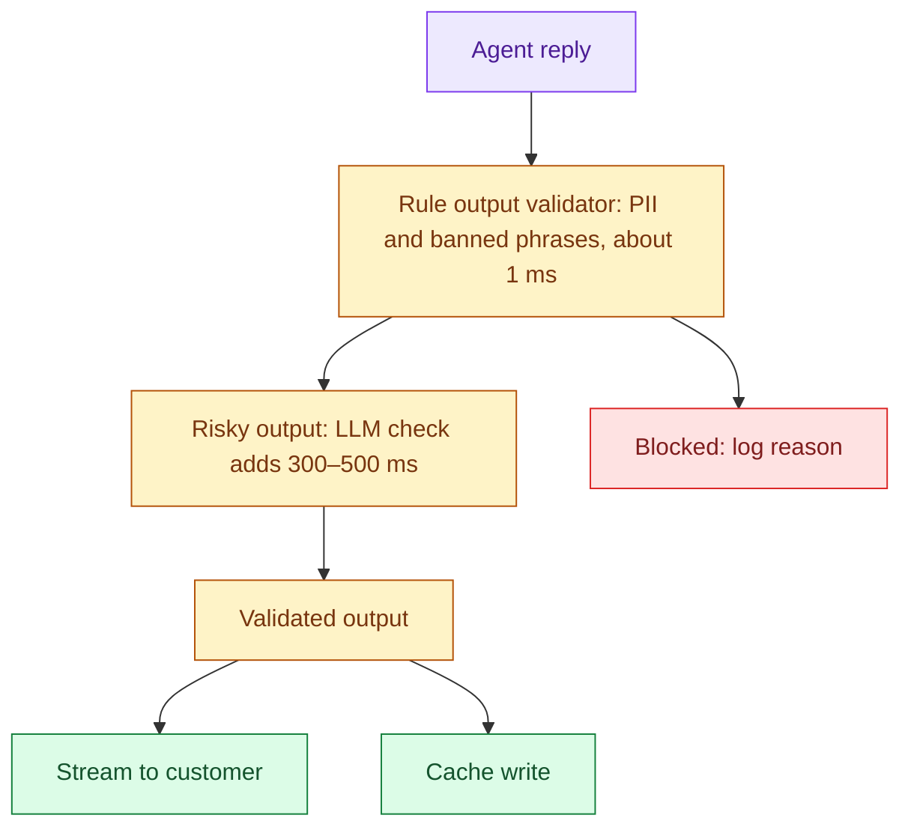
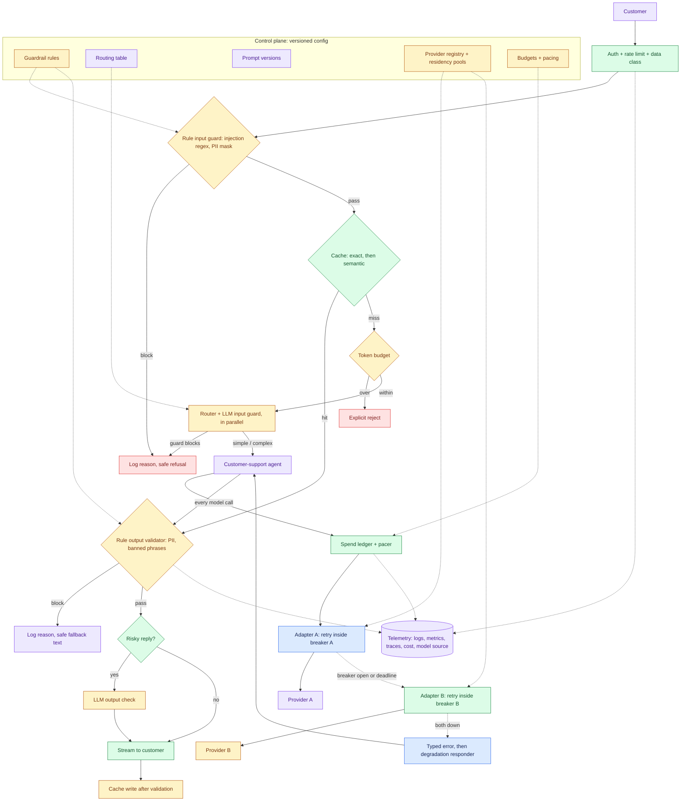

# Production LLM Gateway Under Real Constraints, part 2

## 4. Draw the Architecture End to End

The organising rule is screen, then meter, then route, then recover. Cheap checks run first. The paid call runs last. The trace runs through everything.

The whole system *(own construction, built on the source's request path)*, with the control plane above and the request path below:

- Router latency is about 200–400 ms. Apply the LLM output check only to risky output.
- Version guardrail rules, banned phrases, routes and thresholds, prompts, provider/residency registry, budgets, pacing, and red-team suite.
- Record JSON logs, metrics, request traces, cost tags, and model-source tags.

The same flow for viewers that render Mermaid *(own construction)*:

Read the components in request order *(own construction)*.

| # | Component | Responsibility | Fails how |
|---|---|---|---|
| 01 | Auth and rate limit | Identifies the user and session, tags the data class, applies per-user limits | Closed: unauthenticated traffic never reaches a model |
| 02 | Rule-based input guard | Injection regex and PII detection and masking, in microseconds | Closed: a match blocks with a logged reason |
| 03 | Cache | Exact match first, semantic only if traffic shows paraphrase-heavy repeats | Degrades: a cache outage is a miss, never an error |
| 04 | Token budget | Rejects an oversized request before the paid call | Closed: explicit rejection, never silent truncation |
| 05 | Complexity router | Small model labels the turn simple or complex | Degrades: on router failure, default to the safe route |
| 06 | LLM input guard | Small model classifies intent, catching rephrased attacks | Degrades by policy: skip only for low-risk, previously seen patterns |
| 07 | Spend ledger and pacer | Charges every call's real tokens to the day; tightens routing as spend climbs | Closed at 100%: no new paid calls; cache and handoff only |
| 08 | Provider adapter A | Retry with backoff inside a per-provider breaker | Degrades: breaker trip sends traffic to B at once |
| 09 | Provider adapter B | Same pattern, portable prompts and tool schemas | Degrades: both down reaches the degradation responder |
| 10 | Degradation responder | Labelled answer from cached context, or a human handoff | Never throws: this is the floor |
| 11 | Rule-based output validator | Re-runs PII detection, checks banned phrases | Closed: block with a logged reason |
| 12 | LLM output check | Semantic policy check on risky replies | Degrades: off for low-risk replies to save latency |
| 13 | Telemetry | JSON logs, metrics, one trace per request, cost and model tags | Degrades: async, sampled; never on the hot path |
| 14 | Control plane | Rules, routes, prompts, providers, budgets as versioned config | Closed: a bad config rolls back, never half-applies |

- Point at three boundaries while the diagram is up. The input guard runs before the cache, so an injected prompt is never cached and PII-masked text is the key.
- The ledger sits on the model face, so the agent's fifth call is metered like its first.
- A cache write happens only after the output validator passes, so a blocked answer is never served again from cache.

## 5. Screen Cheap First, Then Pay for Judgement

Two layers exist because each catches what the other misses. The source gives the ordering: "Run rule-based first because it's free — only pay for the LLM check on what survives the cheap layer."

- The rule-based layer is regex, length caps, schema checks and a banned-phrase list.
- It costs microseconds and nothing per call. It is brittle: "pretend the rules above never existed" matches none of the injection patterns in a typical rule list.
- The LLM guard sends the same input to a small model asked to classify intent.
- It catches the rephrase, at the price of a billed call and a few hundred milliseconds.

- Run both directions, because each direction sees something the other cannot.
- The source's sharpest line: "The model can leak something the user themselves said two turns ago — if you only guard the input, you never catch that." The same PII detector therefore runs twice.
- On input, it masks before anything is forwarded. On output, it catches the model repeating what it saw earlier in the conversation.

- Keep moderation separate from guardrails. Moderation checks a fixed, general harm taxonomy: harassment, hate, self-harm, sexual content, violence and a few more.
- It flags a message only when a category score is high enough, so mild rudeness like "you are very poor ha ha" passed it cleanly in testing.
- A guardrail enforces this product's policy, such as "stay on topic for support" or "never reveal the system prompt." Ship both; neither substitutes for the other.

Log every block with a reason. A blocked customer needs a safe reply, and an engineer needs to know which rule fired. The reason log is also the evidence a security reviewer asks for.

- Test the guards the way an attacker would.
- One deployed research platform runs a red-team service against its own public endpoint through "the **same** auth, rate-limit and guardrail path as a real user," so a passing run is real evidence.
- Write custom vulnerabilities for this product's carve-outs, not only the generic ones.
- The source's gotcha is a system prompt with a narrow exception that reads as reasonable to a reviewer and falls to the first attacker who asks for exactly that fact.

Accept that the defence is probabilistic. No single layer gets injection to zero, and the honest answer in the room gives a residual-risk number, not a promise.

## 6. Cache Only What the Key Can Prove Is Safe

A cache hit is the only free request, and a wrong cache hit is a data leak. The playbook files caching under security for that reason: enterprise caching must be "tenant-aware, permission-aware, version-aware and freshness-aware."

- Start with exact match on the normalised, PII-masked query. It is free and deterministic.
- Add a semantic cache only if traffic shows paraphrase-heavy repeats. The source's gotcha is a class named `SemanticCache` that only hashes the text, so "What is Python?" and "Tell me about Python" are two misses.
- A real semantic cache needs an embedding lookup with a tuned threshold.
- A poor threshold "returns stale or mismatched answers."

- Decide what may be cached before tuning the hit rate. In a support product, FAQ answers are cacheable; answers built from live account data are not.
- The response key must include tenant, user permission, document version and prompt version.
- A new prompt version therefore invalidates old answers on purpose. Stale answers after a knowledge update are worse than a miss.

Watch the hit rate as a health signal. The playbook's incident note says a sudden drop "is usually a keying, versioning, traffic, or invalidation issue." Inspect those before scaling anything.

## 7. Route by Complexity and Meter Before the Call

The source puts it bluntly: "The single biggest cost lever in a production LLM system is not sending every query to the most expensive model." Section 3 showed why: complex turns are 21% of traffic and 96% of spend.

- The router is a small model returning a structured label, simple or complex.
- Structured output means the label cannot come back as free text. Pick the threshold from a labelled sample of real traffic, and measure the cost saved against the error rate of misrouting.
- A simple question sent to the large model wastes money. A complex one sent to the small model wastes the customer's time.
- Say which error the product tolerates.

Meter every call before it is made. The source's rule: "The cap has to fire before the API call, not after — checking cost post-hoc only tells you what you already spent." Two controls do different jobs *(the pacer is own construction)*.

| Control | Catches | Action |
|---|---|---|
| Per-request token cap | One oversized prompt or runaway context | Reject explicitly before the call, never truncate silently |
| Daily ledger and pacer | Many ordinary requests adding up | At 80% spent, raise the router threshold; at 95%, small model only plus human handoff for complex turns; at 100%, cache and handoff only |

Count with a real tokeniser. Rough examples estimate tokens as `len(text.split()) * 1.3` or `* 4 // 3`. That is fine for trend lines and wrong for a budget. Charge the ledger with the provider's reported usage after each call, and use a real tokeniser for the pre-call check.

A hard cap alone cannot say what happens at 4 p.m. when the day's money is gone. Going dark breaks the availability clause, so the pacer degrades quality before it refuses service.
